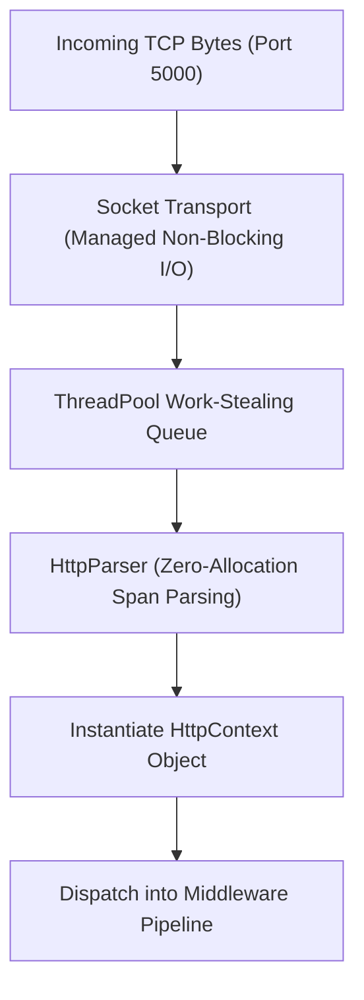
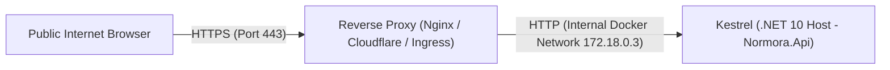
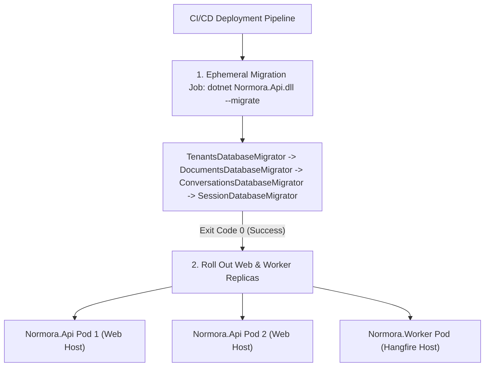
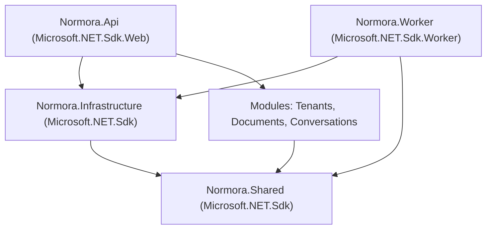

# Module 1: Introduction to ASP.NET Core & Cloud-Native Foundations

## 1. What is ASP.NET Core?

Imagine you want to build a house. You need a foundation, walls, plumbing, and electricity. You *could* build everything from raw bricks and copper wire yourself, or you could use a **construction framework** — a proven system of pre-built components that snap together so you can focus on designing your specific house.

ASP.NET Core is that construction framework, but for web applications. It is a **cross-platform, high-performance, open-source framework** engineered by Microsoft on top of the **.NET Common Language Runtime (CLR)** (the managed execution engine that compiles code, manages memory via garbage collection, and runs your C# programs) for creating modern web applications, APIs, microservices, and real-time distributed backends.

### A Brief History (Why It Exists & The Architectural Shift)
*   **2002 – ASP.NET (The Legacy Monolith):** Microsoft created ASP.NET, which ran only on Windows and only inside IIS (Internet Information Services, Windows' built-in web server) via `System.Web`. It was powerful for its era but heavy, slow to start, tied to Windows COM (Component Object Model) components, and completely impossible to run on Linux, Mac, or in lightweight Docker containers.
*   **2016 – ASP.NET Core 1.0 (The Clean-Slate Rewrite):** Microsoft dismantled the legacy codebase and rewrote everything from scratch. The new framework was completely decoupled from Windows and IIS, cross-platform (Windows, Mac, Linux), open-source, modular via **NuGet** packages (the .NET package manager, analogous to `npm` or `pip`), and *blazingly fast*.
*   **Today – .NET 10 (LTS) & C# 14:** ASP.NET Core is the **only** web framework Microsoft actively develops; legacy ASP.NET (`System.Web`) is obsolete for new projects. **.NET 10** is a Long-Term Support (LTS) release paired with **C# 14**, featuring **Primary Constructors** (concise class-level constructor parameters for clean Dependency Injection), native first-party OpenAPI support, and runtime performance that routinely outperforms Node.js, Python (Django/FastAPI), Ruby on Rails, and standard Java Spring Boot across high-concurrency benchmarks.

### What Can You Build With It?
| Type | Technology | Production Example from Your Projects |
|---|---|---|
| **REST APIs** | Controllers or Minimal APIs | **Normora** (`Tenants`, `Documents`, `Conversations`) & **NextEvent** (Identity, Organizations, Events) |
| **Real-time Apps** | SignalR (WebSockets) | **Normora** (`DocumentHub`, `NotificationHub`) & **NextMatch** (`MessageHub`, `PresenceTracker`) |
| **Server-Sent Events (SSE)** | Streaming HTTP Responses | **Normora** (Token-by-token conversational AI streaming and live tool execution chips) |
| **Web Pages** | Razor Pages, MVC, Blazor | Server-rendered HTML and full-stack interactive client web apps |
| **Microservices** | Lightweight APIs in Docker | Individual isolated services in a container cluster or Kubernetes |
| **Background Jobs** | Generic Host (`IHostedService`), Hangfire | **Normora.Worker** (transactional outbox dispatch, chunking, vector embeddings, purge) |
| **Intelligent Agent Backends** | Agent Frameworks & MCP | **Normora** (AG-UI `/api/copilotkit` endpoint and JSON-RPC 2.0 `/api/mcp` server) |

### When to Use ASP.NET Core — and When NOT to Use It
*   **Use ASP.NET Core when:** You are building high-throughput APIs, multi-tenant SaaS platforms, real-time WebSocket/SSE backends, BFF (Backend-For-Frontend) security gateways, or enterprise modular monoliths that benefit from strong static typing, compiled performance, and built-in security primitives.
*   **Do NOT use ASP.NET Core when:**
    *   **Pure ML/Data-Science Model Training:** Training PyTorch/TensorFlow models locally is dominated by Python C/CUDA ecosystems. *(Notice how **Normora** solves this cleanly: .NET 10 handles orchestration, pgvector hybrid retrieval, and security, while delegating LLM inference and embeddings to Google Gemini over HTTP.)*
    *   **Static Brochure Sites or Client-Only Static Assets:** Serving pure HTML/CSS/JS files needs a CDN or Nginx, not a .NET runtime process.
    *   **Throwaway OS Glue Scripts:** For a 20-line file-renaming or container-boot script, PowerShell or Bash starts faster with zero build step.

### Real-World Normora Examples (How One Platform Uses ASP.NET Core)
1.  **`Normora.Api` (BFF & Edge Host):** Acts as the HTTP entry point and **Duende BFF** (Backend-For-Frontend — a security pattern where encrypted `HttpOnly` cookies stay in the browser while OAuth2/OIDC tokens stay safely on the server) for the Angular 22 SPA, hosting `TenantResolutionMiddleware` and Scalar API docs (`/scalar/v1`).
2.  **`Tenants` Module (`server/Modules/Tenants`):** Exposes decentralized REST controllers for multi-tenant workspaces, memberships, departments, user groups, white-label branding, audit logs, and multi-currency PayU subscriptions.
3.  **`Documents` Module (`server/Modules/Documents`):** Powers authenticated document uploads (persisted to MinIO S3 storage via transactional outbox), PostgreSQL + `pgvector` HNSW hybrid retrieval, and a Model Context Protocol (**MCP**) JSON-RPC 2.0 endpoint (`/api/mcp`).
4.  **`Conversations` Module (`server/Modules/Conversations`):** Runs multi-turn **RAG** (Retrieval-Augmented Generation) pipelines, streams AI tokens and interactive A2UI cards over **SSE** (Server-Sent Events — a unidirectional HTTP stream from server to browser), and hosts the AG-UI endpoint (`/api/copilotkit`).
5.  **Real-Time Hubs (`Normora.Infrastructure/Hubs`):** Hosts SignalR (`DocumentHub`, `NotificationHub`) backed by a Redis pub/sub backplane so worker completion events reach connected Angular clients instantly.
6.  **`Normora.Worker` (Headless Background Host):** Runs Hangfire background queues (OCR via Gemini Vision, Markdown-aware chunking, batch embeddings, and scheduled purges) as an independent .NET worker process without an HTTP server.

---

## 2. Why ASP.NET Core?

If you are deciding which backend technology to learn and evaluate for enterprise systems, here is why ASP.NET Core sits at the top of the industry:

### 1. Extreme Performance & Non-Blocking Async I/O
ASP.NET Core routinely ranks at the **top of the TechEmpower benchmarks** (the industry-standard web framework benchmark). The .NET runtime team has systematically re-engineered the framework for **zero-allocation computing** (avoiding temporary heap objects that trigger garbage collection pauses) using primitives like:
*   `Span<T>` / `Memory<T>`: Safe, allocation-free views over contiguous memory buffers (used internally when Kestrel parses HTTP headers and routes URLs).
*   `ArrayPool<T>`: A shared pool of reusable byte arrays so streaming large files doesn't constantly allocate and discard memory.
*   `ValueTask<T>`: A lightweight alternative to `Task<T>` for hot paths that frequently complete synchronously (such as reading a value from an in-memory cache).

Equally important is **non-blocking asynchronous I/O (`async`/`await`)**. When a request waits on PostgreSQL, Redis, MinIO, or an external AI API, ASP.NET Core releases the **ThreadPool** worker thread immediately so it can serve other incoming HTTP requests, resuming only when the network socket signals completion.

> **Analogy:** Think of web frameworks like cars. Most frameworks are family sedans — they get the job done. ASP.NET Core is a Formula 1 car engineered with the comfort and safety of a luxury sedan. You get raw throughput *and* high developer productivity.

### 2. Cross-Platform & Open Source
*   Develop on Windows, Mac, or Linux using your favorite tools (VS Code, Visual Studio, Rider).
*   Deploy to any cloud: Azure, AWS, Google Cloud, or your own bare-metal Linux servers.
*   The entire source code is hosted on GitHub under the .NET Foundation. You can inspect every line of framework code, contribute, or debug framework internals directly.

### 3. Unified Programming Model
Whether you are building an API endpoint, a real-time WebSocket hub, or an SSE streaming agent endpoint, the underlying building blocks are **exactly the same:**
*   **Middleware** ([Module 2](02_Module_2_Middleware_and_Pipeline.md))
*   **Dependency Injection** ([Module 3](03_Module_3_Dependency_Injection.md))
*   **Routing** ([Module 4](04_Module_4_Routing_and_Endpoints.md))
*   **Configuration** ([Module 5](05_Module_5_Configuration_and_Options.md))

Learn them once, use them everywhere.

### 4. Built-in Dependency Injection (DI)
**Dependency Injection (DI)** is a design pattern where a class receives the services it needs from an external container rather than constructing them itself with `new`. Unlike older .NET or Java frameworks where you needed to install third-party DI containers (Autofac, Ninject, Spring), ASP.NET Core includes a fast, lightweight DI container **out of the box**. Every single service in the framework is designed from the ground up to be injected — and in **C# 14**, **primary constructors** make DI concise with zero boilerplate fields.

### 5. Cloud-Ready by Design: JIT vs. Native AOT
ASP.NET Core apps are designed for Docker containers and cloud deployments from day one. Running on Alpine or Debian container base images (`mcr.microsoft.com/dotnet/aspnet`), memory consumption at cold start is compact and apps boot rapidly — ideal for auto-scaling Kubernetes clusters.

In .NET 10, you also have two compilation modes:
*   **JIT (Just-In-Time) Compilation (Default):** The CLR compiles intermediate code (IL) to native machine instructions at runtime. Supports full reflection, dynamic LINQ expression trees, and assembly scanning.
*   **Native AOT (Ahead-Of-Time Compilation):** Compiles your app directly into a standalone native binary at build time with near-instant startup and minimal RAM.
*   **When NOT to use Native AOT:** Avoid Native AOT for rich enterprise modular monoliths that rely heavily on runtime reflection, dynamic LINQ query compilation, or assembly scanning. For example, **Normora intentionally uses standard JIT** because **EF Core** global multi-tenant query filters, **MediatR** assembly scanning, **FluentValidation** auto-registration, and **Hangfire** serialized job expressions depend on dynamic runtime metadata. Save Native AOT for small, stateless Minimal API microservices or serverless edge functions.

### Real-World Normora Examples (Why These Capabilities Matter)
1.  **Non-Blocking AI & Vector Retrieval:** During a conversational turn, `Conversations` runs `PerformHybridRetrievalQuery` (pgvector cosine + full-text RRF in PostgreSQL) and awaits `GeminiTextGenerationService` SSE streams. Because every I/O call uses `async`/`await` with `CancellationToken`, a single Kestrel instance handles hundreds of concurrent streaming chats without thread starvation.
2.  **Sub-Millisecond Multi-Tenant Caching:** `TenantResolutionMiddleware` resolves workspace slugs and RBAC permissions via Redis with short sliding expirations (30s–5m), avoiding repeated database roundtrips on every API call.
3.  **Batch Ingestion Without Memory Bloat:** `GeminiEmbeddingService` batches up to 100 Markdown-aware document chunks per `batchEmbedContents` API call inside `Normora.Worker`, keeping heap allocations low even when ingesting large enterprise policy PDFs.
4.  **One Unified Pipeline for Four Protocols:** In `Normora.Api`, REST controllers (`DocumentsController`), SignalR (`DocumentHub`), AG-UI (`/api/copilotkit`), and MCP (`/api/mcp`) all share the exact same DI container, Duende BFF cookie authentication, and OpenTelemetry tracing.
5.  **Zero-Third-Party DI Boilerplate:** Each bounded context (`TenantsModuleExtensions`, `DocumentsModuleExtensions`, `ConversationsModuleExtensions`) plugs cleanly into `builder.Services` using Microsoft's built-in DI container and C# primary constructors.

---

## 3. Where Does It Run? The Hosting Model, Kestrel Internals & Reverse Proxies

When you hear "web server," you might think of Apache, Nginx, or IIS. ASP.NET Core has its own distinct architecture built around two foundational concepts: **The .NET Host** and **Kestrel**.

### The .NET Hosting Model: `WebApplication` vs. Generic `Host`
Every .NET 10 backend application starts as a console program controlled by a **Host** — an object that manages the app's Dependency Injection container, configuration, logging, and lifetime (`SIGTERM` graceful shutdown). ASP.NET Core gives you two host builders:

| Host Builder | Purpose | Used By in Normora |
|---|---|---|
| `WebApplication.CreateBuilder(args)` | Full HTTP web host with Kestrel, Middleware pipeline, Routing, and SignalR | **`Normora.Api`** (Duende BFF, module APIs, SignalR hubs, AG-UI) |
| `Host.CreateApplicationBuilder(args)` | Headless **Generic Host** with DI, config, logging, and `IHostedService` — **no Kestrel HTTP server** | **`Normora.Worker`** (Hangfire document ingestion, embeddings, purge) and **`--migrate`** CLI host |

*   **When NOT to use `WebApplication`:** Never use `WebApplication.CreateBuilder` for pure background workers or CLI migration jobs. Opening an HTTP port and loading BFF/authentication middleware inside a worker wastes memory, expands the attack surface, and can trigger port conflicts or native teardown issues in containers.

### Kestrel: The Built-in Web Server

When you run `Normora.Api`, you are starting a console application that boots a high-performance web server called **Kestrel**.

> **Analogy:** Imagine Kestrel as a very efficient receptionist sitting at the front desk. Every time an HTTP request (a visitor) arrives, Kestrel receives it, converts it into a format the .NET code can understand, hands it to your application code, waits for the response, and sends it back to the visitor.



*   **What it does:** Listens on a network port (e.g., `http://localhost:5000`), receives raw HTTP stream bytes over **TCP** (Transmission Control Protocol), parses them into an **`HttpContext`** object (the C# representation of the current HTTP request and response), and passes them through the middleware pipeline.
*   **Why it's great:** Kestrel is completely asynchronous, non-blocking, and event-driven, supporting HTTP/1.1, HTTP/2, HTTP/3 (QUIC), WebSockets, and SSE out of the box. It can handle **millions of requests per second** on modern multi-core hardware.
*   **What it lacks:** Internet-facing edge protections like automated multi-domain TLS/SSL certificate renewals at scale, public DDoS filtering, slow-loris buffering, and complex multi-site URL rewriting.

### Hardening Kestrel in Production: Server Headers, Limits & Graceful Shutdown
By default, Kestrel broadcasts `Server: Kestrel` in every HTTP response header. This gives attackers reconnaissance data about your runtime. It also enforces default limits (such as `MaxRequestBodySize`, which defaults to ~30 MB) to guard against memory-exhaustion **Denial-of-Service (DoS)** attacks. In **Normora**, Kestrel is hardened immediately during startup:

```csharp
// From Normora.Api's Program.cs
builder.WebHost.ConfigureKestrel(options =>
{
    // 1. Prevent Kestrel from broadcasting "Server: Kestrel" (OWASP Reconnaissance Mitigation)
    options.AddServerHeader = false;

    // 2. Cap incoming payload sizes explicitly (e.g., 50 MB for PDF/DOCX uploads via UploadDocumentCommand)
    options.Limits.MaxRequestBodySize = 50 * 1024 * 1024;
});
```

When Kubernetes or Docker stops a container (`SIGTERM`), Kestrel initiates **graceful shutdown**: it stops accepting new connections while giving in-flight HTTP requests and SSE streams a configurable drain window (`HostOptions.ShutdownTimeout`) to finish cleanly before the process exits.

---

### The Reverse Proxy Pattern (Production)

Because Kestrel is optimized for raw application execution rather than edge internet routing, in production environments, you place Kestrel **behind a Reverse Proxy** (Nginx, Cloudflare, Envoy, IIS, or AWS ALB / Azure Application Gateway).



*   **The Reverse Proxy handles:** **TLS termination** (decrypting HTTPS traffic at the edge), DDoS protection, IP filtering, request buffering, static file caching, and load balancing across multiple Kestrel replicas.
*   **Kestrel handles:** Executing your .NET application code at maximum speed.
*   **When NOT to use a Reverse Proxy:** During local `localhost` development, or for purely internal service-to-service cluster communication inside a private zero-trust service mesh where Kestrel itself terminates mTLS.

---

### Forwarded Headers & Reverse Proxy Security (.NET 10)

When a reverse proxy terminates TLS and forwards the request to Kestrel over HTTP, two critical pieces of metadata are lost:
1.  **The Original Scheme:** The client used `https://`, but Kestrel receives `http://`. Without remediation, ASP.NET Core generates `http://` redirect URLs, breaking **OIDC** (OpenID Connect) callbacks (like Keycloak + Duende BFF) and **HSTS** (HTTP Strict Transport Security).
2.  **The Client IP Address:** The connection arriving at Kestrel originates from the reverse proxy's internal container IP (e.g., `172.18.0.3` in Docker), not the user's browser. If your code checks `context.Connection.RemoteIpAddress`, it sees the proxy's IP. This corrupts security audit logs and causes rate limiters to punish all users under one shared proxy IP.

To fix this, reverse proxies inject standardized HTTP headers:
*   `X-Forwarded-For`: The client's original IP address (and proxy chain).
*   `X-Forwarded-Proto`: The original protocol scheme (`https`).
*   `X-Forwarded-Host`: The original domain name requested by the client.

#### ⚠️ The Naive Insecure Trap: Clearing `KnownProxies` / `KnownIPNetworks`
Many outdated tutorials tell developers to write:
```csharp
// ❌ INSECURE ANTI-PATTERN & DEPRECATED API IN .NET 10: DO NOT USE
forwardedHeadersOptions.KnownNetworks.Clear(); // Obsolete in .NET 10 (ASPDEPR005); replaced by KnownIPNetworks
forwardedHeadersOptions.KnownProxies.Clear();  // ⚠️ DANGER: Accepts headers from ANY IP
app.UseForwardedHeaders(forwardedHeadersOptions);
```
**Why this is dangerous:**
1. **Security Breach:** If you clear `KnownProxies` and `KnownIPNetworks`, your application unconditionally trusts `X-Forwarded-For` from **anyone**. An attacker can send `X-Forwarded-For: 127.0.0.1`, spoofing `localhost`, forging `Tenants` audit logs, or bypassing rate limiters.
2. **.NET 10 API Change:** In .NET 10, `ForwardedHeadersOptions.KnownNetworks` is marked obsolete (`ASPDEPR005`) in favor of `KnownIPNetworks` (which uses the built-in `System.Net.IPNetwork` type).

#### 🛡️ The Hardened Production Approach: Normora Case Study
Normora enforces a strict zero-trust boundary. It **only** honors forwarded headers originating from explicitly configured, trusted proxy IP addresses (`KnownProxies` or `KnownIPNetworks`). In production, it fails fast at startup if no trusted proxy is declared:

```csharp
// From Normora.Api's Program.cs
var trustedProxyAddresses = builder.Configuration
    .GetSection("ReverseProxy:KnownProxies")
    .Get<string[]>() ?? [];

// In production, failure to configure trusted proxies is an unacceptable security hazard
if (!app.Environment.IsDevelopment() && trustedProxyAddresses.Length == 0)
{
    throw new InvalidOperationException(ApiMessages.TrustedProxyRequired);
}

var forwardedHeadersOptions = new ForwardedHeadersOptions
{
    ForwardedHeaders = ForwardedHeaders.XForwardedFor 
                     | ForwardedHeaders.XForwardedHost 
                     | ForwardedHeaders.XForwardedProto,
    // Limit to 1 hop (the immediate upstream reverse proxy) to prevent header spoofing chains
    ForwardLimit = 1
};

foreach (var trustedProxyAddress in trustedProxyAddresses)
{
    if (!IPAddress.TryParse(trustedProxyAddress, out var address))
    {
        throw new InvalidOperationException(ApiMessages.InvalidTrustedProxy);
    }

    forwardedHeadersOptions.KnownProxies.Add(address);
}

app.UseForwardedHeaders(forwardedHeadersOptions);
```
*   **When NOT to enable `UseForwardedHeaders`:** If your Kestrel server sits directly on the public internet with no reverse proxy in front of it, do **not** enable `UseForwardedHeaders`. Any `X-Forwarded-*` headers on the wire came straight from untrusted clients.

---

### Cloud-Native Health Checks: Liveness vs. Readiness
In Docker Compose and Kubernetes, orchestrators need to know two very different things about your ASP.NET Core container:
1.  **Liveness (`/health/live`):** *"Is the .NET process alive and not deadlocked?"* If this fails, Kubernetes kills and restarts the container.
2.  **Readiness (`/health/ready`):** *"Can this instance serve live traffic right now?"* If this fails, the load balancer temporarily removes the pod from rotation without restarting it.

*   **When NOT to put dependencies in Liveness:** Never check PostgreSQL, Redis, MinIO, or Google Gemini inside `/health/live`. If Redis restarts for 3 seconds and `/health/live` returns `503 Service Unavailable`, Kubernetes will kill and restart *every* `Normora.Api` pod simultaneously, turning a minor hiccup into a full outage. Put infrastructure dependency checks strictly in `/health/ready`!

### Real-World Normora Examples (Hosting & Edge Architecture)
1.  **`Normora.Api` (`WebApplication.CreateBuilder`):** Hosts Kestrel, Duende BFF cookie middleware, `TenantResolutionMiddleware`, and module controllers while exposing port `5000`.
2.  **`Normora.Worker` (`Host.CreateApplicationBuilder`):** Boots a headless Generic Host with `Normora.Infrastructure` to run Hangfire jobs (`DocumentProcessingJob`, outbox dispatch, purge) without any Kestrel port.
3.  **Kestrel Upload Sizing & Header Stripping:** `Normora.Api` disables `Server: Kestrel` (`AddServerHeader = false`) and bounds `MaxRequestBodySize` so oversized payloads to `UploadDocumentCommand` fail early at Kestrel before touching MinIO or PostgreSQL.
4.  **Hardened Reverse Proxy Boundary:** `Normora.Api` uses `ReverseProxy:KnownProxies` with `ForwardLimit = 1` and fails fast with `ApiMessages.TrustedProxyRequired` in non-development environments so Keycloak OIDC redirects always use `https://` and audit logs record true client IPs.
5.  **Separated Liveness & Readiness Probes:** Container health checks verify the Kestrel process on `/health/live` while isolating PostgreSQL (`Tenants`, `Documents`, `Conversations`) and Redis cache checks to `/health/ready`.

---

## 4. Cloud-Native Database Migrations (The Normora CLI Pattern)

In small sample projects, developers often place database migrations in the application startup path:

```csharp
// ❌ DANGEROUS IN CONTAINERIZED CLUSTERS (e.g., Kubernetes, ECS)
using var scope = app.Services.CreateScope();
var dbContext = scope.ServiceProvider.GetRequiredService<TenantsDbContext>();
dbContext.Database.Migrate(); // Running inside WebApplication startup
```

### Why In-Process Startup Migrations Fail in Production
When you deploy a containerized application to Kubernetes or an auto-scaling cloud environment:
1.  **Race Conditions:** If your deployment launches 3 or 5 replica pods simultaneously, each pod starts up and runs `Database.Migrate()` against the same PostgreSQL database concurrently.
2.  **Schema Lock Timeouts:** PostgreSQL acquires table-level **DDL** (Data Definition Language — schema commands like `ALTER TABLE` or `CREATE INDEX`) locks during migrations. Multiple pods attempting to apply migrations concurrently trigger deadlocks, migration transaction failures, or corrupt schema migration history tables (`__EFMigrationsHistory`).
3.  **Pod Crash Loops:** When a migration locks up or times out, the container health probe fails, causing Kubernetes to terminate the pod and restart it — repeating the race condition indefinitely.

### 🏗️ The Architectural Pattern: Ephemeral Migration Execution

In **Normora**, database migration execution is decoupled from the web application runtime via a dedicated command-line flag that boots a **lean console host** (never initializing Kestrel, OpenTelemetry diagnostic listeners, SignalR hubs, or Hangfire hosted services, preventing port conflicts and native `SIGSEGV` exit code `139` crashes on teardown):

```csharp
// From Normora.Api's Program.cs
// Ephemeral schema migration CLI execution:
// Command: dotnet Normora.Api.dll --migrate
if (args.Contains("--migrate", StringComparer.OrdinalIgnoreCase))
{
    await MigrationHostExtensions.RunMigrationsAsync(args);
    return; // Exit process cleanly; DO NOT spin up Kestrel, SignalR, OpenTelemetry, or Hangfire!
}

var builder = WebApplication.CreateBuilder(args);
// ... continues normal web host configuration
```

Inside `Normora.Infrastructure`, `DatabaseMigrationRunner` executes all four `IDatabaseMigrator` implementations sequentially in deterministic order:
1. `TenantsDatabaseMigrator` (`tenants` schema)
2. `DocumentsDatabaseMigrator` (`documents` schema + `pgvector` HNSW indexes)
3. `ConversationsDatabaseMigrator` (`conversations` schema)
4. `SessionDatabaseMigrator` (Duende BFF PostgreSQL session store)

### How This Works in CI/CD and Kubernetes



### When NOT to Use `--migrate` CLI Auto-Migrations
*   **Zero-Downtime Blue/Green or Canary Deployments with Breaking Schema Changes:** If old `v1` containers remain running while `v2` containers roll out, dropping or renaming a column during `--migrate` will crash `v1` pods. In those environments, generate DBA-reviewed SQL via `dotnet ef migrations script --idempotent` and follow the **Expand-and-Contract** pattern (add new column -> deploy dual-write code -> backfill -> remove old column in a later release).
*   **Restricted Production DB Permissions:** In strict FinTech/enterprise environments where the app's runtime PostgreSQL role lacks `DDL` privileges (`CREATE`/`ALTER`), migrations must run under a separate CI/CD DBA credential rather than the app binary.

### Real-World Normora Examples (Ephemeral Migration Pipeline)
1.  **`Program.cs` Early Exit Gate:** `Normora.Api` inspects `args.Contains("--migrate")` before `WebApplication.CreateBuilder` so Kestrel and Duende BFF middleware are never constructed during migrations.
2.  **Lean Host Isolation (`MigrationHostExtensions.RunMigrationsAsync`):** Explicitly skips OpenTelemetry listeners, SignalR hubs, and background hosted services so containers exit cleanly with status `0` instead of native `SIGSEGV` (`139`).
3.  **`TenantsDatabaseMigrator`:** Migrates the `tenants` schema (`TenantPlans`, `TenantMemberships`, `Departments`, `UserGroups`, `AuditLogs`) first so multi-tenant directory tables exist.
4.  **`DocumentsDatabaseMigrator`:** Migrates the `documents` schema, including `pgvector` vector columns, HNSW indexes, and `DocumentProcessingOutboxMessage` tables.
5.  **`ConversationsDatabaseMigrator` & `SessionDatabaseMigrator`:** Migrates the `conversations` schema (chat turns, `PendingApproval` HITL records) and Duende BFF session storage (`Normora.Api/Migrations/Bff`).

---

## 5. Anatomy of an ASP.NET Core Project (.NET 10)

When you create a new ASP.NET Core project, you get a handful of core files. Let's understand every single one in depth using modern **.NET 10** conventions.

### `Program.cs` — The Heart of Everything

In modern .NET, `Program.cs` is the single entry point (the legacy `Startup.cs` class was retired in .NET 6). Everything happens in this one file, broken into **three distinct phases:**

```csharp
using Scalar.AspNetCore;

// ============================================
// PHASE 1: THE BUILDER (Configure Services)
// ============================================
var builder = WebApplication.CreateBuilder(args);

// Register services into the Dependency Injection container.
// Think of this as "hiring staff" for your restaurant before opening.
builder.Services.AddControllers(); // Hire the "controllers" staff
builder.Services.AddOpenApi();     // Native .NET 10 OpenAPI schema generator (replaces Swashbuckle)

// ============================================
// PHASE 2: THE APP (Configure Middleware Pipeline & Endpoints)
// ============================================
var app = builder.Build();

// Configure HOW requests flow through your application.
// Think of this as "designing the workflow" — who does what, in what order.
if (app.Environment.IsDevelopment())
{
    app.MapOpenApi();            // Exposes /openapi/v1.json
    app.MapScalarApiReference(); // Interactive Scalar UI at /scalar/v1 (used by Normora)
}

app.UseHttpsRedirection();
app.MapControllers();

// ============================================
// PHASE 3: RUN (Start Listening)
// ============================================
app.Run(); // Kestrel starts listening on the configured port
```

> **Analogy:** Think of opening a restaurant.
> - **Phase 1 (Builder):** You hire the chef, waiter, dishwasher, and security guard.
> - **Phase 2 (App):** You design the workflow — "When a guest arrives, the security guard checks them first, then the waiter seats them, then the chef prepares food."
> - **Phase 3 (Run):** You open the doors and start serving customers.

> [!NOTE]
> **Why `Microsoft.AspNetCore.OpenApi` + `Scalar.AspNetCore` instead of Swashbuckle (`AddSwaggerGen`)?**
> Starting in .NET 9 and continuing in **.NET 10**, Microsoft ships first-party OpenAPI JSON generation via `Microsoft.AspNetCore.OpenApi` (`AddOpenApi()` / `MapOpenApi()`), and dropped Swashbuckle from default templates. Because the built-in package outputs raw JSON without a UI, modern .NET 10 backends like **Normora** pair it with **`Scalar.AspNetCore`** (`MapScalarApiReference()`), serving interactive docs at `/scalar/v1`.

### `appsettings.json` — The Configuration File

This is a JSON file where you store settings that change between environments.

```json
{
  "Logging": {
    "LogLevel": {
      "Default": "Information"
    }
  },
  "ConnectionStrings": {
    "DefaultConnection": "Host=localhost;Database=normora;Username=postgres;..."
  },
  "ReverseProxy": {
    "KnownProxies": ["172.18.0.2"]
  },
  "AllowedOrigins": ["http://localhost:4200"]
}
```

*   **What:** Key-value pairs for your app's configuration, loaded in layered precedence (`appsettings.json` → `appsettings.{Environment}.json` → User Secrets in dev → Environment Variables).
*   **Where:** Database connection strings, trusted proxy IPs, CORS origins, feature flags.
*   **Why not hardcode?** Because the same compiled binary must run in `Development`, `Staging`, and `Production` with different settings ([Module 5](05_Module_5_Configuration_and_Options.md)).
*   **Security Warning:** NEVER commit real secrets (`GEMINI_API_KEY`, `RESEND_API_KEY`, database passwords) into `appsettings.json` in Git. Use **User Secrets** locally or **Environment Variables / Cloud Key Vaults** in production.

### The `.csproj` File — The Project Definition

```xml
<Project Sdk="Microsoft.NET.Sdk.Web">
  <PropertyGroup>
    <TargetFramework>net10.0</TargetFramework>
    <Nullable>enable</Nullable>
    <ImplicitUsings>enable</ImplicitUsings>
  </PropertyGroup>
  <ItemGroup>
    <PackageReference Include="Microsoft.AspNetCore.OpenApi" Version="10.0.0" />
    <PackageReference Include="Scalar.AspNetCore" Version="2.0.0" />
  </ItemGroup>
</Project>
```

*   **What:** An XML file that tells **MSBuild** (the .NET build engine) how to compile your project.
*   **Three SDK Types You Will See in Multi-Project Solutions:**
    *   `Microsoft.NET.Sdk.Web`: Full ASP.NET Core web host SDK (used by `Normora.Api`).
    *   `Microsoft.NET.Sdk.Worker`: Background worker host SDK without Kestrel (used by `Normora.Worker`).
    *   `Microsoft.NET.Sdk`: Standard class library SDK for shared code and modules (used by `Normora.Shared`, `Normora.Infrastructure`, and `Modules/*`).
*   **Key Properties:** `<TargetFramework>net10.0</TargetFramework>` targets .NET 10 LTS; `<Nullable>enable</Nullable>` turns on compiler null-safety checks to prevent `NullReferenceException` bugs; `<ImplicitUsings>enable</ImplicitUsings>` auto-imports common namespaces like `System` and `Microsoft.AspNetCore.Builder`.

### `launchSettings.json` — Local Development Only

This file inside `Properties/` controls how the app launches locally on your development machine (ports and environment variables such as `ASPNETCORE_ENVIRONMENT`).

```json
{
  "profiles": {
    "Normora.Api": {
      "commandName": "Project",
      "applicationUrl": "http://localhost:5000",
      "environmentVariables": {
        "ASPNETCORE_ENVIRONMENT": "Development"
      }
    }
  }
}
```

*   **Important:** `launchSettings.json` is **never deployed** to production. Production containers read ports and `ASPNETCORE_ENVIRONMENT=Production` from Docker/Kubernetes environment variables.

### How Projects Fit Together in Normora's Solution



### Real-World Normora Examples (Project Anatomy)
1.  **`server/Normora.Api/Normora.Api.csproj` (`Microsoft.NET.Sdk.Web`):** Targets `net10.0` and hosts Kestrel, Duende BFF, SignalR hubs, and Scalar OpenAPI (`/scalar/v1`) — containing **zero** business controllers.
2.  **`server/Normora.Worker/Normora.Worker.csproj` (`Microsoft.NET.Sdk.Worker`):** Targets `net10.0` as an independent Hangfire worker host; references `Normora.Infrastructure` and `Normora.Shared` contracts, never `Normora.Api`.
3.  **`server/Normora.Shared/Normora.Shared.csproj` (`Microsoft.NET.Sdk`):** Holds provider-neutral shared primitives (`ApiMessages`, `BolaException`, `BflaException`, and `Normora.Shared.Contracts.*` for MediatR).
4.  **`server/Normora.Api/Program.cs` (3-Phase Composition):** Checks `--migrate` first, configures Kestrel + services via module/layer extensions (`AddTenantsModule`, `AddDocumentsModule`, `AddConversationsModule`), builds the middleware pipeline (`UseForwardedHeaders`, `TenantResolutionMiddleware`, Scalar in dev), and starts Kestrel with `app.Run()`.
5.  **`appsettings.json` & `.env` Overrides (`start.ps1`):** Local `start.ps1` Docker Compose orchestration injects `GEMINI_API_KEY`, `RESEND_API_KEY`, PostgreSQL/Redis/MinIO connection strings, and `ReverseProxy:KnownProxies` via environment variables without ever committing secrets to Git.

---

## 6. Minimal APIs vs. Controllers (and C# 14 Primary Constructors)

ASP.NET Core gives you two fundamentally different ways to define HTTP endpoints.

### Controllers (The NextEvent & Normora Modular Standard)
You create a C# class inside a module's `API/` folder that inherits from `ControllerBase`, decorate methods with HTTP verb attributes, and inject dependencies using a **C# Primary Constructor** (parameters declared directly on the class header, eliminating boilerplate `private readonly` fields and constructor bodies).

```csharp
// server/Modules/Documents/API/DocumentsController.cs
[ApiController]                    // Enables automatic model validation & HTTP 400 responses
[Route("api/documents")]           // Base route
public class DocumentsController(IMediator mediator) : ControllerBase
{
    [HttpGet("{id:guid}")]         // GET /api/documents/{id}
    public async Task<IActionResult> GetById(Guid id, CancellationToken ct)
    {
        var result = await mediator.Send(new GetDocumentByIdQuery(id), ct);
        return Ok(result); // Throws BolaException -> mapped globally to 404 if unauthorized/missing
    }

    [HttpPost]                     // POST /api/documents
    public async Task<IActionResult> Upload([FromForm] UploadDocumentRequest request, CancellationToken ct)
    {
        var documentId = await mediator.Send(new UploadDocumentCommand(request.File), ct);
        return CreatedAtAction(nameof(GetById), new { id = documentId }, new { id = documentId });
    }
}
```

> **Primary Constructor Note:** Notice `public class DocumentsController(IMediator mediator) : ControllerBase`. Every Normora class uses primary constructors for DI instead of declaring explicit `_mediator` fields and boilerplate constructors. *(Warning: Primary constructor parameters are mutable inside the class unless captured or never reassigned — treat injected services like `mediator` as strictly read-only.)*

**When to use Controllers:**
*   Large, complex enterprise APIs with dozens of bounded contexts (like Normora's `Tenants`, `Documents`, and `Conversations` modules).
*   When you want Action Filters (cross-cutting logic per endpoint) or standardized `[ApiController]` conventions.
*   When structuring applications using Clean Architecture or Modular Monoliths where decentralized controllers live inside `Modules/{ModuleName}/API/` and act as razor-thin CQRS dispatchers.

**When NOT to use Controllers:**
*   Tiny 2–5 endpoint microservices or Native AOT lambdas where MVC controller discovery adds unnecessary startup memory and reflection overhead.
*   Health probes or host-level protocol endpoints inside `Normora.Api` (where `Normora.Api` must contain **no** business controllers).

### Minimal APIs (The Modern, Lightweight Approach)
Introduced in .NET 6 and refined through .NET 10. You define endpoints directly in `Program.cs` or route group extension methods using lambda expressions and strongly typed **`TypedResults`**.

```csharp
// Host-level endpoints in Normora.Api (no business controllers in Normora.Api!)
app.MapGet("/health/live", () => TypedResults.Ok(new { Status = "Healthy" }))
   .AllowAnonymous();

// Example Minimal API protected by Duende BFF session & anti-CSRF conventions
app.MapGet("/api/workspace/ping", (ITenantContext tenantContext) =>
    TypedResults.Ok(new { tenantContext.TenantId }))
   .AsBffApiEndpoint();
```

**When to use Minimal APIs:**
*   Microservices with a handful of focused endpoints, serverless functions, or **Native AOT** services.
*   Host-level infrastructure endpoints in `Normora.Api` (health checks, AG-UI `/api/copilotkit` hosting, Duende BFF management endpoints).
*   When you want maximum throughput with minimal framework ceremony.

**When NOT to use Minimal APIs:**
*   When an enterprise modular monolith already organizes 50+ endpoints into feature-based controllers (`server/Modules/{Module}/API/{Feature}Controller.cs`) with shared controller base conventions and authorization policies — mixing styles arbitrarily inside the same business module hurts consistency.

> **Key Insight:** Under the hood, both Controllers and Minimal APIs compile down to the **exact same Endpoint Routing pipeline**. When combined with thin CQRS handlers (where the controller action simply calls `mediator.Send`), the execution speed difference between the two in high-scale production is negligible.

### Real-World Normora Examples (Controllers vs. Minimal APIs)
1.  **Decentralized `DocumentsController` (`server/Modules/Documents/API/`):** Uses a primary constructor `(IMediator mediator)` to dispatch `UploadDocumentCommand` and hybrid search queries without touching `DocumentsDbContext`.
2.  **`McpController` (`server/Modules/Documents/API/`):** Exposes JSON-RPC 2.0 `/api/mcp` for external AI agents, dispatching cross-module `GetMcpToolsQuery` and `ExecuteMcpToolCommand` via `IMediator` rather than injecting `IAgentToolRegistry`.
3.  **`SubscriptionController` (`server/Modules/Tenants/API/`):** Handles `PUT /api/subscription/currency` (`UpdateTenantCurrencyCommand`) and returns `StatusCode(403, ApiResponse.Failure(ApiMessages.Forbidden))` (or `BflaException`) instead of empty `Forbid()` or magic strings.
4.  **`ApprovalsController` (`server/Modules/Conversations/API/`):** Completes two-phase Human-In-The-Loop (HITL) approvals for destructive agent tools (`documents_delete`) after validating the 15-minute `PendingApproval` TTL.
5.  **Host-Level Minimal Endpoints in `Normora.Api`:** `Normora.Api` contains **zero** business controllers, instead mapping `/health/live`, `/health/ready`, `/scalar/v1`, Duende BFF endpoints (`AsBffApiEndpoint()`), and the `/api/copilotkit` AG-UI streaming endpoint.

---

## 7. Best Practices from Production Projects

Here are the proven patterns implemented across **NextEvent** and **Normora**:

### ✅ Keep `Program.cs` Clean with Extension Methods
Real applications register dozens (sometimes hundreds) of services. If you dump them all into `Program.cs`, it becomes unreadable within weeks. Both projects solve this with **Extension Methods** that group registrations by architectural layer:

```csharp
// From NextEvent's Program.cs — Clean, scannable, organized
var builder = WebApplication.CreateBuilder(args);

builder.Services.AddApiServices(builder.Configuration);      // CORS, Controllers, JSON
builder.Services.AddDatabaseServices(builder.Configuration); // EF Core, SQL Server
builder.Services.AddApplicationServices();                   // MediatR, FluentValidation
builder.Services.AddSwaggerServices();                       // OpenAPI documentation
builder.Services.AddIdentityServices(builder.Configuration); // JWT Auth, Identity
builder.Services.AddMassTransitServices(builder.Configuration); // Message bus
builder.Services.AddRedisServices(builder.Configuration);    // Distributed caching
builder.Services.AddRateLimiterServices();                   // API rate limiting
```

And in **Normora** (.NET 10):
```csharp
// From Normora.Api's Program.cs
builder.Services.AddConfigurationServices(builder.Configuration);
builder.Services.AddDatabaseServices(builder.Configuration, builder.Environment, migrationMode: false);
builder.Services.AddExternalProviders(builder.Configuration, builder.Environment);
builder.Services.AddApplicationServices();
builder.Services.AddApiServices(builder.Configuration);
builder.Services.AddIdentityServices(builder.Configuration, builder.Environment);
builder.Services.AddNormoraTelemetry(builder.Environment);
```

### ✅ Hide Server Identity Headers
By default, Kestrel broadcasts `Server: Kestrel` in every HTTP response header. Normora disables this:

```csharp
// From Normora.Api's Program.cs
builder.WebHost.ConfigureKestrel(options =>
{
    options.AddServerHeader = false; // Don't broadcast server technology
});
```

### ✅ Environment-Specific Behavior (.NET 10 OpenAPI + Scalar)
Never expose interactive API explorers in production. NextEvent gates Swagger and dev-only auto-migrations, while **Normora (.NET 10)** gates native OpenAPI + Scalar and keeps migrations isolated to `--migrate`:

```csharp
// Normora.Api (.NET 10): OpenAPI JSON + Scalar UI only in Development
if (app.Environment.IsDevelopment())
{
    app.MapOpenApi();            // /openapi/v1.json
    app.MapScalarApiReference(); // /scalar/v1
}
else
{
    app.UseHsts();              // Enforce HTTPS via browser headers
    app.UseHttpsRedirection();  // Redirect HTTP -> HTTPS
}
```

### ✅ Fail Fast on Startup Using Centralized `ApiMessages`
If your database connection is broken or required configuration is missing, don't let the app start and silently fail on every request. Crash immediately with a clear constant from `Normora.Shared.Constants.ApiMessages` (never hardcoded magic strings):

```csharp
// From Normora.Api's startup configuration
var connectionString = builder.Configuration.GetConnectionString("DefaultConnection")
    ?? throw new InvalidOperationException(ApiMessages.DatabaseConnectionMissing);
```

### Real-World Normora Examples (Production Startup & Governance)
1.  **Layered Composition Extensions (`Normora.Api`):** `AddDatabaseServices`, `AddExternalProviders` (`ProviderServiceExtensions`), and `AddNormoraTelemetry` keep `Program.cs` readable while enforcing clean dependency boundaries.
2.  **No Third-Party Vendor SDKs in Modules:** `Documents` and `Conversations` depend only on provider-neutral interfaces (`IDocumentStorageService`, `ITextEmbeddingService`, `ITextGenerationService`), while `MinIO` and `Google Gemini` adapters stay isolated inside `Normora.Infrastructure/Providers/`.
3.  **Zero Magic Strings (`Normora.Shared.Constants.ApiMessages`):** Startup failures (`ApiMessages.TrustedProxyRequired`), authorization exceptions, and worker notifications never inline raw error strings.
4.  **CWE-209 Safe Background Failure Handling:** When `DocumentProcessingJob` in `Normora.Worker` fails, raw `exception.Message` and stack traces stay strictly in structured OpenTelemetry/application logs while user-facing notifications receive generic `ApiMessages` constants.
5.  **BOLA/BFLA-Safe Controller Conventions:** Module controllers never return `NotFound("Document 42 not found")` or empty `Forbid()`, instead relying on `BolaException` (mapped globally to `404`) and `BflaException` / structured `403` `ApiResponse.Failure(ApiMessages.Forbidden)`.

---

## 8. Common Mistakes & Anti-Patterns

> [!CAUTION]
> **Anti-Pattern 1: Clearing `KnownProxies` / `KnownIPNetworks` (and Using Obsolete `KnownNetworks`)**
>
> **Wrong Code:**
> ```csharp
> // ❌ DANGER: Trusts spoofed headers from any internet client AND uses deprecated .NET 10 API
> var options = new ForwardedHeadersOptions
> {
>     ForwardedHeaders = ForwardedHeaders.XForwardedFor | ForwardedHeaders.XForwardedProto
> };
> options.KnownNetworks.Clear(); // Obsolete in .NET 10 (ASPDEPR005)
> options.KnownProxies.Clear();  // Allows IP spoofing!
> app.UseForwardedHeaders(options);
> ```
> **Why it's wrong:** Clearing `KnownProxies` and `KnownIPNetworks` causes Kestrel to trust `X-Forwarded-For` headers sent directly by attackers, letting them spoof `127.0.0.1` in `Tenants` audit logs, bypass rate limiters, or forge `X-Forwarded-Proto` redirects. Additionally, `KnownNetworks` is deprecated in .NET 10 (`ASPDEPR005`).
>
> **Fix:** Explicitly add trusted ingress IP addresses or `System.Net.IPNetwork` ranges via `KnownProxies` / `KnownIPNetworks`, set `ForwardLimit = 1`, and fail fast on startup in production if `ReverseProxy:KnownProxies` is empty (throwing `InvalidOperationException(ApiMessages.TrustedProxyRequired)`).

> [!CAUTION]
> **Anti-Pattern 2: Running `Database.Migrate()` Inside Web App Startup**
>
> **Wrong Code:**
> ```csharp
> // ❌ DANGER: Concurrent multi-pod race condition on PostgreSQL DDL locks
> var app = builder.Build();
> using (var scope = app.Services.CreateScope())
> {
>     var db = scope.ServiceProvider.GetRequiredService<DocumentsDbContext>();
>     await db.Database.MigrateAsync();
> }
> app.Run();
> ```
> **Why it's wrong:** When Kubernetes or Docker scales up multiple `Normora.Api` replicas simultaneously, every pod races to acquire PostgreSQL table locks and write to `__EFMigrationsHistory`, causing deadlocks, failed migrations, and crash-looping containers.
>
> **Fix:** Decouple migrations behind an ephemeral CLI gate (`if (args.Contains("--migrate", StringComparer.OrdinalIgnoreCase)) { await MigrationHostExtensions.RunMigrationsAsync(args); return; }`) executed once by CI/CD before rolling out web and worker pods.

> [!CAUTION]
> **Anti-Pattern 3: Booting Kestrel, OpenTelemetry, or Hangfire During `--migrate`**
>
> **Wrong Code:**
> ```csharp
> // ❌ DANGER: Full web builder initialized just to run migrations
> var builder = WebApplication.CreateBuilder(args);
> builder.Services.AddNormoraTelemetry(builder.Environment);
> builder.Services.AddHangfireServer();
> var app = builder.Build();
> if (args.Contains("--migrate")) { await RunMigratorsAsync(app.Services); return; }
> ```
> **Why it's wrong:** Initializing Kestrel sockets, OpenTelemetry native diagnostic listeners, SignalR hubs, and Hangfire background servers inside an ephemeral CLI migration container wastes startup time and can cause port conflicts or native `SIGSEGV` crashes (exit code `139`) when the process tears down immediately after migrating.
>
> **Fix:** Intercept `--migrate` at the very top of `Program.cs` before `WebApplication.CreateBuilder(args)` and use `MigrationHostExtensions.RunMigrationsAsync(args)` to build a minimal console host containing only `DatabaseMigrationRunner`.

> [!CAUTION]
> **Anti-Pattern 4: Putting Business Controllers or Another Module's `DbContext` Inside `Normora.Api`**
>
> **Wrong Code:**
> ```csharp
> // ❌ WRONG: Placed in Normora.Api/Controllers/DocumentsController.cs with explicit constructor & foreign DbContext
> [ApiController]
> [Route("api/documents")]
> public class DocumentsController : ControllerBase
> {
>     private readonly DocumentsDbContext _db;
>     public DocumentsController(DocumentsDbContext db) => _db = db;
> }
> ```
> **Why it's wrong:** Placing business controllers in `Normora.Api` violates Normora's Modular Monolith boundaries, injecting `DocumentsDbContext` breaks 100% DbContext encapsulation, and using a manual field + constructor violates Normora's C# 14 primary constructor standard.
>
> **Fix:** Place controllers inside `server/Modules/{ModuleName}/API/{Feature}Controller.cs`, use a **primary constructor** injecting `IMediator`, and dispatch CQRS commands/queries:
> ```csharp
> [ApiController]
> [Route("api/documents")]
> public class DocumentsController(IMediator mediator) : ControllerBase
> {
>     [HttpGet("{id:guid}")]
>     public async Task<IActionResult> GetById(Guid id, CancellationToken ct) =>
>         Ok(await mediator.Send(new GetDocumentByIdQuery(id), ct));
> }
> ```

> [!CAUTION]
> **Anti-Pattern 5: Returning Magic Error Strings or Empty `Forbid()` in Controllers**
>
> **Wrong Code:**
> ```csharp
> // ❌ DANGER: Information leakage (BOLA enumeration) + broken client JSON envelope + magic strings
> if (doc is null || doc.TenantId != currentTenantId)
>     return NotFound($"Document {id} not found for tenant {currentTenantId}");
> if (!canDelete)
>     return Forbid();
> ```
> **Why it's wrong:** Revealing internal IDs or distinguishing "missing" vs. "belongs to another tenant" enables **BOLA** (Broken Object Level Authorization) enumeration attacks. Returning empty `Forbid()` breaks Angular's structured JSON error interceptor, and hardcoded strings violate the zero-magic-strings rule.
>
> **Fix:** Throw `BolaException()` (mapped globally to generic `404` using `ApiMessages.NotFound`) and `BflaException()` (or `StatusCode(StatusCodes.Status403Forbidden, ApiResponse.Failure(ApiMessages.Forbidden))`).

> [!CAUTION]
> **Anti-Pattern 6: Putting External Dependencies (PostgreSQL, MinIO, Gemini) in `/health/live`**
>
> **Wrong Code:**
> ```csharp
> // ❌ DANGER: Cascading cluster restart when Gemini or Redis has a 3-second blip
> app.MapGet("/health/live", async (ITextGenerationService ai, DocumentsDbContext db) =>
> {
>     await db.Database.ExecuteSqlRawAsync("SELECT 1");
>     await ai.PingAsync();
>     return Results.Ok();
> });
> ```
> **Why it's wrong:** Kubernetes restarts a container whenever its **liveness** probe fails. If PostgreSQL restarts or Google Gemini throttles momentarily, `/health/live` fails across every `Normora.Api` replica, causing Kubernetes to kill and restart all pods simultaneously instead of waiting out a transient glitch.
>
> **Fix:** Keep `/health/live` strictly process-local (no external I/O) and move PostgreSQL, Redis, and MinIO dependency checks to `/health/ready` so traffic pauses gracefully without killing pods.

---

## 9. Summary Checklist for Software Architects

* [ ] **.NET 10 & Primary Constructors:** Project targets `net10.0` with `<Nullable>enable</Nullable>`, uses primary constructors for DI, and exposes `Microsoft.AspNetCore.OpenApi` + `Scalar.AspNetCore` in development only.
* [ ] **Host Separation:** `Normora.Api` uses `WebApplication.CreateBuilder` (BFF/HTTP/SignalR) while `Normora.Worker` uses headless `Host.CreateApplicationBuilder` (Hangfire jobs) with no exposed HTTP port.
* [ ] **Kestrel Hardening:** `options.AddServerHeader = false` and explicit `MaxRequestBodySize` limits are configured.
* [ ] **Forwarded Headers Security:** `KnownProxies` / `KnownIPNetworks` is explicitly configured with trusted ingress IPs (`ForwardLimit = 1`); `KnownNetworks.Clear()` / `KnownProxies.Clear()` is never used; fail-fast startup check throws `ApiMessages.TrustedProxyRequired` in production.
* [ ] **Containerized Migrations:** In-process startup migrations are disabled; ephemeral CLI migrations (`--migrate`) run in a lean console host via `MigrationHostExtensions.RunMigrationsAsync` before pods roll out.
* [ ] **Health Probes Separated:** `/health/live` checks process health only; `/health/ready` checks PostgreSQL and Redis readiness.
* [ ] **Composition Root Cleanliness:** `Program.cs` is partitioned into layer/module extension methods (`AddTenantsModule`, `AddDocumentsModule`, `AddConversationsModule`, `AddExternalProviders`).
* [ ] **Fail-Fast & Zero Magic Strings:** Missing connection strings or secrets crash on startup using `Normora.Shared.Constants.ApiMessages`.

---

## 10. Interview Questions

1. **(Junior) Why was ASP.NET Core rewritten from scratch instead of continuing legacy ASP.NET (`System.Web`)?**
   - **Answer:** Legacy ASP.NET was coupled to Windows, COM, and IIS via `System.Web`, making it heavy and impossible to run on Linux or Docker containers. ASP.NET Core is cross-platform, open-source, modular via NuGet, built on a unified non-blocking pipeline, and engineered for cloud-native performance.

2. **(Junior) What is Kestrel, and why do we still put Nginx, Envoy, or Cloudflare in front of it in production?**
   - **Answer:** Kestrel is ASP.NET Core's built-in, cross-platform, asynchronous web server that parses TCP bytes into `HttpContext` and runs your middleware/endpoints. In production, a reverse proxy sits in front of Kestrel to handle edge concerns Kestrel isn't designed for: automated multi-domain TLS termination, DDoS mitigation, WAF rules, static caching, and multi-replica load balancing.

3. **(Junior) What are the three phases of `Program.cs` in .NET 10, and what happens if you register a service after `builder.Build()`?**
   - **Answer:** Phase 1 configures services on `builder.Services` (the DI container); Phase 2 calls `builder.Build()` and wires the middleware pipeline and endpoints on `app`; Phase 3 calls `app.Run()` to start Kestrel. The DI service collection becomes read-only once `builder.Build()` is called, so trying to register services afterward throws an `InvalidOperationException`.

4. **(Senior) Why is `forwardedHeadersOptions.KnownProxies.Clear()` a critical vulnerability, and what changed in .NET 10 for proxy network configuration?**
   - **Answer:** Clearing `KnownProxies` and `KnownIPNetworks` makes ASP.NET Core trust `X-Forwarded-For` and `X-Forwarded-Proto` from any client on the internet, enabling IP spoofing in audit logs (e.g., `Tenants` `AuditLogs`), rate-limit bypasses, and redirect manipulation. In .NET 10, `KnownNetworks` was deprecated (`ASPDEPR005`) in favor of `KnownIPNetworks` using `System.Net.IPNetwork`. Normora explicitly configures `ReverseProxy:KnownProxies` with `ForwardLimit = 1` and fails fast at startup in production if empty.

5. **(Senior) Why does Normora separate `Normora.Api` (`WebApplication`) from `Normora.Worker` (`Host`), and when would you choose Minimal APIs vs. Controllers?**
   - **Answer:** `Normora.Api` boots Kestrel to handle HTTP/BFF cookies, SignalR, and SSE, whereas `Normora.Worker` uses a headless Generic Host (`Host.CreateApplicationBuilder`) for Hangfire background jobs without opening HTTP ports or loading BFF middleware. Both Minimal APIs and Controllers compile to the same Endpoint Routing pipeline: Controllers are ideal for large modular monoliths with standardized `[ApiController]` conventions and CQRS dispatchers (Normora's module `API/` folders), while Minimal APIs excel for small microservices, Native AOT lambdas, and host-level endpoints like `/health/live`.

6. **(Senior) Explain the difference between Kubernetes `/health/live` and `/health/ready` probes in an ASP.NET Core backend.**
   - **Answer:** `/health/live` checks whether the .NET process itself is alive and responsive; failing it triggers a container restart. `/health/ready` checks whether downstream dependencies (like Normora's PostgreSQL databases and Redis cache) are reachable; failing it removes the pod from the load balancer without killing it. Never place external dependencies or third-party AI APIs (like Google Gemini) in `/health/live`, or transient network blips will crash-loop the entire cluster.

7. **(Architect) Why does `Normora.Api` execute schema migrations via a dedicated `--migrate` CLI flag inside a lean console host instead of calling `Database.Migrate()` at web startup?**
   - **Answer:** Calling `Database.Migrate()` during web startup causes multi-replica race conditions, PostgreSQL DDL table locks, and pod crash loops during auto-scaling. Running `dotnet Normora.Api.dll --migrate` as a single pre-deployment CI/CD job avoids concurrent migrations. Furthermore, `MigrationHostExtensions.RunMigrationsAsync` intentionally skips initializing Kestrel, OpenTelemetry, SignalR, and Hangfire so the four sequential migrators (`Tenants`, `Documents`, `Conversations`, `Session`) complete and exit with code `0` without port conflicts or native `SIGSEGV` (`139`) teardown crashes.

8. **(Architect) When would you choose JIT over Native AOT in .NET 10, and when would you avoid `--migrate` CLI auto-migrations altogether?**
   - **Answer:** Native AOT delivers instant cold starts and low RAM for small stateless Minimal APIs, but Normora intentionally uses JIT because EF Core dynamic multi-tenant query filters, MediatR assembly scanning, FluentValidation, and Hangfire rely on runtime reflection/dynamic codegen. Similarly, you should avoid `--migrate` CLI auto-migrations during zero-downtime Blue/Green or Canary rollouts with breaking schema changes where `v1` and `v2` pods share the database simultaneously — use DBA-reviewed idempotent SQL scripts (`dotnet ef migrations script --idempotent`) and the Expand-and-Contract pattern instead.

---
**Next up:** In [Module 2](02_Module_2_Middleware_and_Pipeline.md), we dive into the single most important concept in ASP.NET Core — the **Middleware Pipeline**. Understanding middleware is the key to understanding *everything else*.
