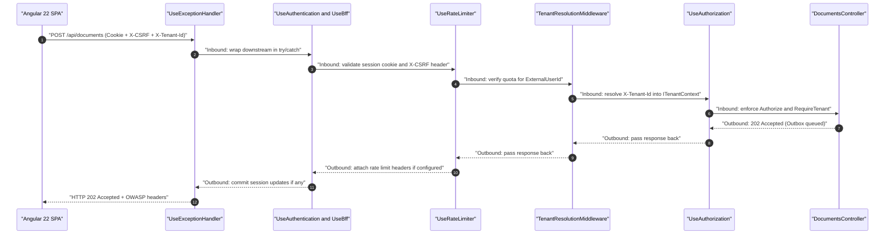
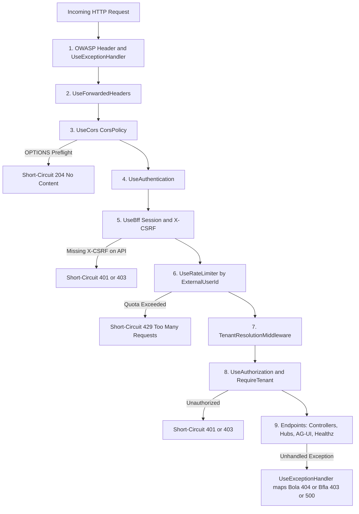
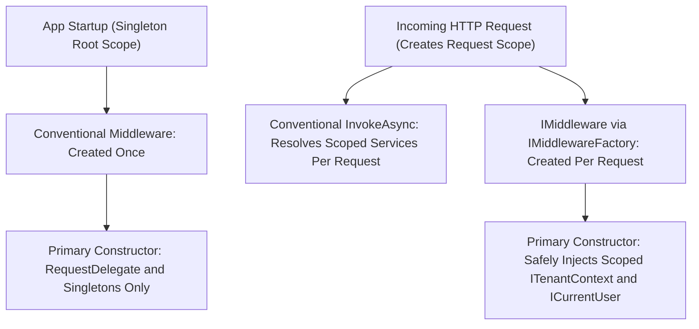

# Module 2: The Request Pipeline, Middleware & Security Invariants

If Module 1 was about understanding the *structure* of an ASP.NET Core application, Module 2 is about understanding its *soul*. **Middleware is the single most important concept in ASP.NET Core.** Every feature — authentication, routing, logging, error handling, rate limiting, and CORS — is implemented as middleware. Master this, and everything else clicks.

For a software architect, ordering middleware is not an aesthetic preference — **it is a matter of system security, performance, and operational correctness.**

---

## 1. What is Middleware?

### The Concept
When a browser sends an HTTP request to your server (e.g., `GET /api/products`), that request doesn't magically teleport to your Controller. It has to travel through a **pipeline** of software components. Each component in the pipeline is called a **middleware**.

Each middleware can:
1.  **Inspect or modify** the incoming request.
2.  **Decide** whether to pass the request to the *next* middleware.
3.  **Inspect or modify** the outgoing response on the way back.

> **Analogy — The Airport Security Model:**  
> Imagine arriving at an airport for a flight.  
> 1. **Check-in Counter** (HTTPS Redirect) — "Do you have the right ticket format? Let me upgrade you to HTTPS."  
> 2. **Passport Control** (Authentication) — "Who are you? Show me your credentials/token."  
> 3. **Security Screening** (Authorization) — "Are you allowed to enter this gate?"  
> 4. **Boarding Gate** (Endpoint/Controller) — "Welcome aboard. Here's your seat (response)."  
>  
> If you fail at *any* checkpoint, you're sent back immediately — you never reach the plane. This is exactly how middleware works.

### The Technical Definition
Middleware is a **function** (called a **`RequestDelegate`**) that receives an **`HttpContext`** and optionally calls the `next` delegate to pass control to the next middleware.

- **`HttpContext`**: The per-request envelope object created by Kestrel (ASP.NET Core's web server). It holds everything about the current HTTP exchange: `Request` (method, path, headers, body stream), `Response` (status code, headers, body stream), `User` (authenticated `ClaimsPrincipal`), `RequestServices` (the request's DI scope), `Items` (per-request dictionary), and `RequestAborted` (`CancellationToken` triggered if the client disconnects).
- **`RequestDelegate`**: The delegate signature `Task RequestDelegate(HttpContext context)`. Every middleware wraps the next `RequestDelegate` in a chain.
- **Zero-Reflection Startup Compilation**: When `Program.cs` calls `app.Build()` / `app.Run()`, ASP.NET Core composes all registered middleware once into a single nested delegate chain. Every incoming HTTP request simply invokes that compiled delegate—no reflection or pipeline assembly happens per request.

```csharp
// The simplest possible middleware — an inline lambda
app.Use(async (HttpContext context, RequestDelegate next) =>
{
    // === INBOUND (Request traveling toward the endpoint) ===
    Console.WriteLine($"-> Request arriving: {context.Request.Method} {context.Request.Path}");

    await next(context); // Pass to the next middleware

    // === OUTBOUND (Response traveling back to the client) ===
    Console.WriteLine($"<- Response leaving: {context.Response.StatusCode}");
});
```

### 5 Real-World Middleware Examples in Normora
1. **OWASP Security Header Injection (`Normora.Api`)**: An inline `app.Use(...)` middleware appends `X-Content-Type-Options: nosniff` so browsers never MIME-sniff responses returned by `Documents` or `Tenants` endpoints.
2. **Reverse Proxy Protocol Normalization (`UseForwardedHeaders`)**: Reads `X-Forwarded-For` and `X-Forwarded-Proto` from trusted reverse proxies so `Normora.Api` sees the real client IP and `https` scheme before Keycloak OIDC redirects run.
3. **BFF Session & Cookie Authentication (`UseAuthentication` + `UseBff`)**: Translates encrypted `HttpOnly`, `SameSite=Strict` cookies managed by Duende BFF into `HttpContext.User` claims (`ExternalUserId`) without ever exposing JWTs to the Angular 22 SPA.
4. **Identity-Partitioned Rate Limiting (`UseRateLimiter`)**: Enforces per-user request quotas on expensive endpoints such as conversational RAG streaming (`/api/copilotkit`) and document uploads.
5. **Multi-Tenant Workspace Resolution (`TenantResolutionMiddleware`)**: Reads the `X-Tenant-Id` header, calls cached `ITenantResolutionService`, and populates scoped `ITenantContext` so downstream `DocumentsDbContext` and `ConversationsDbContext` global query filters isolate tenant data automatically.

---

## 2. How It Works: The Russian Doll Model

The middleware pipeline is often called the **"Russian Doll" model** (or "Onion" model). Each middleware wraps around the next one. The request travels *inward* through each layer, hits the center (your endpoint), and the response travels *outward* through each layer in reverse.

```
Request →  [Exception Handler]
               →  [Forwarded Headers]
                      →  [CORS]
                             →  [Authentication]
                                    →  [BFF Session]
                                           →  [Rate Limiter]
                                                  →  [Tenant Resolution]
                                                         →  [Authorization]
                                                                →  [Your Controller / Endpoint]
                                                         ←  [Authorization]
                                                  ←  [Tenant Resolution]
                                           ←  [Rate Limiter]
                                    ←  [BFF Session]
                             ←  [Authentication]
                      ←  [CORS]
               ←  [Forwarded Headers]
           ←  [Exception Handler]  → Response
```

### The Three Types of Middleware Registration

ASP.NET Core provides three methods for adding middleware:

```csharp
// 1. app.Use() — Runs code, then passes to the next middleware
app.Use(async (context, next) =>
{
    // Do something before (Inbound)
    await next();  // ← MUST call this to continue the pipeline
    // Do something after (Outbound)
});

// 2. app.Map() — Branches the pipeline based on URL path
app.Map("/healthz", branch =>
{
    branch.Run(async context =>
    {
        context.Response.StatusCode = StatusCodes.Status200OK;
        await context.Response.WriteAsync("OK");
    });
});

// 3. app.Run() — Terminal middleware. NEVER calls next(). The pipeline STOPS here.
app.Run(async context =>
{
    context.Response.StatusCode = StatusCodes.Status404NotFound;
    await context.Response.WriteAsync("Resource not found");
});
```

> **Critical Rule:** If a middleware calls `next()`, the pipeline continues. If it does NOT call `next()`, the pipeline **short-circuits** — no further downstream middleware runs, and the response immediately starts traveling back outward.

### Visual Flow: Normora Russian Doll Execution
Here is how a single `POST /api/documents` upload travels inward and outward through `Normora.Api`:



### Branching the Pipeline: `app.Map` vs `app.MapWhen` vs `app.UseWhen`
Sometimes a middleware should only run for specific paths or headers. ASP.NET Core offers three branching primitives with very different behavior:

| Method | Condition | Rejoins Main Pipeline? | Path Behavior | When NOT to Use |
|---|---|---|---|---|
| `app.Map("/path", branch)` | URL path prefix match | **No** (terminal branch) | Moves matched prefix from `Request.Path` into `Request.PathBase` | Do not use for standard REST endpoints—use Route Groups or `[Route]` controllers instead |
| `app.MapWhen(ctx => ..., branch)` | Any `HttpContext` predicate (header, query, method) | **No** (terminal branch) | Leaves `Request.Path` unchanged | Do not use if downstream endpoints (`MapControllers`) still need to run afterward |
| `app.UseWhen(ctx => ..., branch)` | Any `HttpContext` predicate | **Yes** (rejoins main pipeline unless the branch short-circuits) | Leaves `Request.Path` unchanged | Do not use for endpoint-specific business validation—use Endpoint Filters or MediatR behaviors |

```csharp
// app.UseWhen: Runs extra middleware ONLY for PayU callbacks, then rejoins the main pipeline
app.UseWhen(
    context => context.Request.Path.StartsWithSegments("/api/payments/payu/callback"),
    branch =>
    {
        branch.UseMiddleware<PayuSignatureBufferingMiddleware>();
    });
```

### 5 Real-World Normora Pipeline Flow Examples
1. **Standard Request (`GET /api/documents`)**: Flows inward through `UseExceptionHandler` -> `UseForwardedHeaders` -> `UseCors` -> `UseAuthentication` -> `UseBff` -> `UseRateLimiter` -> `TenantResolutionMiddleware` -> `UseAuthorization` -> `DocumentsController`, then unwinds outward.
2. **Conditional Rejoining (`app.UseWhen` on PayU Callback)**: Enables request-body buffering only for `/api/payments/payu/callback` so signature verification can inspect form fields before `Tenants` billing controllers bind them.
3. **Terminal Path Branch (`app.Map` for Diagnostics/Legacy Hooks)**: Isolates an infrastructure endpoint on its own minimal middleware branch so it never invokes `UseBff` or `TenantResolutionMiddleware`.
4. **Predicate Terminal Branch (`app.MapWhen` for Hangfire Dashboard)**: Routes `/hangfire` requests in non-production environments to a dedicated dashboard branch with strict admin-only authorization, keeping API rate limits out of dashboard polling.
5. **Fallback Terminal (`app.Run` / Unmatched Route)**: If no endpoint in `MapControllers()`, `MapHub()`, or `MapBffManagementEndpoints()` matches the request, the end of the pipeline terminates cleanly with `404 Not Found` (never falling through to uninitialized code).

---

## 3. Why Middleware?

### Without Middleware (The Nightmare)
Imagine you have 50 controller actions. Without middleware, you would need to manually add authentication checks, logging, error handling, tenant scoping, and CORS headers **inside every single action method:**

```csharp
// ❌ WITHOUT MIDDLEWARE: Every action repeats identical boilerplate
[HttpGet]
public IActionResult GetProducts()
{
    try 
    {
        if (!User.Identity.IsAuthenticated) return Unauthorized();  // Auth check
        if (!User.IsInRole("Admin")) return Forbid();                // Authz check
        _logger.LogInformation("Fetching products");                 // Logging
        Response.Headers.Add("Access-Control-Allow-Origin", "*");    // CORS

        var products = _service.GetAll();
        return Ok(products);
    }
    catch (Exception ex) 
    {
        _logger.LogError(ex, "Failed");                              // Error handling
        return StatusCode(500);
    }
}
```

### With Middleware (The Clean Way)
All those cross-cutting concerns are handled **once**, centrally, in the pipeline. Your controller becomes razor-thin:

```csharp
// ✅ WITH MIDDLEWARE: Controller only contains business logic
[HttpGet]
public IActionResult GetProducts()
{
    var products = _service.GetAll();
    return Ok(products);
}
```

The authentication, authorization, logging, CORS, rate limiting, and error handling all happen automatically in the middleware pipeline before and after your controller runs.

### The Principle: Separation of Concerns
*   **Middleware** handles infrastructure and cross-cutting concerns (security, protocol normalization, rate limiting, error handling).
*   **Controllers/Endpoints** handle business orchestration (fetching documents, starting AI conversations, delegating commands to CQRS handlers).

### When NOT to Use Middleware (The Architect's Decision Boundary)
Beginners often stuff everything into middleware because "it runs on every request." As a senior architect, avoid middleware when a higher-level abstraction owns the concern:

| Concern | Put It In... | Why NOT Middleware? |
|---|---|---|
| **DTO / Input Validation** (`UploadDocumentCommandValidator`) | **FluentValidation + MediatR Behavior** (Module 8) | Middleware shouldn't deserialize JSON bodies or couple to module DTOs |
| **Resource Ownership / BOLA** (`DocumentId` belongs to another department) | **CQRS Handler** (`BolaException` -> 404) | Requires module-private `DocumentsDbContext` queries and domain rules |
| **Endpoint-Specific Pre-Conditions** (`[RequireTenant]`) | **Endpoint / Action Filter** (Module 4/6) | Declarative per controller/action; easy to opt in or out per endpoint |
| **Module-Private Persistence** (`TenantsDbContext`, `ConversationsDbContext`) | **Module Handlers via `ITenantResolutionService`** | `Normora.Api` middleware must never inject a module's `DbContext` directly |
| **Long-Running Work** (OCR, Gemini embeddings, email dispatch) | **`Normora.Worker` + Hangfire Outbox** | Middleware blocks the HTTP request thread and causes gateway timeouts |

### 5 Real-World Normora Examples (Middleware vs. Non-Middleware)
1. **Middleware (Right Fit) — Global Exception Mapping**: `UseExceptionHandler()` catches `BolaException` (`404`) and `BflaException` (`403`) across `Tenants`, `Documents`, and `Conversations` using `Normora.Shared.Constants.ApiMessages`, removing `try/catch` blocks from every controller.
2. **Middleware (Right Fit) — Angular SPA CORS Policy**: `UseCors("CorsPolicy")` allows `http://localhost:4200` (with credentials for Duende BFF cookies) once in `Normora.Api`, instead of adding CORS headers per action.
3. **Middleware (Right Fit) — OpenTelemetry HTTP Enrichment**: Attaches HTTP route, status code, and correlation metadata to every incoming request span before any module code executes.
4. **NOT Middleware — `UploadDocumentCommandValidator`**: Validating file size, MIME type, and department IDs for a document upload lives in `Documents/Application/Documents/Commands/UploadDocument/`, not in `Normora.Api` middleware.
5. **NOT Middleware — Document Departmental BOLA Check**: Checking whether `currentUser` has clearance to view a specific `Document` happens inside the `Documents` query handler (throwing `BolaException` -> 404), because `Normora.Api` middleware cannot access `DocumentsDbContext`.

---

## 4. Middleware Order — Where It Goes Matters!

**This is where developers make the most dangerous mistakes.** The order you register middleware in `Program.cs` is the *exact* sequential order requests flow through. Get it wrong, and you introduce security vulnerabilities or subtle platform bugs.

### What Happens If You Get The Order Wrong?

**Scenario 1: Authorization BEFORE Authentication**
```csharp
app.UseAuthorization();    // ❌ Checks permissions
app.UseAuthentication();   // ❌ Reads identity
```
Result: Authorization runs *before* the user's identity is established. `HttpContext.User` is empty. Every request is treated as anonymous. **Your entire API is unprotected or returns 401/403 for everyone.**

---

### The Critical Rate Limiter Placement Invariant

Why is `app.UseRateLimiter()` placed strictly **after** `UseAuthentication()` and `UseBff()`, but **before** `TenantResolutionMiddleware`?

```csharp
// Typical user-partitioned rate limiter rule:
options.AddPolicy("user-policy", context =>
{
    // Extract the unique user ID claim ('sub')
    var userId = context.User.FindFirst(ClaimTypes.NameIdentifier)?.Value;

    if (!string.IsNullOrEmpty(userId))
    {
        return RateLimitPartition.GetTokenBucketLimiter(userId, _ => new TokenBucketRateLimiterOptions
        {
            TokenLimit = 100,
            ReplenishmentPeriod = TimeSpan.FromMinutes(1),
            TokensPerPeriod = 100
        });
    }

    // Fallback: Partition by IP for anonymous requests
    return RateLimitPartition.GetTokenBucketLimiter(
        context.Connection.RemoteIpAddress?.ToString() ?? "anonymous", 
        _ => new TokenBucketRateLimiterOptions
        {
            TokenLimit = 10,
            ReplenishmentPeriod = TimeSpan.FromMinutes(1),
            TokensPerPeriod = 10
        });
});
```

#### ⚠️ The Anonymous Partition Collapse Hazard:
*   **If you register `app.UseRateLimiter()` BEFORE `app.UseAuthentication()`:**
    1.  The request enters `UseRateLimiter`.
    2.  The rate limiter checks `context.User.FindFirst(ClaimTypes.NameIdentifier)`.
    3.  Because `UseAuthentication()` has not run yet, `context.User` is completely empty!
    4.  The rate limiter assumes the user is **anonymous** and places them into the anonymous fallback bucket.
    5.  Every single authenticated user on your platform now shares the same tiny anonymous rate limit bucket!
    6.  As soon as one user performs 10 clicks, the rate limiter triggers HTTP 429 for **every user on the platform**, creating a catastrophic **self-inflicted Denial of Service (DoS)**!

**The Golden Architect Rule:** Always authenticate the caller before evaluating identity-partitioned rate limits.

### Implicit `UseRouting()` in .NET 10 & `context.GetEndpoint()`
You might notice that Normora's `Program.cs` (shown in Section 5) never explicitly calls `app.UseRouting()`. Why?

In modern ASP.NET Core (`WebApplication` minimal hosting model), if you map endpoints (`MapControllers`, `MapHealthChecks`, `MapHub`) without calling `app.UseRouting()`, the framework **automatically inserts `UseRouting()` at the beginning of the pipeline** (right before the first custom/auth middleware) and **`UseEndpoints()` at the end**.

*   **When to call `app.UseRouting()` explicitly:** Call it manually when you have middleware that must run **before** route matching (such as `UseForwardedHeaders`, `UseExceptionHandler`, `UseStaticFiles`, or URL Rewriting), while security middleware (`UseCors`, `UseAuthentication`, `UseBff`, `UseRateLimiter`, `TenantResolutionMiddleware`, `UseAuthorization`) runs **between** `UseRouting()` and endpoint execution.
*   **Inspecting Endpoint Metadata (`context.GetEndpoint()`):** Any middleware running *after* `UseRouting()` can inspect which endpoint matched via `var endpoint = context.GetEndpoint();` and check strongly typed attributes/interfaces via `endpoint?.Metadata.GetMetadata<IAllowAnonymous>()`.
*   **When NOT to inspect endpoints:** Never classify security behavior using `endpoint?.DisplayName` (which can change with controller/route naming), and never broadly disable antiforgery checks simply because an endpoint has `[AllowAnonymous]`—in Duende BFF, use `AsBffApiEndpoint()` and explicit antiforgery skip attributes only for externally signed callbacks (such as PayU payment webhooks).

### 5 Real-World Normora Ordering Scenarios
1. **`UseForwardedHeaders` Before `UseAuthentication`**: If Normora sits behind Nginx/Envoy terminating TLS, placing `UseForwardedHeaders` before `UseAuthentication` ensures Keycloak OIDC redirect URIs resolve as `https://` rather than `http://`.
2. **`UseCors("CorsPolicy")` Before `UseAuthentication`**: Browsers never attach cookies to `OPTIONS` preflight requests from `http://localhost:4200`. Placing `UseCors` before `UseAuthentication` lets preflight succeed with `204 No Content`.
3. **`UseAuthentication` -> `UseBff` -> `UseRateLimiter`**: Duende BFF decrypts and validates the server-side cookie session so `HttpContext.User` contains `ExternalUserId` before `UseRateLimiter` partitions quotas.
4. **`TenantResolutionMiddleware` Before `UseAuthorization`**: `[RequireTenant]` policies check `ITenantContext.TenantId`. If `UseAuthorization` ran first, every tenant-scoped endpoint in `Tenants`, `Documents`, and `Conversations` would fail with `403 Forbidden`.
5. **`UseExceptionHandler` Outermost**: Because `UseExceptionHandler()` wraps the entire pipeline, even an unhandled failure inside `TenantResolutionMiddleware` (e.g., Redis timeout) is caught and formatted as safe `ProblemDetails` without leaking stack traces (CWE-209).

---

## 5. The Production Pipeline Order: Normora Case Study

Here is the exact, hardened production pipeline from **Normora's `Program.cs`**:

```csharp
// =========================================================================
// NORMORA PRODUCTION REQUEST PIPELINE (Order is Sacred)
// =========================================================================

// 1. GLOBAL ERROR HANDLING & OWASP HEADERS (Outermost Layer)
// Must be first so it wraps EVERY downstream middleware failure.
app.Use(async (context, next) =>
{
    context.Response.Headers.Append("X-Content-Type-Options", "nosniff");
    await next();
});

// Centralized ProblemDetails error handler
app.UseExceptionHandler(); 

// 2. REVERSE PROXY & PROTOCOL NORMALIZATION
// Resolves original HTTPS scheme and client IP from trusted proxies
app.UseForwardedHeaders(forwardedHeadersOptions);

// 3. CROSS-ORIGIN RESOURCE SHARING (CORS)
// Evaluates CORS preflight OPTIONS requests before authentication
app.UseCors("CorsPolicy");

// 4. IDENTITY AUTHENTICATION
// Reads JWT Bearer tokens or Session Cookies; populates HttpContext.User
app.UseAuthentication();

// 5. BACKEND-FOR-FRONTEND (BFF) SESSION VALIDATION
// Validates Duende BFF anti-forgery headers and manages server-side sessions
app.UseBff();

// 6. RATE LIMITING (Must be placed AFTER AuthN & BFF!)
// Partitioners inspect `sub` claim. Placing it here prevents anonymous DoS collapse.
app.UseRateLimiter();

// 7. MULTI-TENANT WORKSPACE RESOLUTION
// Extracts X-Tenant-Id, queries cached ITenantResolutionService, populates ITenantContext
app.UseMiddleware<TenantResolutionMiddleware>();

// 8. ENDPOINT AUTHORIZATION
// Evaluates [Authorize] policies and [RequireTenant] against resolved claims and tenant
app.UseAuthorization();

// 9. ENDPOINT EXECUTION (The Center of the Russian Doll)
app.MapHealthChecks("/healthz").AllowAnonymous();
app.MapControllers().AsBffApiEndpoint();
app.MapBffManagementEndpoints();
app.MapHub<DocumentHub>("/hubs/documents").AsBffApiEndpoint();
app.MapHub<NotificationHub>("/hubs/notifications").AsBffApiEndpoint();
app.MapNormoraAguiServer().RequireAuthorization().AsBffApiEndpoint();

app.Run();
```

### Normora Pipeline Topology Diagram


### Deep-Dive: 5+ Production Pipeline Stages in Normora
1. **Stage 1 (`app.Use` OWASP Header + `UseExceptionHandler()`)**: Appends `X-Content-Type-Options: nosniff` and wraps all downstream middleware in a centralized exception catcher. *When NOT to customize manually:* Don't write raw `try/catch` middleware in `Normora.Api` when .NET 10's `UseExceptionHandler()` + `IExceptionHandler` handles `ProblemDetails`, `BolaException` (`404`), and `BflaException` (`403`) cleanly (covered in Module 7).
2. **Stage 2 (`UseForwardedHeaders`)**: Reconstructs `RemoteIpAddress` and `Scheme` from `X-Forwarded-For` / `X-Forwarded-Proto`. *When NOT to trust blindly:* Always restrict `KnownNetworks` / `KnownProxies` in production so attackers cannot spoof `X-Forwarded-For` to bypass IP rate limits!
3. **Stage 3 (`UseCors("CorsPolicy")`)**: Permits cross-origin requests from the Angular 22 SPA (`http://localhost:4200` in dev) with `AllowCredentials()` for BFF cookies. *When NOT to use `AllowAnyOrigin()` with credentials:* Never combine `AllowAnyOrigin()` and `AllowCredentials()`—ASP.NET Core rejects it at runtime as a severe security misconfiguration.
4. **Stage 4–5 (`UseAuthentication()` + `UseBff()`)**: `UseAuthentication` validates the Duende BFF cookie; `UseBff` enforces `X-CSRF: 1` on `AsBffApiEndpoint()` routes (`/api/...`, `/hubs/...`, `/api/copilotkit`) and serves `/bff/login`, `/bff/user`, `/bff/logout` via `MapBffManagementEndpoints()`.
5. **Stage 6–9 (`UseRateLimiter` -> `TenantResolutionMiddleware` -> `UseAuthorization` -> Endpoints)**: Rate limits per authenticated `ExternalUserId`, populates scoped `ITenantContext` from cached `ITenantResolutionService`, enforces `[Authorize]` / `[RequireTenant]`, and dispatches to `Tenants`, `Documents`, `Conversations`, SignalR hubs (`/hubs/documents`, `/hubs/notifications`), or the AG-UI SSE endpoint (`/api/copilotkit`).

---

## 6. Short-Circuiting: The Performance Superpower

Some middleware intentionally does NOT call `next()`. This is called **short-circuiting**.

*   `UseStaticFiles` — If the URL matches a physical file (`/css/style.css`), it serves the file directly and stops. No routing, no authentication, no controller instantiation.
*   `UseRateLimiter` — If an IP or tenant exceeds their allocated quota, it returns `429 Too Many Requests` immediately without touching the database.
*   `UseAuthentication` — If an expired or forged token arrives, it can return `401 Unauthorized` immediately.
*   `UseExceptionHandler` — If an exception is thrown, it catches it and returns a safe ProblemDetails error response without propagating the crash to Kestrel.

> **Why this matters for performance:** If 40% of your requests are for static assets or health checks, short-circuiting saves you from running authentication, database queries, and controller allocations on those requests. That's a massive performance win.

### Response Lifecycle: `Response.HasStarted`, `OnStarting()`, and Request Buffering

Understanding the HTTP wire lifecycle is mandatory when your API mixes standard JSON responses with **Server-Sent Events (SSE)**, **SignalR WebSockets**, and **large file uploads**:

1. **`context.Response.HasStarted` (The Point of No Return)**:
   HTTP requires status codes and headers to be sent *before* the body. As soon as an endpoint writes its first chunk of bytes or calls `FlushAsync()` (which happens immediately in Normora's `/api/copilotkit` SSE token stream or large `Documents` file downloads), `context.Response.HasStarted` becomes `true`. Any outbound middleware attempting to modify `context.Response.StatusCode` or `context.Response.Headers` *after* `await next()` will throw `InvalidOperationException: Headers are read-only, response has already started`.
2. **`context.Response.OnStarting(...)` (The Safe Hook)**:
   If you want to add a response header (e.g., `X-Correlation-Id` or `X-Content-Type-Options`) that might depend on downstream work, register a callback *before* `await next()`:
   ```csharp
   context.Response.OnStarting(() =>
   {
       // Runs right before headers flush to the socket, while HasStarted is still false
       context.Response.Headers["X-Content-Type-Options"] = "nosniff";
       return Task.CompletedTask;
   });
   await next(context);
   ```
3. **Request Body Buffering (`context.Request.EnableBuffering()`)**:
   `HttpRequest.Body` is a forward-only network stream. If middleware reads `Request.Body` (e.g., to verify a PayU webhook HMAC signature) without calling `context.Request.EnableBuffering()` and rewinding `context.Request.Body.Position = 0`, the downstream controller sees an empty stream (`0` bytes) and fails model binding.
   *   **When NOT to enable buffering:** NEVER call `EnableBuffering()` globally on every request! On Normora's `POST /api/documents` multipart file uploads (large PDFs/DOCX files), buffering the entire body in memory or temp disk creates a severe memory/disk exhaustion DoS vector. Restrict it strictly with `app.UseWhen(...)` and a strict max-size check.
4. **When NOT to Short-Circuit**:
   Never short-circuit `OPTIONS` preflight requests before `UseCors`, never short-circuit `/hubs/documents` SignalR negotiate requests without BFF/CORS headers, and never short-circuit with an unformatted plain-text string when the Angular client expects `ApiResponse` JSON or `ProblemDetails`.

### 5 Real-World Normora Short-Circuiting & Streaming Examples
1. **`/healthz` Anonymous Short-Circuit**: Container orchestrators probe `/healthz` every few seconds. Mapping it with `.AllowAnonymous()` bypasses Keycloak/BFF auth and `ITenantResolutionService` lookups entirely.
2. **Rate Limiter `429` Protection on `/api/copilotkit`**: When a compromised or runaway client floods conversational RAG prompts, `UseRateLimiter()` short-circuits at Stage 6 with `429 Too Many Requests`—protecting PostgreSQL pgvector HNSW queries and Google Gemini API quota.
3. **Duende BFF Anti-CSRF Short-Circuit**: If a malicious third-party site attempts a cross-site `POST /api/tenants/branding` using the user's browser cookie without the `X-CSRF: 1` header, `UseBff()` short-circuits before `TenantResolutionMiddleware` or any module controller ever runs.
4. **`Response.HasStarted` During AG-UI SSE Streaming**: When `NormoraWorkplaceAgent` streams AI tokens over `/api/copilotkit`, `Response.HasStarted` flips to `true` on the first token. Outbound middleware checks `if (!context.Response.HasStarted)` before touching status codes or error headers.
5. **Selective `EnableBuffering()` for PayU Billing Callbacks**: Normora uses `UseWhen` on `/api/payments/payu/callback` to buffer small form payloads for signature validation while keeping `Documents` file upload streams zero-buffered.

---

## 7. Writing Custom Middleware

Built-in middleware covers standard scenarios, but real-world enterprise applications always require custom middleware.

### Method 1: Inline Middleware (Quick & Lightweight)
Ideal for simple, cross-cutting headers:

```csharp
// From Normora — Adding OWASP security header to every response
app.Use(async (context, next) =>
{
    context.Response.Headers.Append("X-Content-Type-Options", "nosniff");
    await next();
});
```

### Method 2: Class-Based Middleware (The Professional Way)
For anything beyond a single line, create a dedicated middleware class.

**The Rules:**
1. The class must have a constructor accepting `RequestDelegate next`.
2. The class must have a public method named `Invoke` or `InvokeAsync(HttpContext context, ...)`.
3. Constructor-injected dependencies are **Singletons** (held for the application's life).
4. Method-injected dependencies into `InvokeAsync` are **Scoped** (resolved per request).

#### Example: Request Timing Middleware (C# 14 Primary Constructor)
```csharp
public class RequestTimingMiddleware(
    RequestDelegate next,
    ILogger<RequestTimingMiddleware> logger)
{
    // Primary constructor dependencies live for the app's lifetime (Singleton).
    // Method-injected dependencies in InvokeAsync are resolved per-request (Scoped).
    public async Task InvokeAsync(HttpContext context)
    {
        var startTimestamp = System.Diagnostics.Stopwatch.GetTimestamp();

        await next(context);  // Let the rest of the downstream pipeline run

        var elapsed = System.Diagnostics.Stopwatch.GetElapsedTime(startTimestamp);
        logger.LogInformation(
            "HTTP {Method} {Path} responded {StatusCode} in {ElapsedMs:F1}ms",
            context.Request.Method,
            context.Request.Path,
            context.Response.StatusCode,
            elapsed.TotalMilliseconds);
    }
}

// Create an Extension Method (Convention):
public static class RequestTimingMiddlewareExtensions
{
    public static IApplicationBuilder UseRequestTiming(this IApplicationBuilder builder)
    {
        return builder.UseMiddleware<RequestTimingMiddleware>();
    }
}
```

Register cleanly in `Program.cs`:
```csharp
app.UseRequestTiming();
```

### Method 3: Factory-Based Middleware (`IMiddleware`)
What if you want **all** dependencies (including Scoped services) injected cleanly through your **primary constructor** instead of passing them into `InvokeAsync`? Implement the **`IMiddleware`** interface!

```csharp
// Factory-based middleware: resolved per-request via IMiddlewareFactory
public class WorkspaceAuditEnrichmentMiddleware(
    ITenantContext tenantContext,
    ICurrentUser currentUser) : IMiddleware
{
    public async Task InvokeAsync(HttpContext context, RequestDelegate next)
    {
        if (currentUser.IsAuthenticated && tenantContext.TenantId != Guid.Empty)
        {
            System.Diagnostics.Activity.Current?.SetTag("normora.tenant_id", tenantContext.TenantId);
            System.Diagnostics.Activity.Current?.SetTag("normora.user_id", currentUser.ExternalUserId);
        }

        await next(context);
    }
}
```

> **CRITICAL RULE for `IMiddleware`:** Unlike conventional middleware, `IMiddleware` **MUST** be registered in the DI container before calling `app.UseMiddleware<T>()`:
> ```csharp
> // In Program.cs (Builder / DI phase):
> builder.Services.AddScoped<WorkspaceAuditEnrichmentMiddleware>();
>
> // In Program.cs (Pipeline phase, AFTER TenantResolutionMiddleware):
> app.UseMiddleware<WorkspaceAuditEnrichmentMiddleware>();
> ```
> If you forget `AddScoped<...>()`, ASP.NET Core throws `InvalidOperationException: No service for type '...' has been registered` at runtime.

### Comparing the 3 Approaches

| Approach | DI Lifetime | Primary Constructor Usage | Allocation | When NOT to Use |
|---|---|---|---|---|
| **Inline (`app.Use`)** | N/A (closure) | N/A | Zero class overhead | Anything >5 lines, complex branching, or needing unit tests |
| **Conventional Class** | **Singleton** (app lifetime) | `RequestDelegate next` + Singletons (`ILogger`, `IOptionsMonitor<T>`); Scoped go in `InvokeAsync` | 1 instance for entire app | Do not inject Scoped services into constructor (Captive Dependency) |
| **Factory (`IMiddleware`)** | **Scoped or Transient** (per registration) | Any service (Scoped `ITenantContext`, `ICurrentUser`, etc.) via primary constructor | 1 instance per HTTP request | Hot-path middleware on static/health endpoints where zero allocation matters most |

### 5 Real-World Normora Custom Middleware Examples
1. **Inline Security Headers (`Normora.Api`)**: Adds `X-Content-Type-Options: nosniff` on every response via `app.Use(...)`.
2. **Conventional `RequestTimingMiddleware`**: Uses a primary constructor for `RequestDelegate` + `ILogger<T>` and `Stopwatch.GetElapsedTime(...)` (zero-allocation timing) to log slow `/api/documents/search` or `/api/conversations` requests.
3. **Conventional `TenantResolutionMiddleware` (`Normora.Api/Middleware/`)**: Uses a primary constructor for `RequestDelegate next` and method-injects `ITenantContext`, `ICurrentUser`, and `ITenantResolutionService` into `InvokeAsync`.
4. **Conventional `CorrelationIdMiddleware`**: Reads or generates `X-Correlation-Id` and registers `context.Response.OnStarting(...)` so the header is attached before SSE or JSON bytes flush.
5. **Factory-Based `WorkspaceAuditEnrichmentMiddleware` (`IMiddleware`)**: Registered as `AddScoped`, injects `ITenantContext` and `ICurrentUser` via primary constructor to tag OpenTelemetry `Activity.Current` spans after `TenantResolutionMiddleware`.

---

## 8. Real-World Middleware from Your Projects

### 🏗️ NextEvent: Custom `ExceptionMiddleware`
NextEvent uses a custom `ExceptionMiddleware` that catches **domain-specific exceptions** and maps them to appropriate HTTP status codes:

> [!NOTE]
> **Modern .NET 10 Evolution (Normora):** While custom `try/catch` middleware like NextEvent's works, .NET 8–10 recommends implementing **`IExceptionHandler`** paired with `app.UseExceptionHandler()`, which integrates natively with `ProblemDetails`, `Response.HasStarted` guards, and OpenTelemetry error recording. In Normora, `BolaException` maps globally to `404 Not Found` and `BflaException` maps to `403 Forbidden` using `Normora.Shared.Constants.ApiMessages` (covered in depth in [Module 7](07_Module_7_Error_Handling.md)).

```csharp
// From NextEvent's API/Middleware/ExceptionMiddleware.cs
public class ExceptionMiddleware(
    RequestDelegate next,
    ILogger<ExceptionMiddleware> logger,
    IHostEnvironment env)
{
    public async Task InvokeAsync(HttpContext context)
    {
        try
        {
            await next(context); // Let the entire pipeline run
        }
        catch (ValidationException ex)
        {
            context.Response.StatusCode = StatusCodes.Status400BadRequest;
            await context.Response.WriteAsJsonAsync(ApiResponse.Fail(ex.Errors));
        }
        catch (NotFoundException ex)
        {
            context.Response.StatusCode = StatusCodes.Status404NotFound;
            await context.Response.WriteAsJsonAsync(ApiResponse.Fail(ex.Message));
        }
        catch (BusinessRuleException ex)
        {
            context.Response.StatusCode = StatusCodes.Status409Conflict;
            await context.Response.WriteAsJsonAsync(ApiResponse.Fail(ex.Message));
        }
        catch (UnauthorizedException ex)
        {
            context.Response.StatusCode = StatusCodes.Status401Unauthorized;
            await context.Response.WriteAsJsonAsync(ApiResponse.Fail(ex.Message));
        }
        catch (ForbiddenAccessException ex)
        {
            context.Response.StatusCode = StatusCodes.Status403Forbidden;
            await context.Response.WriteAsJsonAsync(ApiResponse.Fail(ex.Message));
        }
        catch (Exception ex)
        {
            // Generic fallback: 500 Internal Server Error
            logger.LogError(ex, "Unhandled exception: {Message}", ex.Message);

            // CRITICAL: Never leak stack traces to production clients! (CWE-209)
            var message = env.IsDevelopment()
                ? ex.Message
                : "An unexpected error occurred. Please try again later.";

            context.Response.StatusCode = StatusCodes.Status500InternalServerError;
            await context.Response.WriteAsJsonAsync(ApiResponse.Fail(message));
        }
    }
}
```

---

### 🏗️ Normora: High-Performance `TenantResolutionMiddleware`
In Normora's multi-tenant architecture, every request must be scoped to an active workspace.

#### The Performance Evolution:
In an early prototype, tenant resolution was queried directly against `TenantsDbContext`:
```csharp
// ❌ EARLY PATTERN: Direct DB query on every HTTP request
var membership = await tenantsDbContext.TenantMemberships.FirstOrDefaultAsync(...);
```
At 5,000 requests per second, this generated 5,000 duplicate SQL queries, rapidly exhausting PostgreSQL's connection pool.

#### The Hardened Production Solution:
Normora decoupled resolution into `ITenantResolutionService`, which caches tenant access and departmental clearances in Redis and L1 memory:

```csharp
// From Normora's server/Normora.Api/Middleware/TenantResolutionMiddleware.cs
public class TenantResolutionMiddleware(RequestDelegate next)
{
    public async Task InvokeAsync(
        HttpContext context,
        ITenantContext tenantContext,                          // Scoped to this request
        ICurrentUser currentUser,                              // Scoped identity abstraction
        ITenantResolutionService tenantResolutionService)      // Cached resolution engine
    {
        // 1. Tenant resolution only applies to authenticated security principals
        if (currentUser.IsAuthenticated)
        {
            // 2. Extract active workspace header supplied by client interceptor
            if (context.Request.Headers.TryGetValue("X-Tenant-Id", out var tenantIdValues))
            {
                if (Guid.TryParse(tenantIdValues.FirstOrDefault(), out var tenantId))
                {
                    // 3. Query the cached service to validate membership and compute effective departmental clearances.
                    var resolvedAccess = await tenantResolutionService.ResolveTenantAccessAsync(
                        tenantId,
                        currentUser.ExternalUserId,
                        context.RequestAborted);

                    if (resolvedAccess != null)
                    {
                        // 4. Bind resolved workspace scope to ITenantContext for downstream EF query filters
                        tenantContext.SetContext(tenantId, resolvedAccess.Role, resolvedAccess.EffectiveDepartments);
                    }
                }
            }

            // Unresolved or unauthorized tenant scopes remain unset; 
            // [RequireTenant] action filters will reject downstream access with 403 Forbidden.
        }

        await next(context);
    }
}
```

---

### 🏗️ Normora: 4 Additional Production Middleware Case Studies

1. **OWASP Security Headers (`Normora.Api`)**: Sets `X-Content-Type-Options: nosniff` (and in hardening profiles, `X-Frame-Options`, `Referrer-Policy`, and Content Security Policy) at the outermost layer of `Program.cs` so even short-circuited `401`/`403`/`429` responses carry protective browser headers.
2. **Duende BFF Session & Anti-CSRF (`UseBff()`)**: Validates `X-CSRF: 1` on every `AsBffApiEndpoint()` route (`/api/...`, `/hubs/documents`, `/hubs/notifications`, `/api/copilotkit`) while allowing externally signed callbacks (like PayU billing callbacks) only via explicit antiforgery-skip attributes—never by matching `Endpoint.DisplayName` or broadly skipping `[AllowAnonymous]`.
3. **OpenTelemetry Span & Baggage Enrichment**: After `TenantResolutionMiddleware` binds `ITenantContext`, tracing enrichment tags `tenant.id` and `user.id` (`ExternalUserId`) onto `Activity.Current`, propagating workspace context across MediatR cross-module calls (`PerformHybridRetrievalQuery`, `GetMcpToolsQuery`) and Hangfire outbox dispatches.
4. **Selective PayU Callback Buffering (`UseWhen` + `EnableBuffering`)**: Wraps `/api/payments/payu/callback` in `app.UseWhen(...)` to verify gateway HMAC signatures against the raw request payload with strict payload-size bounds, while leaving `Documents` multipart uploads unbuffered.

---

## 9. Middleware Dependency Lifetimes: Singleton vs. Scoped

Software architects must understand the dependency injection rules governing middleware:

### Conventional Class Middleware is a Singleton!
When you write:
```csharp
app.UseMiddleware<TenantResolutionMiddleware>();
```
ASP.NET Core instantiates **exactly one instance** of `TenantResolutionMiddleware` when the application boots and holds it alive forever.

*   **Constructor Injection:** Any service injected into the middleware's **constructor** lives for the lifetime of the application. **You must NEVER inject a Scoped service (like `DbContext` or `ITenantContext`) into the constructor of a conventional middleware!** In Development (`ValidateScopes = true`), ASP.NET Core throws `InvalidOperationException` on startup; if validation is disabled, it creates a **Captive Dependency** ([Module 3](03_Module_3_Dependency_Injection.md)) that leaks state across users and tenants.
*   **Method Injection:** Injected services in the `InvokeAsync(HttpContext context, ITenantContext tenantContext, ...)` method are resolved **per HTTP request** from `context.RequestServices` (the request's scoped container). This is the safe, supported mechanism for consuming scoped dependencies inside conventional middleware.

### Conventional vs. `IMiddleware` Lifetime Flow


### Sharing Per-Request State: `HttpContext.Items` vs. Scoped Services vs. `AsyncLocal<T>`
When middleware resolves data (like the active workspace) that downstream controllers and CQRS handlers need, you have three mechanisms—only one is recommended for domain state:

| Mechanism | Type Safety | Works in Non-HTTP Workers (`Normora.Worker`)? | When to Use / When NOT to Use |
|---|---|---|---|
| **Scoped DI Service (`ITenantContext`)** | **Compile-time typed** | Yes (can be populated explicitly in worker jobs) | **Normora Standard** for workspace, user, and clearance state |
| **`HttpContext.Items` (`IDictionary<object, object?>`)** | Untyped (`object?` casts, magic string keys) | **No** (`HttpContext` is null in Hangfire jobs!) | Acceptable only for tiny HTTP-only plumbing (e.g., request start timestamp); never use for business/tenant state |
| **`AsyncLocal<T>`** | Typed | Fragile across `ConfigureAwait(false)` or thread-pool queuing | **Avoid** in ASP.NET Core when Scoped DI is available; easy to leak across pooled execution contexts |

### 5 Real-World Normora Lifetime & State Examples
1. **`TenantResolutionMiddleware` (`Normora.Api/Middleware/`)**: Takes only `RequestDelegate next` in its primary constructor, while `InvokeAsync` method-injects Scoped `ITenantContext`, `ICurrentUser`, and `ITenantResolutionService`.
2. **`RequestTimingMiddleware`**: Safely injects `ILogger<RequestTimingMiddleware>` (Singleton-compatible) via its primary constructor without touching any Scoped services.
3. **`ITenantContext` Flowing into Module `DbContext`s**: Once `TenantResolutionMiddleware` sets `tenantContext.SetContext(tenantId, role, departments)`, the same Scoped `ITenantContext` instance feeds EF Core global query filters in `DocumentsDbContext` and `ConversationsDbContext`.
4. **Why `TenantsDbContext` Is Never Injected into `TenantResolutionMiddleware`**: Even via `InvokeAsync` method injection, `Normora.Api` middleware must NEVER inject `TenantsDbContext` directly—module DbContexts are 100% encapsulated, so middleware calls `ITenantResolutionService` instead.
5. **Why `Documents` & `Conversations` Handlers Don't Depend on `HttpContext`**: Because `ITenantContext` is a pure interface in `Normora.Shared`, CQRS handlers work identically inside `Normora.Api` HTTP requests and `Normora.Worker` Hangfire jobs without `IHttpContextAccessor`.

---

## 10. Common Mistakes & Anti-Patterns

> [!CAUTION]
> **Anti-Pattern 1: Injecting a Scoped Service (or Module `DbContext`) into a Conventional Middleware Constructor**
>
> **Wrong Code:**
> ```csharp
> // ❌ Captive Dependency + Modular Monolith Boundary Violation
> public class BadTenantMiddleware(RequestDelegate next, ITenantContext tenantContext, TenantsDbContext db)
> {
>     public async Task InvokeAsync(HttpContext context) => await next(context);
> }
> ```
> **Why It's Wrong:** Conventional middleware is instantiated once as a **Singleton**. Injecting Scoped `ITenantContext` or `TenantsDbContext` crashes at startup under `ValidateScopes` (or worse, shares one `DbContext` and tenant ID across concurrent users, causing cross-tenant data leaks and EF Core concurrency exceptions). Furthermore, `Normora.Api` must never touch module-private `DbContext`s.
>
> **The Fix:** Inject only `RequestDelegate` (and Singletons like `ILogger<T>`) in the primary constructor, and method-inject Scoped contracts (`ITenantContext`, `ITenantResolutionService`) into `InvokeAsync`—or implement `IMiddleware` registered with `AddScoped`.
> ```csharp
> // ✅ Correct: Primary constructor for Singleton next; method-inject Scoped services
> public class TenantResolutionMiddleware(RequestDelegate next)
> {
>     public async Task InvokeAsync(
>         HttpContext context,
>         ITenantContext tenantContext,
>         ITenantResolutionService resolutionService)
>     {
>         // Resolve via cached service and bind per-request scope...
>         await next(context);
>     }
> }
> ```

> [!CAUTION]
> **Anti-Pattern 2: Registering `UseRateLimiter()` Before `UseAuthentication()` and `UseBff()`**
>
> **Wrong Code:**
> ```csharp
> // ❌ Anonymous Partition Collapse DoS
> app.UseRateLimiter();
> app.UseAuthentication();
> app.UseBff();
> ```
> **Why It's Wrong:** When `UseRateLimiter()` runs before `UseAuthentication()` / `UseBff()`, `context.User` has no `ExternalUserId` (`sub` claim) yet. Every authenticated user across every Normora tenant falls into the single `"anonymous"` fallback partition and exhausts it together, triggering `429 Too Many Requests` for the entire platform.
>
> **The Fix:** Always place `app.UseRateLimiter()` strictly **after** `app.UseAuthentication()` and `app.UseBff()`.

> [!CAUTION]
> **Anti-Pattern 3: Mutating `Response.StatusCode` or `Response.Headers` After `await next()` on Streaming Endpoints**
>
> **Wrong Code:**
> ```csharp
> // ❌ Crashes on /api/copilotkit SSE streams and Documents binary file downloads
> app.Use(async (context, next) =>
> {
>     await next(context);
>     context.Response.Headers.Append("X-Processed-By", "Normora");
> });
> ```
> **Why It's Wrong:** Once an SSE endpoint (`/api/copilotkit`) or file download flushes its first byte, `context.Response.HasStarted` is `true` and HTTP headers are already on the wire. Touching `Response.Headers` or `Response.StatusCode` after `next()` throws `InvalidOperationException: Headers are read-only, response has already started`.
>
> **The Fix:** Set static headers before `await next(context)`, use `context.Response.OnStarting(...)` for headers computed before flush, and guard error-handling writes with `if (!context.Response.HasStarted)`.
> ```csharp
> // ✅ Safe for both standard JSON and SSE / SignalR streams
> app.Use(async (context, next) =>
> {
>     context.Response.OnStarting(() =>
>     {
>         context.Response.Headers["X-Content-Type-Options"] = "nosniff";
>         return Task.CompletedTask;
>     });
>     await next(context);
> });
> ```

> [!CAUTION]
> **Anti-Pattern 4: Reading `Request.Body` Without `EnableBuffering()`—or Calling `EnableBuffering()` Globally**
>
> **Wrong Code:**
> ```csharp
> // ❌ Consumes the forward-only stream so controllers receive an empty body
> app.Use(async (context, next) =>
> {
>     using var reader = new StreamReader(context.Request.Body, leaveOpen: true);
>     var rawBody = await reader.ReadToEndAsync();
>     await next(context);
> });
> ```
> **Why It's Wrong:** `HttpRequest.Body` is forward-only. Reading it without `EnableBuffering()` and resetting `Position = 0` leaves nothing for MVC model binding (`400 Bad Request`). Conversely, calling `context.Request.EnableBuffering()` unconditionally for *all* requests buffers multi-megabyte `Documents` PDF uploads in memory/disk, inviting OOM Denial of Service.
>
> **The Fix:** Use `app.UseWhen(...)` to enable buffering **only** on tiny signed callback paths (such as PayU payment webhooks), enforce a size cap, and always rewind `context.Request.Body.Position = 0` before calling `next(context)`.

> [!CAUTION]
> **Anti-Pattern 5: Classifying Security by `Endpoint.DisplayName` or Broadly Skipping Antiforgery on `[AllowAnonymous]`**
>
> **Wrong Code:**
> ```csharp
> // ❌ Brittle string matching & accidental CSRF bypass (violates Normora AGENTS.md)
> app.Use(async (context, next) =>
> {
>     var endpoint = context.GetEndpoint();
>     if (endpoint?.DisplayName?.Contains("Webhook") == true ||
>         endpoint?.Metadata.GetMetadata<IAllowAnonymous>() is not null)
>     {
>         // Skipping antiforgery / BFF checks broadly!
>     }
>     await next(context);
> });
> ```
> **Why It's Wrong:** `Endpoint.DisplayName` is a diagnostic string that breaks silently on refactors, and `[AllowAnonymous]` means "no user login required," NOT "disable CSRF protection." Broadly bypassing antiforgery exposes anonymous endpoints (or mis-annotated actions) to Cross-Site Request Forgery.
>
> **The Fix:** Follow Duende BFF's supported conventions: mark APIs with `.AsBffApiEndpoint()` and apply the framework's explicit skip-antiforgery attribute solely to externally signed callbacks (like PayU webhooks).

> [!CAUTION]
> **Anti-Pattern 6: Returning Hardcoded Error Strings from Middleware Instead of `ApiMessages`**
>
> **Wrong Code:**
> ```csharp
> // ❌ Magic strings and potential stack trace leakage (CWE-209)
> catch (Exception ex)
> {
>     context.Response.StatusCode = 500;
>     await context.Response.WriteAsJsonAsync(new { error = ex.Message });
> }
> ```
> **Why It's Wrong:** Returning `ex.Message` in production leaks internal SQL table names, MinIO endpoints, or Gemini SDK errors to attackers (CWE-209), and hardcoded strings violate Normora's centralized `ApiMessages` contract expected by the Angular interceptor.
>
> **The Fix:** Map exceptions centrally via `UseExceptionHandler()` / `IExceptionHandler` using `Normora.Shared.Constants.ApiMessages` constants (`BolaException` -> `404`, `BflaException` -> `403`, fallback -> generic `500` constant).

---

## 11. Best Practices Summary

| Practice | Why |
|---|---|
| **Put Exception Handler first** | It must catch errors from every other downstream middleware component |
| **Put Forwarded Headers early** | Normalizes real client IP and HTTPS scheme before CORS, auth, and rate limiting run |
| **Put Static Files before Routing** | Short-circuits static asset requests to avoid routing, auth, and controller work |
| **Know where `UseRouting()` sits** | Explicit `UseRouting()` separates pre-route work from endpoint-aware middleware (`CORS`, `AuthN`, `AuthZ`) |
| **Authentication before Authorization** | You must know WHO the caller is before checking WHAT they can do |
| **Rate Limiter after Authentication** | Prevents anonymous partition collapse and platform-wide Denial of Service |
| **Tenant Resolution before Authorization** | Workspaces and clearances must populate before `[RequireTenant]` evaluates |
| **Use `UseWhen` over `MapWhen` to rejoin** | `MapWhen` terminates; `UseWhen` rejoins the main pipeline for controllers and hubs |
| **Guard streaming with `HasStarted` / `OnStarting`** | Prevents crashes when endpoints stream SSE (`/api/copilotkit`) or binary files |
| **Use class-based or `IMiddleware` with primary constructors** | Testable, modular, and avoids Captive Dependencies |
| **Keep business rules out of middleware** | DTO validation belongs in FluentValidation/MediatR; BOLA/BFLA ownership belongs in module handlers |
| **Never leak details in Production** | Use `UseExceptionHandler()` + `ApiMessages` constants instead of raw `ex.Message` (CWE-209) |
| **Add security headers via middleware** | OWASP headers (`X-Content-Type-Options: nosniff`) on every response |

---
**Key Takeaways:**
1. Middleware is the compiled delegate pipeline through which **every** HTTP request flows.
2. Order is **sacred** — wrong order = security vulnerabilities, broken preflights, or platform-wide DoS.
3. Short-circuiting saves performance, while `HasStarted` and `OnStarting` keep SSE/SignalR streaming safe.
4. Keep conventional middleware constructors Singleton-safe (method-inject Scoped services into `InvokeAsync`), or use `IMiddleware` for per-request Scoped DI—and never inject module-private `DbContext`s into `Normora.Api` middleware.

---

## 12. Interview Questions

1. **[Junior] What is the difference between `app.Use()`, `app.Map()`, and `app.Run()`?**
   * **Answer:** `app.Use()` executes logic before and/or after calling `next(context)` to continue the pipeline. `app.Map()` branches the pipeline onto a separate path-prefixed sub-pipeline that does **not** rejoin the main pipeline (and moves the matched prefix into `PathBase`). `app.Run()` adds a terminal middleware that never receives `next` and always ends the pipeline.

2. **[Junior] Why must `app.UseAuthentication()` always be registered before `app.UseAuthorization()`?**
   * **Answer:** `UseAuthentication()` reads credentials (like Normora's Duende BFF cookie or bearer token) and populates `HttpContext.User`. `UseAuthorization()` inspects `HttpContext.User` against policies (`[Authorize]`, `[RequireTenant]`). If `UseAuthorization()` runs first, `HttpContext.User` is empty/anonymous, causing every protected endpoint to fail with `401`/`403`.

3. **[Junior] What does "short-circuiting" the middleware pipeline mean, and why is it valuable?**
   * **Answer:** Short-circuiting means a middleware writes a response and returns **without** calling `next(context)`. It prevents downstream middleware and endpoints from running, saving CPU and database/API work on static files, `/healthz` probes, `401` invalid sessions, and `429` rate-limited requests.

4. **[Senior] Explain the difference between Conventional Middleware and `IMiddleware`. How do DI lifetimes differ?**
   * **Answer:** Conventional middleware is instantiated **once at startup as a Singleton**, so its constructor may only take `RequestDelegate` and Singletons (`ILogger<T>`, `IOptionsMonitor<T>`); Scoped services (`ITenantContext`, `ICurrentUser`) must be method-injected into `InvokeAsync`. `IMiddleware` is resolved per request via `IMiddlewareFactory` and **must** be registered in DI (e.g., `AddScoped<T>()`), allowing Scoped services directly in its primary constructor.

5. **[Senior] What is the difference between `app.MapWhen()` and `app.UseWhen()`?**
   * **Answer:** Both branch based on a `Func<HttpContext, bool>` predicate, but `MapWhen()` creates a **terminal** branch (never returns to the main pipeline), whereas `UseWhen()` **rejoins** the main pipeline after the branch finishes (unless the branch short-circuits). Use `UseWhen()` when you want extra middleware (like selective `EnableBuffering()` on a webhook route) before normal endpoint routing runs.

6. **[Senior] Why does modifying `Response.Headers` after `await next()` fail on SSE endpoints like Normora's `/api/copilotkit`, and how do you fix it?**
   * **Answer:** Once the endpoint writes the first chunk of an SSE stream or file download, `Response.HasStarted` becomes `true` and headers have already been flushed to the TCP socket. Modifying headers afterward throws `InvalidOperationException`. Fix it by setting static headers *before* `await next()`, using `context.Response.OnStarting(...)` for deferred headers, and checking `if (!context.Response.HasStarted)` before writing error responses.

7. **[Architect] Why does placing `app.UseRateLimiter()` before `app.UseAuthentication()` / `app.UseBff()` cause an outage in a multi-user SaaS platform like Normora?**
   * **Answer:** Identity-partitioned rate limiters read the user's subject claim (`ExternalUserId`) from `HttpContext.User` and fall back to an anonymous/IP bucket when the claim is missing. Before `UseAuthentication()` and `UseBff()`, `HttpContext.User` is unauthenticated, collapsing **all** logged-in users across all tenants into a single shared anonymous bucket—causing a self-inflicted platform-wide `429` DoS as soon as a few requests arrive.

8. **[Architect] In a Modular Monolith like Normora, how do you decide whether logic belongs in `Normora.Api` Middleware, an Endpoint/Action Filter, or a MediatR Pipeline Behavior?**
   * **Answer:**
     * **Middleware (`Normora.Api`)**: HTTP/protocol-level cross-cutting concerns needed before or around endpoint dispatch (`UseForwardedHeaders`, `UseCors`, `UseAuthentication`, `UseBff`, `UseRateLimiter`, `TenantResolutionMiddleware` via cached `ITenantResolutionService`, OWASP headers, `UseExceptionHandler`).
     * **Filters (`[RequireTenant]`)**: Declarative per-endpoint HTTP preconditions that rely on MVC/route metadata.
     * **MediatR Behaviors / Handlers (`Modules/*`)**: Application-level validation (`FluentValidation`), transactions, and BOLA/BFLA authorization that depend on strongly-typed Commands/Queries or module-private `DbContext`s—keeping `Normora.Api` middleware decoupled from domain internals.

---

**Next up:** In [Module 3](03_Module_3_Dependency_Injection.md), we dive into **Dependency Injection** — the skeletal framework that creates, connects, and destroys services across the application.
