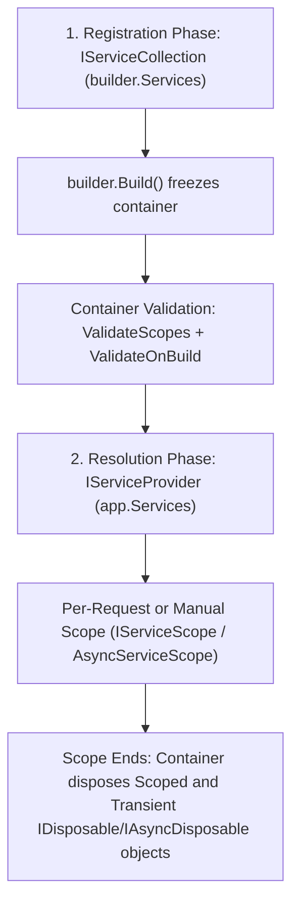
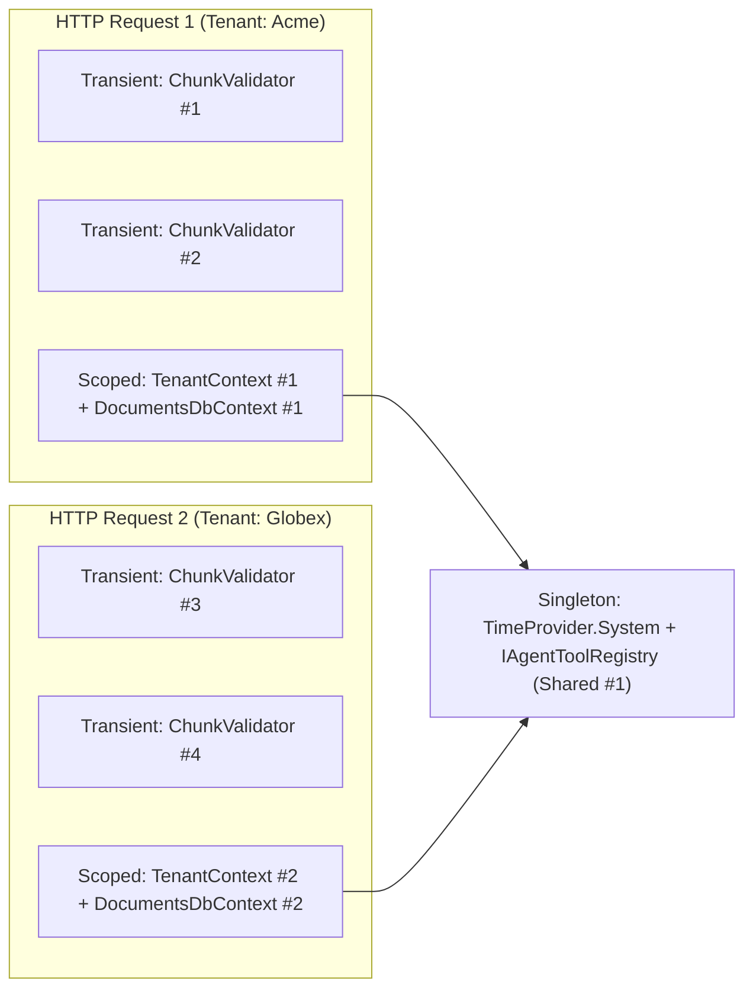
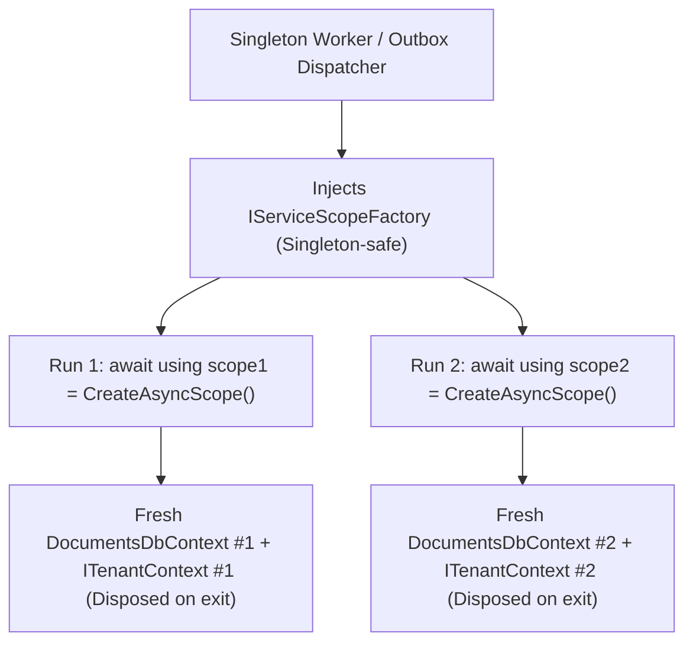
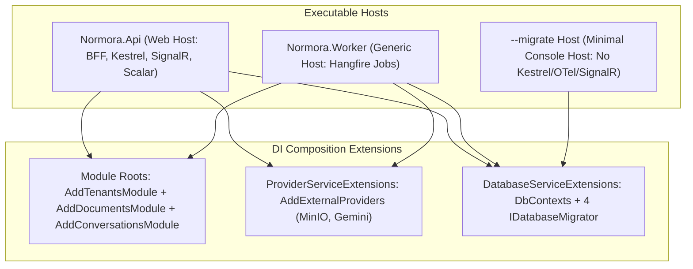

# Module 3: Dependency Injection, Lifetimes & Architectural Invariants

If Middleware is the *soul* of ASP.NET Core, **Dependency Injection (DI) is the skeleton**. It holds everything together. Every middleware, every controller, every service, every database context — they are all created, connected, and destroyed by the DI container. Understanding DI is non-negotiable.

In enterprise software architecture, understanding DI goes far beyond knowing how to register an interface. You must master **object lifetimes, allocation dynamics, thread safety, the captive dependency trap, and automated architectural rules enforcement.**

---

## 1. What Problem Does DI Solve?

### The Problem: Tight Coupling
Imagine you're building an `OrderService` that needs to send emails when an order is placed. The naive approach:

```csharp
// ❌ TIGHTLY COUPLED — OrderService creates its own dependencies
public class OrderService
{
    public void PlaceOrder(Order order)
    {
        // Business logic...
        
        // Send confirmation email
        var emailSender = new SmtpEmailSender("smtp.gmail.com", 587, "password123");
        emailSender.Send(order.CustomerEmail, "Order Confirmed!");
    }
}
```

**What's wrong with this?**
1. **Can't test it.** To unit test `PlaceOrder`, you'd actually send real emails over the network!
2. **Can't swap implementations.** If you switch from Gmail SMTP to SendGrid or AWS SES, you must find and change every `new SmtpEmailSender(...)` in your entire codebase.
3. **Hard-coded secrets.** The SMTP password is buried directly inside business logic.
4. **Lifecycle chaos.** Who disposes of the `SmtpEmailSender`? What if it should be shared? What if it's expensive to create?

> **Analogy — The Chef Who Grows His Own Tomatoes:**  
> Imagine a chef who, instead of ordering tomatoes from a supplier, personally farms, harvests, and transports tomatoes every time a customer orders pasta. The chef is now tightly coupled to farming — he can't focus on cooking!  
>  
> DI is like hiring a supplier (the DI container). The chef says, "I need tomatoes" (an interface), and the supplier delivers them. The chef doesn't care if they come from a local farm or an imported batch — he just cooks.

### The Solution: Inversion of Control & Primary Constructors
Instead of a class creating its own dependencies, **you invert the control** (Inversion of Control, or IoC) — the framework creates and provides them from the outside.

In **C# 12 through C# 14 (.NET 10)**, the standard way to declare constructor dependencies is a **primary constructor**: you place the dependencies directly in parentheses after the class name instead of writing boilerplate `private readonly` backing fields and a separate constructor body. The compiler captures those parameters for the entire class.

```csharp
// ✅ LOOSELY COUPLED — Dependencies are injected via a C# primary constructor
public class OrderService(IEmailSender emailSender)
{
    public void PlaceOrder(Order order)
    {
        // Business logic...
        emailSender.Send(order.CustomerEmail, "Order Confirmed!");
    }
}
```

> **Term Check — Primary Constructor:**  
> A **primary constructor** lets you declare constructor parameters directly on the class declaration (`public class Foo(IDep dep)`). In Normora, **all** DI-injected classes (controllers, CQRS handlers, middleware, and services) must use primary constructors instead of manual field assignments.  
> **When NOT to use a primary constructor:** If a class needs multiple overloaded constructors with different parameter lists, must perform complex validation/transformation and reassign parameters in a constructor body, or is a mutable data model where accidentally mutating a captured parameter would be confusing, prefer a traditional constructor.

Now:
1. **Testable.** In unit tests, pass a fake `IEmailSender` that records emails in memory instead of sending them over the network.
2. **Swappable.** Change the implementation in one place (the DI registration in `Program.cs` or a module extension method).
3. **Clean.** No hard-coded configuration values, SDK clients, or connection strings inside business logic.

### When NOT to Use Dependency Injection
DI adds indirection and container overhead, so do **not** force everything into the DI container:
*   **Domain Entities and Value Objects** (e.g., `Document`, `TenantPlan`): Entities represent state and domain invariants, not infrastructure services. Pass needed collaborators as method parameters instead of injecting services into entities.
*   **CQRS Requests and DTOs** (e.g., `UploadDocumentCommand`, `PerformHybridRetrievalQuery`): Immutable C# `record` types carrying data should be created directly with `new`, never resolved from DI.
*   **Pure Static Helpers and Calculators** (e.g., deterministic math or string formatting with no external I/O or hidden state): A static method or pure domain catalog (like `TenantPlanPricingCatalog`) needs no DI lifecycle.
*   **Ultra-Hot Tight Loops**: Resolving transient objects millions of times per second inside a tight inner loop (e.g., per-token text parsing) creates unnecessary GC pressure; pass dependencies once outside the loop.

### 5 Real-World Normora Decoupling Examples
Normora uses DI and **ports (domain interfaces)** so business modules stay completely decoupled from third-party vendor SDKs:

1. **Document Storage (`Documents` ↔ `Normora.Infrastructure`)**: `UploadDocumentCommandHandler` injects `IDocumentStorageService` instead of `new MinioClient(...)`. In production it receives `MinioDocumentStorageService`; in integration tests it can receive an in-memory storage fake.
2. **Vector Embeddings (`Documents` ↔ Gemini)**: The ingestion pipeline injects `ITextEmbeddingService` rather than calling Google's Gemini SDK directly, allowing `GeminiEmbeddingService` to be swapped for another embedding provider without touching `Documents`.
3. **Conversational AI (`Conversations` ↔ `Microsoft.Extensions.AI`)**: `NormoraWorkplaceAgent` and `ConversationTurnPreparer` depend on `ITextGenerationService` (or `IChatClient`), decoupling multi-turn RAG logic from `GeminiTextGenerationService`.
4. **Workspace Payments (`Tenants` ↔ PayU)**: Billing handlers inject `IPaymentService` instead of instantiating `PayUPaymentService`, keeping subscription logic free of PayU form-signing code and easy to test.
5. **Transactional Email (`Tenants` / `Conversations` ↔ Resend)**: Invitation and HR-escalation workflows inject `IEmailSender`, allowing local dev or test runs to capture emails without hitting the Resend API.

---

## 2. The Built-in DI Container: Two Distinct Phases

Unlike Spring (Java) or older .NET where you needed third-party containers (Autofac, Ninject, Unity), ASP.NET Core ships with a **built-in, high-performance DI container** (`Microsoft.Extensions.DependencyInjection`). It operates in **two strictly separated phases**:



| Interface | Purpose |
|---|---|
| `IServiceCollection` | The **registration** side — a mutable list of `ServiceDescriptor` entries telling the container what services exist (`builder.Services`) |
| `IServiceProvider` | The **resolution** side — an immutable, thread-safe service locator/factory that builds object graphs and manages disposal (`app.Services`) |

```csharp
var builder = WebApplication.CreateBuilder(args);

// ── REGISTRATION PHASE ──
// "Dear container, when someone asks for IDocumentStorageService, provide MinioDocumentStorageService."
builder.Services.AddScoped<IDocumentStorageService, MinioDocumentStorageService>();

var app = builder.Build();
// ── RESOLUTION PHASE ──
// From this point on, the container is locked and read-only. No more registrations allowed.
```

### Container Validation: `ValidateScopes` & `ValidateOnBuild`
When `builder.Build()` runs, ASP.NET Core can verify your dependency graph before a single HTTP request arrives:
*   **`ValidateScopes`**: Throws an `InvalidOperationException` if a **Scoped** service is resolved directly from the root `IServiceProvider` or captured by a **Singleton** (catching the Captive Dependency bug immediately).
*   **`ValidateOnBuild`**: Walks *every* registered `ServiceDescriptor` at startup and verifies that all constructor parameters can be satisfied (catching missing registrations at boot instead of waiting for a user to hit an obscure endpoint).

By default, `WebApplication.CreateBuilder(args)` turns both on **only when `ASPNETCORE_ENVIRONMENT=Development`**. To catch broken DI wiring in staging or CI test hosts too, enable them explicitly:

```csharp
builder.Host.UseDefaultServiceProvider((_, options) =>
{
    options.ValidateScopes = true;
    options.ValidateOnBuild = true; // Fail fast at startup if any dependency is missing
});
```

> **When NOT to enable `ValidateOnBuild` blindly:** If your app registers services whose constructors throw when optional runtime environment variables are absent in a lightweight build-time tool (e.g., OpenAPI spec generation), or if you have hundreds of expensive factory delegates evaluated during validation, scope validation checks in integration tests may be safer than running full build validation in constrained build containers.

### 5 Real-World Normora Examples Across Phases
1. **Registration — Module Composition Roots (`Normora.Api/Program.cs`)**: During the registration phase, `Normora.Api` calls `builder.Services.AddTenantsModule(...)`, `AddDocumentsModule(...)`, and `AddConversationsModule(...)` to register each bounded context into `IServiceCollection`.
2. **Registration — External Provider Binding (`ProviderServiceExtensions.cs`)**: `AddExternalProviders` registers `MinioDocumentStorageService` and `GeminiEmbeddingService` into `IServiceCollection` before `builder.Build()` freezes the graph.
3. **Build-Time Isolation — Ephemeral Migration Host (`--migrate`)**: When running `dotnet Normora.Api.dll --migrate`, `MigrationHostExtensions.RunMigrationsAsync` builds a minimal container containing only database migrators (`IServiceCollection`) without registering Kestrel, SignalR, or Hangfire.
4. **Resolution — Request Scope (`TenantResolutionMiddleware`)**: During the resolution phase, ASP.NET Core creates a per-request `IServiceScope` and resolves `TenantResolutionMiddleware`'s per-request dependencies (`ITenantContext`, `TenantsDbContext`).
5. **Resolution — Startup Database Migration (`DatabaseMigrationRunner`)**: After `Build()`, no HTTP request exists, so `DatabaseMigrationRunner` creates an explicit scope from `IServiceProvider` to resolve all four `IDatabaseMigrator` implementations and migrate schemas sequentially.

---

## 3. Service Lifetimes — The Most Critical Concept

When you register a service, you must tell the container **how long** each instance should live. This is called the **Lifetime**. Getting this wrong causes memory leaks, thread collisions, data corruption, and cross-tenant security breaches.

### Transient — New Instance Every Time
```csharp
builder.Services.AddTransient<DocumentChunker>();
```
*   **What:** A **brand new instance** is created every time any class requests it. If 3 classes in the same request ask for a Transient service, they each get a different instance.
*   **When to use:** Lightweight, stateless utility services, or services whose internal state must never bleed between consumers (for example, typed `HttpClient` wrappers created by `IHttpClientFactory`).
*   **When NOT to use:** Heavy objects with expensive initialization (e.g., an ML model wrapper, regex compilation cache, or database connection pool) or services that must share state within a single request (like `ITenantContext` or `DocumentsDbContext`).
*   **Memory impact:** Higher — many instances created and garbage collected.
*   **Thread safety:** Usually not a concern between consumers — each consumer gets its own private instance.

> **Analogy:** Disposable paper cups. Every time you want water, you grab a new cup.

### Scoped — One Instance Per HTTP Request (or Manual Scope)
```csharp
builder.Services.AddScoped<ITenantContext, TenantContext>();
```
*   **What:** A **single instance** is created when the first class in a scope (usually an HTTP request) asks for it. Every subsequent resolution for the same service **within the same scope** gets the **exact same instance**. When the scope ends, the instance is automatically disposed.
*   **When to use:** This is the **most common lifetime** for web applications. EF Core's `DbContext` uses Scoped by default so all database operations in a single request share one connection and unit-of-work transaction. Request-bound security state (`ITenantContext`) must also be Scoped.
*   **When NOT to use:** Inside background worker loops without creating a manual scope (see Section 6), or for cross-request caches and metrics counters that must survive after the request ends.
*   **Memory impact:** Moderate — exactly one instance per request.
*   **Thread safety:** Isolated **between** concurrent HTTP requests, **NOT** automatically thread-safe **within** a single request! If you run `await Task.WhenAll(repo1.GetAsync(), repo2.GetAsync())` using the same Scoped `DbContext` inside one request, EF Core will throw a concurrency exception because `DbContext` is not thread-safe.

> **Analogy:** A table at a restaurant. Everyone seated at the same table (same HTTP request) shares the same waiter. Different tables (different requests) get different waiters.

### Singleton — One Instance Forever
```csharp
builder.Services.AddSingleton<IAgentToolRegistry, AgentToolRegistry>();
```
*   **What:** A **single instance** is created the very first time it's requested (or immediately if you pass an existing object), and that **same instance** is shared across **every HTTP request** for the entire lifetime of the application.
*   **When to use:** Thread-safe shared registries (`IAgentToolRegistry`), distributed cache facades (Redis), `IHttpClientFactory`, `TimeProvider`, `IOptions<T>`, and services that are expensive to construct or hold immutable lookup metadata.
*   **When NOT to use:** Any service holding per-request user/tenant state (`ITenantContext`), EF Core `DbContext` instances, or classes with mutable un-synchronized fields (`Dictionary<,>`, `List<>`).
*   **Memory impact:** Minimal — only one instance ever.
*   **Thread safety:** **CRITICAL!** Multiple concurrent requests will access the same instance simultaneously. You **must** ensure thread safety (use `ConcurrentDictionary`, `Interlocked`, `Lock`, or immutable data).

> **Analogy:** The restaurant's kitchen. There's only one kitchen shared by every customer. If two waiters bring orders simultaneously, the kitchen must handle them without mixing up dishes (thread safety).

### Disposal Rules & Ownership
The DI container automatically disposes any `IDisposable` or `IAsyncDisposable` instance **that it created**:
*   **Transient** and **Scoped** disposables are tracked by the current `IServiceScope` and disposed when that scope ends (even Transient instances live until the end of the scope so the container can dispose them!).
*   **Singleton** disposables are disposed when the root `IServiceProvider` shuts down.
*   **Important Exception — Manual Instances:** If you register a pre-built object yourself (`builder.Services.AddSingleton(new MinioClient(...))`), **the container did NOT create it and will NOT dispose it** on shutdown. You are responsible for disposing it.
*   **Never** resolve a container-owned service (such as `DocumentsDbContext`) and call `.Dispose()` on it manually inside a controller or handler — let the scope own its lifecycle.

### Visual Summary: Multi-Tenant Request Isolation



### 5 Real-World Normora Lifetime Decisions
1. **`TenantContext` (`Scoped`)**: Each HTTP request resolves its own tenant ID, role, and department memberships in `TenantResolutionMiddleware`, guaranteeing Tenant Acme's request never reads Tenant Globex's context.
2. **`DocumentsDbContext`, `TenantsDbContext`, `ConversationsDbContext` (`Scoped`)**: Each module's EF Core `DbContext` binds dynamically to the Scoped `ITenantContext` for global query filters and shares a single PostgreSQL transaction per request.
3. **`DocumentChunker` / FluentValidation Validators (`Transient` or stateless `Scoped`)**: Lightweight per-operation validators and chunkers carry no cross-consumer mutable state and are cheap to allocate.
4. **`IWorkspaceStateSynchronizer` & `IAgentToolRegistry` (`Singleton`)**: The monotonic `dataVersion` state synchronizer and 19-tool registry must survive across requests and serve concurrent callers safely.
5. **`TimeProvider.System` (`Singleton`)**: Immutable system clock abstraction shared across every module and background job.

---

## 4. Service Registration Patterns (Basic to Advanced)

### Basic Registration
```csharp
// Interface → Implementation
builder.Services.AddTransient<DocumentChunker>();
builder.Services.AddScoped<ITenantContext, TenantContext>();
builder.Services.AddSingleton<IWorkspaceStateSynchronizer, WorkspaceStateSynchronizer>();
```

### Registering Without an Interface
Sometimes an abstraction adds zero value (e.g., internal module helpers or concrete MediatR pipelines):
```csharp
builder.Services.AddTransient<DocumentChunker>();
```
**When NOT to skip interfaces:** Any service crossing a module/infrastructure boundary (`IDocumentStorageService`, `ITextEmbeddingService`, `IPaymentService`) or touching external I/O must sit behind an interface so modules stay vendor-free and unit-testable.

### Factory Registration (Complex Creation Logic)
When construction requires inspecting configuration or choosing an implementation dynamically at resolution time:
```csharp
builder.Services.AddScoped<IPaymentService>(provider =>
{
    var config = provider.GetRequiredService<IConfiguration>();
    var useSandbox = config.GetValue<bool>("Billing:UseMockGateway");

    return useSandbox
        ? ActivatorUtilities.CreateInstance<SandboxPaymentService>(provider)
        : ActivatorUtilities.CreateInstance<PayUPaymentService>(provider);
});
```
> **Pro Tip:** Prefer `ActivatorUtilities.CreateInstance<T>(provider)` inside factories instead of manually calling `new PayUPaymentService(...)` so the container still injects all of `PayUPaymentService`'s other constructor dependencies automatically.

### Idempotent Defaults with `TryAdd*` (`Microsoft.Extensions.DependencyInjection.Extensions`)
`AddScoped<IFoo, Impl>()` appends a duplicate descriptor every time it is called. For **shared infrastructure libraries** or **module helpers** that multiple modules might call, use `TryAddScoped`, `TryAddSingleton`, or `TryAddEnumerable`:
```csharp
// Registers TimeProvider.System ONLY if a test or host hasn't already registered a TimeProvider
services.TryAddSingleton(TimeProvider.System);

// Prevents duplicate registrations of the exact same (ServiceType, ImplementationType) pair
services.TryAddEnumerable(ServiceDescriptor.Scoped<IDatabaseMigrator, DocumentsDatabaseMigrator>());
```
*   **When NOT to use `TryAdd*`:** If you intentionally want to override a previous registration (for example, replacing `MinioDocumentStorageService` with a fake in integration tests), `TryAdd*` will silently do nothing! Use `Add*` or `Replace(...)` when overriding.

### Multiple Implementations & Last-Registration-Wins
You can register multiple implementations for the same interface (e.g., Normora's four sequential database migrators):
```csharp
// In Normora.Infrastructure/Extensions/DatabaseServiceExtensions.cs
services.AddScoped<IDatabaseMigrator, TenantsDatabaseMigrator>();
services.AddScoped<IDatabaseMigrator, DocumentsDatabaseMigrator>();
services.AddScoped<IDatabaseMigrator, ConversationsDatabaseMigrator>();
services.AddScoped<IDatabaseMigrator, SessionDatabaseMigrator>();
```
*   Resolving `IEnumerable<IDatabaseMigrator>` returns **all four** in exact registration order (essential for `DatabaseMigrationRunner`).
*   Resolving a single `IDatabaseMigrator` returns **only the last one registered** (`SessionDatabaseMigrator`) — a frequent source of bugs if you expected an error!

### Open Generics
Register a generic template once and let the container close it for any type argument at runtime:
```csharp
// MediatR applies ValidationBehavior<TRequest, TResponse> to every command and query
builder.Services.AddScoped(typeof(IPipelineBehavior<,>), typeof(ValidationBehavior<,>));
```
*   **When NOT to use Open Generics:** When one closed type needs a different lifetime (e.g., Singleton) or extra dependencies that break uniformity across all `TRequest` types.

### Keyed Services (.NET 8–10)
When a single interface has multiple named implementations active **at the same time**, use **Keyed Services** instead of writing custom factory dictionaries:
```csharp
// Registration with explicit keys
builder.Services.AddKeyedScoped<IDocumentStorageService, MinioDocumentStorageService>("minio");
builder.Services.AddKeyedScoped<IDocumentStorageService, LocalDiskDocumentStorageService>("local");

// Resolution via [FromKeyedServices] in a primary constructor
public sealed class StorageMigrationJob(
    [FromKeyedServices("local")] IDocumentStorageService sourceStorage,
    [FromKeyedServices("minio")] IDocumentStorageService targetStorage)
{
    public Task CopyAsync(string key, CancellationToken ct) => /* ... */;
}
```
*   **When NOT to use Keyed Services:** Avoid scattering magic key strings throughout business modules—Normora keeps `Documents` and `Tenants` completely unaware of storage vendor names (`"minio"`). Use keyed services inside `Normora.Infrastructure` or when a caller genuinely selects between named variants, and prefer `IEnumerable<T>` when you need to execute *all* implementations (like `IDatabaseMigrator`).

### Decorator Pattern (Cross-Cutting Wrapping Without Boilerplate)
Suppose you want to add OpenTelemetry latency tracking around `ITextEmbeddingService` (`GeminiEmbeddingService`) without polluting Gemini code:
```csharp
builder.Services.AddScoped<GeminiEmbeddingService>();
builder.Services.AddScoped<ITextEmbeddingService>(sp =>
    new TelemetryTextEmbeddingDecorator(
        sp.GetRequiredService<GeminiEmbeddingService>(),
        sp.GetRequiredService<ILogger<TelemetryTextEmbeddingDecorator>>()));
```
Notice we register the inner concrete type (`GeminiEmbeddingService`) separately so resolving `ITextEmbeddingService` doesn't cause an infinite circular recursion!

### `IHttpClientFactory` & Typed Clients (`AddHttpClient`)
Never instantiate `new HttpClient()` per request (causes **TCP socket exhaustion** in `TIME_WAIT`) and never register a raw `HttpClient` as a Singleton (causes **stale DNS** when upstream IPs rotate).
Instead, use `AddHttpClient<TInterface, TImpl>()`:
```csharp
// In ProviderServiceExtensions.cs
services.AddHttpClient<IGeminiTextGenerationClient, GeminiTextGenerationClient>(client =>
{
    client.Timeout = TimeSpan.FromSeconds(60);
});
```
*   **Lifetime subtlety:** `IHttpClientFactory` is a **Singleton** that pools and rotates underlying `HttpMessageHandler` instances (default 2-minute handler lifetime so DNS refreshes cleanly), while the typed client (`GeminiTextGenerationClient`) itself is registered as **Transient**! Never inject a Transient typed `HttpClient` into a Singleton service — it would trap the rotated handler and reintroduce stale DNS.

### 5+ Real-World Normora Registration Examples
1. **Domain Port → Infrastructure Adapter (`ProviderServiceExtensions`)**: `services.AddScoped<IDocumentStorageService, MinioDocumentStorageService>()` wires MinIO storage to the `Documents` port.
2. **Sequential Pipeline via `IEnumerable<T>` (`DatabaseServiceExtensions`)**: All four `IDatabaseMigrator` implementations (`Tenants`, `Documents`, `Conversations`, `Session`) are registered in order so `DatabaseMigrationRunner` runs migrations deterministically.
3. **Open Generic MediatR Behavior (`Normora.Api` / Module Extensions)**: `AddOpenBehavior(typeof(ValidationBehavior<,>))` validates every command/query using auto-discovered FluentValidation `IValidator<T>` instances before the handler runs.
4. **Typed HTTP Client (`ProviderServiceExtensions`)**: `AddHttpClient` configures outbound HTTP pools for `PayUPaymentService` and Gemini REST/OCR endpoints with proper timeouts and handler rotation.
5. **Cross-Cutting Decorator / Scoped Context (`TenantsModuleExtensions`)**: `services.AddScoped<ITenantContext, TenantContext>()` ensures tenant resolution runs once per request and binds dynamically to all module `DbContext` instances.

---

## 5. Resolving Services & Primary Constructors

### Primary Constructor Injection — The Modern .NET 10 Standard
ASP.NET Core examines your class's primary constructor, matches parameter types against registered descriptors in `IServiceProvider`, and injects them automatically.

```csharp
[ApiController]
[Route("api/[controller]")]
public class OrdersController(
    IOrderRepository repository,
    IEmailSender emailSender,
    ILogger<OrdersController> logger) : ControllerBase
{
    [HttpPost]
    public async Task<IActionResult> CreateOrder(CreateOrderDto dto)
    {
        var order = await repository.CreateAsync(dto);
        await emailSender.Send(order.Email, "Order confirmed!");
        logger.LogInformation("Order {OrderId} created", order.Id);
        return CreatedAtAction(nameof(GetById), new { id = order.Id }, order);
    }
}
```

### Minimal API Injection — Method Parameter Injection
With Minimal APIs (and Normora's AG-UI / BFF endpoints), ASP.NET Core resolves service parameters directly into the route delegate:

```csharp
app.MapPost("/api/documents/ping", async (
    ITenantContext tenantContext,
    ISender mediator,
    CancellationToken ct) =>
{
    var result = await mediator.Send(new GetDocumentsMetricsQuery(tenantContext.TenantId!.Value), ct);
    return Results.Ok(result);
});
```

### `[FromServices]` — Inject Into a Specific Controller Action
When only one action method on a large controller needs a specialized or heavy service, inject it per-action instead of widening the controller's primary constructor for every endpoint:
```csharp
[HttpGet("report")]
public IActionResult GenerateReport([FromServices] IReportGenerator generator)
{
    return Ok(generator.Generate());
}
```
> **When NOT to overuse `[FromServices]`:** Do not sprinkle `[FromServices]` on every action method to hide a bloated controller that actually violates the Single Responsibility Principle—split the controller or route through MediatR instead.

### Manual Scoping via `CreateAsyncScope()` (Prefer Over `CreateScope()`)
For startup code, CLI runners, or background workers outside an HTTP request, always create an explicit scope:
```csharp
await using var scope = app.Services.CreateAsyncScope();
var runner = scope.ServiceProvider.GetRequiredService<DatabaseMigrationRunner>();
await runner.RunAsync(CancellationToken.None);
```
*   **Why `CreateAsyncScope()` instead of `CreateScope()`?** Modern .NET resources like EF Core's `DbContext` (`DocumentsDbContext`, `TenantsDbContext`) implement `IAsyncDisposable`. If a service implements *only* `IAsyncDisposable` (without synchronous `IDisposable`), synchronous `using var scope = ...CreateScope()` throws `InvalidOperationException` at scope exit! `await using var scope = ...CreateAsyncScope()` safely handles **both** `IAsyncDisposable` and `IDisposable`.

### The Service Locator Anti-Pattern vs. Legitimate Scoping
Injecting `IServiceProvider` directly into a business service or CQRS handler just to call `serviceProvider.GetRequiredService<T>()` is called the **Service Locator anti-pattern**.

*   **Why it is harmful:**
    1. **Hidden dependencies:** Looking at `UploadDocumentCommandHandler(IServiceProvider sp)` tells you nothing about what it needs.
    2. **Delayed runtime crashes:** Missing registrations fail inside an `if` branch at 2 AM instead of during `ValidateOnBuild` at startup.
    3. **Painful unit testing:** You must mock an entire `IServiceProvider` tree instead of passing fake interfaces.
*   **When it IS legitimate:** Composition roots (`Program.cs`), middleware `InvokeAsync(HttpContext, ...)` parameters, factory delegates in `IServiceCollection`, and Singleton background dispatchers injecting `IServiceScopeFactory` to spin up a fresh `AsyncServiceScope` per unit of work.

### 5+ Real-World Normora Resolution Examples
1. **Controller Primary Constructor (`McpController`)**: `Documents/API/McpController` injects MediatR (`ISender`) via a primary constructor and delegates JSON-RPC tool discovery/execution to `Conversations` via `GetMcpToolsQuery` and `ExecuteMcpToolCommand`.
2. **CQRS Handler Primary Constructor (`UploadDocumentCommandHandler`)**: Injects `DocumentsDbContext`, `IDocumentStorageService`, `ITextEmbeddingService` (or outbox wakeup `IDocumentProcessingWakeup`), and `ITenantContext` cleanly via its primary constructor.
3. **BFF / AG-UI Endpoint Injection (`/api/copilotkit`)**: The Duende BFF and AG-UI endpoints resolve `NormoraWorkplaceAgent` and `NormoraAgentIsolationKeyProvider` per request from the request's `IServiceProvider`.
4. **Manual Startup Scope (`MigrationHostExtensions.RunMigrationsAsync`)**: When `Normora.Api.dll --migrate` runs, no HTTP pipeline exists, so the minimal console host creates an async scope to resolve `DatabaseMigrationRunner` and execute the 4 `IDatabaseMigrator` services sequentially.
5. **Worker Background Scope (`HangfireDocumentProcessingOutboxDispatcher`)**: Hangfire resolves job dependencies inside a dedicated job scope so `DocumentsDbContext` and `GeminiDocumentTextExtractor` are cleanly instantiated and disposed per ingestion run.

---

## 6. The Captive Dependency Trap & Scope Validation ⚠️

This is the **#1 DI architectural pitfall**. It occurs when a **longer-lived service captures a shorter-lived service** — most famously when a **Singleton** (or an `IHostedService`) injects a **Scoped** service (`DbContext`, `ITenantContext`) or a **Transient** typed `HttpClient` whose handler needs rotation.

```csharp
// ❌ DANGEROUS: Singleton captures a Scoped service
builder.Services.AddSingleton<IBackgroundProcessor, BackgroundProcessor>();
builder.Services.AddScoped<DocumentsDbContext>(); // Scoped = one per scope/request

public class BackgroundProcessor(DocumentsDbContext dbContext) : IBackgroundProcessor
{
    // ⚠️ Captured! This DocumentsDbContext lives forever and is shared across threads
}
```

### What Happens in Production:
1.  `BackgroundProcessor` is created once as a Singleton on startup.
2.  It captures the `DocumentsDbContext` that was meant to live for a single request or job.
3.  **Memory Leak:** EF Core's change tracker accumulates entities in memory forever, eventually causing an Out-Of-Memory (OOM) crash.
4.  **Multithreaded Crash:** When Request A and Request B call `BackgroundProcessor` simultaneously, both execute queries on the same `DbContext`. EF Core throws:  
    `InvalidOperationException: A second operation was started on this context instance before a previous operation completed.`
5.  **Cross-Tenant Data Contamination:** If a Singleton captures `ITenantContext`, Tenant B executes queries using Tenant A's cached tenant ID!

### The DI Container Rule:
```
Transient  ──▶  Can safely consume: Transient, Scoped, Singleton
Scoped     ──▶  Can safely consume: Scoped, Singleton
Singleton  ──▶  Can ONLY consume: Singleton
```

> **Analogy:** A paper cup (Transient) can hold water from any source. A reusable bottle (Scoped) should only use filtered water. A water tower (Singleton) must only connect to the main supply — it can't depend on individual bottles that come and go.

### The Fix: Manual Scoping via `IServiceScopeFactory.CreateAsyncScope()`
When a Singleton (or `BackgroundService`) needs a Scoped service, inject `IServiceScopeFactory` (which IS a Singleton) and create an explicit `AsyncServiceScope` per unit of work:

```csharp
public class BackgroundProcessor(IServiceScopeFactory scopeFactory) : IBackgroundProcessor
{
    public async Task ProcessAsync(CancellationToken ct)
    {
        // Create an explicit, temporary async scope just for this unit of work
        await using var scope = scopeFactory.CreateAsyncScope();
        var dbContext = scope.ServiceProvider.GetRequiredService<DocumentsDbContext>();

        // ... use dbContext safely ...
        await dbContext.SaveChangesAsync(ct);
        // Async-disposed automatically when await using block exits!
    }
}
```



### 5 Real-World Normora Captive Dependency Scenarios
1. **Singleton `HangfireDocumentProcessingOutboxDispatcher` capturing `DocumentsDbContext`**: Causes EF Core change-tracker memory leaks and `InvalidOperationException` under concurrent Hangfire workers. Fix: inject `IServiceScopeFactory` and resolve `DocumentsDbContext` per dispatch via `CreateAsyncScope()`.
2. **Singleton `NormoraAgentIsolationKeyProvider` or cache service capturing `ITenantContext`**: Causes Tenant Acme's `TenantId` to leak into Tenant Globex's chat session! Fix: keep `TenantContext` Scoped, or pass `Guid TenantId` explicitly into Singleton/cross-module methods.
3. **Singleton `IAgentToolRegistry` capturing `ConversationsDbContext` or `ISender` (MediatR)**: `IMediator` / `ISender` is Scoped by default in MediatR; capturing it in a Singleton registry turns every tool's database access into a shared, un-disposed scope. Fix: pass `IServiceProvider` from the active request/job execution context or create an explicit scope per tool invocation.
4. **Singleton `GeminiTextGenerationService` capturing a Transient Typed `HttpClient`**: Typed clients registered via `AddHttpClient` are Transient so `IHttpClientFactory` can rotate `HttpMessageHandler` instances every 2 minutes. Capturing the typed client in a Singleton pins the initial handler forever and ignores DNS changes. Fix: register `GeminiTextGenerationService` as Transient/Scoped or inject `IHttpClientFactory` directly into a Singleton.
5. **Singleton `IHostedService` capturing `IOptionsSnapshot<GeminiOptions>`**: `IOptionsSnapshot<T>` is **Scoped** (designed to recompute per HTTP request), whereas `IOptionsMonitor<T>` is **Singleton** (supports live reload notifications). Injecting `IOptionsSnapshot<T>` into a Singleton throws a `ValidateScopes` error at startup. Fix: use `IOptionsMonitor<T>` in Singletons (covered further in Module 5).

---

## 7. Real-World DI Patterns from Your Projects

### 🏗️ NextEvent: Modular Service Registration
NextEvent bundles DI registrations into **extension methods by architectural layer**. This keeps `Program.cs` scannable:

```csharp
// From NextEvent's API/Extensions/ApplicationServiceExtensions.cs
public static class ApplicationServiceExtensions
{
    public static IServiceCollection AddApplicationServices(this IServiceCollection services)
    {
        // 1. FluentValidation: Auto-discover all validator classes across modules
        services.AddValidatorsFromAssemblyContaining<CreateEventCommandValidator>();
        services.AddValidatorsFromAssemblyContaining<CreateOrganizationCommandValidator>();
        services.AddValidatorsFromAssemblyContaining<RegisterCommandValidator>();

        // 2. Typed HttpClient for external API calls
        services.AddHttpClient<IGeminiService, GeminiService>();

        // 3. Singleton clock — mockable in tests
        services.AddSingleton<IDateTimeProvider, SystemDateTimeProvider>();

        // 4. MediatR: Register all CQRS handlers across modules
        services.AddMediatR(x =>
        {
            x.RegisterServicesFromAssemblyContaining<GetEventsListQueryHandler>();
            x.RegisterServicesFromAssemblyContaining<GetOrganizationByIdQueryHandler>();
            x.RegisterServicesFromAssemblyContaining<LoginCommandHandler>();

            // Bridge: FluentValidation ↔ MediatR
            x.AddOpenBehavior(typeof(ValidationBehavior<,>));
        });

        return services;
    }
}
```

### 🏗️ NextEvent: Manual Scope for Database Seeding
During startup, no HTTP request scope exists. NextEvent creates a manual scope to migrate and seed:

```csharp
// From NextEvent's Program.cs
using var scope = app.Services.CreateScope();
var services = scope.ServiceProvider;

try
{
    var identityContext = services.GetRequiredService<IdentityDbContext>();
    var userManager = services.GetRequiredService<UserManager<User>>();
    var roleManager = services.GetRequiredService<RoleManager<IdentityRole>>();

    identityContext.Database.Migrate();
    await IdentityDataSeeder.SeedAsync(roleManager, userManager);
}
catch (Exception ex)
{
    var logger = services.GetRequiredService<ILogger<Program>>();
    logger.LogCritical(ex, "A critical error occurred during database initialization.");
    throw; // FAIL FAST — don't start a broken application
}
```

### 🏗️ Normora: Scoped Tenant Context
Normora registers `TenantContext` as **Scoped**, ensuring each HTTP request gets its own isolated tenant state:

```csharp
// From Normora's TenantContext.cs
public class TenantContext : ITenantContext
{
    public Guid? TenantId { get; private set; }
    public string? TenantRole { get; private set; }
    public bool IsTenantResolved => TenantId.HasValue;

    public void SetContext(Guid tenantId, string role, IReadOnlyCollection<Guid> departments)
    {
        // Prevent accidental double-setting within the same request
        if (IsTenantResolved)
            throw new InvalidOperationException("Tenant context is already set for this request.");

        TenantId = tenantId;
        TenantRole = role;
    }
}
```

**Why Scoped?** If it were Singleton, Request A from Tenant "Acme" would overwrite the context, and Request B from Tenant "Globex" would see Acme's confidential data. **Scoped guarantees each request gets its own clean `TenantContext` instance.** *(Note: In Normora's production codebase, exception messages come from `Normora.Shared.Constants.ApiMessages` rather than hardcoded strings.)*

### 🏗️ NextEvent & .NET 10: Abstracted Clock (`IDateTimeProvider` & `TimeProvider`)
Instead of calling `DateTime.UtcNow` directly (which makes expiry, billing cycle, and HITL approval TTL tests non-deterministic), abstract time behind DI:

```csharp
// Classic custom interface (from NextEvent's Shared project)
public interface IDateTimeProvider
{
    DateTime UtcNow { get; }
}

// Real implementation (registered as Singleton)
public class SystemDateTimeProvider : IDateTimeProvider
{
    public DateTime UtcNow => DateTime.UtcNow;
}

// In unit tests, freeze time deterministically:
public class FakeDateTimeProvider : IDateTimeProvider
{
    public DateTime UtcNow { get; set; } = new(2026, 1, 1);
}
```

In **.NET 8–10**, Microsoft introduced the built-in `System.TimeProvider` class so you no longer have to invent `IDateTimeProvider` from scratch:

```csharp
// Registration in Program.cs
builder.Services.AddSingleton(TimeProvider.System);

// Consumption via primary constructor (e.g., Normora's 15-minute HITL PendingApproval TTL)
public sealed class CreatePendingApprovalHandler(
    ConversationsDbContext dbContext,
    TimeProvider timeProvider)
{
    public DateTimeOffset ComputeExpiry() => timeProvider.GetUtcNow().AddMinutes(15);
}

// In unit tests (Microsoft.Extensions.TimeProvider.Testing):
var fakeTime = new FakeTimeProvider(new DateTimeOffset(2026, 11, 20, 12, 0, 0, TimeSpan.Zero));
fakeTime.Advance(TimeSpan.FromMinutes(16)); // Deterministically test expired HITL approvals!
```

### 🏗️ Normora: Multi-Host Composition & Module Extension Roots
Normora runs **three** distinct entry points from one codebase — `Normora.Api` (HTTP/BFF/SignalR), `Normora.Worker` (Hangfire ingestion/purge), and the ephemeral `--migrate` console host (`MigrationHostExtensions.RunMigrationsAsync`). Because each module exposes a clean DI extension method (`AddTenantsModule`, `AddDocumentsModule`, `AddConversationsModule`) and `Normora.Infrastructure` splits database wiring (`DatabaseServiceExtensions`) from external vendors (`ProviderServiceExtensions`), each host composes *only* the services it needs:



### 5+ Real-World Normora DI Patterns Summary
1. **Module Composition Roots (`{ModuleName}ModuleExtensions.cs`)**: Each bounded context (`Tenants`, `Documents`, `Conversations`) registers its own MediatR handlers, FluentValidation validators, and private `DbContext`, keeping `Normora.Api/Program.cs` clean.
2. **External Provider Boundary (`ProviderServiceExtensions.cs`)**: `AddStorageProviders`, `AddAiProviders`, and `AddDocumentExtractionProviders` bind MinIO and Gemini adapters to domain interfaces (`IDocumentStorageService`, `ITextEmbeddingService`, `ITextGenerationService`), ensuring zero third-party SDKs leak into business modules.
3. **Host-Specific Graphs (`Normora.Worker` vs `Normora.Api` vs `--migrate`)**: `Normora.Worker` wires `Normora.Infrastructure` and modules without referencing `Normora.Api`; `--migrate` excludes Kestrel, OpenTelemetry listeners, and SignalR hubs to guarantee clean zero-exit teardown.
4. **Scoped `TenantContext` + Dynamic `DbContext` Query Filters**: `TenantResolutionMiddleware` populates the Scoped `TenantContext` once per request, and EF Core global query filters read `_tenantContext.TenantId` dynamically per query while keeping `IEntityTypeConfiguration<T>` classes parameterless.
5. **Cross-Process Outbox + Redis SignalR Relay**: `UploadDocumentCommandHandler` writes a `DocumentProcessingOutboxMessage` and triggers `IDocumentProcessingWakeup`; `HangfireDocumentProcessingOutboxDispatcher` creates a worker scope to process chunks and notifies clients via `IDocumentNotificationService` over the Redis SignalR backplane.
6. **Deterministic Time (`TimeProvider.System`)**: Token/session expiries, Hangfire retry windows, and HITL `PendingApproval` 15-minute TTL checks use an injected clock instead of `DateTime.UtcNow`.

---

## 8. Architectural Fitness Functions: Enforcing DI Invariants in CI/CD

In **Normora**, the test suite `Normora.Architecture.Tests` programmatically inspects compiled assemblies during CI/CD to enforce architectural invariants:

### Rule 1: Controllers Must NEVER Inject `DbContext` Directly
```csharp
// From Normora.Architecture.Tests/ModularMonolithArchitectureTests.cs
[Fact]
public void Controllers_MustNeverInject_DbContexts()
{
    var assemblies = new[] { ConversationsAssembly, DocumentsAssembly, TenantsAssembly };

    var controllerTypes = assemblies
        .SelectMany(a => a.GetTypes())
        .Where(t => t.IsClass && !t.IsAbstract && typeof(ControllerBase).IsAssignableFrom(t))
        .ToList();

    Assert.NotEmpty(controllerTypes);

    foreach (var controller in controllerTypes)
    {
        var constructors = controller.GetConstructors();
        foreach (var ctor in constructors)
        {
            foreach (var param in ctor.GetParameters())
            {
                Assert.False(
                    typeof(DbContext).IsAssignableFrom(param.ParameterType),
                    $"Controller '{controller.FullName}' must not inject DbContext '{param.ParameterType.Name}'. " +
                    $"Controllers must use MediatR contracts or module service abstractions.");
            }
        }
    }
}
```

### Rule 2: Entity Configurations Must Have Parameterless Constructors
```csharp
// From Normora.Architecture.Tests/ModularMonolithArchitectureTests.cs
[Fact]
public void EntityConfigurations_MustHaveParameterlessConstructors()
{
    var assemblies = new[] { ConversationsAssembly, DocumentsAssembly, TenantsAssembly };

    var configTypes = assemblies
        .SelectMany(a => a.GetTypes())
        .Where(t => t.IsClass && !t.IsAbstract && t.GetInterfaces()
            .Any(i => i.IsGenericType && i.GetGenericTypeDefinition() == typeof(IEntityTypeConfiguration<>)))
        .ToList();

    Assert.NotEmpty(configTypes);

    foreach (var configType in configTypes)
    {
        var defaultCtor = configType.GetConstructor(Type.EmptyTypes);
        Assert.True(
            defaultCtor != null,
            $"Entity configuration '{configType.FullName}' must have a parameterless constructor to allow auto-discovery via ApplyConfigurationsFromAssembly.");
    }
}
```

### Rule 3: Modules Must Never Inject Another Module's `DbContext`
Each bounded context (`Tenants`, `Documents`, `Conversations`) owns its private `DbContext`. Cross-module reads/writes must go through MediatR contracts in `Normora.Shared.Contracts.*`:
```csharp
[Fact]
public void ModuleHandlers_MustNotInject_ForeignDbContexts()
{
    var moduleDbContexts = new Dictionary<Assembly, Type>
    {
        [ConversationsAssembly] = typeof(ConversationsDbContext),
        [DocumentsAssembly]     = typeof(DocumentsDbContext),
        [TenantsAssembly]       = typeof(TenantsDbContext)
    };

    foreach (var (assembly, ownedDbContext) in moduleDbContexts)
    {
        var foreignDbContexts = moduleDbContexts.Values.Where(t => t != ownedDbContext).ToHashSet();

        var violations = assembly.GetTypes()
            .Where(t => t.IsClass && !t.IsAbstract)
            .SelectMany(t => t.GetConstructors().SelectMany(c => c.GetParameters()), (t, p) => (t, p))
            .Where(x => foreignDbContexts.Contains(x.p.ParameterType))
            .ToList();

        Assert.Empty(violations);
    }
}
```

### Rule 4: MediatR Handlers Must Never Inject `IServiceProvider` (No Service Locator)
```csharp
[Fact]
public void CommandAndQueryHandlers_MustNotInject_IServiceProvider()
{
    var assemblies = new[] { ConversationsAssembly, DocumentsAssembly, TenantsAssembly };

    var handlerTypes = assemblies
        .SelectMany(a => a.GetTypes())
        .Where(t => t.IsClass && !t.IsAbstract && t.Name.EndsWith("Handler", StringComparison.Ordinal))
        .ToList();

    foreach (var handler in handlerTypes)
    {
        var hasServiceProvider = handler.GetConstructors()
            .SelectMany(c => c.GetParameters())
            .Any(p => p.ParameterType == typeof(IServiceProvider));

        Assert.False(hasServiceProvider,
            $"Handler '{handler.FullName}' must declare explicit dependencies via primary constructor instead of injecting IServiceProvider.");
    }
}
```

### Rule 5: Verify the Entire DI Graph in CI (`ValidateScopes` + `ValidateOnBuild`)
Even without running HTTP traffic, an integration test can build `ServiceProvider` with `ValidateScopes = true` and `ValidateOnBuild = true` to prove every Normora controller, MediatR handler, Hangfire job, and `NormoraWorkplaceAgent` resolves cleanly without captive dependencies or missing registrations. *(For the full suite of Normora's module-boundary and resiliency fitness tests, see [Module 10](10_Module_10_Architecture_Tests_and_Resilience.md).)*

---

## 9. Common Mistakes & Anti-Patterns

> [!CAUTION]
> **Anti-Pattern 1: Injecting a Scoped Service (`ITenantContext` or `DbContext`) into a Singleton**
>
> **Wrong code:**
> ```csharp
> builder.Services.AddSingleton<WorkspaceAuditAggregator>();
> builder.Services.AddScoped<ITenantContext, TenantContext>();
>
> public sealed class WorkspaceAuditAggregator(
>     ITenantContext tenantContext,
>     TenantsDbContext dbContext)
> {
>     public Task FlushAsync(CancellationToken ct) => /* uses tenantContext.TenantId */;
> }
> ```
> **Why it's wrong:** `WorkspaceAuditAggregator` lives for the entire process lifetime and permanently captures the first request's `ITenantContext` and `TenantsDbContext`. Subsequent requests from other tenants read stale tenant IDs (cross-tenant data leak) and trigger EF Core concurrent-operation crashes.
>
> **Fix:** Inject `IServiceScopeFactory` into the Singleton and create a dedicated `AsyncServiceScope` per execution:
> ```csharp
> public sealed class WorkspaceAuditAggregator(IServiceScopeFactory scopeFactory)
> {
>     public async Task FlushAsync(Guid tenantId, CancellationToken ct)
>     {
>         await using var scope = scopeFactory.CreateAsyncScope();
>         var dbContext = scope.ServiceProvider.GetRequiredService<TenantsDbContext>();
>         // Filter explicitly by tenantId for background/unscoped TenantsDbContext queries
>     }
> }
> ```

> [!CAUTION]
> **Anti-Pattern 2: Using Service Locator (`IServiceProvider`) Inside Business Handlers**
>
> **Wrong code:**
> ```csharp
> public sealed class UploadDocumentCommandHandler(IServiceProvider serviceProvider)
>     : IRequestHandler<UploadDocumentCommand, Guid>
> {
>     public async Task<Guid> Handle(UploadDocumentCommand request, CancellationToken ct)
>     {
>         var storage = serviceProvider.GetRequiredService<IDocumentStorageService>();
>         var db = serviceProvider.GetRequiredService<DocumentsDbContext>();
>         return Guid.NewGuid();
>     }
> }
> ```
> **Why it's wrong:** Dependencies are hidden inside method bodies instead of visible in the class signature, `ValidateOnBuild` cannot verify them at startup, and unit tests must mock an entire `IServiceProvider` tree.
>
> **Fix:** Declare every dependency explicitly in the primary constructor:
> ```csharp
> public sealed class UploadDocumentCommandHandler(
>     IDocumentStorageService storage,
>     DocumentsDbContext dbContext)
>     : IRequestHandler<UploadDocumentCommand, Guid>
> {
>     public async Task<Guid> Handle(UploadDocumentCommand request, CancellationToken ct)
>     {
>         // Dependencies are explicit, verified at startup, and trivially mockable
>         return Guid.NewGuid();
>     }
> }
> ```

> [!CAUTION]
> **Anti-Pattern 3: Injecting Another Module's Internal Service or `DbContext` Across Boundaries**
>
> **Wrong code:**
> ```csharp
> // Inside Conversations module (SearchCompanyDocumentsTool.cs)
> public sealed class SearchCompanyDocumentsTool(DocumentsDbContext documentsDb)
> {
>     // Directly queries Documents tables, bypassing Documents' retrieval rules
> }
> ```
> **Why it's wrong:** Violates modular monolith encapsulation. Changing a schema or chunking column in `Documents` breaks `Conversations` at compile time and makes future service extraction impossible.
>
> **Fix:** Inject MediatR's `ISender` and send a contract from `Normora.Shared.Contracts.Documents` with explicit `TenantId`:
> ```csharp
> public sealed class SearchCompanyDocumentsTool(ISender sender)
> {
>     public Task<HybridRetrievalResult> ExecuteAsync(Guid tenantId, string query, CancellationToken ct)
>         => sender.Send(new PerformHybridRetrievalQuery(tenantId, query), ct);
> }
> ```

> [!CAUTION]
> **Anti-Pattern 4: Injecting `ITenantContext` Into EF Core `IEntityTypeConfiguration<T>`**
>
> **Wrong code:**
> ```csharp
> public sealed class DocumentConfiguration(ITenantContext tenantContext)
>     : IEntityTypeConfiguration<Document>
> {
>     public void Configure(EntityTypeBuilder<Document> builder)
>         => builder.HasQueryFilter(d => d.TenantId == tenantContext.TenantId);
> }
> ```
> **Why it's wrong:** `modelBuilder.ApplyConfigurationsFromAssembly(...)` uses `Activator.CreateInstance` expecting a **parameterless constructor** and throws at startup. Even if registered manually, EF Core caches the compiled model once per app lifetime—capturing the first `ITenantContext` forever!
>
> **Fix:** Keep `DocumentConfiguration` parameterless and bind the global query filter dynamically to a property on `DocumentsDbContext`:
> ```csharp
> // Parameterless configuration
> public sealed class DocumentConfiguration : IEntityTypeConfiguration<Document>
> {
>     public void Configure(EntityTypeBuilder<Document> builder) => builder.HasKey(d => d.Id);
> }
>
> // Inside DocumentsDbContext(DbContextOptions<DocumentsDbContext> options, ITenantContext tenantContext)
> modelBuilder.Entity<Document>().HasQueryFilter(d => d.TenantId == tenantContext.TenantId);
> ```

> [!CAUTION]
> **Anti-Pattern 5: Disposing a Container-Owned Service Manually (or Using `CreateScope()` for `IAsyncDisposable`)**
>
> **Wrong code:**
> ```csharp
> public sealed class DocumentsMetricsHandler(DocumentsDbContext dbContext)
> {
>     public async Task<int> CountAsync(CancellationToken ct)
>     {
>         await using (dbContext) // ❌ Disposes a Scoped service the container still owns!
>         {
>             return await dbContext.Documents.CountAsync(ct);
>         }
>     }
> }
> ```
> **Why it's wrong:** Any other handler, behavior, or middleware later in the same request scope that touches `DocumentsDbContext` will crash with `ObjectDisposedException`. Similarly, using synchronous `CreateScope()` instead of `CreateAsyncScope()` fails on services that implement only `IAsyncDisposable`.
>
> **Fix:** Let the request scope dispose `DocumentsDbContext` automatically; for manual scopes in workers, always use `await using var scope = scopeFactory.CreateAsyncScope();`.

> [!CAUTION]
> **Anti-Pattern 6: Sharing One Scoped `DbContext` Across Parallel `Task.WhenAll` Operations**
>
> **Wrong code:**
> ```csharp
> public sealed class DashboardSummaryHandler(TenantsDbContext dbContext)
> {
>     public async Task<DashboardDto> HandleAsync(Guid tenantId, CancellationToken ct)
>     {
>         var docsTask = dbContext.TenantMemberships.CountAsync(m => m.TenantId == tenantId, ct);
>         var groupsTask = dbContext.UserGroups.CountAsync(g => g.TenantId == tenantId, ct);
>         await Task.WhenAll(docsTask, groupsTask); // ❌ Concurrent operations on one DbContext!
>         return new DashboardDto(await docsTask, await groupsTask);
>     }
> }
> ```
> **Why it's wrong:** `Scoped` guarantees isolation *between* HTTP requests, not thread safety *within* a single request. EF Core `DbContext` throws `InvalidOperationException` when two queries execute concurrently on the same instance.
>
> **Fix:** Either `await` each query sequentially on the Scoped `DbContext`, or inject `IDbContextFactory<TenantsDbContext>` when genuine parallel queries are needed.

---

## 10. Best Practices Summary

| Practice | Why |
|---|---|
| **Use C# primary constructors for DI** | Eliminates field/assignment boilerplate and matches .NET 10 / Normora standards |
| **Program to domain interfaces (ports)** | Keeps business modules free of MinIO, Gemini, or PayU SDKs and easy to unit test |
| **Use Scoped for `DbContext` & `ITenantContext`** | Isolates tenant state and database unit-of-work per HTTP request |
| **Use Singleton only for thread-safe services** | Protects concurrent requests from race conditions and data leaks |
| **Enable `ValidateScopes` & `ValidateOnBuild`** | Catches missing registrations and captive dependencies at startup/CI |
| **Use `IServiceScopeFactory.CreateAsyncScope()`** | Safely resolves and async-disposes Scoped `DbContext`s inside Singletons/workers |
| **Prefer `AddHttpClient<TInterface, TImpl>`** | Prevents socket exhaustion and stale DNS via handler rotation |
| **Use `TryAdd*` in shared libraries, `Add*` in apps** | Prevents duplicate registrations while allowing intentional test overrides |
| **Use `TimeProvider.System` instead of `DateTime.UtcNow`** | Enables deterministic testing of TTLs, billing cycles, and expirations |
| **Automate Architecture Tests in CI/CD** | Enforces module boundaries and blocks `DbContext` or `IServiceProvider` leaks |

---

## 11. Interview Questions

1. **[Junior] What is the difference between `Transient`, `Scoped`, and `Singleton` lifetimes in ASP.NET Core DI?**
   - **Answer:** `Transient` creates a new instance every time the service is requested; `Scoped` creates one instance per scope (one per HTTP request) and disposes it when the scope ends; `Singleton` creates a single instance shared across the entire application lifetime.

2. **[Junior] What happens if you register two implementations for the same interface (e.g., `AddScoped<INotifier, EmailNotifier>()` followed by `AddScoped<INotifier, SignalRNotifier>()`) and inject `INotifier` vs `IEnumerable<INotifier>`?**
   - **Answer:** Injecting `INotifier` resolves only the **last** registered implementation (`SignalRNotifier`). Injecting `IEnumerable<INotifier>` resolves **all** registered implementations in registration order.

3. **[Junior] When should you use `TryAddScoped` instead of `AddScoped`?**
   - **Answer:** Use `TryAddScoped` when writing reusable libraries or shared infrastructure extensions so you register a default implementation only if the host hasn't already registered one. Use `AddScoped` when you intentionally want to override an earlier registration or register multiple implementations for `IEnumerable<T>`.

4. **[Senior] What is a Captive Dependency, why does it happen, and how do you prevent and detect it?**
   - **Answer:** A captive dependency occurs when a longer-lived service (e.g., `Singleton`) holds a reference to a shorter-lived service (e.g., `Scoped` `DbContext` or `ITenantContext`), forcing the shorter-lived service to live forever and causing memory leaks, concurrency exceptions, or cross-tenant leaks. Prevent it by injecting `IServiceScopeFactory` and creating a scope per operation (`CreateAsyncScope()`), and detect it early with `ValidateScopes = true` and `ValidateOnBuild = true`.

5. **[Senior] Why should you prefer `await using var scope = scopeFactory.CreateAsyncScope()` over `using var scope = scopeFactory.CreateScope()`?**
   - **Answer:** `CreateScope()` only supports synchronous `IDisposable` during disposal and throws `InvalidOperationException` if a resolved service implements *only* `IAsyncDisposable`. `CreateAsyncScope()` returns an `AsyncServiceScope` that asynchronously disposes `IAsyncDisposable` services (such as EF Core `DbContext`) and falls back gracefully to `IDisposable`.

6. **[Senior] Why shouldn't you inject a Typed `HttpClient` (registered with `AddHttpClient<TClient>()`) into a Singleton service?**
   - **Answer:** Typed clients created by `AddHttpClient` are registered as **Transient** so `IHttpClientFactory` can rotate underlying `HttpMessageHandler` instances (default every 2 minutes) to pick up DNS changes while still pooling connections. Injecting a Transient typed client into a Singleton pins that single `HttpClient` and its handler forever, defeating DNS rotation.

7. **[Architect] When should you use .NET Keyed Services (`AddKeyedScoped`) versus `IEnumerable<T>` or separate interfaces?**
   - **Answer:** Use Keyed Services when callers must explicitly pick one named variant among several active implementations of the *same* interface (e.g., `"minio"` vs `"local"` storage inside an infrastructure migration job). Use `IEnumerable<T>` when you want to iterate over *all* implementations (like `IDatabaseMigrator`s), and prefer distinct domain interfaces or composition-root switching when business modules shouldn't know about vendor/provider keys at all.

8. **[Architect] How does Normora enforce DI boundaries across its modular monolith (`Tenants`, `Documents`, `Conversations`) and multiple hosts (`Normora.Api`, `Normora.Worker`, `--migrate`)?**
   - **Answer:** Each module encapsulates its own `DbContext` and exposes a `{ModuleName}ModuleExtensions` composition root, while `Normora.Infrastructure` separates vendor adapters (`ProviderServiceExtensions`) from persistence (`DatabaseServiceExtensions`). Hosts assemble only the extensions they need (e.g., `--migrate` omits Kestrel, SignalR, and OTel), and `Normora.Architecture.Tests` inspects compiled assemblies in CI to block controllers from injecting `DbContext`, handlers from injecting foreign `DbContext`s or `IServiceProvider`, and entity configurations from taking constructor parameters.

9. **[Architect] In a multi-tenant ASP.NET Core app, `Scoped` services are isolated per HTTP request. Does that make a Scoped `DbContext` safe for `Task.WhenAll` inside a single controller or MediatR handler? Why or why not?**
   - **Answer:** No. `Scoped` isolates instances *between* different HTTP requests, not across concurrent `async` tasks *inside* the same request. Calling `Task.WhenAll` against two queries on the same `DbContext` executes parallel operations on a non-thread-safe context and throws `InvalidOperationException`. Run queries sequentially with `await`, or use `IDbContextFactory<TContext>` for parallel database work.

---
**Key Takeaways:**
1. DI removes the `new` keyword from your business logic — the container creates, provides, and manages object graphs using C# primary constructors.
2. Lifetimes (`Transient` / `Scoped` / `Singleton`) determine instance longevity and thread-safety boundaries; `ValidateScopes` + `ValidateOnBuild` catch wiring bugs before production.
3. The Captive Dependency trap is the #1 DI pitfall — Singletons must never capture Scoped services or Transient typed `HttpClient`s; use `IServiceScopeFactory.CreateAsyncScope()`.
4. Modern .NET 10 DI adds Keyed Services, `TryAdd*`, Open Generics, `AddHttpClient`, and `TimeProvider.System` alongside modular extension composition roots.
5. Senior architects pair clean DI boundaries with automated architecture tests in CI/CD so controllers and modules can never bypass encapsulation.

**Next up:** In [Module 4](04_Module_4_Routing_and_Endpoints.md), we explore **Routing and Endpoints** — how ASP.NET Core matches incoming URLs to C# actions and powers real-time WebSockets with SignalR.
