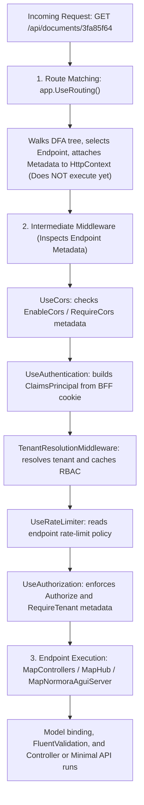
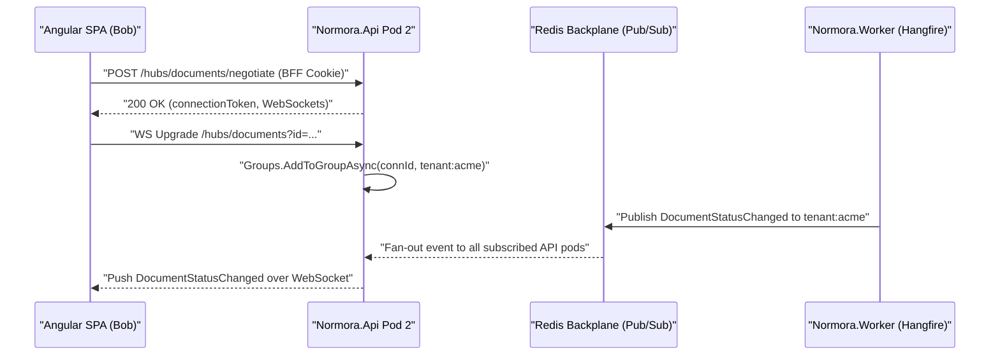
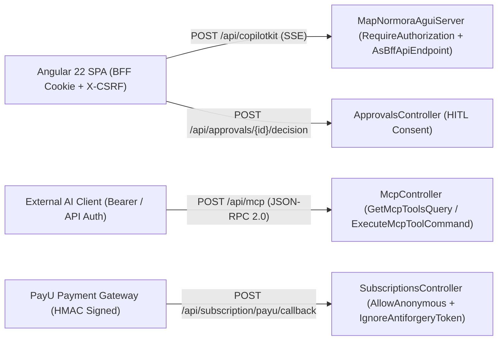

# Module 4: Routing, Endpoints, Minimal APIs & Real-Time SignalR

Routing is the **GPS and dispatch system** of your web application. When an HTTP request arrives at your server saying `GET /api/events/42/tickets`, routing is the mechanism that looks at that URL, decodes it, and determines: *"This request should be handled by the `GetTickets` method of the `EventsController`, and the `id` parameter is `42`."*

For a software architect, routing is not just about string matching: it governs **RESTful API contracts, performance benchmarks, real-time bidirectional communication, defense-in-depth parameter constraints, and modern AI agent interfaces.**

---

## 1. What is Routing?

### The Core Problem
Your ASP.NET Core application has dozens (or hundreds) of C# methods that handle different operations: creating workspaces, fetching documents, deleting conversations. An HTTP request is just a URL string and an HTTP verb. **Something** has to map `/api/departments/3fa85f64` to a specific `GetById(Guid id)` method.

That "something" is the **Router**.

> **Analogy — The Post Office:**  
> Think of routing like a post office. Letters (HTTP requests) arrive with an address (URL). The post office (router) reads the address, looks it up in its delivery registry, and dispatches the letter to the correct mailbox (C# method). If the address doesn't match any mailbox, the letter is returned with "Address Unknown" (404 Not Found).

### What Routing Does, Step by Step
1. **Receives** an incoming URL: `GET /api/documents/3fa85f64-5717-4562-b3fc-2c963f66afa6`
2. **Matches** it against all registered **route templates** (URL patterns with literal segments and parameter placeholders): `"/api/documents/{id:guid}"`
3. **Extracts** parameters: `id = 3fa85f64-5717-4562-b3fc-2c963f66afa6`
4. **Selects** the **endpoint** (the executable C# method or lambda delegate, together with its route pattern and attached metadata)
5. **Binds** the extracted values to the method's parameters

### Under the Hood: The DFA Route Matcher & Route Precedence
Beginners often imagine the router loops through a `List<Route>` with regular expressions one by one—which would get slower as an application grows from 20 endpoints to 500. Instead, ASP.NET Core compiles all route templates at startup into a **Deterministic Finite Automaton (DFA)**—a state-machine prefix tree. Because a DFA walks segment by segment, matching time is proportional to the **length of the incoming URL** (`O(URL length)`), not the total number of registered routes.

When two route templates could both match the same URL, ASP.NET Core resolves ties using **route precedence** (specificity scoring):
1. **Literal segments** beat everything else (`documents/metrics` beats `documents/{slug}`).
2. **Constrained parameters** beat unconstrained parameters (`documents/{id:guid}` beats `documents/{slug}`).
3. **Unconstrained parameters** beat catch-all parameters (`documents/{slug}` beats `documents/{**path}`).

If two endpoints still tie with identical specificity and HTTP method (for example, two controllers accidentally declaring `[HttpGet("api/documents/{id:guid}")]` without distinguishing constraints), the router throws an **`AmbiguousMatchException`** (`500 Internal Server Error`) at request time.

> **When NOT to rely on implicit route precedence:** Never stack overlapping parameter templates on the same HTTP verb (such as `{tenantSlug}` and `{categorySlug}` at the same path depth) hoping precedence will sort them out. Give each resource an explicit literal prefix (`/api/tenants/{slug}` vs `/api/categories/{slug}`) so routes are unambiguous to both the DFA and human readers.

### Real-World Normora Routing Examples
1. **Document Detail Lookup (`Documents` Module):** `GET /api/documents/7c9e6679-7425-40de-944b-e07fc1f90ae7` matches `DocumentsController.GetById(Guid id)` via `[HttpGet("{id:guid}")]`, binding `id` to the document's UUID.
2. **Workspace Branding Lookup (`Tenants` Module):** `GET /api/tenants/acme-corp/branding` matches `BrandingController.GetBranding(string tenantSlug)`, routing public login-page logo requests to the right workspace.
3. **Conversational History (`Conversations` Module):** `GET /api/conversations/f47ac10b-58cc-4372-a567-0e02b2c3d479/messages?page=1&pageSize=25` matches route parameter `conversationId` and query-string pagination parameters.
4. **Model Context Protocol RPC (`Documents` Module):** `POST /api/mcp` matches `McpController.HandleRpc()`—a single JSON-RPC 2.0 endpoint where the action is selected inside the JSON payload (`tools/list`, `tools/call`) rather than separate REST URLs.
5. **Real-Time Document Hub (`Normora.Api` Host):** `wss://app.normora.io/hubs/documents` matches the SignalR hub endpoint mapped at `/hubs/documents` after an initial HTTP `POST /hubs/documents/negotiate` handshake.

---

## 2. Endpoint Routing — The Modern Two-Stage Architecture

Prior to ASP.NET Core 3.0, routing was an internal subsystem of MVC (`app.UseMvc()`). MVC performed route matching, authentication, authorization, and action execution all inside a single monolithic block. This made it impossible for other middleware to inspect **endpoint metadata** (custom attributes or policy markers attached to an endpoint, such as `[Authorize]`, `[AllowAnonymous]`, or rate-limiting rules).

Modern ASP.NET Core uses **Endpoint Routing**, which decouples routing into **two distinct pipeline stages**:



### Why Split Them?
Because **middleware sitting between routing and execution** can inspect `HttpContext.GetEndpoint()` and make security or infrastructure decisions based on *which* endpoint was matched—before a single line of controller code runs.

```csharp
// Explicit two-stage ordering in Normora.Api/Program.cs
app.UseRouting();                  // 1. Match URL -> attach Endpoint & Metadata
app.UseCors("CorsPolicy");         //    Inspects [EnableCors] / RequireCors metadata
app.UseAuthentication();           //    Establishes ClaimsPrincipal from BFF session cookie
app.UseBff();                      //    Validates Duende BFF anti-forgery & session state
app.UseMiddleware<TenantResolutionMiddleware>(); // Resolves active tenant from route/host/claims
app.UseAuthorization();            //    Enforces [Authorize] / RequireAuthorization metadata
app.MapControllers();              // 2. Execute the matched controller endpoint
```

Without this split, `UseAuthorization()` wouldn't know *which* endpoint needs checking until after the endpoint had already executed—which is far too late.

### Endpoint Metadata & Implicit vs. Explicit `UseRouting()`
Every endpoint carries a read-only `EndpointMetadataCollection` (`endpoint.Metadata`). Any attribute on a controller/action (`[Authorize]`, `[EnableCors]`, `[ProducesResponseType]`) and any fluent builder call on a Minimal API or Hub (`.RequireAuthorization()`, `.AsBffApiEndpoint()`, `.WithTags()`, `.ExcludeFromDescription()`) adds an object to that endpoint's metadata bag.

- **Implicit `UseRouting()` in .NET 10:** When using `WebApplication.CreateBuilder(args)`, ASP.NET Core automatically inserts `UseRouting()` at the start of the pipeline if you don't call it yourself.
- **When you MUST call `app.UseRouting()` explicitly:** Whenever custom middleware—like Normora's `TenantResolutionMiddleware` or CORS/auth middleware—must execute *after* route matching (so `HttpContext.GetEndpoint()` and `HttpContext.Request.RouteValues` are already populated) and *before* endpoint execution.
- **When NOT to use Endpoint Metadata:** Do not attach cross-cutting transport concerns that apply identically to *every* HTTP response (such as `Strict-Transport-Security`, `Content-Security-Policy`, `X-Content-Type-Options`, or request correlation IDs) as per-endpoint metadata. Those belong in global pipeline middleware (covered in [Module 2](02_Module_2_Middleware_and_Pipeline.md)) so an endpoint can never accidentally opt out.

### Real-World Normora Endpoint Routing Examples
1. **BFF Anti-Forgery Enforcement (`.AsBffApiEndpoint()`):** Normora attaches Duende BFF metadata to API controllers, SignalR hubs, and AG-UI endpoints so `app.UseBff()` automatically requires the `X-CSRF: 1` header on browser calls to those endpoints while leaving static assets alone.
2. **Webhook Anti-Forgery Bypass (`[IgnoreAntiforgeryToken]`):** For externally signed payment gateway callbacks (such as PayU notifying Normora of a subscription renewal), Normora attaches `[IgnoreAntiforgeryToken]` metadata to that single callback action and verifies PayU's HMAC signature inside the handler—never disabling anti-forgery globally.
3. **Tenant Context Resolution:** `TenantResolutionMiddleware` runs *after* `UseRouting()` and `UseAuthentication()`, allowing it to inspect `HttpContext.GetEndpoint()` to skip tenant lookup on `[AllowAnonymous]` health/auth endpoints while enforcing tenant context on module endpoints.
4. **Rate-Limiting AI Endpoints (`.RequireRateLimiting("ai-copilot")`):** Attaching rate-limiter metadata to `ConversationsController` and `/api/copilotkit` lets `UseRateLimiter()` throttle expensive Google Gemini calls before controller/MediatR execution starts.
5. **Hiding Internal Endpoints from OpenAPI (`.ExcludeFromDescription()`):** Redirect endpoints like `app.MapGet("/scalar", ...).ExcludeFromDescription()` attach metadata that keeps internal convenience routes out of Normora's generated OpenAPI contract.

---

## 3. Controller Routing (Attribute Routing)

For larger modular APIs, **Controllers** are the classic, structured approach: you group related HTTP actions into a class inheriting from `ControllerBase` and decorate the class and methods with **attribute routing** (`[Route]`, `[HttpGet]`, `[HttpPost]`, etc.).

- **What it is:** Declaring URL templates directly on controller classes and methods via C# attributes, paired with `[ApiController]` conventions.
- **Why use it:** Controllers keep complex domain APIs organized by resource, integrate naturally with MVC filters and OpenAPI attributes, and let each module in a modular monolith own its own HTTP surface.
- **When NOT to use Controllers:** Avoid Controllers for lightweight single-purpose endpoints (health probes, Scalar/OpenAPI redirects), Native AOT microservices where reflection-free Minimal APIs cut cold-start time, or streaming agent protocols like AG-UI where Minimal APIs / framework extension endpoints are cleaner.

### Basic Controller Setup (with C# 14 Primary Constructors)
In Normora, business controllers never live in `Normora.Api`; each controller resides inside its owning module's `API/` folder (`server/Modules/{ModuleName}/API/{Feature}Controller.cs`) and receives `IMediator` via a **C# 14 primary constructor**:

```csharp
// server/Modules/Tenants/API/DepartmentsController.cs
[ApiController]
[Authorize]
[Route("api/departments")] // Explicit, immutable API contract
public sealed class DepartmentsController(IMediator mediator) : ControllerBase
{
    // GET /api/departments
    [HttpGet]
    public async Task<ActionResult<ApiResponse<IReadOnlyList<DepartmentDto>>>> GetAll(CancellationToken ct)
    {
        var departments = await mediator.Send(new GetDepartmentsQuery(), ct);
        return Ok(ApiResponse<IReadOnlyList<DepartmentDto>>.Success(departments));
    }

    // GET /api/departments/3fa85f64-5717-4562-b3fc-2c963f66afa6
    [HttpGet("{id:guid}", Name = "GetDepartmentById")]
    public async Task<ActionResult<ApiResponse<DepartmentDto>>> GetById(Guid id, CancellationToken ct)
    {
        var department = await mediator.Send(new GetDepartmentByIdQuery(id), ct);
        // Never leak whether an ID belongs to another tenant (BOLA -> 404 with generic message)
        return department is null
            ? NotFound(ApiResponse.Failure(ApiMessages.NotFound))
            : Ok(ApiResponse<DepartmentDto>.Success(department));
    }

    // POST /api/departments
    [HttpPost]
    public async Task<ActionResult<ApiResponse<DepartmentDto>>> Create(
        CreateDepartmentRequest request,
        CancellationToken ct)
    {
        var created = await mediator.Send(new CreateDepartmentCommand(request.Name), ct);
        return CreatedAtRoute("GetDepartmentById", new { id = created.Id }, ApiResponse<DepartmentDto>.Success(created));
    }

    // PUT /api/departments/3fa85f64-5717-4562-b3fc-2c963f66afa6
    [HttpPut("{id:guid}")]
    public async Task<IActionResult> Update(Guid id, UpdateDepartmentRequest request, CancellationToken ct)
    {
        await mediator.Send(new UpdateDepartmentCommand(id, request.Name), ct);
        return NoContent();
    }

    // DELETE /api/departments/3fa85f64-5717-4562-b3fc-2c963f66afa6
    [HttpDelete("{id:guid}")]
    public async Task<IActionResult> Delete(Guid id, CancellationToken ct)
    {
        await mediator.Send(new DeleteDepartmentCommand(id), ct);
        return NoContent();
    }
}
```

### The `[ApiController]` Attribute — What It Actually Does
This single attribute enables **critical behaviors** that streamline API development:

| Behavior | What it does |
|---|---|
| **Automatic Model Validation** | If `ModelState` is invalid, automatically returns `400 Bad Request` before your code runs |
| **Binding Source Inference** | Complex types default to `[FromBody]`, simple types default to `[FromRoute]` or `[FromQuery]` |
| **Problem Details Responses** | Automatically formats error responses according to RFC 9457 / RFC 7807 Problem Details specification |
| **Multipart/Form-Data Inference** | Parameters of type `IFormFile` or `IFormFileCollection` automatically bind from `[FromForm]` |

### ⚠️ The Renaming Trap: `[Route("api/[controller]")]`
Many beginner templates use token replacement:
```csharp
[Route("api/[controller]")] // ❌ FRAGILE
public class TenantsController : ControllerBase
```
If a developer refactors or renames `TenantsController` to `WorkspacesController`, the public API route silently changes from `/api/tenants` to `/api/workspaces`, breaking external clients!

**Architectural Standard:** Always declare explicit, immutable URI paths:
```csharp
[Route("api/tenants")] // ✅ IMMUTABLE PRODUCTION CONTRACT
public sealed class TenantsController(IMediator mediator) : ControllerBase
```

### Decentralized Controller Discovery & Route Overrides
Because Normora's controllers live in separate module assemblies (`Normora.Modules.Tenants`, `Normora.Modules.Documents`, `Normora.Modules.Conversations`), `Normora.Api` registers them as **Application Parts** at startup:

```csharp
builder.Services.AddControllers()
    .AddApplicationPart(typeof(TenantsController).Assembly)
    .AddApplicationPart(typeof(DocumentsController).Assembly)
    .AddApplicationPart(typeof(ConversationsController).Assembly);
```

And if a single action inside a controller needs to break out of the class-level `[Route("api/documents")]` prefix—for instance, a nested child route under another resource—prefix the action route with `~/`:

```csharp
[HttpGet("~/api/departments/{departmentId:guid}/documents")]
public async Task<IActionResult> GetByDepartment(Guid departmentId, CancellationToken ct) { ... }
```

### Link Generation & the `Async` Suffix Trap
When returning `201 Created` via `CreatedAtAction(nameof(GetByIdAsync), ...)`, remember that ASP.NET Core MVC automatically strips the `Async` suffix from action names at startup (`SuppressAsyncSuffixInActionNames = true` by default). Using `nameof(GetByIdAsync)` evaluates to `"GetByIdAsync"`, which fails to match the registered `"GetById"` route and throws `InvalidOperationException: No route matches the supplied values` at runtime!
**Architect's Fix:** Prefer **`CreatedAtRoute("GetDepartmentById", ...)`** with an explicit `Name = "..."` on your `[HttpGet]` attribute, or inject `LinkGenerator` when building URLs outside a controller.

### Real-World Normora Controller Routing Examples
1. **Departments CRUD (`server/Modules/Tenants/API/DepartmentsController.cs`):** Uses `[Route("api/departments")]` with `{id:guid}` constraints and named route `"GetDepartmentById"` for safe `CreatedAtRoute` link generation.
2. **Document Upload & Retrieval (`server/Modules/Documents/API/DocumentsController.cs`):** Maps `POST /api/documents` (`[FromForm]` multipart upload returning `202 Accepted`) alongside `GET /api/documents/{id:guid}/chunks` for chunk preview inspection.
3. **Subscription & Currency Management (`server/Modules/Tenants/API/SubscriptionsController.cs`):** Exposes `PUT /api/subscription/currency` and `POST /api/subscription/checkout`, while marking the PayU payment callback `POST /api/subscription/payu/callback` with `[AllowAnonymous]` and `[IgnoreAntiforgeryToken]`.
4. **Conversations & HITL Approvals (`server/Modules/Conversations/API/ApprovalsController.cs`):** Routes `POST /api/approvals/{approvalId:guid}/decision` so users can explicitly approve or reject two-phase server-enforced AI tool actions (like `documents_delete`).
5. **External AI Tool Gateway (`server/Modules/Documents/API/McpController.cs`):** Maps `POST /api/mcp` with `[Route("api/mcp")]` as a JSON-RPC 2.0 endpoint that dispatches `GetMcpToolsQuery` and `ExecuteMcpToolCommand` across modules via MediatR.

---

## 4. Route Parameters & Defensive Constraints

Route constraints enforce data typing and structural invariants directly within the URL template. If the incoming URL fails the constraint, the routing engine does not match the endpoint, returning `404 Not Found` immediately (or matching a lower-precedence overload).

```csharp
[HttpGet("{id:guid}")] // Matches only valid GUIDs: /api/documents/3fa85f64-...
public async Task<IActionResult> GetById(Guid id, CancellationToken ct)

[HttpGet("by-number/{sequence:int:min(1)}")] // Positive integers only
public async Task<IActionResult> GetBySequence(int sequence, CancellationToken ct)

[HttpGet("slug/{slug:alpha:minlength(3)}")] // Alphabetical only, min length 3
public async Task<IActionResult> GetBySlug(string slug, CancellationToken ct)

// Optional parameters (?) and query string defaults:
[HttpGet("metrics/{year:int?}")] // year is optional
public async Task<IActionResult> GetMetrics(int? year, CancellationToken ct)

[HttpGet("search")] // query string parameters with defaults
public async Task<IActionResult> Search([FromQuery] int page = 1, [FromQuery] int pageSize = 20)
```

### Built-In Route Constraints Reference

| Constraint | Example | Purpose |
|---|---|---|
| `int` / `long` | `{page:int}` | Matches 32-bit / 64-bit integers |
| `guid` | `{documentId:guid}` | Matches RFC 4122 UUIDs |
| `bool` | `{includeArchived:bool}` | Matches `true` or `false` |
| `alpha` | `{lang:alpha}` | ASCII letters (`a-z`, `A-Z`) only |
| `min` / `max` / `range` | `{year:range(2020,2100)}` | Numeric bounds |
| `minlength` / `maxlength` / `length` | `{code:length(3,10)}` | String length bounds |
| `regex(...)` | `{slug:regex(^[a-z0-9-]+$)}` | Regular expression match (keep simple to avoid ReDoS!) |
| `required` | `{tenantSlug:required}` | Requires non-empty value even when default exists |
| `{**catchAll}` | `{**objectKey}` | Captures multi-segment paths containing `/` (e.g., MinIO storage keys) |

### Custom `IRouteConstraint` & Parameter Transformers
When built-in constraints aren't enough, implement `IRouteConstraint` and register it in `AddRouting`:

```csharp
public sealed class TenantSlugConstraint : IRouteConstraint
{
    public bool Match(
        HttpContext? httpContext,
        IRouter? route,
        string routeKey,
        RouteValueDictionary values,
        RouteDirection routeDirection)
    {
        if (!values.TryGetValue(routeKey, out var raw) || raw is not string slug)
            return false;

        return slug.Length is >= 2 and <= 63
            && slug.All(c => char.IsAsciiLetterLower(c) || char.IsAsciiDigit(c) || c == '-');
    }
}

// Program.cs
builder.Services.AddRouting(options =>
{
    options.LowercaseUrls = true;
    options.ConstraintMap.Add("tenantslug", typeof(TenantSlugConstraint));
});
```

### Why Route Constraints are an Architect's Shield—and When NOT to Use Them
1. **Prevents Database Query Waste:** If a client requests `/api/tenants/invalid-text`, a `{id:guid}` constraint rejects the request at the routing level. The application never attempts to parse a string into a GUID or query PostgreSQL.
2. **Disambiguates Overloaded Routes:** You can map `GET /api/documents/{id:guid}` to fetch by ID and `GET /api/documents/{slug:alpha}` to fetch by tag/slug without `AmbiguousMatchException`.

> **When NOT to use Route Constraints:** **Never use route constraints for business input validation!** Because a failed route constraint skips the endpoint and returns `404 Not Found` (not `400 Bad Request`), using `{email:regex(...)}` or `{name:minlength(8)}` on a route prevents FluentValidation from running and misleads API consumers into thinking the endpoint URL doesn't exist. Keep route constraints strictly for **data-type safety** (`guid`, `int`) and **route disambiguation**, and let FluentValidation (Module 6) handle user-input rules. Also avoid complex nested quantifiers inside `regex(...)` constraints, which can expose your router to **ReDoS** (Regular Expression Denial of Service).

### Real-World Normora Route Parameter & Constraint Examples
1. **Document UUID Guard (`Documents` Module):** `GET /api/documents/{documentId:guid}` rejects malformed IDs like `/api/documents/undefined` (a classic frontend bug!) at the DFA router before `DocumentsDbContext` is ever touched.
2. **Nested Conversation & Message Lookup (`Conversations` Module):** `DELETE /api/conversations/{conversationId:guid}/messages/{messageId:guid}` enforces both route segments as valid GUIDs before verifying tenant and user ownership.
3. **Catch-All Object Key Preview (`Documents` / `Tenants` Modules):** `GET /api/branding/assets/{**assetPath}` uses the double-asterisk catch-all `{**assetPath}` so nested MinIO paths like `logos/2026/acme.png` bind cleanly into a single string parameter.
4. **Custom Workspace Slug Guard (`Tenants` Module):** `GET /api/tenants/{slug:tenantslug}/branding` validates lowercase alphanumeric-hyphen workspace slugs via `TenantSlugConstraint` without running a Redis or PostgreSQL lookup on garbage paths.
5. **Audit Log Time Window (`Tenants` Module):** `GET /api/audit-logs?from=2026-01-01&page=1&pageSize=50` keeps filter criteria (`from`, `page`, `pageSize`) in `[FromQuery]` parameters—never in the URL path—so optional filters remain cacheable and clean.

---

## 5. Minimal APIs: Architecture, Route Groups, Filters & .NET 10 SSE

Introduced in .NET 6 and matured through .NET 10, **Minimal APIs** allow developers to define HTTP endpoints directly as lambda delegates or method groups, bypassing the MVC controller reflection pipeline.

- **What they are:** Lightweight HTTP endpoints mapped directly onto `IEndpointRouteBuilder` (`app.MapGet`, `app.MapPost`, `app.MapGroup`).
- **Why use them:** Zero controller/filter allocation overhead, native AOT (Ahead-Of-Time) readiness, first-class `TypedResults` OpenAPI inference, and clean ergonomics for infrastructure, streaming, and BFF endpoints.
- **When NOT to use Minimal APIs:** Do not mix Minimal APIs arbitrarily into domain modules whose team convention is MVC Controllers + MediatR—inconsistent endpoint styles across a modular monolith fragment OpenAPI conventions, authorization attributes, and onboarding clarity. Use Controllers for cohesive domain resource groups (`Tenants`, `Documents`, `Conversations`) and Minimal APIs for host/BFF, health, webhook, and streaming endpoints (or commit to Minimal APIs consistently if building a microservice).

### Architectural Performance Characteristics:
*   **Zero MVC Overhead:** Skips the Controller Activator, Action Descriptors, and MVC filter pipeline allocation.
*   **Native AOT Ready:** Can be pre-compiled into native machine code with zero JIT (Just-In-Time) overhead and instant cold starts.
*   **Low Allocation:** Significantly reduced per-request GC allocations compared to full MVC controllers for simple operations.

### Clean Organization with Route Groups (`MapGroup`) & Union `Results<...>`
Senior architects organize Minimal APIs using **Route Groups** (`MapGroup`) to apply shared prefixes, authorization policies, OpenAPI tags, and rate limits across related endpoints, while returning compile-time **union result types (`Results<T1, T2>`)** so OpenAPI automatically documents every possible status code:

```csharp
public static class DocumentsEndpointExtensions
{
    public static RouteGroupBuilder MapDocumentsEndpoints(this IEndpointRouteBuilder app)
    {
        var group = app.MapGroup("/api/v1/documents")
            .WithTags("Documents")
            .RequireAuthorization()
            .AsBffApiEndpoint(); // Applies Duende BFF CSRF & cookie rules to all routes in group

        group.MapGet("/", async (IMediator mediator, CancellationToken ct) =>
        {
            var results = await mediator.Send(new GetDocumentsQuery(), ct);
            return TypedResults.Ok(ApiResponse<IReadOnlyList<DocumentDto>>.Success(results));
        });

        group.MapGet("/{id:guid}", async Task<Results<Ok<ApiResponse<DocumentDto>>, NotFound<ApiResponse>>> (
            Guid id,
            IMediator mediator,
            CancellationToken ct) =>
        {
            var doc = await mediator.Send(new GetDocumentByIdQuery(id), ct);
            return doc is null
                ? TypedResults.NotFound(ApiResponse.Failure(ApiMessages.NotFound))
                : TypedResults.Ok(ApiResponse<DocumentDto>.Success(doc));
        });

        return group;
    }
}
```

### Endpoint Filters (`IEndpointFilter`)
Minimal APIs do not run MVC `IActionFilter`s. Instead, they use **Endpoint Filters** (`IEndpointFilter`) to run logic immediately before and after the endpoint handler executes:

```csharp
public sealed class TenantHeaderRequiredFilter : IEndpointFilter
{
    public async ValueTask<object?> InvokeAsync(
        EndpointFilterInvocationContext context,
        EndpointFilterDelegate next)
    {
        var tenantContext = context.HttpContext.RequestServices.GetRequiredService<ITenantContext>();
        if (tenantContext.TenantId == Guid.Empty)
        {
            return TypedResults.BadRequest(ApiResponse.Failure(ApiMessages.TenantContextMissing));
        }

        return await next(context);
    }
}

// Attach to an entire group or single endpoint:
group.AddEndpointFilter<TenantHeaderRequiredFilter>();
```

> **When NOT to use Endpoint Filters:** Avoid duplicating business validation or cross-cutting logging in `IEndpointFilter` if your application already routes commands and queries through a MediatR `IPipelineBehavior<TRequest, TResponse>` (like FluentValidation behavior). Putting validation in both places causes double execution and inconsistent error formats.

### Native Server-Sent Events (SSE) in .NET 10 (`TypedResults.ServerSentEvents`)
Before .NET 10, streaming one-way real-time updates over HTTP required manually setting `Content-Type: text/event-stream` and flushing `Response.WriteAsync` buffers. **.NET 10** introduces first-class SSE support via `System.Net.ServerSentEvents.SseItem<T>` and `TypedResults.ServerSentEvents(...)`, which automatically sets headers, serializes JSON payloads, and handles client cancellation:

```csharp
using System.Net.ServerSentEvents;

app.MapGet("/api/documents/{documentId:guid}/status-stream", (
    Guid documentId,
    IDocumentStatusStream statusStream,
    CancellationToken ct) =>
{
    IAsyncEnumerable<SseItem<DocumentIngestionEvent>> events = statusStream.WatchAsync(documentId, ct);
    return TypedResults.ServerSentEvents(events, eventType: "ingestion-status");
})
.RequireAuthorization()
.AsBffApiEndpoint();
```

### Real-World Normora Minimal API & Extension Endpoint Examples
1. **Scalar Documentation Redirect (`Normora.Api/Program.cs`):** `app.MapGet("/scalar", () => Results.Redirect("/scalar/v1")).ExcludeFromDescription();` provides a clean developer shortcut without generating an MVC controller.
2. **Health & Readiness Probes (`Normora.Api/Program.cs`):** `app.MapHealthChecks("/health/ready").AllowAnonymous();` exposes Kubernetes/Docker health endpoints directly on the routing table without BFF session cookies.
3. **BFF Login/Logout Management Endpoints:** Duende BFF maps `/bff/login`, `/bff/user`, `/bff/logout`, and `/bff/backchannel` as Minimal-style route endpoints inside `app.MapBffManagementEndpoints()`.
4. **CopilotKit AG-UI Streaming Endpoint:** `app.MapNormoraAguiServer().RequireAuthorization().AsBffApiEndpoint();` exposes `/api/copilotkit` for real-time SSE token and tool-call streaming.
5. **One-Way Ingestion Progress Stream (.NET 10 SSE):** Streaming `SseItem<DocumentIngestionEvent>` with `TypedResults.ServerSentEvents(...)` offers a lightweight HTTP alternative when a client only needs unidirectional status updates for a single document upload.

---

## 6. HTTP Return Types and Status Codes

Choosing the right HTTP status code and C# return type is an architectural contract: it tells browsers, Angular interceptors, API gateways, and OpenAPI generators exactly what happened.

### Controller Return Types (`ControllerBase`)
Use **`ActionResult<T>`** (preferred over raw `IActionResult` for typed responses) so OpenAPI automatically discovers the success schema `T`, or pair `IActionResult` with `[ProducesResponseType]` attributes:

```csharp
return Ok(ApiResponse<DocumentDto>.Success(data));          // 200 — Success with JSON envelope
return CreatedAtRoute("GetDocumentById", new { id }, body); // 201 — Created + Location header
return AcceptedAtRoute("GetDocumentStatus", new { id }, body); // 202 — Queued via Outbox for async worker
return NoContent();                                         // 204 — Success, empty body (PUT/DELETE)
return BadRequest(ApiResponse.Failure(ApiMessages.InvalidRequest)); // 400 — Invalid client input
return Unauthorized();                                      // 401 — Unauthenticated caller
// ⚠️ Never return empty Forbid() in SPA APIs (triggers auth redirect instead of JSON)!
return StatusCode(StatusCodes.Status403Forbidden, ApiResponse.Failure(ApiMessages.Forbidden)); // 403 — BFLA
// ⚠️ Never return NotFound("Specific item X missing in tenant Y") (leaks existence for BOLA)!
return NotFound(ApiResponse.Failure(ApiMessages.NotFound)); // 404 — BOLA / Missing
return Conflict(ApiResponse.Failure(ApiMessages.DuplicateResource)); // 409 — Business/concurrency conflict
```

### Why Empty `Forbid()` and Verbose `NotFound("...")` are Dangerous
- **Empty `Forbid()`:** Calling `return Forbid();` invokes `IAuthenticationService.ForbidAsync()`, which in cookie/OIDC schemes can redirect to `/Account/AccessDenied` (HTML) rather than returning JSON—breaking Angular's HTTP error interceptor. Always throw `BflaException` (handled globally) or explicitly return `StatusCode(StatusCodes.Status403Forbidden, ApiResponse.Failure(ApiMessages.Forbidden))`.
- **Verbose `NotFound(...)`:** Returning `NotFound($"Document {id} belongs to Tenant B")` tells an attacker the document ID exists (**BOLA — Broken Object Level Authorization**). Normora maps `BolaException` globally to a uniform `404 Not Found` with `ApiMessages.NotFound`.

### Minimal API Return Types (`TypedResults` vs `Results<T1, T2>`)
Always prefer **`TypedResults`** over `Results` in Minimal APIs: `TypedResults` returns strongly-typed concrete types (`Ok<T>`, `NotFound<T>`) that are unit-testable without reflection and automatically emit OpenAPI metadata when combined with `Results<T1, T2>`:

```csharp
return TypedResults.Ok(data);
return TypedResults.Accepted($"/api/documents/{id}/status", payload);
return TypedResults.NoContent();
return TypedResults.Created($"/api/documents/{id}", data);
return TypedResults.BadRequest(ApiResponse.Failure(ApiMessages.InvalidRequest));
return TypedResults.NotFound(ApiResponse.Failure(ApiMessages.NotFound));
return TypedResults.Problem(detail: ApiMessages.UnexpectedError, statusCode: StatusCodes.Status500InternalServerError);
```

### Real-World Normora HTTP Return Type Examples
1. **Asynchronous Document Upload (`202 Accepted`):** `DocumentsController.Upload` persists metadata + a `DocumentProcessingOutboxMessage` in PostgreSQL and returns `202 Accepted` because Hangfire (`Normora.Worker`) extracts text and computes Gemini embeddings asynchronously.
2. **BOLA Defense (`404 Not Found`):** When a user in Tenant A requests `/api/documents/{tenantBDocId:guid}`, the query handler throws `BolaException` (mapped globally to `404` with `ApiMessages.NotFound`), indistinguishable from a non-existent GUID.
3. **BFLA Defense (`403 Forbidden`):** When a standard employee attempts `POST /api/departments`, RBAC enforcement throws `BflaException`, returning `403 Forbidden` with a structured `ApiResponse.Failure(ApiMessages.Forbidden)` JSON body for Angular toast alerts.
4. **Department Creation (`201 Created`):** `DepartmentsController.Create` returns `CreatedAtRoute("GetDepartmentById", new { id = created.Id }, ...)` so HTTP clients receive a standard `Location` header pointing to the new resource.
5. **Free Tier Cancellation Guard (`409 Conflict` / `400 Bad Request`):** Attempting to cancel a Free tier subscription in `SubscriptionsController` rejects the state transition using `ApiMessages.CannotCancelFreePlan` rather than silently returning `200 OK`.

---

## 7. Real-Time Endpoints with SignalR: WebSockets at Enterprise Scale

REST APIs follow a strict request-response paradigm: the client must initiate every interaction. For real-time applications — live document ingestion indicators, workspace notifications, and reactive `dataVersion` table refreshes — ASP.NET Core provides **SignalR**.

- **What it is:** A real-time RPC (Remote Procedure Call) abstraction over WebSockets (with automatic fallback to Server-Sent Events or Long Polling) backed by C# **Hub** classes.
- **Why use it:** Supports bidirectional messaging, automatic reconnection, and built-in **Groups** (ideal for multi-tenant room isolation) plus multi-pod horizontal scaling via a Redis backplane.
- **When NOT to use SignalR:** Do not use SignalR for strictly one-way HTTP streaming (such as single-request AI token streams or AG-UI events, where `TypedResults.ServerSentEvents` / SSE is simpler and stateless), for third-party webhooks, or for transferring large binary files (upload to MinIO via HTTP/presigned URLs instead).

### 🏗️ SignalR Routing & BFF Protection in Normora
Normora maps dedicated real-time hubs in `Normora.Api/Program.cs` (while the hub abstractions and notification dispatchers live in `Normora.Infrastructure/Hubs/`):

```csharp
// From Normora.Api/Program.cs
app.MapHub<DocumentHub>("/hubs/documents").AsBffApiEndpoint();
app.MapHub<NotificationHub>("/hubs/notifications").AsBffApiEndpoint();
```

Notice the `.AsBffApiEndpoint()` modifier: this attaches Duende BFF metadata so both the initial `POST /hubs/documents/negotiate` handshake and the WebSocket upgrade validate the client's encrypted `HttpOnly` session cookie and anti-CSRF protections!

### Strongly-Typed Hubs & Tenant-Isolated Groups
Never pass magic method-name strings like `SendAsync("DocumentReady")`. Always define a typed client interface (`Hub<TClient>`) and isolate connections by tenant inside `OnConnectedAsync`:

```csharp
public interface IDocumentHubClient
{
    Task DocumentStatusChanged(DocumentStatusMessage message);
    Task WorkspaceDataInvalidated(long dataVersion);
}

[Authorize]
public sealed class DocumentHub(ITenantContext tenantContext) : Hub<IDocumentHubClient>
{
    public override async Task OnConnectedAsync()
    {
        var groupName = $"tenant:{tenantContext.TenantId}";
        await Groups.AddToGroupAsync(Context.ConnectionId, groupName);
        await base.OnConnectedAsync();
    }
}
```

### ⚠️ The Multi-Node Scaling Problem & Cross-Process Worker Relay
In production, you run multiple container replicas of `Normora.Api` behind a load balancer, alongside a separate `Normora.Worker` process running Hangfire ingestion jobs. If Alice is connected to **API Pod 1** and Bob is connected to **API Pod 2**—and `Normora.Worker` finishes indexing a PDF—`Normora.Worker` has *no direct WebSocket connections* at all!

### 🛡️ The Architectural Fix: Redis Backplane
Normora solves both multi-pod API scaling and `Normora.Worker` → `Normora.Api` broadcasting by wiring a **Redis Pub/Sub Backplane** in `Normora.Infrastructure`:



```csharp
// From Normora.Infrastructure/Extensions/ApplicationServiceExtensions.cs
public static IServiceCollection AddNormoraSignalR(
    this IServiceCollection services, 
    IOptions<RedisOptions> redisOptions)
{
    var signalRBuilder = services.AddSignalR(options =>
    {
        options.EnableDetailedErrors = false; // Security: Never leak internals in production
    });

    // If Redis connection is configured, wire the distributed Redis backplane
    if (!string.IsNullOrWhiteSpace(redisOptions.Value.ConnectionString))
    {
        signalRBuilder.AddStackExchangeRedis(redisOptions.Value.ConnectionString, options =>
        {
            // Dedicated channel prefix to prevent collisions with other Redis databases
            options.Configuration.ChannelPrefix = StackExchange.Redis.RedisChannel.Literal(redisOptions.Value.ChannelPrefix);
        });
    }

    return services;
}
```

### Real-World Normora SignalR Examples
1. **Document Ingestion Hub (`/hubs/documents`):** Streams real-time status transitions (`Queued` → `Extracting` → `Chunking` → `Indexed` or `Failed`) to the Angular document table without polling.
2. **Workspace Notification Hub (`/hubs/notifications`):** Pushes HR escalation alerts, invitation acceptances, and `dataVersion` synchronization events so Angular `effect()` observers auto-refresh stale tables.
3. **Cross-Process Worker-to-Client Relay:** `Normora.Worker` injects `IDocumentNotificationService` (implemented via `IHubContext<DocumentHub, IDocumentHubClient>`) and publishes events into Redis without referencing `Normora.Api`.
4. **Tenant Group Isolation:** Every SignalR broadcast targets `Clients.Group($"tenant:{tenantId}")`—never `Clients.All`—guaranteeing Tenant A never receives Tenant B's ingestion events.
5. **BFF Cookie & CSRF Validation:** Mapping hubs with `.AsBffApiEndpoint()` blocks cross-origin WebSocket hijacking attempts from untrusted browser tabs.

---

## 8. Modern AI Agent Endpoints: CopilotKit, AG-UI & MCP

As enterprise software incorporates AI agents, backend architectures must host streaming protocols designed for multi-turn AI interactions, human-in-the-loop (HITL) approvals, and external tool discovery.



### AG-UI Protocol Endpoint (`/api/copilotkit`)
- **What it is:** The **AG-UI (Agent-User Interaction)** protocol hosted via `Microsoft.Agents.AI.Hosting.AGUI.AspNetCore` that streams AI text tokens, live tool-execution chips (`tool_started`, `tool_finished`), and interactive A2UI cards (`policy_limit_card`, `hr_escalation_card`, `intake_form_card`) over HTTP Server-Sent Events.
- **Why use it:** Eliminates brittle custom WebSocket framing for AI chats and binds directly to `NormoraWorkplaceAgent` (`AIAgent`), while `NormoraAgentIsolationKeyProvider` partitions agent thread state strictly by `{TenantId}:{ExternalUserId}`.
- **When NOT to use it:** Never route deterministic CRUD forms, file uploads, or batch background ingestion through `/api/copilotkit`—use standard REST endpoints + Hangfire outbox dispatch for predictable latency and transactional guarantees.

```csharp
// From Normora.Api/Program.cs
// Microsoft Agent Framework AG-UI endpoint for CopilotKit Workplace Intelligence:
app.MapNormoraAguiServer()
    .RequireAuthorization()
    .AsBffApiEndpoint();
```

### Model Context Protocol (MCP) Endpoint (`/api/mcp`)
- **What it is:** A standard **JSON-RPC 2.0** HTTP endpoint (`server/Modules/Documents/API/McpController.cs`) exposing Normora's knowledge search and workspace tools (`tools/list`, `tools/call`, `resources/list`) to external AI orchestrators.
- **How it respects Modular Boundaries:** `McpController` lives in the `Documents` module, yet tools like `workspace_list_departments` or `conversations_list` belong to `Tenants` and `Conversations`. Rather than injecting `IAgentToolRegistry` across module boundaries, `McpController` dispatches `GetMcpToolsQuery` and `ExecuteMcpToolCommand` via MediatR contracts in `Normora.Shared.Contracts.Conversations`.
- **When NOT to use MCP:** Do not use JSON-RPC over `/api/mcp` for your first-party Angular SPA views—REST endpoints give you HTTP status codes, OpenAPI types, and browser cache semantics that JSON-RPC hides inside `200 OK` envelopes.

### Real-World Normora AI & Callback Endpoint Examples
1. **CopilotKit Stream (`/api/copilotkit`):** Streams `NormoraWorkplaceAgent` responses and live tool chips over SSE, protected by `.RequireAuthorization()` and `.AsBffApiEndpoint()`.
2. **MCP Tool Gateway (`POST /api/mcp`):** Handles JSON-RPC 2.0 `tools/list` and `tools/call` payloads, dispatching cross-module commands through MediatR without breaking module encapsulation.
3. **Two-Phase HITL Approval (`POST /api/approvals/{approvalId:guid}/decision`):** Completes or rejects server-enforced destructive tool calls (like `documents_delete`) stored in `PendingApproval` with a 15-minute TTL.
4. **Externally Signed Payment Callback (`POST /api/subscription/payu/callback`):** Uses `[IgnoreAntiforgeryToken]` *only* because PayU posts externally without a browser CSRF token, verifying PayU's cryptographic hash + `udf3` (`"{currency}:{cycle}"`) before updating billing state.
5. **Persona-Scoped Suggestions (`GET /api/conversations/suggestions`):** Serves contextual prompt pills filtered by the active Copilot persona (`All-Rounder`, `HR & People Ops`, `Finance & Travel`, `IT & Security`).

---

## 9. Cross-Cutting Routing Configuration (URLs, CORS, Rate Limiting & OpenAPI)

Routing behavior is also shaped by global host configuration in `Program.cs` and infrastructure extensions.

### 🏗️ Lowercase URLs & Configurable CORS Origins (NextEvent & Normora)
```csharp
// From NextEvent's ApiServiceExtensions.cs (same pattern used in Normora.Api)
services.AddRouting(options =>
{
    options.LowercaseUrls = true;  // /api/Users/5 → /api/users/5
});

// CORS origins loaded from configuration, not hardcoded
var allowedOrigins = configuration.GetSection("AllowedOrigins").Get<string[]>() ?? [];
services.AddCors(options =>
{
    options.AddPolicy("CorsPolicy", policy =>
    {
        policy.AllowAnyHeader()
              .AllowAnyMethod()
              .AllowCredentials()
              .WithOrigins(allowedOrigins);
    });
});
```

**Why `LowercaseUrls = true`?** REST API conventions dictate lowercase URLs. Without this, generated links (like `Location` headers from `CreatedAtRoute` or OpenAPI paths) can emit mixed casing, causing CDN cache fragmentation and inconsistent client expectations. And for endpoints that *must* allow external origins differently from the SPA, override at the endpoint level with `[EnableCors("PublicBrandingPolicy")]` or `.RequireCors(...)` rather than weakening the global `"CorsPolicy"`.

### 🏗️ NextEvent: JSON Serialization Configuration
```csharp
// From NextEvent's ApiServiceExtensions.cs
services.AddControllers()
    .AddJsonOptions(options =>
    {
        options.JsonSerializerOptions.PropertyNamingPolicy = JsonNamingPolicy.CamelCase;
        options.JsonSerializerOptions.PropertyNameCaseInsensitive = true;
    });
```

*   **`CamelCase`:** C# properties (`FirstName`) are serialized as JSON (`firstName`), matching JavaScript/Angular frontend expectations.
*   **`PropertyNameCaseInsensitive`:** When receiving JSON from clients, `firstname`, `FirstName`, and `FIRSTNAME` all bind correctly, preventing frustrating 400 errors from casing mismatches.

### 🏗️ Modern API Documentation: Migrating from Swagger to Scalar (.NET 10)
In **Normora**, API documentation is generated using native **.NET 10 OpenAPI** (`Microsoft.AspNetCore.OpenApi`) and exposed through modern **Scalar UI**, gated strictly to Development:

```csharp
// From Normora.Api/Program.cs
if (app.Environment.IsDevelopment())
{
    app.MapOpenApi();
    app.MapScalarApiReference();
    app.MapGet("/scalar", () => Results.Redirect("/scalar/v1")).ExcludeFromDescription();
}
```

> **When NOT to expose OpenAPI / Scalar:** Never map `MapOpenApi()` or `MapScalarApiReference()` unconditionally in production—publicly browsable endpoint schemas act as a free reconnaissance map for attackers looking for admin or BFLA targets.

### Real-World Normora Cross-Cutting Routing Examples
1. **Strict Lowercase Routing (`Normora.Api`):** `AddRouting(o => o.LowercaseUrls = true)` ensures generated `Location` headers (e.g., `/api/departments/{id}`) stay lowercase across all modules.
2. **Endpoint-Level AI Rate Limiting:** Applying `.RequireRateLimiting("ai-copilot")` to `/api/copilotkit` and `[EnableRateLimiting("ai-copilot")]` on `ConversationsController` protects Gemini quota without throttling lightweight UI reads.
3. **BFF-Safe CORS Policy:** `CorsPolicy` binds `WithOrigins(allowedOrigins)` plus `.AllowCredentials()` so Angular (`localhost:4200`) can send `HttpOnly` BFF cookies—never `AllowAnyOrigin()` combined with `AllowCredentials()` (which ASP.NET Core rejects at runtime!).
4. **Development-Only Scalar UI (`/scalar/v1`):** `MapOpenApi()` + `MapScalarApiReference()` inspects `ActionResult<T>` and `Results<T1, T2>` metadata to render live interactive docs strictly when `IsDevelopment()` is true.
5. **Zero-Leakage SignalR Errors:** `AddSignalR(o => o.EnableDetailedErrors = false)` ensures internal C# exception details are never serialized over WebSocket frames to clients.

---

## 10. Common Mistakes & Anti-Patterns

> [!CAUTION]
> **Anti-Pattern 1: Fragile `[Route("api/[controller]")]` Token Replacement**
> ```csharp
> // ❌ WRONG: Public API URL depends on the C# class name
> [ApiController]
> [Route("api/[controller]")]
> public class TenantsController : ControllerBase { }
> ```
> **Why it's wrong:** Renaming `TenantsController` to `WorkspacesController` during a refactor silently breaks every frontend service, mobile client, and webhook pointing at `/api/tenants`.
>
> **The fix:** Always hardcode an explicit route template (`[Route("api/tenants")]`) and use a C# 14 primary constructor for DI:
> ```csharp
> // ✅ CORRECT
> [ApiController]
> [Route("api/tenants")]
> public sealed class TenantsController(IMediator mediator) : ControllerBase { }
> ```

> [!CAUTION]
> **Anti-Pattern 2: Using Route Constraints for Business Input Validation**
> ```csharp
> // ❌ WRONG: Rejects short or invalid slugs with a misleading 404 Not Found
> [HttpGet("tenants/{slug:alpha:minlength(5)}")]
> public async Task<IActionResult> GetBySlug(string slug) { ... }
> ```
> **Why it's wrong:** When a constraint fails, ASP.NET Core skips the endpoint and returns `404 Not Found`. Clients cannot tell whether the URL path is wrong or their `slug` input failed validation, and your FluentValidation error envelope never runs.
>
> **The fix:** Use route constraints strictly for primitive type safety (`{id:guid}`, `{page:int}`) or route disambiguation, and validate domain rules via FluentValidation (returning `400 Bad Request` with field errors).

> [!CAUTION]
> **Anti-Pattern 3: Returning Empty `Forbid()` or Verbose `NotFound("...")` in SPA Controllers**
> ```csharp
> // ❌ WRONG: Leaks tenant data (BOLA) or breaks Angular JSON error interceptors
> if (doc.TenantId != currentTenantId) return NotFound($"Document {id} belongs to another workspace");
> if (!isAdmin) return Forbid();
> ```
> **Why it's wrong:** Returning a custom `NotFound` message reveals that `id` exists in another tenant (Broken Object Level Authorization / BOLA), and empty `Forbid()` triggers an authentication challenge redirect instead of a structured JSON body.
>
> **The fix:** Throw `BolaException()` (mapped globally to `404` with `ApiMessages.NotFound`) or `BflaException()` (mapped globally to `403`), or return `StatusCode(StatusCodes.Status403Forbidden, ApiResponse.Failure(ApiMessages.Forbidden))`.

> [!CAUTION]
> **Anti-Pattern 4: Skipping Anti-Forgery Broadly Based on `[AllowAnonymous]`**
> ```csharp
> // ❌ WRONG: Disabling CSRF checks for every [AllowAnonymous] endpoint
> if (endpoint?.Metadata.GetMetadata<IAllowAnonymous>() is not null)
> {
>     // Bypass antiforgery globally -> dangerous!
> }
> ```
> **Why it's wrong:** Some anonymous endpoints (like login, public forms, or BFF-adjacent routes) are still browser-reachable and vulnerable to CSRF or abuse. Broadly skipping antiforgery based on `[AllowAnonymous]` weakens defense-in-depth.
>
> **The fix:** Use `.AsBffApiEndpoint()` for SPA-consumed routes/hubs/AG-UI endpoints, and apply `[IgnoreAntiforgeryToken]` *only* to specific externally signed webhook actions (such as PayU callbacks) that validate cryptographic signatures.

> [!CAUTION]
> **Anti-Pattern 5: `CreatedAtAction(nameof(GetByIdAsync), ...)` Failing at Runtime**
> ```csharp
> // ❌ WRONG: MVC strips "Async" from action names by default!
> [HttpGet("{id:guid}")]
> public async Task<IActionResult> GetByIdAsync(Guid id) { ... }
>
> [HttpPost]
> public async Task<IActionResult> CreateAsync(CreateDepartmentRequest req)
> {
>     return CreatedAtAction(nameof(GetByIdAsync), new { id = created.Id }, created); // 💥 Throws InvalidOperationException!
> }
> ```
> **Why it's wrong:** Because `SuppressAsyncSuffixInActionNames` defaults to `true`, ASP.NET Core registers the action name as `"GetById"`, while `nameof(GetByIdAsync)` passes `"GetByIdAsync"`. Link generation fails at runtime with `No route matches the supplied values`.
>
> **The fix:** Use explicit named routes with `CreatedAtRoute`:
> ```csharp
> // ✅ CORRECT
> [HttpGet("{id:guid}", Name = "GetDepartmentById")]
> public async Task<IActionResult> GetByIdAsync(Guid id, CancellationToken ct) { ... }
>
> return CreatedAtRoute("GetDepartmentById", new { id = created.Id }, created);
> ```

> [!CAUTION]
> **Anti-Pattern 6: Running `TenantResolutionMiddleware` Before `UseRouting()` or Omitting SignalR Redis Backplane**
> ```csharp
> // ❌ WRONG: HttpContext.GetEndpoint() is null because UseRouting() hasn't run yet!
> app.UseMiddleware<TenantResolutionMiddleware>();
> app.UseRouting();
> app.MapControllers();
> ```
> **Why it's wrong:** Any middleware that inspects endpoint metadata (`[AllowAnonymous]`, route values) before `UseRouting()` sees `null` for `HttpContext.GetEndpoint()`, causing tenant resolution to run on health checks or crash on missing route values. Similarly, mapping `app.MapHub<DocumentHub>(...)` across multiple pods without `AddStackExchangeRedis(...)` silently drops real-time updates across containers and from `Normora.Worker`.
>
> **The fix:** Place `UseRouting()` before `UseCors()`, `UseAuthentication()`, `UseBff()`, `TenantResolutionMiddleware`, and `UseAuthorization()`, and always configure `AddNormoraSignalR` with the Redis backplane for multi-process topologies.

---

## 11. Best Practices Summary

| Practice | Why |
|---|---|
| **Use `LowercaseUrls = true`** | Professional REST API convention, prevents CDN cache fragmentation |
| **Always use explicit `[Route("api/...")]`** | Prevents refactoring class names from silently breaking public API contracts |
| **Always use route constraints (`{id:guid}`)** | Shields database from garbage input, disambiguates routes (use FluentValidation for business rules) |
| **Use primary constructors & `[ApiController]`** | Clean C# 14 DI, auto-validation, binding inference, Problem Details |
| **Use `CreatedAtRoute` with explicit `Name`** | Avoids the `SuppressAsyncSuffixInActionNames` runtime crash on `201 Created` |
| **Protect SPA hubs & AG-UI with `.AsBffApiEndpoint()`** | Enforces Duende BFF cookies and anti-CSRF tokens on WebSockets and SSE streams |
| **Configure SignalR Redis Backplane + `Hub<T>`** | Scales WebSockets across `Normora.Api` pods and `Normora.Worker` with zero magic strings |
| **Enforce BOLA (`404`) & BFLA (`403`) JSON envelopes** | Prevents resource enumeration and keeps Angular error interceptors consistent |
| **Gate OpenAPI / Scalar UI in Production** | Never expose interactive API schemas publicly in production |

---
**Key Takeaways:**
1. Routing uses a compiled DFA state machine to map URLs to endpoints in `O(URL length)` time, and Endpoint Routing splits matching (`UseRouting`) from execution (`MapControllers`/`MapHub`) so auth, rate limiting, and tenant middleware can inspect endpoint metadata in between.
2. Controllers give modular monolith domains (`Tenants`, `Documents`, `Conversations`) structured resource boundaries; Minimal APIs + `MapGroup` + `TypedResults.ServerSentEvents` excel at host/BFF endpoints, probes, and .NET 10 SSE streams.
3. Route constraints (`{id:guid}`) protect your database and disambiguate routes—but never replace FluentValidation for business input rules.
4. Scale SignalR horizontally across multi-node clusters and background workers (`Normora.Worker`) using strongly-typed `Hub<T>` contracts, tenant-scoped groups, and a Redis backplane.
5. Modern AI endpoints (`/api/copilotkit` AG-UI and `/api/mcp` JSON-RPC) sit cleanly on top of ASP.NET Core endpoint routing when paired with BFF metadata, rate limiting, and MediatR module contracts.

---

## 12. Interview Questions

1. **(Junior) What is the difference between `app.UseRouting()` and `app.MapControllers()`, and why are they separate?**
   > `app.UseRouting()` matches the incoming URL against the route table and attaches the selected `Endpoint` (plus its metadata) to `HttpContext` without running it. `app.MapControllers()` (at the end of the pipeline) actually executes that endpoint. Splitting them lets intermediate middleware—like `UseCors`, `UseAuthentication`, and `UseAuthorization`—inspect the matched endpoint's metadata (e.g., `[Authorize]`) before executing any handler code.

2. **(Junior) Why is `[Route("api/[controller]")]` considered an anti-pattern in production APIs?**
   > `[controller]` dynamically substitutes the C# class name into the URL. If a developer renames `TenantsController` to `WorkspacesController` during refactoring, the public HTTP endpoint silently changes from `/api/tenants` to `/api/workspaces`, breaking existing clients. Explicit routes like `[Route("api/tenants")]` keep the public contract decoupled from internal C# naming.

3. **(Junior) Why do we use route constraints like `{id:guid}`, and when should you NOT use a route constraint?**
   > Route constraints reject malformed values (e.g., `/api/documents/undefined`) at the routing layer before hitting controllers or databases, and they disambiguate overloaded routes (e.g., `{id:guid}` vs `{slug:alpha}`). You should **not** use route constraints for business input validation (like email format or minimum slug length) because failed constraints return `404 Not Found` instead of `400 Bad Request` with clear validation messages.

4. **(Senior) How does ASP.NET Core match routes quickly when an application has hundreds of endpoints, and what causes `AmbiguousMatchException`?**
   > ASP.NET Core compiles route templates at startup into a **DFA (Deterministic Finite Automaton)** prefix tree, so route matching scales with the length of the incoming URL rather than linearly with the number of endpoints. `AmbiguousMatchException` occurs at runtime when two or more endpoints share the same HTTP method and equal route precedence score for a given URL (for example, two actions both matching `GET /api/documents/{id:guid}`), leaving the DFA unable to pick a unique winner.

5. **(Senior) Why does `CreatedAtAction(nameof(GetDocumentAsync), ...)` often throw `InvalidOperationException` at runtime, and how do you prevent it?**
   > By default, ASP.NET Core MVC sets `SuppressAsyncSuffixInActionNames = true`, stripping `"Async"` from registered action names (`"GetDocumentAsync"` becomes `"GetDocument"`). Using `nameof(GetDocumentAsync)` passes `"GetDocumentAsync"`, which matches no route. The clean fix is to assign an explicit route name (`[HttpGet("{id:guid}", Name = "GetDocumentById")]`) and return `CreatedAtRoute("GetDocumentById", ...)`.

6. **(Senior) Compare `IActionResult`, `ActionResult<T>`, `IResult`, and `Results<T1, T2>` in .NET 10.**
   > `IActionResult` (Controllers) and `IResult` (Minimal APIs) allow returning any status code, but hide concrete response types from the compiler and OpenAPI generator unless manually annotated with `[ProducesResponseType]`. `ActionResult<T>` (Controllers) and `Results<T1, T2>` with `TypedResults` (Minimal APIs) enforce return types at compile time, enable clean reflection-free unit testing, and automatically emit accurate OpenAPI response schemas for tools like Scalar.

7. **(Senior) In a SPA with Duende BFF, why is returning an empty `Forbid()` or a detailed `NotFound("Doc belongs to Tenant B")` problematic?**
   > Empty `Forbid()` delegates to the configured authentication handler's `ForbidAsync()`, which can trigger an HTML redirect instead of returning a structured JSON `403` envelope for the SPA's HTTP interceptor. Returning a detailed `NotFound(...)` leaks object existence across tenant boundaries (**BOLA**). Instead, return `403` with a structured `ApiResponse.Failure(ApiMessages.Forbidden)` (or `BflaException`) for permission denials and uniform `404` with `ApiMessages.NotFound` (or `BolaException`) for missing/unauthorized objects.

8. **(Architect) When would you choose .NET 10 `TypedResults.ServerSentEvents` over SignalR, and how does Normora scale SignalR when an independent worker process triggers notifications?**
   > Choose `TypedResults.ServerSentEvents` when communication is strictly **unidirectional** (server-to-client) over standard HTTP without needing client-to-server RPC, hub groups, or SignalR's client SDK (e.g., AI token streams or single-operation progress feeds). Choose SignalR when you need bidirectional messaging, transport fallback, or tenant-scoped connection groups. In Normora, `Normora.Worker` has no direct browser WebSockets, so it publishes strongly-typed `IDocumentHubClient` messages into a **Redis Pub/Sub backplane** (`AddStackExchangeRedis`); every `Normora.Api` pod subscribes and pushes the event to locally connected clients in the target `tenant:{TenantId}` group.

9. **(Architect) How do you safely expose BFF-protected SPA endpoints, external AI MCP endpoints, and third-party payment webhooks in the same ASP.NET Core host?**
   > You attach distinct **endpoint metadata** rather than weakening global middleware: SPA controllers, SignalR hubs, and `/api/copilotkit` receive `.RequireAuthorization()` and `.AsBffApiEndpoint()` so Duende BFF enforces `HttpOnly` cookies and `X-CSRF` anti-forgery headers; external machine-to-machine endpoints like `POST /api/mcp` use explicit API/token auth policies without browser cookie assumptions; and externally signed webhooks (like PayU's callback) use `[AllowAnonymous]` paired with `[IgnoreAntiforgeryToken]` *only on that specific action*, enforcing cryptographic HMAC signature verification inside the handler rather than globally disabling anti-forgery for anonymous routes.

---

**Next up:** In [Module 5](05_Module_5_Configuration_and_Options.md), we dive into **Configuration and the Options Pattern** — how to manage database credentials, API keys, and environment settings without hardcoding secrets.
