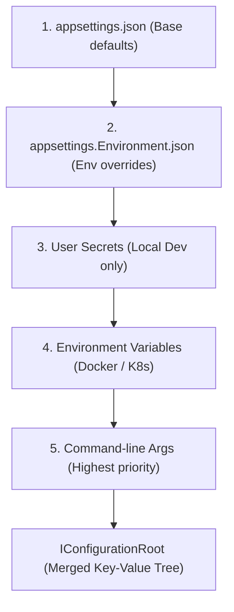
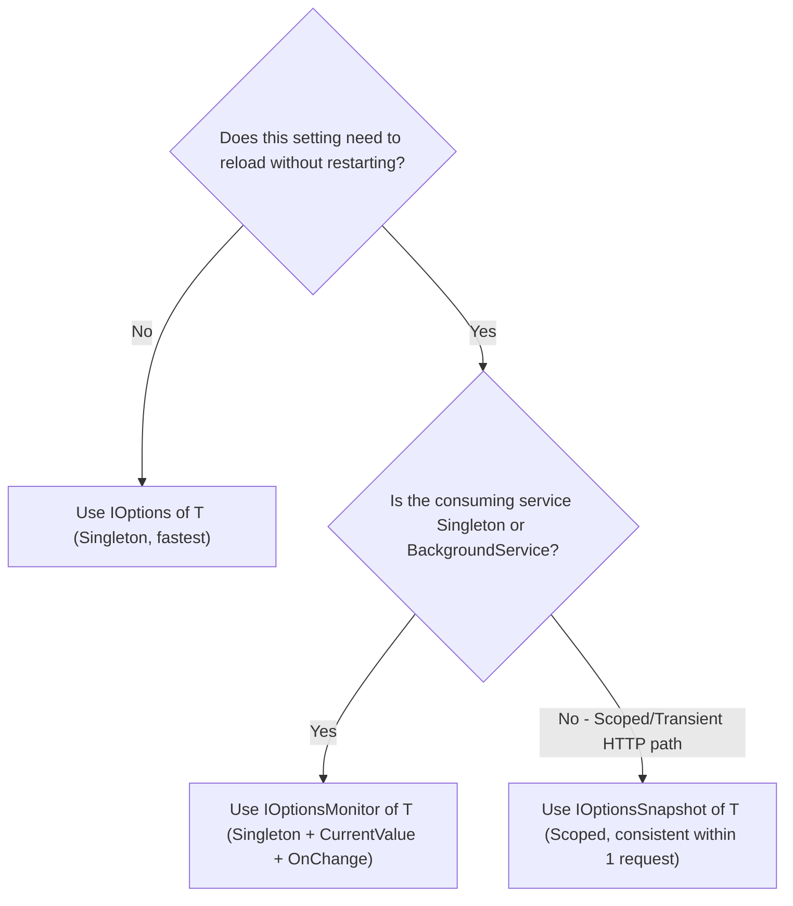
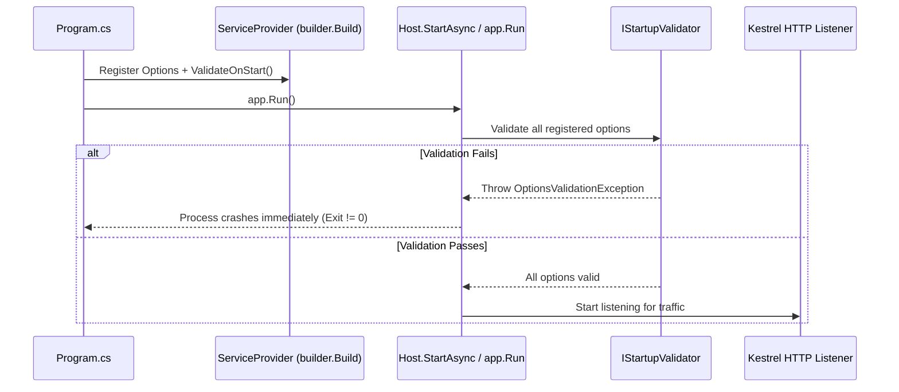

# Module 5: Configuration, the Options Pattern & Cloud Secrets

Every real-world application needs settings that change based on where it runs. Your development machine uses `localhost:5432` for the database; production uses `prod-db.company.com:5432`. Your local environment uses a test API key; production uses the real one. **Configuration** is the system that manages these values, and ASP.NET Core has one of the most sophisticated, extensible configuration systems of any modern web framework.

---

## 1. What is Configuration?

Configuration is **externalized data** that your application reads at runtime to control its behavior. Think of it as a set of knobs and dials that you can adjust without recompiling your code.

This follows the **Twelve-Factor App** methodology's third principle (*Config*): store configuration in the environment, keeping a strict separation between **application code** (identical across every server) and **deployment settings** (unique to each environment).

Examples of configuration:
*   Database connection strings (PostgreSQL, Redis)
*   Third-party API keys and endpoints (Google Gemini, MinIO S3, PayU, Resend)
*   Feature flags (enable/disable features dynamically)
*   Logging verbosity levels and OpenTelemetry exporter endpoints
*   CORS allowed origins
*   OIDC client credentials and token validation parameters

> **Analogy — The Car Dashboard:**  
> Your car's engine (application code) is the same whether you're driving in the city or on the highway. But the dashboard settings (configuration) change — you adjust the AC, the mirrors, and the seat position. You don't rebuild the engine to change these.

### When NOT to Use Configuration
Not everything belongs in `appsettings.json` or environment variables. Putting the wrong data in configuration creates fragile deployments and security risks:
*   **Domain Business Invariants:** In Normora, subscription tier pricing (`Free`, `Pro`, `Enterprise`) and annual discount rules live in `TenantPlanPricingCatalog` inside `Normora.Modules.Tenants.Domain` — not in `appsettings.json`, because pricing integrity is a business invariant tested by domain unit tests, not an ops knob.
*   **Static Protocol / Error Constants:** User-facing error envelopes in Normora come from `Normora.Shared.Constants.ApiMessages` (for example, `ApiMessages.NotFound` or `ApiMessages.TenantContextMissing`), ensuring consistent localization and zero magic strings.
*   **Mutable Per-Tenant Runtime State:** A tenant's chosen workspace currency (`TenantPlan.Currency`) or branding logo path changes while users interact with the UI — that belongs in PostgreSQL, not static config files.
*   **Large Datasets or Lookup Tables:** Prompt templates, RBAC permission matrices, or thousands of policy rules belong in database tables or embedded templates, not configuration providers.

### Real-World Normora Examples (What Belongs in Configuration)
1. **PostgreSQL + pgvector Connection (`ConnectionStrings:DefaultConnection`):** Points `TenantsDbContext`, `DocumentsDbContext`, and `ConversationsDbContext` to local Docker PostgreSQL in development and a managed RDS/Azure PostgreSQL cluster in production.
2. **Google Gemini API Settings (`GeminiOptions`):** Supplies the `GEMINI_API_KEY`, default chat model, and embedding model dimensions used by `GeminiEmbeddingService` and `GeminiTextGenerationService` in `Normora.Infrastructure/Providers/Gemini/`.
3. **MinIO / S3 Object Storage (`MinioOptions`):** Configures the S3 endpoint, access key, secret key, TLS flag (`UseSsl`), and bucket names for `MinioDocumentStorageService` and `MinioBrandingStorageService`.
4. **Redis Backplane & Caching (`RedisOptions`):** Configures `REDIS_CONNECTION`, key `InstanceName` (`"normora:"`), and SignalR pub/sub `ChannelPrefix` (`"normora:signalr"`) shared across `Normora.Api` and `Normora.Worker`.
5. **Keycloak OIDC & Duende BFF (`Keycloak` section):** Supplies the Identity Provider `Authority` URL, `ClientId`, and `ClientSecret` used by `Normora.Api` to authenticate browser BFF sessions without exposing tokens to the Angular SPA.

---

## 2. The Hierarchical Configuration Model

### How It Works Under the Hood
ASP.NET Core does not read configuration from a single file. Behind the scenes, a `ConfigurationBuilder` composes an ordered list of **configuration providers** (`IConfigurationProvider`) into an **`IConfigurationRoot`**.

Every provider flattens hierarchical data (like nested JSON) into a single **case-insensitive key-value dictionary** using `:` as the path separator:
*   Nested object: `"Gemini": { "Model": "gemini-2.5-flash" }` becomes key `"Gemini:Model"`.
*   JSON array: `"AllowedOrigins": ["http://localhost:4200", "https://app.normora.ai"]` becomes `"AllowedOrigins:0"` and `"AllowedOrigins:1"`.

When multiple providers define the same key, the **last provider registered wins** (overrides earlier values).



Both `WebApplication.CreateBuilder(args)` (used by `Normora.Api`) and `Host.CreateApplicationBuilder(args)` (used by `Normora.Worker`) automatically register these five standard sources in that exact order.

### Why This Layered Model is Brilliant

**Scenario:** You have a database connection string across environments.

| Source | Value | Purpose |
|---|---|---|
| `appsettings.json` | `Host=localhost;Port=5432;Database=normora;...` | Default for local Docker Compose development |
| `appsettings.Production.json` | `SslMode=Require;Pooling=true;Maximum Pool Size=50;` | Non-secret production tuning |
| Environment Variable | `ConnectionStrings__DefaultConnection=Host=prod-pg.internal;...` | Kubernetes / Cloud secret injection (wins over JSON) |

The exact same compiled `.dll` binary runs in every environment without recompilation. The only thing that changes is *which configuration sources are present.*

### Environment Names
ASP.NET Core uses `ASPNETCORE_ENVIRONMENT` (for web hosts like `Normora.Api`) or `DOTNET_ENVIRONMENT` (for generic hosts like `Normora.Worker`) to determine the current environment:
*   **Development** — Your local machine. Automatically loads User Secrets, enables `reloadOnChange` diagnostics, and allows `Program.cs` (`if (app.Environment.IsDevelopment())`) to expose developer exception pages, OpenAPI JSON, and Scalar UI (`/scalar/v1`).
*   **Staging** — Pre-production mirror for integration, load, and security testing (such as ZAP scans).
*   **Production** — The live environment. User Secrets are *not* loaded; `Program.cs` enforces HSTS, strict security headers, and generic error envelopes.

### Beyond the Default Five Sources
Because `IConfigurationBuilder` is extensible, enterprise apps often layer additional providers:
*   **Kubernetes Key-Per-File (`AddKeyPerFile`):** Reads secrets mounted as individual files in `/run/secrets/` (each filename becomes a key).
*   **Cloud Secret Managers (`AddAzureKeyVault`, AWS Secrets Manager):** Fetches rotated secrets directly from managed vaults at startup using Managed Identity / IAM roles (no static passwords in env vars).
*   **In-Memory (`AddInMemoryCollection`):** Ideal in integration tests (`WebApplicationFactory<Program>`) to override `Gemini:ApiKey` or `Redis:ConnectionString` without touching disk files.
*   **Debugging Precedence (`GetDebugView()`):** Calling `((IConfigurationRoot)builder.Configuration).GetDebugView()` prints every key, its winning value, and **which provider supplied it**. *(Never expose `GetDebugView()` on an HTTP endpoint in Production — it prints secrets in plaintext!)*

### When NOT to Rely on Implicit Environment Defaults
*   **Do not** bake secrets into `Dockerfile` `ENV` statements — anyone with `docker history` or image pull access can read them. Inject them at container runtime instead.
*   **Do not** assume `ASPNETCORE_ENVIRONMENT` defaults to `Development` in containers; .NET defaults to **`Production`** when the variable is unset.

### Real-World Normora Examples (Hierarchy & Hosts)
1. **`Normora.Api` (`WebApplication.CreateBuilder`):** Uses `ASPNETCORE_ENVIRONMENT` to load `appsettings.Development.json` and User Secrets locally, while reading `DUENDE_BFF` / Keycloak and PayU secrets from environment variables in Docker.
2. **`Normora.Worker` (`Host.CreateApplicationBuilder`):** Uses `DOTNET_ENVIRONMENT` instead of `ASPNETCORE_ENVIRONMENT` because it is a headless Hangfire background host with no Kestrel HTTP server.
3. **Ephemeral Migration Host (`dotnet Normora.Api.dll --migrate`):** Passes `--migrate` as a command-line argument (highest priority) and runs `MigrationHostExtensions.RunMigrationsAsync`, intentionally skipping Kestrel, SignalR, and Hangfire initialization.
4. **Testing Overrides (`Normora.Architecture.Tests` / Integration Tests):** Uses `AddInMemoryCollection` in test harnesses to swap `ConnectionStrings:DefaultConnection` to a disposable Testcontainers PostgreSQL instance.
5. **Startup Precedence Diagnostics:** During local onboarding, checking `(builder.Configuration as IConfigurationRoot)?.GetDebugView()` immediately reveals whether `Minio:Endpoint` came from `appsettings.json` or an overridden `.env` variable in Docker Compose.

---

## 3. The Configuration Sources in Detail

### `appsettings.json` — The Base Defaults
Committed to Git. Contains only **non-sensitive defaults** shared across all environments:
```json
{
  "Logging": {
    "LogLevel": {
      "Default": "Information",
      "Microsoft.AspNetCore": "Warning"
    }
  },
  "ConnectionStrings": {
    "DefaultConnection": "Host=localhost;Port=5432;Database=normora;Username=postgres;Password=postgres"
  },
  "AllowedOrigins": [ "http://localhost:4200" ],
  "Redis": {
    "InstanceName": "normora:",
    "ChannelPrefix": "normora:signalr"
  },
  "Minio": {
    "Endpoint": "localhost:9000",
    "UseSsl": false,
    "DocumentsBucket": "normora-documents",
    "BrandingBucket": "normora-branding"
  },
  "Gemini": {
    "ChatModel": "gemini-2.5-flash",
    "EmbeddingModel": "gemini-embedding-001",
    "MaxBatchSize": 100
  }
}
```

### `appsettings.{Environment}.json` — Environment Overrides
Loaded only when `ASPNETCORE_ENVIRONMENT` / `DOTNET_ENVIRONMENT` matches (e.g., `appsettings.Development.json`):
```json
{
  "Logging": {
    "LogLevel": {
      "Default": "Debug",
      "Microsoft.EntityFrameworkCore.Database.Command": "Information"
    }
  }
}
```
> **When NOT to use `appsettings.Production.json`:** Never put production database passwords, `GEMINI_API_KEY`, or `PayU` salts inside `appsettings.Production.json` — that file is still committed to Git! Use it only for non-secret production tuning (like log levels or pool sizes).

### User Secrets — Local Secrets (Never Committed to Git)
User Secrets store sensitive keys in your OS user profile outside the Git repository (`%APPDATA%\Microsoft\UserSecrets\<UserSecretsId>\secrets.json` on Windows, `~/.microsoft/usersecrets/<UserSecretsId>/secrets.json` on Linux/macOS), linked via a `<UserSecretsId>` GUID in `Normora.Api.csproj` and `Normora.Worker.csproj`:
```bash
# Initialize once per host project, then set sensitive values locally
dotnet user-secrets init --project server/Normora.Api
dotnet user-secrets set "Gemini:ApiKey" "AIzaSy_local_dev_key" --project server/Normora.Api
dotnet user-secrets set "Keycloak:ClientSecret" "dev-bff-secret" --project server/Normora.Api
```

**Why?** Because `appsettings.json` is tracked by Git. And remember: `CreateBuilder` **only** loads User Secrets when the environment is `Development` — never rely on User Secrets in Staging, Production, or CI/CD runners.

### Environment Variables — The Production & Container Standard
In Docker Compose, Kubernetes, or cloud App Services, inject configuration via environment variables:

```bash
# In Docker Compose (.env) or Kubernetes deployment manifests:
ConnectionStrings__DefaultConnection=Host=postgres;Port=5432;Database=normora;Username=normora;Password=s3cret
Gemini__ApiKey=AIzaSy_production_key
Minio__SecretKey=prod_minio_secret_key
AllowedOrigins__0=https://app.normora.ai
AllowedOrigins__1=https://admin.normora.ai
```

Note two key rules:
1. **Double underscore (`__`):** Replaces the JSON colon `:` because POSIX shells (`bash`/`sh`) do not allow colons in environment variable names. `Gemini__ApiKey` automatically maps to `Gemini:ApiKey`.
2. **Array indices (`__0`, `__1`):** Populate JSON arrays (`AllowedOrigins[0]`, `AllowedOrigins[1]`) from flat environment variables.

### Command-Line Arguments — Highest Precedence
Command-line flags override every file and environment variable:
```bash
dotnet Normora.Api.dll --Logging:LogLevel:Default=Warning --Minio:UseSsl=true
```
You can also define custom short flags (switch mappings) or inspect host flags like `--migrate`.

### Real-World Normora Examples (Configuration Sources)
1. **`Normora.Api/appsettings.json`:** Defines safe local defaults for `Redis:InstanceName` (`"normora:"`), `Redis:ChannelPrefix` (`"normora:signalr"`), and Gemini model names without any API keys.
2. **Local `.env` Provisioned by `start.ps1`:** Sets `GEMINI_API_KEY` and `RESEND_API_KEY` for Docker Compose services so `Normora.Api` and `Normora.Worker` receive identical secrets at runtime.
3. **`dotnet user-secrets` for Debugging Outside Docker:** When running `Normora.Api` directly from Visual Studio / Rider against Dockerized Postgres and MinIO, developers store `Keycloak:ClientSecret` and `PayU:Salt` in User Secrets so they never risk `git add`ing credentials.
4. **Array Overrides for Multi-Origin CORS:** Deploying Normora behind a preview domain overrides `AllowedOrigins__0=https://preview.normora.internal` without editing `appsettings.json`.
5. **CLI Override for Migration Mode:** Running `dotnet Normora.Api.dll --migrate` uses CLI arguments at the top of the precedence stack to execute `DatabaseMigrationRunner` (all four `IDatabaseMigrator`s sequentially) and exit cleanly with code `0`.

---

## 4. Reading Configuration — The Raw Way (And Why It's Bad)

### Using `IConfiguration` Directly (The Anti-Pattern)
```csharp
// ❌ RAW ICONFIGURATION ANTI-PATTERN (in a runtime service/handler)
public class PayUPaymentService(IConfiguration configuration)
{
    public string BuildCheckoutSignature()
    {
        // 1. Magic strings: Typos compile successfully but fail at runtime!
        var merchantKey = configuration["PayU:MerchantKey"];

        // 2. Manual parsing: Fragile type conversions
        var timeout = int.Parse(configuration["PayU:TimeoutSeconds"] ?? "30");
        var isSandbox = bool.Parse(configuration["PayU:UseSandbox"] ?? "false");

        return $"{merchantKey}:{timeout}:{isSandbox}";
    }
}
```

### Why Raw `IConfiguration` Fails Enterprise Standards:
*   **No Type Safety:** Indexer access (`configuration["..."]`) returns `string?`. Even helper methods like `configuration.GetValue<int>("PayU:TimeoutSeconds")` still rely on string keys.
*   **No IntelliSense or Refactoring Safety:** Renaming a setting requires hunting through string literals across the codebase.
*   **No Startup Validation:** If a key is misspelled (`"PayU:MerchentKey"`), it silently returns `null`, causing failures deep in production during checkout.
*   **Hidden Dependencies & Hard Unit Testing:** A service taking `IConfiguration` hides which settings it actually needs, forcing tests to construct fake `ConfigurationBuilder` dictionaries instead of passing a clean C# object.

### When Raw `IConfiguration` *IS* Acceptable
You **should** read `IConfiguration` directly in **exactly one place**: your **Composition Root** (`Program.cs` and startup extension methods like `DatabaseServiceExtensions.cs` or `ProviderServiceExtensions.cs`) **before** the Dependency Injection (DI) container is built. Why? Because `IOptions<T>` isn't resolvable until after DI registration completes, and frameworks like EF Core, Hangfire, or Duende BFF need connection strings or toggle flags *while* services are being registered.

Even at startup, prefer `GetConnectionString("...")` or `GetRequiredSection("...").Get<T>()` over nullable indexer lookups so missing sections fail immediately.

### Real-World Normora Examples (Raw `IConfiguration` vs. Structured Startup)
1. **Valid Startup Read (`DatabaseServiceExtensions`):** Reads `configuration.GetConnectionString("DefaultConnection")` once during `AddDatabaseServices(...)` to configure `Npgsql` pooling and Hangfire PostgreSQL storage.
2. **Valid Startup Conditional Wiring (`ProviderServiceExtensions`):** Reads a startup flag or section in `AddExternalProviders(configuration)` to decide whether to wire MinIO storage or local development mocks before building the app.
3. **Valid Startup CORS Read (`Normora.Api/Extensions`):** Reads `configuration.GetSection("AllowedOrigins").Get<string[]>() ?? []` during `AddCors(...)` registration.
4. **Forbidden in CQRS Handlers (`UploadDocumentCommandHandler`):** Never inject `IConfiguration` into a MediatR handler to read max file sizes — inject `IOptions<DocumentUploadOptions>` instead so unit tests can simply pass `Options.Create(...)`.
5. **Forbidden in Infrastructure Adapters (`GeminiEmbeddingService`):** Injecting `IConfiguration` directly into `Normora.Infrastructure/Providers/Gemini/GeminiEmbeddingService` hides whether the adapter depends on `Gemini:ApiKey`, `Gemini:EmbeddingModel`, or `Gemini:MaxBatchSize`.

---

## 5. The Options Pattern: Strongly-Typed Configuration

The **Options Pattern** binds JSON configuration sections directly to plain C# classes (**POCOs** — *Plain Old CLR Objects*). Instead of passing an untyped string dictionary everywhere, your services declare the exact configuration object they depend on.

### Step 1: Create the Options Class
```csharp
namespace Normora.Infrastructure.Providers.Storage;

public sealed class MinioOptions
{
    public const string SectionName = "Minio";

    public string Endpoint { get; set; } = string.Empty;
    public string AccessKey { get; set; } = string.Empty;
    public string SecretKey { get; set; } = string.Empty;
    public bool UseSsl { get; set; }
    public string DocumentsBucket { get; set; } = "normora-documents";
    public string BrandingBucket { get; set; } = "normora-branding";
}
```
*(Notice `SectionName` is a `const string` right on the options class so `Program.cs` and architecture tests reference the same section name without duplicating magic strings.)*

### Step 2: Register in Your Module / Infrastructure Extensions
```csharp
// BindConfiguration automatically looks up IConfiguration.GetSection(MinioOptions.SectionName)
services.AddOptions<MinioOptions>()
    .BindConfiguration(MinioOptions.SectionName);
```
*(In .NET 8–10, `AddOptions<T>().BindConfiguration(section)` is preferred over `services.Configure<T>(config.GetSection(...))` because it returns an `OptionsBuilder<T>` you can chain validation onto, and doesn't require passing `IConfiguration` into every extension helper if you don't need it.)*

### Step 3: Inject `IOptions<T>` via Primary Constructor
```csharp
// ✅ CLEAN, STRONGLY-TYPED DI WITH C# PRIMARY CONSTRUCTOR
public sealed class MinioDocumentStorageService(
    IOptions<MinioOptions> options,
    ILogger<MinioDocumentStorageService> logger) : IDocumentStorageService
{
    private readonly MinioOptions _options = options.Value;

    public async Task UploadAsync(string objectKey, Stream content, CancellationToken ct)
    {
        // Strongly-typed, verified, IntelliSense-enabled!
        var bucket = _options.DocumentsBucket;
        logger.LogInformation("Uploading {ObjectKey} to bucket {Bucket}", objectKey, bucket);
        // ... MinIO SDK upload call lives strictly here in Normora.Infrastructure
    }
}
```

### Advanced Options Capabilities (Senior / Architect Toolkit)

#### 1. Source-Generated Configuration Binding (`.NET 8–10`)
Traditionally, `ConfigurationBinder` uses **reflection** at runtime to inspect properties and bind values. In `.NET 8+` and `.NET 10`, enabling the **Configuration Binding Source Generator** in your `.csproj` generates strongly-typed C# binding code at compile time:
```xml
<PropertyGroup>
  <EnableConfigurationBindingGenerator>true</EnableConfigurationBindingGenerator>
</PropertyGroup>
```
**Why?** Zero reflection overhead at startup, full compatibility with **Native AOT** (*Ahead-Of-Time compilation* — compiling C# directly to native machine code without a JIT compiler), and compile-time warnings if a property type cannot be bound.

#### 2. `PostConfigure<T>` and DI-Backed `Configure<T>`
Sometimes raw config values need normalization or fallback logic after JSON/env binding completes:
```csharp
// Example: Normalize RedisOptions fallback from legacy REDIS_CONNECTION env var
services.AddOptions<RedisOptions>()
    .BindConfiguration(RedisOptions.SectionName)
    .PostConfigure<IConfiguration>((opts, config) =>
    {
        if (string.IsNullOrWhiteSpace(opts.ConnectionString))
        {
            opts.ConnectionString = config[RedisOptions.EnvironmentVariable];
        }
        opts.InstanceName = opts.InstanceName.Trim();
    });
```
Use `PostConfigure<T>` when you need a **final cleanup pass** that runs after all `Configure<T>` callbacks. You can also inject DI services into `.Configure<ISomeService>((opts, svc) => ...)` — though keep these lightweight and free of database calls at startup!

#### 3. Named Options
What if you need **two instances** of the same options class (e.g., `"Primary"` vs `"Archive"` MinIO buckets, or `"Chat"` vs `"Summarization"` Gemini profiles)?
```csharp
services.AddOptions<GeminiProfileOptions>("Chat")
    .BindConfiguration("Gemini:Profiles:Chat");
services.AddOptions<GeminiProfileOptions>("Ocr")
    .BindConfiguration("Gemini:Profiles:Ocr");
```
Consume them with `IOptionsSnapshot<GeminiProfileOptions>.Get("Ocr")` or `IOptionsMonitor<GeminiProfileOptions>.Get("Ocr")`.
> **When NOT to use Named Options:** Don't use Named Options with magic string keys (`"Chat"`, `"Ocr"`) if the two configurations actually have different fields — create two separate classes (`GeminiChatOptions` and `GeminiOcrOptions`) instead so the compiler enforces what each service needs.

#### 4. When NOT to Use the Options Pattern
*   **Business Domain Modules with Zero Infrastructure Coupling:** Avoid leaking `IOptions<T>` into pure Domain entities or domain services (e.g., `TenantPlanPricingCatalog` in `Normora.Modules.Tenants.Domain`). Pass plain domain values or keep `Options/` inside Application/Infrastructure layers.
*   **Compile-Time Constants & Messages:** `ApiMessages` and `RagConstants` should stay `const` / `static readonly` C# classes, not `IOptions<T>`.
*   **Per-Tenant Dynamic Settings:** If Workspace A wants a custom logo or currency (`USD` vs `INR`), `IOptions<T>` only reflects server deployment config — load tenant-specific settings from PostgreSQL/Redis using `ITenantContext`.

### Real-World Normora Examples (Options Pattern)
1. **`MinioOptions` (`Normora.Infrastructure/Providers/Storage/`):** Encapsulates S3 endpoint, credentials, SSL flag, and bucket names, keeping the `Minio` vendor SDK completely isolated from `Modules/Documents` and `Modules/Tenants`.
2. **`GeminiOptions` (`Normora.Infrastructure/Providers/Gemini/`):** Holds `ApiKey`, `ChatModel`, `EmbeddingModel`, and batch size (`100` chunks/call for `batchEmbedContents`) injected into `GeminiEmbeddingService` and `GeminiTextGenerationService`.
3. **`RedisOptions` (`Normora.Infrastructure/Options/RedisOptions.cs`):** Standardizes `REDIS_CONNECTION`, `InstanceName`, and `ChannelPrefix` across both `Normora.Api` (BFF & SignalR) and `Normora.Worker` (Hangfire & SignalR backplane relay).
4. **`PayUOptions` (`server/Modules/Tenants/Options/`):** Stores merchant key, salt, checkout URL, and callback signing rules for `PayUPaymentService` without ever leaking gateway secrets into `TenantPlanPricingCatalog`.
5. **`DocumentExtractionOptions` / `RagOptions`:** Configures markdown chunking token limits and Reciprocal Rank Fusion (RRF) weights inside `Documents` without hardcoding tuning numbers inside `DocumentChunker`.

---

## 6. The Options Trinity: `IOptions` vs. `IOptionsSnapshot` vs. `IOptionsMonitor`

Before choosing an Options interface, remember the three **DI Service Lifetimes** from Module 3:
*   **Singleton:** Created once for the entire lifetime of the application.
*   **Scoped:** Created once per HTTP request (or per Hangfire job scope).
*   **Transient:** Created fresh every time it is requested.

A **Captive Dependency** bug happens when a **Singleton** service captures a **Scoped** service inside its constructor — the scoped service gets trapped inside the singleton forever instead of refreshing per request (ASP.NET Core's scope validator throws `InvalidOperationException` on startup when this happens).

ASP.NET Core provides three distinct interfaces to consume options safely across all lifetimes:

| Interface | Service Lifetime | Reads Changes at Runtime? | Injected into Singletons? | Best Use Case |
|---|---|---|---|---|
| **`IOptions<T>`** | **Singleton** | ❌ No (Reads once on first access) | ✅ **Yes** | Static startup infrastructure (DB pools, Redis multiplexer, MinIO/Keycloak URLs) |
| **`IOptionsSnapshot<T>`** | **Scoped** | ✅ **Yes** (Re-bound once per request) | ❌ **NO!** (Captive dependency hazard) | Per-request business tuning (RAG top-K, rate-limit thresholds, feature toggles) |
| **`IOptionsMonitor<T>`** | **Singleton** | ✅ **Yes** (Live push notifications) | ✅ **Yes** | Background workers (`Normora.Worker`), Singleton caches, live-reloading services |



### Using `IOptionsSnapshot<T>` for Consistent Per-Request Reloading
`IOptionsSnapshot<T>` recomputes options **once when an HTTP request scope begins**, guaranteeing that if `appsettings.json` changes mid-request, every service in that request sees the exact same snapshot:
```csharp
// ✅ Scoped CQRS handler / service: consistent snapshot per HTTP request
public sealed class RagRetrievalTuningService(IOptionsSnapshot<RagOptions> ragOptions)
{
    public int GetTopK() => ragOptions.Value.DefaultTopK;
}
```

### Using `IOptionsMonitor<T>` in Singletons & Background Workers
`IOptionsMonitor<T>` is a Singleton that exposes `.CurrentValue` (always the latest bound instance) and `.OnChange(...)` (which returns an `IDisposable` listener registration):
```csharp
// ✅ Primary constructor + proper IDisposable cleanup for OnChange listener
public sealed class OutboxPollingWorker(
    IOptionsMonitor<OutboxOptions> optionsMonitor,
    ILogger<OutboxPollingWorker> logger) : BackgroundService
{
    protected override async Task ExecuteAsync(CancellationToken stoppingToken)
    {
        // Dispose the subscription when the worker shuts down to avoid memory leaks
        using var subscription = optionsMonitor.OnChange((newOptions, _) =>
        {
            logger.LogInformation(
                "Outbox polling interval updated to {IntervalSeconds}s",
                newOptions.PollingIntervalSeconds);
        });

        while (!stoppingToken.IsCancellationRequested)
        {
            // Reads the latest value without restarting Normora.Worker
            var interval = optionsMonitor.CurrentValue.PollingIntervalSeconds;
            await Task.Delay(TimeSpan.FromSeconds(interval), stoppingToken);
        }
    }
}
```
*(Architectural tip: `FileSystemWatcher` can fire `OnChange` twice for a single file save on Windows/Linux due to OS file-write events. Keep `OnChange` callbacks idempotent!)*

### When NOT to Use `IOptionsSnapshot<T>` or `IOptionsMonitor<T>`
*   **Never inject `IOptionsSnapshot<T>` into a Singleton** (e.g., an EF Core `IDbContextFactory` singleton, SignalR hub connection manager, or `BackgroundService`) — it causes a captive dependency crash.
*   **Avoid `IOptionsSnapshot<T>` on ultra-hot paths** when hot-reloading isn't needed: `IOptionsSnapshot<T>` re-runs configuration binding on every HTTP scope creation, whereas `IOptions<T>` binds once and caches forever.
*   **Don't use live reload for stateful connections without teardown:** Updating `ConnectionStrings:DefaultConnection` or `Redis:ConnectionString` on disk does **not** automatically recreate `NpgsqlDataSource` or `ConnectionMultiplexer` pools — those require `IOptions<T>` plus a rolling container restart.

### Real-World Normora Examples (The Options Trinity)
1. **`IOptions<MinioOptions>` in `MinioDocumentStorageService`:** S3 endpoint and credentials are static infrastructure settings wired once per container lifetime.
2. **`IOptions<RedisOptions>` in `AddNormoraSignalR`:** `Normora.Api` and `Normora.Worker` bind the Redis backplane connection string once at startup — live-reloading a SignalR Redis connection string without reconnecting the multiplexer would desync pub/sub channels.
3. **`IOptionsSnapshot<RagOptions>` in `ConversationTurnPreparer`:** Allows tuning hybrid search weights (vector vs. full-text RRF `k`) or token budgets across web requests without restarting the API host, while keeping values consistent throughout a single user's RAG turn.
4. **`IOptionsMonitor<DocumentProcessingOptions>` in `Normora.Worker`:** Lets background Hangfire jobs adjust `MaxBatchSize` or retry backoff dynamically while `Normora.Worker` stays running.
5. **`IOptionsMonitor<GeminiOptions>` in a Singleton `IChatClient` wrapper:** Enables rotating an API key or switching model tiers (`gemini-2.5-flash` vs fallback) via mounted config without dropping active SignalR/SSE connections.

---

## 7. Fail-Fast Startup Validation: `ValidateOnStart()` & `[OptionsValidator]`

A fundamental rule of resilient software architecture is: **Fail Fast, Fail Loudly.**

If an application is missing its database connection string, Keycloak client secret, or Gemini API key, **the container must refuse to start** so orchestrators (Docker/Kubernetes) keep the previous healthy container running instead of routing user traffic to a broken pod.

> **Important Lifecycle Detail:** `.ValidateOnStart()` does **not** run inside `builder.Build()`. Instead, it registers an `IStartupValidator` that executes inside `host.StartAsync()` / `app.Run()` **before Kestrel begins listening for HTTP requests**. This means DI-backed validators (`IValidateOptions<T>`) can safely inject other registered services!



### Level 1: DataAnnotations (`ValidateDataAnnotations`)
Best for straightforward single-property rules (`[Required]`, `[Url]`, `[Range]`):
```csharp
public sealed class KeycloakOptions
{
    public const string SectionName = "Keycloak";

    [Required(ErrorMessage = "Keycloak Authority URL is mandatory.")]
    [Url(ErrorMessage = "Keycloak Authority must be a valid URL.")]
    public string Authority { get; set; } = string.Empty;

    [Required(ErrorMessage = "Keycloak ClientId is mandatory.")]
    public string ClientId { get; set; } = string.Empty;

    [Required(ErrorMessage = "Keycloak ClientSecret is mandatory.")]
    public string ClientSecret { get; set; } = string.Empty;

    [Range(1, 60, ErrorMessage = "TokenClockSkewSeconds must be between 1 and 60.")]
    public int TokenClockSkewSeconds { get; set; } = 5;

    public bool AllowInsecureHttpMetadata { get; set; }
}
```

### Level 2: Inline Cross-Property Predicates (`.Validate(...)`)
DataAnnotations cannot compare two properties against each other. Chain `.Validate(...)` when rules span multiple fields:
```csharp
services.AddOptions<KeycloakOptions>()
    .BindConfiguration(KeycloakOptions.SectionName)
    .ValidateDataAnnotations()
    .Validate(
        opts => opts.Authority.StartsWith("https://", StringComparison.OrdinalIgnoreCase)
                || opts.AllowInsecureHttpMetadata,
        "Keycloak Authority must use HTTPS unless AllowInsecureHttpMetadata is explicitly enabled.")
    .ValidateOnStart();
```

### Level 3: `IValidateOptions<T>` (DI-Aware & Unit-Testable)
When validation depends on the environment (`IHostEnvironment`) or complex business rules, implement `IValidateOptions<T>` with a **primary constructor**:
```csharp
public sealed class MinioOptionsValidator(IHostEnvironment environment)
    : IValidateOptions<MinioOptions>
{
    public ValidateOptionsResult Validate(string? name, MinioOptions options)
    {
        var failures = new List<string>();

        if (string.IsNullOrWhiteSpace(options.Endpoint))
            failures.Add("Minio:Endpoint is required.");

        if (environment.IsProduction() && !options.UseSsl)
            failures.Add("Minio:UseSsl must be true in Production.");

        if (string.IsNullOrWhiteSpace(options.DocumentsBucket))
            failures.Add("Minio:DocumentsBucket is required.");

        return failures.Count > 0
            ? ValidateOptionsResult.Fail(failures)
            : ValidateOptionsResult.Success;
    }
}

// Registration:
services.AddSingleton<IValidateOptions<MinioOptions>, MinioOptionsValidator>();
services.AddOptions<MinioOptions>()
    .BindConfiguration(MinioOptions.SectionName)
    .ValidateOnStart();
```

### Level 4: `[OptionsValidator]` Source Generator & Nested Validation (`.NET 8–10`)
Traditional `ValidateDataAnnotations()` uses runtime reflection **and silently skips nested objects**! In `.NET 8–10`, `[OptionsValidator]` generates zero-reflection validation code at compile time, and `[ValidateObjectMembers]` forces deep validation of nested option classes:
```csharp
public sealed class GeminiOptions
{
    public const string SectionName = "Gemini";

    [Required]
    public string ApiKey { get; set; } = string.Empty;

    [Range(1, 100)]
    public int MaxBatchSize { get; set; } = 100;

    [ValidateObjectMembers] // ✅ Validates nested RetryOptions properties too!
    public GeminiRetryOptions Retry { get; set; } = new();
}

public sealed class GeminiRetryOptions
{
    [Range(1, 10)]
    public int MaxAttempts { get; set; } = 3;
}

// Compile-time source-generated validator!
[OptionsValidator]
public sealed partial class ValidateGeminiOptions : IValidateOptions<GeminiOptions>
{
}

// Registration:
services.AddSingleton<IValidateOptions<GeminiOptions>, ValidateGeminiOptions>();
services.AddOptions<GeminiOptions>()
    .BindConfiguration(GeminiOptions.SectionName)
    .ValidateOnStart();
```

### When NOT to Use `ValidateOnStart()`
*   **Ephemeral CLI / Migration Hosts (`--migrate`):** In Normora, `dotnet Normora.Api.dll --migrate` executes `MigrationHostExtensions.RunMigrationsAsync` inside a lean console host to apply PostgreSQL schemas via `DatabaseMigrationRunner`. If you registered and `ValidateOnStart()`-checked `GeminiOptions` or `PayUOptions` during `--migrate`, a CI/CD migration job that only has database credentials would crash needlessly! Register only database options for `--migrate`.
*   **Optional Feature Integrations:** If an optional telemetry sink or experimental feature is disabled (`Enabled = false`), do not fail startup for missing optional credentials; check `if (!options.Enabled) return ValidateOptionsResult.Success;` inside `IValidateOptions<T>`.

### Real-World Normora Examples (Startup Validation)
1. **`KeycloakOptions` in `Normora.Api`:** Validates `Authority`, `ClientId`, and `ClientSecret` with `ValidateOnStart()` so the Duende BFF host never starts accepting browser login redirects with broken OIDC config.
2. **`MinioOptionsValidator` (Environment-Aware):** Enforces `UseSsl == true` in `Production` via injected `IHostEnvironment`, while permitting `UseSsl == false` against local Docker MinIO (`localhost:9000`) in `Development`.
3. **`ValidateGeminiOptions` (`[OptionsValidator]`):** Validates `ApiKey`, `MaxBatchSize` (capped at `100` for Gemini's `batchEmbedContents` limit), and nested `Retry` settings with zero reflection overhead.
4. **`PayUOptions` in `Modules/Tenants/Options/`:** Validates merchant credentials and verifies `CallbackBaseUrl` uses HTTPS in production before `PayUPaymentService` can generate any checkout signature.
5. **Selective Validation in `--migrate` Host:** `MigrationHostExtensions` builds a minimal host containing only `ConnectionStrings` and the 4 `IDatabaseMigrator` services (`Tenants`, `Documents`, `Conversations`, `Session`), bypassing API/AI/Payment `ValidateOnStart()` checks so migrations succeed in isolated pipelines.

---

## 8. Real-World Configuration from Your Projects

### 🏗️ NextEvent: Fail-Fast on Missing Connection String
```csharp
// From NextEvent's DatabaseServiceExtensions.cs
var connectionString = configuration.GetConnectionString("DefaultConnection")
    ?? throw new InvalidOperationException(
        "Connection string 'DefaultConnection' was not found.");
```

**Why throw immediately?** If the connection string is missing, every database operation will fail. Crash at startup with a clear error message rather than failing minutes later under user load.

### 🏗️ NextEvent: Securing the JWT Token Key
```csharp
// From NextEvent's IdentityServiceExtensions.cs
var tokenKey = config["TokenKey"]
    ?? throw new InvalidOperationException(
        "TokenKey is not configured. Set it via User Secrets (development) " +
        "or an environment variable (production).");
```

The JWT signing key is **never** stored in `appsettings.json`. Developers use `dotnet user-secrets set "TokenKey" "my-super-secret-key"` locally, and in production, it's injected as an environment variable.

### 🏗️ NextEvent: CORS Origins from Configuration
```csharp
// From NextEvent's ApiServiceExtensions.cs
var allowedOrigins = configuration.GetSection("AllowedOrigins").Get<string[]>() ?? [];

services.AddCors(options =>
{
    options.AddPolicy("CorsPolicy", policy =>
    {
        policy.WithOrigins(allowedOrigins); // Not hardcoded!
    });
});
```

### 🏗️ NextEvent: Database Resilience Configuration
```csharp
// From NextEvent's DatabaseServiceExtensions.cs
options.UseSqlServer(connectionString, sqlOptions =>
{
    sqlOptions.MigrationsAssembly(migrationsAssembly);
    sqlOptions.EnableRetryOnFailure(
        maxRetryCount: 5,                                // Retry 5 times
        maxRetryDelay: TimeSpan.FromSeconds(10),         // Wait up to 10s between retries
        errorNumbersToAdd: null);                        // Retry on transient network blips
    sqlOptions.CommandTimeout(60);                       // 60-second query timeout
});
```

**Why `EnableRetryOnFailure`?** In cloud environments, database connections can briefly drop during failovers or network rebalancing. With retry logic, the query retries transparently and the user never experiences a 500 error.

### 🏗️ Normora: Production `RedisOptions`
```csharp
// From Normora.Infrastructure/Options/RedisOptions.cs
public class RedisOptions
{
    public const string SectionName = "Redis";
    public const string EnvironmentVariable = "REDIS_CONNECTION";

    public string? ConnectionString { get; set; }
    public string InstanceName { get; set; } = "normora:";
    public string ChannelPrefix { get; set; } = "normora:signalr";
}
```

And verified via architecture tests:
```csharp
// From Normora.Architecture.Tests/ModularMonolithArchitectureTests.cs
[Fact]
public void RedisOptions_DefaultValues_AreStronglyTypedAndConsistent()
{
    var options = new Normora.Infrastructure.Options.RedisOptions();

    Assert.Equal("Redis", Normora.Infrastructure.Options.RedisOptions.SectionName);
    Assert.Equal("REDIS_CONNECTION", Normora.Infrastructure.Options.RedisOptions.EnvironmentVariable);
    Assert.Equal("normora:signalr", options.ChannelPrefix);
    Assert.Equal("normora:", options.InstanceName);
    Assert.Null(options.ConnectionString);
}
```

### 🏗️ Normora: Isolating Vendor Providers via `ProviderServiceExtensions`
Normora's business modules (`Tenants`, `Documents`, `Conversations`) must never reference external vendor SDKs (`Minio`, Google AI SDKs). Instead, `Normora.Infrastructure/Providers/` owns both the provider options (`MinioOptions`, `GeminiOptions`) and the dedicated DI wiring (`AddStorageProviders`, `AddAiProviders`):
```csharp
// Illustrative wiring in Normora.Infrastructure/Extensions/ProviderServiceExtensions.cs
public static IServiceCollection AddStorageProviders(
    this IServiceCollection services,
    IConfiguration configuration)
{
    services.AddSingleton<IValidateOptions<MinioOptions>, MinioOptionsValidator>();
    services.AddOptions<MinioOptions>()
        .Bind(configuration.GetSection(MinioOptions.SectionName))
        .ValidateOnStart();

    services.AddScoped<IDocumentStorageService, MinioDocumentStorageService>();
    services.AddScoped<IBrandingStorageService, MinioBrandingStorageService>();
    return services;
}
```

### 🏗️ Normora: `GeminiOptions` & `AddAiProviders`
`GeminiEmbeddingService` and `GeminiTextGenerationService` inject `IOptions<GeminiOptions>` via primary constructors, keeping `IChatClient` / `IEmbeddingGenerator` registration cleanly separated from `DatabaseServiceExtensions`:
```csharp
public sealed class GeminiTextGenerationService(
    IOptions<GeminiOptions> options,
    ILogger<GeminiTextGenerationService> logger) : ITextGenerationService
{
    private readonly GeminiOptions _gemini = options.Value;
    // Business modules depend only on ITextGenerationService, never GeminiOptions!
}
```

### 🏗️ Normora: Module-Scoped Options (`Modules/Tenants/Options/`)
Each modular monolith context owns options strictly relevant to its domain adapters—for example, `PayUOptions` in `server/Modules/Tenants/Options/` for `PayUPaymentService`:
```csharp
// server/Modules/Tenants/Options/PayUOptions.cs
public sealed class PayUOptions
{
    public const string SectionName = "PayU";

    [Required]
    public string MerchantKey { get; set; } = string.Empty;

    [Required]
    public string MerchantSalt { get; set; } = string.Empty;

    [Required, Url]
    public string GatewayBaseUrl { get; set; } = string.Empty;
}
```
Meanwhile, subscription tier pricing (`Free`, `Pro`, `Enterprise`) and multi-currency calculations stay in `TenantPlanPricingCatalog` inside `Normora.Modules.Tenants.Domain` — **never** duplicated in configuration files.

### 🏗️ Normora: Ephemeral Migration Host Isolation (`--migrate`)
When running `dotnet Normora.Api.dll --migrate` in containers, `MigrationHostExtensions.RunMigrationsAsync` builds a minimal console host that binds **only** `ConnectionStrings` for `DatabaseMigrationRunner` (`TenantsDatabaseMigrator`, `DocumentsDatabaseMigrator`, `ConversationsDatabaseMigrator`, `SessionDatabaseMigrator`). By avoiding Kestrel, SignalR hubs, Hangfire, and external provider options validation in `--migrate` mode, CI/CD migration jobs execute with minimal secrets and exit cleanly (`0`) without native teardown crashes.

---

## 9. Common Mistakes & Anti-Patterns

> [!CAUTION]
> **Anti-Pattern 1: Injecting `IOptionsSnapshot<T>` into a Singleton (Captive Dependency)**
>
> **Wrong Code:**
> ```csharp
> // ❌ Registered as Singleton, but injects Scoped IOptionsSnapshot<T>!
> public sealed class SignalRRedisBridge(IOptionsSnapshot<RedisOptions> redisOptions)
> {
>     public string GetPrefix() => redisOptions.Value.ChannelPrefix;
> }
> ```
> **Why It's Wrong:** `IOptionsSnapshot<T>` has a **Scoped** lifetime. Injecting it into a **Singleton** traps the first request's scope forever (or throws `InvalidOperationException: Cannot consume scoped service ... from singleton` when scope validation is enabled).
>
> **The Fix:** Inject `IOptions<T>` (if static at startup) or `IOptionsMonitor<T>` (if the Singleton genuinely needs live updates):
> ```csharp
> // ✅ Safe in Singletons
> public sealed class SignalRRedisBridge(IOptionsMonitor<RedisOptions> redisOptions)
> {
>     public string GetPrefix() => redisOptions.CurrentValue.ChannelPrefix;
> }
> ```

> [!CAUTION]
> **Anti-Pattern 2: Injecting Raw `IConfiguration` into CQRS Handlers or Services**
>
> **Wrong Code:**
> ```csharp
> // ❌ Magic strings and manual parsing inside a MediatR handler
> public sealed class UploadDocumentCommandHandler(IConfiguration configuration)
> {
>     public Task Handle(UploadDocumentCommand request, CancellationToken ct)
>     {
>         var maxBytes = long.Parse(configuration["Documents:MaxUploadBytes"] ?? "10485760");
>         return Task.CompletedTask;
>     }
> }
> ```
> **Why It's Wrong:** Typos compile silently, missing keys fail late with `FormatException` or `NullReferenceException`, and unit tests must build fake `IConfigurationRoot` dictionaries.
>
> **The Fix:** Bind a strongly-typed `DocumentUploadOptions` class and inject `IOptions<DocumentUploadOptions>`:
> ```csharp
> // ✅ Strongly typed, validated at startup, trivial to unit test with Options.Create(...)
> public sealed class UploadDocumentCommandHandler(IOptions<DocumentUploadOptions> uploadOptions)
> {
>     private readonly long _maxBytes = uploadOptions.Value.MaxUploadBytes;
> }
> ```

> [!CAUTION]
> **Anti-Pattern 3: Putting Secrets in `appsettings.Production.json` or `Dockerfile` `ENV`**
>
> **Wrong Code:**
> ```json
> // ❌ Committed to Git in appsettings.Production.json!
> {
>   "Gemini": { "ApiKey": "AIzaSy_real_prod_key_exposed_in_git_history" },
>   "PayU": { "MerchantSalt": "prod_salt_123" }
> }
> ```
> **Why It's Wrong:** Anything in `appsettings.*.json` or `Dockerfile` `ENV` is permanently baked into Git history or container image layers. Anyone with repo read access or image pull access gets your production credentials.
>
> **The Fix:** Keep `ApiKey` / `MerchantSalt` empty in `appsettings*.json`. Use `dotnet user-secrets` locally, and inject production secrets at runtime via Docker/Kubernetes environment variables (`Gemini__ApiKey`), Key-Per-File mounts, or Azure Key Vault / AWS Secrets Manager.

> [!CAUTION]
> **Anti-Pattern 4: Registering Options Without `.ValidateOnStart()`**
>
> **Wrong Code:**
> ```csharp
> // ❌ Binds without validation — silently produces "" if Keycloak:ClientSecret is missing!
> services.Configure<KeycloakOptions>(configuration.GetSection(KeycloakOptions.SectionName));
> ```
> **Why It's Wrong:** The API starts cleanly, passes basic port health checks, and then fails every user login with cryptic OIDC 500 errors once real traffic arrives.
>
> **The Fix:** Chain validation and `.ValidateOnStart()` so `IStartupValidator` aborts startup before Kestrel serves traffic:
> ```csharp
> // ✅ Fails loudly on startup if any required setting is missing or invalid
> services.AddOptions<KeycloakOptions>()
>     .BindConfiguration(KeycloakOptions.SectionName)
>     .ValidateDataAnnotations()
>     .ValidateOnStart();
> ```

> [!CAUTION]
> **Anti-Pattern 5: Relying on `ValidateDataAnnotations()` for Nested Options Objects**
>
> **Wrong Code:**
> ```csharp
> public sealed class GeminiOptions
> {
>     [Required] public string ApiKey { get; set; } = string.Empty;
>     public GeminiRetryOptions Retry { get; set; } = new(); // ❌ Nested properties are NOT validated!
> }
> ```
> **Why It's Wrong:** Standard `.ValidateDataAnnotations()` only validates top-level properties on `GeminiOptions`; `[Range]` or `[Required]` attributes inside `GeminiRetryOptions` are silently ignored!
>
> **The Fix:** Use the .NET 8–10 `[OptionsValidator]` source generator together with `[ValidateObjectMembers]` on the nested property:
> ```csharp
> public sealed class GeminiOptions
> {
>     [Required] public string ApiKey { get; set; } = string.Empty;
>
>     [ValidateObjectMembers] // ✅ Recursively validates GeminiRetryOptions
>     public GeminiRetryOptions Retry { get; set; } = new();
> }
> ```

> [!CAUTION]
> **Anti-Pattern 6: Mutating `options.Value` at Runtime**
>
> **Wrong Code:**
> ```csharp
> // ❌ Mutating a shared Singleton options object during a request!
> public sealed class TenantAwareStorageService(IOptions<MinioOptions> options)
> {
>     public void SetTenantBucket(Guid tenantId)
>     {
>         options.Value.DocumentsBucket = $"tenant-{tenantId}"; // Race condition across threads!
>     }
> }
> ```
> **Why It's Wrong:** `IOptions<T>.Value` is a **shared Singleton** across all concurrent HTTP requests. Mutating it causes cross-tenant data leaks and race conditions!
>
> **The Fix:** Treat `IOptions<T>` as read-only deployment configuration (use `{ get; init; }` where appropriate). Compute per-tenant object key prefixes (`$"{tenantId}/{documentId}"`) in local variables rather than mutating shared options state.

> [!CAUTION]
> **Anti-Pattern 7: Putting Domain Invariants or `ApiMessages` in Configuration**
>
> **Wrong Code:**
> ```json
> // ❌ Treating static domain pricing rules and error envelopes as appsettings!
> {
>   "Messages": { "NotFound": "Resource not found." },
>   "Pricing": { "ProAnnualDiscountPercent": 20 }
> }
> ```
> **Why It's Wrong:** Ops teams can accidentally break financial invariants or error contracts (`Normora.Shared.Constants.ApiMessages`) with a typo in an environment variable, and unit tests can no longer verify domain rules without mocking config.
>
> **The Fix:** Keep error constants in `ApiMessages` and authoritative pricing rules in `TenantPlanPricingCatalog` (`Normora.Modules.Tenants.Domain`), reserving configuration strictly for environment-specific infrastructure, credentials, and operational tuning.

---

## 10. Best Practices Summary

| Practice | Why |
|---|---|
| **Never hardcode environment values** | Use `appsettings.json` + environment variables so one binary runs everywhere |
| **Use the Options Pattern, not raw `IConfiguration`** | Type safety, IntelliSense, startup validation, and clean unit testing |
| **Use `IOptions<T>` by default; `IOptionsSnapshot<T>` only for Scoped hot-reload** | Avoids per-request binding overhead and prevents Captive Dependency bugs |
| **Use `IOptionsMonitor<T>` for Singletons & Workers** | Safely reads `CurrentValue` and subscribes to `OnChange` with `IDisposable` cleanup |
| **Validate options on startup (`.ValidateOnStart()` / `[OptionsValidator]`)** | Fail fast before Kestrel accepts traffic; use `[ValidateObjectMembers]` for nested classes |
| **Store secrets in User Secrets (dev) / Env Vars or Vaults (prod)** | Never commit passwords, API keys, or salts to Git or `Dockerfile` layers |
| **Keep `IConfiguration` strictly in the Composition Root** | Only read raw keys in `Program.cs` / `*ServiceExtensions.cs` before DI builds |
| **Isolate `--migrate` host configuration** | Only bind/validate database settings during ephemeral schema migration runs |

---

## 11. Interview Questions

### 1. *(Junior)* What is the default configuration precedence order in ASP.NET Core, and why do environment variables use `__` instead of `:`?
**Answer:** From lowest to highest priority: `appsettings.json` → `appsettings.{Environment}.json` → User Secrets (Development only) → Environment Variables → Command-line arguments. The last source loaded wins. Double underscores (`__`) are used because POSIX/Linux shells do not allow colons (`:`) in environment variable identifiers; ASP.NET Core automatically translates `__` back to `:` when flattening keys.

### 2. *(Junior)* Why is injecting `IConfiguration` directly into services or MediatR handlers considered an anti-pattern?
**Answer:** `IConfiguration` relies on untyped magic string keys (`configuration["Gemini:ApiKey"]`), provides no compile-time refactoring safety, hides what settings a class actually needs, forces manual type parsing, and makes unit testing clumsy. Injecting `IOptions<T>` gives strong typing, startup validation, and effortless testing via `Options.Create(new MyOptions { ... })`.

### 3. *(Junior)* Why should you never put secrets in `appsettings.Production.json`?
**Answer:** `appsettings.Production.json` is still checked into source control (Git). Any secret placed there is exposed to everyone with repository access and persists in Git history. Use `dotnet user-secrets` locally (stored outside the repo in the OS user profile) and inject production secrets via environment variables, Kubernetes mounted files (`AddKeyPerFile`), or a cloud secret manager (Azure Key Vault / AWS Secrets Manager).

### 4. *(Senior)* Compare `IOptions<T>`, `IOptionsSnapshot<T>`, and `IOptionsMonitor<T>`. What happens if you inject `IOptionsSnapshot<T>` into a Singleton?
**Answer:**
- `IOptions<T>` is a **Singleton** read once on first access (does not reload).
- `IOptionsSnapshot<T>` is **Scoped**, re-binding configuration once per HTTP request so values remain consistent throughout a single request.
- `IOptionsMonitor<T>` is a **Singleton** that always exposes the latest `CurrentValue` and supports `OnChange(...)` callbacks.
Injecting `IOptionsSnapshot<T>` into a Singleton creates a **Captive Dependency** bug — ASP.NET Core's scope validation throws an `InvalidOperationException` at startup (or traps the first request's values forever if validation is disabled).

### 5. *(Senior)* When does `.ValidateOnStart()` actually execute, and how do you validate nested options objects in .NET 10?
**Answer:** `.ValidateOnStart()` does **not** run during `builder.Build()`. It registers an `IStartupValidator` executed during host startup (`app.Run()` / `host.StartAsync()`) *before* Kestrel begins accepting traffic, which is why `IValidateOptions<T>` implementations can inject DI services like `IHostEnvironment`. Standard `ValidateDataAnnotations()` ignores nested properties; in .NET 8–10, use the `[OptionsValidator]` source generator combined with `[ValidateObjectMembers]` on nested properties to validate the entire object graph without reflection.

### 6. *(Senior)* How do `PostConfigure<T>` and `IValidateOptions<T>` work together in enterprise systems?
**Answer:** `PostConfigure<T>` runs **after** all `Configure<T>` / `BindConfiguration` calls, making it ideal for normalizing values (trimming URLs, applying environment-variable fallbacks like `REDIS_CONNECTION` → `RedisOptions.ConnectionString`). `IValidateOptions<T>` runs after configuration and post-configuration complete, allowing DI-injected, environment-aware validation (e.g., enforcing `MinioOptions.UseSsl == true` in Production while allowing `false` in Development).

### 7. *(Architect)* In a modular monolith like Normora, where should `Options` classes live, and how do you prevent third-party configuration from leaking across boundaries?
**Answer:** Business modules (`Tenants`, `Documents`, `Conversations`) must remain free of third-party vendor SDKs and vendor configuration. Infrastructure provider options (`MinioOptions`, `GeminiOptions`, `RedisOptions`) live inside `Normora.Infrastructure/Providers/` or `Normora.Infrastructure/Options/` and are wired by `ProviderServiceExtensions`, while modules depend only on neutral domain ports (`IDocumentStorageService`, `ITextEmbeddingService`). Module-specific options (like `PayUOptions` in `Modules/Tenants/Options/`) stay encapsulated inside that module's `Add{Module}Module(...)` composition root.

### 8. *(Architect)* Why does Normora's `--migrate` command isolate configuration loading instead of reusing the full `Normora.Api` startup validation pipeline?
**Answer:** `--migrate` runs inside an ephemeral console host (`MigrationHostExtensions.RunMigrationsAsync`) solely to execute `DatabaseMigrationRunner` across the four `IDatabaseMigrator`s. If it ran full API DI registration and `ValidateOnStart()` for `KeycloakOptions`, `GeminiOptions`, and `PayUOptions`, CI/CD migration runners—which intentionally receive only database credentials under least-privilege security—would crash on missing AI or payment keys. Isolating startup configuration ensures least-privilege execution and clean exit code `0` teardown without Kestrel or Hangfire overhead.

---
**Key Takeaways:**
1. Configuration is layered — `appsettings.json` → `appsettings.{Environment}.json` → User Secrets (Dev only) → Environment Variables → Command-line args. Last one wins.
2. Keep raw `IConfiguration` strictly in the Composition Root (`Program.cs` / `*ServiceExtensions.cs`); everywhere else, bind to strongly-typed POCOs via the Options Pattern (with `EnableConfigurationBindingGenerator` when targeting AOT/high startup speed).
3. Use `IOptions<T>` for static Singletons, `IOptionsSnapshot<T>` for Scoped per-request reloads, and `IOptionsMonitor<T>` for live-reloading Singletons and `BackgroundService` workers.
4. Enforce `.ValidateOnStart()` with `IValidateOptions<T>` or `[OptionsValidator]` + `[ValidateObjectMembers]` so misconfigured containers abort before Kestrel serves traffic—while keeping ephemeral `--migrate` hosts lean.

**Next up:** In [Module 6](06_Module_6_Model_Binding.md), we explore **Model Binding and Validation** — how ASP.NET Core deserializes HTTP payloads and enforces clean CQRS pipeline validation.
