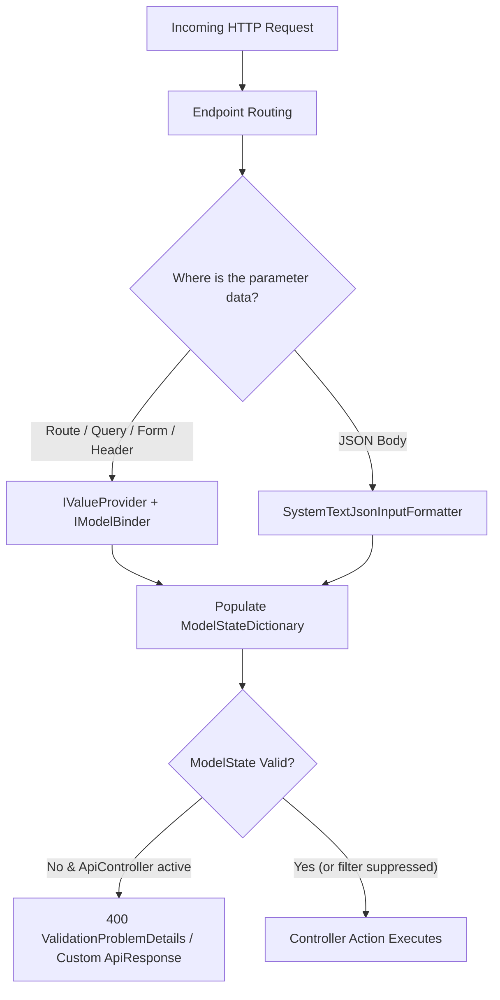
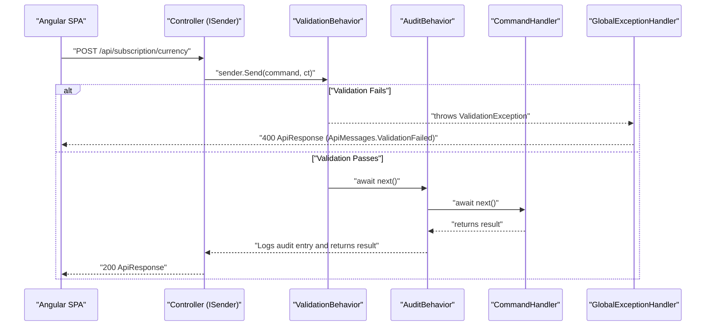

# Module 6: Model Binding, Validation & CQRS Pipeline

Your API receives raw HTTP data — bytes over the wire: a JSON body, query string parameters, URL segments, multipart files, and HTTP headers. Your C# code works with strongly-typed objects. **Model Binding** is the bridge between these two worlds. And **Validation** is the guard that ensures incoming data is structurally valid and safe before your business logic touches it.

> **Term Check — Core Concepts Used in This Module:**
> - **DTO (Data Transfer Object):** A lightweight class or `record` shaped specifically for an API request or response boundary, keeping internal database entities hidden.
> - **`ModelState`:** ASP.NET Core's dictionary tracking every bound parameter/property name, its attempted raw value, and any parsing or validation errors encountered before your action runs.
> - **CQRS (Command Query Responsibility Segregation):** Separating operations that mutate state (**Commands**, e.g., `UploadDocumentCommand`) from operations that only read data (**Queries**, e.g., `PerformHybridRetrievalQuery`).
> - **MediatR:** An in-process mediator library that decouples controllers from business handlers by routing commands/queries through a configurable pipeline of cross-cutting behaviors (`IPipelineBehavior<TRequest, TResponse>`).

In enterprise software architecture, validation must be **isolated, automated, and testable**. This module demonstrates how ASP.NET Core .NET 10 model binding works under the hood, compares Data Annotations with FluentValidation, and integrates automated validation and audit logging directly into **Normora's MediatR CQRS pipeline**.

---

## 1. What is Model Binding? (And How It Works Under the Hood)

Model Binding is the **automatic process** by which ASP.NET Core reads incoming HTTP request data and converts it into C# method parameters and objects.

> **Analogy — The Mail Room:**  
> Imagine your office receives packages (HTTP requests). Each package has a shipping label (URL route/query), a customs form (headers), and contents inside the box (body). The mail room (Model Binder / Input Formatter) reads all of these, assembles the information into a structured internal form (C# DTO/Command), and delivers it to the right department (Controller action).

### Before Model Binding (Manual Parsing)
```csharp
// ❌ Without model binding — Painful, error-prone, fragile
[HttpPost]
public async Task<IActionResult> CreateDepartment()
{
    var body = await new StreamReader(Request.Body).ReadToEndAsync();
    var json = JsonSerializer.Deserialize<Dictionary<string, object>>(body);
    var name = json?["name"]?.ToString();
    var maxDocs = int.Parse(json!["maxDocuments"].ToString()!);
    // ... endless manual parsing, type conversion, null checks, and KeyNotFoundException risks
    return Ok();
}
```

### With Model Binding (Automatic)
```csharp
// ✅ With model binding — Clean, automatic, strongly-typed
[HttpPost]
public async Task<IActionResult> CreateDepartment(
    CreateDepartmentRequest request,
    CancellationToken ct)
{
    // 'request' is already populated from the JSON body!
    // ASP.NET Core handled stream reading, JSON deserialization, and type conversion.
    var result = await sender.Send(new CreateDepartmentCommand(request.Name, request.Description), ct);
    return Ok(ApiResponse<Guid>.Success(result));
}
```

### Under the Hood: Value Providers vs. Input Formatters

A senior architect knows that ASP.NET Core actually uses **two different mechanisms** depending on *where* the data lives in the HTTP request:

1. **Key-Value Data (Route, Query, Form, Header) → `IValueProvider` + `IModelBinder`:**
   - ASP.NET Core queries registered `IValueProvider` sources in precedence order: **Form values** → **Route values** → **Query string values** (headers require explicit `[FromHeader]`).
   - Matching `IModelBinder` implementations convert strings into `int`, `Guid`, `bool`, `DateTimeOffset`, enums, collections, or `IFormFile`.
2. **Body Payloads (`[FromBody]`) → `IInputFormatter` (`SystemTextJsonInputFormatter`):**
   - Body binding does **not** use `IValueProvider` or property-by-property `IModelBinder`s. Instead, it delegates the entire `HttpContext.Request.Body` stream to `System.Text.Json`.



### When NOT to Use Default Model Binding
* **HMAC / Cryptographically Signed Webhooks:** Payment gateways or webhook providers compute signatures over the exact raw request bytes. Reading/deserializing via `[FromBody]` can alter whitespace or property order; read the raw `Request.Body` stream (with `EnableBuffering()` if needed) or bind specific `[FromForm]` fields verified against the raw payload.
* **Massive Streaming Uploads:** Buffering a 2 GB file via `IFormFile` can exhaust temp disk or memory; stream `Request.Body` or `MultipartReader` directly to MinIO/S3 object storage instead.
* **Cross-Cutting Security Contexts:** Never bind authoritative `TenantId` or `ExternalUserId` from request payloads or routes — resolve them from server-trusted middleware (`ITenantContext`, `ICurrentUser`).

### Real-World Normora Examples: Model Binding in Action
1. **Tenants — Creating a Department (`[FromBody]`):** `DepartmentsController` binds `CreateDepartmentRequest` automatically from the JSON body and maps it to `CreateDepartmentCommand`.
2. **Documents — Uploading a Policy PDF (`[FromForm]`):** `DocumentsController` binds a multipart form containing an `IFormFile` (`file`), `string? title`, and `Guid? departmentId` for atomic MinIO upload and outbox creation.
3. **Documents — Hybrid Search (`[FromQuery]`):** `DocumentsController` binds `?query=travel+allowance&topK=5&departmentId=...` into a typed search request feeding `PerformHybridRetrievalQuery`.
4. **Conversations — Sending a Chat Turn (`[FromRoute]` + `[FromBody]`):** `ConversationsController` binds `Guid conversationId` from `/api/conversations/{conversationId}/messages` and `SendMessageRequest` from JSON.
5. **Tenants — PayU Payment Callback (`[FromForm]`):** `SubscriptionController` binds PayU's form-encoded POST callback (`txnid`, `status`, `amount`, `udf3`, `hash`) using `[FromForm]` with `[IgnoreAntiforgeryToken]` (because it is an externally signed gateway callback, per Duende BFF rules).

---

## 2. Binding Sources — Where Data Comes From

HTTP requests carry data in **multiple places**. ASP.NET Core can read from all of them.

### The Four Primary Sources

| Attribute | Source | Normora Example | Common Use |
|---|---|---|---|
| `[FromRoute]` | URL path segments | `/api/documents/{id}` → `id` | Resource identifiers (`Guid`, slugs) |
| `[FromQuery]` | Query string | `?page=2&pageSize=20` → `page = 2, pageSize = 20` | Filters, pagination, search |
| `[FromBody]` | Request body (JSON) | `{ "currency": "USD" }` → `command.Currency = "USD"` | POST/PUT/PATCH payloads |
| `[FromHeader]` | HTTP headers | `X-Correlation-Id: 9f3a...` | Metadata, correlation IDs, client hints |

### Additional Sources (.NET 10)

| Attribute | Source | Use Case |
|---|---|---|
| `[FromForm]` | Form-encoded or multipart body | File uploads (`IFormFile`), gateway form callbacks |
| `[FromServices]` | DI container | Inject a service into a single action rather than the controller constructor |
| `[FromKeyedServices("key")]` | DI container (keyed) | Inject a specific named implementation (e.g., `"gemini"` vs `"fallback"` client) in .NET 8+/10 |
| `[AsParameters]` | Minimal API parameter grouping | Bundle `[FromRoute]`, `[FromQuery]`, `[FromHeader]`, and services into one flat record in Minimal APIs |

### How `[ApiController]` Changes the Rules
When a controller is annotated with `[ApiController]`, ASP.NET Core applies **inference rules** so you don't have to write binding attributes for every parameter:

| Parameter Type | Inferred Source |
|---|---|
| Simple types (`int`, `string`, `Guid`, `bool`, `DateTimeOffset`) | `[FromRoute]` if a matching route parameter exists, otherwise `[FromQuery]` |
| Complex types (classes, records) | `[FromBody]` |
| `IFormFile` or `IFormFileCollection` | `[FromForm]` |
| `CancellationToken` | Injected automatically by the framework from `HttpContext.RequestAborted` |

This means:
```csharp
// From server/Modules/Tenants/API/DepartmentsController.cs
[ApiController]
[Route("api/departments")]
public sealed class DepartmentsController(ISender sender) : ControllerBase
{
    // ASP.NET Core automatically infers:
    //   - 'departmentId' comes from the route (matches {departmentId:guid})
    //   - 'includeArchived' comes from the query string (simple type, no route match)
    //   - 'request' comes from the JSON body (complex type)
    //   - 'ct' is bound automatically to the client disconnect token
    [HttpPut("{departmentId:guid}")]
    public async Task<IActionResult> UpdateDepartment(
        Guid departmentId,
        bool includeArchived,
        UpdateDepartmentRequest request,
        CancellationToken ct)
    {
        var result = await sender.Send(
            new UpdateDepartmentCommand(departmentId, request.Name, request.Description, includeArchived),
            ct);
        return Ok(ApiResponse<DepartmentDto>.Success(result));
    }
}
```

### Explicit Binding (When You Need Unambiguous Contracts)
Always add explicit binding attributes when binding **complex objects from query strings** (because `[ApiController]` defaults complex types to `[FromBody]`), **headers**, or **multipart forms**:

```csharp
// From server/Modules/Documents/API/DocumentsController.cs
[HttpGet]
public async Task<IActionResult> ListDocuments(
    [FromQuery] DocumentFilterQuery filter,
    [FromHeader(Name = "X-Correlation-Id")] string? correlationId,
    CancellationToken ct)
{
    var result = await sender.Send(new ListDocumentsQuery(filter.DepartmentId, filter.Page, filter.PageSize), ct);
    return Ok(ApiResponse<PagedResult<DocumentDto>>.Success(result));
}
```

### Critical Binding Rules & Nuances
1. **Only ONE `[FromBody]` per Action:** `Request.Body` is a forward-only stream. You cannot have two `[FromBody]` parameters on the same action—combine them into a single command/request record.
2. **Complex Query Binding Requires `[FromQuery]`:** Without `[FromQuery]`, `[ApiController]` treats a `DocumentFilterQuery` class/record as `[FromBody]`, which fails on HTTP `GET` requests.
3. **Multipart File Limits (`[FromForm]`):** `IFormFile` buffers uploads up to a memory threshold before spilling to temp disk. Always protect upload endpoints with `[RequestSizeLimit(25_000_000)]` (or configured limits) so attackers cannot exhaust server memory/disk.
4. **C# `required` + `System.Text.Json`:** In .NET 8–10, marking a DTO property `public required string Currency { get; init; }` causes `System.Text.Json` to reject missing JSON fields at deserialization time with a clear `JsonException`, rather than silently leaving defaults.
5. **Preventing Over-Posting (Mass Assignment):** Never bind HTTP requests directly to EF Core entities (e.g., `TenantMembership` or `Document`). If a client sends `{ "role": "Owner", "isDeleted": false }`, the serializer populates unintended properties. Always bind to a dedicated request DTO or CQRS command.

### When NOT to Bind From Specific Sources
* **Never bind security identity from `[FromRoute]`, `[FromQuery]`, or `[FromBody]`:** A caller sending `tenantId` in JSON could spoof another organization's workspace. Always resolve `ITenantContext` and `ICurrentUser` from authenticated BFF session middleware.
* **Never put secrets, tokens, or PII in `[FromQuery]`:** Query strings are recorded in reverse-proxy logs, browser history, OpenTelemetry URL attributes, and CDN access logs.

### Real-World Normora Examples: Binding Sources
1. **Tenants — Updating Workspace Currency (`[FromBody]`):** `PUT /api/subscription/currency` binds `UpdateTenantCurrencyRequest` from the JSON body (`{ "currency": "EUR" }`) via `[ApiController]` inference.
2. **Documents — Uploading a Knowledge File (`[FromForm]`):** `POST /api/documents` binds `[FromForm] UploadDocumentFormRequest` containing `IFormFile File`, `Guid? DepartmentId`, and `string? Title`, guarded by an explicit upload size limit.
3. **Tenants — Filtering Audit Logs (`[FromQuery]`):** `GET /api/audit-logs?action=DeleteDocument&page=1&pageSize=25` uses explicit `[FromQuery] AuditLogFilterQuery` so the complex filter record binds from query parameters instead of a non-existent GET body.
4. **Conversations — Approving a HITL Action (`[FromRoute]` + `[FromBody]`):** `ApprovalsController` binds `Guid approvalId` from `/api/approvals/{approvalId}/decision` and `{ "approved": true, "reason": "..." }` from JSON body, plus `CancellationToken`.
5. **Documents — JSON-RPC 2.0 MCP Endpoint (`[FromBody]` + `[FromHeader]`):** `McpController` (`/api/mcp`) binds `McpJsonRpcRequest` from `[FromBody]` and inspects custom MCP session headers without relying on form/query fallback.

---

## 3. Custom Model Binders, `IParsable<T>`, and Strongly-Typed Values

Built-in binding handles primitives (`Guid`, `int`, `string`), enums, and JSON DTOs. Sometimes, however, you want domain value objects—like a validated `TenantSlug` or a comma-separated query list `?departmentIds=id1,id2`—directly in your action signature.

### Option A: `IParsable<TSelf>` (.NET 7–10 Modern Standard for Route/Query/Header)
In modern .NET, any type implementing `IParsable<TSelf>` (or defining `static bool TryParse(string? s, IFormatProvider? provider, out T result)`) is **automatically bound** by both Minimal APIs and ASP.NET Core controllers from route, query, and header strings—no `IModelBinder` boilerplate required!

```csharp
// From Normora.Shared/Models/TenantSlug.cs
public readonly record struct TenantSlug : IParsable<TenantSlug>
{
    public string Value { get; }

    private TenantSlug(string value) => Value = value;

    public static TenantSlug Parse(string s, IFormatProvider? provider)
        => TryParse(s, provider, out var result)
            ? result
            : throw new FormatException(ApiMessages.InvalidTenantSlug);

    public static bool TryParse(string? s, IFormatProvider? provider, out TenantSlug result)
    {
        if (!string.IsNullOrWhiteSpace(s) && s.Length is >= 3 and <= 64 &&
            s.All(c => char.IsAsciiLetterLower(c) || char.IsAsciiDigit(c) || c == '-'))
        {
            result = new TenantSlug(s.Trim().ToLowerInvariant());
            return true;
        }

        result = default;
        return false;
    }
}
```

### Option B: Custom `IModelBinder` (For Non-Standard Query/Header Formats)
When a client sends a comma-separated query string (`?departmentIds=a1b2...,c3d4...`) instead of repeated keys (`?departmentIds=a1b2&departmentIds=c3d4`), a custom `IModelBinder` parses it cleanly:

```csharp
// Custom binder for comma-separated GUID lists in GET queries
public sealed class CommaSeparatedGuidModelBinder : IModelBinder
{
    public Task BindModelAsync(ModelBindingContext bindingContext)
    {
        var valueResult = bindingContext.ValueProvider.GetValue(bindingContext.ModelName);
        if (valueResult == ValueProviderResult.None)
        {
            return Task.CompletedTask;
        }

        var rawValues = valueResult.Values
            .SelectMany(v => (v ?? string.Empty).Split(',', StringSplitOptions.RemoveEmptyEntries | StringSplitOptions.TrimEntries))
            .ToArray();

        var parsed = new List<Guid>(rawValues.Length);
        foreach (var raw in rawValues)
        {
            if (!Guid.TryParse(raw, out var guid))
            {
                bindingContext.ModelState.TryAddModelError(bindingContext.ModelName, ApiMessages.InvalidIdentifierFormat);
                return Task.CompletedTask;
            }
            parsed.Add(guid);
        }

        bindingContext.Result = ModelBindingResult.Success(parsed);
        return Task.CompletedTask;
    }
}
```

### When NOT to Use Custom Model Binders
* **Never perform database queries or authorization checks inside `IModelBinder`:** Model binding runs before filters and MediatR behaviors, lacks rich error mapping (`BolaException` / `BflaException`), and silently hides I/O latency.
* **Never use `IModelBinder` for JSON body properties:** `IModelBinder` is skipped for `[FromBody]`—use a `System.Text.Json` `JsonConverter<T>` instead.

### Real-World Normora Examples: Custom Parsing & Converters
1. **Tenants — `TenantSlug` via `IParsable<TenantSlug>`:** Normalizes workspace slugs (`"acme-corp"`) at the HTTP boundary and rejects uppercase/special-character injection early.
2. **Documents — `CommaSeparatedGuidModelBinder`:** Parses `?departmentIds=guid1,guid2` on `GET /api/documents` into `IReadOnlyList<Guid>` for multi-department filtering.
3. **Tenants — `SupportedCurrency` Value Object (`IParsable<SupportedCurrency>`):** Normalizes `"usd"` → `"USD"` and validates against `TenantPlanPricingCatalog` currency codes before reaching `UpdateTenantCurrencyCommand`.
4. **Documents — `McpJsonRpcIdConverter` (`JsonConverter<McpRequestId>`):** Handles JSON-RPC 2.0's polymorphic `"id"` field in `/api/mcp` (`string`, `number`, or `null`) during `[FromBody]` deserialization.
5. **Conversations — `DocumentChunkId` (`IParsable<DocumentChunkId>` + `JsonConverter`):** Prevents accidentally swapping `ConversationId` and `DocumentId` (both `Guid`s under the hood) in route and JSON bindings.

---

## 4. What is Validation? (Syntactic vs. Semantic & Security Boundaries)

### The Golden Rule: Never Trust Client Data
Every byte of data coming from the internet is potentially malicious or malformed. A client could send:
*   An empty workspace name or document title
*   A negative `pageSize` or a `pageSize` of `10_000_000` (causing an Out-Of-Memory database dump!)
*   A catastrophic Regular Expression Denial of Service (ReDoS) payload
*   A 50MB string where a short chat prompt should be

**Validation** ensures that incoming data meets structural and business rules **before** it touches your core domain logic.

> **Analogy — The Bouncer at a Club:**  
> Your business logic is the VIP section. The bouncer (validator) stands at the velvet rope. He checks ID, dress code, and guest list *before* anyone enters. If you don't meet the rules, you are turned away at the door (`400 Bad Request`) — you never enter the club.

### The Architect's Three-Layer Validation Boundary
Senior engineers separate validation into three distinct layers so rules live in the right place:

1. **Syntactic / Format Validation (Model Binding & JSON Deserializer):** Can `"2026-11-20"` parse into a `DateTimeOffset`? Is `"id"` a valid `Guid`?
2. **Structural / Input Validation (FluentValidation in `ValidationBehavior`):** Is `Prompt` non-empty and under 4,000 characters? Is `PageSize` between `1` and `100`? Fails with **`400 Bad Request`** (`ApiMessages.ValidationFailed`).
3. **Semantic / Domain & Security Validation (Command Handler & Domain Entities):** Does this user have permission to delete this document? Is the tenant on the `Free` plan trying to cancel?
   - Unauthorized resource access → throw **`BolaException()`** (`404 Not Found` — prevents ID enumeration!)
   - Unauthorized functional action → throw **`BflaException()`** (`403 Forbidden`)
   - Domain invariant violation → throw **`InvalidOperationException(ApiMessages.CannotCancelFreePlan)`** (`400 Bad Request`)

### Client-Side vs. Server-Side Validation
Normora's Angular 22 frontend uses Reactive Forms to give users instant inline feedback. **Client-side validation is strictly a UX feature, never a security boundary**—any attacker can bypass the browser with `curl` or a proxy and hit `/api/...` directly.

### When NOT to Put Rules in an Input Validator
* **Never put BOLA or BFLA authorization checks in FluentValidation:** FluentValidation produces `400 Bad Request` with field-level details. Returning `400` or `403` when an attacker probes another tenant's `DocumentId` leaks whether the document exists! BOLA belongs in handlers/policies throwing `BolaException` (`404`).
* **Never hardcode raw error strings:** Always reference `Normora.Shared.Constants.ApiMessages` so `GlobalExceptionHandler` (Module 7) and frontend i18n interceptors behave consistently.

### Real-World Normora Examples: Validation Boundaries
1. **Documents — `UploadDocumentCommand`:** Syntactic validation checks non-empty filename, allowed extensions (`.pdf`, `.md`, `.docx`, `.txt`), and max byte size (`400`); semantic validation checks workspace storage/document quota in the handler.
2. **Tenants — `CancelSubscriptionCommand`:** Domain invariant check in `CancelSubscriptionCommandHandler` rejects `Free` tier workspaces with `InvalidOperationException(ApiMessages.CannotCancelFreePlan)`.
3. **Documents — `DeleteDocumentCommand`:** Ownership/departmental access is a security boundary—if the user cannot access the document, the handler throws `BolaException()` (`404`), NOT a FluentValidation `400`.
4. **Conversations — `SendMessageCommand`:** FluentValidation enforces non-empty prompt and max character budget (`400`); the handler verifies conversation ownership (`BolaException` → `404`) before invoking Gemini.
5. **Tenants — `UpdateTenantCurrencyCommand`:** FluentValidation verifies the currency code is in `TenantPlanPricingCatalog` (`400`); `BflaException` (`403`) blocks non-admin members from changing workspace billing settings.

---

## 5. Approach 1: Data Annotations & Automatic `ModelState` Validation

Data Annotations use C# attributes directly on DTO or Options properties, and `[ApiController]` automatically validates them before your controller action executes:

```csharp
// Example: Simple leaf DTO using Data Annotations
public sealed class PaginationQueryRequest
{
    [Range(1, int.MaxValue)]
    public int Page { get; init; } = 1;

    [Range(1, 100)]
    public int PageSize { get; init; } = 20;
}
```

### How `[ApiController]` Enforces `ModelState`
When `[ApiController]` is present, ASP.NET Core registers `ModelStateInvalidFilter` automatically. If `ModelState.IsValid` is `false` (due to a failed Data Annotation or malformed JSON), the framework short-circuits and returns a `400 Bad Request` (`ValidationProblemDetails`) without ever entering your controller method.

In **Normora**, responses follow a uniform `ApiResponse` envelope rather than raw `ValidationProblemDetails` from different places. You can customize `InvalidModelStateResponseFactory` in `Normora.Api` (or suppress the filter with `SuppressModelStateInvalidFilter = true` when delegating completely to MediatR):

```csharp
// Customizing [ApiController] automatic 400 responses to match Normora's ApiResponse envelope
builder.Services.Configure<ApiBehaviorOptions>(options =>
{
    options.InvalidModelStateResponseFactory = context =>
    {
        var errors = context.ModelState
            .Where(kvp => kvp.Value?.Errors.Count > 0)
            .ToDictionary(
                kvp => kvp.Key,
                kvp => kvp.Value!.Errors.Select(e => e.ErrorMessage).ToArray());

        return new BadRequestObjectResult(
            ApiResponse<Dictionary<string, string[]>>.Failure(ApiMessages.ValidationFailed, errors));
    };
});
```

### Common Data Annotation Attributes:
| Attribute | What it checks |
|---|---|
| `[Required]` | Value is not null, empty, or whitespace |
| `[StringLength(max, MinimumLength = min)]` | String length is within bounds |
| `[Range(min, max)]` | Numeric value is within bounds |
| `[EmailAddress]` | String matches standard email format |
| `[RegularExpression(pattern)]` | String matches custom regex (beware ReDoS on untrusted complex patterns!) |
| `[Compare("OtherProperty")]` | Two properties match (e.g., confirmation fields) |

*(Need basic cross-property checks without FluentValidation? Implement `IValidatableObject.Validate(ValidationContext)` on the DTO—though for CQRS commands, FluentValidation is far cleaner.)*

### Limitations of Data Annotations:
1.  **Pollutes DTOs:** Validation logic is tightly coupled to the data transfer object.
2.  **No Complex Logic:** Conditional rules (*"If billing cycle is Annual, validate annual discount eligibility"*) become an unreadable mess of custom attributes.
3.  **Cannot Query External Services:** Attributes cannot easily perform async queries (e.g., checking whether a department name already exists in PostgreSQL).
4.  **Difficult to Unit Test:** Testing requires instantiating `System.ComponentModel.DataAnnotations.ValidationContext` rather than pure, fast unit tests.
5.  **Only Runs in MVC/API Binding:** If a background job in `Normora.Worker` or an AI agent tool in `Conversations` sends a MediatR command directly, Data Annotations on an HTTP DTO are completely bypassed!

### When to USE vs. When NOT to Use Data Annotations
* **When TO use:** Startup configuration validation (`IOptions<T>` + `.ValidateDataAnnotations().ValidateOnStart()` as covered in Module 5) and trivial scalar bounds on query DTOs.
* **When NOT to use:** CQRS commands/queries inside business modules, conditional/cross-field rules, or anything requiring DI or async I/O.

### Real-World Normora Examples: Data Annotations
1. **Infrastructure — `GeminiOptions` Startup Validation:** Uses `[Required]` and `[Range]` with `.ValidateDataAnnotations().ValidateOnStart()` so missing API keys crash at boot, not mid-chat.
2. **Infrastructure — `MinioOptions` Startup Validation:** Validates S3 endpoint, bucket name, and credentials at startup via Data Annotations.
3. **Documents — `PaginationQueryRequest`:** Constrains `Page >= 1` and `PageSize` between `1` and `100` on document list queries.
4. **Normora.Api — `InvalidModelStateResponseFactory`:** Intercepts malformed JSON binding errors (e.g., sending `"pageSize": "abc"`) and returns `ApiResponse` with `ApiMessages.ValidationFailed`.
5. **Tenants — Why `CreateDepartmentRequest` Outgrows Data Annotations:** While `[StringLength(100)]` works for `Name`, checking unique department names within the tenant requires FluentValidation / handler logic—making Data Annotations insufficient.

---

## 6. Approach 2: FluentValidation (Enterprise Standard)

**FluentValidation** decouples validation into dedicated, strongly-typed validator classes. In **Normora**, every CQRS operation follows the **folder-per-operation** layout, with the command, handler, and validator in separate files:

```text
server/Modules/Tenants/Application/Employees/Commands/InviteEmployee/
├── InviteEmployeeCommand.cs
├── InviteEmployeeCommandHandler.cs
└── InviteEmployeeCommandValidator.cs
```

### Clean CQRS Command + Dedicated Validator (With Primary Constructor & `ApiMessages`)

```csharp
// InviteEmployeeCommand.cs
public sealed record InviteEmployeeCommand(
    string Email,
    string Role,
    IReadOnlyList<Guid> DepartmentIds,
    string? PersonalNote) : IRequest<Guid>;

// InviteEmployeeCommandValidator.cs
public sealed class InviteEmployeeCommandValidator : AbstractValidator<InviteEmployeeCommand>
{
    private static readonly string[] AllowedRoles = ["Member", "DepartmentAdmin", "TenantAdmin"];

    public InviteEmployeeCommandValidator()
    {
        RuleFor(x => x.Email)
            .Cascade(CascadeMode.Stop)
            .NotEmpty().WithMessage(ApiMessages.EmailRequired)
            .EmailAddress().WithMessage(ApiMessages.InvalidEmailFormat)
            .MaximumLength(254).WithMessage(ApiMessages.EmailTooLong);

        RuleFor(x => x.Role)
            .NotEmpty().WithMessage(ApiMessages.RoleRequired)
            .Must(role => AllowedRoles.Contains(role, StringComparer.Ordinal))
            .WithMessage(ApiMessages.InvalidRole);

        RuleFor(x => x.DepartmentIds)
            .NotEmpty().WithMessage(ApiMessages.DepartmentSelectionRequired);

        // RuleForEach validates every element in a collection!
        RuleForEach(x => x.DepartmentIds)
            .NotEmpty().WithMessage(ApiMessages.InvalidIdentifierFormat);

        // Conditional rule: only validate PersonalNote when provided
        RuleFor(x => x.PersonalNote)
            .MaximumLength(500).WithMessage(ApiMessages.NoteTooLong)
            .When(x => !string.IsNullOrWhiteSpace(x.PersonalNote));
    }
}
```

### Async / Database-Dependent Validation & The TOCTOU Trade-Off
Because validators are standard classes resolved from DI, a module validator can inject a **module-internal** read interface to run async checks via `MustAsync`:

*(Note on C# Primary Constructors: Controllers, handlers, and MediatR behaviors in Normora always use primary constructors for DI. `AbstractValidator<T>` is the one special case where `RuleFor(...)` calls must execute inside a constructor body—and because the `MustAsync` lambda captures the constructor parameters directly, you still avoid declaring boilerplate `private readonly` fields!)*

```csharp
// Inside Modules/Tenants/Application/Departments/Commands/CreateDepartment/CreateDepartmentCommandValidator.cs
public sealed class CreateDepartmentCommandValidator : AbstractValidator<CreateDepartmentCommand>
{
    public CreateDepartmentCommandValidator(
        IDepartmentReadStore departmentReadStore,
        ITenantContext tenantContext)
    {
        RuleFor(x => x.Name)
            .Cascade(CascadeMode.Stop)
            .NotEmpty().WithMessage(ApiMessages.DepartmentNameRequired)
            .Length(2, 100).WithMessage(ApiMessages.DepartmentNameLengthInvalid)
            .MustAsync(async (name, ct) =>
            {
                var exists = await departmentReadStore.ExistsByNameAsync(tenantContext.TenantId, name, ct);
                return !exists; // true = valid
            })
            .WithMessage(ApiMessages.DepartmentAlreadyExists);
    }
}
```

> [!WARNING]
> **Architect's Trade-Off — `MustAsync` vs. TOCTOU Race Conditions:**
> 1. **Never inject another module's `DbContext`** into a validator (violates 100% DbContext encapsulation).
> 2. **Watch out for TOCTOU (Time-of-Check to Time-of-Use):** Two concurrent requests can both pass `MustAsync` at `t=0` and both attempt `INSERT` at `t=5ms`. Always back uniqueness rules with a PostgreSQL `UNIQUE` index `(TenantId, NormalizedName)` and map `DbUpdateException` cleanly.
> 3. **Always execute async validators with `ValidateAsync`:** Calling synchronous `.Validate()` on a validator with `MustAsync` throws `AsyncValidatorInvokedSynchronouslyException` at runtime.

### Pure Unit Testing with `FluentValidation.TestHelper`
Unlike Data Annotations, FluentValidation validators test cleanly in milliseconds without spinning up Kestrel or `HttpContext`:

```csharp
[Fact]
public async Task Should_Fail_When_Currency_Is_Not_Supported()
{
    var validator = new UpdateTenantCurrencyCommandValidator();
    var result = await validator.TestValidateAsync(new UpdateTenantCurrencyCommand("XYZ"));

    result.ShouldHaveValidationErrorFor(x => x.Currency)
          .WithErrorMessage(ApiMessages.UnsupportedCurrency);
}
```

### When NOT to Use FluentValidation
* **BOLA / BFLA Authorization Checks:** Never put tenant/document ownership checks in FluentValidation (`400`)—throw `BolaException` (`404`) or `BflaException` (`403`) in handlers.
* **Cross-Module Heavy Orchestration:** Avoid turning validators into mini-handlers that query multiple external HTTP APIs (Gemini, MinIO) before the handler even starts.
* **Startup `IOptions<T>` Binding:** Use `ValidateDataAnnotations().ValidateOnStart()` for configuration options so boot fails before MediatR exists.

### Real-World Normora Examples: FluentValidation
1. **Tenants — `InviteEmployeeCommandValidator`:** Validates email format, allowed workspace roles, non-empty `DepartmentIds` via `RuleForEach`, and optional note length using `ApiMessages`.
2. **Tenants — `UpdateTenantCurrencyCommandValidator`:** Validates the requested currency code against `TenantPlanPricingCatalog.SupportedCurrencies` (`INR`, `USD`, `EUR`, `GBP`, `CAD`, `AUD`, `JPY`, `SGD`).
3. **Documents — `UploadDocumentCommandValidator`:** Enforces allowed file extensions (`.pdf`, `.docx`, `.md`, `.txt`), non-zero file size up to the max byte limit, and title length bounds.
4. **Tenants — `CreateUserGroupCommandValidator`:** Uses `CascadeMode.Stop` on group name length and `RuleForEach` on member GUIDs so invalid arrays fail fast with `ApiMessages`.
5. **Conversations — `SendMessageCommandValidator`:** Validates non-empty prompt, max token/character ceiling, valid optional `Persona` key (`All-Rounder`, `HR & People Ops`, `Finance & Travel`, `IT & Security`), and `ConversationId` presence when continuing a thread.

---

## 7. The MediatR Pipeline Behavior Pattern

In Clean Architecture and Modular Monoliths, controllers do not perform validation. Instead, a **MediatR Pipeline Behavior** intercepts every command and query before it reaches the handler—using the same Russian Doll decorator pattern you learned for ASP.NET Core Middleware in Module 2, except scoped to application requests.



### The Production `ValidationBehavior`:

Here is the exact implementation used in **Normora** (and **NextEvent**):

```csharp
// From Normora.Shared/ValidationBehavior.cs
using FluentValidation;
using MediatR;

namespace Normora.Shared;

public sealed class ValidationBehavior<TRequest, TResponse>(
    IEnumerable<IValidator<TRequest>> validators) 
    : IPipelineBehavior<TRequest, TResponse>
    where TRequest : notnull
{
    public async Task<TResponse> Handle(
        TRequest request,
        RequestHandlerDelegate<TResponse> next,
        CancellationToken cancellationToken)
    {
        // 1. If no validators are registered for this request, pass through immediately
        if (!validators.Any())
        {
            return await next();
        }

        var context = new ValidationContext<TRequest>(request);

        // 2. Execute all validators asynchronously in parallel
        var validationResults = await Task.WhenAll(
            validators.Select(v => v.ValidateAsync(context, cancellationToken)));

        // 3. Aggregate failures across all validator classes
        var failures = validationResults
            .SelectMany(r => r.Errors)
            .Where(f => f != null)
            .ToList();

        // 4. If any validation rules fail, throw ValidationException
        if (failures.Count != 0)
        {
            throw new ValidationException(failures);
        }

        // 5. All validation passed — continue to the actual Command Handler
        return await next();
    }
}
```

> [!TIP]
> **Senior Architect Nuance — `Task.WhenAll` vs. EF Core `DbContext`:**  
> `Task.WhenAll` is fast when validators run CPU-bound rules or hit independent async stores. However, if **two or more validators** for the same `TRequest` inject the same scoped EF Core `DbContext` and run `MustAsync` database queries concurrently, EF Core throws `InvalidOperationException` (*"A second operation was started on this context instance before a previous operation completed"*). If you register multiple EF Core validators for a single request, iterate sequentially (`foreach (var validator in validators) { ... await validator.ValidateAsync(...) }`) instead of `Task.WhenAll`.

### The Controller in a CQRS Pipeline (Primary Constructor + `ISender`):
Notice that Normora controllers inject `ISender` (not the broader `IMediator` interface—following the Interface Segregation Principle because controllers only send requests and never publish domain events) via a **primary constructor**:

```csharp
// From server/Modules/Tenants/API/SubscriptionController.cs
[ApiController]
[Route("api/subscription")]
public sealed class SubscriptionController(ISender sender) : ControllerBase
{
    [HttpPut("currency")]
    public async Task<IActionResult> UpdateCurrency(
        UpdateTenantCurrencyRequest request,
        CancellationToken ct)
    {
        // The controller contains ZERO validation boilerplate!
        await sender.Send(new UpdateTenantCurrencyCommand(request.Currency), ct);
        return Ok(ApiResponse.Success());
        // If invalid, ValidationBehavior throws ValidationException.
        // GlobalExceptionHandler (Module 7) maps it to 400 Bad Request
        // with ApiMessages.ValidationFailed. The handler never executes!
    }
}
```

### When NOT to Use a MediatR Pipeline Behavior
* **HTTP Transport Concerns:** Cookie handling, CORS, security headers, rate limiting, and `TenantResolutionMiddleware` belong in ASP.NET Core HTTP Middleware (Module 2), not MediatR behaviors.
* **Single-Operation Business Logic:** If a rule only applies to one handler (e.g., PayU hash verification or Free-tier cancellation guard), put it in that handler or domain service—don't bloat every MediatR dispatch with `if (request is SpecificCommand)` checks.

### Real-World Normora Examples: MediatR Validation Pipeline
1. **Tenants — `UpdateTenantCurrencyCommand`:** `SubscriptionController` dispatches the command via `ISender`; `ValidationBehavior` validates the currency code before `UpdateTenantCurrencyCommandHandler` updates `TenantPlan.Currency`.
2. **Tenants — `CreateDepartmentCommand`:** `DepartmentsController` stays 5 lines long while `ValidationBehavior` runs `CreateDepartmentCommandValidator` automatically.
3. **Documents — `UploadDocumentCommand`:** Even when invoked from an internal endpoint or helper, `ValidationBehavior` guarantees file metadata and size invariants hold before inserting the `DocumentProcessingOutboxMessage`.
4. **Documents — `PerformHybridRetrievalQuery`:** When a query has no registered `IValidator<TRequest>`, `!validators.Any()` short-circuits in O(1) with zero allocation overhead.
5. **Conversations — `ApprovePendingActionCommand`:** `ApprovalsController` dispatches the HITL confirmation command; `ValidationBehavior` ensures the approval ID and decision payload are valid before executing the queued destructive action (such as `documents_delete`).

---

## 8. Cross-Cutting Pipeline Behaviors: `AuditBehavior` & Observability

In **Normora**, any command mutating system state must record an immutable audit trail. Rather than duplicating audit logging code inside dozens of command handlers, Normora implements an **`AuditBehavior`**:

```csharp
// From Normora.Shared/AuditBehavior.cs
public sealed class AuditBehavior<TRequest, TResponse>(
    ILogger<AuditBehavior<TRequest, TResponse>> logger,
    ICurrentUser currentUser,
    ITenantContext tenantContext) 
    : IPipelineBehavior<TRequest, TResponse>
    where TRequest : notnull
{
    public async Task<TResponse> Handle(
        TRequest request,
        RequestHandlerDelegate<TResponse> next,
        CancellationToken cancellationToken)
    {
        var requestName = typeof(TRequest).Name;

        // Execute the command
        var response = await next();

        // If the command mutates state, record the audit entry
        if (requestName.EndsWith("Command", StringComparison.Ordinal))
        {
            logger.LogInformation(
                "Audit: Action {CommandName} executed by User {UserId} in Tenant {TenantId}",
                requestName,
                currentUser.ExternalUserId ?? "System",
                tenantContext.TenantId);
        }

        return response;
    }
}
```

### Architect Upgrade: Naming Convention vs. Marker Interface
Checking `requestName.EndsWith("Command", StringComparison.Ordinal)` is simple and zero-overhead, **provided** your team enforces strict naming conventions (for example, via NetArchTest architecture tests in Module 10). An even stronger compile-time option is a **marker interface** like `IAuditableCommand` or `ICommand<TResponse>`:
* **Why marker interfaces shine:** If a developer accidentally names a mutating request `RevokeInviteAction` instead of `RevokeInviteCommand`, `EndsWith("Command")` silently skips auditing. Implementing `IAuditableCommand` makes auditing an explicit type-level contract.
* **Notice `ExternalUserId`:** Per Normora's coding rules, `AuditBehavior` logs `currentUser.ExternalUserId ?? "System"`, keeping OIDC vendor names (like Keycloak) completely decoupled from application logs and supporting headless `Normora.Worker` jobs where no HTTP user exists.

### When NOT to Log Request Data in `AuditBehavior`
* **Never serialize and log the raw `TRequest` object unconditionally:** Commands can carry PII (`Email`), invitation tokens, or large document streams. Log the command name, actor (`ExternalUserId`), `TenantId`, and OpenTelemetry `Activity.Current?.Id`—never secrets or raw document content.

### Real-World Normora Examples: Pipeline Behaviors in Action
1. **Tenants — `InviteEmployeeCommand`:** `AuditBehavior` records which `ExternalUserId` invited a new member and under which `TenantId`, strictly after `InviteEmployeeCommandHandler` succeeds (so failed validations/exceptions aren't falsely audited as completed mutations).
2. **Documents — `DeleteDocumentCommand`:** Logs the destructive deletion audit event once HITL approval or admin authorization succeeds.
3. **Tenants — `CancelSubscriptionCommand`:** Captures billing state mutations centrally without polluting `CancelSubscriptionCommandHandler`.
4. **Tenants — `CreateUserGroupCommand`:** Automatically audited as a workspace RBAC mutation, keeping `CreateUserGroupCommandHandler` focused solely on persistence and `IWorkspaceStateSynchronizer`.
5. **Conversations — `PerformHybridRetrievalQuery` (Observability / Latency):** Because queries don't end with `"Command"`, `AuditBehavior` skips mutation auditing on high-volume RAG searches, while an OpenTelemetry / slow-request behavior can flag retrieval queries exceeding a latency threshold (e.g., `> 500ms`).

---

## 9. Wiring Behaviors & Validators in a Modular Monolith

In a single-project application (such as the **NextEvent** baseline), everything is scanned from one application assembly:

```csharp
// Single-assembly baseline (e.g., NextEvent's ApplicationServiceExtensions.cs)
public static IServiceCollection AddApplicationServices(this IServiceCollection services)
{
    services.AddValidatorsFromAssemblyContaining<RegisterCommandValidator>();

    services.AddMediatR(cfg =>
    {
        cfg.RegisterServicesFromAssemblyContaining<LoginCommandHandler>();
        cfg.AddOpenBehavior(typeof(ValidationBehavior<,>));
        cfg.AddOpenBehavior(typeof(AuditBehavior<,>));
    });

    return services;
}
```

In **Normora's Modular Monolith**, each bounded context owns its own `{ModuleName}ModuleExtensions.cs` composition root, registering its internal validators and handlers without exposing `DbContext`s or internal services:

```csharp
// 1. Inside server/Modules/Tenants/TenantsModuleExtensions.cs
public static IServiceCollection AddTenantsModule(
    this IServiceCollection services,
    IConfiguration configuration)
{
    services.AddValidatorsFromAssembly(typeof(TenantsModuleExtensions).Assembly);
    // Register TenantsDbContext, internal read stores, and module services...
    return services;
}

// 2. Inside server/Normora.Api/Extensions/ApplicationServiceExtensions.cs (Host Composition Root)
public static IServiceCollection AddNormoraMediatR(this IServiceCollection services)
{
    services.AddMediatR(cfg =>
    {
        cfg.RegisterServicesFromAssemblies(
            typeof(TenantsModuleExtensions).Assembly,
            typeof(DocumentsModuleExtensions).Assembly,
            typeof(ConversationsModuleExtensions).Assembly);

        // Russian Doll execution order (first registered = outermost wrapper):
        cfg.AddOpenBehavior(typeof(ValidationBehavior<,>)); // 1. Validate inputs first
        cfg.AddOpenBehavior(typeof(AuditBehavior<,>));      // 2. Audit only validated, successful commands
    });

    return services;
}
```

### Critical Registration Rules Architects Verify
1. **Execution Order Matters:** Behaviors wrap each other like Russian Dolls. Register `ValidationBehavior<,>` **before** `AuditBehavior<,>` so invalid commands fail immediately and never enter `AuditBehavior` or the handler.
2. **Lifetimes & Captive Dependencies:** `cfg.AddOpenBehavior(...)` defaults to `ServiceLifetime.Transient`. This is safe when injecting `Scoped` services (`IValidator<T>`, `ITenantContext`, `ICurrentUser`). Never override an open behavior's lifetime to `Singleton` if it consumes `Scoped` dependencies—otherwise you trigger a Captive Dependency bug (Module 3).
3. **Why Both `Normora.Api` and `Normora.Worker` Benefit:** When `Normora.Worker` (Hangfire) executes background workflows via MediatR, `ValidationBehavior` still guards invariants and `AuditBehavior` safely records `"System"` as the actor (`currentUser.ExternalUserId ?? "System"`).

### Real-World Normora Examples: Modular Wiring
1. **Tenants — `TenantsModuleExtensions.AddTenantsModule`:** Auto-discovers all FluentValidation validators inside `Normora.Modules.Tenants` (e.g., `UpdateTenantCurrencyCommandValidator`, `InviteEmployeeCommandValidator`).
2. **Documents — `DocumentsModuleExtensions.AddDocumentsModule`:** Auto-discovers `UploadDocumentCommandValidator` and `SearchDocumentsQueryValidator` without leaking `DocumentsDbContext` to the API host.
3. **Conversations — `ConversationsModuleExtensions.AddConversationsModule`:** Registers `SendMessageCommandValidator` and MCP tool handlers inside the `Conversations` assembly.
4. **Normora.Api — `AddNormoraMediatR`:** Centralizes the open generic `ValidationBehavior<,>` and `AuditBehavior<,>` pipeline across all three module assemblies in one deterministic order.
5. **Normora.Worker — Hangfire Outbox Dispatch:** Background workers referencing module contracts and MediatR retain identical validation and audit guarantees outside Kestrel HTTP requests.

---

## 10. Common Mistakes & Anti-Patterns

> [!CAUTION]
> **Anti-Pattern 1: Binding `TenantId` or `UserId` from the Client Request**
> ```csharp
> // ❌ WRONG — Client controls TenantId in JSON body!
> public sealed record CreateDepartmentRequest(Guid TenantId, string Name);
> ```
> **Why it's wrong:** An attacker can modify the JSON payload in transit and pass another organization's `TenantId`, creating or modifying data in someone else's tenant (Cross-Tenant IDOR).
> ```csharp
> // ✅ FIX — Bind only domain input; read TenantId from server-trusted ITenantContext
> public sealed record CreateDepartmentRequest(string Name, string? Description);
> // Inside CreateDepartmentCommandHandler: use tenantContext.TenantId
> ```

> [!CAUTION]
> **Anti-Pattern 2: Performing BOLA/BFLA Authorization Inside FluentValidation**
> ```csharp
> // ❌ WRONG — Leaks resource existence via 400 Bad Request
> RuleFor(x => x.DocumentId)
>     .MustAsync((id, ct) => docRepo.UserHasAccessAsync(id, currentUser.ExternalUserId, ct))
>     .WithMessage("You do not have access to this document.");
> ```
> **Why it's wrong:** Returning `400` or `403` when probing an unauthorized `DocumentId` lets an attacker enumerate valid document IDs across tenants (OWASP API1 BOLA).
> ```csharp
> // ✅ FIX — Keep syntax checks in FluentValidation; enforce BOLA in the handler
> // Inside DeleteDocumentCommandHandler:
> var document = await db.Documents.FirstOrDefaultAsync(d => d.Id == request.DocumentId, ct)
>     ?? throw new BolaException(); // Mapped globally to 404 Not Found with ApiMessages.NotFound
> ```

> [!CAUTION]
> **Anti-Pattern 3: Over-Posting / Binding Directly to EF Core Domain Entities**
> ```csharp
> // ❌ WRONG — Exposes internal database columns to JSON mass assignment!
> [HttpPut("{id:guid}")]
> public async Task<IActionResult> UpdateEmployee(Guid id, [FromBody] TenantMembership entity)
> ```
> **Why it's wrong:** A malicious client can add `"role": "Owner"` or `"isActive": true` to the JSON body and `System.Text.Json` will bind those properties directly onto your EF Core entity.
> ```csharp
> // ✅ FIX — Always bind to a minimal, immutable request DTO or CQRS command
> public sealed record UpdateMemberDepartmentRequest(IReadOnlyList<Guid> DepartmentIds);
> ```

> [!CAUTION]
> **Anti-Pattern 4: Concurrent `Task.WhenAll` Over Multiple EF Core Validators**
> ```csharp
> // ❌ WRONG if two IValidator<TRequest> implementations share one scoped DbContext
> var results = await Task.WhenAll(validators.Select(v => v.ValidateAsync(context, ct)));
> ```
> **Why it's wrong:** EF Core `DbContext` instances are **not thread-safe** and reject concurrent async queries on the same instance with `InvalidOperationException`.
> ```csharp
> // ✅ FIX — Execute validators sequentially when EF Core read stores are injected
> var failures = new List<ValidationFailure>();
> foreach (var validator in validators)
> {
>     var result = await validator.ValidateAsync(context, ct);
>     failures.AddRange(result.Errors.Where(f => f is not null));
> }
> ```

> [!CAUTION]
> **Anti-Pattern 5: Unbounded Multipart Uploads & Missing `CancellationToken`**
> ```csharp
> // ❌ WRONG — No size cap and ignores client disconnects
> [HttpPost("upload")]
> public async Task<IActionResult> Upload(IFormFile file)
>     => Ok(await sender.Send(new UploadDocumentCommand(file.FileName, file.OpenReadStream())));
> ```
> **Why it's wrong:** Attackers can upload multi-gigabyte payloads to exhaust disk/memory (DoS), and disconnected clients keep background streams and DB queries running needlessly.
> ```csharp
> // ✅ FIX — Enforce explicit request size limits and propagate CancellationToken
> [HttpPost("upload")]
> [RequestSizeLimit(25_000_000)]
> public async Task<IActionResult> Upload(IFormFile file, CancellationToken ct)
> {
>     await using var stream = file.OpenReadStream();
>     var id = await sender.Send(new UploadDocumentCommand(file.FileName, file.Length, stream), ct);
>     return Ok(ApiResponse<Guid>.Success(id));
> }
> ```

> [!CAUTION]
> **Anti-Pattern 6: Hardcoding Magic Error Strings in Validators**
> ```csharp
> // ❌ WRONG — Magic string breaks centralized messaging & GlobalExceptionHandler allowlists
> RuleFor(x => x.Currency).NotEmpty().WithMessage("Currency cannot be empty!");
> ```
> **Why it's wrong:** Hardcoded strings bypass `Normora.Shared.Constants.ApiMessages`, drift out of sync with the Angular frontend's `api-messages.ts` error keys, and fail Normora's zero-magic-strings rule.
> ```csharp
> // ✅ FIX — Reference centralized ApiMessages constants
> RuleFor(x => x.Currency).NotEmpty().WithMessage(ApiMessages.CurrencyRequired);
> ```

---

## 11. Best Practices Summary

| Practice | Why |
|---|---|
| **Always use `[ApiController]`** | Automatic binding inference, `ModelState` checking, and standardized error responses |
| **Use DTOs / Commands, never Entities** | Prevents over-posting (mass assignment) and hides internal persistence schemas |
| **Prefer FluentValidation over Data Annotations** | Decoupled, unit-testable (`TestValidateAsync`), supports conditionals and DI |
| **Use `ValidationBehavior<,>` in MediatR** | Guarantees every command is validated whether triggered by HTTP, MCP, or Hangfire |
| **Keep BOLA/BFLA out of FluentValidation** | Authorization belongs in handlers/policies (`BolaException` → `404`, `BflaException` → `403`) |
| **Use `ApiMessages` constants everywhere** | Eliminates magic strings and keeps backend/frontend error envelopes synchronized |
| **Use `[FromRoute]` for identifiers** | Clean, RESTful URLs: `/api/documents/{documentId}` |
| **Use `[FromQuery]` for filters/pagination** | Required for complex GET filter DTOs (`[FromQuery] AuditLogFilterQuery`) |
| **Always pass `CancellationToken`** | Respects client disconnects and frees thread-pool/DB connections immediately |
| **Implement `AuditBehavior<,>` centrally** | Records mutation telemetry (`ExternalUserId`, `TenantId`) without cluttering handlers |

---

## 12. Interview Questions (Junior to Architect)

1. **[Junior] With `[ApiController]`, how does ASP.NET Core decide whether a parameter comes from `[FromRoute]`, `[FromQuery]`, or `[FromBody]`?**
   - *Answer:* Simple types (`int`, `Guid`, `string`, `bool`) bind from `[FromRoute]` if the parameter name matches a route template token (e.g., `{documentId}`), otherwise from `[FromQuery]`. Complex types (classes/records) default to `[FromBody]`, `IFormFile`/`IFormFileCollection` default to `[FromForm]`, and `CancellationToken` is bound automatically to `HttpContext.RequestAborted`.

2. **[Junior] Why do enterprise teams prefer FluentValidation over Data Annotations for CQRS commands?**
   - *Answer:* FluentValidation separates validation rules from DTOs/commands, supports conditional rules (`.When()`) and collection element rules (`RuleForEach`), integrates with DI, executes cleanly in pure unit tests (`TestValidateAsync`), and runs inside MediatR even for non-HTTP callers like background workers.

3. **[Senior] Under the hood, why can you have multiple `[FromQuery]` or `[FromRoute]` parameters, yet only ONE `[FromBody]` parameter?**
   - *Answer:* Route, query, form, and header parameters are bound via `IValueProvider` and `IModelBinder` from parsed key-value collections. `[FromBody]` uses an `IInputFormatter` (`SystemTextJsonInputFormatter`) that reads the forward-only `HttpContext.Request.Body` stream once and deserializes the entire JSON payload into a single root object.

4. **[Senior] What is an Over-Posting (Mass Assignment) vulnerability, and how do you prevent it in .NET 10?**
   - *Answer:* Over-posting occurs when a client includes extra JSON fields (like `isAdmin: true` or `tenantId`) that map directly to properties on a database entity bound to an action. You prevent it by binding exclusively to purpose-built request DTOs or immutable CQRS command records, never EF Core entities, and optionally enabling `JsonUnmappedMemberHandling.Disallow` on `System.Text.Json`.

5. **[Senior] What happens if `ValidationBehavior` uses `Task.WhenAll` when two validators for the same command both query EF Core via `MustAsync`?**
   - *Answer:* Because a scoped EF Core `DbContext` is not thread-safe for concurrent operations, running two `MustAsync` DB queries in parallel with `Task.WhenAll` throws `InvalidOperationException` (*"A second operation was started on this context instance..."*). Either run validators sequentially with `foreach` or consolidate EF Core checks into one validator/handler.

6. **[Senior] If you have both `[ApiController]` and MediatR `ValidationBehavior`, why might invalid requests return two different JSON shapes—and how do you unify them?**
   - *Answer:* Malformed JSON or Data Annotations fail inside `[ApiController]`'s `ModelStateInvalidFilter` (returning `ValidationProblemDetails`) before reaching the controller, whereas FluentValidation fails inside `ValidationBehavior` (handled by `GlobalExceptionHandler` as `ApiResponse`). You unify them by configuring `ApiBehaviorOptions.InvalidModelStateResponseFactory` to emit the same `ApiResponse` envelope (or suppressing the filter if all validation is handled downstream).

7. **[Architect] Why should a multi-tenant platform like Normora NEVER enforce BOLA (resource ownership) checks inside FluentValidation or a custom `IModelBinder`?**
   - *Answer:* FluentValidation and model binding produce `400 Bad Request` field errors, which leaks whether an ID exists or fails ownership—enabling ID enumeration attacks. In Normora's zero-trust design, unauthorized object access must throw `BolaException` inside the handler/domain layer, which `GlobalExceptionHandler` maps uniformly to `404 Not Found` (`ApiMessages.NotFound`), indistinguishable from a non-existent record.

8. **[Architect] When should cross-cutting logic live in ASP.NET Core Middleware versus a MediatR `IPipelineBehavior`?**
   - *Answer:* Put transport/HTTP concerns (forwarded headers, BFF cookie auth, CORS, rate limiting, `TenantResolutionMiddleware`, global exception-to-HTTP mapping) in **ASP.NET Core Middleware**. Put application-level concerns tied to typed CQRS requests (command validation, mutation auditing, handler latency telemetry) in **MediatR `IPipelineBehavior`s**—especially because background hosts like `Normora.Worker` and internal cross-module MediatR calls traverse the MediatR pipeline without ever passing through HTTP middleware.

---
**Key Takeaways:**
1. Model Binding automatically bridges raw HTTP data and C# types using `IValueProvider`/`IModelBinder` for key-value data and `SystemTextJsonInputFormatter` for `[FromBody]`.
2. `[ApiController]` provides binding inference, `ModelState` validation, and `CancellationToken` injection—while custom `IParsable<T>` types handle strongly-typed route/query values cleanly.
3. FluentValidation is the enterprise standard for structural input validation, while BOLA (`404`), BFLA (`403`), and domain invariants belong in handlers and domain entities using `ApiMessages`.
4. In Normora's CQRS modular monolith, `ValidationBehavior<,>` and `AuditBehavior<,>` protect every command across both HTTP controllers (`ISender`) and headless background workers.

**Next up:** In [Module 7](07_Module_7_Error_Handling.md), we explore **Error Handling and Logging** — how to record structured logs, adopt .NET 8+ `IExceptionHandler` to map `ValidationException`, `BolaException`, and `BflaException`, and prevent sensitive technical data leaks (CWE-209).
