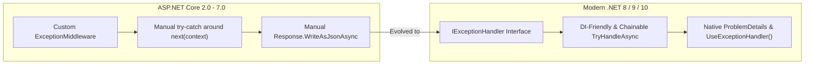
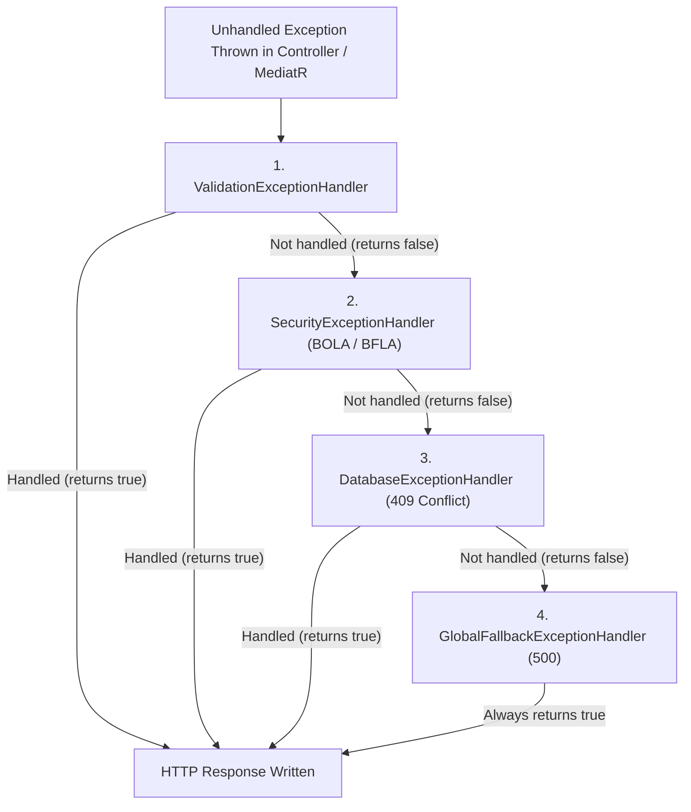
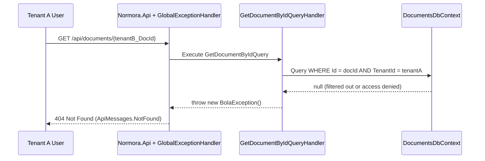
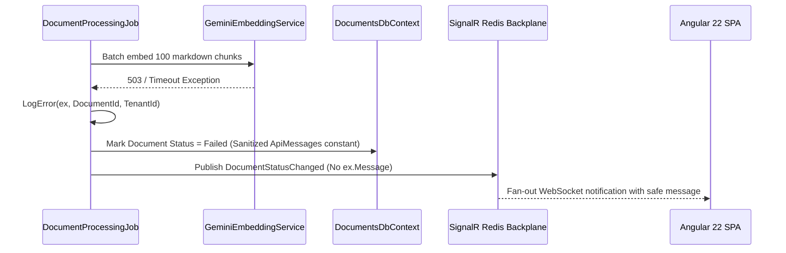

# Module 7: Error Handling, Logging & Security Sanitization

Every distributed system encounters failures: database failovers occur, third-party AI services trigger rate limits, network partitions disconnect workers, and invalid inputs penetrate validation guards.

In production architecture, error handling and logging serve two critical mandates:
1.  **Observability & Diagnostics:** Engineers must be able to trace exactly what failed, where it failed, and why it failed within seconds.
2.  **Security & Information Shielding (CWE-209 Mitigation):** The system must **never leak internal implementation details, stack traces, database schemas, or infrastructure topology** to untrusted clients.

This module details the modern evolution from custom exception middleware to **.NET 8+ / .NET 10 `IExceptionHandler`**, **RFC 9457 Problem Details** (which updated RFC 7807), **high-performance `[LoggerMessage]` source generation**, **BOLA/BFLA security protections**, reflection-cached safe error propagation, and non-HTTP error handling across SSE streams, SignalR hubs, and background workers.

---

## 1. What is Logging?

Logging is the practice of recording **structured events** while your application runs. Think of it as your application's black box flight recorder — when something goes wrong, you read the logs to understand exactly what happened and why.

> **Analogy — The Hospital Chart:**  
> A patient walks into a hospital. Every action is recorded on their chart: vitals taken, tests ordered, medications given, symptoms observed. If the patient's condition worsens, the doctor reads the chart to trace what happened. Without it, the doctor is guessing. Logs are your application's medical chart.

In a multi-tenant modular monolith like **Normora**, a single user action might cross `Normora.Api` (Duende BFF), the `Tenants` or `Documents` module, PostgreSQL + `pgvector`, MinIO object storage, Redis, and `Normora.Worker` (Hangfire). Structured logs let you filter millions of lines down to one exact `TenantId`, `DocumentId`, or `TraceId`.

### 5 Real-World Normora Logging Events
1. **Tenants Module (`InviteEmployeeCommandHandler`):** Logs an `Information` event when an admin invites a teammate, recording `{TenantId}` and `{InvitationId}` (never the raw invite token).
2. **Documents Module (`UploadDocumentCommandHandler`):** Logs `{TenantId}`, `{DocumentId}`, and `{FileSizeBytes}` when a policy PDF and its `DocumentProcessingOutboxMessage` commit atomically.
3. **Conversations Module (`PerformHybridRetrievalQueryHandler`):** Logs `{TenantId}`, `{ChunkCount}`, and `{DurationMs}` when pgvector cosine + full-text Reciprocal Rank Fusion (RRF) search finishes.
4. **Background Worker (`DocumentProcessingJob` in `Normora.Worker`):** Logs `{DocumentId}` and `{BatchCount}` when `GeminiEmbeddingService` generates batch vector embeddings, or `Error` with the full exception if MinIO is unreachable.
5. **BFF Host (`TenantResolutionMiddleware` in `Normora.Api`):** Logs a `Warning` when a cached tenant slug lookup misses or an inactive tenant slug is requested.

---

## 2. Logging with `ILogger<T>` — The Built-in System

ASP.NET Core provides a built-in logging abstraction via `ILogger<T>`. The generic `<T>` parameter tags every log message with the class name (the **log category**), making it easy to filter logs by component. In **.NET 10 / C# 14**, Normora injects `ILogger<T>` using **primary constructors** so dependencies stay concise without boilerplate private fields.

### Basic Usage (Normora `DocumentsController` with Primary Constructor)
```csharp
// server/Modules/Documents/API/DocumentsController.cs
[ApiController]
[Route("api/documents")]
public sealed class DocumentsController(
    ISender mediator,
    ILogger<DocumentsController> logger) : ControllerBase
{
    [HttpGet("{documentId:guid}")]
    public async Task<IActionResult> GetById(Guid documentId, CancellationToken ct)
    {
        logger.LogInformation("Fetching document {DocumentId}", documentId); // Structured!

        var document = await mediator.Send(new GetDocumentByIdQuery(documentId), ct);
        return Ok(ApiResponse<DocumentDto>.Success(document));
    }
}
```

### Structured Logging — Why `{DocumentId}` and NOT String Interpolation
```csharp
// ❌ BAD: String interpolation creates flat text and allocates strings even if filtered out
logger.LogInformation($"Fetching document {documentId} for tenant {tenantId}");
// Output: "Fetching document 9b1deb4d... for tenant 3f2504e0..."  ← Cannot query by field!

// ✅ GOOD: Message template with named placeholders
logger.LogInformation(
    "Fetching document {DocumentId} for tenant {TenantId}",
    documentId,
    tenantId);
// Output (JSON): { "DocumentId": "9b1deb4d...", "TenantId": "3f2504e0...", "MessageTemplate": "..." }
```

**Why does this matter?** With structured logging, you can query your log platform: *"Show me all logs where `TenantId == '3f2504e0...'` and `DocumentId == '9b1deb4d...'`."* With string interpolation, you can only do slow full-text search.

### High-Performance Logging with `[LoggerMessage]` (Source Generators)
* **What it is:** A compile-time C# source generator attribute (`[LoggerMessage]`) that generates zero-allocation, strongly typed logging methods on `partial` classes.
* **Why use it:** Calling `logger.LogInformation("...", a, b)` parses the template string, boxes value types (like `Guid`, `int`, `bool`), and allocates an `object[]` array on every call—even if that log level is disabled in `appsettings.json`! On hot paths like Normora's RAG chunking or SSE token streaming, that creates unnecessary Garbage Collector (GC) pressure.
* **How to use it (Normora Examples):**

```csharp
// server/Modules/Conversations/Application/Rag/RagLogMessages.cs
internal static partial class RagLogMessages
{
    [LoggerMessage(
        EventId = 3001,
        Level = LogLevel.Information,
        Message = "Hybrid retrieval completed for tenant {TenantId} with {CandidateCount} chunks in {ElapsedMs} ms")]
    public static partial void HybridRetrievalCompleted(
        this ILogger logger,
        Guid tenantId,
        int candidateCount,
        long elapsedMs);

    [LoggerMessage(
        EventId = 3002,
        Level = LogLevel.Warning,
        Message = "Gemini rate limit hit (429) during {OperationName} for tenant {TenantId}")]
    public static partial void GeminiRateLimited(
        this ILogger logger,
        string operationName,
        Guid tenantId);
}
```
* **When NOT to use it:** Don't force `[LoggerMessage]` for one-off startup checks or infrequent admin actions (like `UpdateTenantCurrencyCommand`) where readability matters more than microsecond allocations. Reserve it for hot paths (middleware, RAG retrieval, chunk embedding loops, SignalR message dispatch).

### Log Scopes (`BeginScope`) for Multi-Tenant Correlation
When an HTTP request arrives in `Normora.Api`, attaching `TenantId` and `ExternalUserId` once via `logger.BeginScope(...)` automatically enriches **every downstream log** inside MediatR handlers, EF Core interceptors, and provider adapters without repeating `{TenantId}` in every single log call:

```csharp
// Inside TenantResolutionMiddleware
using (logger.BeginScope(new Dictionary<string, object>
{
    ["TenantId"] = tenantContext.TenantId,
    ["ExternalUserId"] = currentUser.ExternalUserId ?? "anonymous"
}))
{
    await next(context);
}
```
> [!NOTE]
> **When NOT to use `BeginScope`:** Avoid creating nested `BeginScope` blocks inside tight loops (e.g., per-chunk inside `DocumentChunker` over 5,000 chunks). Scopes allocate dictionary/async-local state and should wrap coarse boundaries like an HTTP request, a Hangfire job, or a MediatR command.

### Log Levels — When to Use Each

| Level | Severity | When to use | Normora Example |
|---|---|---|---|
| `Trace` | 0 | Extremely detailed debugging info. Almost never on in production. | `"Entering DocumentChunker at heading level 3, char offset 1420"` |
| `Debug` | 1 | Useful during development. Turned off in production. | `"Redis cache miss for tenant slug key 'tenant:slug:acme'"` |
| `Information` | 2 | **Normal business events.** Use this for important milestones. | `"Document {DocumentId} ingested with {ChunkCount} chunks for tenant {TenantId}"` |
| `Warning` | 3 | **Something unexpected happened, but the app recovered.** | `"Gemini 429 rate limit on batch embed; retrying attempt {Attempt} via resilience pipeline"` |
| `Error` | 4 | **An operation failed.** The request or job couldn't be completed. | `"MinIO upload failed for document {DocumentId} in tenant {TenantId}"` |
| `Critical` | 5 | **Application is dying.** Entire system is compromised. | `"PostgreSQL pgvector extension missing during --migrate. Process terminating."` |

### Log Level Configuration
You control which levels are recorded per category in `appsettings.json`:

```json
{
  "Logging": {
    "LogLevel": {
      "Default": "Information",                    // Everything: Info and above
      "Microsoft.AspNetCore": "Warning",           // Framework noise: Warning only
      "Microsoft.EntityFrameworkCore": "Warning",  // EF Core: Warning only
      "Normora.Modules": "Information",            // Normora modules: Info and above
      "Normora.Infrastructure.Providers": "Debug"  // Provider diagnostics in dev
    }
  }
}
```

This means in production, you don't see hundreds of framework-level `Information` logs — only warnings and errors from ASP.NET Core, while capturing `Information` from `Normora.Modules`.

### 5 More Real-World Normora `ILogger<T>` Examples
1. **`UploadDocumentCommandHandler` (`Documents`):** Uses `logger.LogInformation("Committed document {DocumentId} and outbox message {OutboxId} for tenant {TenantId}", ...)` right after `SaveChangesAsync`.
2. **`CancelSubscriptionCommandHandler` (`Tenants`):** Logs `logger.LogWarning("Attempted cancellation on Free tier for tenant {TenantId}", request.TenantId)` before throwing `InvalidOperationException(ApiMessages.CannotCancelFreePlan)`.
3. **`ExecuteMcpToolCommandHandler` (`Conversations`):** Logs `logger.LogInformation("MCP tool {ToolName} executed by {ExternalUserId} in tenant {TenantId}", ...)` for audit visibility.
4. **`HangfireDocumentProcessingOutboxDispatcher` (`Normora.Infrastructure`):** Uses `[LoggerMessage]` (`LogLevel.Warning`) when `IDocumentProcessingWakeup` misses a transient DB lock and falls back to the recurring 1-minute sweep.
5. **`PayUPaymentService` (`Tenants`):** Logs `logger.LogError("PayU callback hash mismatch for transaction {TxId} in tenant {TenantId}", ...)` without logging the merchant salt or raw signature payload.

---

## 3. Logging Providers — Where Logs Go

The built-in `ILogger<T>` is just the **interface**. Where logs actually go depends on which **providers** you configure.

### Built-in Providers
*   **Console (`AddConsole` / `AddJsonConsole`)** — Prints to stdout/stderr. `AddJsonConsole()` emits structured single-line JSON natively in .NET 10, ideal for Docker containers and Kubernetes log forwarders (Fluent Bit, Promtail).
*   **Debug** — Prints to the IDE's debug output window.
*   **EventLog** — Windows Event Log (Windows only).

### Third-Party & Telemetry Providers (Serilog & OpenTelemetry)
In production, enterprise systems either export logs via **OpenTelemetry (OTLP)** (as Normora does in `AddNormoraTelemetry`) or use **Serilog** with sinks for **Seq, Elasticsearch, Datadog, or Azure Application Insights**:

```csharp
// Option A: Built-in .NET 10 Structured JSON Console (Zero extra packages)
builder.Logging.AddJsonConsole(options =>
{
    options.IncludeScopes = true;
    options.TimestampFormat = "yyyy-MM-ddTHH:mm:ss.fffZ";
});

// Option B: Serilog for rich file/Seq/Elasticsearch sinks
builder.Host.UseSerilog((context, services, configuration) => configuration
    .ReadFrom.Configuration(context.Configuration)
    .ReadFrom.Services(services)
    .Enrich.FromLogContext()
    .WriteTo.Console(new Serilog.Formatting.Compact.RenderedCompactJsonFormatter()));
```

### Sensitive Data Redaction & Log Injection Defense (CWE-532 & CWE-117)
Logging too much is as dangerous as logging too little:
*   **CWE-532 (Insertion of Sensitive Information into Log File):** Never log JWTs, Duende BFF session cookies, `GEMINI_API_KEY`, `RESEND_API_KEY`, PayU merchant secrets, or raw confidential document text from `Documents`.
*   **CWE-117 (Improper Output Neutralization for Logs):** If an attacker submits a workspace slug or filename containing `\r\n` (newlines), flat-text logs can be forged with fake entries. Structured JSON logging (`AddJsonConsole` or OTLP) escapes newlines automatically.
*   **.NET 8+ Redaction (`Microsoft.Extensions.Compliance.Redaction`):** You can tag sensitive properties with `[SensitiveData]` or `[PersonalData]` and configure a redactor so `ILogger` masks or hashes PII automatically before it reaches any provider.
*   **When NOT to log request/response bodies:** Never attach middleware that logs full HTTP bodies globally—in Normora, `/api/documents` uploads binary PDFs and `/api/conversations` streams confidential HR policies.

### 5 Real-World Normora Logging Provider & Security Examples
1. **`Normora.Api` in Docker:** Uses structured console + OpenTelemetry OTLP logging (`AddNormoraTelemetry`) so container logs carry `TraceId` and `SpanId`.
2. **`Normora.Worker` Hangfire Host:** Routes `DocumentProcessingJob` logs to the same OTLP/stdout collector, keeping worker logs unified with API logs.
3. **`GeminiOptions` & `MinioOptions` Startup Logging:** Logs `Endpoint` and `BucketName` at `Information`, but **never** logs `ApiKey` or `SecretKey`.
4. **`PayUPaymentService` Webhook Handler:** Logs `{TenantId}`, `{Currency}`, `{BillingCycle}`, and `{Status}`, redacting `udf` payloads and secret hashes.
5. **`AuditLog` vs Application Logs:** Business compliance events (e.g., *"Admin deleted Document X"*) go to `TenantsDbContext.AuditLogs` in PostgreSQL, while technical diagnostics go to `ILogger<T>`—never mix the two.

---

## 4. The Architectural Evolution: `ExceptionMiddleware` to `IExceptionHandler`

ASP.NET Core has evolved its error-handling mechanisms across major versions:



### Approach 1: Custom Exception Middleware (Legacy / NextEvent)
In **NextEvent** (and older .NET 6/7 apps), error handling is wrapped in a class-based middleware:

```csharp
// From NextEvent's API/Middleware/ExceptionMiddleware.cs
public class ExceptionMiddleware(
    RequestDelegate next,
    ILogger<ExceptionMiddleware> logger,
    IHostEnvironment env)
{
    public async Task InvokeAsync(HttpContext context)
    {
        try
        {
            await next(context);
        }
        catch (ValidationException ex)
        {
            context.Response.StatusCode = StatusCodes.Status400BadRequest;
            await context.Response.WriteAsJsonAsync(ApiResponse.Fail(ex.Errors));
        }
        catch (NotFoundException ex)
        {
            context.Response.StatusCode = StatusCodes.Status404NotFound;
            await context.Response.WriteAsJsonAsync(ApiResponse.Fail(ex.Message));
        }
        catch (Exception ex)
        {
            logger.LogError(ex, "Unhandled exception: {Message}", ex.Message);
            var message = env.IsDevelopment() ? ex.Message : "An unexpected server error occurred.";
            context.Response.StatusCode = StatusCodes.Status500InternalServerError;
            await context.Response.WriteAsJsonAsync(ApiResponse.Fail(message));
        }
    }
}
```

---

### Approach 2: Modern .NET 8+ / .NET 10 `IExceptionHandler` (Normora)

In .NET 8+, Microsoft introduced the `IExceptionHandler` interface. Instead of hand-rolling a middleware `try/catch` wrapper, you implement `IExceptionHandler`, register it in DI, and let ASP.NET Core's built-in `UseExceptionHandler()` middleware invoke handlers in sequence.

#### Wiring `IExceptionHandler` in `Program.cs`
A common mistake is implementing `IExceptionHandler` without registering both the handler and the middleware correctly:

```csharp
// In Normora.Api/Program.cs
builder.Services.AddExceptionHandler<GlobalExceptionHandler>();
builder.Services.AddProblemDetails(); // Enables standardized error formatting

var app = builder.Build();

if (app.Environment.IsDevelopment())
{
    // Shows rich stack traces locally ONLY — never in Staging/Production
    app.UseDeveloperExceptionPage();
}
else
{
    // Activates registered IExceptionHandler implementations
    app.UseExceptionHandler();
}
```
*(Note: If you want `GlobalExceptionHandler` to enforce BOLA/BFLA and `ApiResponse` envelopes in Development too, omit `UseDeveloperExceptionPage()` and call `app.UseExceptionHandler()` unconditionally, using `env.IsProduction()` inside the handler as Normora does below.)*

Here is the production implementation of `GlobalExceptionHandler` in **Normora**:

```csharp
// From Normora.Api/Middleware/GlobalExceptionHandler.cs
public sealed class GlobalExceptionHandler(
    ILogger<GlobalExceptionHandler> logger, 
    IWebHostEnvironment env) 
    : IExceptionHandler
{
    // Reflection-cached allowlist of safe, deliberate domain error messages
    private static readonly HashSet<string> SafeDomainMessages = typeof(ApiMessages)
        .GetFields(BindingFlags.Public | BindingFlags.Static)
        .Where(f => f.IsLiteral && !f.IsInitOnly && f.FieldType == typeof(string))
        .Select(f => (string)f.GetValue(null)!)
        .ToHashSet(StringComparer.Ordinal);

    public async ValueTask<bool> TryHandleAsync(
        HttpContext httpContext,
        Exception exception,
        CancellationToken cancellationToken)
    {
        // Guard: Never mutate headers/body if an SSE stream has already started
        if (httpContext.Response.HasStarted)
        {
            logger.LogWarning(exception, "Exception occurred after response headers started.");
            return false;
        }

        // 1. Validation Failures (FluentValidation from MediatR pipeline)
        if (exception is ValidationException validationException)
        {
            var errors = validationException.Errors
                .GroupBy(e => e.PropertyName)
                .ToDictionary(g => g.Key, g => g.Select(e => e.ErrorMessage).ToArray());

            httpContext.Response.StatusCode = StatusCodes.Status400BadRequest;
            await httpContext.Response.WriteAsJsonAsync(
                ApiResponse<Dictionary<string, string[]>>.Failure(ApiMessages.ValidationFailed, errors), 
                cancellationToken);
            return true;
        }

        // 2. Business Invariant Violations (InvalidOperationException)
        if (exception is InvalidOperationException)
        {
            httpContext.Response.StatusCode = StatusCodes.Status400BadRequest;
            // Production Information Shielding: Verify if message is a deliberate constant
            var message = env.IsProduction() && !SafeDomainMessages.Contains(exception.Message)
                ? ApiMessages.BadRequest
                : exception.Message;
            await httpContext.Response.WriteAsJsonAsync(ApiResponse.Failure(message), cancellationToken);
            return true;
        }

        // 3. OWASP API 1: BOLA (Broken Object Level Authorization)
        if (exception is BolaException || exception is NotFoundException)
        {
            httpContext.Response.StatusCode = StatusCodes.Status404NotFound;
            await httpContext.Response.WriteAsJsonAsync(ApiResponse.Failure(ApiMessages.NotFound), cancellationToken);
            return true;
        }

        // 4. OWASP API 5: BFLA (Broken Function Level Authorization)
        if (exception is BflaException)
        {
            httpContext.Response.StatusCode = StatusCodes.Status403Forbidden;
            await httpContext.Response.WriteAsJsonAsync(ApiResponse.Failure(ApiMessages.Forbidden), cancellationToken);
            return true;
        }

        // 5. Upstream AI / External Dependency Fault Isolation (e.g. Gemini 429)
        if (exception is HttpRequestException httpException && 
            httpException.StatusCode == System.Net.HttpStatusCode.TooManyRequests)
        {
            logger.LogWarning("Upstream AI dependency rate limit encountered (429).");
            httpContext.Response.StatusCode = StatusCodes.Status429TooManyRequests;
            await httpContext.Response.WriteAsJsonAsync(ApiResponse.Failure(ApiMessages.RateLimitExceeded), cancellationToken);
            return true;
        }

        // 6. Generic Fallback: Unhandled Server Errors (500)
        logger.LogError(exception, "An unhandled exception occurred in the API pipeline.");
        
        var serverErrorMessage = env.IsProduction() ? ApiMessages.InternalServerError : exception.Message;
        httpContext.Response.StatusCode = StatusCodes.Status500InternalServerError;
        await httpContext.Response.WriteAsJsonAsync(ApiResponse.Failure(serverErrorMessage), cancellationToken);
        return true;
    }
}
```

### Chaining Multiple `IExceptionHandler` Implementations
`IExceptionHandler` uses the **Chain of Responsibility** pattern:
*   Return `true` when your handler handled the exception and wrote the response (stops the chain).
*   Return `false` to pass the exception to the **next** registered `IExceptionHandler`.

```csharp
// Registration order defines execution order!
builder.Services.AddExceptionHandler<ValidationExceptionHandler>();   // 1st: FluentValidation -> 400
builder.Services.AddExceptionHandler<SecurityExceptionHandler>();     // 2nd: BolaException/BflaException -> 404/403
builder.Services.AddExceptionHandler<DatabaseExceptionHandler>();     // 3rd: DbUpdateConcurrencyException -> 409
builder.Services.AddExceptionHandler<GlobalFallbackExceptionHandler>(); // Last: catch-all -> 500
```



> [!TIP]
> **When NOT to use `IExceptionHandler`:**
> 1. **Expected business outcomes that aren't exceptional** (e.g., optional lookup returning null, or form field hint checks).
> 2. **Background workers (`Normora.Worker`)** — Hangfire jobs have no `HttpContext`.
> 3. **SignalR Hubs & mid-stream SSE responses** — `IExceptionHandler` cannot intercept SignalR invocations or change HTTP status codes once `HasStarted == true`.

### 5 Real-World Normora Exceptions Handled by `GlobalExceptionHandler`
1. **`InviteEmployeeCommandValidator` (`Tenants`):** MediatR `ValidationBehavior` throws FluentValidation's `ValidationException` on an invalid email -> `GlobalExceptionHandler` returns `400 Bad Request` with field-level errors and `ApiMessages.ValidationFailed`.
2. **`CancelSubscriptionCommandHandler` (`Tenants`):** Throws `InvalidOperationException(ApiMessages.CannotCancelFreePlan)` when a Free-tier tenant tries to cancel -> `SafeDomainMessages` recognizes the constant and returns `400` with the exact safe message even in Production.
3. **`GetDocumentByIdQueryHandler` (`Documents`):** Throws `BolaException` when Tenant A requests Tenant B's document GUID -> mapped to `404 Not Found` with `ApiMessages.NotFound`.
4. **`CreateDepartmentCommandHandler` (`Tenants`):** Throws `BflaException` when a non-admin member calls `POST /api/departments` -> mapped to `403 Forbidden` with `ApiMessages.Forbidden`.
5. **`GeminiEmbeddingService` (`Normora.Infrastructure`):** Throws `HttpRequestException` with status `429 TooManyRequests` during burst query embedding -> mapped to `429 Too Many Requests` with `ApiMessages.RateLimitExceeded`.

---

## 5. Security Deep Dive: Information Shielding & CWE-209 Mitigation

### The Vulnerability: Information Exposure Through Error Messages (CWE-209)
In insecure APIs, when an unexpected database error occurs, the server transmits the raw exception to the client:
```json
{
  "error": "Npgsql.PostgresException: 42P01: relation 'tenants.billing_secrets' does not exist at line 4 column 12..."
}
```
This informs attackers of the internal database technology (`Npgsql` / PostgreSQL), internal schemas (`tenants`), table names, and query structures.

### 🛡️ The Architectural Solution: Reflection-Cached `SafeDomainMessages`
In **Normora**, the architect implements a **Reflection-Cached Allowlist**:
1.  All intentional business error strings are centralized as `const string` fields in a single class: `Normora.Shared.Constants.ApiMessages`.
2.  At boot time, `GlobalExceptionHandler` scans `ApiMessages` via reflection (`IsLiteral && !IsInitOnly`) and caches all string constants into a static `HashSet<string>`.
3.  In Production, when an `InvalidOperationException` occurs:
    *   If `exception.Message` exists in `SafeDomainMessages`, it is safe to display to the user.
    *   If `exception.Message` does **not** exist in the set (e.g., an unhandled EF Core LINQ translation error or Npgsql exception), it is automatically masked and replaced with `ApiMessages.BadRequest` or `ApiMessages.InternalServerError`!

> [!IMPORTANT]
> **When NOT to rely solely on `GlobalExceptionHandler` for CWE-209:**  
> `GlobalExceptionHandler` only protects HTTP requests! Background jobs (`DocumentProcessingJob` in `Normora.Worker`) and transactional email templates run outside the HTTP pipeline. Always catch exceptions inside workers, log full details via `ILogger<T>`, and write/send only generic `ApiMessages` constants—never `exception.Message`.

### 5 Real-World Normora Information-Shielding (CWE-209) Examples
1. **PostgreSQL / `pgvector` Failure:** If `DocumentsDbContext` throws `Npgsql.PostgresException` (e.g., connection pool exhausted), `GlobalExceptionHandler` logs the full exception internally and returns `500` with `ApiMessages.InternalServerError`.
2. **EF Core `GroupBy` Translation Exception:** If a developer accidentally writes an untranslatable `GroupBy().Select(g => new MyDto(...))` in `Tenants`, EF Core throws `InvalidOperationException`. Because EF Core's internal message is not in `SafeDomainMessages`, Production masks it to `ApiMessages.BadRequest`.
3. **Intentional Domain Invariant (`CancelSubscriptionCommandHandler`):** Throws `InvalidOperationException(ApiMessages.CannotCancelFreePlan)`. Because `ApiMessages.CannotCancelFreePlan` IS in `SafeDomainMessages`, Production forwards the clear, safe message to the Angular UI.
4. **Background Worker (`DocumentProcessingJob`):** When Gemini OCR or MinIO fails during ingestion, `DocumentProcessingJob` stores a sanitized `ApiMessages` failure code on the `Document` entity and never emails raw stack traces or internal URLs to workspace admins.
5. **PayU Payment Callback (`PayUPaymentService`):** When signature verification fails, the handler logs the mismatch internally and returns `ApiMessages.BadRequest` (or a generic payment failure message) without exposing the merchant salt or expected HMAC string.

---

## 6. OWASP API Security: BOLA & BFLA Mitigation

The OWASP API Security Top 10 lists **Broken Object Level Authorization (BOLA)** as the #1 most exploited API vulnerability globally.

### 1. BOLA (OWASP API 1): Why BOLA Must Return 404, NOT 403!
Imagine an attacker in Tenant A calls `GET /api/documents/88888888-0000-0000-0000-000000000001`. That document belongs to Tenant B.

*   **If you return `403 Forbidden`:** The attacker learns that document ID **actually exists in the database**, but they lack permission to view it. An attacker can enumerate which resource IDs exist across tenants!
*   **If you return `404 Not Found` (The Normora Standard):** The API reveals **zero information**. The attacker cannot distinguish between a document belonging to another tenant (or a restricted department) and a document that does not exist at all.



In Normora's `GlobalExceptionHandler`:
```csharp
// Maps BOLA attempts to generic 404 Not Found to prevent resource enumeration
if (exception is BolaException || exception is NotFoundException)
{
    httpContext.Response.StatusCode = StatusCodes.Status404NotFound;
    await httpContext.Response.WriteAsJsonAsync(ApiResponse.Failure(ApiMessages.NotFound), cancellationToken);
    return true;
}
```

### 2. BFLA (OWASP API 5): Broken Function Level Authorization
Occurs when an authenticated user attempts to invoke a privileged **function or endpoint** they don't have the role for (for example, a standard Employee calling an Admin billing or department-creation endpoint).
*   Mapped strictly to **`403 Forbidden`** via `BflaException` with `ApiMessages.Forbidden`.
*   **Controller Rule in Normora:** Never return ASP.NET Core's empty `Forbid()` (which can produce an empty body or redirect depending on auth schemes). Always return a structured JSON envelope: `StatusCode(StatusCodes.Status403Forbidden, ApiResponse.Failure(ApiMessages.Forbidden))` or throw `BflaException`.

### 5 Real-World Normora BOLA & BFLA Examples
1. **BOLA — Cross-Tenant Document (`Documents`):** User in Tenant A requests Tenant B's `DocumentId` via `GET /api/documents/{id}` -> `DocumentsDbContext` tenant filter returns `null` -> throws `BolaException` -> `404 Not Found` (`ApiMessages.NotFound`).
2. **BOLA — Departmental / User Group Isolation (`Documents`):** User in Engineering requests an HR-restricted policy PDF within the *same* tenant -> ACL check fails -> throws `BolaException` -> `404 Not Found` so they cannot even confirm the confidential policy exists.
3. **BOLA — Private Conversation Thread (`Conversations`):** User A attempts to read or append a turn to User B's `ConversationId` -> `ConversationsDbContext` ownership check fails -> throws `BolaException` -> `404 Not Found`.
4. **BFLA — Workspace Billing Mutation (`Tenants`):** A standard Member calls `PUT /api/subscription/currency` (`UpdateTenantCurrencyCommand`) or cancels a subscription -> role check fails -> throws `BflaException` -> `403 Forbidden` (`ApiMessages.Forbidden`).
5. **BFLA — Admin & HITL Tool Guard (`Tenants` / `Conversations`):** A non-admin tries `POST /api/departments` (`CreateDepartmentCommand`) or tries to approve another user's `PendingApproval` for `documents_delete` -> throws `BflaException` -> `403 Forbidden`.

---

## 7. Problem Details (RFC 9457, formerly RFC 7807) — The Industry Standard

REST APIs require a **standardized error format** so that clients can parse errors consistently regardless of which endpoint threw them.

**RFC 9457 (Problem Details for HTTP APIs)** — which updated and obsoleted RFC 7807 in 2023 — defines this JSON standard (note that status type URIs now reference **RFC 9110**, which replaced RFC 7231):

```json
{
  "type": "https://tools.ietf.org/html/rfc9110#section-15.5.1",
  "title": "One or more validation errors occurred.",
  "status": 400,
  "detail": "The Workspace Slug field is required.",
  "instance": "/api/tenants",
  "traceId": "00-84c1fd4063c38d9d7fa57c42-00"
}
```

### Enabling & Customizing `ProblemDetails` in .NET 10
Enable native Problem Details and `UseStatusCodePages()` in `Program.cs`:
```csharp
builder.Services.AddProblemDetails(options =>
{
    options.CustomizeProblemDetails = context =>
    {
        context.ProblemDetails.Extensions["traceId"] =
            Activity.Current?.Id ?? context.HttpContext.TraceIdentifier;
    };
});

// Middleware pipeline:
app.UseExceptionHandler();
app.UseStatusCodePages(); // Converts empty 404/405/401 responses into ProblemDetails JSON!
```

> [!TIP]
> **Why `app.UseStatusCodePages()` matters:**  
> `IExceptionHandler` only runs when an **exception is thrown**. If a client hits a non-existent route (`/api/typo`) or uses the wrong HTTP verb (`DELETE /api/documents`), ASP.NET Core routing returns a `404` or `405` **without throwing an exception**. `UseStatusCodePages()` catches those empty error status codes and formats them with `IProblemDetailsService` so the Angular frontend always receives valid JSON.

### Architectural Choice: `ProblemDetails` vs. Custom `ApiResponse<T>` Envelope
*   **RFC 9457 `ProblemDetails` (`IProblemDetailsService`):** Best for public/third-party REST APIs, OpenAPI/Scalar standardization, and automatic ASP.NET Core model-binding/Minimal API validation errors.
*   **Custom `ApiResponse` Envelope (Normora's SPA Convention):** Normora's Angular HTTP interceptor expects a uniform `{ success, message, data, errors }` shape across all endpoints, including `GlobalExceptionHandler`.
*   **When NOT to mix them:** Never return `ProblemDetails` from half your endpoints and `ApiResponse.Failure(...)` from the other half! Pick one contract for your API surface (or write a custom `IProblemDetailsWriter` that outputs your standard envelope).

### 5 Real-World Normora Error Response Examples (Problem Details / Envelope)
1. **Validation Failure (`400 Bad Request`):** `CreateDepartmentCommandValidator` rejects an empty `Name` -> returns `ApiMessages.ValidationFailed` with `errors["Name"]` and `traceId`.
2. **BOLA Not Found (`404 Not Found`):** `GetDocumentByIdQueryHandler` throws `BolaException` on `/api/documents/{id}` -> returns `404` with `ApiMessages.NotFound` (zero tenant info in `detail`).
3. **Duplicate Slug / Concurrency (`409 Conflict`):** Two admins simultaneously edit `TenantPlan` or register a duplicate department name -> `DbUpdateConcurrencyException` / unique constraint maps to `409 Conflict`.
4. **Gemini Rate Limit (`429 Too Many Requests`):** `PerformHybridRetrievalQueryHandler` hits Gemini 429 -> returns `429` with `ApiMessages.RateLimitExceeded` so the Angular Copilot UI shows a clean retry banner.
5. **Unmatched Route / BFF Auth Rejection (`404` / `401`):** `UseStatusCodePages()` ensures an expired Duende BFF session or mistyped `/api/v1/docs` route returns structured JSON rather than an empty body.

---

## 8. Startup Error Handling — Fail Fast

If the database is unreachable or a required API key is missing during boot, should the app start and fail on every request? **No. Crash immediately.**

```csharp
// From NextEvent's Program.cs (Note: prefer MigrateAsync() in async startup)
using var scope = app.Services.CreateScope();
var services = scope.ServiceProvider;

try
{
    var identityContext = services.GetRequiredService<IdentityDbContext>();
    await identityContext.Database.MigrateAsync();
    await IdentityDataSeeder.SeedAsync(roleManager, userManager);
}
catch (Exception ex)
{
    var logger = services.GetRequiredService<ILogger<Program>>();
    logger.LogCritical(ex, 
        "A critical error occurred during database initialization. " +
        "The application will terminate.");
    throw;  // RE-THROW — kill the process immediately
}
```

**Why `LogCritical` + `throw`?**
*   `LogCritical` ensures the error is flushed to container logs before the process dies.
*   `throw` ensures the process exits with a non-zero exit code, telling Docker/Kubernetes the container is unhealthy and triggering a restart/alert instead of serving broken traffic.

### 5 Real-World Normora Startup Fail-Fast Examples
1. **Ephemeral Migration Host (`dotnet Normora.Api.dll --migrate`):** `MigrationHostExtensions.RunMigrationsAsync` executes `DatabaseMigrationRunner` in a minimal console host (without Kestrel, SignalR, or OpenTelemetry) and fails fast with a non-zero exit code if any of the 4 migrators (`Tenants`, `Documents`, `Conversations`, `Session`) fails.
2. **Typed Options Validation (`ValidateOnStart`):** `GeminiOptions` and `MinioOptions` use `.ValidateDataAnnotations().ValidateOnStart()` so `Normora.Api` and `Normora.Worker` crash at boot if `GEMINI_API_KEY` or `MinioOptions:Endpoint` is missing—not 2 hours later on the first PDF upload.
3. **PostgreSQL `pgvector` Extension Check:** `DocumentsDatabaseMigrator` requires the `vector` extension for HNSW indexes; if PostgreSQL lacks `pgvector`, migration throws immediately with `LogCritical`.
4. **Redis Backplane Startup (`AddNormoraSignalR`):** If `RedisOptions` has an invalid connection string, `Normora.Api` / `Normora.Worker` surfaces the configuration failure immediately at startup rather than silently dropping real-time ingestion notifications.
5. **Hangfire Storage Initialization (`Normora.Worker`):** If Hangfire cannot initialize its PostgreSQL job tables at boot, the worker process logs `Critical` and exits so Docker Compose restarts it cleanly once Postgres is ready.

---

## 9. Distributed Tracing & OpenTelemetry

In modern architectures, a single user request spans multiple systems (`Normora.Api`, MinIO, PostgreSQL, Hangfire in `Normora.Worker`, Redis, and Gemini AI). How do you trace the entire flow when something fails?

### The Solution: OpenTelemetry
OpenTelemetry assigns a unique W3C **`TraceId`** (`traceparent`) to each incoming request and propagates it across database queries, HTTP calls, and background jobs.

```csharp
// From Normora.Api/Program.cs
builder.Services.AddNormoraTelemetry(builder.Environment);
```

When an exception occurs, you can enrich the active OpenTelemetry `Activity` (span) so your trace viewer (Jaeger, Grafana Tempo, Aspire Dashboard) highlights the exact failing span in red:

```csharp
var activity = Activity.Current;
activity?.SetStatus(ActivityStatusCode.Error, "Gemini embedding call timed out");
activity?.AddException(ex);
```

> [!NOTE]
> **When NOT to trace everything:** Exclude noisy infrastructure endpoints like `/health`, `/scalar`, and static assets from OpenTelemetry tracing using instrumentation filters; otherwise health-check probes every 10 seconds will drown out real user error traces.

### 5 Real-World Normora OpenTelemetry Error-Tracing Examples
1. **Error Envelope Correlation:** `GlobalExceptionHandler` / `ProblemDetails` exposes `HttpContext.TraceIdentifier` / `Activity.Current?.TraceId`, letting users or support paste a `TraceId` to jump straight to the failing RAG request.
2. **Gemini Upstream Failure (`GeminiTextGenerationService`):** Records `activity?.AddException(ex)` and status `Error` on the outgoing HTTP span when Gemini returns `429` or `503`.
3. **Transactional Outbox Trace Continuity (`UploadDocumentCommandHandler` -> `Normora.Worker`):** Storing `Activity.Current?.Id` (`traceparent`) on `DocumentProcessingOutboxMessage` lets `DocumentProcessingJob` start a linked child span, connecting upload errors in the worker back to the user's original HTTP upload!
4. **SignalR Redis Backplane Diagnostics:** Tracing `IDocumentNotificationService` reveals whether a missing UI toast failed in `Normora.Worker`, Redis pub/sub, or the `Normora.Api` WebSocket hub.
5. **Database Slow/Failed Query Spans:** EF Core / Npgsql OpenTelemetry instrumentation captures failed SQL commands (without logging sensitive parameter values in production) alongside the exact `TenantsDbContext` or `DocumentsDbContext` operation.

---

## 10. Exceptions vs. the Result Pattern — When NOT to Throw

Exceptions are designed for **exceptional, unexpected failures** or **cross-cutting guardrails** (security violations, unhandled DB failures, broken invariants)—not routine control flow.

### What is the Result Pattern?
Instead of throwing an exception for an expected outcome, a method returns a discriminated result object (like `Result<T>` or `ApiResponse<T>`):

```csharp
// Example: Expected business state vs exceptional security/invariant failure
public sealed record Result<T>(bool IsSuccess, T? Value, string? ErrorMessage)
{
    public static Result<T> Success(T value) => new(true, value, null);
    public static Result<T> Failure(string error) => new(false, default, error);
}
```

### Why Avoid Exceptions for Normal Flow Control?
1. **Performance:** Throwing an exception captures the entire call-stack trace (`Environment.StackTrace`), which is orders of magnitude slower than returning a value—especially inside loops like RAG chunking or batch retrieval.
2. **Explicitness:** A method returning `Task<Result<DocumentDto>>` forces the caller to handle failure in the type signature; an exception is invisible in the signature.

### When to Use Exceptions vs. Result Pattern in Normora

| Scenario | Approach | Why |
|---|---|---|
| **BOLA / BFLA security breach** | Throw `BolaException` / `BflaException` | Cross-cutting security guard; aborts the handler pipeline immediately and maps uniformly in `GlobalExceptionHandler`. |
| **FluentValidation in MediatR** | Throw `ValidationException` | `ValidationBehavior` rejects invalid commands before any handler executes. |
| **Downstream optional wakeup fails after commit** | Catch & log (`Warning`), return success | In `UploadDocumentCommandHandler`, once metadata + `DocumentProcessingOutboxMessage` commit, failing to notify `IDocumentProcessingWakeup` must NOT fail the upload! |
| **Query rewriting / optional suggestion fallback** | Return fallback / empty list | If `ISuggestionsService` times out, returning empty suggestions gracefully degrades the UI instead of crashing the whole page. |
| **Per-item batch parsing (e.g., 100 chunks)** | Return structured status / skip & log | Throwing mid-loop aborts valid items; return per-item failure or handle gracefully. |

> [!NOTE]
> **When NOT to throw exceptions:** Never throw an exception just to check if a record exists (use `FirstOrDefaultAsync(...)` returning `null`), never use `try/catch` around `int.TryParse` (use `TryParse`!), and never let non-critical side effects (analytics, wakeup signals, optional cache writes) throw and roll back a committed business transaction.

### 5 Real-World Normora Examples (Exceptions vs. Graceful Results)
1. **`UploadDocumentCommandHandler` (`Documents`):** Commits `Document`, `DocumentVersion`, and `DocumentProcessingOutboxMessage` in one transaction, then calls `IDocumentProcessingWakeup`. If the wakeup signal throws, it logs a `Warning` and still returns success because the recurring Hangfire outbox sweep will pick it up.
2. **`PerformHybridRetrievalQueryHandler` (`Conversations`):** If `IQueryRewriterService` hits a transient timeout, it logs a `Warning` and falls back to the raw user query rather than throwing a `500`.
3. **`CancelSubscriptionCommandHandler` (`Tenants`):** Throws `InvalidOperationException(ApiMessages.CannotCancelFreePlan)` because cancelling a Free tier plan violates a strict domain invariant and must abort immediately.
4. **`GetDocumentByIdQueryHandler` (`Documents`):** Throws `BolaException` when a document is missing or owned by another tenant so `GlobalExceptionHandler` enforces `404 Not Found` uniformly.
5. **`ExecuteMcpToolCommandHandler` (`Conversations`):** Returns a structured JSON-RPC / `ApiResponse` tool-error payload when an AI agent supplies invalid tool parameters, allowing the LLM to self-correct on its next turn instead of crashing the HTTP request!

---

## 11. Error Handling Beyond REST: SSE Streams, SignalR Hubs, EF Core & Background Workers

A common mid-level mistake is assuming `GlobalExceptionHandler` protects your entire application. In a modern platform like **Normora**, **four major execution paths bypass HTTP `IExceptionHandler` or require special handling**:

### 1. Server-Sent Events (SSE) & AG-UI Streaming (`/api/copilotkit`)
Once an SSE endpoint flushes `200 OK` and `text/event-stream` headers to stream tokens from `NormoraWorkplaceAgent`, `httpContext.Response.HasStarted` becomes `true`. If `GeminiTextGenerationService` fails mid-stream, `IExceptionHandler` **cannot** change the status code to `500` or overwrite headers!
*   **Fix:** Wrap streaming loops in `try/catch`, check `HasStarted`, log the full exception internally, emit a sanitized SSE `error` event with `ApiMessages.InternalServerError` (or `ApiMessages.RateLimitExceeded`), and close the stream cleanly.

### 2. SignalR Hubs (`Normora.Api` & `Normora.Infrastructure`)
Exceptions thrown inside a SignalR Hub method do **not** flow through ASP.NET Core HTTP middleware or `IExceptionHandler`. By default, SignalR sends a generic `"An unexpected error occurred invoking '...' on the server"` message (or leaks details if `EnableDetailedErrors = true`).
*   **Fix:** Register an `IHubFilter` (using a primary constructor for DI) to centralize SignalR error logging and throw a sanitized `HubException(ApiMessages.InternalServerError)`:

```csharp
// Centralized SignalR Hub exception filter
public sealed class SanitizedHubExceptionFilter(
    ILogger<SanitizedHubExceptionFilter> logger) : IHubFilter
{
    public async ValueTask<object?> InvokeMethodAsync(
        HubInvocationContext invocationContext,
        Func<HubInvocationContext, ValueTask<object?>> next)
    {
        try
        {
            return await next(invocationContext);
        }
        catch (BolaException)
        {
            throw new HubException(ApiMessages.NotFound);
        }
        catch (BflaException)
        {
            throw new HubException(ApiMessages.Forbidden);
        }
        catch (Exception ex)
        {
            logger.LogError(ex, "Unhandled SignalR error in hub method {HubMethod}", invocationContext.HubMethodName);
            throw new HubException(ApiMessages.InternalServerError);
        }
    }
}
```

### 3. Background Workers (`Normora.Worker` / Hangfire) & CWE-209
Hangfire jobs like `DocumentProcessingJob` run inside `Normora.Worker` with **no `HttpContext`**. If an unhandled exception occurs, Hangfire retries the job according to its retry policy, and you must ensure neither database status fields nor notification emails leak `ex.Message`.



### 4. EF Core Persistence Exceptions (`DbUpdateConcurrencyException` & `DbUpdateException`)
By default, EF Core throws `DbUpdateConcurrencyException` (optimistic concurrency conflict) or `DbUpdateException` (PostgreSQL unique index violation `23505`). Without explicit mapping in `IExceptionHandler`, these become `500 Internal Server Error` instead of `409 Conflict`!

### 5 Real-World Normora Non-REST Error Handling Examples
1. **AG-UI / CopilotKit SSE Stream (`Conversations`):** Checks `CancellationToken` (`HttpContext.RequestAborted`) when the user clicks "Stop Generating" so client disconnects log `Debug` rather than false `Error` alerts.
2. **`DocumentProcessingJob` (`Normora.Worker`):** Catches MinIO / Gemini OCR failures, logs `DocumentId` + `TenantId` + full stack trace internally, sets status using a sanitized `ApiMessages` constant, and broadcasts over Redis via `IDocumentNotificationService`.
3. **Transactional Email Failure Notification (CWE-209):** When notifying an admin that a document upload failed, `IEmailSender` uses a generic `ApiMessages` template—never interpolating `ex.Message` or internal MinIO bucket URLs.
4. **SignalR `IWorkspaceStateSynchronizer` (`Normora.Infrastructure`):** Wraps hub broadcasts with `IHubFilter` so BOLA/BFLA checks on workspace subscriptions emit sanitized `HubException` messages.
5. **Concurrent Workspace Plan Update (`TenantsDbContext`):** Maps `DbUpdateConcurrencyException` when two admins update `TenantPlan.Currency` simultaneously to `409 Conflict` instead of crashing with a `500`.

---

## 12. Common Mistakes & Anti-Patterns

> [!CAUTION]
> **Anti-Pattern 1: Swallowing Exceptions Silently**
> ```csharp
> // ❌ WRONG: Silent failure hides bugs, data corruption, and MinIO outages
> try
> {
>     await storageService.DeleteAsync(document.StorageKey, ct);
> }
> catch (Exception)
> {
>     // Ignored!
> }
> ```
> **Why it's wrong:** You have zero visibility into why orphaned files are piling up in MinIO, and the caller assumes deletion succeeded.  
> **The fix:** Either let the exception bubble to `GlobalExceptionHandler` / Hangfire retry, or if the operation is genuinely non-fatal (like `IDocumentProcessingWakeup`), **log a structured `Warning` with context** (`logger.LogWarning(ex, "Wakeup failed for {DocumentId}; outbox sweep will recover.", document.Id)`).

> [!CAUTION]
> **Anti-Pattern 2: Returning `403 Forbidden` or Specific Messages for BOLA**
> ```csharp
> // ❌ WRONG: Leaks that the document exists in another tenant!
> if (doc.TenantId != currentTenant.TenantId)
>     return StatusCode(403, "Document belongs to another workspace.");
> ```
> **Why it's wrong:** Violates OWASP API 1 (BOLA). Attackers can enumerate every valid `DocumentId` across all Normora tenants by probing for `403` vs `404`.  
> **The fix:** Always throw `new BolaException()` (or return `404 Not Found` with `ApiMessages.NotFound`), and enforce EF Core global `TenantId` query filters so cross-tenant rows appear nonexistent.

> [!CAUTION]
> **Anti-Pattern 3: Using `throw ex;` Instead of `throw;` (Stack Trace Destruction)**
> ```csharp
> // ❌ WRONG: Resets the original stack trace to this catch line!
> catch (Exception ex)
> {
>     logger.LogError(ex, "Failed processing {DocumentId}", docId);
>     throw ex;
> }
> ```
> **Why it's wrong:** `throw ex;` overwrites the original exception stack trace, erasing the exact line in `GeminiEmbeddingService` or `DocumentsDbContext` where the failure occurred.  
> **The fix:** Always use bare `throw;` to preserve the original stack trace.

> [!CAUTION]
> **Anti-Pattern 4: String Interpolation & Secret Logging in `ILogger`**
> ```csharp
> // ❌ WRONG: Flat text, wasted allocations, and leaks secret API key!
> logger.LogInformation($"Calling Gemini with key {options.Value.ApiKey} for {query}");
> ```
> **Why it's wrong:** Interpolation destroys structured queryability, allocates strings even when the log level is disabled, and triggers CWE-532 by writing `ApiKey` and raw user queries into log files.  
> **The fix:** Use structured message templates (`logger.LogInformation("Calling Gemini model {Model} for tenant {TenantId}", model, tenantId)`), never pass secrets/JWTs/cookies, and use `[LoggerMessage]` on hot paths.

> [!CAUTION]
> **Anti-Pattern 5: Leaking Raw `ex.Message` in Worker Emails or API Responses (CWE-209)**
> ```csharp
> // ❌ WRONG: Exposes PostgreSQL table names or Gemini internal URLs to users
> await emailSender.SendAsync(adminEmail, $"Upload failed: {ex.Message}", ct);
> ```
> **Why it's wrong:** Violates CWE-209. `NpgsqlException` or `HttpRequestException` messages often include internal hostnames (`postgres:5432`, `minio:9000`), schema names, or SQL fragments.  
> **The fix:** Log `ex` internally via `ILogger<T>`, and send/store only an allowlisted constant from `Normora.Shared.Constants.ApiMessages`.

> [!CAUTION]
> **Anti-Pattern 6: Writing to `HttpContext.Response` Without Checking `HasStarted`**
> ```csharp
> // ❌ WRONG: Crashes with InvalidOperationException during SSE streaming
> public async ValueTask<bool> TryHandleAsync(HttpContext ctx, Exception ex, CancellationToken ct)
> {
>     ctx.Response.StatusCode = 500; // Throws if SSE stream already started!
>     await ctx.Response.WriteAsJsonAsync(ApiResponse.Failure(ApiMessages.InternalServerError), ct);
>     return true;
> }
> ```
> **Why it's wrong:** In Normora's `/api/copilotkit` SSE endpoint, headers and `200 OK` are flushed before the LLM finishes streaming. Modifying `StatusCode` after `HasStarted == true` throws a secondary exception.  
> **The fix:** Always check `if (httpContext.Response.HasStarted) return false;` inside `IExceptionHandler` and handle mid-stream errors via SSE error events.

---

## 13. Best Practices Summary

| Practice | Why |
|---|---|
| **Use structured logging (`{DocumentId}`, not `$"{id}"`)** | Queryable, indexable, machine-readable |
| **Use `[LoggerMessage]` on hot paths** | Zero-allocation compile-time logging for RAG/SSE loops |
| **Attach `BeginScope` per request/job (`TenantId`)** | Correlates all downstream logs without repetitive parameters |
| **Never log secrets, tokens, or raw PII (CWE-532)** | Prevents credential leaks in centralized log aggregators |
| **Use `IExceptionHandler` (.NET 8–10) + `UseStatusCodePages()`** | DI-friendly, chainable, covers both thrown exceptions and 404/405 routes |
| **Return `404` for BOLA, `403` for BFLA** | Neutralizes ID enumeration (OWASP API 1) while enforcing RBAC (OWASP API 5) |
| **Guard CWE-209 with `SafeDomainMessages` + `ApiMessages`** | Shields DB/infrastructure errors in API responses, workers, and emails |
| **Handle non-REST paths (SSE, SignalR `IHubFilter`, Hangfire)** | Prevents crashed streams and leaked worker exceptions |
| **Fail fast on startup (`LogCritical` + `throw` + `ValidateOnStart`)** | Ensures broken containers/migrations exit immediately with clear telemetry |
| **Integrate OpenTelemetry (`AddNormoraTelemetry`)** | Traces requests across API, PostgreSQL, Redis, MinIO, Gemini, and Worker |

---

## 14. Interview Questions

1. **(Junior) Why should you use `logger.LogInformation("Fetched {DocumentId}", id)` instead of `$"Fetched {id}"`?**  
   *Answer:* Message templates preserve structured key-value properties (`DocumentId`) for log aggregation queries (Seq, Grafana, Datadog) and avoid string formatting allocations when that log level is disabled.

2. **(Junior) What is the difference between `throw;` and `throw ex;` inside a `catch` block?**  
   *Answer:* `throw;` preserves the original stack trace so you can see where the failure originated. `throw ex;` resets the stack trace to the `catch` block line, destroying diagnostic context.

3. **(Junior) Why must production APIs never return raw exception messages or stack traces (CWE-209)?**  
   *Answer:* Raw exceptions reveal database engines, table/schema names, framework versions, internal hostnames, and code paths that attackers use to craft targeted exploits.

4. **(Senior) How does .NET 8+ `IExceptionHandler` improve on custom `ExceptionMiddleware`, and how does chaining work?**  
   *Answer:* `IExceptionHandler` is resolved from DI (supporting scoped/transient dependencies cleanly via `TryHandleAsync`), integrates natively with `UseExceptionHandler()` and `ProblemDetails`, and supports chaining: multiple registered handlers run in registration order until one returns `true` (handled).

5. **(Senior) Why should you register `app.UseStatusCodePages()` alongside `app.UseExceptionHandler()` when configuring RFC 9457 Problem Details?**  
   *Answer:* `IExceptionHandler` only executes when an exception is thrown. Unmatched routes (`404`), wrong HTTP methods (`405`), or auth rejections (`401`) often set a status code without throwing. `UseStatusCodePages()` formats those empty responses into consistent JSON Problem Details.

6. **(Senior) How does `[LoggerMessage]` improve performance over `ILogger.LogInformation(...)`?**  
   *Answer:* `[LoggerMessage]` uses a Roslyn source generator at compile time to emit strongly typed static methods that check `IsEnabled(LogLevel)` first, avoid boxing value types (`Guid`, `int`), avoid `object[]` allocations, and pre-parse the message template.

7. **(Architect) Why does Normora map BOLA (`BolaException`) to `404 Not Found` instead of `403 Forbidden`, and how does it verify defense-in-depth?**  
   *Answer:* Returning `403` confirms to an attacker that a resource ID exists in another tenant, enabling enumeration attacks (OWASP API 1). Returning `404` makes cross-tenant or restricted objects indistinguishable from nonexistent ones. Defense-in-depth combines EF Core global `TenantId` query filters (and explicit `TenantId` checks on `TenantsDbContext` / cross-module MediatR contracts) with `GlobalExceptionHandler` mapping `BolaException` to `404` + `ApiMessages.NotFound`.

8. **(Architect) Why doesn't `IExceptionHandler` protect an entire modular monolith, and how do you handle failures in SSE streams, SignalR, and Hangfire workers?**  
   *Answer:* `IExceptionHandler` only catches HTTP exceptions **before** response headers are sent (`!httpContext.Response.HasStarted`). Mid-stream SSE failures (like `/api/copilotkit`) must be caught inside the streaming generator to emit a sanitized SSE error event; SignalR hubs require an `IHubFilter` returning sanitized `HubException`s; and background jobs (`Normora.Worker` / Hangfire) have no `HttpContext`, so they must catch/log exceptions internally, store/broadcast sanitized `ApiMessages` constants, and correlate via OpenTelemetry `TraceParent` propagated through the Transactional Outbox.

---
**Key Takeaways:**
1. Logging is structured data, not flat text. Use message templates, `BeginScope` for `TenantId`, and `[LoggerMessage]` on hot paths—while never logging secrets or PII.
2. `IExceptionHandler` (.NET 8–10) centralizes exception-to-HTTP mapping cleanly, while `UseStatusCodePages()` covers non-exception `404`/`405`/`401` responses.
3. Never leak stack traces or raw `ex.Message` to production clients, worker emails, or SignalR notifications (CWE-209). Enforce allowlisted `ApiMessages` constants via `SafeDomainMessages`.
4. Prevent BOLA enumeration attacks by returning `404 Not Found` for unauthorized object access, and `403 Forbidden` for BFLA function-level violations.
5. Handle failures explicitly beyond REST (SSE `HasStarted` guards, SignalR `IHubFilter`, Hangfire outbox workers) and fail fast on startup errors.

**Next up:** In [Module 8](08_Module_8_Modular_Monolith.md), we explore **Modular Monolith Architecture** — how to structure a large ASP.NET Core application so it doesn't degrade into an unmaintainable "Big Ball of Mud."
