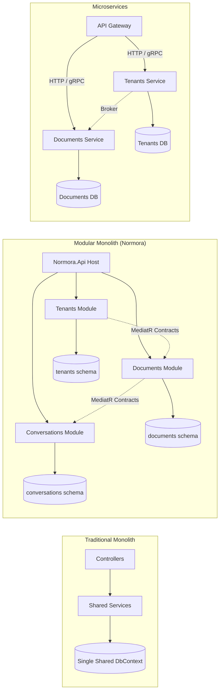
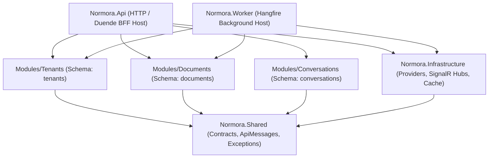
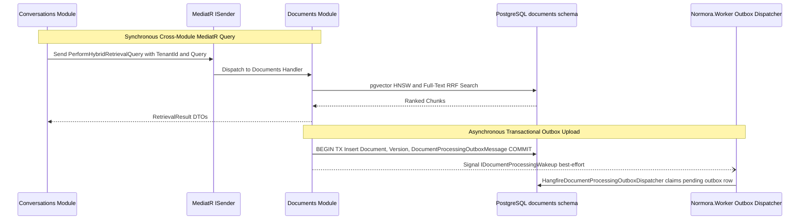

# Module 8: Modular Monolith Architecture & Database Isolation

This is the module where everything comes together. You've learned Middleware, DI, Routing, Configuration, Model Binding, and Error Handling — the individual building blocks. Now we'll learn **how to organize them at scale** so your application doesn't collapse under its own weight as it grows.

---

## 1. The Architecture Spectrum

### Option 1: Traditional Monolith ("Big Ball of Mud")
All code lives in one project with folders like `Controllers/`, `Services/`, `Repositories/`. Every class can reference every other class. The `OrderService` directly queries the `UserRepository`. The `UserController` creates `EmailSender` instances.

**This works** for small apps. But as the codebase grows to 50+ developers and 200+ files, it becomes an unmaintainable mess — changing the `User` table structure breaks the `Billing`, `Shipping`, and `Notification` code.

### Option 2: Microservices
Split the application into separate deployable services — a `UserService`, an `OrderService`, a `NotificationService` — each with its own database, API, and deployment pipeline.

**This sounds great** in theory. In practice, it introduces:
*   **Network complexity** — Services talk over HTTP/gRPC, which is 1000x slower than an in-memory function call.
*   **Distributed transactions** — How do you roll back an order if the payment service succeeds but the inventory service fails?
*   **DevOps nightmare** — 20 services = 20 CI/CD pipelines, 20 Docker images, 20 monitoring dashboards.
*   **Debugging hell** — A single user action spans 5 services. Good luck finding the bug.

### Option 3: Modular Monolith (The Sweet Spot)
A **Modular Monolith** gives you the **organizational discipline of microservices** with the **simplicity of a monolith**.

*   **Single deployable application** — One binary, one database server, one deployment pipeline.
*   **Strict internal boundaries** — Code is divided into isolated **modules** (Bounded Contexts) that cannot directly access each other's internals.
*   **In-memory communication** — Modules talk via function calls and in-memory events, not HTTP.
*   **Microservice-ready** — If a module needs to scale independently later, extract it with minimal effort.

> **Analogy — The Office Building:**  
> - **Monolith** = Open-plan office. Everyone sits together. The marketing team can freely access the engineering team's files. Sounds collaborative, but it's chaotic at scale.  
> - **Microservices** = Separate buildings across the city. Each department has its own building, its own reception, its own parking lot. Organized but expensive and slow to communicate.  
> - **Modular Monolith** = One building with **separate floors for each department**. They share the same reception (API), elevators (middleware), and address (deployment), but each floor has locked doors. Marketing can't walk into Engineering's lab — they have to use the intercom (interfaces/events).



### When NOT to Use a Modular Monolith
Architecture is about trade-offs, not dogma. Avoid a Modular Monolith when:
*   **Small MVP or short-lived prototype (< 10 endpoints):** Creating separate module projects, MediatR contract DTOs, and multiple `DbContext`s slows down early discovery when a clean layered or vertical-slice single-context app is enough.
*   **Hard polyglot / hardware isolation from Day 1:** If one subsystem *must* run in Python on GPU nodes (e.g., local ML model hosting) while the core API runs on .NET 10, that subsystem should be an external service behind a port interface, not forced into .NET modules.
*   **Strict organizational compliance isolation:** If two subsystems require completely separate runtime credentials, VPC boundaries, or independent zero-trust deployment blast radii from Day 1, separate services are warranted.

### Real-World Normora Examples: The Architecture Spectrum
1.  **One Binary, Three Bounded Contexts (`Normora.Api`):** Normora ships `Tenants`, `Documents`, and `Conversations` inside a single ASP.NET Core host (`Normora.Api`). An end-user request to start a workspace chat only crosses one HTTP boundary (`Angular 22 SPA` -> `Duende BFF` -> `Normora.Api`), avoiding inter-service network hops.
2.  **In-Memory RAG Instead of Microservice RPC:** During a conversational AI turn, `Conversations` retrieves grounded policy chunks from `Documents` via an in-memory MediatR query (`PerformHybridRetrievalQuery`). If `Documents` were a separate microservice, every single chat message would pay extra TLS/HTTP serialization latency and retry complexity.
3.  **Single PostgreSQL Server, Logical Schema Walls:** Normora runs one PostgreSQL + pgvector instance in Docker Compose rather than three separate database servers, keeping backup, local onboarding (`.\start.ps1`), and connection pooling simple while enforcing schema-level separation (`tenants`, `documents`, `conversations`).
4.  **Process Split Without Microservice Sprawl (`Normora.Worker`):** When Normora needed CPU/I/O isolation for PDF OCR and Gemini embeddings, it introduced a separate *worker host* (`Normora.Worker`) running the *same* `Documents` module code against Hangfire—gaining process isolation without turning `Documents` into a network-addressed microservice.
5.  **Stateless Horizontal Scaling Without Splitting Modules:** Because `Normora.Api` stores session/auth cookies via Duende BFF and caches tenant resolution and branding in Redis (`RedisOptions`), multiple replicas of the modular monolith can scale horizontally behind a load balancer without premature microservice decomposition.

---

## 2. Real-World Bounded Contexts: Normora & NextEvent

Both of your production projects implement the Modular Monolith pattern. Let's compare:

### NextEvent — Project Structure
```
NextEvent/
├── API/                            ← Composition Root (Program.cs)
│   ├── Extensions/                 ← Service registration extension methods
│   │   ├── ApiServiceExtensions.cs
│   │   ├── DatabaseServiceExtensions.cs
│   │   ├── ApplicationServiceExtensions.cs
│   │   ├── IdentityServiceExtensions.cs
│   │   ├── MassTransitServiceExtensions.cs
│   │   ├── RedisServiceExtensions.cs
│   │   └── RateLimiterServiceExtensions.cs
│   ├── Middleware/
│   │   └── ExceptionMiddleware.cs
│   ├── Services/
│   │   └── CurrentUserService.cs
│   └── Program.cs
│
├── Shared/                         ← Cross-cutting concerns (ALL modules can reference)
│   ├── Interfaces/                 ← ICurrentUserService, IDateTimeProvider
│   ├── Exceptions/                 ← NotFoundException, BusinessRuleException
│   ├── Common/                     ← ApiResponse, ValidationBehavior
│   └── Persistence/                ← SqlConnectionFactory, DapperTypeHandlers
│
└── Modules/
    ├── Identity/                   ← Authentication, Users, Roles
    │   ├── Domain/                 ← User entity, value objects
    │   ├── Application/            ← Commands, Queries, Handlers
    │   └── Persistence/            ← IdentityDbContext, Migrations, Seeders
    │
    ├── Organizations/              ← Organizations, Memberships
    │   ├── Domain/
    │   ├── Application/
    │   └── Persistence/            ← OrganizationsDbContext, Migrations
    │
    ├── Events/                     ← Events, Tickets, Sessions
    │   ├── Domain/
    │   ├── Application/
    │   └── Persistence/            ← EventsDbContext, Migrations
    │
    └── AI/                         ← Gemini integration, smart features
        └── Application/
```

### Normora — Project Structure
```
Normora/server/
├── Normora.Api/                    ← Composition Root (Program.cs, Middleware, Extensions)
│   ├── Extensions/
│   ├── Middleware/                 ← GlobalExceptionHandler, TenantResolutionMiddleware
│   ├── Services/                   ← CurrentUser, TenantContext
│   └── Program.cs
│
├── Normora.Infrastructure/         ← External Adapters (MinIO, Gemini, Redis, Keycloak)
│   ├── Agents/
│   ├── BackgroundJobs/
│   ├── Hubs/                       ← SignalR (DocumentHub, NotificationHub)
│   ├── Options/                    ← RedisOptions
│   └── Providers/
│
├── Normora.Shared/                 ← Cross-cutting interfaces & contracts
│   ├── Constants/                  ← ApiMessages
│   ├── Contracts/                  ← Cross-module interfaces & DTOs
│   ├── Exceptions/                 ← BolaException, BflaException
│   ├── Interfaces/                 ← ITenantContext, ICurrentUser
│   ├── AuditBehavior.cs
│   └── ValidationBehavior.cs
│
├── Normora.Worker/                 ← Independent Background Host (Hangfire, OCR, Vector Embeddings)
│   └── Program.cs
│
├── Normora.Architecture.Tests/     ← Automated Architectural Fitness Functions
│
└── Modules/
    ├── Tenants/                    ← Workspace boundaries, subscriptions, billing, departments
    │   ├── API/                    ← TenantsController, DepartmentsController
    │   ├── Application/            ← Commands, Queries, Handlers, Validators
    │   ├── Domain/                 ← Tenant, Department, TenantMembership entities
    │   └── Persistence/            ← TenantsDbContext (Schema: 'tenants'), Migrations
    │
    ├── Documents/                  ← Document ingestion, chunking, pgvector embeddings
    │   ├── API/                    ← DocumentsController
    │   ├── Application/
    │   ├── Domain/                 ← Document, DocumentChunk entities
    │   └── Persistence/            ← DocumentsDbContext (Schema: 'documents'), Migrations
    │
    └── Conversations/              ← Chat sessions, AI agent orchestration
        ├── API/                    ← ConversationsController, ApprovalsController
        ├── Application/
        ├── Domain/                 ← Conversation, Message entities
        └── Persistence/            ← ConversationsDbContext (Schema: 'conversations'), Migrations
```



### Bounded Contexts, "No Ghost Modules", and Module Composition Roots
A **Bounded Context** (a core concept from Domain-Driven Design) is a logical boundary inside which a domain model has one clear meaning and one owner. Designing module boundaries around business capabilities—rather than technical layers like `Controllers/` or `Repositories/`—prevents changes in one feature area from rippling across the entire codebase.

1. **No Ghost Modules (`Auth` / `Users`):** A common mistake is creating thin "ghost modules" that only duplicate infrastructure. In Normora, OIDC authentication and cookie session handling belong to the host (`Normora.Api` + Duende BFF), while workspace users, `TenantMembership`s, roles, invitations, and `ExternalUserId` mappings live inside **`Tenants`**. Creating separate `Auth` or `Users` modules would scatter membership invariants across multiple databases.
2. **Module Composition Roots (`{ModuleName}ModuleExtensions.cs`):** Each module exposes a single public registration extension method (for example, `services.AddTenantsModule(...)`, `services.AddDocumentsModule(...)`, `services.AddConversationsModule(...)`) that registers its `DbContext`, MediatR handlers, validators, and internal services. `Normora.Api` acts strictly as the **Composition Root**—wiring modules together in `Program.cs` without knowing their internal implementations.
3. **Decentralized Controllers:** Feature controllers live inside their owning module's `API/` folder (`Modules/Documents/API/McpController.cs`, `Modules/Conversations/API/ApprovalsController.cs`), never inside `Normora.Api`. `Normora.Api` only owns middleware, SignalR hub routing, BFF endpoints, and OpenAPI/Scalar setup.
4. **CQRS Folder-Per-Operation:** **CQRS (Command Query Responsibility Segregation)** separates state-changing writes (**Commands**) from side-effect-free reads (**Queries**). Inside each module's `Application/{Feature}/` directory, Normora isolates every operation in its own folder with separate files for the record, handler, and validator:
   ```text
   Application/{Feature}/
   ├── Commands/
   │   └── {OperationName}/
   │       ├── {OperationName}Command.cs
   │       ├── {OperationName}CommandHandler.cs
   │       └── {OperationName}CommandValidator.cs
   ├── Queries/
   │   └── {OperationName}/
   │       ├── {OperationName}Query.cs
   │       └── {OperationName}QueryHandler.cs
   └── DTOs/
       └── {Feature}Dtos.cs
   ```

### When NOT to Split a Module or Add CQRS Ceremony
*   **Don't split tightly coupled invariants into separate modules:** `Document` and `DocumentChunk` share ingestion lifecycle, soft-delete, and departmental visibility rules—splitting them into `Documents` and `Embeddings` modules would create constant cross-module chatter.
*   **Don't create a module for cross-cutting host plumbing:** Middleware (`TenantResolutionMiddleware`), exception mapping, and BFF endpoints belong in `Normora.Api` or `Normora.Shared`, not a business module.
*   **Don't force CQRS handlers for pure static constants:** Pricing tables like `TenantPlanPricingCatalog` live directly in `Normora.Modules.Tenants.Domain` as pure domain logic rather than wrapped in redundant MediatR handlers.

### Real-World Normora Examples: Bounded Contexts & Module Anatomy
1.  **`Tenants` Bounded Context & Authoritative Pricing:** `Modules/Tenants` owns workspaces, `Departments`, `UserGroups`, `AuditLogs`, `TenantPlan`, white-label branding, and PayU billing—including `TenantPlanPricingCatalog` in `Domain/` and commands like `UpdateTenantCurrencyCommand` and `CancelSubscriptionCommandHandler`.
2.  **`Documents` Bounded Context & MCP Endpoint:** `Modules/Documents` owns ingestion, Markdown-aware `DocumentChunker`, pgvector HNSW embeddings, hybrid search, and `Modules/Documents/API/McpController.cs` (exposing `/api/mcp` JSON-RPC 2.0 endpoints).
3.  **`Conversations` Bounded Context & HITL Approvals:** `Modules/Conversations` owns multi-turn RAG (`ConversationTurnPreparer`), `IAgentToolRegistry` (19 domain tools), SSE streaming, and `ApprovalsController` for Human-in-the-Loop (`PendingApproval`) confirmation flows.
4.  **CQRS Operation Folder with Primary Constructor DI:** Each handler sits beside its command and validator in its own folder:
    ```csharp
    // Modules/Tenants/Application/Subscriptions/Commands/CancelSubscription/CancelSubscriptionCommandHandler.cs
    public sealed class CancelSubscriptionCommandHandler(
        TenantsDbContext dbContext,
        ITenantContext tenantContext) : IRequestHandler<CancelSubscriptionCommand>
    {
        public async Task Handle(CancelSubscriptionCommand request, CancellationToken ct)
        {
            var tenantId = tenantContext.TenantId
                ?? throw new InvalidOperationException(ApiMessages.TenantContextMissing);
            // Enforce Free-tier invariant using ApiMessages (no magic strings)
            // ...
        }
    }
    ```
5.  **Identity Neutrality Inside `Tenants`:** Instead of a `Users` ghost module referencing `KeycloakUserId`, `Tenants` stores provider-neutral `ExternalUserId` values matching `ICurrentUser.ExternalUserId`, keeping OIDC vendor details confined to `Normora.Api`.

---

## 3. The Golden Rule: Strict Database Isolation

The single most common mistake in modular architecture is sharing a single `DbContext` and writing SQL queries that join tables across module boundaries:

```csharp
// ❌ ARCHITECTURAL DISASTER: Cross-Module SQL Join
// Documents module directly querying Tenants table via EF navigation property
var doc = await dbContext.Documents
    .Include(d => d.Tenant) // Leaking foreign module entity!
    .FirstOrDefaultAsync(d => d.Id == id);
```

### Why Cross-Module Database Joins Destroy Your Architecture:
1.  **Tight Coupling at the Data Layer:** If the `Tenants` module modifies its schema, the `Documents` module breaks.
2.  **Prevents Microservice Extraction:** If you ever need to extract `Documents` into an independent microservice, you cannot, because the database tables are physically coupled by foreign keys and queries.

### 🛡️ The Architectural Rule: One `DbContext` and Schema Per Module

In **Normora**, each module owns its **private PostgreSQL schema and dedicated `DbContext`**:
*   `Tenants` module owns `TenantsDbContext` targeting PostgreSQL schema `tenants`.
*   `Documents` module owns `DocumentsDbContext` targeting PostgreSQL schema `documents`.
*   `Conversations` module owns `ConversationsDbContext` targeting PostgreSQL schema `conversations`.

```csharp
// Inside TenantsDbContext.cs
protected override void OnModelCreating(ModelBuilder modelBuilder)
{
    // Isolates all tables of this module into the 'tenants' schema
    modelBuilder.HasDefaultSchema("tenants");
    modelBuilder.ApplyConfigurationsFromAssembly(typeof(TenantsDbContext).Assembly);
}
```

```csharp
// Inside DocumentsDbContext.cs
protected override void OnModelCreating(ModelBuilder modelBuilder)
{
    // Isolates all tables of this module into the 'documents' schema
    modelBuilder.HasDefaultSchema("documents");
    modelBuilder.ApplyConfigurationsFromAssembly(typeof(DocumentsDbContext).Assembly);
}
```

**The Foreign Key Invariant:**  
A table in `documents` **never declares a physical foreign key constraint** to a table in `tenants`. Instead, `documents.Document` stores a plain `Guid TenantId`. Foreign key integrity within a module is enforced by the database; cross-module consistency is managed by application contracts and events.

### 100% DbContext Encapsulation & Parameterless Entity Configurations
1. **Strict DbContext Privacy:** Module `DbContext`s are private persistence internals. API middleware, SignalR hubs, and sibling modules must **never** inject another module's `DbContext` (for example, `Conversations` handlers cannot inject `DocumentsDbContext`).
2. **Lean `DbContext` + Parameterless `IEntityTypeConfiguration<T>`:** Rather than stuffing hundreds of lines of Fluent API into `OnModelCreating`, each entity owns a dedicated `Persistence/Configurations/{Entity}Configuration.cs` class with a **public parameterless constructor**. Never inject scoped services like `ITenantContext` into an `IEntityTypeConfiguration<T>` class—EF Core's `ApplyConfigurationsFromAssembly` instantiates configuration classes via `Activator.CreateInstance` with zero arguments. Global multitenant query filters must bind dynamically to the `DbContext`'s own instance field/property inside `OnModelCreating`.
3. **EF Core `GroupBy` Translation Rule:** When running aggregations with `GroupBy` on a module `DbContext`, EF Core's relational SQL translator cannot materialize parameterized C# record constructors directly inside `GroupBy(...).Select(...)`. Always project to an **anonymous type** in SQL first, then project to your DTO/record in memory after `ToListAsync()`.
4. **Ephemeral Migration Host Isolation (`--migrate`):** In containerized deployments, schema migrations run via `dotnet Normora.Api.dll --migrate` inside a lean console host (`MigrationHostExtensions.RunMigrationsAsync`) *without* booting Kestrel, SignalR hubs, OpenTelemetry listeners, or background services. `DatabaseMigrationRunner` in `Normora.Infrastructure` executes four `IDatabaseMigrator` implementations sequentially:
   - `TenantsDatabaseMigrator`
   - `DocumentsDatabaseMigrator`
   - `ConversationsDatabaseMigrator`
   - `SessionDatabaseMigrator`
   This guarantees deterministic schema ordering and clean zero-exit container teardown (avoiding native `SIGSEGV` exit code 139 during shutdown).

### When NOT to Split Schemas & DbContexts
*   **Single-domain reporting or BI warehouses:** Analytical dashboards joining across dozens of tables should read from dedicated read models, materialized views, or an OLAP store rather than bypassing module isolation in transactional `DbContext`s.
*   **Very small single-context CRUD services:** If your entire app has 4 tables in one bounded context, multiple `DbContext`s and migration runners add migration-coordination overhead for zero architectural gain.

### Real-World Normora Examples: Database Isolation
1.  **Three Module Schemas + BFF Session Isolation:** `TenantsDbContext` (`tenants`), `DocumentsDbContext` (`documents`), and `ConversationsDbContext` (`conversations`) each own independent EF Core migration histories, while Duende BFF server-side sessions live in their own `SessionDatabaseMigrator` pipeline.
2.  **Parameterless `DocumentConfiguration`:**
    ```csharp
    // Modules/Documents/Persistence/Configurations/DocumentConfiguration.cs
    public sealed class DocumentConfiguration : IEntityTypeConfiguration<Document>
    {
        public void Configure(EntityTypeBuilder<Document> builder)
        {
            builder.ToTable("documents");
            builder.HasKey(d => d.Id);
            builder.Property(d => d.TenantId).IsRequired(); // Plain Guid, NO FK to tenants.tenants
            builder.HasIndex(d => new { d.TenantId, d.Status });
        }
    }
    ```
3.  **Intra-Module FK vs Cross-Module Value:** Inside `documents`, `DocumentChunk` has a real PostgreSQL foreign key to `Document` (same module, same ACID lifecycle) plus an HNSW pgvector index. Across modules, `ConversationMessage` stores citation `DocumentId` / `ChunkId` identifiers without physical cross-schema foreign keys.
4.  **Safe `GroupBy` Aggregation in `Documents` Metrics:**
    ```csharp
    // ✅ Translates cleanly to SQL, then maps to DTO in memory
    var countsByStatus = await dbContext.Documents
        .GroupBy(d => d.Status)
        .Select(g => new { Status = g.Key, Count = g.Count() })
        .ToListAsync(ct);

    var result = countsByStatus
        .Select(x => new DocumentStatusMetricDto(x.Status, x.Count))
        .ToList();
    ```
5.  **Sequential Four-Migrator Startup (`--migrate`):** During `.\start.ps1` / container startup, `Normora.Api.dll --migrate` runs `TenantsDatabaseMigrator` -> `DocumentsDatabaseMigrator` -> `ConversationsDatabaseMigrator` -> `SessionDatabaseMigrator` and exits immediately before the API or `Normora.Worker` containers start serving traffic.

---

## 4. Cross-Module Communication Patterns

If modules cannot reference each other's internal classes or perform database joins, how do they communicate?

```
                       CROSS-MODULE COMMUNICATION
                                   │
         ┌─────────────────────────┴─────────────────────────┐
         ▼                                                   ▼
1. SYNCHRONOUS QUERIES                              2. ASYNCHRONOUS EVENTS
   (Needs immediate data)                              (State changes occurred)
   - Expose public interface in Shared/Contracts       - In-Memory: MediatR INotification
   - Call abstraction: ITenantPlanQueryService         - Distributed: MassTransit + RabbitMQ
```

### Pattern 1: Synchronous Queries via Contract Interfaces
If the `Documents` module needs to verify a tenant's subscription tier before allowing a 100MB file upload:
1.  Define an interface and contract DTO in `Normora.Shared.Contracts`:
    ```csharp
    public interface ITenantPlanQueryService
    {
        Task<TenantPlanDto> GetTenantPlanAsync(Guid tenantId, CancellationToken ct);
    }
    ```
2.  The `Tenants` module implements the interface using its private `TenantsDbContext`.
3.  The `Documents` module injects `ITenantPlanQueryService` via DI, without referencing any internal entity from the `Tenants` module.

### Pattern 1B (Normora Standard): Synchronous Requests via MediatR Contracts
While service interfaces (`ITenantPlanQueryService`) work well in many modular monoliths, **Normora** takes decoupling a step further: modules **never inject services or interfaces from another module directly**. Instead, synchronous cross-module calls use **MediatR request/query contracts** defined in `Normora.Shared.Contracts.{ModuleName}`:

1. **Contract stays thin & explicit:** Every cross-module query/command explicitly passes `Guid TenantId` so behavior is identical in HTTP requests and non-HTTP `Normora.Worker` jobs.
2. **Callers depend only on `ISender`:** Calling modules dispatch a contract without knowing which handler or `DbContext` fulfills it.
3. **No module internals in `Normora.Shared`:** Only neutral contract records and DTOs live in `Normora.Shared.Contracts.*`. Domain constants (`RagConstants`, `ConversationConstants`), entities, and internal interfaces (`IRetrievalService`, `IAgentToolRegistry`) stay private inside their owning module.

### Pattern 2: Asynchronous Events via In-Memory MediatR Notifications
When an event occurs in one module that other modules need to react to, publish a **Domain Notification**:
```csharp
// Published by Tenants module when a workspace is deactivated:
public record TenantDeactivatedEvent(Guid TenantId) : INotification;

// Handled independently by Documents module:
public class TenantDeactivatedNotificationHandler(DocumentsDbContext dbContext) 
    : INotificationHandler<TenantDeactivatedEvent>
{
    public async Task Handle(TenantDeactivatedEvent notification, CancellationToken ct)
    {
        // Archive documents belonging to deactivated tenant (bypassing ambient HTTP filter if run in worker/admin scope)
        await dbContext.Documents
            .IgnoreQueryFilters()
            .Where(d => d.TenantId == notification.TenantId)
            .ExecuteUpdateAsync(s => s.SetProperty(d => d.IsArchived, true), ct);
    }
}
```

### Pattern 3: Distributed Asynchronous Events via MassTransit (NextEvent)
In **NextEvent**, distributed events communicate over a message broker using **MassTransit** and the **Transactional Outbox Pattern**:
```csharp
// Event published when a ticket is purchased:
await publishEndpoint.Publish(new TicketPurchasedEvent(orderId, eventId, attendeeId));
```
MassTransit writes the event to a local database outbox table within the same transaction as the order creation. A background publisher polls the outbox and publishes the event to RabbitMQ, guaranteeing **at-least-once delivery** without distributed 2-phase commits.

### Pattern 4: Transactional Outbox Without a Message Broker (Normora Document Upload)
You don't need RabbitMQ to get Transactional Outbox reliability. In **Normora**, `UploadDocumentCommandHandler` commits document metadata, the document version, and a `DocumentProcessingOutboxMessage` inside **one PostgreSQL transaction**, then triggers `IDocumentProcessingWakeup` as a best-effort asynchronous wake-up. Hangfire runs `HangfireDocumentProcessingOutboxDispatcher` immediately—and a minutely recurring Hangfire job recovers any pending outbox rows if the wake-up signal was lost. Downstream queue failures never roll back or fail an already-committed upload.



### When NOT to Use Synchronous Cross-Module Calls
*   **Slow I/O or multi-second work:** Never block an HTTP request or cross-module MediatR call waiting for PDF OCR, Gemini embedding batches, or email delivery—write an outbox row or publish an async job instead.
*   **Circular module dependencies:** If `Conversations` queries `Documents` and `Documents` simultaneously calls `Conversations` during the same operation, redesign ownership or break the cycle with an asynchronous event.
*   **Pure local writes:** Don't route intra-module calls through `Normora.Shared.Contracts`—keep internal handlers inside the owning module.

### Real-World Normora Examples: Cross-Module Communication
1.  **Cross-Module Hybrid RAG (`Conversations` -> `Documents`):** `ConversationTurnPreparer` and `SearchCompanyDocumentsTool` inside `Conversations` never inject `IRetrievalService`. They send `PerformHybridRetrievalQuery` defined in `Normora.Shared.Contracts.Documents` with an explicit `Guid TenantId`:
    ```csharp
    // Inside Modules/Conversations/Application/...
    public sealed class SearchCompanyDocumentsTool(ISender sender)
    {
        public Task<HybridRetrievalResult> ExecuteAsync(Guid tenantId, string query, CancellationToken ct)
            => sender.Send(new PerformHybridRetrievalQuery(tenantId, query), ct);
    }
    ```
2.  **Cross-Module MCP Tool Execution (`Documents` -> `Conversations`):** `Documents/API/McpController.cs` exposes `/api/mcp` for external AI frameworks, discovering and invoking tools owned by `Conversations` via `GetMcpToolsQuery` and `ExecuteMcpToolCommand` in `Normora.Shared.Contracts.Conversations`—never injecting `IAgentToolRegistry`.
3.  **Transactional Outbox on Upload (`Documents` -> `Normora.Worker`):** `UploadDocumentCommandHandler` writes the `Document`, `DocumentVersion`, and `DocumentProcessingOutboxMessage` atomically in `DocumentsDbContext`, signals `IDocumentProcessingWakeup`, and lets `HangfireDocumentProcessingOutboxDispatcher` reliably dispatch ingestion.
4.  **Reactive State Synchronization (`dataVersion`):** When mutations occur across workspace modules, `IWorkspaceStateSynchronizer` increments the tenant's monotonic `dataVersion` and pushes updates over SignalR/SSE so the Angular 22 SPA reloads stale tables automatically without tight coupling.
5.  **Explicit `TenantId` Defense-in-Depth:** Both `PerformHybridRetrievalQuery` and `ExecuteMcpToolCommand` carry `Guid TenantId` in the contract payload rather than relying on `ITenantContext` alone, so they execute safely from both `Normora.Api` HTTP controllers and headless `Normora.Worker` jobs.

---

## 5. Multi-Tenancy Architecture: EF Core Global Query Filters

In enterprise multi-tenant systems, data isolation between rival tenants is a paramount security invariant.

### The Problem: Accidental Tenant Data Leaks
If an engineer forgets to append `WHERE TenantId = @currentTenant` to a single query:
```csharp
// ❌ HIGH RISK: If where clause is forgotten, Tenant A sees Tenant B's confidential documents!
var docs = await dbContext.Documents.ToListAsync();
```

### 🛡️ The Architectural Solution: Global Query Filters
In **Normora**, multi-tenant isolation is enforced automatically at the database context level via **EF Core Global Query Filters**:

```csharp
public class DocumentsDbContext(
    DbContextOptions<DocumentsDbContext> options,
    ITenantContext tenantContext) // Scoped to the current HTTP request
    : DbContext(options)
{
    protected override void OnModelCreating(ModelBuilder modelBuilder)
    {
        base.OnModelCreating(modelBuilder);

        // Enforce Multi-Tenant Isolation across all queries automatically:
        modelBuilder.Entity<Document>()
            .HasQueryFilter(doc => doc.TenantId == tenantContext.TenantId);
    }
}
```

Whenever *any* query executes against `DocumentsDbContext`:
```csharp
var docs = await dbContext.Documents.ToListAsync();
```
EF Core automatically rewrites the executed SQL query:
```sql
SELECT d.id, d.title, d.tenant_id 
FROM documents.documents AS d
WHERE d.tenant_id = '3fa85f64-5717-4562-b3fc-2c963f66afa6';
```

### Safe Bypassing in Background Workers
When a system background worker (e.g., Hangfire job running in `Normora.Worker`) needs to reindex all documents across all tenants, the architect explicitly disables the filter:
```csharp
// Explicitly bypass tenant filter for system administrative jobs
var allSystemDocs = await dbContext.Documents
    .IgnoreQueryFilters()
    .ToListAsync(ct);
```

### Immutable Scoped Context Defense
In Normora's `TenantContext`:
```csharp
// From Normora's TenantContext.cs — Immutable once set per request
public class TenantContext : ITenantContext
{
    public Guid? TenantId { get; private set; }
    public string? TenantRole { get; private set; }
    public bool IsTenantResolved => TenantId.HasValue;

    public void SetContext(Guid tenantId, string role, IReadOnlyCollection<Guid> departments)
    {
        if (IsTenantResolved)
            throw new InvalidOperationException(ApiMessages.TenantContextAlreadySet); // From Normora.Shared.Constants.ApiMessages
        
        TenantId = tenantId;
        TenantRole = role;
    }
}
```

**Why `throw` if already set?** Prevents a subtle attack where a compromised service tries to switch tenants mid-request to access another company's data. Using `ApiMessages` instead of hardcoded strings also enforces Normora's zero-magic-string policy.

> [!NOTE]
> **How EF Core Evaluates the Filter Dynamically:** EF Core does **not** bake the literal `Guid` value into the model once at startup. Because `tenantContext.TenantId` is accessed through a property/parameter on the `DbContext` instance, EF Core parameterizes the `TenantId` per query execution—and when `tenantContext.TenantId` is `null` (such as before resolution or in an unauthenticated context), `doc.TenantId == null` evaluates to `false`, failing **closed** by returning zero rows.

### Scoped Domain DbContexts vs. Unscoped Root (`TenantsDbContext`)
Not every `DbContext` in a modular monolith should apply a global `TenantId` filter:
*   **Scoped Domain `DbContext`s (`DocumentsDbContext`, `ConversationsDbContext`):** All business records belong strictly to one resolved workspace, so global `TenantId` query filters protect every query automatically.
*   **Unscoped Multi-Tenancy Root (`TenantsDbContext`):** `TenantsDbContext` handles workspace resolution bootstrapping (`TenantResolutionMiddleware`), tenant slug lookups, and a user's cross-workspace memberships. Applying an ambient `TenantId` filter there would block resolving the tenant in the first place! Therefore, any query against `TenantsDbContext` that fetches workspace-scoped entities (`TenantMemberships`, `Departments`, `UserGroups`, `AuditLogs`) **must explicitly filter** `.Where(m => m.TenantId == request.TenantId)`.

### Intra-Tenant Security: BOLA (404) & BFLA (403)
Global query filters isolate **Tenant A from Tenant B**, but inside a single tenant, an HR policy document might be restricted to specific `Departments` or `UserGroups`:
*   **BOLA (Broken Object Level Authorization):** When a user requests a document or conversation in their tenant that they are not allowed to see, Normora throws `BolaException()` (mapped globally to `404 Not Found` with `ApiMessages.NotFound`) so attackers cannot probe whether a `Guid` exists.
*   **BFLA (Broken Function Level Authorization):** When a user attempts an admin action (like creating a department or canceling a subscription) without the required role, Normora throws `BflaException()` (mapped globally to `403 Forbidden` with `ApiMessages.Forbidden`).

### When NOT to Use Global Query Filters
*   **Directory & bootstrapping tables:** Tables queried *before* tenant resolution (`Tenants`, `TenantSubscriptions` during webhook callbacks) should live in an unscoped `DbContext` and filter explicitly.
*   **Complex per-user / group ACLs:** Keep `HasQueryFilter` simple and index-friendly (`TenantId == tenantContext.TenantId` and soft-delete `!IsDeleted`); enforce dynamic `UserGroup` or role permissions explicitly in query handlers or PostgreSQL Row-Level Security (RLS).

### Real-World Normora Examples: Multi-Tenancy Isolation
1.  **`DocumentsDbContext` Dynamic Tenant Filter:** `DocumentsDbContext` binds `doc.TenantId == tenantContext.TenantId` in `OnModelCreating` alongside `ApplyConfigurationsFromAssembly`, isolating `Document` and `DocumentChunk` (and pgvector HNSW similarity searches) per workspace.
2.  **`ConversationsDbContext` Session Partitioning:** `ConversationsDbContext` filters `Conversation` and `PendingApproval` rows by `TenantId`, while `NormoraAgentIsolationKeyProvider` partitions agent threads by `{TenantId}:{ExternalUserId}` so AI memory never leaks across tenants or users.
3.  **Explicit Filtering on Unscoped `TenantsDbContext`:**
    ```csharp
    // Modules/Tenants/Application/Departments/Queries/GetDepartments/GetDepartmentsQueryHandler.cs
    public sealed class GetDepartmentsQueryHandler(TenantsDbContext dbContext)
        : IRequestHandler<GetDepartmentsQuery, IReadOnlyList<DepartmentDto>>
    {
        public async Task<IReadOnlyList<DepartmentDto>> Handle(GetDepartmentsQuery request, CancellationToken ct)
            => await dbContext.Departments
                .Where(d => d.TenantId == request.TenantId) // Mandatory on unscoped TenantsDbContext!
                .Select(d => new DepartmentDto(d.Id, d.Name))
                .ToListAsync(ct);
    }
    ```
4.  **Explicit `IgnoreQueryFilters()` in `Normora.Worker`:** When `HangfireDocumentProcessingOutboxDispatcher` polls `DocumentProcessingOutboxMessage` rows across all tenants in `Normora.Worker`, it calls `.IgnoreQueryFilters()` and then passes the row's `TenantId` explicitly into downstream commands.
5.  **BOLA/BFLA Enforcement on `CancelSubscriptionCommandHandler`:** First `TenantResolutionMiddleware` locks `TenantContext` (throwing on double-set), then the handler checks role permissions (`BflaException` -> 403), checks workspace ownership (`BolaException` -> 404), and rejects `Free` tier cancellations with `InvalidOperationException(ApiMessages.CannotCancelFreePlan)`.

---

## 6. Decoupled Background Workers: The `Normora.Worker` Host

In high-throughput architectures, CPU-intensive tasks must **never run in the user-facing web API process**:
*   PDF OCR text extraction
*   Document chunking and tokenization
*   High-dimensional vector embedding generation via Gemini API

If these workloads execute inside `Normora.Api`, thread pool starvation occurs, causing HTTP request response times to spike for all users.

### The Solution: Headless Worker Process
Normora isolates heavy workloads into a dedicated console worker: **`Normora.Worker`**.
*   `Normora.Api` accepts document uploads, saves them to MinIO storage, commits a `DocumentProcessingOutboxMessage`, signals `IDocumentProcessingWakeup`, and returns HTTP 202 Accepted.
*   `Normora.Worker` runs in a separate Docker container referencing `Normora.Infrastructure` and the necessary modules—**never** referencing `Normora.Api`.
*   `Normora.Infrastructure` acts as a host-neutral library (containing Hangfire dispatchers, Redis caching, OpenTelemetry, SignalR hubs, and external providers) and **never** references either executable host (`Normora.Api` or `Normora.Worker`).

### Multi-Host SignalR Redis Backplane & Worker Security (CWE-209)
1. **Cross-Process Real-Time Updates:** Browser WebSockets connect to `Normora.Api` (`DocumentHub`, `NotificationHub`), not `Normora.Worker`. When `DocumentProcessingJob` finishes chunking and embedding in `Normora.Worker`, it calls `IDocumentNotificationService` or `INotificationService`. Because `AddNormoraSignalR` configures a shared **Redis pub/sub backplane**, Redis relays the message to all `Normora.Api` instances, which fan it out to connected Angular clients in real time.
2. **Worker Error Hygiene (CWE-209):** Background jobs and transactional emails must **never** surface raw `exception.Message`, internal HTTP codes, or stack traces to end users or workspace admins. Always log full diagnostics structurally via OpenTelemetry/Serilog and map user-facing failure notices to constants in `Normora.Shared.Constants.ApiMessages`.

### When NOT to Split a Separate Worker Host
*   **Low-traffic single-instance apps:** If background tasks are fast and infrequent (a few emails per hour), an in-process `BackgroundService` / `IHostedService` inside the API host avoids deploying and monitoring a second container.

### Real-World Normora Examples: Multi-Host Modular Monolith
1.  **Document Upload HTTP 202 + Outbox:** `Normora.Api` stores the raw PDF via `IDocumentStorageService`, commits the outbox record, and responds immediately so HTTP threads stay free.
2.  **`HangfireDocumentProcessingOutboxDispatcher`:** Claims pending `DocumentProcessingOutboxMessage` rows inside `Normora.Worker` and enqueues `DocumentProcessingJob`, backed by a minutely recurring Hangfire recovery job.
3.  **Markdown Chunking & Gemini Batch Embeddings:** `DocumentProcessingJob` runs `DocumentChunker` (preserving `#`/`##`/`###` headings and tables) and invokes `ITextEmbeddingService` (batching up to 100 chunks per Gemini `batchEmbedContents` call) without blocking any web request.
4.  **Worker-to-Browser Live Status via Redis Backplane:** As `DocumentProcessingJob` transitions a document from `Processing` to `Ready`, `IDocumentNotificationService` publishes over the Redis SignalR backplane so the Angular UI updates immediately.
5.  **Host-Neutral Infrastructure Enforcement:** `Normora.Infrastructure` defines `DatabaseMigrationRunner` and `AddNormoraSignalR` without referencing `Normora.Api` or `Normora.Worker`, letting both hosts boot identically from one shared infrastructure layer.

---

## 7. External Provider Boundary (Ports & Adapters)

Even inside a well-isolated modular monolith, business logic rots quickly if modules directly import cloud vendor SDKs like `Minio`, Google Gemini packages, or payment gateway clients.

### The Problem: Vendor Lock-In Inside Domain Modules
If `Modules/Documents` imports the `Minio` NuGet package directly:
*   Switching object storage from MinIO (local) to AWS S3 or Azure Blob Storage requires editing domain/application handlers.
*   Unit testing `UploadDocumentCommandHandler` becomes painful because handlers depend on concrete SDK clients instead of clean domain ports.

### The Solution: Ports in Modules, Adapters in `Normora.Infrastructure/Providers/`
Normora applies the **Ports & Adapters (Hexagonal)** boundary inside the modular monolith:
1. **Ports (Domain Interfaces) live in Business Modules:**
   * `Documents`: `IDocumentStorageService`, `IDocumentTextExtractor`, `ITextEmbeddingService`
   * `Conversations`: `ITextGenerationService`, `IQueryRewriterService`, `ISuggestionsService`
   * `Tenants`: `IBrandingStorageService`, `IPaymentService`
2. **Adapters (Vendor Implementations) live in `Normora.Infrastructure/Providers/`:**
   * `Storage/`: `MinioDocumentStorageService`, `MinioBrandingStorageService`, `MinioOptions`
   * `Gemini/`: `GeminiEmbeddingService`, `GeminiTextGenerationService`, `GeminiQueryRewriterService`, `GeminiSuggestionsService`, `GeminiOptions`
   * `DocumentExtraction/`: `GeminiDocumentTextExtractor`
3. **Dedicated Provider Wiring (`ProviderServiceExtensions.cs`):** `AddExternalProviders`, `AddStorageProviders`, `AddAiProviders`, and `AddDocumentExtractionProviders` wire adapters cleanly—keeping `DatabaseServiceExtensions.cs` focused solely on PostgreSQL, `DbContext`s, and Hangfire.

### When NOT to Add Port Abstractions
*   **Don't wrap EF Core `DbContext` in a generic `IRepository<T>`:** EF Core already implements Unit of Work and Repository semantics, and each module already owns its private `DbContext`—wrapping it hides `ExecuteUpdateAsync`, projections, and query filters.
*   **Don't create interfaces for pure domain calculators:** Domain rules like `TenantPlanPricingCatalog` have no external I/O and should remain simple deterministic classes in `Domain/`.

### Real-World Normora Examples: External Provider Boundary
1.  **Zero Vendor SDKs in `Documents`:** `UploadDocumentCommandHandler` depends on `IDocumentStorageService`, while `Normora.Infrastructure/Providers/Storage/MinioDocumentStorageService` handles S3 buckets and streams.
2.  **Swappable AI & `Microsoft.Extensions.AI`:** `Normora.Infrastructure/Providers/Gemini/` implements `ITextGenerationService` and `ITextEmbeddingService` (and bridges `Microsoft.Extensions.AI` `IChatClient` / `IEmbeddingGenerator`), so swapping Gemini for another LLM touches zero lines in `Modules/Conversations`.
3.  **Document OCR Extraction Port:** `IDocumentTextExtractor` lives in `Documents`, implemented by `GeminiDocumentTextExtractor` in `Normora.Infrastructure/Providers/DocumentExtraction/`.
4.  **White-Label Branding Storage Port:** `Tenants` declares `IBrandingStorageService` for workspace logos/assets, backed by `MinioBrandingStorageService`—isolated from `Documents` storage buckets.
5.  **Payment & Identity Neutrality:** `Tenants` uses `IPaymentService` (implemented by `PayUPaymentService` with `TenantPlanPricingCatalog` as the single source of truth) and `ExternalUserId` rather than coupling domain logic to PayU or Keycloak naming.

---

## 8. Architectural Fitness Functions: Enforcing Module Boundaries in CI/CD

How do software architects guarantee that developers do not reference internal classes across modules? *(We will dive much deeper into NetArchTest rules and resilience patterns in [Module 10](10_Module_10_Architecture_Tests_and_Resilience.md).)*

In **Normora**, the test suite `Normora.Architecture.Tests` runs in CI/CD pipelines to fail builds if module boundaries are violated:

```csharp
// From Normora.Architecture.Tests/ModularMonolithArchitectureTests.cs

[Fact]
public void DocumentsModule_MustNotReference_ConversationsInternals()
{
    var docTypes = DocumentsAssembly.GetTypes()
        .Where(t => t.IsClass && !t.IsAbstract)
        .ToList();

    foreach (var type in docTypes)
    {
        foreach (var ctor in type.GetConstructors())
        {
            foreach (var param in ctor.GetParameters())
            {
                Assert.False(
                    param.ParameterType.Namespace?.StartsWith("Normora.Modules.Conversations") == true,
                    $"Documents type '{type.FullName}' directly references Conversations type '{param.ParameterType.FullName}'. " +
                    $"Cross-module communication must use Normora.Shared.Contracts.");
            }
        }
    }
}

[Fact]
public void BusinessModules_MustNotReferenceEachOther()
{
    var moduleAssemblies = new[] { TenantsAssembly, DocumentsAssembly, ConversationsAssembly };

    foreach (var module in moduleAssemblies)
    {
        var otherModuleNames = moduleAssemblies
            .Where(m => m != module)
            .Select(m => m.GetName().Name!)
            .ToList();

        var referencedAssemblies = module.GetReferencedAssemblies()
            .Select(r => r.Name)
            .ToList();

        foreach (var other in otherModuleNames)
        {
            Assert.DoesNotContain(
                other, 
                referencedAssemblies, 
                $"Architectural Violation: Module '{module.GetName().Name}' references '{other}'. " +
                $"Modules must be completely decoupled.");
        }
    }
}

[Fact]
public void Worker_MustNotReferenceApiHost()
{
    Assert.DoesNotContain(
        WorkerAssembly.GetReferencedAssemblies(),
        reference => string.Equals(reference.Name, "Normora.Api", StringComparison.Ordinal),
        "Worker host must be completely decoupled from the Web API host.");
}
```

### When NOT to Write Overly Rigid Architecture Tests
*   **Avoid testing cosmetic internal folder structure blindly** if it blocks legitimate refactoring inside a module. Focus architectural fitness functions on **assembly dependency direction, cross-module type leakage, `DbContext` encapsulation, and vendor SDK isolation**.

### Real-World Normora Examples: Architectural Fitness Functions
1.  **Zero Module-to-Module Project References:** CI fails immediately if `Normora.Modules.Conversations.csproj` adds a `<ProjectReference>` to `Normora.Modules.Documents.csproj` or `Normora.Modules.Tenants.csproj`.
2.  **Constructor Injection Guard (`Documents` vs `Conversations`):** Even if modules live in the same solution, constructor reflection checks verify `Documents` never injects `IAgentToolRegistry` or any `Normora.Modules.Conversations.*` type.
3.  **Host Separation (`Normora.Worker` vs `Normora.Api`):** Guarantees background job handlers cannot accidentally take a dependency on HTTP middleware, `HttpContext`, or Duende BFF endpoints.
4.  **Infrastructure Host-Neutrality:** Ensures `Normora.Infrastructure` does not reference `Normora.Api` or `Normora.Worker`, preventing circular assembly graphs.
5.  **Vendor SDK Isolation in Modules:** Architecture tests verify business module assemblies do not reference third-party provider SDKs (such as `Minio` or Gemini client libraries), keeping all vendor adapters inside `Normora.Infrastructure/Providers/`.

---

## 9. When to Extract a Module into a Microservice

The beauty of a Modular Monolith is that extraction is surgical, not an architectural rewrite:

| Signal | Action |
|---|---|
| One module needs independent scaling (e.g., AI document processing) | Extract to a separate service |
| One module requires a different database technology | Give it its own database server |
| One module has an independent release cadence | Deploy it independently |
| One module is owned by a separate engineering team | Hand that team complete ownership |

**How to extract:** Because the module already owns its private `DbContext`, schemas, and communicates via interfaces/events:
1. Create a new ASP.NET Core project for the module.
2. Move the module's folder into the new solution.
3. Replace in-memory MediatR domain events with MassTransit/RabbitMQ distributed messages.
4. Point the module's `DbContext` at its dedicated database instance.

### When NOT to Extract into a Microservice
*   **Before scaling `Normora.Worker` or read replicas:** Most "scaling bottlenecks" in monoliths are CPU/I/O background jobs—spinning up more `Normora.Worker` replicas solves them at 10% of the operational cost of a microservice.
*   **Chatty synchronous dependencies:** If two modules exchange dozens of low-latency queries per user action, splitting them over the network degrades tail latency and reliability.

### Real-World Normora Examples: Extraction Decisions
1.  **Scaling Ingestion Without Extracting `Documents`:** Normora scaled heavy PDF OCR and batch embeddings first by moving Hangfire jobs to `Normora.Worker` containers rather than turning `Documents` into an HTTP microservice.
2.  **What Extracting `Documents` Would Change (`PerformHybridRetrievalQuery`):** Because `Conversations` already talks to `Documents` exclusively through `PerformHybridRetrievalQuery` in `Normora.Shared.Contracts.Documents`, extraction only swaps the in-memory MediatR handler for an HTTP/gRPC client adapter.
3.  **What Extracting `Tenants` Would Change (`TenantDeactivatedEvent`):** In-memory MediatR `INotification` handlers in `Documents` and `Conversations` would subscribe to a message broker topic (e.g., RabbitMQ) with no changes to internal domain entities.
4.  **Why `Conversations` and `Documents` Stay Co-Located Today:** Conversational RAG + citation resolution + MCP tool calls benefit enormously from sub-millisecond in-memory MediatR dispatch.
5.  **Why `Tenants` Remains In-Process:** Nearly every authenticated API call checks workspace status, branding, or membership; keeping `Tenants` in-process (backed by Redis caching) avoids turning every request into an inter-service auth bottleneck.

---

## 10. Best Practices Summary

| Practice | Why |
|---|---|
| **Organize by business domain, not technical layer** | `Modules/Documents/` (Normora) or `Modules/Events/` (NextEvent), not `/Controllers/DocumentsController.cs` |
| **One DbContext & schema per module** | `TenantsDbContext` (`tenants`), `DocumentsDbContext` (`documents`), `ConversationsDbContext` (`conversations`) |
| **Use `Normora.Shared.Contracts.*` for MediatR contracts** | Modules exchange neutral queries/commands with explicit `Guid TenantId`—never internal services |
| **Keep `Normora.Api` as Composition Root & BFF only** | Decentralized controllers live in `Modules/{Module}/API/`; host wires middleware & modules |
| **Parameterless `IEntityTypeConfiguration<T>`** | Enables `ApplyConfigurationsFromAssembly` without scoped DI breakage |
| **Apply Global Query Filters (+ explicit filter on `TenantsDbContext`)** | Prevents accidental cross-tenant leaks across scoped contexts while handling root bootstrapping safely |
| **Use Transactional Outbox for async work** | Commits metadata + `DocumentProcessingOutboxMessage` atomically before `Normora.Worker` runs |
| **Keep third-party SDKs in `Normora.Infrastructure/Providers/`** | Zero `Minio` or vendor AI SDKs inside business modules |
| **Automate boundary verification with Architecture Tests** | Programmatically fails CI/CD builds on boundary violations |

---

## 11. Common Mistakes & Anti-Patterns

> [!CAUTION]
> **Anti-Pattern 1: Injecting Another Module's `DbContext` or Internal Service**
> ```csharp
> // ❌ WRONG: Conversations handler directly injects Documents' private DbContext or IRetrievalService
> public sealed class ChatTurnHandler(DocumentsDbContext documentsDb, IRetrievalService retrieval)
> {
>     // Couples Conversations directly to Documents' persistence and internals!
> }
> ```
> **Why it's wrong:** Breaks module encapsulation, allows accidental cross-schema joins, and fails `Normora.Architecture.Tests`.
>
> **Fix:** Depend only on `ISender` and dispatch a contract from `Normora.Shared.Contracts.Documents` with an explicit `Guid TenantId`:
> ```csharp
> // ✅ RIGHT: Cross-module MediatR contract
> public sealed class ChatTurnHandler(ISender sender)
> {
>     public Task<HybridRetrievalResult> RetrieveAsync(Guid tenantId, string query, CancellationToken ct)
>         => sender.Send(new PerformHybridRetrievalQuery(tenantId, query), ct);
> }
> ```

> [!CAUTION]
> **Anti-Pattern 2: Injecting Scoped `ITenantContext` into `IEntityTypeConfiguration<T>`**
> ```csharp
> // ❌ WRONG: Parameterized constructor on entity configuration
> public sealed class DocumentConfiguration(ITenantContext tenantContext)
>     : IEntityTypeConfiguration<Document>
> {
>     public void Configure(EntityTypeBuilder<Document> builder)
>         => builder.HasQueryFilter(d => d.TenantId == tenantContext.TenantId);
> }
> ```
> **Why it's wrong:** `modelBuilder.ApplyConfigurationsFromAssembly(typeof(DocumentsDbContext).Assembly)` requires a **parameterless public constructor**. Adding constructor parameters causes runtime `MissingMethodException` failures during startup/migrations.
>
> **Fix:** Keep `DocumentConfiguration` parameterless and apply the dynamic global query filter inside `DocumentsDbContext.OnModelCreating` referencing the `DbContext`'s injected `tenantContext`.

> [!CAUTION]
> **Anti-Pattern 3: Assuming `TenantsDbContext` Has a Global `TenantId` Filter**
> ```csharp
> // ❌ WRONG: Querying TenantMemberships on unscoped TenantsDbContext without TenantId filter
> var members = await tenantsDbContext.TenantMemberships
>     .Where(m => m.IsActive)
>     .ToListAsync(ct);
> ```
> **Why it's wrong:** `TenantsDbContext` is an unscoped multi-tenancy root (no ambient `TenantId` global filter) because it resolves tenant slugs and cross-workspace memberships. Omitting `m.TenantId == request.TenantId` returns members from **all** workspaces!
>
> **Fix:** Always filter workspace-scoped entities (`TenantMemberships`, `Departments`, `UserGroups`, `AuditLogs`) explicitly by `request.TenantId`:
> ```csharp
> // ✅ RIGHT: Explicit tenant predicate on unscoped TenantsDbContext
> var members = await tenantsDbContext.TenantMemberships
>     .Where(m => m.TenantId == request.TenantId && m.IsActive)
>     .ToListAsync(ct);
> ```

> [!CAUTION]
> **Anti-Pattern 4: Dual-Write Without Transactional Outbox on Upload**
> ```csharp
> // ❌ WRONG: Save document to PostgreSQL, then enqueue Hangfire job outside transaction
> documentsDbContext.Documents.Add(document);
> await documentsDbContext.SaveChangesAsync(ct);
> backgroundJobClient.Enqueue<DocumentProcessingJob>(j => j.ProcessAsync(document.Id)); // If Redis/Hangfire blips, file is stuck forever!
> ```
> **Why it's wrong:** If the process crashes or the job queue fails right after `SaveChangesAsync`, the uploaded document remains permanently unprocessed in `Pending` state.
>
> **Fix:** Commit `Document`, `DocumentVersion`, and `DocumentProcessingOutboxMessage` inside the **same** PostgreSQL transaction, then signal `IDocumentProcessingWakeup` (backed by `HangfireDocumentProcessingOutboxDispatcher` and a minutely recovery job).

> [!CAUTION]
> **Anti-Pattern 5: Direct Third-Party SDKs Inside Business Modules**
> ```csharp
> // ❌ WRONG: Importing Minio SDK directly inside Modules/Documents
> using Minio;
> public sealed class UploadDocumentCommandHandler(IMinioClient minioClient) { ... }
> ```
> **Why it's wrong:** Couples `Documents` domain logic to MinIO's API surface, making storage swaps and isolated unit testing difficult.
>
> **Fix:** Inject the module's neutral port (`IDocumentStorageService`), and keep `MinioDocumentStorageService` inside `Normora.Infrastructure/Providers/Storage/`.

> [!CAUTION]
> **Anti-Pattern 6: EF Core `GroupBy` Record Projection & Raw Exception Leakage (CWE-209)**
> ```csharp
> // ❌ WRONG: Direct record constructor in GroupBy + exposing raw ex.Message
> var stats = await db.Documents
>     .GroupBy(d => d.Status)
>     .Select(g => new DocumentStatusMetricDto(g.Key, g.Count())) // Throws InvalidOperationException in EF Core!
>     .ToListAsync(ct);
> ```
> **Why it's wrong:** EF Core's relational translator cannot translate parameterized record constructors inside `GroupBy().Select(...)`, throwing `InvalidOperationException` at runtime. Likewise, forwarding raw `ex.Message` from `DocumentProcessingJob` to users leaks internal infrastructure details (CWE-209).
>
> **Fix:** Project `GroupBy` to an anonymous type (`new { Key = g.Key, Count = g.Count() }`) before mapping to DTOs in memory, and map user-facing errors strictly to `Normora.Shared.Constants.ApiMessages`.

---

## 12. Interview Questions

1. **Junior — What is a Modular Monolith, and how does it differ from a "Big Ball of Mud" monolith?**  
   A Modular Monolith deploys as a single application binary, but splits code into strict business modules (Bounded Contexts) with private data schemas and explicit public contracts. Unlike a traditional layered monolith where any service or repository can call any other, modules cannot access each other's internal classes or tables directly.

2. **Junior — Why does each module in Normora own a separate `DbContext` and PostgreSQL schema (`tenants`, `documents`, `conversations`)?**  
   Separate `DbContext`s and schemas enforce data isolation at both compile time and database runtime, preventing cross-module SQL joins and physical cross-schema foreign keys. If a module later needs to become a standalone microservice, its tables already have clean boundaries.

3. **Junior — Where should controllers live in a Modular Monolith like Normora?**  
   Feature controllers live inside their owning module's `API/` directory (e.g., `Modules/Documents/API/McpController.cs`), not in a giant `Controllers/` folder inside the host. The host (`Normora.Api`) only handles middleware, BFF auth pipelines, SignalR hub mapping, OpenAPI/Scalar, and module composition.

4. **Senior — How do EF Core Global Query Filters enforce multi-tenancy, and why does `TenantsDbContext` intentionally omit one?**  
   Scoped domain `DbContext`s (`DocumentsDbContext`, `ConversationsDbContext`) bind `HasQueryFilter(e => e.TenantId == tenantContext.TenantId)` to a scoped `ITenantContext` instance, automatically appending `WHERE tenant_id = ...` on every query and failing closed when `TenantId` is `null`. `TenantsDbContext` omits this filter because it acts as the unscoped root that bootstraps tenant resolution by slug and queries cross-workspace memberships; therefore, handlers querying workspace-scoped tables in `TenantsDbContext` must filter `TenantId` explicitly.

5. **Senior — Why does Normora pass `Guid TenantId` explicitly in `Normora.Shared.Contracts.*` MediatR requests instead of relying solely on `ITenantContext`?**  
   `ITenantContext` is populated by HTTP middleware (`TenantResolutionMiddleware`), which does not run inside headless background jobs in `Normora.Worker`. Passing `Guid TenantId` explicitly in cross-module contracts (like `PerformHybridRetrievalQuery` and `ExecuteMcpToolCommand`) guarantees identical tenant isolation across both HTTP requests and background workers.

6. **Senior — Why must `IEntityTypeConfiguration<T>` classes have parameterless constructors when using `ApplyConfigurationsFromAssembly`?**  
   EF Core's `ApplyConfigurationsFromAssembly` discovers configuration classes via reflection and instantiates them with `Activator.CreateInstance` using a zero-argument constructor. Injecting scoped services like `ITenantContext` into an entity configuration constructor breaks assembly scanning and model creation.

7. **Architect — How does Normora guarantee reliable background document ingestion without introducing RabbitMQ or distributed 2-phase commits?**  
   `UploadDocumentCommandHandler` uses the **Transactional Outbox Pattern**: it inserts the `Document`, `DocumentVersion`, and a `DocumentProcessingOutboxMessage` within one PostgreSQL transaction, then sends a best-effort `IDocumentProcessingWakeup` signal. `Normora.Worker` claims outbox rows via `HangfireDocumentProcessingOutboxDispatcher`, backed by a minutely Hangfire recovery job, and relays completion events back to `Normora.Api` browsers over a SignalR Redis pub/sub backplane.

8. **Architect — Why does Normora isolate database migrations into an ephemeral `--migrate` console host (`MigrationHostExtensions.RunMigrationsAsync`)?**  
   Running migrations inside the full web host boots Kestrel, SignalR, OpenTelemetry diagnostic listeners, and background services unnecessarily, increasing startup risk and risking unclean container shutdowns (e.g., native `SIGSEGV` exit code 139). An ephemeral console host runs `DatabaseMigrationRunner`'s four `IDatabaseMigrator` pipelines sequentially and exits cleanly with code 0 before traffic hits the API or worker.

9. **Architect — How do you decide when to split a module into a separate process (`Normora.Worker`) versus extracting a full microservice?**  
   First isolate CPU/I/O-heavy asynchronous workloads into a separate worker process (`Normora.Worker`) sharing the same modules and infrastructure—this solves API thread-pool starvation without network RPC overhead or distributed transactions. Only extract a module into a full microservice when you genuinely need independent deployment cadences, separate team ownership boundaries, incompatible runtime/database technologies, or independent synchronous API scaling that cannot be served by stateless API replicas.

---
**Key Takeaways:**
1. A Modular Monolith provides the modular discipline of microservices with the deployment simplicity of a monolith.
2. Each module owns its dedicated schema, `DbContext`, decentralized controllers, and CQRS operation folders — cross-module SQL joins are strictly forbidden.
3. Cross-module calls traverse MediatR contracts in `Normora.Shared.Contracts.*` (with explicit `Guid TenantId`) or Transactional Outbox / domain events, while external SDKs live strictly behind Ports & Adapters in `Normora.Infrastructure/Providers/`.
4. Multi-tenant isolation combines scoped EF Core Global Query Filters (with explicit filtering on unscoped `TenantsDbContext`), immutable `TenantContext`, and BOLA (404) / BFLA (403) enforcement.
5. Decouple heavy background workloads into `Normora.Worker` with a Redis SignalR backplane, and enforce all boundaries automatically via `Normora.Architecture.Tests` in CI/CD.

**Next up:** In [Module 9](09_Module_9_Authentication_and_Authorization.md), we explore **Authentication, Authorization & Identity Architecture** — Claims, JWTs, Keycloak IAM, and why the Backend-For-Frontend (BFF) pattern is the modern standard for securing Single Page Applications.
