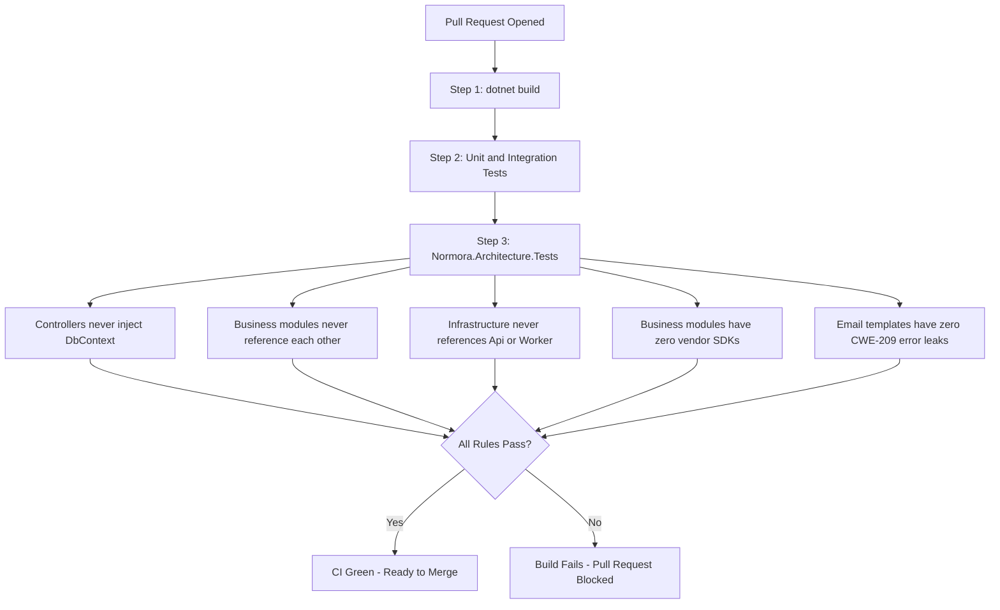
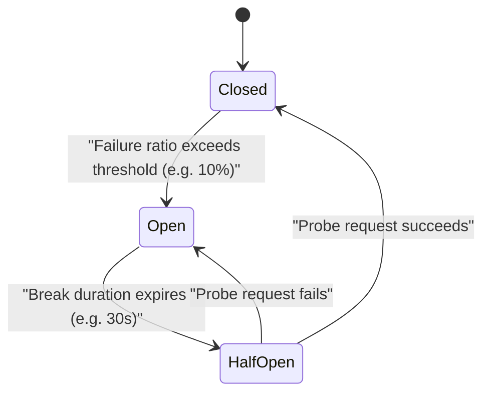
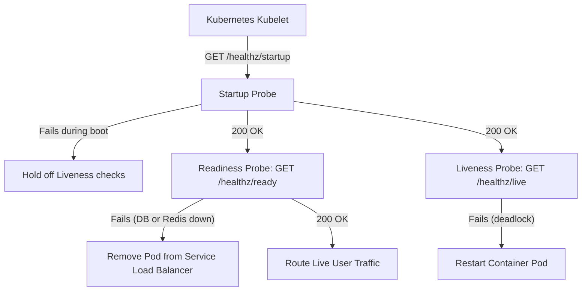
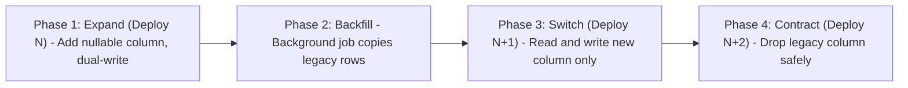

# Module 10: Architectural Fitness Functions, Resiliency & Production Engineering

Architectures degrade over time. As deadlines loom, engineers make expedient compromises: a developer injects `DbContext` directly into a controller to bypass a query handler, a module references an internal entity of another bounded context, or an error handler leaks an internal SQL exception into an email notification.

In enterprise software engineering, senior architects do not rely on code reviews alone to protect the integrity of the system. **They write Architectural Fitness Functions — automated unit tests that fail CI/CD builds whenever architectural rules are violated.**

This module examines how **Normora** programmatically enforces clean architecture rules, handles distributed cache resilience, configures health probes for Kubernetes, and executes zero-downtime database migrations.

---

## 1. What are Architectural Fitness Functions?

First introduced in *Building Evolutionary Architectures* (Neal Ford, Rebecca Parsons, Patrick Kua), an **Architectural Fitness Function** is an objective, automated metric or test used to evaluate and preserve critical architectural characteristics (modularity, layer boundaries, loose coupling, security invariants) as a codebase evolves.

* **What it is:** An executable unit test (or CI check) that inspects compiled assemblies, types, dependencies, or rendered templates to verify structural rules—rather than business logic.
* **Why you need it:** Code reviews are human and inconsistent under deadline pressure. A single rushed pull request that injects a `DbContext` into a controller or imports a vendor SDK into a domain module creates coupling that is expensive to untangle months later.
* **How it works in .NET:** Architects write fitness functions using **.NET Reflection** (`Assembly.GetReferencedAssemblies()`, `GetTypes()`, `GetConstructors()`) or fluent architecture-testing libraries like **NetArchTest.Rules** and **ArchUnit.NET**.



### When NOT to Use Architectural Tests

* **Volatile internal implementation details:** Do not assert private method names, internal helper signatures, or exact line counts inside a single class—those slow down refactoring without protecting any meaningful boundary.
* **Compiler-enforced boundaries already covered by `.csproj` references:** If `Normora.Modules.Documents.csproj` is a separate project that literally does not reference `Normora.Modules.Tenants.csproj`, MSBuild already prevents compile-time coupling. Use fitness functions to guard rules MSBuild *cannot* enforce (such as banning accidental `ProjectReference` additions, constructor injection choices, naming conventions, or template output hygiene).
* **Replacing behavioral integration tests:** An architecture test verifies *structure* (e.g., controllers use MediatR), not *runtime behavior* (e.g., BOLA returns HTTP `404` or `TenantId` filtering isolates data).

### Five Real-World Architectural Invariants in Normora

1. **Decentralized Controller Purity:** Controllers in `Tenants`, `Documents`, and `Conversations` must only dispatch MediatR contracts or thin abstractions—never inject `TenantsDbContext`, `DocumentsDbContext`, or `ConversationsDbContext`.
2. **Strict Bounded-Context Isolation:** A **bounded context** (an explicit domain boundary with its own data model and ubiquitous language) must remain self-contained. `Documents` and `Conversations` communicate only via `Normora.Shared.Contracts.*` (`PerformHybridRetrievalQuery`, `GetMcpToolsQuery`), never by referencing each other's assemblies.
3. **Zero Third-Party Vendor SDKs in Business Modules:** Packages like `Minio` or Google AI client SDKs are confined to `Normora.Infrastructure/Providers/`. Business modules depend only on provider-neutral interfaces (`IDocumentStorageService`, `ITextEmbeddingService`).
4. **Parameterless EF Core Configurations & `TenantId` Contracts:** Every `IEntityTypeConfiguration<T>` class must expose a parameterless public constructor so `ApplyConfigurationsFromAssembly` never crashes at startup, and cross-module contracts in `Normora.Shared.Contracts.*` must carry `Guid TenantId` explicitly for background-worker safety.
5. **Host Isolation & CWE-209 Hygiene:** `Normora.Infrastructure` must never reference executable hosts (`Normora.Api` or `Normora.Worker`), and user-facing email templates (`DocumentEmailTemplates`) must never leak raw exception messages or HTTP status codes.

---

## 2. Real-World Architecture Tests from Normora

Let's examine the exact, battle-tested architecture tests from `Normora.Architecture.Tests`:

### Invariant 1: Controllers Must NEVER Inject `DbContext`
Controllers must be razor-thin dispatchers. Injecting a `DbContext` into a controller bypasses MediatR validation, audit logging, and domain event dispatching.

```csharp
// From Normora.Architecture.Tests/ModularMonolithArchitectureTests.cs
[Fact]
public void Controllers_MustNeverInject_DbContexts()
{
    var assemblies = new[] { ConversationsAssembly, DocumentsAssembly, TenantsAssembly };

    var controllerTypes = assemblies
        .SelectMany(a => a.GetTypes())
        .Where(t => t.IsClass && !t.IsAbstract && typeof(ControllerBase).IsAssignableFrom(t))
        .ToList();

    Assert.NotEmpty(controllerTypes);

    foreach (var controller in controllerTypes)
    {
        var constructors = controller.GetConstructors();
        foreach (var ctor in constructors)
        {
            foreach (var param in ctor.GetParameters())
            {
                Assert.False(
                    typeof(DbContext).IsAssignableFrom(param.ParameterType),
                    $"Violation: Controller '{controller.FullName}' must not inject DbContext '{param.ParameterType.Name}'. " +
                    $"Controllers must dispatch MediatR contracts or service abstractions.");
            }
        }
    }
}
```

---

### Invariant 2: Strict Module Boundary Isolation
Modules in a Modular Monolith must never have direct assembly references to one another. Communication must flow strictly through `Normora.Shared.Contracts` or in-memory domain events.

```csharp
// From Normora.Architecture.Tests/ModularMonolithArchitectureTests.cs
[Fact]
public void BusinessModules_MustNotReferenceEachOther()
{
    var moduleAssemblies = new[] { TenantsAssembly, DocumentsAssembly, ConversationsAssembly };

    foreach (var module in moduleAssemblies)
    {
        var otherModuleNames = moduleAssemblies
            .Where(m => m != module)
            .Select(m => m.GetName().Name!)
            .ToList();

        var referencedAssemblies = module.GetReferencedAssemblies()
            .Select(r => r.Name)
            .ToList();

        foreach (var other in otherModuleNames)
        {
            Assert.DoesNotContain(
                other, 
                referencedAssemblies, 
                $"Architectural Violation: Module '{module.GetName().Name}' references '{other}'. " +
                $"Modules must be completely decoupled.");
        }
    }
}
```

---

### Invariant 3: Decoupling Hosts from Infrastructure
The `Worker` host and the `Api` host are executable processes. The `Infrastructure` project must never reference executable hosts:

```csharp
// From Normora.Architecture.Tests/ModularMonolithArchitectureTests.cs
[Fact]
public void Infrastructure_MustNotReferenceExecutableHosts()
{
    var hostReferences = InfrastructureAssembly.GetReferencedAssemblies()
        .Where(reference =>
            string.Equals(reference.Name, "Normora.Api", StringComparison.Ordinal) ||
            string.Equals(reference.Name, "Normora.Worker", StringComparison.Ordinal))
        .Select(reference => reference.Name)
        .ToList();

    Assert.Empty(hostReferences);
}
```

---

### Invariant 4: Security Invariant — Zero Error Detail Leakage in Emails
To prevent **CWE-209 (Information Exposure Through Error Messages)**, the architecture test inspects rendered email notification templates to guarantee that raw HTTP status codes, monospace stack trace blocks, or unescaped HTML tags never appear:

```csharp
// From Normora.Architecture.Tests/ModularMonolithArchitectureTests.cs
[Fact]
public void DocumentProcessingFailedEmail_MustNotExpose_TechnicalErrorDetails_Or_RawStatusCodes()
{
    const string tenantName = "Acme Corp <script>";
    const string fileName = "policy_handbook.pdf";

    var emailHtml = DocumentEmailTemplates.DocumentProcessingFailedEmail(tenantName, fileName);

    // Security check: Raw error detail container must never exist in notification emails
    Assert.DoesNotContain("Error Details", emailHtml, StringComparison.OrdinalIgnoreCase);
    Assert.DoesNotContain("font-family: monospace", emailHtml, StringComparison.OrdinalIgnoreCase);
    Assert.DoesNotContain("429 (Too Many Requests)", emailHtml, StringComparison.OrdinalIgnoreCase);
    Assert.DoesNotContain("500 (Internal Server Error)", emailHtml, StringComparison.OrdinalIgnoreCase);

    // Security check: Dynamic inputs must be properly HTML escaped to mitigate XSS
    Assert.DoesNotContain("<script>", emailHtml, StringComparison.OrdinalIgnoreCase);
    Assert.Contains("&lt;script&gt;", emailHtml, StringComparison.OrdinalIgnoreCase);
}
```

---

### Invariant 5: Zero Third-Party Vendor SDKs in Business Modules
Normora applies the **Provider Pattern** (also called **Ports and Adapters**): business modules declare provider-neutral interfaces (`IDocumentStorageService`, `ITextGenerationService`, `ITextEmbeddingService`, `IBrandingStorageService`), while vendor packages like `Minio` or Google AI SDKs live exclusively in `Normora.Infrastructure/Providers/`.

```csharp
// From Normora.Architecture.Tests/ModularMonolithArchitectureTests.cs
[Fact]
public void BusinessModules_MustNotReference_VendorSdks()
{
    var moduleAssemblies = new[] { TenantsAssembly, DocumentsAssembly, ConversationsAssembly };
    var forbiddenVendorPrefixes = new[] { "Minio", "Google.GenAI", "Google.Cloud", "AWSSDK", "Azure." };

    foreach (var module in moduleAssemblies)
    {
        var referencedNames = module.GetReferencedAssemblies()
            .Select(r => r.Name!)
            .ToList();

        foreach (var prefix in forbiddenVendorPrefixes)
        {
            Assert.DoesNotContain(
                referencedNames,
                name => name.StartsWith(prefix, StringComparison.OrdinalIgnoreCase));
        }
    }
}
```

---

### Invariant 6: Parameterless `IEntityTypeConfiguration<T>` & Explicit `TenantId` Contracts
In Normora, each module `DbContext` registers entity mappings via `modelBuilder.ApplyConfigurationsFromAssembly(...)`. If a developer injects a scoped service (such as `ITenantContext`) into an `IEntityTypeConfiguration<T>` constructor, `ApplyConfigurationsFromAssembly` throws at runtime because EF Core requires a public parameterless constructor. Similarly, cross-module MediatR contracts in `Normora.Shared.Contracts.*` must carry `Guid TenantId` explicitly so `Normora.Worker` background jobs never depend on ambient HTTP context.

```csharp
[Fact]
public void EntityConfigurations_MustHave_PublicParameterlessConstructor()
{
    var moduleAssemblies = new[] { TenantsAssembly, DocumentsAssembly, ConversationsAssembly };

    var configTypes = moduleAssemblies
        .SelectMany(a => a.GetTypes())
        .Where(t => t is { IsClass: true, IsAbstract: false } &&
                    t.GetInterfaces().Any(i =>
                        i.IsGenericType &&
                        i.GetGenericTypeDefinition() == typeof(IEntityTypeConfiguration<>)))
        .ToList();

    Assert.NotEmpty(configTypes);

    foreach (var configType in configTypes)
    {
        var hasParameterlessCtor = configType.GetConstructor(Type.EmptyTypes) is not null;
        Assert.True(
            hasParameterlessCtor,
            $"Violation: '{configType.FullName}' must expose a public parameterless constructor for ApplyConfigurationsFromAssembly.");
    }
}
```

### Pure Reflection vs. `NetArchTest.Rules`
Normora uses plain xUnit + .NET Reflection in `Normora.Architecture.Tests` for zero external test-library dependencies and fine-grained checks (like inspecting HTML templates or constructor parameter types). For larger teams wanting fluent, self-documenting rules, **NetArchTest.Rules** offers a concise DSL:

```csharp
// Equivalent fluent check using NetArchTest.Rules
var result = Types.InAssemblies([TenantsAssembly, DocumentsAssembly, ConversationsAssembly])
    .That().ResideInNamespaceContaining("Application")
    .ShouldNot().HaveDependencyOnAny("Minio", "Normora.Infrastructure")
    .GetResult();

Assert.True(result.IsSuccessful, $"Failed types: {string.Join(", ", result.FailingTypeNames ?? [])}");
```

* **When to use pure Reflection:** Constructor parameter inspection, custom attribute validation, assembly reference checks, and output/template security assertions (CWE-209).
* **When to use `NetArchTest.Rules` / `ArchUnitNET`:** Broad namespace-dependency graphs (e.g., *"Domain must never depend on Infrastructure or API"* across hundreds of classes).

---

## 3. HTTP & External Dependency Resilience (Polly v8 & `Microsoft.Extensions.Resilience`)

Modern cloud applications depend on external APIs, object stores, and identity providers that inevitably experience **transient faults**—temporary, self-healing failures such as network blips, HTTP `429 Too Many Requests` rate limits, or `503 Service Unavailable` responses during upstream deployments.

In .NET 10, the official resilience stack is **`Microsoft.Extensions.Resilience`** and **`Microsoft.Extensions.Http.Resilience`**, built directly on top of **Polly v8**.

### Core Resilience Primitives (Explained from First Principles)

* **Attempt Timeout vs. Total Request Timeout:** An *attempt timeout* caps how long a single HTTP call may wait (e.g., 10 seconds), while a *total timeout* caps the entire operation across all retries (e.g., 30 seconds).
* **Retry with Exponential Backoff & Jitter:** Retrying immediately hammers an already overloaded service. *Exponential backoff* doubles the wait between attempts (e.g., 1s, 2s, 4s), and **jitter** adds small random delays so thousands of pods do not retry in lockstep (preventing a **thundering herd**).
* **Circuit Breaker:** A state machine that monitors recent failure rates. When failures cross a threshold, the circuit trips **Open** and fails fast locally without calling the struggling downstream service—giving it breathing room to recover before testing a probe request in **Half-Open** state.
* **Concurrency Limiter (Bulkhead):** Caps how many simultaneous in-flight calls may hit a dependency (e.g., max 20 concurrent Gemini OCR calls), preventing one slow dependency from exhausting all thread pool threads.
* **Hedging:** Fires a duplicate backup request if the primary request is unusually slow, returning whichever finishes first.
* **Idempotency:** An operation is *idempotent* if executing it multiple times produces the exact same result as executing it once (e.g., `GET` document metadata or `PUT` overwriting a known object key, unlike an unkeyed `POST` payment charge).



### Strategy Execution Order in `AddStandardResilienceHandler()`

When you call `.AddStandardResilienceHandler()` on an `IHttpClientBuilder`, .NET wires five strategies in a deliberate **outer-to-inner** order:

1. **Rate Limiter (Bulkhead)** — reject excess concurrency before wasting resources.
2. **Total Request Timeout** — hard ceiling for the entire call including retries.
3. **Retry** — re-attempts transient failures with exponential backoff + jitter.
4. **Circuit Breaker** — tracks individual attempt outcomes and short-circuits broken dependencies.
5. **Attempt Timeout** — cancels each individual network try if it stalls.

### When NOT to Use Retries or Hedging

* **Non-idempotent mutations without an idempotency key:** Never blindly retry `POST` payment captures, user invitations, or email sends—you risk double-charging customers or spamming inboxes.
* **Deterministic `4xx` client errors:** Retrying HTTP `400 Bad Request`, `401 Unauthorized`, `403 Forbidden` (`BflaException`), or `404 Not Found` (`BolaException`) only wastes quota and latency.
* **User-facing real-time streams after tokens start flowing:** Once an SSE token stream in `Conversations` has started sending chunks to the browser, you cannot transparently retry the whole HTTP response—emit a structured error event and close cleanly instead.

### Five Real-World Normora Resilience Examples

#### Example 1: Google Gemini AI Client (`AddStandardResilienceHandler`)
`GeminiEmbeddingService`, `GeminiTextGenerationService`, and `GeminiDocumentTextExtractor` invoke Google Gemini APIs over HTTP, where `429` quota bursts and transient `503`s occur during batch ingestion.

```csharp
// In Normora.Infrastructure/Extensions/ProviderServiceExtensions.cs
services.AddHttpClient("GeminiApi", client =>
{
    client.BaseAddress = new Uri(geminiOptions.BaseUrl);
})
.AddStandardResilienceHandler(options =>
{
    options.AttemptTimeout.Timeout = TimeSpan.FromSeconds(15);
    options.TotalRequestTimeout.Timeout = TimeSpan.FromSeconds(45);

    options.Retry.MaxRetryAttempts = 3;
    options.Retry.Delay = TimeSpan.FromSeconds(1);
    options.Retry.BackoffType = DelayBackoffType.Exponential;
    options.Retry.UseJitter = true;

    // Only trip the circuit if sustained failures occur across at least 10 calls
    options.CircuitBreaker.FailureRatio = 0.2;
    options.CircuitBreaker.MinimumThroughput = 10;
    options.CircuitBreaker.BreakDuration = TimeSpan.FromSeconds(30);
});
```

#### Example 2: MinIO Object Storage (`ResiliencePipeline` with Primary Constructor)
Uploading and reading document blobs in `MinioDocumentStorageService` uses deterministic object keys (`{tenantId}/{documentId}/{version}`), making retries idempotent when wrapped in a named Polly v8 `ResiliencePipeline`.

```csharp
// In Normora.Infrastructure/Providers/Storage/MinioDocumentStorageService.cs
public sealed class MinioDocumentStorageService(
    IMinioClient minioClient,
    [FromKeyedServices("minio-storage")] ResiliencePipeline pipeline,
    ILogger<MinioDocumentStorageService> logger) : IDocumentStorageService
{
    public async Task UploadAsync(string objectKey, Stream content, string contentType, CancellationToken ct)
    {
        await pipeline.ExecuteAsync(async token =>
        {
            if (content.CanSeek) content.Position = 0;

            var args = new PutObjectArgs()
                .WithBucket("normora-documents")
                .WithObject(objectKey)
                .WithStreamData(content)
                .WithObjectSize(content.Length)
                .WithContentType(contentType);

            await minioClient.PutObjectAsync(args, token);
        }, ct);

        logger.LogInformation("Uploaded object {ObjectKey} to MinIO", objectKey);
    }
}
```

#### Example 3: PayU Payment Gateway (No Blind Retries on Checkout Mutations)
In `PayUPaymentService`, generating or verifying payment callbacks involves financial state (`udf3 = "{currency}:{cycle}"`). Automatic retries on non-idempotent gateway `POST`s could trigger duplicate payment attempts. Instead, Normora applies a strict **Attempt Timeout only** and relies on signed gateway callbacks plus idempotent database state checks.

#### Example 4: Transactional Outbox for Document Uploads
Network resilience is not enough if a process crashes *after* saving a document to PostgreSQL but *before* enqueueing Hangfire. Normora's `UploadDocumentCommandHandler` solves this with the **Transactional Outbox** pattern:
1. Inserts the document metadata, document version, and `DocumentProcessingOutboxMessage` inside **one PostgreSQL transaction**.
2. Signals `IDocumentProcessingWakeup` asynchronously after commit (so a wakeup failure never rolls back an already-committed upload).
3. `HangfireDocumentProcessingOutboxDispatcher` claims and processes outbox rows, backed by a **minutely recurring Hangfire recovery job** if a worker pod restarts mid-flight.

#### Example 5: Graceful Degradation in `GeminiSuggestionsService`
When Gemini's circuit breaker opens (`BrokenCircuitException`), secondary UX features like follow-up prompt suggestions should degrade gracefully instead of failing the whole chat screen:

```csharp
// In Normora.Infrastructure/Providers/Gemini/GeminiSuggestionsService.cs
public sealed class GeminiSuggestionsService(
    HttpClient httpClient,
    ILogger<GeminiSuggestionsService> logger) : ISuggestionsService
{
    public async Task<IReadOnlyList<string>> GenerateSuggestionsAsync(
        Guid tenantId, string topic, CancellationToken ct)
    {
        try
        {
            // Uses HttpClient configured with AddStandardResilienceHandler
            return await FetchFromGeminiAsync(tenantId, topic, ct);
        }
        catch (BrokenCircuitException ex)
        {
            logger.LogWarning(ex, "Gemini circuit open; returning fallback suggestions for tenant {TenantId}", tenantId);
            return [];
        }
    }
}
```

---

## 4. Distributed Caching & Environment Resiliency

In cloud deployments, external services like Redis might occasionally be unavailable or absent during local development and testing.

A resilient system must support **graceful environment degradation**:

```csharp
// From Normora.Infrastructure/Extensions/DatabaseServiceExtensions.cs
var redisOptions = configuration.GetSection(RedisOptions.SectionName).Get<RedisOptions>() 
    ?? new RedisOptions();

if (string.IsNullOrWhiteSpace(redisOptions.ConnectionString))
{
    redisOptions.ConnectionString = configuration.GetConnectionString(RedisOptions.SectionName)
        ?? configuration[RedisOptions.EnvironmentVariable];
}

if (!string.IsNullOrWhiteSpace(redisOptions.ConnectionString))
{
    // Production / Staging: Distributed Redis Cache
    services.AddStackExchangeRedisCache(options =>
    {
        options.Configuration = redisOptions.ConnectionString;
        options.InstanceName = redisOptions.InstanceName;
    });
}
else
{
    // In Production, running without Redis is fatal: Fail-Fast!
    if (!environment.IsDevelopment())
    {
        throw new InvalidOperationException(ApiMessages.RedisRequired);
    }

    // Local Development & Integration Tests: Graceful fallback to memory cache
    services.AddDistributedMemoryCache();
}

services.AddSingleton<ICacheService, DistributedCacheService>();
```

### Architectural Principles Applied:
1.  **Seamless Local Dev:** Developers can clone and run the application locally without requiring a Docker Redis instance if they only need to test basic features.
2.  **Fail-Fast Production Invariant:** If the production environment lacks a Redis connection string, the container crashes immediately on boot with `ApiMessages.RedisRequired`. It never silently degrades to an in-memory cache that would break distributed session sharing across multiple pods.

### Cache Stampede Protection & `.NET 10 HybridCache`
A **cache stampede** (or *thundering herd*) happens when a hot cache key expires and 500 concurrent requests miss the cache simultaneously, slamming PostgreSQL with 500 identical queries.

In .NET 9/10, `HybridCache` (`Microsoft.Extensions.Caching.Hybrid`) solves this natively by combining an ultra-fast in-process L1 cache with a shared distributed L2 cache (Redis) and **request coalescing**—only *one* caller computes the missing value while the remaining 499 callers await that single computation.

### When NOT to Use Caching or In-Memory Fallbacks
* **Multi-replica production environments:** Never fall back to `IMemoryCache` / `AddDistributedMemoryCache()` in production for shared state (SignalR backplane, tenant revocation, rate-limit counters); Pod A and Pod B will hold conflicting realities.
* **Security-critical authorization tokens or HITL approvals:** Never rely solely on long-lived caches for destructive approvals (`PendingApproval`) or revoked permissions without short TTLs or explicit invalidation.

### Five Real-World Normora Caching & State Resiliency Examples

1. **Fail-Fast Redis Boot Guard (`DatabaseServiceExtensions`):** As shown above, staging/production boots crash immediately with `ApiMessages.RedisRequired` if Redis is unconfigured, preventing split-brain state across replicas.
2. **`TenantResolutionMiddleware` Short-TTL Caching (30s–5m):** Resolving a tenant slug and checking RBAC membership on every HTTP request via PostgreSQL would bottleneck throughput. Normora caches tenant resolution and role checks in Redis with short sliding expirations (30s–5m) so revocations propagate rapidly while protecting PostgreSQL.
3. **White-Label Branding Cache (`HybridCache` / `ICacheService`):** Tenant logos and theme metadata in `Tenants` are read on every SPA load but rarely change. Using `HybridCache` (with primary-constructor DI) prevents stampedes when a tenant's branding key expires:
   ```csharp
   public sealed class TenantBrandingQueryService(
       HybridCache cache,
       ITenantBrandingRepository repository)
   {
       public ValueTask<TenantBrandingDto?> GetBrandingAsync(Guid tenantId, CancellationToken ct) =>
           cache.GetOrCreateAsync(
               $"tenant-branding:{tenantId}",
               async token => await repository.GetByTenantIdAsync(tenantId, token),
               new HybridCacheEntryOptions { Expiration = TimeSpan.FromMinutes(5) },
               cancellationToken: ct);
   }
   ```
4. **Multi-Host SignalR Redis Backplane (`AddNormoraSignalR`):** `Normora.Worker` runs in a separate process from `Normora.Api`. When `DocumentProcessingJob` finishes ingesting a PDF, `IDocumentNotificationService` publishes the status event into Redis pub/sub so `Normora.Api` fans it out to connected Angular WebSockets, keeping `IWorkspaceStateSynchronizer` (`dataVersion`) coherent across pods.
5. **Durable PostgreSQL State for HITL Approvals (`PendingApproval`):** When an AI agent attempts `documents_delete`, Normora persists `PendingApproval` in PostgreSQL with a 15-minute TTL rather than keeping it in volatile pod memory—ensuring user approval still succeeds via `ApprovalsController` even if a pod restarts or load-balances to a different replica.

---

## 5. Cloud Health Checks: Liveness, Readiness & Startup Probes

In container orchestrators like Kubernetes, container health is monitored using **Health Probes**—periodic HTTP or command checks that tell the orchestrator whether a container is still booting, ready for traffic, or wedged in a deadlock. ASP.NET Core provides a native health check subsystem (`Microsoft.Extensions.Diagnostics.HealthChecks`):

```csharp
// In Composition Root (Normora.Api):
builder.Services.AddHealthChecks()
    .AddNpgSql(connectionString, name: "postgresql", tags: ["ready"])
    .AddRedis(redisConnectionString, name: "redis", tags: ["ready"])
    .AddCheck<MinioStorageHealthCheck>("minio", tags: ["ready"]);

// In Request Pipeline (partitioned by probe type):
app.MapHealthChecks("/healthz/live", new HealthCheckOptions
{
    Predicate = _ => false // Process alive check only; zero external dependencies!
}).AllowAnonymous();

app.MapHealthChecks("/healthz/ready", new HealthCheckOptions
{
    Predicate = check => check.Tags.Contains("ready")
}).AllowAnonymous();

app.MapHealthChecks("/healthz/startup", new HealthCheckOptions
{
    Predicate = _ => false
}).AllowAnonymous();
```



### The Architect's Distinction: Liveness vs. Readiness vs. Startup
*   **Liveness Probe (`/healthz/live`):** "Is the process alive or deadlocked?"
    *   If this returns 500 or times out, Kubernetes immediately kills the container and creates a replacement pod.
    *   *Rule:* Never check external dependencies (database, Redis) in a liveness probe! If PostgreSQL has a 5-second network hiccup, all 20 API pods would fail their liveness probe simultaneously, causing Kubernetes to restart every pod at once — turning a minor network blip into a catastrophic cluster-wide outage!
*   **Readiness Probe (`/healthz/ready`):** "Is this pod ready to accept user traffic?"
    *   Checks whether PostgreSQL, Redis, and object storage are accessible.
    *   If this fails, Kubernetes leaves the container alive, but stops routing user requests to it until it recovers.
*   **Startup Probe (`/healthz/startup`):** "Has the application finished cold-booting?"
    *   Protects slow-starting pods (such as EF Core model compilation or DI validation) so Kubernetes does not prematurely kill them with a liveness failure during startup.

### When NOT to Check External Dependencies in Health Probes
* **Never check third-party SaaS APIs (Google Gemini, PayU, Resend) in `/healthz/ready`:** If Google Gemini has a regional blip, Normora users still need access to existing documents, workspace administration, and login! Checking Gemini inside `/healthz/ready` would take down your entire API cluster whenever an upstream AI vendor sneezes.
* **Never expose detailed exception messages or connection strings on public `/healthz` endpoints:** Unauthenticated probes should return minimal `Healthy`/`Unhealthy` status codes, preventing CWE-209 topology disclosure.

### Five Real-World Normora Health Check Examples

1. **API Liveness Probe (`/healthz/live`):** Configured with `Predicate = _ => false` so `Normora.Api` reports `200 Healthy` as long as Kestrel can dispatch requests—protecting pods from mass restarts during brief PostgreSQL failovers.
2. **API Readiness Probe (`/healthz/ready`):** Tagged `"ready"` to verify PostgreSQL (`tenants`, `documents`, `conversations` schemas), Redis (sessions & SignalR backplane), and MinIO before Kubernetes sends Angular SPA traffic to the pod.
3. **Startup Probe (`/healthz/startup`):** Gives `Normora.Api` time to run `ValidateOnStart()` options checks (like `GeminiOptions` and `MinioOptions`) and warm up EF Core compiled models before readiness/liveness begin polling.
4. **Custom Dependency Check (`MinioStorageHealthCheck`) with Primary Constructor:**
   ```csharp
   public sealed class MinioStorageHealthCheck(IMinioClient minioClient) : IHealthCheck
   {
       public async Task<HealthCheckResult> CheckHealthAsync(
           HealthCheckContext context, CancellationToken cancellationToken = default)
       {
           using var timeoutCts = CancellationTokenSource.CreateLinkedTokenSource(cancellationToken);
           timeoutCts.CancelAfter(TimeSpan.FromSeconds(2));

           var exists = await minioClient.BucketExistsAsync(
               new BucketExistsArgs().WithBucket("normora-documents"),
               timeoutCts.Token);

           return exists
               ? HealthCheckResult.Healthy()
               : HealthCheckResult.Unhealthy(ApiMessages.StorageUnavailable);
       }
   }
   ```
5. **`Normora.Worker` Process Health & Hangfire Heartbeat:** Because `Normora.Worker` is a non-HTTP generic host, container platforms check its health via an `IHostedService` heartbeat file or Hangfire's internal server heartbeat table in PostgreSQL rather than exposing a public Kestrel port.

---

## 6. Zero-Downtime Database Migration Deployments

How do software architects upgrade database schemas in production without taking the application offline or corrupting rolling deployments?

### The Two Golden Rules

1. **Decouple Migration from Web Pod Boot (Ephemeral Migration Host):** Run migrations once via a dedicated CLI command (`dotnet Normora.Api.dll --migrate`) in an ephemeral Kubernetes `Job` or CI/CD pre-deploy step *before* updating web pods. Never call `context.Database.MigrateAsync()` inside normal `Program.cs` web startup—multiple replicas booting concurrently race for DDL locks, and long migrations can trigger Kubernetes startup probe timeouts.
2. **The Expand / Contract Pattern (Parallel Change):** Never rename, alter type, or drop a column in the same deployment where old pods are still running. Rolling deployments temporarily run **Version N** and **Version N+1** pods side-by-side against the *same* database schema.



### Ephemeral Migration Host Isolation (`--migrate`) in Normora
When Normora runs `dotnet Normora.Api.dll --migrate`, `MigrationHostExtensions.RunMigrationsAsync` boots a **lean console host**—intentionally skipping Kestrel, OpenTelemetry diagnostic listeners, SignalR hubs, and Hangfire background services. This guarantees clean zero-exit container teardown (avoiding native `SIGSEGV` exit code `139` during abrupt host shutdown). Inside, `DatabaseMigrationRunner` executes four `IDatabaseMigrator` implementations sequentially:
1. `TenantsDatabaseMigrator`
2. `DocumentsDatabaseMigrator`
3. `ConversationsDatabaseMigrator`
4. `SessionDatabaseMigrator`

### When NOT to Use Expand / Contract
* **Brand-new additive tables or optional nullable columns with defaults:** Adding a brand-new table (like `DocumentProcessingOutboxMessage`) or a nullable column that old code simply ignores does not require four deployment phases—only *breaking* changes (renames, drops, `NOT NULL` tightening, type changes) require Expand / Contract.
* **Single-instance maintenance windows in non-production environments:** In local dev or ephemeral integration tests, tearing down and recreating a clean schema is faster and simpler.

### Five Real-World Normora Migration & Schema Evolution Examples

1. **Ephemeral `--migrate` Host (`MigrationHostExtensions`):** Running `dotnet Normora.Api.dll --migrate` in Docker/Kubernetes init steps executes all four bounded-context migrators (`Tenants`, `Documents`, `Conversations`, `Session`) sequentially with zero Kestrel/Hangfire side effects.
2. **Expand / Contract Billing Column (`stripe_id` to `payment_reference`):** When decoupling `Tenants` billing from a vendor-specific name to a provider-neutral column for `PayUPaymentService`:
   * *Deploy N (Expand):* Add nullable `payment_reference`; dual-write both columns.
   * *Backfill:* Copy existing `stripe_id` values in batches.
   * *Deploy N+1 (Switch):* Read/write `payment_reference` exclusively.
   * *Deploy N+2 (Contract):* Drop `stripe_id`.
3. **Safe Non-Null Column Rollout (`TenantPlan.Currency`):** When adding multi-currency support (`INR`, `USD`, `EUR`, etc.) to `TenantPlan`, add `currency` as nullable (or with a PostgreSQL default `'USD'`), backfill existing plans using `TenantPlanPricingCatalog`, deploy application code that always populates `Currency` via `UpdateTenantCurrencyCommand`, and only then enforce `NOT NULL`.
4. **Non-Blocking `pgvector` HNSW Index Creation (`Documents`):** Creating a large HNSW vector index on `documents` chunk embeddings locks writes in PostgreSQL unless `CONCURRENTLY` is used. In EF Core migrations, pass `suppressTransaction: true` because `CREATE INDEX CONCURRENTLY` cannot run inside a transaction block:
   ```csharp
   migrationBuilder.Sql(
       "CREATE INDEX CONCURRENTLY IF NOT EXISTS ix_document_chunks_embedding_hnsw ON documents.document_chunks USING hnsw (embedding vector_cosine_ops);",
       suppressTransaction: true);
   ```
5. **Backward-Compatible Outbox Schema Updates (`Documents`):** Adding diagnostic columns to `DocumentProcessingOutboxMessage` (e.g., `attempt_count` with default `0`) allows older `Normora.Worker` pods to keep draining existing jobs while new `Normora.Api` pods start writing the expanded schema.

---

## 7. Production Resilience: Load Shedding, Graceful Shutdown & Observability

Resilient production systems do not just survive dependency failures—they also protect themselves from **traffic spikes**, **abrupt container termination**, and **blind debugging**.

* **Load Shedding & Rate Limiting (`AddRateLimiter`):** *Load shedding* deliberately rejects excess requests (HTTP `429 Too Many Requests`) before CPU, database connections, or external AI quotas saturate. Partitioning limits by `TenantId` prevents one noisy tenant from starving every other organization in a multi-tenant SaaS.
* **Graceful Shutdown (`SIGTERM` & `CancellationToken`):** When Kubernetes scales down or deploys a new version, it sends `SIGTERM` to the container and waits for a grace period (e.g., 30 seconds). ASP.NET Core stops accepting new connections, signals `CancellationToken` on active HTTP/SSE streams, and lets `IHostedService` implementations (`StopAsync`) drain in-flight work cleanly.
* **Distributed Tracing (`OpenTelemetry`):** Traces follow a single user action across processes using a W3C **`traceparent`** header or propagated trace ID—linking an HTTP request in `Normora.Api`, its PostgreSQL outbox insert, and its asynchronous execution inside `Normora.Worker`.

### When NOT to Apply Aggressive Rate Limits or Long Shutdown Grace Periods
* **Internal health probes and BFF auth callbacks:** Never attach strict rate limiters to `/healthz/*` or OIDC/PayU signed callback endpoints—throttling Kubernetes probes triggers false-positive pod restarts!
* **Infinite shutdown waits:** Do not set `ShutdownTimeout` longer than your orchestrator's `terminationGracePeriodSeconds`, or Kubernetes will send `SIGKILL` (`kill -9`) mid-drain anyway.

### Five Real-World Normora Production Engineering Examples

1. **Tenant-Partitioned Rate Limiter on `/api/copilotkit`:** Protects Normora's Google Gemini token budget from a single tenant flooding conversational RAG queries:
   ```csharp
   builder.Services.AddRateLimiter(options =>
   {
       options.RejectionStatusCode = StatusCodes.Status429TooManyRequests;
       options.AddPolicy("tenant-ai-limit", httpContext =>
       {
           var tenantId = httpContext.User.FindFirst("tenant_id")?.Value ?? "anonymous";
           return RateLimitPartition.GetSlidingWindowLimiter(
               partitionKey: tenantId,
               _ => new SlidingWindowRateLimiterOptions
               {
                   PermitLimit = 30,
                   Window = TimeSpan.FromMinutes(1),
                   SegmentsPerWindow = 6
               });
       });
   });
   ```
2. **SSE Token Stream `CancellationToken` Propagation (`Conversations`):** When a user closes the Angular browser tab mid-answer, ASP.NET Core cancels `HttpContext.RequestAborted`. Passing that `CancellationToken` into `NormoraWorkplaceAgent` and `ITextGenerationService` immediately aborts the upstream Gemini stream so wasted tokens are not billed.
3. **Hangfire `Normora.Worker` Graceful Drain:** On `SIGTERM`, `Normora.Worker` stops dequeuing new `DocumentProcessingJob` items while allowing active chunking/embedding batches to finish or checkpoint back into PostgreSQL safely before process exit.
4. **Cross-Process OpenTelemetry Trace Propagation (`Outbox` -> `Worker`):** `UploadDocumentCommandHandler` stores the current `Activity.Current?.Id` (`traceparent`) on `DocumentProcessingOutboxMessage`. When `HangfireDocumentProcessingOutboxDispatcher` picks it up in `Normora.Worker`, it links a child `Activity`, giving architects one unified Jaeger/OTel waterfall from file upload to pgvector indexing.
5. **Structured Error Telemetry Without CWE-209 Leaks:** When `GeminiDocumentTextExtractor` fails after retries, `DocumentProcessingJob` records the full exception and HTTP status code on the OpenTelemetry `Activity` and structured logs, while persisting/emailing only sanitized `ApiMessages` constants (`DocumentEmailTemplates.DocumentProcessingFailedEmail`).

---

## 8. Common Mistakes & Anti-Patterns

> [!CAUTION]
> **Anti-Pattern 1: Running `Database.MigrateAsync()` in Web API Startup**
>
> **Wrong Code:**
> ```csharp
> var app = builder.Build();
> using (var scope = app.Services.CreateScope())
> {
>     var db = scope.ServiceProvider.GetRequiredService<DocumentsDbContext>();
>     await db.Database.MigrateAsync(); // Runs on EVERY web pod boot!
> }
> app.Run();
> ```
> **Why It's Wrong:** When 6 `Normora.Api` pods boot simultaneously during autoscaling, they race to apply DDL migrations, causing lock contention, partial failures, and Kubernetes startup probe timeouts that kill healthy pods.
>
> **The Fix:** Run migrations once via an ephemeral CLI step before deploying web pods:
> ```bash
> dotnet Normora.Api.dll --migrate
> ```
> Inside `MigrationHostExtensions.RunMigrationsAsync`, boot only the migration host (`DatabaseMigrationRunner`) without Kestrel, SignalR, or Hangfire.

> [!CAUTION]
> **Anti-Pattern 2: Checking PostgreSQL and Redis Inside the Liveness Probe**
>
> **Wrong Code:**
> ```csharp
> builder.Services.AddHealthChecks()
>     .AddNpgSql(connectionString)
>     .AddRedis(redisConnectionString);
>
> app.MapHealthChecks("/healthz"); // Used for BOTH liveness and readiness!
> ```
> **Why It's Wrong:** A 5-second PostgreSQL failover causes every pod to fail `/healthz`. Kubernetes restarts all pods simultaneously, turning a momentary database blip into a full-cluster cold-boot outage.
>
> **The Fix:** Tag dependency checks as `"ready"` and keep `/healthz/live` dependency-free:
> ```csharp
> app.MapHealthChecks("/healthz/live", new HealthCheckOptions { Predicate = _ => false });
> app.MapHealthChecks("/healthz/ready", new HealthCheckOptions { Predicate = c => c.Tags.Contains("ready") });
> ```

> [!CAUTION]
> **Anti-Pattern 3: Blindly Retrying Non-Idempotent Mutations**
>
> **Wrong Code:**
> ```csharp
> builder.Services.AddHttpClient("PayUGateway")
>     .AddStandardResilienceHandler(); // Default retries POST requests on 5xx/timeouts!
> ```
> **Why It's Wrong:** If a payment capture or workspace invite `POST` timed out *after* the upstream server committed it, an automatic HTTP retry creates duplicate charges or duplicate invitations.
>
> **The Fix:** Disable retries on non-idempotent `POST` mutations (or restrict retries to `GET`/`PUT` and operations carrying an explicit idempotency key):
> ```csharp
> builder.Services.AddHttpClient("PayUGateway")
>     .AddStandardResilienceHandler(options =>
>     {
>         options.Retry.ShouldHandle = args => ValueTask.FromResult(
>             args.Outcome.Result?.RequestMessage?.Method == HttpMethod.Get);
>     });
> ```

> [!CAUTION]
> **Anti-Pattern 4: Silent In-Memory Cache Fallback in Production**
>
> **Wrong Code:**
> ```csharp
> if (string.IsNullOrWhiteSpace(redisConnectionString))
> {
>     services.AddDistributedMemoryCache(); // Silently falls back in Production too!
> }
> ```
> **Why It's Wrong:** In multi-replica production, each pod gets its own isolated memory cache. Revoked tenant memberships, SignalR messages, and rate-limit state diverge across pods without raising any startup error.
>
> **The Fix:** Fail fast outside Development using `ApiMessages.RedisRequired`:
> ```csharp
> if (!environment.IsDevelopment())
> {
>     throw new InvalidOperationException(ApiMessages.RedisRequired);
> }
> services.AddDistributedMemoryCache();
> ```

> [!CAUTION]
> **Anti-Pattern 5: Leaking Raw Exception Details in Resilient Fallbacks or Emails (CWE-209)**
>
> **Wrong Code:**
> ```csharp
> catch (Exception ex)
> {
>     await emailSender.SendAsync(adminEmail, $"Document failed: {ex.Message}\n{ex.StackTrace}");
> }
> ```
> **Why It's Wrong:** Raw exceptions frequently include SQL table names, internal IP addresses, MinIO bucket keys, or upstream `429`/`500` headers—exposing internal architecture to end users and attackers.
>
> **The Fix:** Log the full exception internally via `ILogger`/OpenTelemetry, and render user-facing notifications exclusively from HTML-encoded templates and `ApiMessages` constants:
> ```csharp
> catch (Exception ex)
> {
>     logger.LogError(ex, "Document processing failed for {DocumentId}", documentId);
>     var html = DocumentEmailTemplates.DocumentProcessingFailedEmail(tenantName, fileName);
>     await emailSender.SendAsync(adminEmail, ApiMessages.DocumentProcessingFailedSubject, html);
> }
> ```

> [!CAUTION]
> **Anti-Pattern 6: Testing Brittle Private Details in Architecture Tests**
>
> **Wrong Code:**
> ```csharp
> // Asserting internal helper naming or exact constructor parameter counts
> Assert.Single(typeof(UploadDocumentCommandHandler).GetConstructors().First().GetParameters());
> ```
> **Why It's Wrong:** Injecting a new logger or `IDocumentProcessingWakeup` into a handler breaks the test even though no architectural boundary was violated, training developers to ignore or delete architecture tests.
>
> **The Fix:** Test *invariant boundaries* (controllers never inject `DbContext`, modules never reference each other, business modules never import vendor SDKs, `IEntityTypeConfiguration<T>` has a parameterless constructor).

---

## 9. Summary Checklist for Software Architects

* [ ] **Automate Architecture Tests:** Enforce that Controllers never inject `DbContext`, module boundaries are strictly isolated, business modules contain zero vendor SDKs, `IEntityTypeConfiguration<T>` stays parameterless, and hosts are decoupled.
* [ ] **Sanitize Technical Information (CWE-209):** Verify that notification templates and client-facing error payloads use `ApiMessages` constants and never expose raw technical details or stack traces.
* [ ] **Harden External I/O with Polly v8:** Apply `AddStandardResilienceHandler()` (timeouts, exponential backoff + jitter, circuit breakers) to idempotent HTTP clients like Gemini and MinIO—while disabling blind retries on non-idempotent mutations like PayU checkout.
* [ ] **Protect State with Transactional Outbox & Fail-Fast Caching:** Pair atomic outbox writes with Hangfire recovery, use `HybridCache` against stampedes, allow in-memory cache fallbacks only in Development, and fail fast with `ApiMessages.RedisRequired` in Production.
* [ ] **Partition Health Checks:** Separate Liveness (`/healthz/live`, zero external checks), Readiness (`/healthz/ready`, PostgreSQL/Redis/MinIO), and Startup (`/healthz/startup`) probes to avoid cascading container restarts.
* [ ] **Zero-Downtime Schema Evolutions:** Use ephemeral migration runners (`dotnet Normora.Api.dll --migrate`), non-blocking `CONCURRENTLY` indexes, and the Expand / Contract pattern for breaking changes.
* [ ] **Production Guardrails:** Partition rate limits by `TenantId`, propagate `CancellationToken` on SSE/background jobs for graceful `SIGTERM` drains, and link cross-process OpenTelemetry traces.

---

## 10. Interview Questions

1. **[Junior] Why should you never check PostgreSQL or Redis inside a Kubernetes Liveness probe (`/healthz/live`)?**
   * **Answer:** A failed liveness probe causes Kubernetes to kill and restart the container. If PostgreSQL experiences a brief 5-second failover, checking it in the liveness probe forces Kubernetes to restart *all* API pods simultaneously, escalating a minor network hiccup into a full cluster outage. External dependencies belong in the **Readiness** probe (`/healthz/ready`), which simply removes the pod from load-balancer rotation until the dependency recovers.

2. **[Junior] What is the difference between `AttemptTimeout` and `TotalRequestTimeout` in `Microsoft.Extensions.Http.Resilience`?**
   * **Answer:** `AttemptTimeout` caps how long a *single* HTTP try may take before being canceled (e.g., 15s), whereas `TotalRequestTimeout` is the outer wall-clock ceiling across *all* attempts including retries and backoff delays (e.g., 45s).

3. **[Junior] Why does Normora fall back to `AddDistributedMemoryCache()` in Development when Redis is unconfigured, but throw `ApiMessages.RedisRequired` in Production?**
   * **Answer:** Local developers can run and test single-instance features without spinning up Redis, whereas a multi-replica Production deployment using in-memory caching suffers split-brain state (inconsistent tenant revocations, broken SignalR backplane). Failing fast on boot prevents silent security and data consistency bugs.

4. **[Senior] Explain why `AddStandardResilienceHandler()` places the Circuit Breaker *inside* the Retry strategy (between Retry and Attempt Timeout).**
   * **Answer:** Because the Retry strategy wraps the Circuit Breaker, each individual failed attempt updates the breaker's failure-ratio metrics. If the circuit trips **Open** mid-retry, subsequent retry iterations immediately receive `BrokenCircuitException` without hitting the struggling upstream server, allowing the caller to fail fast or trigger a graceful fallback.

5. **[Senior] When is it dangerous to use automatic retries or hedging on an `HttpClient`?**
   * **Answer:** On **non-idempotent mutations** (such as `POST` payment charges in `PayUPaymentService` or sending transactional emails without an idempotency key), where a server-side commit followed by a dropped response causes duplicate charges or messages. It is also wasteful on deterministic `4xx` responses (`400`, `401`, `403`, `404`) and impossible mid-stream once an SSE response has already flushed chunks to the client.

6. **[Senior] How does `.NET 10 HybridCache` prevent a cache stampede compared to plain `IDistributedCache`?**
   * **Answer:** With plain `IDistributedCache`, 500 concurrent requests hitting an expired key all observe a cache miss and query PostgreSQL simultaneously. `HybridCache` performs **request coalescing** (stampede protection): it executes the factory delegate once for a given key and shares that single awaited result across all 500 concurrent callers, while also layering fast L1 in-memory reads over L2 Redis.

7. **[Architect] How do Architectural Fitness Functions differ from `.csproj` project references, and what Normora invariants require Reflection tests?**
   * **Answer:** `.csproj` references enforce coarse assembly-level dependencies at compile time, whereas Architectural Fitness Functions enforce fine-grained design, convention, and security invariants in CI. In Normora, Reflection tests verify rules MSBuild cannot express: controllers never injecting `DbContext`, business modules never referencing vendor SDKs (`Minio`, Google AI), `IEntityTypeConfiguration<T>` classes exposing public parameterless constructors, and email templates (`DocumentEmailTemplates`) never leaking raw status codes or unescaped HTML (CWE-209).

8. **[Architect] Walk through how you would rename a `NOT NULL` database column (`stripe_id` -> `payment_reference`) in a multi-replica production cluster with zero downtime.**
   * **Answer:** Use the **Expand / Contract** pattern alongside an ephemeral migration job (`dotnet Normora.Api.dll --migrate`): (1) **Expand** by adding nullable `payment_reference` and deploying code that reads `stripe_id` while dual-writing both columns; (2) **Backfill** historical rows via a background worker; (3) **Switch** application reads and writes to `payment_reference` exclusively; (4) **Contract** in a final migration that applies `NOT NULL` (if required) and drops `stripe_id` once zero old pods remain.

9. **[Architect] Why does Normora use both the Transactional Outbox (`DocumentProcessingOutboxMessage`) and a separate `Normora.Worker` process instead of firing Hangfire directly from `UploadDocumentCommandHandler`?**
   * **Answer:** Calling Hangfire directly after `SaveChangesAsync()` creates a dual-write race condition: if the API pod crashes or Redis/Hangfire glitches right after PostgreSQL commits, the uploaded document sits orphaned forever. Persisting `DocumentProcessingOutboxMessage` in the *same* PostgreSQL transaction guarantees durability, while `IDocumentProcessingWakeup` + a minutely recovery dispatcher ensure eventual execution in the isolated `Normora.Worker` host without risking API thread-pool exhaustion.
