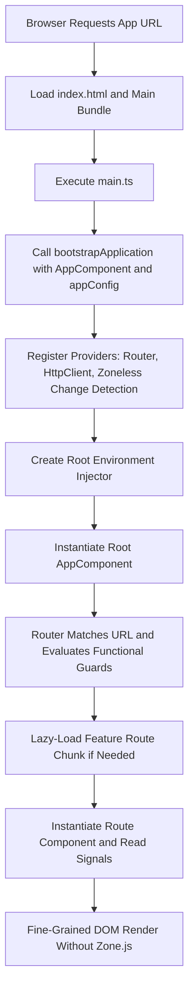
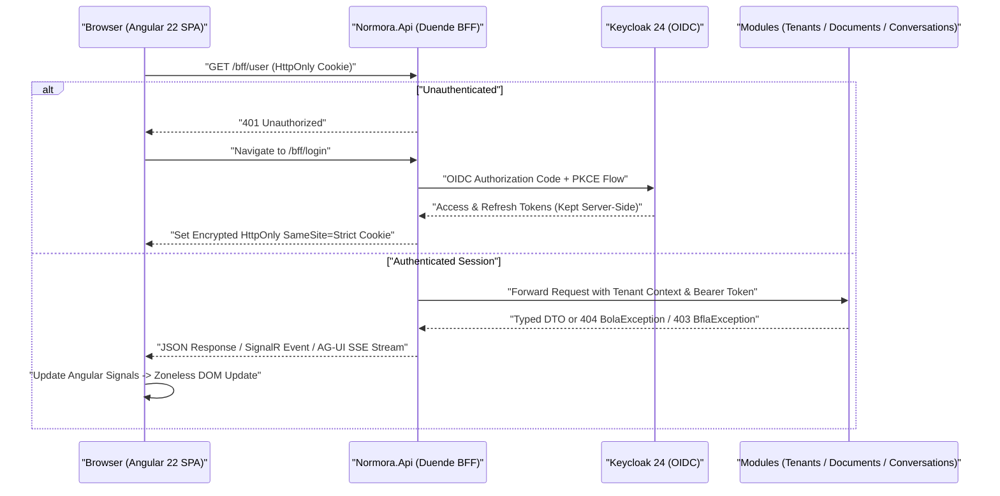
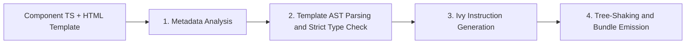

# Chapter 1: Introduction to Modern Angular

## 1. Learning Objectives
By the end of this chapter, you will be able to:
* Trace the evolution of Angular from AngularJS (v1) to Angular 22's standalone, Signal-driven, zoneless architecture.
* Articulate the core design philosophy driving Angular's opinionated platform and know when to choose—and when **not** to choose—Angular.
* Explain the paradigm shift from `NgModule` and `Zone.js` to Standalone Components, Signals, built-in control flow (`@if`, `@for`, `@defer`), and zoneless change detection.
* Understand how an Angular 22 **Single-Page Application (SPA)** fits into an enterprise **Backend-For-Frontend (BFF)** architecture like **Normora** alongside Tailwind CSS v4.
* Read simplified **Ivy** compiler output and understand why **Ahead-of-Time (AOT)** compilation improves performance, tree-shaking, and security.

---

## 2. Introduction

### History of Angular: The Evolution
Angular has undergone one of the most significant evolutions in frontend engineering history. Born originally as **AngularJS** in 2010, it revolutionized web development by introducing two-way data binding and **Dependency Injection (DI)** (a pattern where objects receive their dependencies externally rather than creating them) to the browser. However, as web apps grew more complex, AngularJS's **digest cycle** (a loop that repeatedly checked every bound expression for changes, known as **dirty checking**) became a severe performance bottleneck.

In 2016, the Google team completely rewrote the framework, releasing **Angular (v2)**. This version introduced a strict component-based tree architecture, **unidirectional data flow** (data flows down from parent to child, events flow up), a hierarchical dependency injector, and first-class TypeScript support. For change detection, Angular v2–v17 relied heavily on **Zone.js**, a library that **monkey-patches** (intercepts and wraps) asynchronous browser APIs like `setTimeout`, `fetch`, and DOM event listeners so Angular knows when to re-check the component tree.

Fast forward to **Modern Angular (v14–v22)**, the framework has undergone a complete renaissance:
* **v14/v15** introduced **Standalone Components**, removing the mandatory boilerplate and cognitive overhead of `NgModule`.
* **v16/v17** introduced **Signals** (fine-grained reactive primitives) and built-in template control flow (`@if`, `@for`, `@defer`), laying the groundwork to eliminate Zone.js.
* **v18/v19** introduced experimental **Zoneless Change Detection**, made `standalone: true` the **default** for all components, directives, and pipes (v19), and stabilized **Server-Side Rendering (SSR)** with incremental hydration (attaching client interactivity to server-rendered HTML without re-creating DOM nodes).
* **v20–v22** matured **Zoneless Angular** as the modern standard, alongside stabilized Signal-based component APIs (`input()`, `output()`, `model()`) and tight alignment with modern CSS toolchains like **Tailwind CSS v4**.

### AngularJS vs Legacy Angular (v2–v13) vs Modern Angular (v22)
| Feature | AngularJS (v1) | Legacy Angular (v2–v13) | Modern Angular (v22) |
|---|---|---|---|
| **Architecture** | MVC / MVVM (`$scope`) | `NgModule`-based Component Tree | Standalone Component Tree (`standalone: true` by default) |
| **Change Detection** | Digest Cycle (Dirty Checking) | Tree-wide via `Zone.js` | Zoneless, Signal-driven, `OnPush` |
| **Template Syntax** | `ng-if`, `ng-repeat` | `*ngIf`, `*ngFor` (requires `CommonModule`) | Built-in `@if`, `@for`, `@defer` |
| **Language** | JavaScript | TypeScript | Strict TypeScript + Signal APIs |
| **Bundle & Rendering** | Runtime template parsing | View Engine -> Ivy (AOT) | Ivy + Tree-Shaking + Deferrable Views + Hydration |

### Design Philosophy: Platform vs. Library
Angular is not a UI library; it is a cohesive **platform**. Unlike UI-only libraries (such as React) where teams must independently select, configure, and maintain third-party routing, HTTP clients, form validation, and DI containers, Angular provides a curated, enterprise-ready standard library out of the box:
* **Opinionated by Design:** It establishes a consistent "right way" to structure routing, forms, HTTP interceptors, and DI, preventing architecture drift across large engineering teams.
* **Enterprise Dependency Injection:** Inspired by backend frameworks like ASP.NET Core and Spring, Angular treats services as typed injectables—making UI components decoupled and straightforward to unit test.
* **Compile-Time Safety:** Through **AOT (Ahead-of-Time)** compilation (compiling HTML templates during the build rather than in the user's browser) and strict TypeScript, template typos and type mismatches fail the build instead of crashing in production.

### When to Use Angular (and When NOT to Use It)
Even the best platform is the wrong tool in the wrong context. A senior architect evaluates trade-offs before choosing Angular:

* **Use Angular when:**
  * You are building a long-lived, multi-tenant **Enterprise SaaS** application with complex workflows, role-based access control, multi-step forms, and real-time dashboards.
  * Multiple squads work in parallel and need strict architectural guardrails, standardized patterns, and strong TypeScript contracts.
  * You want first-party routing, typed Reactive Forms, HTTP interceptors, and DI maintained under one release cadence.
* **Do NOT use Angular when:**
  * **Content-first marketing sites or documentation blogs:** Static-site or island architectures (e.g., Astro, Hugo) ship near-zero JavaScript and beat a full SPA on initial load and SEO simplicity.
  * **Tiny embeddable third-party widgets:** If you are shipping a 10 KB chat launcher script onto arbitrary customer websites, a full Angular runtime adds unnecessary payload compared to vanilla TypeScript or lightweight Web Components.
  * **Throwaway weekend prototypes:** If you only need a single static landing page with no state or forms, plain HTML/CSS is faster and simpler.

### Real-World Enterprise SaaS Examples (Normora)
Consider **Normora**, an enterprise multi-tenant knowledge management and conversational AI platform built with a **.NET 10 Modular Monolith** backend (`Tenants`, `Documents`, and `Conversations` modules) and an **Angular 22 SPA** frontend sitting behind a **Duende Backend-For-Frontend (BFF)** proxy. Here are five real-world reasons Angular 22 excels in Normora:
1. **Multi-Tenant Workspace Shell & White-Label Branding (`Tenants` module):** Normora renders tenant-scoped dashboards, department hierarchies, and white-label design tokens (`client/src/design-system/tokens`) with strict dark mode (`dark:` variants) and Tailwind CSS v4 responsive grids.
2. **Real-Time Document Ingestion Monitoring (`Documents` module):** When users upload policies, background Hangfire jobs extract text, chunk Markdown, and generate pgvector embeddings. SignalR pushes status updates that Angular Signals reflect immediately in workspace tables without full-page reloads.
3. **Conversational RAG & Unified Copilot Workstation (`Conversations` module):** Normora's omnipresent assistant (`Ctrl+J` / `Cmd+J`) streams **Server-Sent Events (SSE)** tokens, live tool-execution chips (`tool_started`, `tool_finished`), and interactive generative UI cards (`ExpenseSimulatorCardComponent`, `HrEscalationCardComponent`).
4. **Dynamic Missing-Parameter Intake Forms:** When an AI agent tool needs missing inputs, the server streams an `intake_form_card` contract that Angular Reactive Forms render and validate inline before submitting back to the BFF.
5. **Security-Hardened BFF Session Integration:** Because Normora's Angular SPA sits behind `Normora.Api` (Duende BFF), the browser never stores OAuth access or refresh tokens in `localStorage`. Angular's typed HTTP layer sends encrypted `HttpOnly`, `SameSite=Strict` cookies automatically and maps standardized `ApiMessages` constants for `403` (**BFLA**) and `404` (**BOLA**) responses.

---

## 3. Core Concepts (A High-Level Primer)

To master Angular 22, you must understand its core primitives from first principles—what each piece does, why it exists, and when **not** to reach for it:

* **Components:** The fundamental building blocks of the UI. A component pairs a TypeScript class (state and behavior) with an HTML template and scoped CSS. *When NOT to use:* Do not bloat components with raw HTTP calls, authorization logic, or token management; delegate those to services and your backend/BFF.
* **Templates & Built-in Control Flow (`@if`, `@for`, `@defer`):** HTML supercharged with Angular bindings and compile-time control flow. `@if` and `@for` replace legacy `*ngIf` / `*ngFor` without needing `CommonModule`, while `@defer` lazy-loads heavy UI blocks on demand. *When NOT to use:* Avoid complex business calculations directly inside template expressions; derive them with `computed()` signals instead.
* **Standalone Components:** The modern standard (and the **default** since Angular 19—you no longer even need to write `standalone: true`). Each component declares its own `imports` directly, eliminating `NgModule` indirection. *When NOT to use `NgModule`:* Never create new `NgModule`s in Angular 22; only work with them when maintaining legacy libraries.
* **Dependency Injection (DI):** An **Inversion of Control (IoC)** mechanism where classes ask the Angular **Injector** for collaborators (via `inject()` or constructors) instead of instantiating them with `new`. This enables clean mocking in Vitest/unit tests and scoped lifetimes (application-wide singletons vs. component-scoped instances).
* **Signals (`signal`, `computed`, `effect`, `input()`, `output()`, `model()`):** A synchronous reactive graph primitive. A `signal` holds a value, `computed()` derives memoized values lazily, and `effect()` runs side effects when dependencies change. *When NOT to use:* Do not force Signals to replace complex asynchronous event orchestration (debouncing, race-condition cancellation with `switchMap`, WebSocket/SSE stream framing)—that is RxJS's domain.
* **RxJS & Observables:** A library for push-based asynchronous streams, deeply integrated into Angular's `HttpClient` and Router. *When NOT to use:* Avoid building tangled RxJS `BehaviorSubject` chains for simple synchronous UI state (toggles, modal visibility, derived totals); Signals are simpler, faster, and glitch-free.
* **Zoneless Change Detection:** **Change detection** is how Angular synchronizes TypeScript state to the browser DOM. Historically, `Zone.js` monkey-patched every browser async API and triggered broad component-tree checks. In **Zoneless Angular 22**, Signals and `OnPush` notify Angular *precisely* which views need updating—cutting bundle size, stack-trace noise, and wasted CPU cycles.
* **Routing & Services:** The Angular Router maps URLs to lazy-loaded standalone components and protects routes with functional **guards** (e.g., checking tenant context or roles before rendering). Services (`@Injectable({ providedIn: 'root' })`) encapsulate shared state and BFF API communication.

### Core Primitives in Action: 5 Normora Examples
1. **Signals + `effect()` for Reactive Workspace Sync:** In Normora, `IWorkspaceStateSynchronizer` broadcasts a monotonic `dataVersion` over SignalR/SSE whenever a tenant mutates departments or documents. Angular stores `dataVersion` in a signal and uses `effect()` to automatically refresh employer management tables without full-page reloads.
2. **Built-in `@if` for Free-Tier Invariants:** Workspaces on Normora's `Free` tier must never see cancellation danger zones, downgrade modals, or renewal countdowns. Using `@if (planTier() !== 'Free')` ensures those DOM nodes are never rendered at all.
3. **Signals vs. RxJS in the Copilot Workstation:** Live SSE token streaming from `/api/copilotkit` and SignalR hub reconnects use **RxJS / async streams** (`Conversations` stream handling), while the active persona tab (`All-Rounder`, `HR & People Ops`, `Finance & Travel`, `IT & Security`) and dock open/closed state (`Ctrl+J`) live in lightweight **Signals**.
4. **Services & Centralized Constants (`ApiMessages`):** Normora's frontend HTTP services under `client/src/app/core` never hardcode toast strings; they import `ApiMessages` from `client/src/app/core/constants/api-messages.ts` so UI error envelopes stay consistent with `Normora.Shared.Constants.ApiMessages`.
5. **Lazy Routing & Co-Browsing Actuation:** Features under `client/src/app/features` (such as `Tenants` billing vs. `Documents` explorer) are lazy-loaded by URL route. When an AI agent emits a `navigateActuation` payload (like `Locate in Documents` from a citation badge), Angular's Router navigates directly to the target chunk without reloading the SPA.

---

## 4. Visual Diagrams

### The Angular 22 Application Bootstrap Flow (Standalone & Zoneless)
When a user visits an Angular 22 application, the browser fetches a minimal `index.html`, boots `main.ts`, configures providers via `bootstrapApplication()`, and renders the root component without `NgModule` or `Zone.js`:



### Normora Runtime Topology: Angular 22 SPA Behind Duende BFF
Because Normora follows the **Backend-For-Frontend (BFF)** pattern, the Angular SPA never handles OAuth2 access tokens directly. Instead, `Normora.Api` terminates Keycloak OIDC authentication, holds tokens server-side, and issues encrypted `HttpOnly`, `SameSite=Strict`, `Secure` cookies to the browser:



### 5 Normora Bootstrap & Runtime Scenarios
1. **BFF Session Hydration on Startup:** Before rendering tenant dashboards, Angular's `core` auth service queries the BFF session endpoint using cookies; if unauthenticated, the app redirects cleanly to the BFF login route without ever touching `localStorage` tokens.
2. **Tenant Slug & Branding Resolution:** Once the route activates (using the workspace route under `client/src/app/layout`), Angular loads white-label tokens (`client/src/design-system/tokens`) and applies tenant colors alongside Tailwind v4 `dark:` classes.
3. **Lazy-Loading Heavy Features:** Users opening only the `Conversations` chat view never download `Tenants` subscription billing or PayU checkout components until they navigate to `/subscription`.
4. **Connecting the SignalR `dataVersion` Hub:** After session bootstrap succeeds, Normora's real-time service opens a WebSocket connection via `Normora.Api`'s SignalR hub (backed by Redis pub/sub from `Normora.Worker`) so document ingestion progress updates live.
5. **Deferring Secondary Drawers with `@defer`:** Heavy inspection views such as `ChunkPreviewDrawerComponent` (with Markdown rendering for RAG citations) only hydrate and fetch sub-chunks when a user actually clicks a citation badge.

---

## 5. API Deep Dive: `@Component` Decorator & Angular 22 Anatomy

The `@Component` decorator is the most important metadata contract in Angular. It tells the Angular compiler how to turn a TypeScript class into an encapsulated, tree-shakable UI element.

In **Angular 22**, components are **standalone by default** (`standalone: true` became implicit in Angular 19), use **Signal inputs/outputs** (`input()`, `output()`, `model()`), pair with `ChangeDetectionStrategy.OnPush` for **zoneless** readiness, and use built-in `@if` / `@for` control flow without importing `CommonModule`.

Here is a realistic Normora generative-UI card modeled after `ExpenseSimulatorCardComponent` (`policy_limit_card`), styled with **Tailwind CSS v4** (notice `dark:` variants on every color and the v4 **suffix** `!important` syntax such as `shadow-none!`):

```typescript
import { ChangeDetectionStrategy, Component, computed, input, output, signal } from '@angular/core';

export interface PolicyTierOption {
  readonly code: string;
  readonly label: string;
  readonly nightlyCap: number;
}

@Component({
  selector: 'normora-expense-simulator-card',
  // standalone: true is the default in Angular 19–22; omit it unless opting out with standalone: false
  imports: [],
  changeDetection: ChangeDetectionStrategy.OnPush,
  template: `
    <article
      class="rounded-xl border border-slate-200 dark:border-slate-700 bg-white dark:bg-slate-900 p-4 sm:p-6 shadow-none!"
    >
      <header class="flex items-center justify-between gap-3">
        <h2 class="text-base sm:text-lg font-semibold text-slate-900 dark:text-white">
          {{ title() }}
        </h2>
        <span class="text-xs font-medium text-indigo-700 dark:text-indigo-300">
          {{ currency() }}
        </span>
      </header>

      @if (tiers().length > 0) {
        <div class="mt-4 grid grid-cols-1 sm:grid-cols-2 gap-3">
          @for (tier of tiers(); track tier.code) {
            <button
              type="button"
              (click)="selectedNightlyCap.set(tier.nightlyCap)"
              class="rounded-lg border border-slate-300 dark:border-slate-600 bg-slate-50 dark:bg-slate-800 px-3 py-2 text-left text-sm text-slate-800 dark:text-slate-100 outline-none!"
            >
              {{ tier.label }} ({{ tier.nightlyCap }} / night)
            </button>
          }
        </div>
      }

      <p class="mt-4 text-sm text-slate-600 dark:text-slate-300">
        Estimated Allowance: {{ totalAllowance() }} {{ currency() }}
      </p>
    </article>
  `,
})
export class ExpenseSimulatorCardComponent {
  readonly title = input.required<string>();
  readonly currency = input<string>('USD');
  readonly tiers = input<readonly PolicyTierOption[]>([]);

  readonly nights = signal(2);
  readonly selectedNightlyCap = signal(180);
  readonly totalAllowance = computed(() => this.nights() * this.selectedNightlyCap());

  readonly simulated = output<number>();
}
```

### Decorator Properties Explained:
* `selector`: The custom HTML tag (`normora-expense-simulator-card`) that tells Angular where to instantiate this component.
* `standalone` *(omitted in Angular 22)*: Implicitly `true` since v19. You only write `standalone: false` if integrating with a legacy `NgModule`.
* `imports`: Direct list of standalone components, directives, or pipes used in this component's template (empty here because `@if` and `@for` are built into the compiler).
* `templateUrl` / `template`: Inline or external HTML template. Use `templateUrl` for large multi-section pages and inline `template` for focused cards.
* `styleUrl` / `styles`: Component-scoped CSS (automatically encapsulated per component). With Tailwind CSS v4 utility classes, many components need zero custom CSS files.
* `changeDetection`: `ChangeDetectionStrategy.OnPush` restricts checks to Signal updates, `input()` changes, or template events—essential for **zoneless** Angular 22 performance.
* `providers`: Optional component-level **Node Injector** services scoped strictly to this component instance and its children (destroyed automatically when the component unmounts).

> [!TIP]
> **When NOT to bloat `@Component`:** Never put `HttpClient` URL construction, BFF cookie checks, or multi-step workflow orchestration directly inside a component class. Keep components focused on UI state and user interaction; move API calls and cross-cutting rules into injectable services under `client/src/app/core`.

### 5 Real-World `@Component` Examples in Normora
1. **`ExpenseSimulatorCardComponent` (`policy_limit_card`):** Uses `input()` signals for location tiers and `computed()` for real-time hotel night allowance estimation inside the Copilot chat stream.
2. **`HrEscalationCardComponent` (`hr_escalation_card`):** Renders a responsive 3-stage progress timeline (`Dispatched` -> `Under Review` -> `Resolution`) with Tailwind v4 `dark:` variants and one-click clipboard copy using `output()` events.
3. **`ChunkPreviewDrawerComponent`:** A slide-over inspection panel under `client/src/app/features` that applies `.custom-scrollbar` for long Markdown policy chunks and emits a `locateInDocuments` `output()` for co-browsing actuation.
4. **Dynamic Intake Form Card (`intake_form_card`):** Triggered by the `workspace_request_form` agent tool, pairing `@Component` with Angular Reactive Forms to collect and validate missing parameters inline before calling `Normora.Api`.
5. **Subscription Management View (`Tenants` feature):** Uses `@if (tier() !== 'Free')` inside its template to guarantee Free-tier workspaces never render cancellation buttons, danger zones, or renewal countdown modals.

---

## 6. Angular Internals: The Compiler

When you run `ng build` (or `ng serve`), your code is not simply passed to a generic TypeScript-to-JavaScript transpiler. The **Angular Compiler (`ngc`)** runs an **Ahead-of-Time (AOT)** compilation pipeline before a single byte reaches the user's browser:



1. **Analysis:** `ngc` reads `@Component` metadata, `imports`, and Signal `input()` signatures.
2. **Template Parsing & Type Checking:** It parses HTML templates into an **Abstract Syntax Tree (AST)** and type-checks every binding (`{{ ... }}`, `[prop]`, `(event)`) against your TypeScript class—catching typos at build time instead of runtime.
3. **Code Generation (Ivy Instructions):** It compiles HTML into compact, imperative JavaScript DOM instructions (**Ivy**).
4. **Tree-Shaking:** Because Ivy emits static function imports (like `ɵɵelementStart`), bundlers (esbuild/Rollup) automatically strip out any Angular features your app never uses—a technique called **tree-shaking**. (In contrast, older **Just-in-Time (JIT)** compilation shipped the template compiler into the browser, increasing payload size and delaying startup.)

**Example:**
*You write:*
```html
<div class="greeting text-slate-900 dark:text-white">Hello {{ name() }}</div>
```

*The Compiler Outputs (Simplified Ivy Instructions):*
```javascript
function DashboardComponent_Template(rf, ctx) {
  if (rf & 1) { // Create Phase (runs once when the view is created)
    ɵɵelementStart(0, "div", 0); // <div class="greeting ...">
    ɵɵtext(1); // Placeholder text node
    ɵɵelementEnd();
  }
  if (rf & 2) { // Update Phase (runs only when bound signals/state change)
    ɵɵadvance(1);
    ɵɵtextInterpolate1("Hello ", ctx.name(), "");
  }
}
```
*Why this matters:* Notice the `rf & 1` (**Create Phase**) vs. `rf & 2` (**Update Phase**) split. During streaming updates, Angular never destroys and rebuilds `<div class="greeting">`; it advances directly to text node `1` and patches only the text content. By pre-compiling templates into raw Ivy instructions, Angular avoids shipping an HTML parser to the browser.

### When NOT to Bypass the Angular Compiler
Never circumvent Angular's template compiler with raw `document.querySelector()` DOM mutations or unsanitized `[innerHTML]` bindings. Direct DOM manipulation breaks SSR hydration, skips `OnPush` change detection, and disables Angular's built-in **Cross-Site Scripting (XSS)** contextual escaping.

### 5 Normora Examples of AOT & Ivy in Practice
1. **Zero-Overhead Token Streaming (`NormoraWorkplaceAgent`):** During AG-UI SSE streaming in `Conversations`, Ivy's `rf & 2` update phase patches only the active assistant message text node instead of re-creating the entire chat message list.
2. **Tree-Shaking Unused Controls:** Because Normora uses standalone components and `@if`/`@for`, components that don't import legacy directives or heavy PDF viewers don't pull them into the main bundle.
3. **Lazy Chunk Splitting with `@defer`:** Wrapping `ChunkPreviewDrawerComponent`'s rich Markdown renderer inside `@defer (on interaction)` tells the compiler to split that subtree into a separate JS chunk fetched only when a user inspects a RAG citation.
4. **Compile-Time DTO Safety Across Modules:** When a backend DTO in `Application/{Feature}/DTOs/` renames a field (such as `externalUserId` instead of `keycloakUserId`), `ngc` template type-checking catches stale template bindings like `{{ member.keycloakUserId }}` during CI builds.
5. **Built-in XSS Protection for Uploaded Document Titles:** When displaying user-uploaded filenames from `Documents`, standard Ivy interpolation (`{{ doc.fileName }}`) automatically escapes HTML entities, neutralizing malicious filenames like ``.

---

## 7. Real Production Case Study Introduction

Throughout this book, we anchor architectural concepts in two complementary enterprise systems:

1. **Normora (Primary Enterprise Reference Architecture):** A production-grade, multi-tenant knowledge management and conversational AI platform powered by a **.NET 10 Modular Monolith** (`Tenants`, `Documents`, `Conversations`), **PostgreSQL + pgvector**, **Keycloak OIDC**, **Duende BFF**, **SignalR**, and an **Angular 22 SPA** styled with **Tailwind CSS v4**.
2. **Multi-Tenant EV Charging Management Platform (Hands-On Build Case Study):** A progressive multi-tenant application we will scaffold and build step-by-step across chapters:
   * **Platform Admins:** Manage multiple charging network operators (Tenants).
   * **Tenant Organizers (Operators):** Manage their own charging stations, pricing tariffs, and users.
   * **Drivers (Users):** View nearby chargers, start/stop charging sessions, and view billing history.

In the next chapter, we will generate the workspace using the Angular CLI and establish an enterprise folder structure aligned with `client/src/app/core`, `features`, `layout`, `shared`, and `design-system`.

---

## 8. Common Mistakes & Anti-Patterns

> [!CAUTION]
> **Anti-Pattern 1: Storing OAuth Tokens in Browser Storage Instead of Using the BFF**
>
> **Wrong:**
> ```typescript
> // Inside an Angular AuthService
> loginSuccess(accessToken: string, refreshToken: string) {
>   localStorage.setItem('access_token', accessToken);
>   localStorage.setItem('refresh_token', refreshToken);
> }
> ```
> **Why it's wrong:** Any third-party script or XSS vulnerability can read `localStorage` and exfiltrate bearer tokens. In Normora, the Angular SPA sits behind a **Duende BFF (`Normora.Api`)** specifically so tokens never enter browser JavaScript.
>
> **Fix:** Let `Normora.Api` complete the OIDC Authorization Code + PKCE exchange with Keycloak server-side and issue encrypted `HttpOnly`, `SameSite=Strict`, `Secure` cookies. Angular simply sends cookie-authenticated requests (`withCredentials: true` when cross-origin in local dev) to BFF endpoints.

> [!CAUTION]
> **Anti-Pattern 2: Using Tailwind v3 Prefix `!important` and Missing Dark Mode Variants**
>
> **Wrong:**
> ```html
> <div class="!border-none bg-white text-slate-900">
>   Workspace Summary
> </div>
> ```
> **Why it's wrong:** Tailwind CSS v4 changed the `!important` modifier from a prefix (`!border-none`) to a **suffix** (`border-none!`)—the prefix syntax silently fails to apply. Omitting `dark:` variants also breaks Normora's mandatory dark-mode contrast across every surface.
>
> **Fix:**
> ```html
> <div class="border-none! bg-white dark:bg-slate-900 text-slate-900 dark:text-white">
>   Workspace Summary
> </div>
> ```

> [!CAUTION]
> **Anti-Pattern 3: Hardcoding Magic Error Strings or Misinterpreting BOLA/BFLA Status Codes**
>
> **Wrong:**
> ```typescript
> if (err.status === 404) {
>   this.toast.error('Document #4821 belongs to another tenant');
> }
> ```
> **Why it's wrong:** Hardcoding UI messages violates Normora's `ApiMessages` contract, and leaking why a resource returned `404` defeats **BOLA (Broken Object Level Authorization)** anti-enumeration protection (`BolaException` intentionally maps unauthorized object lookups to `404 Not Found`, while `BflaException` maps missing role permissions to `403 Forbidden`).
>
> **Fix:** Always reference centralized constants from `client/src/app/core/constants/api-messages.ts`:
> ```typescript
> import { ApiMessages } from '../core/constants/api-messages';
>
> if (err.status === 404) {
>   this.toast.error(ApiMessages.NotFound);
> } else if (err.status === 403) {
>   this.toast.error(ApiMessages.Forbidden);
> }
> ```

> [!CAUTION]
> **Anti-Pattern 4: Legacy `NgModule` / `CommonModule` Boilerplate & Default Change Detection**
>
> **Wrong:**
> ```typescript
> import { Component } from '@angular/core';
> import { CommonModule } from '@angular/common';
>
> @Component({
>   selector: 'normora-legacy-card',
>   standalone: false,
>   template: `<div *ngIf="visible">...</div>`
> })
> export class LegacyCardComponent {
>   visible = true;
> }
> ```
> **Why it's wrong:** New Angular 22 code should never introduce `NgModule`, `standalone: false`, legacy `*ngIf`, or `ChangeDetectionStrategy.Default`. Relying on plain mutable class fields without `OnPush` + Signals prevents clean zoneless execution.
>
> **Fix:** Omit `standalone` (it defaults to `true`), use `ChangeDetectionStrategy.OnPush`, hold state in `signal()`, and use built-in `@if`:
> ```typescript
> @Component({
>   selector: 'normora-card',
>   changeDetection: ChangeDetectionStrategy.OnPush,
>   template: `@if (visible()) { <div>...</div> }`
> })
> export class CardComponent {
>   readonly visible = signal(true);
> }
> ```

> [!CAUTION]
> **Anti-Pattern 5: Rendering Unsanitized `[innerHTML]` for RAG Chunks or Bypassing Ivy**
>
> **Wrong:**
> ```html
> <div [innerHTML]="rawDocumentChunkHtml()"></div>
> ```
> **Why it's wrong:** Binding raw untrusted content or bypassing Angular's compiler via `document.querySelector` opens **XSS** vectors and breaks hydration/change detection. Even if `DomSanitizer.bypassSecurityTrustHtml()` exists, calling it on user-uploaded document chunks (`Documents` module) turns a malicious PDF/Markdown upload into arbitrary script execution.
>
> **Fix:** Use standard Angular template interpolation (`{{ chunk.text }}`) or a safe structured Markdown-to-AST component inside `ChunkPreviewDrawerComponent` that emits safe Angular elements without bypassing sanitization.

> [!CAUTION]
> **Anti-Pattern 6: Rendering Paid-Tier Controls for Free-Tier Tenants**
>
> **Wrong:**
> ```html
> <button (click)="cancelSubscription()">Cancel Subscription</button>
> ```
> **Why it's wrong:** Normora's billing invariants prohibit `Free`-tier workspaces from invoking `CancelSubscriptionCommandHandler` or `ReactivateSubscriptionCommandHandler` (the API rejects them with `ApiMessages.CannotCancelFreePlan`). Showing cancellation danger zones or renewal countdowns to `Free` tenants confuses users and triggers avoidable error responses.
>
> **Fix:** Gate paid-tier controls strictly with `@if`:
> ```html
> @if (planTier() !== 'Free') {
>   <button type="button" (click)="cancelSubscription()">Cancel Subscription</button>
> }
> ```

---

## 9. Interview Questions

1. **[Junior] Why did Angular introduce Standalone Components, and do you still need `standalone: true` in Angular 22?**
   * **Answer:** Standalone components eliminate the boilerplate and indirection of `NgModule`s—components declare their own template dependencies directly via `imports`, simplifying lazy loading and tree-shaking. Since Angular 19 (including Angular 22), `standalone: true` is the **default**, so you omit it on modern components and only specify `standalone: false` when maintaining legacy `NgModule`-based code.

2. **[Junior] What problem does AOT (Ahead-of-Time) compilation solve compared to JIT (Just-in-Time) compilation?**
   * **Answer:** AOT compiles HTML templates into Ivy JavaScript instructions during `ng build` rather than in the user's browser. This eliminates shipping the Angular template compiler to clients, enables aggressive tree-shaking, speeds up initial rendering, and catches template type errors at build time.

3. **[Junior] In Tailwind CSS v4, why does `!border-none` fail while `border-none!` works?**
   * **Answer:** Tailwind CSS v4 moved the `!important` modifier from a leading prefix (`!class`) to a trailing suffix (`class!`). Using `!border-none` in v4 produces no style override.

4. **[Senior] Explain the difference between Signals and RxJS in Angular 22. When would you choose each in Normora?**
   * **Answer:** **Signals** (`signal`, `computed`, `effect`) represent synchronous, glitch-free reactive state and derived UI values (e.g., active Copilot persona, `ExpenseSimulatorCardComponent` allowance totals, or reactive `dataVersion` table refreshes). **RxJS** handles asynchronous event streams over time—such as HTTP cancellation (`switchMap`), debounced search, SignalR connection lifecycles, and AG-UI SSE token streams.

5. **[Senior] How does Zoneless Change Detection work, and why is `ChangeDetectionStrategy.OnPush` still important?**
   * **Answer:** Traditional Angular relied on `Zone.js` monkey-patching browser async APIs (`fetch`, `setTimeout`, DOM events) to trigger broad component-tree checks after every callback. Zoneless Angular removes `Zone.js` and relies on explicit change notifications—chiefly Signal reads in templates, `input()` updates, `AsyncPipe`, and DOM events bound to components. Pairing zoneless mode with `OnPush` ensures Angular skips unaffected subtrees and updates only views whose reactive dependencies actually changed.

6. **[Senior] Look at `rf & 1` and `rf & 2` in Ivy's compiled output. Why does Angular split template execution into two phases?**
   * **Answer:** `rf & 1` is the **Create Phase** (runs once to instantiate DOM elements and placeholders), and `rf & 2` is the **Update Phase** (runs when bindings change to patch only dynamic text/attributes). During high-frequency updates—like `NormoraWorkplaceAgent` streaming SSE tokens—Angular updates just the target text node without destroying or recreating surrounding DOM nodes.

7. **[Architect] Why does Normora place its Angular 22 SPA behind a Duende BFF (`Normora.Api`) instead of using an in-browser OIDC library (`angular-auth-oidc-client`)?**
   * **Answer:** In-browser OIDC libraries must hold access/refresh tokens in browser memory or storage (`localStorage`/`sessionStorage`), leaving tokens exposed to XSS attacks or malicious browser extensions. With Duende BFF, `Normora.Api` handles the Keycloak OIDC exchange server-side, stores tokens securely on the server, and gives Angular only an encrypted `HttpOnly`, `SameSite=Strict`, `Secure` cookie with anti-CSRF protection.

8. **[Architect] How should an Angular frontend handle 404 vs 403 errors in a multi-tenant SaaS with strict BOLA/BFLA controls?**
   * **Answer:** The frontend must never inspect or leak internal existence hints. When Normora's backend detects **BOLA** (a user requesting a document/conversation in another tenant or department), it throws `BolaException` mapped to a generic `404 Not Found` (`ApiMessages.NotFound`) to prevent ID enumeration; when a user lacks permission for an action, **BFLA** returns `403 Forbidden` (`ApiMessages.Forbidden`). Angular interceptors and components map those envelopes strictly via centralized `ApiMessages` constants rather than hardcoded or raw backend strings.
