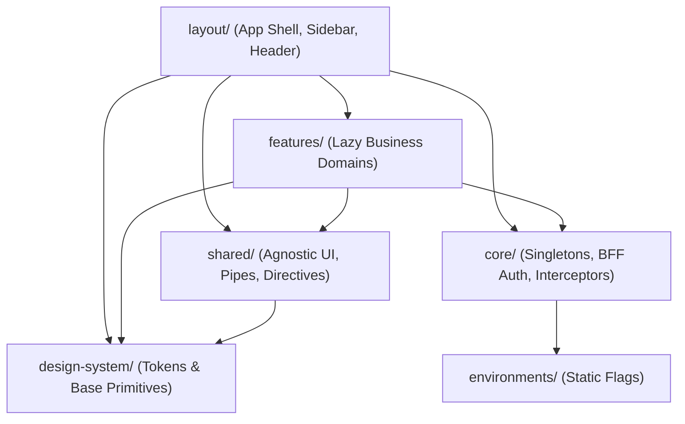
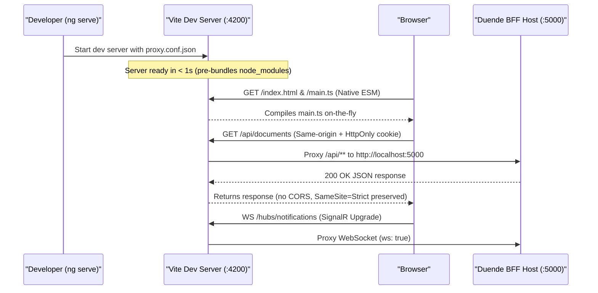
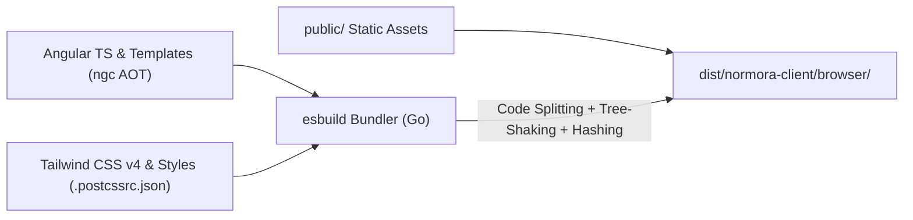

# Chapter 2: The Angular CLI & Workspace Architecture

## 1. Learning Objectives
By the end of this chapter, you will be able to:
* Understand the Angular CLI (`@angular/cli`), its schematic/builder architecture, and how it enforces consistency across large engineering teams.
* Configure `angular.json`, `tsconfig.json` path aliases, environment strategies, and `proxy.conf.json` for a Backend-For-Frontend (BFF) setup.
* Differentiate between Polyrepo, Angular CLI Multi-Project Workspaces, Nx Monorepos, and Co-located Polyglot Repositories—and know when **not** to use each.
* Design strict domain-driven folder boundaries (`core`, `shared`, `design-system`, `features`, `layout`) with enforceable import rules.
* Understand the modern Angular 22 build, dev, and test pipeline (Vite, esbuild, Tailwind CSS v4 PostCSS integration, Vitest, and zoneless `bootstrapApplication`).
* Initialize the workspace foundations for both an **EV Charging SaaS** case study and **Normora** (an enterprise multi-tenant knowledge & conversational-AI platform behind a Duende BFF).

---

## 2. Introduction to the Angular CLI & Workspace Configuration

The **Angular CLI** (`@angular/cli`) is the official command-line toolchain for initializing, scaffolding, building, testing, and upgrading Angular applications. Under the hood, it orchestrates two engines:
1. **Schematics (`@angular-devkit/schematics`)**: Code generators that scaffold files deterministically from templates (components, services, guards, library skeletons).
2. **Architect Builders (`@angular-devkit/architect`)**: Task runners configured in `angular.json` that execute compilation (`@angular/build:application`), dev serving (`@angular/build:dev-server`), and unit testing (`@angular/build:unit-test`).

In an enterprise SaaS organization where 50+ engineers commit to the same repository, the CLI prevents **architectural drift**—different developers inventing conflicting file naming conventions, folder placements, or test harnesses.

### Core Commands Every Architect Should Know
* `ng new <workspace-name>`: Generates a new workspace (configured for standalone components, zoneless change detection, and modern `@angular/build` by default in Angular 22).
* `ng generate <schematic>` (or `ng g`): Scaffolds code using schematics (e.g., `ng g c`, `ng g s`, `ng g guard`, `ng g environments`). Use `--dry-run` (`-d`) to preview file changes without touching disk.
* `ng serve`: Starts the Vite-powered development server in memory with Hot Module Replacement (HMR) and optional BFF proxying.
* `ng build`: Runs Ahead-of-Time (AOT) compilation and bundles the application with esbuild into `dist/`.
* `ng test`: Executes unit tests—using **Vitest** via `@angular/build:unit-test` in modern Angular 20–22 workspaces (replacing the legacy Karma/Jasmine browser runner).
* `ng update`: Automatically runs AST-based migration schematics when upgrading Angular major versions (e.g., migrating `@Input()` decorators to signal `input()`).

> [!TIP]
> **When NOT to Use `ng generate`:**
> Do not blindly run `ng g component` for every file. Skip schematics when creating:
> - **Pure TypeScript domain models, constants, or DTO interfaces** (e.g., `ApiMessages` or RAG citation types)—plain `.ts` files need no schematic boilerplate.
> - **Thin functional guards/interceptors or signal stores** that don't match default templates, unless your team maintains custom workspace schematics.
> - **Headless design-system primitives** that follow a bespoke token-driven template structure different from app feature components.

### Anatomy of `angular.json`
`angular.json` is the single source of truth for every project (application or library) in a workspace. Key sections an architect manages:
* **`projects.<name>.prefix`**: Enforces the HTML selector prefix (e.g., `app-` or `nm-` for Normora) to prevent collisions with third-party Web Components or PrimeNG selectors (`p-`).
* **`architect.build.options`**: Configures `browser` entry point (`src/main.ts`), `tsConfig` (`tsconfig.app.json`), `assets` (copying `public/` to the root of `dist/`), `styles` (Tailwind CSS v4 entry and PrimeNG themes), and `budgets` (bundle size thresholds that fail CI if an engineer accidentally imports a 2 MB dependency).
* **`architect.build.configurations`**: Overrides settings per target (`production` enables hashing, minification, and `fileReplacements`; `development` preserves source maps and disables optimization).
* **`architect.serve.options.proxyConfig`**: Points the Vite dev server to `proxy.conf.json` so API, auth, and WebSocket calls are routed seamlessly to a backend or BFF on the same origin.

### TypeScript Configuration & Path Aliases (`tsconfig.json`)
A modern Angular workspace splits TypeScript settings across three files:
* `tsconfig.json` (root): Shared strict compiler flags (`"strict": true`, `"noImplicitOverride": true`, `"strictTemplates": true`) and `paths` aliases.
* `tsconfig.app.json`: Extends root config, narrows `files`/`include` to application source, and excludes `*.spec.ts`.
* `tsconfig.spec.json`: Extends root config and adds test runner types (e.g., `vitest/globals`).

Configuring `compilerOptions.paths` eliminates fragile relative imports (`../../../../core/constants/api-messages`) and makes module boundaries self-documenting:
```json
{
  "compilerOptions": {
    "baseUrl": "./",
    "paths": {
      "@core/*": ["src/app/core/*"],
      "@shared/*": ["src/app/shared/*"],
      "@design-system/*": ["src/design-system/*"],
      "@features/*": ["src/app/features/*"],
      "@env/*": ["src/environments/*"]
    }
  }
}
```

### Build-Time Environments vs. Runtime Configuration
Running `ng g environments` generates `src/environments/environment.ts` and `environment.development.ts`, swapped at build time via `fileReplacements` in `angular.json`.
* **When to use `environment.ts`**: Static build-time flags (e.g., `production: true`, default feature-flag toggles, log verbosity).
* **When NOT to rely on `environment.ts`**: **Never** store secrets (API keys like `GEMINI_API_KEY` or Keycloak client secrets) or container-specific backend URLs in `environment.ts`. Everything in `environment.ts` is compiled into public JavaScript bundles readable by anyone opening DevTools. Furthermore, in containerized SaaS deployments ("build one Docker image, promote through Staging and Production"), build-time `fileReplacements` force you to rebuild the image for every environment. Instead, serve runtime settings from a `/api/config` BFF endpoint or `public/config.json` mounted at container startup.

### Real-World Normora Examples: CLI & Workspace Configuration
1. **BFF Same-Origin Dev Proxy (`client/proxy.conf.json`)**: Normora's Angular SPA runs on `http://localhost:4200` while `Normora.Api` (Duende BFF) runs on `http://localhost:5000`. Because Duende BFF uses `HttpOnly`, `SameSite=Strict` session cookies, calling `:5000` directly from `:4200` triggers cross-origin blocks. Normora wires `proxyConfig` in `angular.json` to forward `/api`, `/bff`, `/signin-oidc`, `/signout-callback-oidc`, and `/hubs` (with `ws: true` for SignalR) through Vite on `:4200`.
2. **Scaffolding a Feature Component with Normora Conventions**: When adding a new citation viewer inside the Documents domain, an engineer runs `ng g component features/documents/components/chunk-preview-drawer --prefix=nm` from `client/`. The CLI places `ChunkPreviewDrawerComponent` inside the `documents` bounded context with `.spec.ts` wired for Vitest, avoiding manual boilerplate drift.
3. **Path Aliases for `ApiMessages` & Design Tokens**: Normora forbids hardcoded error strings (`AGENTS.md` Rule 1). Instead of fragile `../../../core/constants/api-messages` imports, `client/tsconfig.json` maps `@core/*` and `@design-system/*` so any feature component cleanly imports `import { ApiMessages } from '@core/constants/api-messages';` and `import { ButtonComponent } from '@design-system/components';`.
4. **Bundle Budgets for AI & UI Dependencies**: Normora ships PrimeNG, CopilotKit integration, and Markdown/syntax rendering for RAG citations. Configuring `budgets` in `client/angular.json` (`initial` warning at `750kB`, error at `1.2MB`) catches accidental eager imports of heavy Markdown or PDF viewers into the initial bundle before they reach production.
5. **Runtime Tenant & White-Label Config Instead of `environment.ts`**: Normora supports multi-tenant white-label branding (custom logos, workspace titles, and active subscription tiers) stored in the `Tenants` module. Rather than hardcoding tenant URLs or branding in `client/src/environments/environment.ts`, the Angular workspace fetches tenant context and branding over the BFF at runtime, while keeping `GEMINI_API_KEY`, `RESEND_API_KEY`, and Keycloak OIDC client secrets strictly on `Normora.Api` and `Normora.Worker`.

---

## 3. Workspace Architecture

When you run `ng new`, Angular does not just create an application; it creates a **Workspace**. A workspace is a container defined by `angular.json` that can host one or multiple applications (`projects`) and reusable internal libraries.

### The Standard Structure (Angular 22)
A modern Angular workspace looks like this:

```text
ev-charging-platform/
├── angular.json          # The heart of the workspace configuration
├── package.json          # Node dependencies and scripts
├── tsconfig.json         # Base TypeScript configuration & path aliases
├── tsconfig.app.json     # App-specific TS compilation settings
├── tsconfig.spec.json    # Test-runner TS settings (Vitest)
├── public/               # Static files served at "/" (favicons, robots.txt, config.json)
└── src/
    ├── app/              # The application code
    │   ├── app.component.ts  # Root standalone shell (or app.ts in Angular 20+ minimal naming)
    │   ├── app.config.ts     # Global providers (replaces app.module.ts in Standalone Angular)
    │   └── app.routes.ts     # Top-level route definitions
    ├── environments/     # Build-time environment flags (via ng g environments)
    ├── index.html        # The root HTML file
    ├── styles.css        # Global Tailwind CSS v4 (@import "tailwindcss";) & theme entry
    └── main.ts           # The zoneless bootstrap entry point
```

> [!NOTE]
> **Where did `src/assets/` go?**
> Starting in Angular v18+, `ng new` replaces `src/assets/` with a top-level `public/` directory (configured in `angular.json` as `{"glob": "**/*", "input": "public"}`). Everything inside `public/` is served directly from the root URL (e.g., `public/logo.svg` is served at `/logo.svg`).

### Polyrepo vs. Angular CLI Workspace vs. Nx Monorepo vs. Co-located Polyglot Repo
In an enterprise setting, repository topology is one of the highest-leverage architectural decisions you will make early on:

| Topology | How It Works | Best For | When NOT to Use It |
| :--- | :--- | :--- | :--- |
| **1. Polyrepo** | Each app (Driver App, Admin Dashboard, UI Kit) lives in its own Git repository. | Independent teams with separate release cadences, strict compliance isolation, or different tech stacks. | When multiple Angular apps share rapidly evolving UI components or auth logic—publishing NPM packages for every button tweak creates versioning hell. |
| **2. Angular CLI Multi-Project Workspace** | `ng new --no-create-application` followed by `ng g application` and `ng g library` inside `projects/`. | 2–3 closely related Angular apps sharing 1–2 internal libraries without external tooling. | Beyond ~5 projects; the native Angular CLI lacks affected-graph detection and distributed build caching, causing CI to rebuild everything on every PR. |
| **3. Nx Monorepo** | Adds an explicit project dependency graph, computation caching (Nx Cloud), and ESLint module boundary enforcement on top of Angular/TypeScript projects. | Large organizations (3+ frontend apps, multiple shared design-system/domain libs, 20+ engineers). | Small teams building a single SPA—Nx generators, `project.json` maintenance, and plugin upgrades add unnecessary complexity if you have no cross-app sharing. |
| **4. Co-located Polyglot Repo** | A single repository holds one Angular SPA (`client/`) alongside its backend (`server/`), infrastructure (`infrastructure/`), and docs (`docs/`). | Full-stack SaaS products where frontend features evolve atomically alongside backend APIs/BFF contracts. | When frontend and backend teams are completely decoupled organizations or when dozens of unrelated apps live in the same repo without build-graph tooling. |

For our **EV Charging Management Platform**, we will utilize a **Feature-Sliced Architecture** within a single application workspace, simulating a tightly coupled enterprise domain.

### Domain-Driven Folder Topology & Dependency Rules
Inside `src/app/`, enterprise codebases prevent "big ball of mud" spaghetti by dividing code into strict architectural layers with one-way dependency rules:



* **`core/`**: Application-wide singletons (`providedIn: 'root'`), BFF session state, HTTP interceptors, route guards, SignalR connection managers, and centralized constants. **Never** imports from `features/` or `layout/`.
* **`design-system/`**: Pure visual design tokens (colors, spacing, typography) and low-level UI primitives. Zero knowledge of business entities or HTTP services.
* **`shared/`**: Domain-agnostic reusable components, pipes, and directives (e.g., `ConfirmModalComponent`, `RelativeTimePipe`). **Rule of thumb:** If a component knows about a specific business domain (like `ChargerStatusBadge` or `DocumentUploadProgress`), it does **not** belong in `shared/`—it belongs in `features/`.
* **`features/`**: Self-contained, lazy-loaded business domains (e.g., `tenants/`, `documents/`, `conversations/`). Feature modules must **not** reach directly into another feature's internal components or private signals; cross-feature navigation happens via routes or shared `core/` state.
* **`layout/`**: The outer application frame (navigation rail, workspace switcher, dockable panels) composing routes and core services.

> [!TIP]
> **Avoid Indiscriminate Barrel Files (`index.ts`):**
> Many tutorials recommend putting an `index.ts` file inside every folder to re-export everything (`export * from './...';`). In modern Angular + esbuild workspaces, deep barrel files often introduce **circular dependencies**, hide true dependency graphs from linters, and degrade **tree-shaking** (causing unused components to be pulled into the initial bundle). Use explicit direct file imports inside an application, and reserve `public-api.ts` barrels strictly for published workspace libraries (`projects/ui-kit/src/public-api.ts`).

### Real-World Normora Examples: Workspace Topology & Boundaries
1. **Co-located Polyglot Repository (`client/` + `server/`)**: Normora does not force an Nx monorepo for a single SPA. Instead, it uses a co-located polyglot layout with `client/` (Angular 22), `server/` (.NET 10 Modular Monolith), `infrastructure/` (Keycloak, Postgres/pgvector), `keycloak-theme/`, and `docs/`. A single PR can add a CQRS endpoint in `server/Modules/Documents` and its matching Angular feature UI in `client/src/app/features` atomically.
2. **Symmetric Domain Mirroring (`server/Modules/` ↔ `client/src/app/features/`)**: Normora's backend enforces three strict bounded contexts—`Tenants`, `Documents`, and `Conversations`. The Angular workspace mirrors these domains in `client/src/app/features/` (`tenants/`, `documents/`, `conversations/`), ensuring frontend and backend engineers share the exact same ubiquitous language.
3. **Dedicated `client/src/design-system/` Layer**: Rather than mixing raw Tailwind token overrides into `shared/`, Normora isolates `client/src/design-system/tokens/` and `client/src/design-system/components/`. Both `layout/` and `features/` consume these primitives consistently with built-in Tailwind v4 `dark:` support and `.custom-scrollbar` styling.
4. **Centralized Core Singletons (`client/src/app/core/`)**: Global non-domain concerns—such as `ApiMessages` (`client/src/app/core/constants/api-messages.ts`), the Duende BFF antiforgery/error interceptor (parsing `403 Forbidden` and `404 Not Found` BOLA/BFLA envelopes), and the SignalR `dataVersion` synchronizer—live strictly in `core/`.
5. **Layout Shell Separation (`client/src/app/layout/`)**: Normora's **Unified Copilot Workstation** (the Dock & Expand assistant triggered with `Ctrl+J`/`Cmd+J`, responsive sidebar, and tenant workspace header) lives in `client/src/app/layout/`. Keeping the shell separate from `features/conversations` allows the Copilot drawer to stay mounted while users navigate across `documents` and `tenants` routes.

---

## 4. Angular Internals: The Modern Build, Dev & Test Pipeline

For years, Angular relied on **Webpack** (`@angular-devkit/build-angular:browser`) to bundle applications. While powerful, Webpack became notoriously slow for large enterprise applications. Starting in Angular v17 and standardized through Angular 22 under the `@angular/build:application` builder, the Angular team completely overhauled the toolchain.

### Vite and esbuild: The Dual-Engine Architecture
Modern Angular splits development and production across two specialized engines:
1. **esbuild (`ng build`):** Used for Ahead-of-Time (AOT) compilation output bundling, tree-shaking, minification, and CSS processing in production builds. esbuild is written in Go and parallelizes across CPU cores, running 5x–20x faster than Webpack.
2. **Vite (`ng serve`):** Used exclusively for the development server. Vite pre-bundles third-party `node_modules` dependencies once with esbuild, then serves your Angular source files on demand over **native ES Modules (ESM)** with fast Hot Module Replacement (HMR) for templates and styles.

### Why Vite Changes Developer Velocity
* **Webpack:** Crawls your entire dependency graph, compiles every route and component, builds the full bundle, and *only then* starts the server—often taking minutes on enterprise workspaces.
* **Vite:** Starts the dev server in under a second, then transpiles individual TypeScript/template files lazily only when the browser actually navigates to a route that requests them.

### Visual Diagram: Vite Dev Server & Duende BFF Proxy Flow

When an Angular SPA sits behind a **Backend-For-Frontend (BFF)**—a security pattern where a server-side host manages OIDC tokens and issues `HttpOnly`, `SameSite=Strict` cookies to the browser—the Vite dev server must also act as a same-origin reverse proxy during local development:



### Visual Diagram: Production `ng build` Pipeline



This architecture means that whether your app has 10 components or 10,000 components, `ng serve` starts almost instantaneously, and `ng build` emits optimized, content-hashed ESM chunks into `dist/`.

### Tailwind CSS v4 & PostCSS Integration
Modern Angular workspaces pair seamlessly with **Tailwind CSS v4** via `@tailwindcss/postcss` configured in `.postcssrc.json`:
* **CSS-first entry (`src/styles.css`)**: Uses `@import "tailwindcss";` and `@theme` tokens instead of a heavy JavaScript `tailwind.config.js`.
* **Automatic content detection**: Tailwind v4 scans your `.html` and `.ts` templates automatically for utility classes.
* **Important modifier is a SUFFIX**: In Tailwind v4, `!important` goes at the end (`border-none!`, `shadow-none!`), never at the front (`!border-none`).
* **Dark mode variants**: Every color utility (background, text, border, ring) pairs with explicit `dark:` variants (e.g., `bg-white dark:bg-slate-900 text-slate-900 dark:text-white`).

### Modern Unit Testing & Zoneless Bootstrap
* **Vitest Test Pipeline (`ng test`)**: Angular 20–22 replaces the legacy Karma/Jasmine browser runner with **Vitest** (`@angular/build:unit-test`), running fast headless tests directly via Vite's module graph without launching Chrome for every spec run.
* **Zoneless Change Detection**: Historically, Angular monkey-patched browser APIs (`setTimeout`, `Promise`, `addEventListener`) via `zone.js` to guess when to re-render. In Angular 22, new workspaces default to **zoneless change detection** (`provideZonelessChangeDetection()`), driven deterministically by **Signals** (`signal`, `computed`, `input()`, `output()`), async pipes, and explicit `markForCheck()`, cutting bundle size and eliminating wasted change-detection cycles.

> [!TIP]
> **When NOT to Eject or Customize the Angular Builder:**
> Avoid replacing `@angular/build:application` with custom Webpack configs (`@angular-builders/custom-webpack`) or raw hand-rolled `vite.config.ts` setups. Angular's internal AOT compiler (`ngc`) tightly integrates template type-checking, `@defer` block chunk splitting, and SSR hydration with `@angular/build`. Only reach for custom esbuild plugins when integrating exotic non-JS build artifacts (e.g., custom WebAssembly pipelines) that Angular's `assets` or `scripts` options cannot handle.

### Real-World Normora Examples: Build, Dev & Test Pipeline
1. **Vite On-Demand Compilation for Heavy Generative AI Cards**: Normora includes interactive A2UI components such as `ExpenseSimulatorCardComponent` (`policy_limit_card`) and `HrEscalationCardComponent` (`hr_escalation_card`), plus `ChunkPreviewDrawerComponent` with Markdown rendering. During `ng serve`, Vite skips compiling those components until a developer opens a Copilot chat turn that renders them—keeping cold startup under a second.
2. **Duende BFF & SignalR WebSocket Proxying (`client/proxy.conf.json`)**: Normora's Vite dev server proxies `/api`, `/bff`, `/signin-oidc`, `/signout-callback-oidc`, and SignalR hubs (`/hubs` with `ws: true`) to `http://localhost:5000` (`Normora.Api`). This guarantees `SameSite=Strict`, `HttpOnly` auth cookies and Redis-backplane SignalR ingestion notifications work locally on `http://localhost:4200`.
3. **Tailwind CSS v4 & Dark Mode Token Pipeline**: Normora's `client/src/styles.css` and `client/src/design-system/tokens/` compile through `@tailwindcss/postcss`. Components enforce Tailwind v4 suffix `!important` modifiers (`border-none!`, `outline-none!`), `.custom-scrollbar` overflow styling, and complete `dark:` variants on every surface and border.
4. **Vitest Execution in `client/`**: As documented in Normora's `client/README.md`, Normora uses **Vitest** instead of Karma/Jasmine. Pure signal state logic, `ApiMessages` error mapping, and standalone components run in milliseconds in CI without spinning up a heavyweight Karma Chrome process.
5. **Zoneless `appConfig` with Signals & SSE/SignalR**: Normora updates workspace `dataVersion` counters over SignalR and AG-UI SSE streams (`/api/copilotkit`) and reacts with Angular `effect()` observers. Running zoneless (`provideZonelessChangeDetection()`) ensures high-frequency token streaming in `NormoraWorkplaceAgent` conversations triggers fine-grained signal updates without `zone.js` monkey-patching every `EventSource` or WebSocket frame.

---

## 5. Enterprise SaaS Case Studies: Workspace Initialization

In this section, we first initialize our **EV Charging Management Platform** foundation using Angular 22 defaults, and then walk through **Normora's production workspace blueprint** behind a Duende BFF.

### Case Study A: Multi-Tenant EV Charging Management Platform

#### Step 1: Generate the Workspace
Use the Angular CLI to generate a strict, standalone, routing-enabled, zoneless Angular 22 workspace:
```bash
npx @angular/cli@latest new ev-platform \
  --standalone=true \
  --routing=true \
  --style=css \
  --strict=true \
  --zoneless=true
```

#### Step 2: Establish the Enterprise Folder Structure
An enterprise application must not become a dumping ground inside `src/app`. We implement a domain-driven structure:

```text
ev-platform/
├── public/               # Static assets served at "/"
└── src/app/
    ├── core/             # Singleton services, interceptors, guards (Instantiated once)
    │   ├── auth/         # Authentication logic
    │   └── http/         # Base HTTP interceptors
    ├── shared/           # Reusable dumb components, pipes, directives
    │   ├── ui/           # Buttons, Modals, Form Controls
    │   └── utils/        # Helper functions
    ├── features/         # The actual business domains
    │   ├── dashboard/    # Tenant Dashboard domain
    │   ├── chargers/     # Charger management domain
    │   ├── sessions/     # Charging sessions domain
    │   └── admin/        # Platform admin portal
    └── layout/           # Shell layouts (Sidebar, Header, Main Content)
```

#### Step 3: Bootstrapping the Application (Zoneless Angular 22)
In modern Angular, `main.ts` is remarkably clean. It uses `bootstrapApplication` and passes in `appConfig` with `provideZonelessChangeDetection()` (replacing legacy `provideZoneChangeDetection()`):

**`src/main.ts`**
```typescript
import { bootstrapApplication } from '@angular/platform-browser';
import { AppComponent } from './app/app.component';
import { appConfig } from './app/app.config';

bootstrapApplication(AppComponent, appConfig)
  .catch((err) => console.error(err));
```

**`src/app/app.config.ts`**
```typescript
import { ApplicationConfig, provideZonelessChangeDetection } from '@angular/core';
import { provideRouter } from '@angular/router';
import { routes } from './app.routes';
import { provideHttpClient, withInterceptors } from '@angular/common/http';
import { authInterceptor } from './core/auth/auth.interceptor';

export const appConfig: ApplicationConfig = {
  providers: [
    // Angular 22 Zoneless change detection powered by Signals
    provideZonelessChangeDetection(),

    // Sets up application routing
    provideRouter(routes),

    // Sets up the modern HttpClient with a functional interceptor
    provideHttpClient(withInterceptors([authInterceptor]))
  ]
};
```

---

### Case Study B: Normora Production Workspace Blueprint (`client/`)

Normora combines an Angular 22 SPA (`client/`) with a `.NET 10` Modular Monolith + Duende BFF (`server/`). Here are five concrete workspace artifacts that make Normora secure, maintainable, and fast:

#### 1. Normora's Co-located Client Workspace Layout
```text
normora/
├── client/
│   ├── angular.json
│   ├── .postcssrc.json             # Enables @tailwindcss/postcss for Tailwind v4
│   ├── proxy.conf.json             # Same-origin proxy to Duende BFF (:5000)
│   ├── tsconfig.json               # Path aliases (@core/*, @shared/*, @design-system/*)
│   ├── public/                     # Static icons, manifest, favicons
│   └── src/
│       ├── styles.css              # @import "tailwindcss"; + .custom-scrollbar
│       ├── environments/           # Static non-secret build flags only
│       ├── design-system/          # Tokens & Tailwind v4/PrimeNG UI primitives
│       │   ├── components/
│       │   └── tokens/
│       └── app/
│           ├── core/               # ApiMessages, BFF CSRF/BOLA/BFLA interceptors, SignalR
│           ├── features/           # tenants/, documents/, conversations/
│           ├── layout/             # Dock & Expand Copilot Workstation shell
│           └── shared/             # Domain-agnostic UI helpers
└── server/                         # .NET 10 Modular Monolith (Tenants, Documents, Conversations)
```

#### 2. `client/proxy.conf.json` (Same-Origin Duende BFF & SignalR Proxy)
```json
{
  "/api": {
    "target": "http://localhost:5000",
    "secure": false,
    "changeOrigin": false
  },
  "/bff": {
    "target": "http://localhost:5000",
    "secure": false,
    "changeOrigin": false
  },
  "/signin-oidc": {
    "target": "http://localhost:5000",
    "secure": false
  },
  "/signout-callback-oidc": {
    "target": "http://localhost:5000",
    "secure": false
  },
  "/hubs": {
    "target": "http://localhost:5000",
    "secure": false,
    "ws": true
  }
}
```
> Notice `"changeOrigin": false` and `"ws": true` on `/hubs`: preserving the `localhost:4200` host header keeps Duende BFF redirect URIs and `SameSite=Strict` cookies intact, while `ws: true` enables WebSocket upgrades for SignalR ingestion notifications.

#### 3. `client/angular.json` (Application Builder, Budgets & Proxy Wiring)
```json
{
  "$schema": "./node_modules/@angular/cli/lib/config/schema.json",
  "version": 1,
  "projects": {
    "normora-client": {
      "projectType": "application",
      "root": "",
      "sourceRoot": "src",
      "prefix": "nm",
      "architect": {
        "build": {
          "builder": "@angular/build:application",
          "options": {
            "browser": "src/main.ts",
            "tsConfig": "tsconfig.app.json",
            "assets": [{ "glob": "**/*", "input": "public" }],
            "styles": ["src/styles.css"],
            "budgets": [
              { "type": "initial", "maximumWarning": "750kB", "maximumError": "1.2MB" },
              { "type": "anyComponentStyle", "maximumWarning": "8kB", "maximumError": "16kB" }
            ]
          }
        },
        "serve": {
          "builder": "@angular/build:dev-server",
          "options": {
            "proxyConfig": "proxy.conf.json"
          }
        },
        "test": {
          "builder": "@angular/build:unit-test"
        }
      }
    }
  }
}
```

#### 4. `client/src/app/core/constants/api-messages.ts` & `client/src/styles.css` (No Magic Strings + Tailwind v4)
```typescript
// client/src/app/core/constants/api-messages.ts
export const ApiMessages = {
  NotFound: 'The requested resource could not be found.',
  Forbidden: 'You do not have permission to perform this action.',
  TenantContextMissing: 'Workspace context is unavailable. Please select a workspace.',
  NetworkError: 'Unable to reach the server. Please check your connection.'
} as const;
```

```css
/* client/src/styles.css */
@import "tailwindcss";

/* Normora custom scrollbar utility used across Copilot & document lists */
.custom-scrollbar::-webkit-scrollbar {
  width: 6px;
}
.custom-scrollbar::-webkit-scrollbar-thumb {
  @apply rounded-full bg-slate-300 dark:bg-slate-700;
}
```

#### 5. `client/src/app/app.config.ts` (Zoneless + Duende BFF Anti-CSRF Header)
```typescript
import { ApplicationConfig, provideZonelessChangeDetection } from '@angular/core';
import { provideRouter, withComponentInputBinding } from '@angular/router';
import { provideHttpClient, withInterceptors, withXsrfConfiguration } from '@angular/common/http';
import { routes } from './app.routes';
import { bffAntiforgeryInterceptor } from '@core/http/bff-antiforgery.interceptor';
import { apiErrorInterceptor } from '@core/http/api-error.interceptor';

export const appConfig: ApplicationConfig = {
  providers: [
    provideZonelessChangeDetection(),
    provideRouter(routes, withComponentInputBinding()),
    provideHttpClient(
      withXsrfConfiguration({
        cookieName: '__Host-Normora-XSRF',
        headerName: 'X-CSRF'
      }),
      withInterceptors([bffAntiforgeryInterceptor, apiErrorInterceptor])
    )
  ]
};
```

---

## 6. Common Mistakes & Anti-Patterns

> [!CAUTION]
> **Anti-Pattern 1: Bloating `shared/` with Domain-Coupled Components**
>
> **Wrong Code:**
> ```text
> client/src/app/shared/components/
> ├── charger-status-badge.component.ts      # Knows about EV Charger telemetry
> ├── hr-escalation-card.component.ts        # Knows about Normora HR escalation flow
> └── expense-simulator-card.component.ts    # Knows about Normora policy limits
> ```
>
> **Why It's Wrong:** Placing business-domain components in `shared/` creates hidden coupling across unrelated features, inflates shared imports, and breaks module boundary linting.
>
> **Fix:** Keep `shared/` strictly domain-agnostic (`ButtonComponent`, `ConfirmModalComponent`, `RelativeTimePipe`). Move `HrEscalationCardComponent` and `ExpenseSimulatorCardComponent` into `client/src/app/features/conversations/` (or an explicit `features/copilot/` domain), and move `ChargerStatusBadgeComponent` into `features/chargers/`.

> [!CAUTION]
> **Anti-Pattern 2: Calling the BFF Port Directly Instead of Using `proxy.conf.json`**
>
> **Wrong Code:**
> ```typescript
> // client/src/environments/environment.development.ts
> export const environment = {
>   production: false,
>   apiBaseUrl: 'http://localhost:5000/api' // Direct cross-origin call from :4200!
> };
> ```
>
> **Why It's Wrong:** Duende BFF issues `HttpOnly`, `SameSite=Strict` session cookies. A browser running on `http://localhost:4200` sending requests directly to `http://localhost:5000` triggers CORS preflights and cookie restrictions, causing silent `401 Unauthorized` loops and broken SignalR negotiations.
>
> **Fix:** Always use relative `/api/...` and `/bff/...` paths in Angular services and configure `"proxyConfig": "proxy.conf.json"` in `angular.json` so Vite forwards `/api`, `/bff`, `/signin-oidc`, and `/hubs` (`ws: true`) on the same origin (`:4200`).

> [!CAUTION]
> **Anti-Pattern 3: Using Tailwind v3 `!` Prefix Syntax or Omitting `dark:` Variants**
>
> **Wrong Code:**
> ```html
> <!-- Tailwind v3 prefix (!border-none) silently fails in v4; no dark mode support -->
> <div class="!border-none bg-white text-slate-900 p-4">
>   <p class="text-sm text-red-600">Upload failed</p>
> </div>
> ```
>
> **Why It's Wrong:** Tailwind CSS v4 changed `!important` from a prefix (`!border-none`) to a **suffix** (`border-none!`). Prefix syntax produces dead CSS classes. Omitting `dark:` variants also breaks dark mode contrast across the entire workspace, and hardcoding `'Upload failed'` violates Normora's `ApiMessages` rule.
>
> **Fix:**
> ```html
> <div class="border-none! bg-white dark:bg-slate-900 text-slate-900 dark:text-white p-4">
>   <p class="text-sm text-red-600 dark:text-red-400">{{ ApiMessages.NotFound }}</p>
> </div>
> ```

> [!CAUTION]
> **Anti-Pattern 4: Storing Secrets or Per-Container URLs in `environment.ts`**
>
> **Wrong Code:**
> ```typescript
> // client/src/environments/environment.prod.ts
> export const environment = {
>   production: true,
>   geminiApiKey: 'AIzaSy...',
>   keycloakClientSecret: 'super-secret'
> };
> ```
>
> **Why It's Wrong:** Anything compiled by `ng build` into `dist/` is shipped publicly to every user's browser and trivially extracted in DevTools. Secrets like `GEMINI_API_KEY`, `RESEND_API_KEY`, and OIDC client secrets belong strictly on `Normora.Api` / `Normora.Worker`. Additionally, hardcoding staging vs. production URLs in `environment.ts` forces rebuilding Docker images per environment.
>
> **Fix:** Keep `environment.ts` limited to non-sensitive build flags, keep all secrets inside backend/BFF hosts, and load dynamic tenant or deployment metadata at runtime via `/api/config` or mounted `public/config.json`.

> [!CAUTION]
> **Anti-Pattern 5: Keeping `provideZoneChangeDetection` or `zone.js` Assumptions in Angular 22**
>
> **Wrong Code:**
> ```typescript
> // app.config.ts
> export const appConfig: ApplicationConfig = {
>   providers: [
>     provideZoneChangeDetection({ eventCoalescing: true }), // Legacy Zone.js coupling
>     provideRouter(routes)
>   ]
> };
> ```
>
> **Why It's Wrong:** Relying on `zone.js` adds unnecessary runtime bundle weight and masks state bugs where mutations happen outside Signal/reactive primitives (such as third-party SSE/WebSocket callbacks). In Angular 22, enterprise apps should adopt `provideZonelessChangeDetection()` so UI updates are explicitly driven by Signals (`signal`, `computed`, `input()`).
>
> **Fix:** Configure `provideZonelessChangeDetection()` in `app.config.ts`, remove `zone.js` from `angular.json` `polyfills`, and wrap external SignalR/SSE callbacks in Signal `.set()` / `.update()` calls.

> [!CAUTION]
> **Anti-Pattern 6: Deep Barrel Files (`index.ts`) Everywhere**
>
> **Wrong Code:**
> ```typescript
> // client/src/app/shared/index.ts
> export * from './ui/button.component';
> export * from './ui/heavy-chart.component';
> export * from './pipes/markdown.pipe';
> ```
>
> **Why It's Wrong:** Re-exporting an entire folder through `index.ts` often creates circular import graphs between `shared/` and `core/`, slows down TypeScript incremental type-checking, and can defeat esbuild tree-shaking or inflate lazy chunks.
>
> **Fix:** Import directly from specific files using path aliases (e.g., `import { ButtonComponent } from '@design-system/components/button.component';`), and reserve `public-api.ts` barrels exclusively for formal workspace libraries in `projects/`.

---

## 7. Interview Questions

### Junior
**1. What is the difference between `angular.json`, `package.json`, and `tsconfig.json` in an Angular workspace?**
> **A:** `package.json` manages npm dependencies and scripts; `tsconfig.json` configures the TypeScript compiler (`strict` mode, target ES version, path aliases like `@core/*`); `angular.json` configures Angular CLI builders (`@angular/build:application`, `dev-server`, `unit-test`), asset paths (`public/`), styles, bundle budgets, and proxy settings.

**2. Why do modern Angular workspaces use a `public/` folder instead of `src/assets/`?**
> **A:** Since Angular v18+, the `application` builder configures `public/` as the default static asset directory (`{"glob": "**/*", "input": "public"}`). Files placed in `public/` are copied directly to the output root and served from `/` without requiring a `/assets/` prefix, keeping paths cleaner for favicons, `robots.txt`, and runtime `config.json` files.

**3. What does `ng generate component ... --dry-run` do, and why is it useful?**
> **A:** `--dry-run` (`-d`) executes the CLI schematic in memory and prints every file it would create or modify without writing to disk. It lets developers verify selector prefixes (`nm-`), directory placement, and standalone boilerplate before committing changes.

### Senior
**4. How does `ng serve` and `ng build` in Angular 22 differ from Angular v15?**
> **A:** Angular v15 used Webpack (`browser` builder), which crawled and bundled the entire app before starting the dev server. Angular 22 uses `@angular/build:application`: **Vite** powers `ng serve` (serving native ESM and transpiling files lazily on-demand in under a second), while **esbuild** (written in Go) powers `ng build` for parallelized bundling, tree-shaking, and code splitting. Also, modern `ng test` uses **Vitest** (`@angular/build:unit-test`) instead of Karma/Jasmine.

**5. Why does an Angular SPA behind a Duende BFF need `proxy.conf.json` during local development?**
> **A:** Duende BFF stores OAuth/OIDC tokens on the server and authenticates the browser via `HttpOnly`, `SameSite=Strict` cookies. During development, Angular runs on `localhost:4200` while the BFF runs on `localhost:5000`. Without `proxy.conf.json`, requests to `:5000` are cross-origin and fail cookie/CSRF checks. Vite's proxy forwards `/api`, `/bff`, `/signin-oidc`, and SignalR `/hubs` (`ws: true`) transparently through `:4200`.

**6. Why should you avoid placing business-domain components in `shared/` or creating `index.ts` barrel files in every folder?**
> **A:** Putting domain components (like `HrEscalationCardComponent`) in `shared/` creates hidden cross-feature coupling and bloats shared dependencies. Indiscriminate `index.ts` barrel files obscure the true dependency graph, trigger circular dependency warnings, and can pull unrelated code into lazy-loaded chunks. Direct file imports via `tsconfig.json` path aliases keep dependency edges explicit and tree-shakeable.

### Architect
**7. When designing an enterprise platform, how do you decide between a Polyrepo, an Angular CLI Multi-Project Workspace, an Nx Monorepo, and a Co-located Polyglot Repo?**
> **A:**
> * **Nx Monorepo:** Choose when you have 3+ frontend apps (Admin, Customer Portal, Partner App) sharing UI/auth libraries and need computation caching (`affected` builds) plus `@nx/enforce-module-boundaries` linting.
> * **Angular CLI Multi-Project Workspace (`projects/`):** Good for 2–3 tightly paired Angular apps/libraries where Nx tooling would be overkill.
> * **Co-located Polyglot Repo (like Normora's `client/` + `server/`):** Ideal when a single Angular SPA evolves lockstep with a dedicated backend/BFF (`Normora.Api`), enabling atomic full-stack PRs without multi-app monorepo overhead.
> * **Polyrepo:** Choose only when teams have completely independent release lifecycles, compliance boundaries, or zero shared frontend code.

**8. Why should environment-specific runtime URLs or tenant configurations avoid `environment.ts` in containerized SaaS deployments?**
> **A:** `environment.ts` uses build-time `fileReplacements`, which bakes values directly into compiled JS bundles. In Docker/Kubernetes SaaS pipelines ("build once, promote through dev/staging/prod"), baking URLs at build time breaks artifact immutability. And secrets must never enter *any* frontend file. Instead, load runtime metadata from a BFF endpoint (`/api/config`) or a container-mounted `public/config.json` before or during app initialization.

---

## 8. Summary
In this chapter, we explored Angular 22 workspace architecture from first principles to enterprise scale. We examined CLI schematics and `angular.json` configuration, compared Polyrepo, Nx Monorepo, and Co-located Polyglot topologies, enforced strict `core`/`design-system`/`shared`/`features`/`layout` boundaries, unpacked the Vite + esbuild + Vitest + Tailwind CSS v4 pipeline, and built zoneless workspace blueprints for both our EV Charging Platform and Normora behind its Duende BFF. In Chapter 3, we will dive deep into the fundamental building block of the framework: the Standalone Component.
