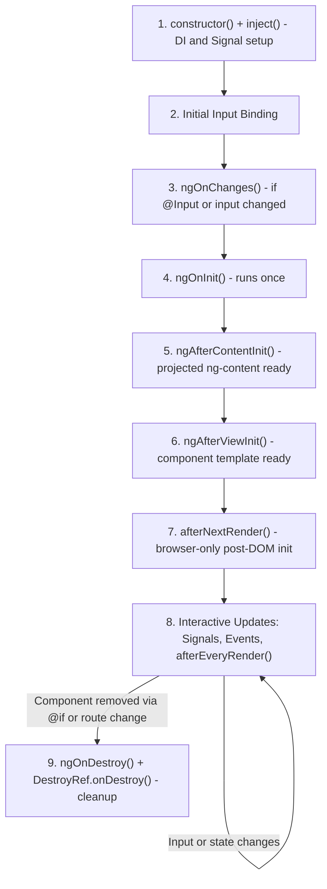
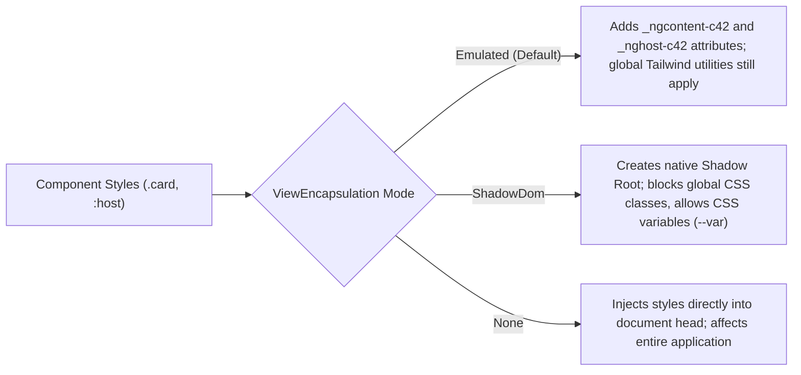

# Chapter 3: Component Fundamentals & View Encapsulation

## 1. Learning Objectives
By the end of this chapter, you will be able to:
* Understand the anatomy of an Angular 22 standalone component (`@Component` metadata, `host` bindings, `OnPush` change detection, and element vs. attribute selectors) and know when **not** to create a component.
* Master the full component lifecycle—including `constructor`, `ngOnInit`, `ngOnChanges`, `ngAfterViewInit`, `ngOnDestroy`, and modern Angular 22 primitives (`DestroyRef`, `afterNextRender`, and `afterEveryRender`).
* Write clean, high-performance templates using Angular's built-in Control Flow syntax (`@if`, `@for`, `@switch`, `@let`) and avoid `track` performance traps.
* Explain how View Encapsulation (`Emulated`, `ShadowDom`, `None`) works under the hood and integrate **Tailwind CSS v4** (`dark:` variants and suffix `!` modifiers) cleanly with component styles.
* Build flexible, design-system-safe enterprise wrappers using Content Projection (`<ng-content>`, multi-slot `select`, fallback content, `ngProjectAs`) and understand when lazy `<ng-template>` projection is required.

---

## 2. Introduction to Components

In Angular, a **Component** is a TypeScript class decorated with `@Component` that controls a specific region of the screen called a **view**. Every Angular application is a hierarchical tree of components rooted at `AppComponent` (rendered inside `<app-root>`).

Unlike React, where a component is a JavaScript function returning JSX, an Angular component cleanly separates its concerns—and in **Angular 22**, **standalone components are the default** (no `NgModule` boilerplate, and you no longer need to write `standalone: true` explicitly):

* **The Class (`.ts`):** Manages reactive state (via Signals like `signal()`, `computed()`, and `input()`), injects services with `inject()`, and defines interaction handlers.
* **The Template (`.html` or inline `template`):** Defines declarative HTML enhanced with Angular Control Flow (`@if`, `@for`, `@switch`, `@let`) and bindings.
* **The Styles (`.css`/`.scss`, inline `styles`, or Tailwind CSS v4):** Scoped to the component by default via View Encapsulation, working alongside global utility classes from Tailwind CSS v4.

> [!NOTE]
> **Standalone by Default (Angular 19–22):** Prior to Angular 19, every modern component required `standalone: true` inside `@Component({ ... })`. In Angular 22, standalone is the implicit default—any component without `standalone: false` is standalone and lists its template dependencies directly in its `imports: [...]` array.

### Anatomy of a Modern `@Component` Decorator

Understanding every metadata property in `@Component` separates beginners from architects:

| Property | Purpose | Angular 22 Enterprise Guidance |
|---|---|---|
| `selector` | CSS selector matching the component in parent templates | Use a consistent app prefix (`app-` or `normora-`). Prefer **element selectors** (`normora-status-card`) for block UI, and **attribute selectors** (`button[normoraButton]`) when enhancing native `<button>`/`<a>` elements so you preserve native accessibility without extra wrapper DOM nodes. |
| `imports` | Standalone components, directives, and pipes used in this template | Import only what the template uses; tree-shaking eliminates unused code per component. |
| `template` / `templateUrl` | Inline template string or path to `.html` file | Use inline `template` for small, focused UI components (under ~50 lines) and `templateUrl` for complex feature views. |
| `styles` / `styleUrl` | Inline CSS/SCSS or external stylesheet path | Keep minimal when using Tailwind CSS v4 utilities; reserve component CSS for `:host` layout rules, CSS custom properties, or animations. |
| `changeDetection` | `ChangeDetectionStrategy.OnPush` vs `Default` | **Always set `ChangeDetectionStrategy.OnPush`** (covered deeply in Chapter 13). In zoneless Angular 22, `OnPush` + Signals prevents unnecessary subtree checks and enforces predictable reactivity. |
| `host` | Declaratively binds attributes, classes, styles, and events on the host element | **Preferred over legacy `@HostBinding` and `@HostListener` decorators**—cleaner, tree-shakeable, and works seamlessly with Signals. |
| `encapsulation` | `Emulated` (default), `ShadowDom`, or `None` | Keep `Emulated` by default; see Section 5 for when `ShadowDom` or `None` makes sense. |

### When NOT to Create a Component

Creating a component for every tiny visual element adds unnecessary class instances, change-detection nodes, and wrapper tags (`<app-badge-wrapper>`) to the DOM:
* **Don't create a component just to style or attach behavior to a native element:** If you only need click tracking, permission disabling, or a focus ring on a `<button>`, write an **Attribute Directive** (Chapter 4) or use a Tailwind utility class.
* **Don't create a component just to format a value:** Converting bytes to MB or formatting currency belongs in a **Pure Pipe** (Chapter 4) or a `computed()` Signal.
* **Don't create a component for a single local expression:** Use `@let` inside the existing template instead of splitting 3 lines of HTML into a new file unless it is genuinely reused or encapsulates non-trivial state.

### Real-World Normora Examples: Component Design & Metadata

In **Normora** (`client/src/app/`), components are organized across `core/`, `layout/`, `shared/`, `features/`, and `design-system/components/`:

1. **Inline Attribute-Selector Button (`client/src/design-system/components/`):** `ButtonComponent` uses `selector: 'button[normoraButton], a[normoraButton]'` with `host: { class: 'inline-flex items-center justify-center rounded-lg font-medium transition-colors ...' }`. Using an attribute selector on native `<button>` preserves keyboard navigation, `disabled`, and `type="submit"` semantics without wrapping a `<button>` inside an extra `<normora-button>` tag.
2. **Co-located Smart Feature View (`client/src/app/features/documents/`):** `DocumentsPageComponent` uses external `templateUrl` and `OnPush`, hosting semantic HTML (`<main>`, `<header>`, `<section>`) with one `<h1>` per page for SEO and accessibility, and rendering a `DocumentTableComponent` and `DocumentUploadModalComponent`.
3. **Host-Bound Copilot Dock (`client/src/app/layout/`):** `CopilotDockComponent` uses `host: { '[class.w-96]': 'isOpen()', '[class.w-0]': '!isOpen()', '(document:keydown.control.j)': 'toggleDock($event)' }` so keyboard shortcuts (`Ctrl+J`) and width transitions live cleanly on the host element without `@HostListener`.
4. **A2UI Generative Cards (`client/src/app/features/conversations/`):** `ExpenseSimulatorCardComponent` and `HrEscalationCardComponent` are standalone `OnPush` components registered dynamically when the AI agent streams `policy_limit_card` or `hr_escalation_card` payloads over AG-UI/SSE.
5. **Thin Wrapper Rejection (`ApiMessages` Toasts):** Rather than building a `<normora-error-banner>` component for every single feature page, Normora centralizes error constants in `client/src/app/core/constants/api-messages.ts` and shares one design-system alert component driven by Signal inputs.

---

## 3. The Component Lifecycle

Angular creates, binds inputs to, renders, updates, and destroys components in a strict, deterministic order. You can tap into key moments of a component's existence using **Lifecycle Hook interfaces**, **Signal-driven primitives**, or **Render Callbacks**.

### Core & Modern Lifecycle Phases

1. **`constructor()` & `inject()` (Instantiation):** Runs first when JavaScript constructs the class instance. Use `inject()` (or constructor parameters) exclusively for **Dependency Injection** and setting up Signal fields (`computed()`, `effect()`, `afterNextRender()`). **Never** make HTTP calls or touch DOM elements here—inputs are not bound yet, and the template does not exist.
2. **`ngOnChanges(changes: SimpleChanges)` (Input Binding):** Runs before `ngOnInit()` and whenever a parent changes an `@Input()` property. Provides a `SimpleChanges` map with `previousValue` and `currentValue`. *(Angular 22 note: With Signal Inputs `input()`, you rarely need `ngOnChanges()`—derived values belong in `computed()` and side effects belong in `effect()`).*
3. **`ngOnInit()` (Initialization):** Called **exactly once** after Angular binds initial inputs. Place one-time component setup here (such as triggering an initial workspace fetch when inputs are required).
4. **`ngAfterContentInit()` (Projected Content Ready):** Called once after Angular projects external parent HTML into this component's `<ng-content>` slots and initializes `contentChild()` / `contentChildren()` queries.
5. **`ngAfterViewInit()` (Own View Ready):** Called once after Angular initializes the component's own template and child views (`viewChild()` / `viewChildren()`). Historically used for third-party DOM libraries, though in Angular 22 **`afterNextRender()`** is preferred because it is SSR-safe.
6. **`ngDoCheck()`, `ngAfterContentChecked()`, `ngAfterViewChecked()` (Check Hooks — Use Sparingly):** These run on *every* change detection cycle. Avoid putting business logic or heavy computations here; they can silently degrade frame rates.
7. **`afterNextRender()` & `afterEveryRender()` (Angular 17–22 Render Hooks):** Registered in the injection context (e.g., field initializer or `constructor()`). They run **only in the browser** after Angular commits DOM updates:
   * `afterNextRender(callback)`: Runs **once** after the next DOM render—ideal for initializing third-party libraries (charts, syntax highlighters, PDF viewers) or measuring initial element geometry without breaking Server-Side Rendering (SSR).
   * `afterEveryRender(callback)`: Runs after **every** DOM render—useful for keeping scrollbars pinned to the bottom during streaming AI responses, using `earlyRead` / `write` phases to avoid layout thrashing.
8. **`ngOnDestroy()` & `DestroyRef` (Teardown):** Called once right before Angular removes the component from the DOM. Crucial for clearing intervals, closing `IntersectionObserver`s, detaching SignalR listeners, and cancelling RxJS subscriptions. In modern Angular, injecting **`DestroyRef`** (`inject(DestroyRef).onDestroy(...)` or `takeUntilDestroyed()`) replaces manual `ngOnDestroy()` boilerplate and works inside reusable functions.

### Visual Diagram: Component Lifecycle & Render Flow



### When NOT to Use Lifecycle Hooks

* **Don't implement `ngOnChanges()` when `computed()` solves it:** Computing a CSS badge class or filtered list from a Signal `input()` should be a pure `computed()` Signal—never imperative `ngOnChanges()` state mutation.
* **Don't use `ngAfterViewInit()` for browser-only DOM APIs if SSR/hydration is enabled:** `ngAfterViewInit()` executes on the server during SSR; `afterNextRender()` guarantees the code only executes in a real browser DOM.
* **Don't implement `ngOnDestroy()` just to unsubscribe from one-shot `HttpClient` calls:** `HttpClient` observables complete after emitting the response; reserve `DestroyRef` / `takeUntilDestroyed()` for long-lived streams (SignalR, `ActivatedRoute.params`, `interval`, `fromEvent`).

### Real-World Normora Examples: Lifecycle & Cleanup

1. **SignalR `dataVersion` Listener Cleanup (`DestroyRef`):** When `EmployeesTableComponent` subscribes to Normora's SignalR hub (`IWorkspaceStateSynchronizer` broadcasting `dataVersion` updates), it uses `inject(DestroyRef)` with `takeUntilDestroyed()` so switching routes or logging out of the BFF session immediately cleans up the subscription.
2. **Chat Streaming Auto-Scroll (`afterEveryRender`):** In `CopilotThreadComponent`, as Google Gemini streams tokens over SSE into `NormoraWorkplaceAgent`, an `afterEveryRender()` callback checks if the user is near the bottom of `.custom-scrollbar` and smoothly scrolls the newest token into view.
3. **Markdown & Code Syntax Highlighting (`afterNextRender`):** `ChunkPreviewDrawerComponent` renders retrieved policy chunks from `Documents` (`pgvector` hybrid search). Because Markdown/code highlighting reads DOM `<code>` nodes, it initializes inside `afterNextRender()` rather than `constructor()` or `ngOnInit()`.
4. **Input-Driven Cost Calculation (`computed()` instead of `ngOnChanges`):** `ExpenseSimulatorCardComponent` receives `policyLimits = input.required<PolicyLimitDto>()` from the AG-UI payload. Instead of implementing `ngOnChanges()`, it derives `totalAllowance = computed(() => ...)` reactively whenever location tier or hotel nights change.
5. **Document Upload Timer Cleanup (`DestroyRef.onDestroy`):** If a diagnostic polling fallback timer is created while `DocumentUploadModalComponent` is open, `this.destroyRef.onDestroy(() => clearInterval(timerId))` guarantees zero orphan timers if the user presses `Escape` to close the modal.

---

## 4. Modern Control Flow (Angular v17–v22)

For years, Angular relied on structural directives like `*ngIf`, `*ngFor`, and `*ngSwitch` to manipulate the DOM. While functional, they required importing `CommonModule`, relied on runtime microsyntax parsing, and lacked clean type narrowing.

Angular v17 introduced **Built-in Control Flow** (`@if`, `@for`, `@switch`), and Angular v18.1 added **`@let`** for local template variables. These blocks are compiled directly into optimized template instructions—requiring **zero imports**, offering **strict TypeScript narrowing**, and delivering significantly faster list diffing.

### The `@if` Block (with `as` Aliasing)
```html
@if (sessionStatus() === 'CHARGING') {
  <div class="badge success">Active Charging</div>
} @else if (sessionStatus() === 'FAULT') {
  <div class="badge error">Hardware Fault</div>
} @else {
  <div class="badge default">Idle</div>
}
```
You can also capture a truthy expression into a narrowed local variable using `; as`:
```html
@if (activeTenant(); as tenant) {
  <span>{{ tenant.name }} ({{ tenant.planTier }})</span>
}
```

### The `@for` Block and Mandatory `track`
The `@for` block **requires** a `track` expression and supports a built-in `@empty` fallback block. Under the hood, Angular uses `track` to map each data item to its existing DOM subtree via an efficient O(n) diffing algorithm, moving DOM nodes in place instead of destroying and recreating them.

```html
<ul>
  @for (charger of chargers(); track charger.id) {
    <li>{{ charger.name }} - {{ charger.status }}</li>
  } @empty {
    <li>No chargers found for this site.</li>
  }
</ul>
```

Inside `@for`, Angular exposes six read-only contextual variables: ``$index``, ``$count``, ``$first``, ``$last``, ``$even``, and ``$odd``.

> [!IMPORTANT]
> **Choosing the Right `track` Key:**
> * **Best:** A stable unique primitive ID (`track doc.id` or `track message.messageId`).
> * **Acceptable only for static lists:** `track $index` when items are purely primitive read-only strings that never reorder, insert at the top, or hold child component state. If a list reorders or prepends items, `track $index` forces Angular to reuse the wrong component instances and causes subtle input/focus bugs!
> * **Dangerous for immutable updates:** `track item` (object identity) breaks if an API refetch or Signal update replaces objects with fresh clones—Angular sees new object references and destroys/recreates every row in the DOM.

### The `@switch` Block
Unlike legacy `[ngSwitch]`, `@switch` enforces strict `===` equality and narrows discriminated unions cleanly:
```html
@switch (citation.sourceType) {
  @case ('PDF') { <span class="text-xs font-medium">PDF Policy</span> }
  @case ('MARKDOWN') { <span class="text-xs font-medium">Knowledge Doc</span> }
  @default { <span class="text-xs font-medium">Workspace File</span> }
}
```

### The `@let` Declaration (Angular 18.1+)
`@let` declares a read-only local template variable, eliminating repeated signal calls or `async` pipe evaluations within a single template block:
```html
@let plan = subscriptionPlan();
@let isFreeTier = plan.tier === 'Free';
```

### When NOT to Use Built-In Control Flow
* **Don't use `@for` alone for 1,000+ DOM-heavy rows:** Even with `track`, rendering 2,000 rich table rows or audit log entries simultaneously bloats memory and layout time. Use server-side pagination or `@angular/cdk/scrolling` Virtual Scrolling (Chapter 15).
* **Don't use `@if` to hide heavy forms whose transient UI state should survive tab toggles:** `@if` completely destroys the child component and resets its internal Signals/scroll state when false. If preserving DOM state across rapid toggles is critical, consider CSS visibility (`[class.hidden]`) or lift the state to a Signal store.
* **Don't push complex business logic into `@let`:** Keep `@let` for simple template ergonomics (aliases or formatting helpers); multi-step calculations belong in `computed()` Signals.

### Real-World Normora Examples: Built-In Control Flow

1. **Free-Tier Subscription Invariant (`@if` in `BillingSettingsComponent`):** Per Normora's billing rules, Free-tier workspaces must never render cancellation buttons, danger zones, or renewal countdowns: `@if (subscription().tier !== 'Free') { <normora-cancel-danger-zone /> }`.
2. **RAG Citations List (`@for` with `track citation.chunkId` + `@empty`):** `CopilotMessageComponent` renders retrieved policy citations using `@for (citation of message().citations; track citation.chunkId; let i = $index)` with `@empty { <p class="text-xs text-slate-500 dark:text-slate-400">No document citations referenced.</p> }`.
3. **Live Agent Tool Lifecycle Chips (`@switch` on `tool.status`):** As AG-UI streams `tool_started` and `tool_finished` events (e.g., `documents_search`, `workspace_list_employees`), `ToolChipComponent` switches on `tool.status` (`'RUNNING'`, `'COMPLETED'`, `'AWAITING_APPROVAL'`, `'FAILED'`) to render spinning vs. checkmark badges.
4. **HR Escalation 3-Stage Timeline (`@for` + ``$last`` in `HrEscalationCardComponent`):** Renders `['Dispatched', 'Under Review', 'Resolution']` using ``$last`` (`@if (!$last) { <div class="connector-line"></div> }`) to omit the trailing connector line after the final stage.
5. **Local Currency Formatting Alias (`@let` in `PlanPricingCardComponent`):** Uses `@let priceLabel = formatCatalogPrice(plan(), selectedCurrency(), billingCycle());` so the header badge, annual savings note, and checkout button ARIA label share one clean reference without re-invoking the helper.

---

## 5. View Encapsulation & Styling Architecture

One of Angular's defining enterprise features is **View Encapsulation** (`ViewEncapsulation` enum). When you author styles inside a component, Angular scopes them so a `.card` rule in one feature never accidentally breaks a `.card` layout in another lazy-loaded route.

### How the Three Encapsulation Modes Work



#### 1. `ViewEncapsulation.Emulated` (Default)
Angular emulates Shadow DOM isolation at compile time without creating a real browser Shadow Root:
* **Component Host Element:** `<normora-doc-card _nghost-c42>...</normora-doc-card>`
* **Component Template HTML:** `<div _ngcontent-c42 class="card">...</div>`
* **Compiled CSS:** `.card[_ngcontent-c42] { padding: 1rem; }`

Because of those generated attributes:
* **`:host` targets the component's own custom element** (compiled to `[_nghost-c42]`), which is essential because custom elements default to `display: inline`. Always add `:host { display: block; }` when a component should behave like a block container.
* **`:host-context(.dark)`** matches when an ancestor has `.dark`, though in Tailwind CSS v4 you should prefer `dark:` utility classes directly in the template.
* **Global styles and Tailwind CSS v4 utilities flow *in*** seamlessly, while your component-scoped CSS never leaks *out*.

#### 2. `ViewEncapsulation.ShadowDom`
Angular attaches a native browser Shadow Root (`attachShadow({ mode: 'open' })`).
* **Pros:** True browser-level isolation; external stylesheets cannot bleed in.
* **Cons:** Global utility frameworks (**Tailwind CSS v4**, PrimeNG themes, `.custom-scrollbar`) do **not** penetrate the Shadow Root unless explicitly imported inside the component. Only inherited properties and **CSS Custom Properties** (`--normora-brand-primary`) cross the Shadow DOM boundary.

#### 3. `ViewEncapsulation.None`
Disables encapsulation entirely. Angular injects the component's styles into the global `<head>`, affecting the entire SPA. Even if you delete the component later, its styles can collide across routes.

> [!NOTE]
> **Avoid `::ng-deep`:** Legacy Angular codebases used `::ng-deep` to force styles down into child components (such as PrimeNG overlays). `::ng-deep` is deprecated—and without `:host ::ng-deep`, it leaks globally! Prefer **CSS Custom Properties**, Tailwind utility classes passed via `input()` / `host`, or intentional overrides in global `styles.css`.

### Integrating Tailwind CSS v4 with Angular Encapsulation

Normora uses **Tailwind CSS v4** alongside Angular's default `ViewEncapsulation.Emulated`. Three strict rules keep styling predictable:
1. **Important modifier is a SUFFIX (`class!`):** Tailwind v4 moves `!important` from a prefix to a suffix. Write `border-none!`, `shadow-none!`, or `outline-none!`—**never** `!border-none` (which Tailwind v4 silently ignores).
2. **Dark mode `dark:` variants on every color:** Every background, text, border, and ring class must declare its dark pair (for example: `bg-white dark:bg-slate-900 text-slate-900 dark:text-slate-100 border-slate-200 dark:border-slate-700`).
3. **Custom scrollbars:** Overflowing lists and chat threads apply `.custom-scrollbar` from global styles so scrollbars look crisp across Chromium, Firefox, and WebKit.

### When NOT to Use `ShadowDom` or `None`
* **Don't use `ViewEncapsulation.ShadowDom` on standard UI components in a Tailwind/PrimeNG app:** You will break Tailwind utility classes and PrimeNG component tokens inside that template. Reserve `ShadowDom` strictly for embedding untrusted/third-party HTML widgets or building standalone Web Components (`@angular/elements`).
* **Don't use `ViewEncapsulation.None` just to style a child component:** Put shared design tokens or third-party library overrides in `src/styles.css` (or a dedicated Tailwind `@layer components` partial) rather than scattering unscoped styles inside feature components.

### Real-World Normora Examples: View Encapsulation & Styling

1. **White-Label Tenant Theme Shell (`TenantBrandShellComponent` — `Emulated` + `:host` CSS variables):** Binds `--brand-accent` on the host element (`host: { '[style.--brand-accent]': 'branding().primaryColor' }`) while keeping layout styles encapsulated and allowing Tailwind utilities to read `bg-[var(--brand-accent)]`.
2. **Markdown Policy Reader (`ChunkPreviewDrawerComponent` — `Emulated`):** Uses scoped `.prose-chunk h2` rules inside component CSS so rendered policy headings retrieved from `Documents` don't clash with app headings, while outer drawer chrome uses `bg-white dark:bg-slate-900 border-l border-slate-200 dark:border-slate-800`.
3. **Copilot Dock Container (`CopilotDockComponent` — `Emulated` + Tailwind v4):** Applies `border-none! shadow-none!` on nested PrimeNG input triggers and `.custom-scrollbar` on the message feed without disabling View Encapsulation.
4. **External HTML Policy Previewer (`RawPolicyPreviewComponent` — `ShadowDom`):** If rendering vendor-supplied rich HTML brochures with arbitrary embedded `<style>` tags (after sanitization), `ShadowDom` prevents those embedded rules from mutating Normora's navigation bar or buttons.
5. **Global PrimeNG & Scrollbar Layer (`src/styles.css` instead of `ViewEncapsulation.None`):** Normora places `.custom-scrollbar` and PrimeNG dialog dark-mode tokens in global stylesheets rather than putting `ViewEncapsulation.None` on `AppComponent` or modal wrappers.

---

## 6. Content Projection (`<ng-content>`)

Content Projection (similar to `children` in React or `slots` in Vue) lets a parent component pass arbitrary template markup into designated slots of a child wrapper component. It is the backbone of reusable layout primitives like Modals, Cards, Drawers, and Empty States.

### Single-Slot Projection
**Card Component Template (`app-card`)**
```html
<div class="enterprise-card rounded-xl border border-slate-200 dark:border-slate-700 bg-white dark:bg-slate-900 p-4">
  <!-- Whatever the parent puts inside <app-card> goes here -->
  <ng-content />
</div>
```

### Multi-Slot Projection & `select`
In enterprise design systems, wrappers often enforce distinct regions (Header, Body, Footer) using CSS selectors inside the `select` attribute (matching attributes `[slot-name]`, element tags `normora-badge`, or classes `.actions`):

**Modal Component Template (`app-modal`)**
```html
<div class="modal-dialog bg-white dark:bg-slate-900 text-slate-900 dark:text-slate-100">
  <header>
    <ng-content select="[modal-title]" />
  </header>

  <main>
    <ng-content /> <!-- Default catch-all for unselected content -->
  </main>

  <footer>
    <ng-content select="[modal-actions]" />
  </footer>
</div>
```

**Usage by Parent Component:**
```html
<app-modal>
  <h2 modal-title>Delete Charger</h2>

  <p>Are you sure you want to delete this charging station? This cannot be undone.</p>

  <div modal-actions>
    <button (click)="cancel()">Cancel</button>
    <button class="danger" (click)="confirm()">Delete</button>
  </div>
</app-modal>
```

### Default Fallback Content (Angular 18+)
If a parent omits an optional slot, `<ng-content>` renders any fallback markup placed directly inside its tags:
```html
<footer>
  <ng-content select="[modal-actions]">
    <button type="button" class="text-slate-600 dark:text-slate-300" (click)="close()">Close</button>
  </ng-content>
</footer>
```

### Wrapper-Free Slot Matching with `ngProjectAs`
Sometimes you want to group projected elements inside `<ng-container>` (which leaves zero DOM nodes) or project a custom component into a named slot without adding an extra `<div>`:
```html
<app-modal>
  <ng-container ngProjectAs="[modal-actions]">
    @if (canDelete()) {
      <button type="button" (click)="confirm()">Delete</button>
    }
    <button type="button" (click)="cancel()">Cancel</button>
  </ng-container>
</app-modal>
```

### The Eager Instantiation Gotcha (Crucial Architect Detail)
Wrapping `<ng-content />` inside `@if (isOpen())` **does not prevent the parent from instantiating the projected components!** Angular instantiates projected children inside the *parent's* template lifecycle and only hides or detaches them in the child.
* If a tab panel or modal body triggers expensive `HttpClient` calls or mounts heavy editors, use **`<ng-template>` + `ngTemplateOutlet`** (covered in Chapter 8) instead of `<ng-content>` so the child truly renders lazily on demand.

### When NOT to Use Content Projection
* **Strict design-system uniformity:** If a `StatusBadge` or `MetricTile` should always look identical (title + icon + single number), pass typed Signal `input()` values instead of `<ng-content>` so teams cannot accidentally project unstyled HTML or break visual consistency.
* **Heavy lazy content:** When an accordion, tab, or drawer should not instantiate or fetch data until opened, use `<ng-template>` rather than `<ng-content>`.

### Real-World Normora Examples: Content Projection

1. **Workspace Shell Layout (`WorkspaceShellComponent`):** Uses multi-slot projection (`select="[shell-sidebar]"`, `select="[shell-topbar]"`, and default `<ng-content />` inside `<main>`) so Tenant Admin and Employee portals share one responsive mobile-first frame with `.custom-scrollbar`.
2. **Design-System Confirmation Dialog (`NormoraDialogComponent`):** Projects `[dialog-title]`, `[dialog-body]`, and `[dialog-footer]` with a default fallback "Dismiss" button inside `[dialog-footer]` for read-only alerts.
3. **HITL Destructive Approval Banner (`ApprovalCardShellComponent`):** Uses `ngProjectAs="[approval-actions]"` on an `<ng-container>` to conditionally project "Approve `documents_delete`" and "Reject" buttons only when the user holds BFLA permission.
4. **Workspace Empty State (`EmptyStateCardComponent`):** Provides fallback `<ng-content select="[empty-action]">` markup that renders a generic "Refresh" link unless `DocumentsPageComponent` projects an "Upload First Policy" button.
5. **Why `ChunkPreviewDrawerComponent` Avoids Plain `<ng-content>` for Heavy Markdown:** Because opening a citation drawer shouldn't mount Markdown renderers for closed drawers, `ChunkPreviewDrawerComponent` receives typed Signal `input()` data (`chunk = input<RetrievedChunk | null>(null)`) and mounts the viewer inside `@if (chunk(); as activeChunk)` rather than eagerly projecting hidden DOM via `<ng-content>`.

---

## 7. Enterprise Case Studies

### Case Study A: The Charger Status Badge (Modernized to Angular 22)

Let's revisit a classic EV Charging Platform status badge upgraded to **Angular 22**: standalone by default (no `standalone: true` needed), `OnPush` change detection, Signal `input.required()`, `computed()` styling, `@switch` control flow, and Tailwind CSS v4 with full `dark:` mode variants.

**`charger-badge.component.ts`**
```typescript
import { ChangeDetectionStrategy, Component, computed, input } from '@angular/core';

export type ChargerStatus = 'AVAILABLE' | 'CHARGING' | 'FAULTED' | 'OFFLINE';

@Component({
  selector: 'app-charger-badge',
  changeDetection: ChangeDetectionStrategy.OnPush,
  host: { class: 'inline-block' },
  template: `
    <span [class]="badgeClasses()">
      @switch (status()) {
        @case ('AVAILABLE') { 🟢 Ready }
        @case ('CHARGING')  { ⚡ In Use }
        @case ('FAULTED')   { 🔴 Hardware Fault }
        @case ('OFFLINE')   { ⚪ Disconnected }
      }
    </span>
  `
})
export class ChargerBadgeComponent {
  readonly status = input.required<ChargerStatus>();

  private readonly statusPalette: Record<ChargerStatus, string> = {
    AVAILABLE: 'bg-emerald-100 text-emerald-800 dark:bg-emerald-950/60 dark:text-emerald-300',
    CHARGING: 'bg-blue-100 text-blue-800 dark:bg-blue-950/60 dark:text-blue-300',
    FAULTED: 'bg-red-100 text-red-800 dark:bg-red-950/60 dark:text-red-300',
    OFFLINE: 'bg-slate-100 text-slate-700 dark:bg-slate-800 dark:text-slate-300',
  };

  readonly badgeClasses = computed(
    () => `inline-flex items-center px-2.5 py-0.5 rounded-full text-xs font-semibold ${this.statusPalette[this.status()]}`
  );
}
```

### Case Study B: Normora `DocumentStatusCardComponent` (Full Architecture)

In **Normora**, uploaded company policies transition asynchronously through the **Transactional Outbox** and **Hangfire (`Normora.Worker`)** ingestion pipeline (`Pending` → `Processing` → `Indexed` or `Failed`). This card combines semantic HTML, `OnPush` + Signals, `:host` Emulated encapsulation, Tailwind v4 `dark:` + suffix `!`, `ApiMessages` constants, and multi-slot `<ng-content>` with fallback markup:

**`client/src/app/features/documents/components/document-status-card.component.ts`**
```typescript
import { ChangeDetectionStrategy, Component, computed, input } from '@angular/core';
import { ApiMessages } from '../../../core/constants/api-messages';

export type IngestionStatus = 'Pending' | 'Processing' | 'Indexed' | 'Failed';

export interface DocumentCardItem {
  id: string;
  fileName: string;
  departmentName: string;
  chunkCount: number;
  status: IngestionStatus;
}

@Component({
  selector: 'normora-document-status-card',
  changeDetection: ChangeDetectionStrategy.OnPush,
  host: {
    class: 'block',
    '[attr.aria-busy]': "document().status === 'Processing'",
  },
  styles: [`
    :host {
      display: block;
    }
    .pulse-ring {
      animation: normoraPulse 2s cubic-bezier(0.4, 0, 0.6, 1) infinite;
    }
    @keyframes normoraPulse {
      0%, 100% { opacity: 1; }
      50% { opacity: 0.45; }
    }
  `],
  template: `
    @let doc = document();
    <article
      class="rounded-xl border border-slate-200 dark:border-slate-700 bg-white dark:bg-slate-900 p-4 shadow-sm transition-colors"
    >
      <header class="flex flex-col sm:flex-row sm:items-center sm:justify-between gap-2">
        <div class="min-w-0">
          <h3 class="truncate text-sm font-semibold text-slate-900 dark:text-slate-100">
            {{ doc.fileName }}
          </h3>
          <p class="text-xs text-slate-500 dark:text-slate-400">
            {{ doc.departmentName }} · {{ doc.chunkCount }} chunks
          </p>
        </div>

        <span [class]="statusBadgeClass()">
          @switch (doc.status) {
            @case ('Pending') { Queued }
            @case ('Processing') {
              <span class="pulse-ring mr-1.5 inline-block h-2 w-2 rounded-full bg-amber-500 dark:bg-amber-400"></span>
              Indexing...
            }
            @case ('Indexed') { Ready for RAG }
            @case ('Failed') { Ingestion Failed }
          }
        </span>
      </header>

      @if (doc.status === 'Failed') {
        <p
          role="alert"
          class="mt-3 rounded-lg border-none! bg-red-50 dark:bg-red-950/50 px-3 py-2 text-xs text-red-700 dark:text-red-300"
        >
          {{ ingestionFailedMessage }}
        </p>
      }

      <div class="mt-3 text-sm text-slate-600 dark:text-slate-300">
        <ng-content />
      </div>

      <footer class="mt-4 flex flex-wrap items-center justify-end gap-2 border-t border-slate-100 dark:border-slate-800 pt-3">
        <ng-content select="[card-actions]">
          <span class="text-xs text-slate-400 dark:text-slate-500">No actions available</span>
        </ng-content>
      </footer>
    </article>
  `
})
export class DocumentStatusCardComponent {
  readonly document = input.required<DocumentCardItem>();
  protected readonly ingestionFailedMessage = ApiMessages.DocumentIngestionFailed;

  readonly statusBadgeClass = computed(() => {
    const base = 'inline-flex items-center rounded-full px-2.5 py-0.5 text-xs font-medium';
    switch (this.document().status) {
      case 'Indexed':
        return `${base} bg-emerald-100 text-emerald-800 dark:bg-emerald-950/60 dark:text-emerald-300`;
      case 'Processing':
        return `${base} bg-amber-100 text-amber-800 dark:bg-amber-950/60 dark:text-amber-300`;
      case 'Failed':
        return `${base} bg-red-100 text-red-800 dark:bg-red-950/60 dark:text-red-300`;
      default:
        return `${base} bg-slate-100 text-slate-700 dark:bg-slate-800 dark:text-slate-300`;
    }
  });
}
```

---

## 8. Common Mistakes & Anti-Patterns

> [!CAUTION]
> **1. Memory Leaks from Unclosed Streams & SignalR Subscriptions**
>
> **Wrong:**
> ```typescript
> ngOnInit(): void {
>   this.signalRService.dataVersion$.subscribe(v => this.reloadTenants(v));
> }
> ```
> **Why it's wrong:** When a user closes a drawer or navigates to another Normora module, the component instance is destroyed, yet the long-lived SignalR subscription stays pinned in memory and triggers stale callbacks on dead components.
>
> **Fix:** Inject `DestroyRef` (or use `takeUntilDestroyed()` in the injection context):
> ```typescript
> private readonly destroyRef = inject(DestroyRef);
>
> ngOnInit(): void {
>   this.signalRService.dataVersion$
>     .pipe(takeUntilDestroyed(this.destroyRef))
>     .subscribe(v => this.reloadTenants(v));
> }
> ```

> [!CAUTION]
> **2. Direct DOM Manipulation or Accessing `document` in `constructor()`**
>
> **Wrong:**
> ```typescript
> constructor() {
>   const el = document.getElementById('copilot-scroll-box');
>   if (el) el.scrollTop = el.scrollHeight;
> }
> ```
> **Why it's wrong:** The template has not rendered yet in `constructor()`, direct DOM queries bypass Angular's rendering engine, and `document.getElementById` crashes during SSR or breaks multiple component instances sharing an ID.
>
> **Fix:** Use a `viewChild()` Signal query and `afterNextRender()` (or `afterEveryRender()`):
> ```typescript
> private readonly scrollBox = viewChild<ElementRef<HTMLElement>>('scrollBox');
>
> constructor() {
>   afterNextRender(() => {
>     const el = this.scrollBox()?.nativeElement;
>     if (el) el.scrollTop = el.scrollHeight;
>   });
> }
> ```

> [!CAUTION]
> **3. Tracking `@for` Loops by `$index` on Dynamic or Reordered Lists**
>
> **Wrong:**
> ```html
> @for (doc of workspaceDocs(); track $index) {
>   <normora-document-status-card [document]="doc" />
> }
> ```
> **Why it's wrong:** When new documents are uploaded or sorted, index `0` now points to a completely different document, causing Angular to reuse the wrong component state, animations, and focus rings (and destroy/re-render needlessly).
>
> **Fix:** Always track by a stable unique identifier:
> ```html
> @for (doc of workspaceDocs(); track doc.id) {
>   <normora-document-status-card [document]="doc" />
> }
> ```

> [!CAUTION]
> **4. Omitting `ChangeDetectionStrategy.OnPush` or Mutating Plain Fields in Zoneless Angular 22**
>
> **Wrong:**
> ```typescript
> @Component({
>   selector: 'normora-quota-banner',
>   template: `<p>Used: {{ usedMb }} MB</p>`
> })
> export class QuotaBannerComponent {
>   usedMb = 0;
>   refresh(): void {
>     setTimeout(() => { this.usedMb = 420; }, 500);
>   }
> }
> ```
> **Why it's wrong:** In zoneless Angular 22, Zone.js no longer patches `setTimeout` or async callbacks to sweep the component tree. Updating a plain property does not notify Angular that the view needs re-rendering.
>
> **Fix:** Always configure `ChangeDetectionStrategy.OnPush` and store reactive view state in Signals (`signal`, `computed`, `input`):
> ```typescript
> @Component({
>   selector: 'normora-quota-banner',
>   changeDetection: ChangeDetectionStrategy.OnPush,
>   template: `<p>Used: {{ usedMb() }} MB</p>`
> })
> export class QuotaBannerComponent {
>   readonly usedMb = signal(0);
>   refresh(): void {
>     setTimeout(() => this.usedMb.set(420), 500);
>   }
> }
> ```

> [!CAUTION]
> **5. Using Tailwind v3 `!important` Prefix Syntax (`!border-none`) or Missing `dark:` Variants**
>
> **Wrong:**
> ```html
> <div class="!border-none bg-white text-slate-900">...</div>
> ```
> **Why it's wrong:** In Tailwind CSS v4, `!important` must be a **suffix**—`!border-none` does not compile as `!important`. Worse, omitting `dark:bg-slate-900 dark:text-slate-100` creates blinding white boxes and unreadable text in dark mode.
>
> **Fix:** Use the v4 suffix modifier and pair every color with a `dark:` variant:
> ```html
> <div class="border-none! bg-white dark:bg-slate-900 text-slate-900 dark:text-slate-100">...</div>
> ```

> [!CAUTION]
> **6. Expecting `@if` Around `<ng-content>` to Lazily Instantiate Projected Components**
>
> **Wrong:**
> ```html
> <!-- Child ModalComponent -->
> @if (isOpen()) {
>   <div class="modal"><ng-content /></div>
> }
> ```
> **Why it's wrong:** Even when `isOpen()` is `false`, the parent component has already instantiated any child components placed between `<app-modal>...</app-modal>`, firing their `ngOnInit()` and HTTP calls prematurely!
>
> **Fix:** Use an `<ng-template>` passed via `contentChild` and rendered with `ngTemplateOutlet` inside `@if (isOpen())`, or pass data via `input()` and render conditionally inside the modal.

> [!CAUTION]
> **7. Hardcoding Error Strings or Over-Projecting Strict Design-System Cards**
>
> **Wrong:**
> ```typescript
> errorText.set('Document failed to process. Try again.');
> ```
> ```html
> <!-- Over-flexible Card allowing arbitrary raw HTML -->
> <normora-metric-card><ng-content /></normora-metric-card>
> ```
> **Why it's wrong:** Hardcoded error strings violate Normora's zero-magic-strings rule and drift out of sync with backend `ApiMessages`, while over-using `<ng-content>` on strict metric tiles lets developers inject inconsistent typography and unescaped HTML.
>
> **Fix:** Import `ApiMessages` from `client/src/app/core/constants/api-messages.ts` for all alerts/toasts, and enforce strict design-system components with typed Signal `input.required()` properties instead of unconstrained `<ng-content>`.

---

## 9. Interview Questions

### Junior
**1. Q: In Angular 22, why don't we write `standalone: true` or declare components inside an `NgModule`?**
> A: Starting in Angular 19 and continuing through Angular 22, `standalone: true` is the implicit default for components, directives, and pipes. Every component declares its own template dependencies directly in its `@Component({ imports: [...] })` array, eliminating `NgModule` indirection and enabling finer-grained tree-shaking.

**2. Q: What is the difference between a component's `constructor()` and `ngOnInit()`?**
> A: The `constructor()` runs first when JavaScript instantiates the class and should only be used for Dependency Injection (`inject()`) and reactive field initialization (`computed`, `effect`, `afterNextRender`). `ngOnInit()` runs once *after* Angular binds the component's initial inputs, making it the proper place for setup logic that depends on input values.

### Senior
**3. Q: Explain how Angular's `Emulated` View Encapsulation works under the hood and how Tailwind CSS v4 works with it.**
> A: At compile time, Angular generates unique attributes per component (`_nghost-c*` on the host tag and `_ngcontent-c*` on template elements) and rewrites component CSS selectors (e.g., `.card[_ngcontent-c42]`) so local styles cannot leak out. Global styles—including Tailwind CSS v4 utility classes (`bg-white dark:bg-slate-900`, `border-none!`)—still apply inside the component seamlessly, unlike `ViewEncapsulation.ShadowDom`.

**4. Q: Why does `@for` require a `track` expression, and why is `track $index` dangerous for dynamic lists?**
> A: `track` maps each item in an iterable to its existing DOM subtree so Angular's O(n) diffing engine can move and reuse DOM nodes rather than tearing down and recreating them. Using `track $index` on lists that insert, delete, or reorder items causes Angular to associate an existing DOM element (and its child component state/focus) with a completely different data item; always track by a stable unique ID such as `track doc.id`.

**5. Q: When should you use `afterNextRender()` instead of `ngAfterViewInit()`, and `DestroyRef` instead of `ngOnDestroy()`?**
> A: `afterNextRender()` executes strictly in the browser *after* Angular finishes committing DOM updates, preventing SSR crashes and layout thrashing when integrating third-party DOM libraries or measuring element sizes (`ngAfterViewInit()` still runs on the server under SSR). `DestroyRef` (`inject(DestroyRef).onDestroy(...)` or `takeUntilDestroyed()`) eliminates `ngOnDestroy` boilerplate and lets reusable helper functions register their own teardown logic cleanly.

### Architect
**6. Q: A team puts `<ng-content />` inside `@if (isOpen())` in a shared modal component, yet child components inside the modal still fire HTTP requests when the page loads. Why, and how do you fix it?**
> A: Angular instantiates projected content inside the **parent** template's lifecycle, not the child modal's `@if` block—so the child modal's `@if` only controls DOM attachment, not instantiation. To achieve true lazy instantiation, the parent must wrap the modal body in an `<ng-template>` (captured via `contentChild(TemplateRef)` and rendered inside `@if (isOpen())` with `ngTemplateOutlet`), or mount the child component dynamically.

**7. Q: How would you architect white-label tenant theming across 50+ components in Normora: `ViewEncapsulation.Emulated`, `ShadowDom`, or `None`?**
> A: Keep `ViewEncapsulation.Emulated` globally. `ShadowDom` blocks Tailwind CSS v4 utilities and PrimeNG overlays from penetrating component boundaries, while `None` creates global CSS collisions across lazy-loaded chunks. Instead, bind tenant brand tokens as CSS Custom Properties on the root `:host` (`--brand-primary`, `--brand-accent`) and combine them with Tailwind v4 utilities and `dark:` variants.

**8. Q: In a zoneless Angular 22 application, why is `ChangeDetectionStrategy.OnPush` + Signals critical even for simple presentational components?**
> A: Without Zone.js, Angular no longer runs top-down dirty checking after every DOM event, timer, or network callback. Combining `ChangeDetectionStrategy.OnPush` with Signals (`input()`, `signal()`, `computed()`) gives Angular an exact reactive dependency graph so only the specific views whose read Signals changed are scheduled for rendering—delivering predictable performance and preventing stale UI bugs.

---

## 10. Summary
In this chapter, we mastered the anatomy of an Angular 22 standalone component (`@Component` metadata, `host` bindings, `OnPush`), the full lifecycle from `constructor()`/`inject()` to `afterNextRender()` and `DestroyRef`, built-in Control Flow (`@if`, `@for`, `@switch`, `@let`), View Encapsulation paired with Tailwind CSS v4 (`dark:` and suffix `!`), and safe Content Projection (`<ng-content>`, fallback slots, `ngProjectAs`). In Chapter 4, we will explore Directives and Pipes, learning how to attach reusable behavior and pure data transformations directly to HTML elements.
