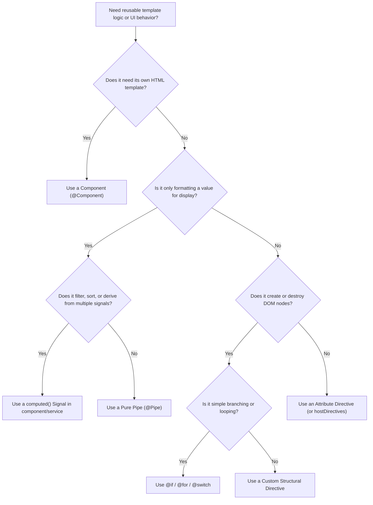
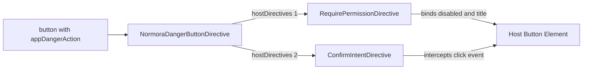
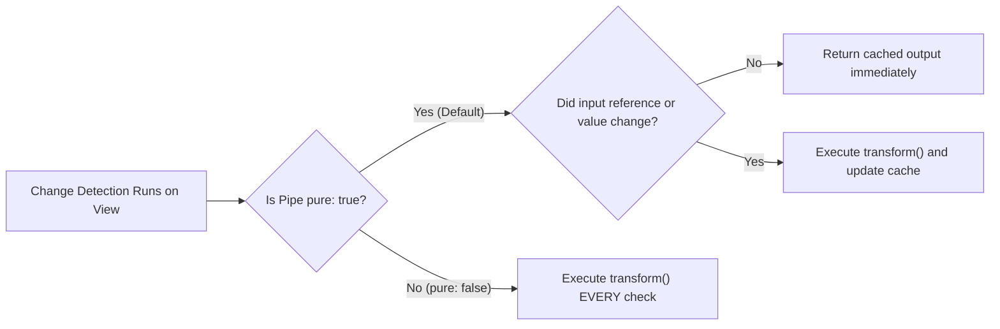

# Chapter 4: Directives & Pipes

## 1. Learning Objectives
By the end of this chapter, you will be able to:
* Distinguish between Components, Attribute Directives, Structural Directives, Pipes, and Computed Signals—and know when **not** to use each.
* Build modern Angular 22 Attribute Directives using `host` metadata bindings, Signal `input()` / `effect()`, `ElementRef`, `Renderer2`, `exportAs`, and `DestroyRef` (while understanding legacy `@HostBinding` and `@HostListener`).
* Build Structural Directives (`TemplateRef`, `ViewContainerRef`, `ngTemplateContextGuard`) and compose reusable behaviors cleanly with `hostDirectives`.
* Use Angular's built-in pipes and build custom Pure Pipes with `PipeTransform` and `inject()`.
* Explain how Pure vs. Impure Pipes behave under **zoneless change detection**, how `AsyncPipe` compares to `toSignal()`, and why derived filtering/sorting belongs in `computed()` Signals.
* Apply these patterns across real-world **Normora** enterprise UI scenarios (RBAC BFLA gating, multi-currency billing, streaming chat auto-scroll, document ingestion formatting, and Tailwind CSS v4 dark-mode styling).

---

## 2. Introduction to Directives & Architectural Selection

In Angular, a **Component** is actually just a Directive with an HTML template and optional encapsulated styles. **Directives** are classes marked with `@Directive` that attach custom behavior, DOM manipulations, or layout rules to elements in your templates. When Angular compiles and renders a template, it instantiates attached directives and executes their instructions against the host element.

There are three kinds of directives in Angular:
1. **Components (`@Component`):** Directives with a template and view encapsulation. (Covered in Chapter 3).
2. **Attribute Directives (`@Directive`):** Change the appearance, attributes, styles, or event behavior of an existing DOM element, component, or another directive without adding/removing DOM nodes.
3. **Structural Directives (`@Directive` with `*` microsyntax):** Dynamically add, remove, or reorder DOM subtrees by wrapping a host element in an `<ng-template>` and manipulating a `ViewContainerRef`. *(Note: As discussed in Chapter 3, Angular 17–22 replaces built-in `*ngIf`, `*ngFor`, and `*ngSwitch` with built-in Control Flow syntax `@if`, `@for`, and `@switch`, which are faster and require no imports. Custom structural directives remain valuable for cross-cutting DOM gating like feature flags or strict security stripping).*

> [!NOTE]
> **Standalone by Default (Angular 19–22):** Prior to Angular 19, you had to explicitly write `standalone: true` inside `@Directive({ ... })` and `@Pipe({ ... })`. In Angular 22, **standalone is the implicit default**—any directive or pipe without `standalone: false` is standalone and can be imported directly into a component's `imports: [...]` array without an `NgModule`.

### Decision Matrix: Component vs. Directive vs. Pipe vs. Computed Signal

Beginners often reach for a Component when a Directive is cleaner, or a Pipe when a `computed()` Signal is required. Use this decision flow before writing code:



### Real-World Normora Architectural Mapping (5 Examples)

In **Normora** (an enterprise multi-tenant RAG and knowledge platform backed by a `.NET 10` modular monolith and **Duende BFF** cookie authentication), choosing the right primitive keeps components lean:

1. **Interactive Expense Simulator (`ExpenseSimulatorCardComponent` -> Component):** Renders multi-field hotel night steppers, location tier dropdowns, and allowance totals inside the Copilot chat—it owns its own template and state, so it must be a Component.
2. **BFLA Action Gating (`appRequirePermission` -> Attribute Directive):** Disables workspace buttons (like inviting employees or triggering `documents_delete`) when the signed-in user's BFF session permissions lack access, without duplicating disabled/tooltip logic in every component.
3. **Free-Tier Danger Zone Stripping (`*appRequiresPlanTier` -> Structural Directive):** Per Normora's billing invariants, workspaces on the `Free` tier must never render subscription cancellation buttons, danger zones, or renewal countdowns in the DOM. A structural directive removes those nodes completely rather than just hiding them with CSS.
4. **Document Byte Formatting (`documentSize` -> Pure Pipe):** Converts raw MinIO file sizes (`2048576` bytes) into human-readable labels (`2.00 MB`) directly in `{{ doc.sizeBytes | documentSize }}`.
5. **Department & Query Filtering (`filteredDocuments` -> `computed()` Signal, NOT a Pipe):** Filtering the workspace document table by department RBAC and search box runs in a `computed()` signal on the component/store rather than an impure pipe.

---

## 3. Attribute Directives Deep Dive

An Attribute Directive encapsulates reusable DOM interactions, styling rules, and event handling. Instead of scattering `ElementRef` queries, event listeners, or repetitive host logic across components, you attach an Attribute Directive declaratively via an HTML attribute selector (e.g., `appDropzoneHighlight`).

### Core API Concepts (Modern Angular 22 vs. Legacy Decorators)

* **`@Directive({ host: { ... } })` (Recommended in Angular 22):** Declares property, attribute, class, style, and event bindings directly in the directive metadata. Combined with Signals (`input()`, `computed()`), Angular evaluates host bindings reactively without extra boilerplate, and tree-shakes unused metadata cleanly.
* **`@HostBinding` & `@HostListener` (Legacy Decorator Style):** Still common in older codebases and interviews. `@HostBinding('class.active')` binds a host property/class/style; `@HostListener('click', ['$event'])` attaches a DOM event listener. Prefer `host: { ... }` for all new Angular 22 code.
* **Signal Inputs (`input()` / `input.required()`):** Reactive directive inputs that automatically trigger `computed()` signals and `effect()` callbacks whenever the bound value changes (unlike `ngOnInit()`, which runs only once!).
* **`ElementRef<HTMLElement>`:** Gives access to the underlying host DOM element (`el.nativeElement`). Use cautiously—never inject unsanitized HTML (`innerHTML`) or bypass SSR boundaries.
* **`Renderer2`:** Angular's platform-safe DOM abstraction (`setStyle`, `setAttribute`, `addClass`, `listen`). Essential when programmatically mutating styles or attributes so your code does not crash under SSR or Web Workers.
* **`exportAs`:** Exposes the directive instance to template reference variables (e.g., `#copy="appCopy"`), letting parent templates read directive state (`copy.copied()`) or invoke methods (`copy.trigger()`).
* **`DestroyRef`:** Inject `DestroyRef` and call `destroyRef.onDestroy(...)` to tear down `IntersectionObserver`, `ResizeObserver`, timers, or manual DOM listeners so zoneless components never leak memory.

### When NOT to Use an Attribute Directive
* **Simple static or one-off Tailwind classes:** Don't build a directive just to toggle two classes on a single component—use native `[class.active]="isActive()"` or Tailwind v4 variants directly in the template.
* **When the element must NOT exist in the DOM for security:** An Attribute Directive only disables or styles an element; a user can still remove the `disabled` attribute in browser DevTools. Always enforce authorization server-side (Normora enforces **BFLA** -> `403 Forbidden` and **BOLA** -> `404 Not Found` on every API endpoint) and use a **Structural Directive** or `@if` when restricted UI should be completely omitted from the DOM.
* **When you need custom child HTML markup:** Use a Component instead.

### Case Study Example: The Access Role Directive (EV Charging Platform)

In our **EV Charging Platform**, certain buttons should only be clickable if the user has a specific RBAC permission (e.g., `chargers.delete`). If they don't, the button should appear disabled and show a "Not Authorized" tooltip on hover.

Instead of writing this logic into every component, we can create an Attribute Directive. *(Note: This baseline example uses classic `@Input` + `ngOnInit`; compare it with the reactive Angular 22 Signal + `host` version in the Normora examples below!)*

**`require-permission.directive.ts`**
```typescript
import { Directive, Input, ElementRef, Renderer2, OnInit, inject } from '@angular/core';
import { AuthService } from '../core/auth/auth.service';

@Directive({
  selector: '[appRequirePermission]',
  standalone: true
})
export class RequirePermissionDirective implements OnInit {
  @Input('appRequirePermission') requiredPermission!: string;

  private authService = inject(AuthService);
  private el = inject(ElementRef);
  private renderer = inject(Renderer2);

  ngOnInit(): void {
    const hasPermission = this.authService.hasPermission(this.requiredPermission);

    if (!hasPermission) {
      // Disable the button safely using Renderer2 (SSR safe)
      this.renderer.setProperty(this.el.nativeElement, 'disabled', true);
      this.renderer.setStyle(this.el.nativeElement, 'opacity', '0.5');
      this.renderer.setAttribute(this.el.nativeElement, 'title', 'Not Authorized');
    }
  }
}
```

**Usage in HTML:**
```html
<button 
  appRequirePermission="chargers.delete" 
  (click)="deleteCharger()">
  Delete Station
</button>
```
By encapsulating this behavior, the component remains ignorant of authorization logic, adhering perfectly to the Single Responsibility Principle.

### Real-World Normora Examples (6 Attribute Directives)

#### Example 1: Reactive BFLA Permission Gating (`RequirePermissionDirective`)
In Normora, user permissions arrive asynchronously from the Duende BFF session (`/bff/user`) and can change when switching workspaces. Using `input.required()`, `computed()`, and `host` bindings ensures the button updates reactively whenever tenant permissions change—and uses `ApiMessages.Forbidden` (no magic strings) plus Tailwind v4 suffix `!important` modifiers (`cursor-not-allowed!`, `opacity-50!`).

```typescript
import { Directive, computed, inject, input } from '@angular/core';
import { TenantSessionStore } from '../core/auth/tenant-session.store';
import { ApiMessages } from '../core/constants/api-messages';

@Directive({
  selector: '[appRequirePermission]',
  host: {
    '[attr.disabled]': 'isDisabled() ? true : null',
    '[attr.aria-disabled]': 'isDisabled()',
    '[attr.title]': 'tooltipText()',
    '[class]': 'hostClasses()',
  },
})
export class RequirePermissionDirective {
  readonly requiredPermission = input.required<string>({ alias: 'appRequirePermission' });
  private readonly sessionStore = inject(TenantSessionStore);

  protected readonly isDisabled = computed(
    () => !this.sessionStore.hasPermission(this.requiredPermission())
  );

  protected readonly tooltipText = computed(() =>
    this.isDisabled() ? ApiMessages.Forbidden : null
  );

  protected readonly hostClasses = computed(() =>
    this.isDisabled()
      ? 'opacity-50! cursor-not-allowed! pointer-events-none bg-slate-100 dark:bg-slate-800 text-slate-400 dark:text-slate-500'
      : ''
  );
}
```
```html
<button
  type="button"
  appRequirePermission="documents.delete"
  class="px-3 py-1.5 rounded-lg bg-red-600 dark:bg-red-700 text-white dark:text-slate-100"
  (click)="requestHitlDelete(doc.id)">
  Delete Policy
</button>
```

#### Example 2: Streaming RAG Auto-Scroll (`AutoScrollAnchorDirective`)
During SignalR/SSE token streaming in Normora's Copilot workstation, messages grow continuously. This directive keeps the `.custom-scrollbar` container pinned to the bottom unless the user scrolls up to read earlier citations, cleaning up its `MutationObserver` via `DestroyRef`.

```typescript
import { DestroyRef, Directive, ElementRef, afterNextRender, inject, signal } from '@angular/core';

@Directive({
  selector: '[appAutoScrollAnchor]',
  exportAs: 'appScrollAnchor',
  host: {
    '(scroll)': 'onScroll()',
  },
})
export class AutoScrollAnchorDirective {
  private readonly el = inject<ElementRef<HTMLElement>>(ElementRef);
  private readonly destroyRef = inject(DestroyRef);
  readonly isPinned = signal(true);

  constructor() {
    afterNextRender(() => {
      const observer = new MutationObserver(() => {
        if (this.isPinned()) {
          const node = this.el.nativeElement;
          node.scrollTop = node.scrollHeight;
        }
      });
      observer.observe(this.el.nativeElement, { childList: true, subtree: true, characterData: true });
      this.destroyRef.onDestroy(() => observer.disconnect());
    });
  }

  protected onScroll(): void {
    const node = this.el.nativeElement;
    const distanceFromBottom = node.scrollHeight - node.scrollTop - node.clientHeight;
    this.isPinned.set(distanceFromBottom < 48);
  }

  scrollToBottom(): void {
    const node = this.el.nativeElement;
    node.scrollTo({ top: node.scrollHeight, behavior: 'smooth' });
    this.isPinned.set(true);
  }
}
```
```html
<div
  #chatFeed="appScrollAnchor"
  appAutoScrollAnchor
  class="custom-scrollbar flex-1 overflow-y-auto bg-white dark:bg-slate-950 text-slate-900 dark:text-slate-100">
  <!-- Streamed Copilot messages -->
</div>
@if (!chatFeed.isPinned()) {
  <button
    type="button"
    class="bg-indigo-600 dark:bg-indigo-500 text-white dark:text-slate-950 px-3 py-1 rounded-full"
    (click)="chatFeed.scrollToBottom()">
    Jump to latest
  </button>
}
```

#### Example 3: Inquiry Hash & Snippet Copy (`CopyToClipboardDirective` with `exportAs`)
Used inside `HrEscalationCardComponent` to copy an inquiry reference hash or inside RAG code blocks. Exposes `copied()` signal via `exportAs: 'appCopy'`.

```typescript
import { DestroyRef, Directive, inject, input, output, signal } from '@angular/core';

@Directive({
  selector: '[appCopyToClipboard]',
  exportAs: 'appCopy',
  host: {
    '(click)': 'copyText()',
    '[attr.aria-label]': 'copied() ? "Copied to clipboard" : "Copy to clipboard"',
  },
})
export class CopyToClipboardDirective {
  readonly textToCopy = input.required<string>({ alias: 'appCopyToClipboard' });
  readonly copiedChange = output<boolean>();

  private readonly destroyRef = inject(DestroyRef);
  readonly copied = signal(false);
  private resetTimer: ReturnType<typeof setTimeout> | undefined;

  constructor() {
    this.destroyRef.onDestroy(() => {
      if (this.resetTimer) clearTimeout(this.resetTimer);
    });
  }

  async copyText(): Promise<void> {
    if (!navigator.clipboard) return;
    await navigator.clipboard.writeText(this.textToCopy());
    this.copied.set(true);
    this.copiedChange.emit(true);
    if (this.resetTimer) clearTimeout(this.resetTimer);
    this.resetTimer = setTimeout(() => this.copied.set(false), 2000);
  }
}
```
```html
<button
  #copyBtn="appCopy"
  [appCopyToClipboard]="escalation().referenceHash"
  class="text-xs px-2 py-1 rounded border border-slate-200 dark:border-slate-700 bg-slate-50 dark:bg-slate-800 text-slate-700 dark:text-slate-200">
  {{ copyBtn.copied() ? 'Copied' : 'Copy Ref' }}
</button>
```

#### Example 4: Document Upload Dropzone Highlight (`DropzoneHighlightDirective`)
Highlights Normora's MinIO document upload area on drag-over using Tailwind v4 dark-mode classes and suffix `!important` border overrides (`border-indigo-500!`).

```typescript
import { Directive, output, signal } from '@angular/core';

@Directive({
  selector: '[appDropzoneHighlight]',
  host: {
    '(dragover)': 'onDragOver($event)',
    '(dragleave)': 'onDragLeave($event)',
    '(drop)': 'onDrop($event)',
    '[class]': 'isDragging() ? "border-indigo-500! dark:border-indigo-400! bg-indigo-50/60 dark:bg-indigo-950/40" : ""',
  },
})
export class DropzoneHighlightDirective {
  readonly filesDropped = output<FileList>();
  protected readonly isDragging = signal(false);

  protected onDragOver(event: DragEvent): void {
    event.preventDefault();
    event.stopPropagation();
    this.isDragging.set(true);
  }

  protected onDragLeave(event: DragEvent): void {
    event.preventDefault();
    event.stopPropagation();
    this.isDragging.set(false);
  }

  protected onDrop(event: DragEvent): void {
    event.preventDefault();
    event.stopPropagation();
    this.isDragging.set(false);
    if (event.dataTransfer?.files.length) {
      this.filesDropped.emit(event.dataTransfer.files);
    }
  }
}
```

#### Example 5: White-Label Tenant Branding (`TenantBrandingDirective`)
Normora's `Tenants` module supports white-label workspace branding. Instead of touching `document.documentElement` directly, this directive binds CSS custom properties safely via `Renderer2.setStyle` on a workspace root element whenever the active tenant theme signal updates.

```typescript
import { Directive, ElementRef, Renderer2, effect, inject, input } from '@angular/core';

export interface TenantBrandTheme {
  readonly accentHex: string;
  readonly surfaceTintHex: string;
}

@Directive({
  selector: '[appTenantBranding]',
})
export class TenantBrandingDirective {
  readonly theme = input.required<TenantBrandTheme>({ alias: 'appTenantBranding' });

  private readonly el = inject<ElementRef<HTMLElement>>(ElementRef);
  private readonly renderer = inject(Renderer2);

  constructor() {
    effect(() => {
      const { accentHex, surfaceTintHex } = this.theme();
      this.renderer.setStyle(this.el.nativeElement, '--normora-accent', accentHex);
      this.renderer.setStyle(this.el.nativeElement, '--normora-surface-tint', surfaceTintHex);
    });
  }
}
```

#### Example 6: External Citation Link Hardening (`ExternalLinkSecurityDirective`)
Automatically hardens any external link rendered in RAG citation drawers or footer policies with `target="_blank"` and `rel="noopener noreferrer"` to prevent reverse-tabnabbing attacks.

```typescript
import { Directive, computed, input } from '@angular/core';

@Directive({
  selector: 'a[appExternalLink]',
  host: {
    '[attr.target]': 'isExternal() ? "_blank" : null',
    '[attr.rel]': 'isExternal() ? "noopener noreferrer" : null',
  },
})
export class ExternalLinkSecurityDirective {
  readonly href = input<string>('');

  protected readonly isExternal = computed(() => {
    const url = this.href();
    return url.startsWith('https://') || url.startsWith('http://');
  });
}
```

---

## 4. Structural Directives & Directive Composition (`hostDirectives`)

### Structural Directives Under the Hood

A **Structural Directive** reshapes the DOM by inserting, removing, or rearranging views inside a host container. You recognize them by the asterisk (`*`) prefix, such as `*appHasTenantRole="'Admin'"`.

The asterisk is syntactic sugar called **microsyntax**. Angular desugars:
```html
<section *appRequiresPlanTier="'Pro'; else upgradePrompt">
  <app-mcp-config-panel />
</section>
```
into an explicit `<ng-template>` wrapper:
```html
<ng-template [appRequiresPlanTier]="'Pro'" [appRequiresPlanTierElse]="upgradePrompt">
  <section>
    <app-mcp-config-panel />
  </section>
</ng-template>
```

Two core DI tokens power every structural directive:
* **`TemplateRef<TContext>`:** Represents the embedded `<ng-template>` blueprint captured by Angular (not yet in the DOM).
* **`ViewContainerRef`:** Represents the anchor point in the DOM where zero, one, or multiple views can be attached (`createEmbeddedView(templateRef, context)`) or destroyed (`clear()`).
* **`ngTemplateContextGuard` (Static Type Guard):** A static method on the directive class that gives Angular's template type-checker full TypeScript inference for `let-` template variables!

### When NOT to Use a Structural Directive
* **Standard conditional rendering or loops:** Never rebuild `*ngIf` or `*ngFor`—always use Angular 22's built-in `@if`, `@for` (with `track`), and `@switch`. They require zero directive imports, produce smaller bundles, and work natively with Signal tracking.
* **When an element only needs visual deactivation:** If a user should still see a button as disabled with an explanation tooltip, use an Attribute Directive (`appRequirePermission`) rather than silently removing the button with a structural directive.

### Directive Composition API (`hostDirectives`)

Sometimes you want a directive or component to inherit the behavior of multiple existing Attribute Directives without deep class inheritance (which breaks Single Responsibility and causes diamond problems). Angular's **`hostDirectives`** metadata property lets you compose standalone directives directly onto a host component or directive.



Key rules for `hostDirectives`:
1. Composed directives **must be standalone** (Angular 22 default).
2. Their inputs and outputs are **not** exposed on the host automatically—you explicitly forward only the ones you want using `inputs: ['...']` and `outputs: ['...']` (with optional aliasing like `'appRequirePermission: permission'`).
3. **When NOT to use `hostDirectives`:** Do not compose directives that write conflicting values to the same host property (e.g., two directives both setting `[class]` completely instead of individual `[class.x]` bindings), and don't over-abstract one-off behavior that belongs in a single clean directive.

### Real-World Normora Examples (5 Structural & Composition Examples)

#### Example 1: Plan-Tier Stripping (`RequiresPlanTierDirective` with `else` template)
Per Normora's billing invariants, `Free`-tier workspaces must completely suppress subscription cancellation controls, danger zones, and renewal countdowns. This structural directive removes the subtree from the DOM entirely—and swaps in an optional `else` upgrade template.

```typescript
import { Directive, TemplateRef, ViewContainerRef, effect, inject, input } from '@angular/core';
import { TenantBillingStore, PlanTier } from '../core/billing/tenant-billing.store';

@Directive({
  selector: '[appRequiresPlanTier]',
})
export class RequiresPlanTierDirective {
  readonly requiredTiers = input.required<readonly PlanTier[]>({ alias: 'appRequiresPlanTier' });
  readonly elseTemplate = input<TemplateRef<unknown> | null>(null, { alias: 'appRequiresPlanTierElse' });

  private readonly templateRef = inject<TemplateRef<unknown>>(TemplateRef);
  private readonly viewContainer = inject(ViewContainerRef);
  private readonly billingStore = inject(TenantBillingStore);

  private hasMainView = false;
  private hasElseView = false;

  constructor() {
    effect(() => {
      const currentTier = this.billingStore.currentTier();
      const allowed = this.requiredTiers().includes(currentTier);

      if (allowed && !this.hasMainView) {
        this.viewContainer.clear();
        this.viewContainer.createEmbeddedView(this.templateRef);
        this.hasMainView = true;
        this.hasElseView = false;
      } else if (!allowed) {
        this.viewContainer.clear();
        this.hasMainView = false;
        const fallback = this.elseTemplate();
        if (fallback) {
          this.viewContainer.createEmbeddedView(fallback);
          this.hasElseView = true;
        } else {
          this.hasElseView = false;
        }
      }
    });
  }
}
```
```html
<section
  *appRequiresPlanTier="['Pro', 'Enterprise']; else freePlanNotice"
  class="p-4 rounded-xl border border-red-200 dark:border-red-900 bg-red-50 dark:bg-red-950/30">
  <h3 class="text-red-900 dark:text-red-200 font-semibold">Danger Zone</h3>
  <button type="button" (click)="cancelSubscription()">Cancel Subscription</button>
</section>

<ng-template #freePlanNotice>
  <p class="text-sm text-slate-600 dark:text-slate-400">
    Upgrade to Pro or Enterprise to unlock managed billing options.
  </p>
</ng-template>
```

#### Example 2: Typed Context Structural Directive (`TenantRoleContextDirective` + `ngTemplateContextGuard`)
Exposes the user's resolved `WorkspaceRole` and `departmentId` directly into template variables (`let-role="role"`), with full TypeScript strict checking.

```typescript
import { Directive, TemplateRef, ViewContainerRef, effect, inject, input } from '@angular/core';
import { TenantSessionStore, WorkspaceRole } from '../core/auth/tenant-session.store';

export interface TenantRoleContext {
  $implicit: WorkspaceRole;
  role: WorkspaceRole;
  tenantSlug: string;
}

@Directive({
  selector: '[appIfTenantRole]',
})
export class TenantRoleContextDirective {
  readonly allowedRoles = input.required<readonly WorkspaceRole[]>({ alias: 'appIfTenantRole' });

  private readonly templateRef = inject<TemplateRef<TenantRoleContext>>(TemplateRef);
  private readonly viewContainer = inject(ViewContainerRef);
  private readonly sessionStore = inject(TenantSessionStore);

  constructor() {
    effect(() => {
      const role = this.sessionStore.role();
      const tenantSlug = this.sessionStore.tenantSlug();
      this.viewContainer.clear();

      if (role && this.allowedRoles().includes(role)) {
        this.viewContainer.createEmbeddedView(this.templateRef, {
          $implicit: role,
          role,
          tenantSlug,
        });
      }
    });
  }

  static ngTemplateContextGuard(
    _dir: TenantRoleContextDirective,
    ctx: unknown
  ): ctx is TenantRoleContext {
    return true;
  }
}
```
```html
<div *appIfTenantRole="['Owner', 'Admin']; let role; let slug = tenantSlug">
  <span class="text-xs text-slate-500 dark:text-slate-400">
    Audit Logs ({{ slug }} - {{ role }})
  </span>
</div>
```

#### Example 3: Feature-Flagged MCP Panel (`FeatureFlagDirective`)
Toggles experimental Normora UI features (such as the JSON-RPC MCP inspector `/api/mcp`) driven by a reactive remote-config Signal store, avoiding manual `@if` boilerplate across dozens of admin screens.

```typescript
import { Directive, TemplateRef, ViewContainerRef, effect, inject, input } from '@angular/core';
import { FeatureFlagStore } from '../core/config/feature-flag.store';

@Directive({
  selector: '[appFeatureFlag]',
})
export class FeatureFlagDirective {
  readonly flagKey = input.required<string>({ alias: 'appFeatureFlag' });
  private readonly flags = inject(FeatureFlagStore);
  private readonly templateRef = inject<TemplateRef<unknown>>(TemplateRef);
  private readonly viewContainer = inject(ViewContainerRef);

  constructor() {
    effect(() => {
      this.viewContainer.clear();
      if (this.flags.isEnabled(this.flagKey())) {
        this.viewContainer.createEmbeddedView(this.templateRef);
      }
    });
  }
}
```

#### Example 4: Composing Destructive Action Safety (`NormoraDangerButtonDirective` via `hostDirectives`)
Combines `RequirePermissionDirective` (BFLA check) and a `ConfirmIntentDirective` (two-click safety before triggering Normora's HITL `documents_delete` approval flow) into a single ergonomic directive!

```typescript
import { Directive, input, output, signal } from '@angular/core';
import { RequirePermissionDirective } from './require-permission.directive';

@Directive({
  selector: '[appConfirmIntent]',
  host: {
    '(click)': 'handleClick($event)',
    '[attr.data-confirming]': 'armed()',
  },
})
export class ConfirmIntentDirective {
  readonly confirmPrompt = input<string>('Click again to confirm');
  readonly confirmed = output<void>();
  readonly armed = signal(false);

  protected handleClick(event: MouseEvent): void {
    event.stopPropagation();
    if (!this.armed()) {
      this.armed.set(true);
      return;
    }
    this.armed.set(false);
    this.confirmed.emit();
  }
}

@Directive({
  selector: '[appNormoraDangerAction]',
  hostDirectives: [
    {
      directive: RequirePermissionDirective,
      inputs: ['appRequirePermission: permission'],
    },
    {
      directive: ConfirmIntentDirective,
      inputs: ['confirmPrompt'],
      outputs: ['confirmed'],
    },
  ],
})
export class NormoraDangerActionDirective {}
```
```html
<button
  type="button"
  appNormoraDangerAction
  permission="documents.delete"
  confirmPrompt="Confirm HITL document deletion?"
  (confirmed)="deleteDocument(doc.id)"
  class="px-3 py-1.5 rounded-lg bg-red-600 dark:bg-red-700 text-white dark:text-slate-100">
  Delete Document
</button>
```

#### Example 5: Composing Actionable Card Behaviors (`NormoraActionCardDirective` via `hostDirectives`)
Attaches `CopyToClipboardDirective` and keyboard accessibility (`Enter`/`Space` activation) onto Normora's `HrEscalationCardComponent` without inheriting a base class.

```typescript
import { Directive, output } from '@angular/core';
import { CopyToClipboardDirective } from './copy-to-clipboard.directive';

@Directive({
  selector: '[appKeyboardActivate]',
  host: {
    tabindex: '0',
    role: 'button',
    '(keydown.enter)': 'activate.emit()',
    '(keydown.space)': 'onSpace($event)',
  },
})
export class KeyboardActivateDirective {
  readonly activate = output<void>();

  protected onSpace(event: Event): void {
    event.preventDefault();
    this.activate.emit();
  }
}

@Directive({
  selector: '[appNormoraInteractiveCard]',
  hostDirectives: [
    {
      directive: CopyToClipboardDirective,
      inputs: ['appCopyToClipboard: copyValue'],
      outputs: ['copiedChange'],
    },
    {
      directive: KeyboardActivateDirective,
      outputs: ['activate'],
    },
  ],
})
export class NormoraInteractiveCardDirective {}
```

---

## 5. Built-in Pipes & Custom Pure Pipes

Pipes are pure transformation functions that accept an input value (plus optional arguments separated by `:`) and return a formatted value for display in an HTML template using the pipe operator (`|`).

Under the hood, Angular's template compiler generates a pipe instance per template binding expression (or shares pure memoized results per binding slot), invokes `transform(value, ...args)`, and—if the pipe implements `OnDestroy` or uses `DestroyRef`—tears it down automatically when the host view is destroyed. Pipes also participate in Dependency Injection, so you can call `inject()` inside a pipe (for example, to inject `LOCALE_ID`, `DomSanitizer`, or a formatting service).

### Built-in Angular Pipes Reference

| Pipe | Example | Use Case |
|---|---|---|
| `DatePipe` | `{{ log.createdAt \| date:'medium' }}` | Locale-aware date/time formatting |
| `CurrencyPipe` | `{{ plan.price \| currency:plan.currency:'symbol':'1.0-2' }}` | Currency formatting across ISO codes |
| `DecimalPipe` | `{{ score \| number:'1.2-2' }}` | Numeric padding and rounding |
| `PercentPipe` | `{{ matchScore \| percent:'1.0-1' }}` | pgvector cosine similarity confidence (`0.894` -> `89.4%`) |
| `SlicePipe` | `{{ chunks \| slice:0:3 }}` | Non-mutating array/string slicing |
| `KeyValuePipe` | `@for (entry of metadata \| keyValue; track entry.key)` | Iterating `Record<string, T>` or `Map` |
| `AsyncPipe` | `{{ status$ \| async }}` | Subscribing & auto-unsubscribing `Observable`/`Promise` |
| `JsonPipe` | `{{ payload \| json }}` | Quick object inspection during debugging |

### Chaining Pipes
You can chain multiple pipes left-to-right:
```html
<span>{{ citation().similarityScore | percent:'1.0-1' }}</span>
<time>{{ auditLog().timestamp | date:'yyyy-MM-dd HH:mm' | uppercase }}</time>
```

### When NOT to Use a Pipe
* **Side effects or mutations:** Never mutate input arrays, trigger HTTP requests, or update global Signals inside `transform()`. Pipes must be referentially transparent display formatters.
* **Filtering or sorting collections:** Do not write a `FilterPipe` or `SortPipe`—derive filtered/sorted arrays in a `computed()` Signal inside your component or store.
* **Complex HTML generation:** Never build raw HTML strings in a pipe and bind them to `[innerHTML]`—that invites XSS vulnerabilities. Render structured Angular components or `@for` templates instead.

### Case Study Example: The KwH Formatter Pipe (EV Charging Platform)

In our EV platform, we constantly display energy metrics (Kilowatt-hours). Let's build a pure pipe to format raw decimal values into clean KwH strings.

**`kwh.pipe.ts`**
```typescript
import { Pipe, PipeTransform } from '@angular/core';

@Pipe({
  name: 'kwh',
  standalone: true
})
export class KwhPipe implements PipeTransform {
  
  transform(value: number | string | null | undefined, precision: number = 2): string {
    if (value == null || value === '') {
      return '0.00 kWh';
    }

    const numValue = typeof value === 'string' ? parseFloat(value) : value;
    
    if (isNaN(numValue)) {
      return '0.00 kWh';
    }

    return `${numValue.toFixed(precision)} kWh`;
  }
}
```

**Usage:**
```html
<p>Total Energy Delivered: {{ session.energyDelivered | kwh:3 }}</p>
```

### Real-World Normora Examples (6 Pure Pipes)

#### Example 1: MinIO Document Size Formatter (`FileSizePipe`)
Converts raw byte counts stored for Normora's MinIO document versions into readable units (`B`, `KB`, `MB`, `GB`).

```typescript
import { Pipe, PipeTransform } from '@angular/core';

@Pipe({
  name: 'documentSize',
})
export class FileSizePipe implements PipeTransform {
  private readonly units = ['B', 'KB', 'MB', 'GB', 'TB'] as const;

  transform(bytes: number | null | undefined, decimals = 2): string {
    if (bytes == null || !Number.isFinite(bytes) || bytes <= 0) {
      return '0 B';
    }
    const base = 1024;
    const unitIndex = Math.min(
      Math.floor(Math.log(bytes) / Math.log(base)),
      this.units.length - 1
    );
    const scaled = bytes / Math.pow(base, unitIndex);
    return `${scaled.toFixed(unitIndex === 0 ? 0 : decimals)} ${this.units[unitIndex]}`;
  }
}
```
```html
<span class="text-xs text-slate-500 dark:text-slate-400">
  {{ document().sizeBytes | documentSize }}
</span>
```

#### Example 2: Multi-Currency Billing Formatter (`NormoraCurrencyPipe`)
Normora's `TenantPlanPricingCatalog` supports 8 currencies (`INR`, `USD`, `EUR`, `GBP`, `CAD`, `AUD`, `JPY`, `SGD`) with `Monthly` and `Annual` cycles (20% annual discount). Because `JPY` has 0 decimal places while `USD` and `INR` use 2 (or 0 for whole-unit pricing), wrapping `Intl.NumberFormat` in a pure pipe keeps pricing cards consistent across locales.

```typescript
import { LOCALE_ID, Pipe, PipeTransform, inject } from '@angular/core';

export type SupportedCurrency = 'INR' | 'USD' | 'EUR' | 'GBP' | 'CAD' | 'AUD' | 'JPY' | 'SGD';

@Pipe({
  name: 'normoraCurrency',
})
export class NormoraCurrencyPipe implements PipeTransform {
  private readonly locale = inject(LOCALE_ID);

  transform(
    amount: number | null | undefined,
    currency: SupportedCurrency = 'USD',
    cycle?: 'Monthly' | 'Annual'
  ): string {
    if (amount == null || !Number.isFinite(amount)) {
      return '—';
    }

    const zeroDecimal = currency === 'JPY';
    const formatted = new Intl.NumberFormat(this.locale, {
      style: 'currency',
      currency,
      minimumFractionDigits: zeroDecimal ? 0 : 2,
      maximumFractionDigits: zeroDecimal ? 0 : 2,
    }).format(amount);

    if (!cycle) return formatted;
    return cycle === 'Annual' ? `${formatted} / yr (20% off)` : `${formatted} / mo`;
  }
}
```
```html
<div class="text-2xl font-bold text-slate-900 dark:text-white">
  {{ selectedPlan().price | normoraCurrency:selectedPlan().currency:selectedPlan().cycle }}
</div>
```

#### Example 3: Ingestion Outbox Status Label (`DocumentStatusLabelPipe`)
Maps backend `DocumentProcessingOutboxMessage` / ingestion states into clean human-readable badges without duplicating `switch` logic across table rows and upload drawers.

```typescript
import { Pipe, PipeTransform } from '@angular/core';

export type IngestionStatus =
  | 'Pending'
  | 'Extracting'
  | 'Chunking'
  | 'Embedding'
  | 'Indexed'
  | 'Failed';

const STATUS_LABELS: Record<IngestionStatus, string> = {
  Pending: 'Queued for processing',
  Extracting: 'Extracting text (OCR)',
  Chunking: 'Splitting Markdown chunks',
  Embedding: 'Generating Gemini vectors',
  Indexed: 'Searchable in RAG',
  Failed: 'Processing failed',
};

@Pipe({
  name: 'docStatusLabel',
})
export class DocumentStatusLabelPipe implements PipeTransform {
  transform(status: IngestionStatus | null | undefined): string {
    return status ? (STATUS_LABELS[status] ?? 'Unknown status') : 'Unknown status';
  }
}
```

#### Example 4: Hybrid Retrieval Citation Snippet Truncation (`CitationTruncatePipe`)
Safely trims long retrieved pgvector chunks in `ChunkPreviewDrawerComponent` at word boundaries instead of cutting words in half.

```typescript
import { Pipe, PipeTransform } from '@angular/core';

@Pipe({
  name: 'truncateChunk',
})
export class CitationTruncatePipe implements PipeTransform {
  transform(text: string | null | undefined, maxLength = 180): string {
    if (!text) return '';
    const normalized = text.trim().replace(/\s+/g, ' ');
    if (normalized.length <= maxLength) return normalized;

    const sliced = normalized.slice(0, maxLength);
    const lastSpace = sliced.lastIndexOf(' ');
    const cutoff = lastSpace > maxLength * 0.6 ? lastSpace : maxLength;
    return `${sliced.slice(0, cutoff)}...`;
  }
}
```

#### Example 5: Employee Email Masking (`RedactedEmailPipe`)
Masks employee emails in workspace directory views where non-admins should see partial identifiers only.

```typescript
import { Pipe, PipeTransform } from '@angular/core';

@Pipe({
  name: 'redactEmail',
})
export class RedactedEmailPipe implements PipeTransform {
  transform(email: string | null | undefined, shouldRedact = true): string {
    if (!email) return '';
    if (!shouldRedact) return email;

    const [localPart, domain] = email.split('@');
    if (!localPart || !domain) return email;

    const visiblePrefix = localPart.slice(0, Math.min(2, localPart.length));
    return `${visiblePrefix}***@${domain}`;
  }
}
```

#### Example 6: Pure Relative Time Formatter (`RelativeTimePipe`)
Formats audit log or conversation timestamps relative to an optional reference timestamp (`nowMs` signal) so the pipe stays **100% pure and deterministic** for unit testing.

```typescript
import { Pipe, PipeTransform } from '@angular/core';

@Pipe({
  name: 'relativeTime',
})
export class RelativeTimePipe implements PipeTransform {
  transform(isoDate: string | Date | null | undefined, referenceMs = Date.now()): string {
    if (!isoDate) return '';
    const targetMs = isoDate instanceof Date ? isoDate.getTime() : Date.parse(isoDate);
    if (Number.isNaN(targetMs)) return '';

    const diffSeconds = Math.max(0, Math.floor((referenceMs - targetMs) / 1000));
    if (diffSeconds < 60) return `${diffSeconds}s ago`;
    const diffMinutes = Math.floor(diffSeconds / 60);
    if (diffMinutes < 60) return `${diffMinutes}m ago`;
    const diffHours = Math.floor(diffMinutes / 60);
    if (diffHours < 24) return `${diffHours}h ago`;
    return `${Math.floor(diffHours / 24)}d ago`;
  }
}
```

---

## 6. Pure vs. Impure Pipes, `AsyncPipe`, Signals & Zoneless Performance

Understanding the difference between Pure and Impure pipes—and how Angular 22's **zoneless change detection** interacts with them—is a core architect-level skill.

### Pure Pipes (Default: `pure: true`)
By default, every pipe in Angular is **Pure**. Angular caches the last input arguments and returned result for each template pipe slot. During change detection, Angular checks inputs using strict referential equality (`Object.is` / `===`):
* **Primitives (`string`, `number`, `boolean`):** Re-runs only when the value changes.
* **Objects & Arrays:** Re-runs **only when the object/array reference changes**. Mutating an array in place (`docs.push(newDoc)`) keeps the same reference, so a pure pipe **will not re-run**. Replacing it immutably (`docs.update(list => [...list, newDoc])`) produces a new reference and triggers the pipe.

### Impure Pipes (`pure: false`)
Setting `pure: false` disables Angular's input memoization cache. An impure pipe executes its `transform()` method on **every single change detection check** for that component view—even when its inputs have not changed!



### How Zoneless Angular 22 Changes the Picture
In legacy Zone.js Angular apps, *any* browser event (`mousemove`, `setTimeout`, XHR completion) triggered a global top-down change detection sweep—meaning an impure pipe could execute hundreds of times per second.

In **Angular 22 Zoneless mode**, change detection runs only when a Signal read in the template changes, an event bound in a template fires, or `ChangeDetectorRef.markForCheck()` is called (for example by `AsyncPipe`). **However, impure pipes are still dangerous in zoneless apps:**
1. Every time a streaming RAG token arrives via SignalR/SSE, or any Signal in that component updates, Angular re-checks the template and calls **every** impure pipe in that view.
2. Impure pipes break fine-grained Signal memoization and prevent Angular from skipping unchanged subtrees cleanly.

> [!IMPORTANT]
> **Architect Rule:** Never use an impure pipe to filter or sort arrays in a template. Always compute derived lists using a `computed()` Signal in your component or Signal store so Angular only recalculates when the underlying source signals actually change.

### The `AsyncPipe` vs. `toSignal()` in Angular 22

The `AsyncPipe` (`pure: false`, stateful) subscribes to an `Observable` or `Promise`, calls `ChangeDetectorRef.markForCheck()` whenever a new value arrives (making it compatible with zoneless change detection), and **automatically unsubscribes** on component destruction to prevent memory leaks.

#### Baseline EV Charging Platform Example (`AsyncPipe`)
```typescript
@Component({ ... })
export class DashboardComponent {
  // An Observable stream of chargers
  chargers$ = this.chargerService.getActiveChargers();
}
```
```html
<!-- The async pipe subscribes, unwraps the array, and assigns it to 'chargers' -->
@if (chargers$ | async; as chargers) {
  <ul>
    @for (charger of chargers; track charger.id) {
      <li>{{ charger.name }}</li>
    }
  </ul>
}
```
*Note: In Angular 22 Signal-first applications, `toSignal()` (from `@angular/core/rxjs-interop`) is usually preferred over `AsyncPipe` because it exposes a synchronous Signal value usable inside `computed()`, `effect()`, and multiple template locations without creating duplicate subscriptions.*

### Real-World Normora Examples (5 Reactivity & Performance Examples)

#### Example 1: Signal + Pure Pipe Composition (No `AsyncPipe` Needed)
When Normora's `TenantBillingStore` holds workspace usage in Signals, Pure Pipes compose effortlessly with zero RxJS boilerplate:

```html
<p class="text-sm text-slate-700 dark:text-slate-300">
  Storage Used: {{ billingStore.storageBytesUsed() | documentSize }}
  / {{ billingStore.storageQuotaBytes() | documentSize }}
</p>
```

#### Example 2: `AsyncPipe` vs. `toSignal()` for SignalR Document Status Streams
When subscribing to Normora's Redis-backed SignalR `DocumentNotification` stream:
```typescript
import { Component, inject } from '@angular/core';
import { AsyncPipe } from '@angular/common';
import { toSignal } from '@angular/core/rxjs-interop';
import { DocumentRealtimeService } from '../core/realtime/document-realtime.service';
import { DocumentStatusLabelPipe } from '../shared/pipes/document-status-label.pipe';

@Component({
  selector: 'app-ingestion-status-pill',
  imports: [AsyncPipe, DocumentStatusLabelPipe],
  template: `
    <!-- Option A: Classic AsyncPipe (subscribes per async pipe usage) -->
    <span class="px-2 py-0.5 rounded bg-slate-100 dark:bg-slate-800 text-slate-800 dark:text-slate-200">
      {{ (latestStatus$ | async) | docStatusLabel }}
    </span>

    <!-- Option B (Preferred in Angular 22): toSignal() -->
    <span class="px-2 py-0.5 rounded bg-indigo-50 dark:bg-indigo-950 text-indigo-700 dark:text-indigo-200">
      {{ latestStatus() | docStatusLabel }}
    </span>
  `,
})
export class IngestionStatusPillComponent {
  private readonly realtime = inject(DocumentRealtimeService);

  readonly latestStatus$ = this.realtime.statusStream$;
  readonly latestStatus = toSignal(this.realtime.statusStream$, { initialValue: 'Pending' as const });
}
```

#### Example 3: Replacing an Impure `FilterDocumentsPipe` with `computed()`
Instead of `@for (doc of documents() | filterDocs:searchQuery():deptId())`, derive the filtered list once in a `computed()` Signal:

```typescript
readonly documents = signal<readonly WorkspaceDocument[]>([]);
readonly searchQuery = signal('');
readonly selectedDepartmentId = signal<string | null>(null);

readonly filteredDocuments = computed(() => {
  const query = this.searchQuery().trim().toLowerCase();
  const deptId = this.selectedDepartmentId();
  return this.documents().filter((doc) => {
    const matchesDept = !deptId || doc.departmentId === deptId;
    const matchesQuery = !query || doc.title.toLowerCase().includes(query);
    return matchesDept && matchesQuery;
  });
});
```

#### Example 4: Replacing a `SortAuditLogsPipe` with Immutable `computed()` Sorting
Never sort `AuditLogs` with a pipe or mutate the array in-place (`logs.sort(...)`). Copy first (`[...logs].sort(...)`) inside `computed()`:

```typescript
readonly auditLogs = signal<readonly TenantAuditLog[]>([]);
readonly sortDirection = signal<'asc' | 'desc'>('desc');

readonly sortedAuditLogs = computed(() => {
  const factor = this.sortDirection() === 'asc' ? 1 : -1;
  return [...this.auditLogs()].sort(
    (a, b) => (Date.parse(a.timestamp) - Date.parse(b.timestamp)) * factor
  );
});
```

#### Example 5: Rare Valid Stateful Impure Pipe (`LiveElapsedPipe`) & Why Signals Still Win
The only legitimate reason to write `pure: false` is a **stateful** pipe (like `AsyncPipe`) that holds an internal timer/subscription and calls `cdr.markForCheck()`. Here is how one is safely implemented with `DestroyRef` for tracking an active `DocumentProcessingJob`:

```typescript
import { ChangeDetectorRef, DestroyRef, Pipe, PipeTransform, inject } from '@angular/core';

@Pipe({
  name: 'liveElapsed',
  pure: false,
})
export class LiveElapsedPipe implements PipeTransform {
  private readonly cdr = inject(ChangeDetectorRef);
  private readonly destroyRef = inject(DestroyRef);

  private startMs: number | null = null;
  private timerId: ReturnType<typeof setInterval> | null = null;
  private cachedLabel = '0s';

  constructor() {
    this.destroyRef.onDestroy(() => this.stopTimer());
  }

  transform(startedAtIso: string | null | undefined): string {
    if (!startedAtIso) {
      this.stopTimer();
      return '—';
    }
    const parsed = Date.parse(startedAtIso);
    if (Number.isNaN(parsed)) return '—';

    if (this.startMs !== parsed) {
      this.startMs = parsed;
      this.updateLabel();
      this.stopTimer();
      this.timerId = setInterval(() => {
        this.updateLabel();
        this.cdr.markForCheck();
      }, 1000);
    }
    return this.cachedLabel;
  }

  private updateLabel(): void {
    if (this.startMs === null) return;
    const sec = Math.max(0, Math.floor((Date.now() - this.startMs) / 1000));
    this.cachedLabel = `${sec}s`;
  }

  private stopTimer(): void {
    if (this.timerId !== null) {
      clearInterval(this.timerId);
      this.timerId = null;
    }
  }
}
```
*Architect takeaway:* Even here, sharing a single `nowMs = signal(Date.now())` clock service with the **Pure** `RelativeTimePipe` (`{{ job.startedAt | relativeTime:clock.nowMs() }}`) uses one timer for the entire page instead of one interval per table row!

---

## 7. Common Mistakes & Anti-Patterns

> [!CAUTION]
> **Anti-Pattern 1: Mutating Arrays Passed to a Pure Pipe**
>
> **Wrong:**
> ```typescript
> // Mutates the array in place — the array reference stays identical!
> this.chunks.push(newChunk);
> ```
> ```html
> <p>{{ chunks | citationSummary }}</p>
> ```
> **Why it's wrong:** Angular's pure pipe check compares object references (`oldRef === newRef`). Because `.push()` mutates the existing array without creating a new reference, the pure pipe never re-runs and the UI shows stale data.
>
> **Fix:** Always update Signal or component collections immutably so a new reference is produced:
> ```typescript
> this.chunks.update((current) => [...current, newChunk]);
> ```

> [!CAUTION]
> **Anti-Pattern 2: Using an Impure Pipe for Filtering or Sorting Tables**
>
> **Wrong:**
> ```typescript
> @Pipe({ name: 'filterDocs', pure: false })
> export class FilterDocsPipe implements PipeTransform {
>   transform(docs: WorkspaceDocument[], query: string): WorkspaceDocument[] {
>     return docs.filter((d) => d.title.includes(query));
>   }
> }
> ```
> **Why it's wrong:** `pure: false` executes `.filter()` on every single change detection pass in that view (e.g., every streamed Copilot token, every button click, or input keystroke), wasting CPU and breaking Signal-level memoization.
>
> **Fix:** Move filtering and sorting into a `computed()` Signal in the component or store, and keep pipes strictly for stateless display formatting.

> [!CAUTION]
> **Anti-Pattern 3: Reading Directive `@Input()` Only in `ngOnInit()`**
>
> **Wrong:**
> ```typescript
> @Directive({ selector: '[appRequirePermission]' })
> export class LegacyPermissionDirective implements OnInit {
>   @Input('appRequirePermission') permission = '';
>   private readonly session = inject(TenantSessionStore);
>   private readonly el = inject(ElementRef);
>
>   ngOnInit(): void {
>     if (!this.session.hasPermission(this.permission)) {
>       this.el.nativeElement.disabled = true;
>     }
>   }
> }
> ```
> **Why it's wrong:** `ngOnInit()` executes **once** at mount time. In Normora, if the Duende BFF session finishes hydrating after mount, or the user switches workspaces (`TenantId` changes), the button stays permanently stale!
>
> **Fix:** Use Signal `input.required()` + `computed()` + `host` bindings (or `effect()`) so the DOM reacts automatically whenever either the input or the session Signal updates.

> [!CAUTION]
> **Anti-Pattern 4: Direct `document.querySelector` or Unsanitized `[innerHTML]` XSS Risk**
>
> **Wrong:**
> ```typescript
> @Pipe({ name: 'highlightQuery' })
> export class UnsafeHighlightPipe implements PipeTransform {
>   transform(chunkText: string, query: string): string {
>     // XSS vulnerability if chunkText contains 
>     return chunkText.replaceAll(query, `<mark>${query}</mark>`);
>   }
> }
> ```
> ```html
> <div [innerHTML]="chunk.content | highlightQuery:search()"></div>
> ```
> **Why it's wrong:** Injecting raw strings into `[innerHTML]` (or bypassing Angular's DOM escaping with `ElementRef.nativeElement.innerHTML = ...` or `document.querySelector`) exposes your multi-tenant app to Cross-Site Scripting (XSS) from untrusted uploaded document text.
>
> **Fix:** Rely on Angular's built-in interpolation escaping (`{{ segment.text }}`) with structured tokens rendered via `@for`, or sanitize strictly through Angular's `DomSanitizer` / Markdown renderer pipeline.

> [!CAUTION]
> **Anti-Pattern 5: Tailwind v4 `!important` Prefix Typo & Missing Dark-Mode Variants**
>
> **Wrong:**
> ```typescript
> host: {
>   '[class]': 'isDisabled() ? "!border-none !cursor-not-allowed bg-slate-100" : ""'
> }
> ```
> **Why it's wrong:** Two bugs at once: (1) In **Tailwind CSS v4**, `!important` is a **suffix** (`border-none!`), never a prefix (`!border-none` silently fails to generate the CSS rule); (2) Hardcoding `bg-slate-100` without a `dark:` variant breaks Normora's dark theme contrast.
>
> **Fix:** Always use the Tailwind v4 suffix `!important` syntax and pair every color with a `dark:` variant:
> ```typescript
> host: {
>   '[class]': 'isDisabled() ? "border-none! cursor-not-allowed! bg-slate-100 dark:bg-slate-800 text-slate-400 dark:text-slate-500" : ""'
> }
> ```

> [!CAUTION]
> **Anti-Pattern 6: Hardcoding Magic Strings & Forgetting `DestroyRef` Cleanup**
>
> **Wrong:**
> ```typescript
> this.renderer.setAttribute(this.el.nativeElement, 'title', 'You cannot do that!');
> const obs = new ResizeObserver(() => this.measure());
> obs.observe(this.el.nativeElement); // Never disconnected!
> ```
> **Why it's wrong:** Hardcoded error strings violate Normora's centralized `ApiMessages` rule (causing inconsistent localization/UX), and an uncleaned `ResizeObserver` / `MutationObserver` leaks detached DOM nodes when views are destroyed by `@if` or routing.
>
> **Fix:** Pull user-facing status/error text from `ApiMessages` (`client/src/app/core/constants/api-messages.ts`) and register `destroyRef.onDestroy(() => obs.disconnect())`.

---

## 8. Interview Questions

### Junior
**Q1: What is the difference between a Component, an Attribute Directive, and a Structural Directive?**
> A: A **Component** is a directive with its own HTML template and view. An **Attribute Directive** modifies the behavior, attributes, styles, or event handling of an existing host element without adding or removing DOM elements. A **Structural Directive** reshapes the DOM layout by creating or destroying embedded `<ng-template>` views via `TemplateRef` and `ViewContainerRef`.

**Q2: What is the difference between `@HostBinding`/`@HostListener` and `@Directive({ host: { ... } })`?**
> A: Both bind host DOM properties, classes, styles, and events to a directive. `@HostBinding` and `@HostListener` are legacy class property/method decorators, whereas the `host` metadata object inside `@Directive({ ... })` is Angular 22's preferred declarative approach—it produces cleaner tree-shakeable metadata and binds directly to Signal `computed()` getters.

**Q3: Why does a Pure Pipe fail to update when you call `array.push(item)`?**
> A: Pure pipes (`pure: true`, the default) check input changes by strict reference equality (`===` / `Object.is`). Calling `.push()` mutates the array in place without changing its memory reference, so Angular skips `transform()`. Reassigning a new array reference (`[...items, newItem]`) triggers the pipe.

### Senior
**Q4: Why does the Angular team strongly advise against creating a custom `FilterPipe` or `SortPipe` for arrays?**
> A: Filtering or sorting inside a template pipe ties data transformation to the rendering pass. If pure, any array mutation forces an aggressive re-copy or breaks updates; if impure (`pure: false`), the entire array is re-filtered/re-sorted on every change detection cycle of that view. Derived state belongs in a `computed()` Signal (or RxJS `map`) inside the component/store so Angular recalculates only when dependencies change.

**Q5: How does `AsyncPipe` work in a zoneless Angular 22 application, and when should you use `toSignal()` instead?**
> A: `AsyncPipe` subscribes to an `Observable` or `Promise`, stores the latest emitted value, calls `ChangeDetectorRef.markForCheck()` on each emission (so zoneless change detection knows to re-render that view), and unsubscribes on destroy. Use `toSignal()` in new Angular 22 code when you need the emitted value synchronously in `computed()`, `effect()`, or multiple template expressions without creating multiple subscriptions.

**Q6: How do you make custom Structural Directives type-safe in Angular templates?**
> A: Define an explicit context interface (e.g., `TenantRoleContext` with `$implicit` and named fields) and add a static `ngTemplateContextGuard(dir: MyDirective, ctx: unknown): ctx is TenantRoleContext` method on the directive class. Angular's ahead-of-time template type-checker uses this guard to infer types for `let-` variables.

### Architect
**Q7: When should you use `hostDirectives` instead of class inheritance or wrapping components?**
> A: Use `hostDirectives` (Directive Composition API) to attach orthogonal, reusable behaviors (permissions, tooltips, confirmation prompts, keyboard accessibility) onto components or composite directives without creating fragile inheritance hierarchies or extra wrapper DOM elements. Only forward the specific `inputs` and `outputs` you intend to expose, and avoid composing directives that overwrite the same wholesale `[class]` or `[style]` binding.

**Q8: In a multi-tenant SaaS like Normora, what is the architectural boundary between an Attribute Directive (`appRequirePermission`), a Structural Directive (`*appRequiresPlanTier`), and backend BOLA/BFLA?**
> A: Frontend directives are strictly **UX and rendering boundaries**, never security boundaries. An Attribute Directive disables/styles buttons for discoverability (`ApiMessages.Forbidden`), and a Structural Directive removes unauthorized UI (such as `Free`-tier billing danger zones) from the DOM so users aren't shown dead controls. However, an attacker can inspect JS bundles or craft direct HTTP calls—so Normora's `.NET 10` backend must still enforce **BOLA** (`404 Not Found`) and **BFLA** (`403 Forbidden`) on every endpoint behind the Duende BFF.

---

## 9. Summary
In this chapter, we mastered Angular 22 Directives and Pipes from fundamentals to enterprise architecture:
* **Architectural selection:** Choosing cleanly between Components, Attribute Directives, Structural Directives, Pure Pipes, `@if`/`@for`, and `computed()` Signals.
* **Modern Attribute Directives:** Using `host` metadata bindings, Signal `input()` / `computed()` / `effect()`, `ElementRef`, `Renderer2`, `exportAs`, and `DestroyRef`—plus composing behaviors cleanly via `hostDirectives`.
* **Structural Directives:** Understanding `<ng-template>` microsyntax desugaring, `TemplateRef`, `ViewContainerRef`, and `ngTemplateContextGuard`.
* **Pipes & Zoneless Performance:** Using built-in pipes, writing deterministic Pure Pipes, understanding how `pure: true` vs. `pure: false` behaves in zoneless Angular 22, and migrating template filtering/sorting from impure pipes to `computed()` Signals and `toSignal()`.

In **Chapter 5**, we will dive into the beating heart of Angular's architecture: **Dependency Injection**.
