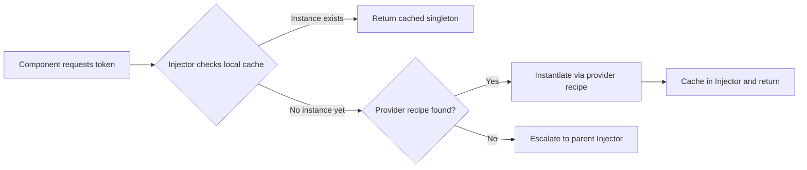
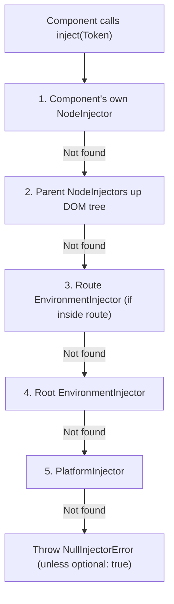
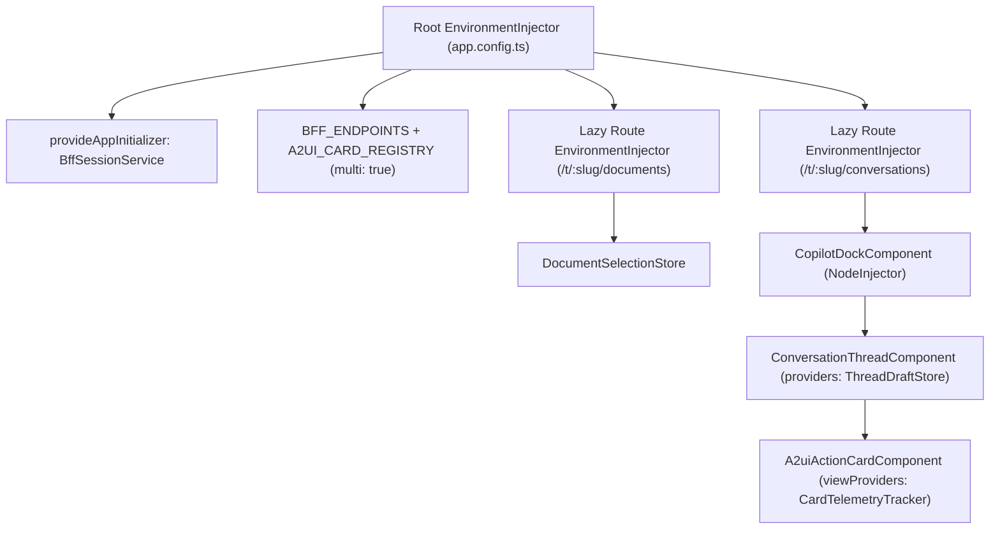

# Chapter 5: Dependency Injection Internals

## 1. Learning Objectives
By the end of this chapter, you will be able to:
* Understand the core philosophy of Dependency Injection (DI) and Inversion of Control (IoC), and know when **not** to use DI.
* Differentiate between Angular's two Injector hierarchies (`EnvironmentInjector` and `NodeInjector`), including `providers` vs `viewProviders` and resolution modifiers (`optional`, `self`, `skipSelf`, `host`).
* Configure providers using `useClass`, `useValue`, `useExisting`, `useFactory`, `multi: true`, `InjectionToken`, and `provideAppInitializer`.
* Master the modern `inject()` function, injection contexts (`NG0203`), `runInInjectionContext`, `DestroyRef`, and circular dependency (`NG0200`) resolution.
* Design tree-shakable, multi-tenant DI architectures in Angular 22 using real-world patterns from Normora's BFF-backed SPA.

---

## 2. Introduction to Dependency Injection

**Dependency Injection (DI)** is a design pattern used to implement **Inversion of Control (IoC)**—a principle where a class receives the helpers (**dependencies**) it needs from an external coordinator instead of constructing them itself with the `new` keyword.

Every DI system relies on three core building blocks:
1. **Token:** A unique lookup key (typically a class reference or an `InjectionToken`) used to ask for a dependency.
2. **Provider:** A recipe that tells Angular *how* to create or locate the value for a given token.
3. **Injector:** The runtime container that stores created instances (by default as **singletons**—one shared instance per injector scope) and resolves tokens when components or services ask for them.

**Without DI (Tightly Coupled & Hard to Test):**
```typescript
export class DashboardComponent {
  private apiService: ApiService;

  constructor() {
    // Hardcoded dependency. Impossible to mock in unit tests.
    this.apiService = new ApiService(); 
  }
}
```

**With DI (Decoupled & Testable):**
```typescript
@Component({
  selector: 'app-dashboard',
  template: `...`
})
export class DashboardComponent {
  // Angular's DI system provides the instance. Easily mockable.
  private apiService = inject(ApiService);
}
```

Angular is unique among frontend frameworks because it ships with a hierarchical, enterprise-grade DI container built directly into the core runtime.

### How Angular's DI Works Under the Hood (Conceptually)



### Real-World Normora Examples (Using DI Properly)

In **Normora** (an enterprise multi-tenant knowledge platform with an Angular 22 SPA sitting behind a **Duende BFF**—a Backend-For-Frontend server that holds OIDC tokens in encrypted `HttpOnly` cookies so the browser never sees them), DI keeps UI components completely decoupled from transport, security, and storage mechanics:

1. **Document Library & BFF APIs (`DocumentApiService`):** `DocumentLibraryComponent` injects `DocumentApiService` rather than instantiating `new HttpClient(...)` directly. Tests can swap `DocumentApiService` with an in-memory stub without hitting PostgreSQL or MinIO.
2. **Conversational RAG Streaming (`CopilotStreamService`):** `CopilotDockComponent` injects `CopilotStreamService` to consume Server-Sent Events (SSE) from `/api/copilotkit`. Changing the transport or adding retry logic requires zero edits to the UI component.
3. **BFF Session Identity (`BffSessionService`):** `WorkspaceHeaderComponent` injects `BffSessionService` to read the user's `ExternalUserId` and active tenant role via Signals, completely unaware of whether authentication came from Keycloak OIDC cookies or a test mock.
4. **Centralized Error & Toast Messaging (`WorkspaceNotificationService`):** `DocumentUploadComponent` injects `WorkspaceNotificationService`, which maps HTTP `403` (BFLA) and `404` (BOLA) responses using `ApiMessages` from `client/src/app/core/constants/api-messages.ts`—never hardcoding error strings in components.
5. **Multi-Currency Billing (`TenantBillingService`):** `SubscriptionBillingComponent` injects `TenantBillingService` to switch currencies (`INR`, `USD`, `EUR`, etc. via `PUT /api/subscription/currency`) and launch PayU checkout without embedding pricing formulas in the template layer.

### When NOT to Use Dependency Injection

DI is powerful, but injecting everything blindly creates unnecessary boilerplate:
* **Static Constants & Message Catalogs:** Normora's `ApiMessages` (`client/src/app/core/constants/api-messages.ts`) is a pure TypeScript constant object—import it directly rather than wrapping it in a service unless you need runtime overrides per environment.
* **Pure Stateless Utility Functions:** Functions like `formatBytes(bytes)` for document upload sizes or `formatCurrency(amount, currency)` have no side effects, external state, or dependencies to mock. Keep them as plain exported functions.
* **Plain Data Models / DTOs:** API payloads like `DocumentSummaryDto` or `ConversationTurn` are data structures, not stateful collaborators. Construct or map them as plain TypeScript interfaces/objects.
* **Pointless 1-to-1 Abstractions:** Do not create an abstract token for a helper that only ever has one trivial implementation and never crosses an architectural boundary (such as a third-party SDK, browser API, or HTTP layer).

---

## 3. The Two Injector Hierarchies

Angular does not just have one global bucket of dependencies. It has two parallel, hierarchical trees of injectors. Understanding these trees is what separates Junior Angular developers from Architects.

### 1. `EnvironmentInjector` (The Logical / Application Tree)
This tree configures providers for the application environment, completely independent of the DOM structure. It is established during application bootstrap or when lazy-loading a route.

* **Platform Injector:** Shared across multiple Angular root apps running on the same page (rare in standard SPAs).
* **Root `EnvironmentInjector`:** Configured at bootstrap (`provideHttpClient()`, `provideRouter()`). Services decorated with `@Injectable({ providedIn: 'root' })` live here. They are **true Singletons** for the entire browser tab lifetime.
* **Route `EnvironmentInjector`:** Created automatically when a route defines its own `providers: []` array. Services provided here live as long as the route subtree is active (or are shared by all child routes under that route).
* **`providedIn: 'any'`:** Tells Angular to create one shared instance in the eager root bundle and a separate instance in each lazy-loaded route `EnvironmentInjector` that imports the service. (Use rarely—only when each lazy feature intentionally needs an isolated copy of a shared library service.)

### 2. `NodeInjector` (The UI / DOM Element Tree)
This tree mirrors your Component DOM tree. Every time Angular renders a component or directive, it creates a `NodeInjector` for that host element.

* **`providers: []` on `@Component`:** Creates a *new instance* of the service scoped to that component instance, its template children, **and** any elements projected into it via `<ng-content>` (**Content Projection**—passing external template markup into a child component's slot).
* **`viewProviders: []` on `@Component`:** Creates an instance visible **only** to the component's own template (**View Children**), hiding it from projected `<ng-content>` children. This prevents external consumers from accidentally accessing or colliding with internal component state.
* **Lifetime:** A `NodeInjector` service is created when the component mounts and destroyed automatically when the component is removed from the DOM (e.g., via `@if`).

> [!TIP]
> **When NOT to use `NodeInjector` (`providers` / `viewProviders`):** Never put global state (auth sessions, HTTP caches, tenant context) in a component's `providers` array—if the user navigates or `@if` toggles the host component off, all state is destroyed and re-created fresh next time.

### Resolution Algorithm & Modifiers

When a component requests a dependency via `inject(Token, options)`, Angular searches upward in two phases: first the `NodeInjector` tree, then the `EnvironmentInjector` tree:



You can alter this lookup path using **Resolution Modifiers** passed as the second argument to `inject()`:

| Modifier | Behavior | When to Use | When NOT to Use |
|---|---|---|---|
| `{ optional: true }` | Returns `null` instead of throwing `NullInjectorError` if missing. | Progressive enhancement when a parent shell/service may not be present. | Required core services (hides missing-provider bugs as silent `null` errors). |
| `{ self: true }` | Checks **only** the component's own `NodeInjector`. | Ensuring a directive reads a service attached to the exact same host element. | Normal service consumption (breaks root singletons). |
| `{ skipSelf: true }` | Skips the current `NodeInjector` and starts at the parent. | Nested overrides (e.g., child theme/scope inheriting from parent scope) or avoiding infinite recursion. | Top-level root services when no parent override exists. |
| `{ host: true }` | Stops searching the `NodeInjector` tree at the host component's view boundary. | Directives inside a component template that must not leak out to arbitrary ancestors. | Services provided in `EnvironmentInjector` (use `host` carefully with `optional: true`). |

### Real-World Normora Examples (Injector Scoping)

1. **Root `EnvironmentInjector` (`BffSessionService`):** `BffSessionService` uses `@Injectable({ providedIn: 'root' })` so the authenticated `ExternalUserId`, tenant role, and CSRF header behavior are shared identically across Copilot, Documents, and Settings.
2. **Lazy Route `EnvironmentInjector` (`DocumentSelectionStore`):** The `/t/:slug/documents` route configuration declares `providers: [DocumentSelectionStore]`, keeping multi-select bulk checkboxes and upload queue filters isolated to the Documents feature rather than polluting the root injector.
3. **Component `NodeInjector` `providers` (`ThreadDraftStore`):** `ConversationThreadComponent` declares `providers: [ThreadDraftStore]`. When Normora renders a docked Copilot thread alongside a full-screen conversation thread, each `NodeInjector` owns an isolated message draft and scroll anchor.
4. **Component `NodeInjector` `viewProviders` (`A2uiActionCardComponent`):** `A2uiActionCardComponent` wraps interactive cards (`ExpenseSimulatorCardComponent`, `HrEscalationCardComponent`) and registers `viewProviders: [CardTelemetryTracker]`. Projected custom footer buttons passed via `<ng-content>` cannot inject or mutate the card's internal telemetry tracker.
5. **Resolution Modifiers (`ChunkPreviewDrawerComponent` & `TenantThemeBoundaryComponent`):**
   ```typescript
   // 1. { optional: true }: Works both inside Copilot co-browsing and standalone in /documents
   private coBrowse = inject(CopilotCoBrowseService, { optional: true });

   // 2. { skipSelf: true, optional: true }: Nested workspace preview inherits parent theme
   private parentTheme = inject(TENANT_THEME, { skipSelf: true, optional: true });
   ```

---

## 4. Configuring Providers & `InjectionToken`

When you inject a service, you are asking the DI container for a **token**. You can tell the DI container exactly how to satisfy that token using provider recipes.

### Why `InjectionToken<T>` Exists (Type Erasure)
TypeScript `interface` and `type` declarations only exist at compile time—they are erased completely when compiled to JavaScript (**type erasure**). Because Angular's DI container resolves dependencies at runtime, you cannot pass an interface as a token (`inject(BffConfig)` fails to compile if `BffConfig` is an interface).

An **`InjectionToken<T>`** creates a unique runtime object that preserves strong TypeScript typing `T`. You can even make an `InjectionToken` **tree-shakable** (**Tree Shaking** is the bundler step that strips unused code from the production build) by supplying a `factory`:

```typescript
export const DEFAULT_LOCALE_CURRENCY = new InjectionToken<string>('DEFAULT_LOCALE_CURRENCY', {
  providedIn: 'root',
  factory: () => 'USD'
});
```

### Standard Provision (`useClass`)
```typescript
@Injectable({ providedIn: 'root' })
export class ApiService {}
```
By default, the token is the class type, and Angular instantiates that exact class.

### Overriding for Testing or Swapping (`useClass`)
You can override what class is instantiated for a given token. Note that `useClass` creates a **brand-new instance** of the target class for that token:

```typescript
providers: [
  // When a component asks for ApiService, give it MockApiService instead
  { provide: ApiService, useClass: MockApiService }
]
```

### Aliasing an Existing Singleton (`useExisting`)
Unlike `useClass`, **`useExisting` does not instantiate anything new**—it points Token A to the exact instance already created for Token B. Use `useExisting` whenever one concrete store implements multiple abstract interfaces (for example, separating read-only state from write actions).

### Providing Values (`useValue`)
Useful for passing configuration objects, endpoints, or constants (note: `useValue` objects are shared by reference and are *not* tree-shaken if declared in root `providers`).

```typescript
export const API_URL = new InjectionToken<string>('API_URL');

providers: [
  { provide: API_URL, useValue: 'https://api.ev-platform.com/v1' }
]
```

### Factory Providers (`useFactory`)
Useful when dependency creation requires runtime logic or conditional setup. Modern Angular lets you call `inject()` directly inside `useFactory` (avoiding verbose `deps` arrays):

```typescript
providers: [
  {
    provide: LoggerService,
    useFactory: (env: EnvironmentConfig) => {
      return env.production ? new DataDogLogger() : new ConsoleLogger();
    },
    deps: [EnvironmentConfig]
  }
]
```

### Multi-Providers (`multi: true`) & `provideAppInitializer`
* **`multi: true`:** Allows multiple providers to register under the **same token**, returning an array `T[]` instead of overwriting the previous registration. Ideal for extensible plugin registries.
* **`makeEnvironmentProviders([...])`:** Groups `EnvironmentInjector`-only providers (like router or HTTP setup) so TypeScript prevents accidentally placing them inside a component's `NodeInjector`.
* **`provideAppInitializer(() => ...)`:** Angular's modern replacement for the legacy `APP_INITIALIZER` token. It runs async startup logic (and supports `inject()` natively) before the application activates its first route.

### Real-World Normora Examples (Provider Recipes)

1. **`useValue` + `InjectionToken` (`BFF_ENDPOINTS`):**
   ```typescript
   export interface BffEndpoints {
     copilotStreamUrl: string;
     mcpEndpointUrl: string;
     loginUrl: string;
     logoutUrl: string;
   }

   export const BFF_ENDPOINTS = new InjectionToken<BffEndpoints>('BFF_ENDPOINTS');

   // In app.config.ts
   {
     provide: BFF_ENDPOINTS,
     useValue: {
       copilotStreamUrl: '/api/copilotkit',
       mcpEndpointUrl: '/api/mcp',
       loginUrl: '/bff/login',
       logoutUrl: '/bff/logout'
     }
   }
   ```
2. **`useClass` for Port-Adapter Swapping (`TelemetrySink`):** Normora defines an abstract `TelemetrySink` class; `app.config.ts` binds `{ provide: TelemetrySink, useClass: OtelBrowserTelemetrySink }` in production, while Vitest unit tests swap it to `NoopTelemetrySink`.
3. **`useExisting` for Read/Write Separation (`TenantBrandingStore`):**
   ```typescript
   // WorkspaceHeaderComponent injects ReadonlyTenantBranding;
   // BrandingSettingsComponent injects TenantBrandingStore.
   // Both receive the EXACT SAME singleton instance!
   providers: [
     TenantBrandingStore,
     { provide: ReadonlyTenantBranding, useExisting: TenantBrandingStore }
   ]
   ```
4. **`useFactory` with `inject()` (`DOCUMENT_REALTIME_TRANSPORT`):**
   ```typescript
   export const DOCUMENT_REALTIME_TRANSPORT = new InjectionToken<RealtimeTransport>(
     'DOCUMENT_REALTIME_TRANSPORT'
   );

   {
     provide: DOCUMENT_REALTIME_TRANSPORT,
     useFactory: () => {
       const session = inject(BffSessionService);
       return session.isAuthenticated()
         ? new SignalRDocumentTransport('/hubs/documents')
         : new NoopRealtimeTransport();
     }
   }
   ```
5. **`multi: true` Plugin Registry (`A2UI_CARD_REGISTRY`):** Normora's Copilot chat renders generative A2UI cards (`policy_limit_card`, `hr_escalation_card`, `intake_form_card`) without a brittle `switch` statement by registering each card handler with `multi: true`:
   ```typescript
   export interface A2uiCardRegistration {
     type: 'policy_limit_card' | 'hr_escalation_card' | 'intake_form_card';
     component: Type<unknown>;
   }

   export const A2UI_CARD_REGISTRY = new InjectionToken<A2uiCardRegistration[]>('A2UI_CARD_REGISTRY');

   export function provideA2uiCards(): EnvironmentProviders {
     return makeEnvironmentProviders([
       { provide: A2UI_CARD_REGISTRY, useValue: { type: 'policy_limit_card', component: ExpenseSimulatorCardComponent }, multi: true },
       { provide: A2UI_CARD_REGISTRY, useValue: { type: 'hr_escalation_card', component: HrEscalationCardComponent }, multi: true },
       { provide: A2UI_CARD_REGISTRY, useValue: { type: 'intake_form_card', component: DynamicIntakeFormComponent }, multi: true }
     ]);
   }
   ```
6. **`provideAppInitializer` (BFF Session & Tenant Slug Hydration):**
   ```typescript
   provideAppInitializer(() => {
     const bffSession = inject(BffSessionService);
     return bffSession.hydrateFromCookie(); // Calls /bff/user using HttpOnly cookie
   })
   ```

---

## 5. The Modern `inject()` Function & Injection Contexts

In Angular v14, a massive paradigm shift occurred. The introduction of the `inject()` function allowed developers to request dependencies *outside* of the class constructor—a pattern that is now standard across Angular 22 standalone components, Signals, and functional APIs.

**Legacy Constructor Injection:**
```typescript
@Component({
  selector: 'app-charger',
  template: `...`
})
export class ChargerComponent {
  constructor(
    private chargerService: ChargerService,
    private authService: AuthService,
    private router: Router
  ) {}
}
```

**Modern `inject()` Approach:**
```typescript
@Component({
  selector: 'app-charger',
  template: `...`
})
export class ChargerComponent {
  private chargerService = inject(ChargerService);
  private authService = inject(AuthService);
  private router = inject(Router);
}
```

### Why `inject()` is Better:
1. **Inheritance without pain:** In constructor injection, if a child class extends a base class, the child must inject all of the parent's dependencies and pass them up via `super()`. With `inject()`, the base class handles its own dependencies natively.
2. **Reusable Composable Functions:** You can write reusable functional utilities that inject services (such as functional router guards, HTTP interceptors, or custom Signal hooks) without needing a wrapper class.
3. **Stronger Type Inference:** `inject(TENANT_CONFIG)` automatically infers `TenantConfig` without needing `@Inject(TENANT_CONFIG)` decorator noise, and `{ optional: true }` accurately narrows the return type to `T | null`.

### Understanding the Injection Context (`NG0203`)

An **Injection Context** is the brief synchronous window during which Angular has an active injector bound to the current call stack. Calling `inject()` outside this window throws runtime error **`NG0203: inject() must be called from an injection context`**.

| Valid Injection Contexts (Safe) | Invalid Contexts (Throws `NG0203`) |
|---|---|
| Class field initializers (`private svc = inject(Svc);`) | Lifecycle hooks (`ngOnInit`, `ngAfterViewInit`) |
| Class `constructor()` body | DOM event handlers (`(click)="onDelete()"`) |
| `useFactory` and `InjectionToken` `factory` functions | Asynchronous callbacks (`setTimeout`, `.subscribe()`, code *after* `await`) |
| Functional route guards, resolvers, and HTTP interceptors | Plain helper methods called later during component interaction |
| `provideAppInitializer(() => ...)` callback | Inside `effect(() => ...)` execution callbacks (call `inject()` *before* `effect()`) |

### `assertInInjectionContext`, `runInInjectionContext`, and `DestroyRef`

* **`assertInInjectionContext(fn)`:** Placed at the top of custom composable functions (like `injectTenantAutoReload()`) so any caller invoking it inside `ngOnInit` gets an immediate, descriptive error naming your helper.
* **`runInInjectionContext(injector, fn)`:** Temporarily binds an `EnvironmentInjector` or `Injector` to the call stack so you can run `inject()`-based logic inside an async callback or dynamic plugin hook.
* **`DestroyRef`:** Inject `DestroyRef` to register teardown callbacks (`inject(DestroyRef).onDestroy(...)`) directly inside helper functions or field initializers—no `implements OnDestroy` class boilerplate required.

### `forwardRef` and Circular Dependencies (`NG0200`)

JavaScript evaluates files top-to-bottom, and classes are not hoisted before their decorators run. Occasionally you need **`forwardRef(() => ClassName)`** when a `@Component` decorator's `providers` array references the component class itself before the class body finishes declaring (common in custom form controls implementing `NG_VALUE_ACCESSOR`).

> [!TIP]
> **When NOT to use `forwardRef`:** Never use `forwardRef` as a Band-Aid for two services that inject each other (`ServiceA` ↔ `ServiceB`). That creates a circular dependency (`NG0200`), makes initialization order fragile, and signals a design flaw—extract the shared state into a third store or communicate unidirectionally via Signals.

### Real-World Normora Examples (`inject()`, Contexts & Lifecycle)

1. **Zero-`super()` Base Class Inheritance (`BaseWorkspaceTableComponent`):**
   ```typescript
   export abstract class BaseWorkspaceTableComponent {
     // Base class resolves its own DI tokens; subclasses don't pass super() args!
     protected readonly tenantContext = inject(TenantContextService);
     protected readonly syncService = inject(WorkspaceSyncService);
   }

   @Component({ selector: 'app-department-list', template: `...` })
   export class DepartmentListComponent extends BaseWorkspaceTableComponent {
     private readonly departmentApi = inject(DepartmentApiService);
   }
   ```
2. **Functional BFLA Route Guard (`tenantAdminGuard`):**
   ```typescript
   export const tenantAdminGuard: CanActivateFn = () => {
     const session = inject(BffSessionService);
     const notifications = inject(WorkspaceNotificationService);
     const router = inject(Router);

     if (!session.hasRole('Admin')) {
       notifications.showError(ApiMessages.Forbidden); // Never hardcoded strings
       return router.createUrlTree(['/unauthorized']);
     }
     return true;
   };
   ```
3. **Composable Helper with `assertInInjectionContext` (`injectWorkspaceDataSync`):** Normora's `IWorkspaceStateSynchronizer` broadcasts a monotonic `dataVersion` over SignalR/SSE when documents or departments mutate:
   ```typescript
   export function injectWorkspaceDataSync(reloadCallback: () => void): void {
     assertInInjectionContext(injectWorkspaceDataSync);
     const sync = inject(WorkspaceSyncService);

     effect(() => {
       sync.dataVersion(); // Track reactive workspace version
       reloadCallback();
     });
   }
   ```
4. **Bridging Async WebSockets via `runInInjectionContext` (`CopilotActuationHandler`):** When an AI agent emits a `navigateActuation` payload after an async SSE stream event, `CopilotDockComponent` uses its stored `EnvironmentInjector` (`private envInjector = inject(EnvironmentInjector);`) and calls `runInInjectionContext(this.envInjector, () => ...)` before invoking DI-backed actuation helpers.
5. **DI-Native Teardown with `DestroyRef` (`CopilotKeyboardShortcutService`):**
   ```typescript
   export function injectCopilotShortcut(onToggle: () => void): void {
     assertInInjectionContext(injectCopilotShortcut);
     const destroyRef = inject(DestroyRef);

     const handler = (event: KeyboardEvent) => {
       if ((event.ctrlKey || event.metaKey) && event.key.toLowerCase() === 'j') {
         event.preventDefault();
         onToggle();
       }
     };

     window.addEventListener('keydown', handler);
     destroyRef.onDestroy(() => window.removeEventListener('keydown', handler));
   }
   ```
6. **Eliminating Circular Dependencies (`NG0200`) Without `forwardRef`:** Originally, if `BffAuthService` injected `TenantContextService` to read the active slug on logout, while `TenantContextService` injected `BffAuthService` to read `ExternalUserId`, Angular threw `NG0200`. Normora avoids this cycle by extracting a leaf `SessionIdentityStore` (holding only `externalUserId` and `tenantSlug` Signals) that both services inject unidirectionally.

---

## 6. Enterprise SaaS Case Studies: Multi-Tenant Configuration

### Case Study A: EV Charging Platform (Pre-Boot Token Injection)

In our EV Charging Platform, we might deploy the same application for different enterprise tenants (e.g., "Tesla" vs "ChargePoint"). We need to inject different branding and feature flags depending on the tenant.

**`tenant.token.ts`**
```typescript
import { InjectionToken } from '@angular/core';

export interface TenantConfig {
  tenantId: string;
  primaryColor: string;
  enableBetaFeatures: boolean;
}

export const TENANT_CONFIG = new InjectionToken<TenantConfig>('TENANT_CONFIG');
```

**`main.ts`** (Bootstrapping dynamically based on URL; note that in Angular 22, async initialization is usually handled via `provideAppInitializer` rather than blocking before `bootstrapApplication`)
```typescript
const host = window.location.hostname; // e.g., tesla.ev-platform.com
const tenantConfig = fetchTenantConfigSynchronously(host);

bootstrapApplication(AppComponent, {
  providers: [
    { provide: TENANT_CONFIG, useValue: tenantConfig }
  ]
});
```

**`header.component.ts`** (Note: `standalone: true` is the default in Angular 22 and can be omitted)
```typescript
@Component({
  selector: 'app-header',
  template: `<header [style.backgroundColor]="config.primaryColor">...</header>`
})
export class HeaderComponent {
  config = inject(TENANT_CONFIG);
}
```
By leveraging DI, our `HeaderComponent` is completely decoupled from *how* the tenant config is retrieved. It just asks the DI container for it.

---

### Case Study B: Normora Multi-Tenant BFF & Copilot DI Architecture

Normora serves multiple workspaces under one Angular 22 SPA (`/t/:slug/...`) behind a **Duende BFF** (`Normora.Api`). Instead of reading raw JWTs in the browser, Normora uses DI to bind cookie-backed session state, white-label branding, and extensible Copilot A2UI cards cleanly across injector boundaries:



**`client/src/app/app.config.ts`** (Root `EnvironmentInjector` composition)
```typescript
export const appConfig: ApplicationConfig = {
  providers: [
    provideZonelessChangeDetection(),
    provideRouter(APP_ROUTES),
    provideHttpClient(withInterceptors([bffCsrfInterceptor, apiErrorInterceptor])),
    {
      provide: BFF_ENDPOINTS,
      useValue: {
        copilotStreamUrl: '/api/copilotkit',
        mcpEndpointUrl: '/api/mcp',
        loginUrl: '/bff/login',
        logoutUrl: '/bff/logout'
      }
    },
    provideA2uiCards(), // Registers ExpenseSimulatorCardComponent, HrEscalationCardComponent, etc. via multi: true
    provideAppInitializer(() => {
      const session = inject(BffSessionService);
      return session.hydrateFromCookie();
    })
  ]
};
```

**`client/src/app/layout/workspace-header/workspace-header.component.ts`**
```typescript
@Component({
  selector: 'app-workspace-header',
  template: `
    <header class="flex items-center justify-between px-4 py-3 bg-white dark:bg-slate-900 border-b border-slate-200 dark:border-slate-700 border-none! sm:border-solid!">
      <div class="flex items-center gap-3">
        <span class="text-sm font-semibold text-slate-900 dark:text-white">
          {{ workspaceName() }}
        </span>
        @if (isAdmin()) {
          <span class="px-2 py-0.5 text-xs rounded bg-indigo-50 dark:bg-indigo-950 text-indigo-700 dark:text-indigo-300">
            Admin
          </span>
        }
      </div>
      <button
        type="button"
        (click)="toggleCopilot()"
        class="px-3 py-1.5 text-sm rounded-md bg-slate-100 dark:bg-slate-800 text-slate-800 dark:text-slate-100 hover:bg-slate-200 dark:hover:bg-slate-700"
      >
        Copilot
      </button>
    </header>
  `
})
export class WorkspaceHeaderComponent {
  private readonly session = inject(BffSessionService);
  private readonly branding = inject(ReadonlyTenantBranding);
  private readonly copilot = inject(CopilotDockStateService);

  protected readonly workspaceName = computed(() => this.branding.workspaceName());
  protected readonly isAdmin = computed(() => this.session.hasRole('Admin'));

  protected toggleCopilot(): void {
    this.copilot.toggle();
  }
}
```
Notice how `WorkspaceHeaderComponent` has zero knowledge of cookies, HTTP calls, or SignalR. Every dependency is injected declaratively via `inject()`, and Tailwind v4 utilities use the suffix `!` (`border-none!`) with full `dark:` color pairs.

---

## 7. Common Mistakes & Anti-Patterns

> [!CAUTION]
> **Anti-Pattern 1: Providing a Global Singleton in `AppComponent` or a Layout `providers` Array**
>
> **Wrong Code:**
> ```typescript
> @Component({
>   selector: 'app-workspace-shell',
>   providers: [BffSessionService, WorkspaceSyncService],
>   template: `<router-outlet />`
> })
> export class WorkspaceShellComponent {}
> ```
> **Why it's wrong:** Putting a service in a component's `providers` array registers it in that component's `NodeInjector`, *not* the root `EnvironmentInjector`. Every time `WorkspaceShellComponent` is destroyed and re-created (for example, navigating from `/login` into `/t/acme/documents` or toggling an `@if`), Angular destroys the service and creates a blank new instance—wiping cached session state and opening duplicate SignalR connections.
>
> **The Fix:** Declare true application singletons with `@Injectable({ providedIn: 'root' })` or register them in `app.config.ts` (`ApplicationConfig.providers`).

> [!CAUTION]
> **Anti-Pattern 2: Using `useClass` Instead of `useExisting` to Alias a Service**
>
> **Wrong Code:**
> ```typescript
> providers: [
>   TenantBrandingStore,
>   { provide: ReadonlyTenantBranding, useClass: TenantBrandingStore }
> ]
> ```
> **Why it's wrong:** `useClass` tells Angular to instantiate a **second, completely separate** `TenantBrandingStore` whenever someone injects `ReadonlyTenantBranding`. When `BrandingSettingsComponent` updates the tenant's logo via `TenantBrandingStore`, `WorkspaceHeaderComponent` (reading `ReadonlyTenantBranding`) never sees the update!
>
> **The Fix:** Use `useExisting` so both tokens resolve to the exact same singleton instance:
> ```typescript
> providers: [
>   TenantBrandingStore,
>   { provide: ReadonlyTenantBranding, useExisting: TenantBrandingStore }
> ]
> ```

> [!CAUTION]
> **Anti-Pattern 3: Calling `inject()` Outside an Injection Context (`NG0203`)**
>
> **Wrong Code:**
> ```typescript
> @Component({ selector: 'app-document-upload', template: `<button (click)="upload()">Upload</button>` })
> export class DocumentUploadComponent {
>   upload(): void {
>     const api = inject(DocumentApiService); // Throws NG0203 at runtime!
>     api.uploadFile();
>   }
> }
> ```
> **Why it's wrong:** `inject()` relies on Angular's active DI stack frame, which only exists during synchronous construction or factory execution—never inside `ngOnInit`, event handlers, or async callbacks.
>
> **The Fix:** Capture dependencies as class fields (or inside the constructor), or bridge dynamic callbacks using `runInInjectionContext(this.envInjector, ...)`:
> ```typescript
> export class DocumentUploadComponent {
>   private readonly api = inject(DocumentApiService);
>   upload(): void {
>     this.api.uploadFile();
>   }
> }
> ```

> [!CAUTION]
> **Anti-Pattern 4: Circular Dependencies Between Services (`NG0200`)**
>
> **Wrong Code:**
> ```typescript
> @Injectable({ providedIn: 'root' })
> export class BffAuthService {
>   private tenant = inject(TenantContextService); // Depends on TenantContextService
> }
>
> @Injectable({ providedIn: 'root' })
> export class TenantContextService {
>   private auth = inject(BffAuthService); // Depends back on BffAuthService -> NG0200!
> }
> ```
> **Why it's wrong:** Angular cannot construct `BffAuthService` before `TenantContextService` or vice versa, throwing `NG0200: Circular dependency in DI`. Wrapping one side in `forwardRef` hides the architecture smell and makes initialization brittle.
>
> **The Fix:** Extract the shared state (`externalUserId`, `activeTenantSlug`) into a leaf `SessionIdentityStore` with zero upward dependencies so both services depend downward on the store.

> [!CAUTION]
> **Anti-Pattern 5: Scoping Mutable Component UI State as `providedIn: 'root'`**
>
> **Wrong Code:**
> ```typescript
> @Injectable({ providedIn: 'root' })
> export class ThreadDraftStore {
>   readonly draftText = signal('');
> }
> ```
> **Why it's wrong:** If Normora renders a docked Copilot drawer (`Ctrl+J`) and a full-page conversation view simultaneously, both components share the same root singleton—typing a prompt in one thread overwrites the draft in the other, and closing one thread fails to clean up its draft state.
>
> **The Fix:** Omit `providedIn: 'root'` and register `providers: [ThreadDraftStore]` directly on `ConversationThreadComponent` so each mounted thread owns an isolated `NodeInjector` instance.

> [!CAUTION]
> **Anti-Pattern 6: Breaking Tree Shaking with Eager Root `providers` Arrays**
>
> **Wrong Code:**
> ```typescript
> // In app.config.ts, registering every experimental or rarely used service manually
> export const appConfig: ApplicationConfig = {
>   providers: [LegacyCsvExportService, ExperimentalPdfAnnotatorService]
> };
> ```
> **Why it's wrong:** Listing classes directly in `ApplicationConfig.providers` creates a hard reference from the root module, forcing esbuild to include them in the initial bundle even if zero routes or components ever inject them.
>
> **The Fix:** Use `@Injectable({ providedIn: 'root' })` on services (or factory-backed `InjectionToken`s) so Angular tree-shakes unused services automatically, and place feature-specific providers on their lazy route's `providers` array.

---

## 8. Interview Questions

### Junior
**Q1: What is the difference between `@Injectable({ providedIn: 'root' })` and adding a service to a component's `providers: []` array?**
> A: `providedIn: 'root'` places one shared singleton in the root `EnvironmentInjector` for the entire app lifetime. Adding a service to a `@Component`'s `providers` array creates a new, isolated instance in that component's `NodeInjector` every time the component mounts, and destroys it when the component is removed from the DOM.

**Q2: Why do we need `InjectionToken<T>` instead of injecting a TypeScript `interface` directly?**
> A: TypeScript interfaces are erased during compilation to JavaScript (**type erasure**), so they do not exist at runtime for Angular's DI container to use as a lookup key. `InjectionToken<T>` creates a concrete runtime object while keeping compile-time type safety for `T`.

### Senior
**Q3: Explain the difference between `ElementRef` and standard dependency injection.**
> A: Standard DI injects class instances (Services) from the logical Injector trees (`EnvironmentInjector` or `NodeInjector`). `ElementRef` is a special token provided exclusively by the `NodeInjector`. Angular dynamically creates it at runtime to wrap the physical DOM element associated with that specific component/directive instance, allowing direct DOM manipulation.

**Q4: When should you use `useExisting` instead of `useClass` in a provider definition?**
> A: Use `useClass` when you want Angular to instantiate a new instance of a class for that token (e.g., swapping `TelemetrySink` for `MockTelemetrySink`). Use `useExisting` when you want an abstract/read-only token to alias an **already-registered** singleton without creating a second duplicate instance (e.g., exposing `ReadonlyTenantBranding` from `TenantBrandingStore`).

**Q5: What is the difference between `providers` and `viewProviders` on a `@Component`?**
> A: Services in `providers` are visible to the component's own template **and** any elements projected into it via `<ng-content>`. Services in `viewProviders` are visible **only** to the component's own template (View Children), hiding internal services from projected content.

### Architect
**Q6: How does Tree Shaking interact with `@Injectable({ providedIn: 'root' })` vs adding a service to a `providers` array?**
> A: When using `providedIn: 'root'`, the service tells Angular "If someone injects me, put me in the root injector." If no component ever injects the service, the Angular build optimizer (esbuild) can prove it is dead code and tree-shake it out of the production bundle. Conversely, if you explicitly add a service to an `EnvironmentProviders` array or a component's `providers` array, the compiler creates a hard reference to that class, preventing it from being tree-shaken, even if it is never actually used.

**Q7: Why does calling `inject()` inside `ngOnInit` or a `setTimeout` callback fail with `NG0203`, and how do you architect composable DI helpers safely?**
> A: `inject()` depends on Angular's active synchronous injection frame, which is only set during class construction, factory execution, or route/interceptor invocation. Composable helpers (like `injectWorkspaceDataSync`) should call `assertInInjectionContext(fn)` upfront, capture all dependencies synchronously, and use `inject(DestroyRef)` for cleanup. If DI resolution must happen later inside an async callback, capture `EnvironmentInjector` during construction and wrap the work in `runInInjectionContext(envInjector, fn)`.

**Q8: How would you design an extensible plugin architecture in Angular 22 (like Normora's dynamic Copilot A2UI cards) without creating a monolithic central `switch` statement?**
> A: Define a strongly typed `InjectionToken<PluginRegistration[]>` (e.g., `A2UI_CARD_REGISTRY`) and register each card/plugin using `multi: true` inside a `makeEnvironmentProviders()` helper (or lazy route providers). The host shell injects the token once, builds a `Map<TypeKey, ComponentType>`, and renders plugins dynamically—making new cards purely additive and open for extension without modifying the core chat renderer.

---

## 9. Summary
In this chapter, we mastered Angular 22's Dependency Injection system from first principles to enterprise architecture:
* **Two Injector Hierarchies:** How `EnvironmentInjector` (root and lazy routes) and `NodeInjector` (`providers` vs `viewProviders`) resolve tokens, and how `{ optional, self, skipSelf, host }` modify lookup paths.
* **Provider Recipes & Tokens:** Choosing between `useClass`, `useExisting`, `useValue`, `useFactory`, `multi: true`, tree-shakable `InjectionToken`s, and `provideAppInitializer`.
* **Modern `inject()` & Injection Contexts:** Leveraging inheritance without `super()`, `assertInInjectionContext`, `runInInjectionContext`, `DestroyRef`, and clean cycle-free architecture (`NG0200` / `NG0203`).
* **Real-World Normora Patterns:** Decoupling Duende BFF sessions, `ApiMessages`, multi-tenant branding, SignalR/SSE transport, and extensible Copilot A2UI cards.

With the fundamentals complete, Part I is finished. In Chapter 6, we will enter Part II: Reactive State, beginning with Mastering RxJS in Angular.
