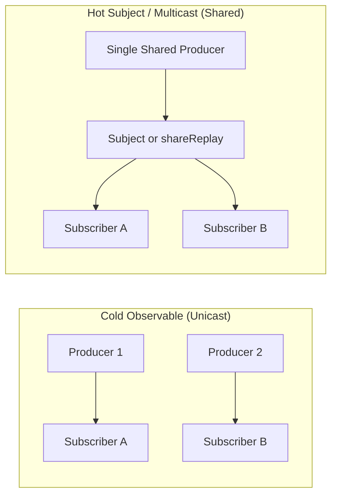
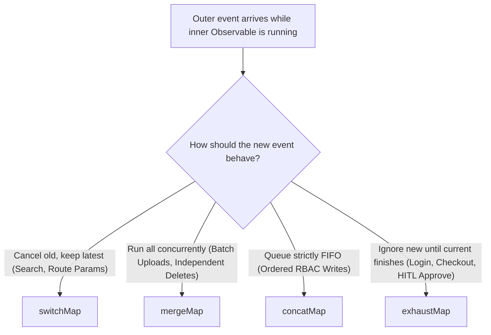
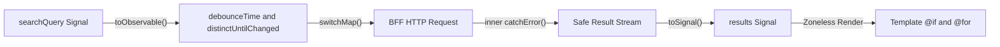
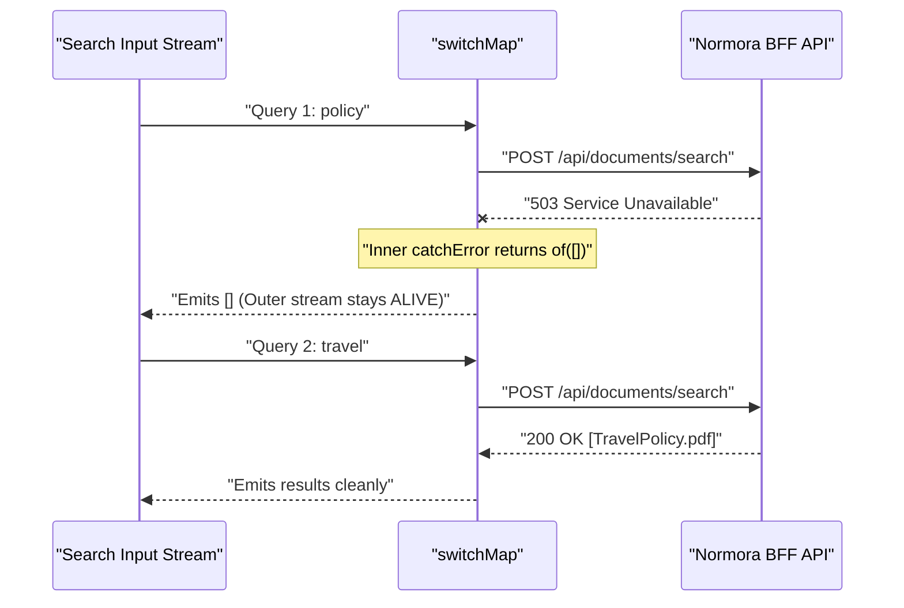

# Chapter 6: Mastering RxJS in Angular

## 1. Learning Objectives
By the end of this chapter, you will be able to:
* Understand Reactive Programming (Push vs. Pull) and when to choose **RxJS** versus **Angular Signals** in a Zoneless Angular 22 application.
* Master the Observable contract (`Observer`, `Subscription`, and teardown logic) and the difference between **Cold** and **Hot** Observables.
* Utilize `Subject`, `BehaviorSubject`, `ReplaySubject`, `AsyncSubject`, and multicasting operators (`share`, `shareReplay`) safely.
* Compose creation, transformation, filtering, and combination operators (`forkJoin`, `combineLatest`, `withLatestFrom`, `merge`, `race`).
* Master Higher-Order Mapping Operators (`switchMap`, `mergeMap`, `concatMap`, `exhaustMap`) and concurrency throttling.
* Prevent memory leaks and integrate cleanly with Zoneless Angular 22 using `takeUntilDestroyed`, `DestroyRef`, `toSignal`, `toObservable`, and `firstValueFrom`.
* Architect resilient error handling (`catchError` placement, exponential backoff `retry` that skips 401/403/404, `finalize`, and Normora's `ApiMessages` constants).

---

## 2. Introduction to Reactive Programming

**Reactive Programming** is programming with asynchronous data streams. Instead of requesting a value once, you declare pipelines that react whenever new events arrive over time. In Angular, the standard library for event streams is **RxJS (Reactive Extensions for JavaScript)**.

### Push vs. Pull Systems
* **Pull System (Imperative):** The *consumer* decides when to retrieve data from the producer. Calling a normal TypeScript function or iterating an `Array` is Pull—you pull values out when you want them.
* **Push System (Reactive):** The *producer* decides when to send data to the consumer. A `Promise` pushes one value when it resolves; an RxJS `Observable` can push zero, one, or an unbounded sequence of values (such as keystrokes, SignalR messages, or Server-Sent Events) until it completes or errors.

Before Angular v16 introduced Signals, RxJS was the *only* reactive engine in Angular. In **Angular 22** (with **Zoneless Change Detection**, where Angular no longer relies on `Zone.js` to guess when async callbacks finished), **Signals** manage synchronous UI state while **RxJS** remains the gold standard for coordinating asynchronous events over time.

### Promises vs. Observables
Why does Angular's `HttpClient` return an `Observable` instead of a `Promise`?
1. **Cancellable:** A `Promise` cannot be cancelled once fired. Unsubscribing from an `Observable` (or cancelling it via `switchMap`) immediately aborts the underlying browser `fetch`/XHR request.
2. **Multiple Values:** A `Promise` resolves at most once. An `Observable` can emit multiple values over time (for example, an EV Charger telemetry feed or a live AI token stream).
3. **Lazy:** A `Promise` executes eagerly the moment it is constructed. An `Observable` is **lazy**; it does nothing until someone calls `.subscribe()` (or bridges it with `toSignal()` / the `async` pipe).
4. **Composable Pipelines:** Observables support declarative operators (`debounceTime`, `retry`, `switchMap`) *before* execution starts, keeping timing and cancellation logic out of imperative `try/catch` blocks.

### RxJS vs. Signals in Angular 22: When NOT to Use RxJS
A senior Angular architect knows both when to use RxJS and **when NOT to use it**:
* **Use RxJS for:** HTTP request orchestration and cancellation, typeahead debouncing, SignalR WebSocket reconnects, Server-Sent Events (SSE) AI streams, Router event pipelines, and multi-stream race/coordination (`forkJoin`, `switchMap`, `exhaustMap`).
* **Do NOT use RxJS for:** Simple synchronous component or UI state (such as whether a drawer is open, which tab is active, or filtering an already-loaded array). Wrapping simple state in a `BehaviorSubject` + `combineLatest` adds boilerplate and subscription overhead—use `signal()` and `computed()` instead (covered in Chapter 7).

### Real-World Normora Examples (Where RxJS Shines vs. Signals)
Normora is an enterprise multi-tenant knowledge management and conversational-AI platform whose Angular 22 SPA sits behind a **Duende BFF (Backend-for-Frontend)**—meaning the browser never holds OAuth tokens directly and authenticates via encrypted `HttpOnly`, `SameSite=Strict` cookies.

1. **Cancellable Hybrid Document Search (`Documents` module):** When a user types in Normora's document search bar, `HttpClient.post('/api/documents/search', ...)` returns a lazy `Observable`. If the user types another character, cancelling the previous subscription aborts the in-flight pgvector hybrid search request before it wastes backend CPU.
2. **Multi-Value SSE AI Streaming (`Conversations` module):** Normora's Copilot workstation streams responses from `/api/copilotkit` using Server-Sent Events (SSE). A single prompt produces dozens of events (`tool_started`, `tool_finished`, `policy_limit_card`, and Markdown text deltas) over several seconds—impossible to model with a single-value `Promise`.
3. **Lazy BFF Session Verification (`Normora.Api` BFF):** Defining `this.http.get<BffClaim[]>('/bff/user')` as a Cold `Observable` allows route guards and startup initializers to compose retries or redirects before any network call is triggered.
4. **Continuous SignalR Ingestion Status (`Documents` + `Normora.Infrastructure`):** When a workspace admin uploads a PDF, `Normora.Worker` processes it via Hangfire and publishes status updates (`Chunking`, `Embedding`, `Ready`) over a Redis-backed SignalR hub. RxJS turns those continuous push notifications into a clean stream.
5. **When NOT to Use RxJS — Copilot Dock/Expand State (`client/src/app/layout/`):** Toggling Normora's Copilot workstation between docked sidebar and expanded modal (`Ctrl+J`) is synchronous UI state. Using `isExpanded = signal(false)` avoids unnecessary `BehaviorSubject` boilerplate and works natively with Angular 22 zoneless rendering.

---

## 3. The Core Primitives: Observables, Observers, Subjects & Multicasting

To master RxJS without memory leaks, you need to understand the three roles in every stream:
* **Observable:** The lazy blueprint that produces values over time.
* **Observer:** An object with up to three callbacks (`next`, `error`, `complete`) that consumes the stream.
* **Subscription:** The live execution handle returned by `.subscribe()`. Calling `.unsubscribe()` invokes the Observable's **teardown logic** (cleaning up timers, event listeners, or `AbortController` instances).

### Creating Custom Observables with Teardown Logic
When wrapping non-RxJS browser APIs (like `EventSource`, `WebSocket`, or SignalR callbacks), return a cleanup function from `new Observable(...)`. RxJS guarantees this teardown runs on `.unsubscribe()`, `complete()`, or `error()`.

```typescript
import { Observable } from 'rxjs';

export function fromResizeObserver(element: HTMLElement): Observable<DOMRectReadOnly> {
  return new Observable<DOMRectReadOnly>(subscriber => {
    const observer = new ResizeObserver(entries => {
      for (const entry of entries) {
        subscriber.next(entry.contentRect);
      }
    });

    observer.observe(element);

    // Teardown logic: runs automatically when the subscriber unsubscribes
    return () => observer.disconnect();
  });
}
```

### The Observable (Cold) vs. The Subject (Hot)
A standard `Observable` is **Cold** (unicast): the data producer is created *inside* the Observable for each subscriber, so every subscriber gets an independent execution.

```typescript
// Cold Observable example (EV Charger platform)
const httpCall$ = this.httpClient.get('/api/chargers');

// The HTTP request has NOT been made yet (lazy).
httpCall$.subscribe(data => console.log(data)); // Request #1 fires
httpCall$.subscribe(data => console.log(data)); // Request #2 fires
```
*Notice:* Subscribing twice resulted in two separate HTTP calls.

A **`Subject`** is **Hot** (multicast): it acts as both an `Observable` and an `Observer`. It maintains a list of listeners and broadcasts the exact same emission to all active subscribers simultaneously.

```typescript
import { Subject } from 'rxjs';

const subject = new Subject<string>();

subject.subscribe(val => console.log('A:', val));
subject.subscribe(val => console.log('B:', val));

subject.next('Hello');
// Output:
// A: Hello
// B: Hello
```



### The Four Subject Variants (And When NOT to Use Them)

| Variant | Initial Value? | Late Subscriber Behavior | Best Use Case | When NOT to Use |
| :--- | :--- | :--- | :--- | :--- |
| **`Subject<T>`** | No | Receives only *future* emissions | Event buses (e.g., refresh triggers, SignalR events) | When late subscribers need the most recent value |
| **`BehaviorSubject<T>`** | Yes (required) | Immediately receives the *latest* value (`.value` synchronous read) | Legacy RxJS state services or streams needing a guaranteed seed | For Angular 22 component/UI state—prefer `signal()` |
| **`ReplaySubject<T>(n)`** | No | Immediately receives the last `n` buffered emissions | One-time bootstrap values (like resolved tenant context) without a fake `null` seed | Without a buffer limit (`new ReplaySubject()`), which can leak unbounded memory |
| **`AsyncSubject<T>`** | No | Receives *only* the final value, and *only* after `.complete()` | Rare; caching the final result of a completing multi-step computation | For ongoing streams that never call `.complete()` (it will never emit!) |

```typescript
import { BehaviorSubject, ReplaySubject } from 'rxjs';

const state$ = new BehaviorSubject<boolean>(false); // Initial state
console.log(state$.value); // Synchronous read: false

// Buffers the last 1 emission without requiring a dummy initial value
const resolvedSlug$ = new ReplaySubject<string>(1);
resolvedSlug$.next('acme-corp');
resolvedSlug$.subscribe(slug => console.log('Late subscriber got:', slug)); // 'acme-corp'
```

> [!TIP]
> **Encapsulation Rule:** Never expose a raw `Subject` or `BehaviorSubject` as `public` on a service. Keep it `private` and expose `readonly events$ = this.eventsSubject.asObservable();` so external components cannot accidentally call `.next()` or `.complete()` on shared state.

### Multicasting Cold Streams with `share` and `shareReplay`
What if you want a Cold HTTP request to behave like a Hot cached stream so three components subscribing to `branding$` only trigger **one** BFF call? Use `shareReplay`:

```typescript
// Turns a Cold Observable into a shared Hot stream with 1 cached result
readonly branding$ = this.http.get<TenantBrandingDto>('/api/tenants/branding').pipe(
  shareReplay({ bufferSize: 1, refCount: true })
);
```
* **`bufferSize: 1`**: Caches the latest emitted value for late subscribers.
* **`refCount: true`** (Critical!): Tracks active subscribers. When the subscriber count drops to `0`, RxJS unsubscribes from the source and resets, preventing permanent memory leaks. Avoid shorthand `shareReplay(1)` (which defaults to `refCount: false`) on component-scoped or user-scoped streams!

### Real-World Normora Examples (Core Primitives & Multicasting)
1. **Custom Observable with `AbortController` for AG-UI SSE Streaming (`Conversations` module):**
   Normora's `CopilotStreamService` wraps `fetch('/api/copilotkit', { method: 'POST', credentials: 'include', headers: { 'X-CSRF': '1' }, signal: controller.signal })` inside `new Observable(subscriber => { ... return () => controller.abort(); })`. Closing the Copilot drawer immediately aborts the streaming Gemini response on both browser and server.
2. **Cold Usage Query (`Tenants` module):**
   `SubscriptionService.getUsage()` returns `this.http.get<TenantUsageDto>('/api/subscription/usage')`. Because it is Cold, navigating to the Billing page triggers the request, and leaving cancels it if still pending.
3. **Hot SignalR `dataVersion` Bus (`IWorkspaceStateSynchronizer`):**
   Normora's `WorkspaceSyncService` maintains a `private readonly versionSubject = new Subject<number>()` fed by SignalR `WorkspaceDataUpdated` events and exposes `readonly dataVersion$ = this.versionSubject.asObservable()`. Multiple admin tables listen without opening duplicate WebSocket connections.
4. **`ReplaySubject<TenantContext>(1)` for Multi-Tenant Resolution (`Tenants` module):**
   During route activation, Normora resolves the current workspace context (slug, role, active tier). Using `ReplaySubject(1)` avoids forcing every consumer to handle an initial `null` placeholder while ensuring late-mounted feature components immediately receive the resolved tenant.
5. **`shareReplay({ bufferSize: 1, refCount: true })` for White-Label Branding (`Tenants` module):**
   The top navbar, sidebar logo, and browser title service all subscribe to `TenantBrandingService.branding$`. Using `shareReplay({ bufferSize: 1, refCount: true })` executes `GET /api/tenants/branding` once per session view and drops the cache cleanly if the user logs out of the workspace.

---

## 4. The Operator Pipeline & Essential Operator Families

Operators are pure functions that transform, filter, combine, or schedule values as they flow through `.pipe()` before reaching `.subscribe()` or `toSignal()`. In modern RxJS (v7+), import all operators directly from `'rxjs'` (avoid the legacy `'rxjs/operators'` path).

```typescript
import { debounceTime, distinctUntilChanged, map } from 'rxjs';

this.chargerForm.valueChanges.pipe(
  debounceTime(300),            // Wait 300ms after the user stops typing
  distinctUntilChanged(),       // Only emit if the value actually changed
  map(val => val.toLowerCase()) // Transform the data
).subscribe(val => console.log(val));
```

### Creation Operators
* **`of(val1, val2)` / `from(iterableOrPromise)`**: Wrap static values, arrays, or Promises into Cold Observables.
* **`fromEvent(target, eventName)`**: Turn DOM events (e.g., keyboard shortcuts like `Ctrl+J`) into an Observable that automatically removes its listener on teardown.
* **`timer(dueTime, period?)` / `interval(period)`**: Time-based emissions. Prefer `timer(0, 30000)` over `interval(30000)` when you want an immediate first tick.
* **`defer(() => ...)`**: Delays creating the inner Observable or Promise until subscription time—essential when reading fresh timestamps, `Date.now()`, or dynamic signals per subscription.
* **`EMPTY` / `throwError(() => new Error(...))`**: `EMPTY` completes immediately without emitting (useful for safe fallbacks); `throwError` takes a factory function in RxJS 7+ so the stack trace is captured at subscription time.

### Transformation & Filtering Operators
* **`map` / `filter`**: Transform each item or pass only items matching a predicate (just like `Array.prototype.map` and `.filter`, but over time).
* **`tap(fn)`**: Perform a **synchronous side effect** (logging, setting a loading signal) without modifying the emitted value. **When NOT to use `tap`:** Never kick off nested HTTP calls inside `tap`—use a flattening operator like `switchMap`.
* **`scan(accFn, seed)`**: Accumulates values over time like `Array.prototype.reduce`, emitting every intermediate state (ideal for appending streaming AI tokens).
* **`startWith(value)`**: Prepends an initial emission immediately upon subscription—useful before `combineLatest` or `toSignal` so consumers don't wait for the first async event.
* **`debounceTime(ms)` / `distinctUntilChanged()`**: Wait for a pause in rapid events and suppress consecutive duplicate values.

### Combination & Joining Operators
Understanding how multiple streams merge is a core Senior/Architect skill:

| Operator | How It Works | Completes When | When NOT to Use |
| :--- | :--- | :--- | :--- |
| **`forkJoin({ a$, b$ })`** | Runs all streams in parallel; emits **once** with the final value of each | All inner streams complete | Never pass an infinite stream (`Subject`, `interval`, `Router.events`)—`forkJoin` will hang forever waiting for completion! |
| **`combineLatest([a$, b$])`** | Emits whenever **any** stream emits (after every stream has emitted at least once) | All inner streams complete | Avoid when only one stream should trigger work (if both update together, it fires twice—use `withLatestFrom` or `computed()`) |
| **`withLatestFrom(b$)`** | Emits only when the **primary** stream emits, sampling the latest value from `b$` | Primary stream completes | Avoid if `b$` has not emitted yet—emissions from the primary stream are silently dropped until `b$` emits once |
| **`merge(a$, b$)`** | Interleaves emissions from all streams as they arrive | All inner streams complete | Avoid when emissions must stay in strict sequence (`concat` instead) |
| **`race(a$, b$)`** | Subscribes to all, keeps the first stream to emit, and **unsubscribes** from the losers | Winning stream completes | Avoid when side effects in losing streams shouldn't be aborted |

### Real-World Normora Examples (Operator Pipelines)
1. **`forkJoin` — Tenant Admin Dashboard Hydration (`Tenants` + `Documents` modules):**
   When opening Normora's workspace dashboard, load independent endpoints concurrently in a single parallel batch:
   ```typescript
   readonly dashboardData$ = forkJoin({
     summary: this.http.get<DashboardSummaryDto>('/api/tenants/dashboard-summary'),
     docMetrics: this.http.get<DocumentMetricsDto>('/api/documents/metrics'),
     usage: this.http.get<TenantUsageDto>('/api/subscription/usage')
   });
   ```
2. **`combineLatest` — Audit Log Multi-Filter Query (`Tenants` module):**
   Normora's audit log table combines `departmentId$`, `actionType$`, and `searchQuery$` (each seeded with `startWith(...)`) and debounces by `250ms` so changing two filters together doesn't trigger redundant `GET /api/audit-logs` calls.
3. **`withLatestFrom` — Sending a Copilot Message with Active Persona (`Conversations` module):**
   When the user clicks Send (`sendClick$`), sample `activePersona$` (`All-Rounder`, `HR & People Ops`, `Finance & Travel`, `IT & Security`) using `withLatestFrom(this.activePersona$)`. Switching personas later won't re-send the old chat prompt!
4. **`scan` — Accumulating SSE Token Deltas (`Conversations` module):**
   Streamed tokens and tool chips from `/api/copilotkit` flow through `scan((msg, chunk) => ({ ...msg, content: msg.content + chunk.delta }), initialMessage)` to build the assistant bubble incrementally.
5. **`merge` — Multi-Trigger Document Library Reload (`Documents` module):**
   Combine `manualRefresh$` (user clicks Refresh) with `signalRDocChanged$` (`IDocumentNotificationService` push) via `merge(this.manualRefresh$, this.signalRDocChanged$).pipe(startWith(void 0))` to reload `GET /api/documents`.

---

## 5. Higher-Order Mapping (The Flattening Operators)

A **Higher-Order Observable** is an Observable that emits other Observables (`Observable<Observable<T>>`)—for example, a search input stream where every keystroke creates an `HttpClient` Observable. You must **flatten** the inner stream into the outer stream using one of four mapping operators instead of nesting `.subscribe()` calls.



### 1. `switchMap` (The Canceller)
Unsubscribes from (cancels) any still-running inner Observable and switches to the newly emitted one.
* **Use Case:** Typeahead search, fetching detail panels on route parameter changes, switching active workspace tabs.
* **Why:** If the user types `"A"` then `"B"`, you only care about `"B"`. `switchMap` aborts the in-flight HTTP request for `"A"`.
* **When NOT to use:** **Never use `switchMap` for state-mutating writes (`POST`, `PUT`, `PATCH`, `DELETE`)** where cancelling mid-flight leaves the UI ignorant of whether the server already committed the database change!

### 2. `mergeMap` (The Parallel Processor)
Runs all inner Observables concurrently without cancelling any. Accepts an optional second parameter `concurrent` (e.g., `mergeMap(item => upload(item), 3)`) to cap parallel in-flight requests.
* **Use Case:** Uploading or deleting multiple independent files in parallel.
* **Why:** Order does not matter, and capping concurrency prevents browser socket exhaustion.
* **When NOT to use:** Never use `mergeMap` for search typeahead or dependent updates—responses can arrive out of order, causing stale data to overwrite newer results (a classic race condition).

### 3. `concatMap` (The Sequential Queuer)
Queues inner Observables and executes them strictly one at a time in FIFO (first-in, first-out) order, waiting for each to complete before starting the next.
* **Use Case:** Ordered sequential mutations where database consistency depends on execution order.
* **When NOT to use:** Avoid for rapid read queries (like typing in a search box)—every keystroke would stall behind previous slow responses.

### 4. `exhaustMap` (The Lock / Ignorer)
Ignores all new emissions from the outer Observable while the current inner Observable is still active.
* **Use Case:** Form submissions, payment checkouts, login buttons, destructive approval confirmations.
* **Why:** If a user double-clicks or spams "Submit" 10 times, `exhaustMap` drops clicks 2–10 until the first HTTP request completes.
* **When NOT to use:** Never use `exhaustMap` for typeahead search or filter dropdowns—it would silently discard the user's latest filter selection if an earlier query was still running.

### Real-World Normora Examples (Higher-Order Mapping)
1. **`switchMap` — Citation Chunk Preview Drawer (`Conversations` + `Documents` modules):**
   When a user clicks citation badges rapidly in Copilot chat, `selectedCitation$.pipe(switchMap(c => this.docService.getChunk(c.documentId, c.chunkId)))` aborts previous chunk fetches so `ChunkPreviewDrawerComponent` always renders the last clicked citation.
2. **`mergeMap(fn, 3)` — Throttled Multi-Document Upload (`Documents` module):**
   When an admin drops 12 policy PDFs into Normora's uploader, `from(files).pipe(mergeMap(file => this.docService.upload(file), 3))` uploads at most 3 files concurrently into `UploadDocumentCommandHandler`'s transactional outbox without starving the browser's connection pool.
3. **`concatMap` — Ordered Departmental RBAC Permission Toggles (`Tenants` module):**
   When toggling multiple department access flags for a `UserGroup`, `permissionToggle$.pipe(concatMap(cmd => this.tenantService.updateGroupPermission(cmd)))` guarantees sequential `PUT /api/user-groups/{id}/permissions` execution so an earlier toggle never races past a later one.
4. **`exhaustMap` — Server-Enforced HITL Approval (`Conversations` module):**
   Normora intercepts destructive agent tools like `documents_delete` with a 15-minute TTL `PendingApproval` card. Wrapping the "Approve & Execute" button click in `exhaustMap(() => this.approvalsService.approve(approvalId))` prevents double-clicking from firing duplicate requests to `ApprovalsController`.
5. **`exhaustMap` — PayU Subscription Checkout (`Tenants` module):**
   Initiating `POST /api/subscription/checkout` generates signed PayU gateway parameters (`udf3 = "{currency}:{cycle}"`). Using `exhaustMap` ensures rapid clicks cannot generate conflicting checkout sessions before redirect.
6. **`switchMap` — Multi-Tenant Workspace Switcher (`Tenants` module):**
   Switching the active tenant slug uses `activeTenantSlug$.pipe(switchMap(slug => this.tenantService.loadWorkspaceShell(slug)))` so slow API responses from the previous tenant can never bleed into the newly selected workspace.

---

## 6. Lifecycle Management, Memory Safety & RxJS–Signal Interop (Angular 22)

A single `HttpClient` call auto-completes after emitting one response. However, long-lived streams—such as `Subject`s, `Router.events`, `interval()`, `fromEvent()`, and SignalR listeners—**never complete on their own**. If a component destroys itself without unsubscribing, the subscription stays in memory, retaining references to the component and its DOM nodes (a memory leak).

### The Zoneless Angular 22 Rule
In legacy Zone.js apps, writing `this.items = results;` inside `.subscribe()` worked accidentally because Zone.js triggered global dirty checking. **Angular 22 runs Zoneless by default.** Mutating a plain class property inside `.subscribe()` does **NOT** notify Angular to update the DOM!

To update the UI safely in Zoneless Angular 22, always bridge RxJS emissions into:
1. A **`signal()`** updated inside `.subscribe()` (paired with `takeUntilDestroyed()`), OR
2. **`toSignal()`** from `@angular/core/rxjs-interop` (which automatically subscribes, triggers fine-grained UI updates, and unsubscribes on component destruction).

### Unsubscription & Interop Tools

| Tool | Purpose | Key Architectural Rules & Gotchas |
| :--- | :--- | :--- |
| **`takeUntilDestroyed()`** | Auto-completes an Observable when the component/service `DestroyRef` destroys | Calling it without arguments works **only in an injection context** (field initializers or constructor). Inside `ngOnInit` or a click method, inject `private destroyRef = inject(DestroyRef)` and pass `takeUntilDestroyed(this.destroyRef)`. |
| **`toSignal(obs$, opts)`** | Converts an Observable into a read-only `Signal<T>` | Subscribes **eagerly** upon creation. Pass `{ initialValue: ... }` if the Observable is asynchronous. Always handle errors via `catchError` *before* `toSignal()`, otherwise reading the signal re-throws the error! |
| **`toObservable(sig)`** | Bridges a `Signal<T>` into an RxJS pipeline (e.g., to apply `debounceTime` + `switchMap`) | Uses an `effect()` internally; rapid synchronous signal updates collapse to the latest value before emitting. |
| **`firstValueFrom(obs$)`** | Converts a single expected emission into a `Promise<T>` (replaces deprecated `.toPromise()`) | Great for `CanActivateFn` guards or `provideAppInitializer`. Avoid on multi-value streams (it unsubscribes after the first emission). |
| **`async` pipe** | Template-level auto-subscribe & markForCheck | Still valid in Angular 22, though `toSignal()` is cleaner because the value is directly readable in `computed()` signals without multiple template `async` pipes. |

**When NOT to use `toSignal` / `toObservable`:** Never convert a `Signal` to an `Observable` and back to a `Signal` (`toSignal(toObservable(count).pipe(map(x => x * 2)))`) for synchronous derivation—use `computed(() => count() * 2)` directly.



### Real-World Normora Examples (Lifecycle & Interop)
1. **`toObservable` + `toSignal` — Department Directory Filter (`Tenants` module):**
   In `client/src/app/features/tenants/`, a `filterQuery = signal('')` drives `toObservable(this.filterQuery).pipe(debounceTime(250), distinctUntilChanged(), switchMap(q => this.deptService.list(q).pipe(catchError(() => of([])))))`, converted back via `toSignal(..., { initialValue: [] })`—zero manual `.subscribe()` calls and 100% Zoneless-safe.
2. **`takeUntilDestroyed(this.destroyRef)` — SignalR Ingestion Status Listener (`Documents` module):**
   In a component method that initializes after mount, Normora injects `private readonly destroyRef = inject(DestroyRef)` and subscribes with `this.docNotifications.statusChanged$.pipe(takeUntilDestroyed(this.destroyRef)).subscribe(evt => this.updateDocumentStatus(evt))`, updating a writable `signal<DocumentItem[]>([])`.
3. **`toSignal` with `initialValue` — Saved Answers Drawer (`Conversations` module):**
   `readonly savedAnswers = toSignal(this.savedAnswersService.list().pipe(catchError(() => of([]))), { initialValue: [] });` loads pinned AI responses automatically when the drawer mounts and cleans up when it closes.
4. **`firstValueFrom` — BFF Session Guard (`Normora.Api` Duende BFF):**
   A functional route guard checks `/bff/user` once using `const user = await firstValueFrom(http.get<BffUser | null>('/bff/user').pipe(catchError(() => of(null))));`—no hanging subscription and clean async/await control flow.
5. **Reactive `dataVersion` Sync (`IWorkspaceStateSynchronizer`):**
   Normora broadcasts monotonic tenant `dataVersion` bumps over SignalR/SSE. Bridging `workspaceSync.dataVersion$` via `toSignal` lets an `effect()` automatically reload employer tables whenever another admin invites an employee or creates a department.

---

## 7. Enterprise Error Handling & Resilience Patterns

In RxJS, an unhandled `error` notification **terminates the Observable permanently**. It immediately unsubscribes and will never emit again.

### Inner vs. Outer `catchError`
If you have a long-lived outer stream (like a search input or button click stream) feeding `switchMap`, **never** place `catchError` on the outer pipe! Put `catchError` **inside** the inner Observable returned by `switchMap`, `mergeMap`, `concatMap`, or `exhaustMap`.



### Smart Retries with Exponential Backoff & Security Filtering
Blindly writing `retry({ count: 3, delay: 1000 })` works for simple demos, but in an enterprise platform like Normora it can cause damage:
* **Never retry `400` (Validation), `401` (Expired BFF Session), `403` (BFLA), or `404` (BOLA).** Retrying a `403 BflaException` or `404 BolaException` wastes backend capacity and triggers security rate-limiters.
* **Only retry transient failures** (`status === 0` network drop, `429`, `502`, `503`, `504`) using **exponential backoff** (`timer(Math.pow(2, retryCount) * 500)`).
* **Always use `finalize()`** to reset loading flags (`isLoading.set(false)`), because `finalize()` runs on completion, error, **and** `switchMap` cancellation!

```typescript
// Simple baseline retry (for basic transient GET endpoints)
this.httpClient.get('/api/flaky-endpoint').pipe(
  retry({ count: 3, delay: 1000 }),
  catchError(() => {
    this.notificationService.showError(ApiMessages.UnexpectedError);
    return EMPTY;
  })
);
```

And here is the **production-grade Normora retry helper** (`retryTransient`) that skips client/security status codes (`400`, `401`, `403` BFLA, `404` BOLA) and uses exponential backoff:

```typescript
import { HttpErrorResponse } from '@angular/common/http';
import { MonoTypeOperatorFunction, retry, throwError, timer } from 'rxjs';

export function retryTransient<T>(maxRetries = 3): MonoTypeOperatorFunction<T> {
  return retry({
    count: maxRetries,
    delay: (error: unknown, retryCount: number) => {
      if (error instanceof HttpErrorResponse) {
        const isTransient = error.status === 0 || error.status === 429 || error.status >= 502;
        if (!isTransient) {
          // Immediately propagate 400, 401, 403 (BFLA), and 404 (BOLA) without retrying
          return throwError(() => error);
        }
      }
      return timer(Math.pow(2, retryCount) * 500); // 1s, 2s, 4s
    }
  });
}
```

### Real-World Normora Examples (Error Handling & `ApiMessages`)
Normora enforces a strict **No Magic Strings** rule: user-facing error messages must always reference `ApiMessages` from `client/src/app/core/constants/api-messages.ts` and never expose raw backend stack traces (CWE-209).

1. **BOLA (`404`) & BFLA (`403`) Guarded Document Fetch (`Documents` module):**
   When opening a document by ID, `retryTransient(2)` skips retrying `404` (`BolaException`—preventing workspace resource enumeration) and `403` (`BflaException`), while `catchError` maps the status to `ApiMessages.DocumentNotFound` or `ApiMessages.Forbidden`.
2. **Exponential Backoff on Audit Log Queries (`Tenants` module):**
   `GET /api/audit-logs` uses `retryTransient(3)` so temporary gateway hiccups (`503`/`504`) recover automatically before surfacing `ApiMessages.AuditLogsLoadFailed`.
3. **`finalize()` Loading State Safety on Stream Cancellation (`Conversations` module):**
   When submitting a RAG query via `switchMap` or `exhaustMap`, placing `finalize(() => this.isThinking.set(false))` on the inner HTTP/SSE pipeline guarantees the Copilot spinner stops even if the user hits Cancel or starts a new turn mid-stream.
4. **Inner `catchError` in Citation Preview (`Conversations` module):**
   Inside `selectedCitation$.pipe(switchMap(c => this.docService.getChunk(c.documentId, c.chunkId).pipe(catchError(() => { this.toast.error(ApiMessages.DocumentNotFound); return of(null); }))))`, a revoked or deleted document returns `404` BOLA without killing future citation clicks in the conversation.
5. **Duende BFF `401` Session Expiry Handling (`Normora.Api` BFF):**
   An Angular HTTP interceptor catches `401` from any `/api/*` endpoint (caused by an expired `HttpOnly` BFF cookie), skips retries, notifies the user with `ApiMessages.SessionExpired`, and triggers a top-level navigation to `/bff/login`.

---

## 8. Enterprise Case Studies: Typeahead Search

### Case Study A: EV Charger Typeahead Search (Upgraded for Angular 22 Zoneless)
In an EV Charging Platform, we need a search bar to find chargers globally without race conditions or memory leaks. Notice how the legacy `ngOnInit` + mutable array version is upgraded for **Angular 22** using standalone components, `signal()`, `toObservable()`, `toSignal()`, and Tailwind CSS v4 (`outline-none!`, `dark:` variants):

**`charger-search.component.ts`**
```typescript
import { ChangeDetectionStrategy, Component, inject, signal } from '@angular/core';
import { toObservable, toSignal } from '@angular/core/rxjs-interop';
import { catchError, debounceTime, distinctUntilChanged, of, switchMap } from 'rxjs';

@Component({
  selector: 'app-charger-search',
  standalone: true,
  changeDetection: ChangeDetectionStrategy.OnPush,
  template: `
    <input
      type="search"
      [value]="searchTerm()"
      (input)="onSearchInput($event)"
      placeholder="Search chargers..."
      class="w-full rounded-lg border border-slate-300 dark:border-slate-700 bg-white dark:bg-slate-900 px-3 py-2 text-slate-900 dark:text-slate-100 outline-none!"
    />
    @for (charger of chargers(); track charger.id) {
      <div class="mt-2 rounded border border-slate-200 dark:border-slate-800 bg-slate-50 dark:bg-slate-800/60 p-2 text-slate-800 dark:text-slate-200">
        {{ charger.name }}
      </div>
    }
  `
})
export class ChargerSearchComponent {
  private readonly chargerService = inject(ChargerService);

  readonly searchTerm = signal('');

  readonly chargers = toSignal(
    toObservable(this.searchTerm).pipe(
      debounceTime(300),
      distinctUntilChanged(),
      switchMap(term =>
        this.chargerService.search(term).pipe(
          // Catch HTTP errors inside switchMap so the outer stream stays alive
          catchError(() => of([]))
        )
      )
    ),
    { initialValue: [] }
  );

  onSearchInput(event: Event): void {
    this.searchTerm.set((event.target as HTMLInputElement).value);
  }
}
```
*Why this matters:* Unlike a raw `ngOnInit()` + `.subscribe(res => this.chargers = res)` pattern, `toSignal()` automatically unsubscribes on destroy **and** triggers Zoneless DOM updates cleanly.

### Case Study B: Normora Hybrid Knowledge Search (`Documents` Module)
In Normora, workspace employees search across ingested policies via pgvector HNSW + full-text Reciprocal Rank Fusion (`POST /api/documents/search`) behind the Duende BFF. This production pattern coordinates loading signals, inner error isolation with `ApiMessages`, transient retries, and `finalize()` cleanup:

**`client/src/app/features/documents/document-search.component.ts`**
```typescript
import { ChangeDetectionStrategy, Component, inject, signal } from '@angular/core';
import { toObservable, toSignal } from '@angular/core/rxjs-interop';
import { catchError, debounceTime, distinctUntilChanged, finalize, map, of, switchMap, tap } from 'rxjs';
import { ApiMessages } from '../../core/constants/api-messages';
import { DocumentsApiService, DocumentSearchResultDto } from './documents-api.service';
import { retryTransient } from '../../core/rxjs/retry-transient';

@Component({
  selector: 'app-document-search',
  standalone: true,
  changeDetection: ChangeDetectionStrategy.OnPush,
  template: `
    <section class="rounded-xl border border-slate-200 dark:border-slate-700 bg-white dark:bg-slate-900 p-4 shadow-sm">
      <input
        type="search"
        [value]="query()"
        (input)="onQueryChange($event)"
        placeholder="Search workspace policies..."
        class="w-full rounded-lg border border-slate-300 dark:border-slate-600 bg-slate-50 dark:bg-slate-800 px-3 py-2 text-sm text-slate-900 dark:text-slate-100 placeholder-slate-400 dark:placeholder-slate-500 outline-none!"
      />

      @if (isSearching()) {
        <p class="mt-3 text-xs text-slate-500 dark:text-slate-400">Searching knowledge base...</p>
      }

      @if (errorMessage(); as err) {
        <p class="mt-3 text-xs text-red-600 dark:text-red-400">{{ err }}</p>
      }

      <div class="custom-scrollbar mt-3 max-h-80 space-y-2 overflow-y-auto">
        @for (hit of results(); track hit.chunkId) {
          <article class="rounded-lg border border-slate-200 dark:border-slate-700 bg-slate-50 dark:bg-slate-800/70 p-3">
            <h3 class="text-sm font-semibold text-slate-900 dark:text-white">{{ hit.documentTitle }}</h3>
            <p class="mt-1 text-xs text-slate-600 dark:text-slate-300">{{ hit.breadcrumb }}</p>
          </article>
        }
      </div>
    </section>
  `
})
export class DocumentSearchComponent {
  private readonly documentsApi = inject(DocumentsApiService);

  readonly query = signal('');
  readonly isSearching = signal(false);
  readonly errorMessage = signal<string | null>(null);

  readonly results = toSignal(
    toObservable(this.query).pipe(
      map(q => q.trim()),
      debounceTime(300),
      distinctUntilChanged(),
      tap(() => this.errorMessage.set(null)),
      switchMap(term => {
        if (term.length < 2) {
          return of([] as DocumentSearchResultDto[]);
        }
        this.isSearching.set(true);
        return this.documentsApi.hybridSearch(term).pipe(
          retryTransient(2),
          catchError(() => {
            this.errorMessage.set(ApiMessages.DocumentSearchFailed);
            return of([] as DocumentSearchResultDto[]);
          }),
          finalize(() => this.isSearching.set(false))
        );
      })
    ),
    { initialValue: [] as DocumentSearchResultDto[] }
  );

  onQueryChange(event: Event): void {
    this.query.set((event.target as HTMLInputElement).value);
  }
}
```

### 5 Real-World Normora Variations on This Pipeline
1. **Departmental RBAC Scoping (`Tenants` + `Documents`):** Combine `query$` and `selectedDepartmentId$` with `combineLatest` so switching departments re-runs hybrid search while cancelling any stale department results via `switchMap`.
2. **Co-Browsing Actuation (`Conversations`):** Clicking a search hit pipes through `exhaustMap` to open `ChunkPreviewDrawerComponent` or navigate (`Locate in Documents`) without double-opening drawers on rapid clicks.
3. **BOLA-Safe Error Mapping:** If a previously cached document was moved to a restricted `UserGroup`, the backend throws `BolaException` (`404`). `retryTransient` skips retrying `404`, and `catchError` displays `ApiMessages.NotFound` without leaking document existence.
4. **Live Re-Search After SignalR Ingestion (`Documents`):** Merging `this.docNotifications.documentReady$` into the trigger stream automatically refreshes visible search hits as soon as `Normora.Worker` finishes embedding a newly uploaded policy.
5. **Filter Guard with `filter()`:** Short-circuiting queries under 2 characters (or handling empty string cleanly with `of([])`) avoids sending expensive pgvector HNSW queries on cleared inputs.

---

## 9. Common Mistakes & Anti-Patterns

> [!CAUTION]
> **Anti-Pattern 1: Nested `.subscribe()` Calls (Callback Hell & Uncancelled Requests)**
> ```typescript
> // WRONG: Nested subscriptions bypass cancellation and leak memory
> this.route.paramMap.subscribe(params => {
>   const docId = params.get('id')!;
>   this.documentsApi.getById(docId).subscribe(doc => {
>     this.document.set(doc);
>   });
> });
> ```
> **Why It's Wrong:** Navigating quickly between two Normora documents leaves the first HTTP request running in parallel; if the first response arrives slower than the second, it overwrites the newer document on screen. Neither subscription is cleaned up automatically.
> **The Fix:** Flatten with `switchMap` and tie lifecycle to `toSignal` or `takeUntilDestroyed()`:
> ```typescript
> readonly document = toSignal(
>   this.route.paramMap.pipe(
>     map(params => params.get('id')!),
>     switchMap(id => this.documentsApi.getById(id).pipe(catchError(() => of(null))))
>   ),
>   { initialValue: null }
> );
> ```

> [!CAUTION]
> **Anti-Pattern 2: Placing `catchError` on the Outer Stream**
> ```typescript
> // WRONG: One 404 BOLA error permanently kills the citation click stream
> this.citationClick$.pipe(
>   switchMap(c => this.documentsApi.getChunk(c.documentId, c.chunkId)),
>   catchError(() => of(null))
> ).subscribe(chunk => this.selectedChunk.set(chunk));
> ```
> **Why It's Wrong:** When `getChunk()` errors, the error propagates out of `switchMap` and hits the outer `catchError`, which replaces the *entire* `citationClick$` pipeline with `of(null)` and completes it. Subsequent citation clicks in Copilot chat do nothing!
> **The Fix:** Place `catchError` **inside** the `switchMap` inner pipe so only the failed HTTP call is recovered, keeping `citationClick$` alive forever.

> [!CAUTION]
> **Anti-Pattern 3: Using `mergeMap` Instead of `switchMap` for Search or Filter Dropdowns**
> ```typescript
> // WRONG: Out-of-order HTTP responses overwrite newer search results
> toObservable(this.query).pipe(
>   debounceTime(300),
>   mergeMap(term => this.documentsApi.hybridSearch(term))
> )
> ```
> **Why It's Wrong:** `mergeMap` never cancels earlier requests. If searching `"hr"` takes 900ms and searching `"hr policy"` takes 150ms, the `"hr"` response arrives last and overwrites the `"hr policy"` UI state.
> **The Fix:** Always use `switchMap` for typeahead searches, route param fetches, and tab/workspace switches.

> [!CAUTION]
> **Anti-Pattern 4: Mutating Plain Class Properties Inside `.subscribe()` in Zoneless Angular 22**
> ```typescript
> // WRONG: Fails to update the DOM in Zoneless Angular 22 and leaks on destroy
> departments: DepartmentDto[] = [];
> ngOnInit() {
>   this.tenantService.getDepartments().subscribe(list => {
>     this.departments = list; // Angular Zoneless does NOT know this changed!
>   });
> }
> ```
> **Why It's Wrong:** Without `Zone.js`, Angular only schedules view updates when a Signal changes, an `async` pipe emits, or `ChangeDetectorRef.markForCheck()` runs. Plain property assignment leaves the UI stale.
> **The Fix:** Use `toSignal(this.tenantService.getDepartments(), { initialValue: [] })` or update a `signal<DepartmentDto[]>([])` inside a `takeUntilDestroyed(this.destroyRef)` subscription.

> [!CAUTION]
> **Anti-Pattern 5: Calling `shareReplay(1)` Without `refCount: true` (Silent Memory Leak)**
> ```typescript
> // WRONG: refCount defaults to false — source subscription never closes
> readonly notifications$ = this.signalR.events$.pipe(shareReplay(1));
> ```
> **Why It's Wrong:** With `refCount: false`, `shareReplay(1)` keeps subscribing to `signalR.events$` and retaining the last emitted object in memory forever, even after every component unsubscribes.
> **The Fix:** Explicitly pass `{ bufferSize: 1, refCount: true }`:
> ```typescript
> readonly notifications$ = this.signalR.events$.pipe(
>   shareReplay({ bufferSize: 1, refCount: true })
> );
> ```

> [!CAUTION]
> **Anti-Pattern 6: Retrying `403` (BFLA) / `404` (BOLA) or Hardcoding Error Strings**
> ```typescript
> // WRONG: Retries security denials and hardcodes magic error strings
> this.http.delete(`/api/documents/${id}`).pipe(
>   retry(3),
>   catchError(() => {
>     this.toast.error('Failed to delete document!');
>     return EMPTY;
>   })
> );
> ```
> **Why It's Wrong:** Retrying a `403 BflaException` or `404 BolaException` wastes server threads and triggers security throttling; hardcoding `'Failed to delete document!'` violates Normora's centralized `ApiMessages` rule.
> **The Fix:** Use `retryTransient()` (which only retries `0`, `429`, and `>= 502`) and display `ApiMessages.Forbidden`, `ApiMessages.NotFound`, or `ApiMessages.DocumentDeleteFailed` from `client/src/app/core/constants/api-messages.ts`.

> [!CAUTION]
> **Anti-Pattern 7: Using `BehaviorSubject` + `combineLatest` for Synchronous UI State**
> ```typescript
> // WRONG: Over-engineered RxJS for simple synchronous UI flags
> private showDrawer$ = new BehaviorSubject(false);
> private hasSelection$ = new BehaviorSubject(false);
> readonly canConfirm$ = combineLatest([this.showDrawer$, this.hasSelection$]).pipe(
>   map(([open, selected]) => open && selected)
> );
> ```
> **Why It's Wrong:** Synchronous boolean combinations don't need streams, subscriptions, or `async` pipes—they introduce boilerplate and glitchy intermediate emissions when two `BehaviorSubject`s update sequentially.
> **The Fix:** Use Angular Signals: `readonly canConfirm = computed(() => this.showDrawer() && this.hasSelection());`.

---

## 10. Interview Questions

### Junior
**1. Q: What is the difference between a Cold Observable and a Hot Observable? Give an example of each.**
> **A:** A **Cold Observable** creates an independent producer per subscriber (unicast)—for example, Angular's `HttpClient.get('/api/documents')` fires a separate HTTP request for every `.subscribe()` call. A **Hot Observable** shares one underlying producer across all subscribers (multicast)—for example, a `Subject`, `Router.events`, or Normora's SignalR `dataVersion$` bus.

**2. Q: Why does Angular's `HttpClient` return an `Observable` instead of a `Promise`, and when do HTTP Observables still require unsubscription?**
> **A:** `HttpClient` returns an `Observable` because it is **lazy** (executes only on subscription), **cancellable** (unsubscribing aborts the underlying XHR/`fetch`), and **composable** with operators like `retry` and `switchMap`. While completed HTTP calls auto-unsubscribe, an *in-flight* slow HTTP call (like a large file upload or report export) should still be tied to `takeUntilDestroyed()` or `switchMap` so it aborts immediately if the user navigates away.

**3. Q: When should you choose `switchMap`, `mergeMap`, `concatMap`, or `exhaustMap`?**
> **A:** Use **`switchMap`** to cancel outdated reads (typeahead search, route params); **`mergeMap`** for parallel independent work (multi-file uploads capped with a concurrency limit); **`concatMap`** for strictly ordered sequential writes (RBAC permission toggles); and **`exhaustMap`** to ignore rapid duplicate triggers while busy (login, PayU checkout, HITL approval buttons).

### Senior
**4. Q: What happens if you place `catchError` outside vs. inside `switchMap` in a long-lived stream, and how does `finalize()` behave when `switchMap` cancels an inner request?**
> **A:** Placing `catchError` *outside* `switchMap` catches the error on the outer stream and completes it, permanently killing future interactions (like subsequent searches or clicks). Placing `catchError` *inside* the inner Observable isolates the failure so the outer stream survives. `finalize()` runs whenever an inner Observable completes, errors, **or is unsubscribed due to `switchMap` cancellation**, making it the safest place to reset `isLoading` signals.

**5. Q: What is the memory leak risk with `shareReplay(1)`, and how do you fix it?**
> **A:** Calling `shareReplay(1)` sets `refCount: false` by default. Even after all components unsubscribe, the replay subject stays subscribed to the source stream and retains the cached value indefinitely. Passing `shareReplay({ bufferSize: 1, refCount: true })` tears down the source subscription and drops the buffer as soon as the subscriber count reaches zero.

**6. Q: In Zoneless Angular 22, why does mutating a regular property inside `.subscribe()` fail to update the UI, and how do `toSignal()` and `takeUntilDestroyed()` solve reactivity and teardown?**
> **A:** Without `Zone.js`, Angular does not run global dirty checking after arbitrary async callbacks, so assigning `this.items = data` leaves the template stale. `toSignal()` stores emissions in a reactive `Signal` (automatically scheduling fine-grained Zoneless DOM updates) and handles unsubscription automatically when the injection context destroys. When imperative `.subscribe()` is still needed (e.g., side effects or SignalR listeners), `takeUntilDestroyed(destroyRef)` guarantees teardown while updating a `signal()`.

### Architect
**7. Q: How do you design a resilient `retry` strategy for an Angular SPA behind a Duende BFF so it handles flaky networks without hammering security or validation endpoints?**
> **A:** Inspect the `HttpErrorResponse.status` inside `retry({ count, delay })`: only return a backoff `timer(...)` for transient failures (`status === 0`, `429`, `502`, `503`, `504`). Immediately re-throw (`throwError(() => error)`) on `400` (FluentValidation), `401` (expired BFF cookie—handled by an auth redirect interceptor), `403` (`BflaException`), and `404` (`BolaException`) so the client never amplifies security violations or triggers rate limits.

**8. Q: In a multi-tenant platform like Normora (using SignalR, SSE AI streaming, BFF HTTP APIs, and Signals), how do you draw the architectural boundary between RxJS and Angular Signals?**
> **A:** Use **RxJS** at the asynchronous boundary: SignalR hub event streams (`IWorkspaceStateSynchronizer`, `IDocumentNotificationService`), SSE token/tool streaming (`/api/copilotkit`), debounced search pipelines, and HTTP cancellation/retry orchestration. Use **Signals** (`signal`, `computed`, `effect`) for all synchronous UI state, derived view state, and component inputs/outputs (`input()`, `output()`, `model()`). Bridge the two cleanly at the feature boundary using `toSignal()` and `toObservable()`.

---

## 11. Summary
In this chapter, we mastered enterprise RxJS for Angular 22:
* **Push vs. Pull & Core Primitives:** Cold vs. Hot Observables, custom `Observable` teardown, the four `Subject` types, and leak-free `shareReplay({ bufferSize: 1, refCount: true })`.
* **Operators & Flattening:** Combination operators (`forkJoin`, `combineLatest`, `withLatestFrom`, `merge`) and Higher-Order Mapping (`switchMap`, `mergeMap`, `concatMap`, `exhaustMap`).
* **Zoneless Angular 22 & Resilience:** Memory-safe teardown (`takeUntilDestroyed`), RxJS–Signal interop (`toSignal`, `toObservable`), inner `catchError` isolation, `finalize()`, exponential backoff `retry` that skips 401/403/404, and Normora's `ApiMessages` constants.

While RxJS excels at asynchronous streams over time, synchronous state and fine-grained DOM updates belong to Signals. In Chapter 7, we dive deep into **The Signals Revolution** (and in Chapter 12, we wire RxJS interceptors and BFF HTTP pipelines end to end).
