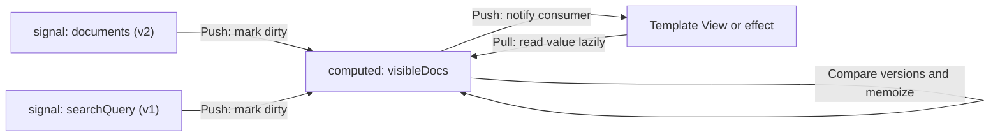
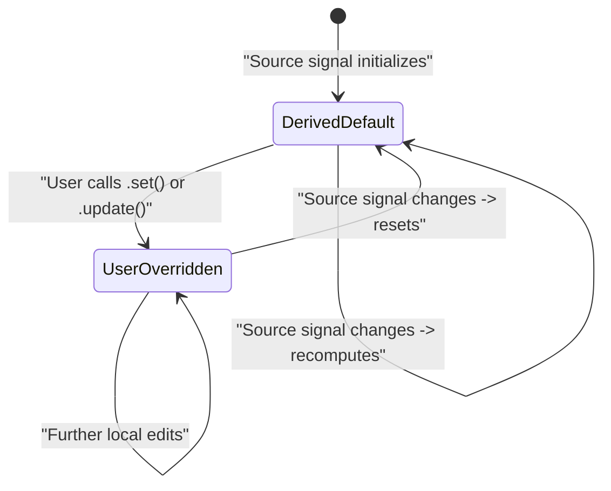
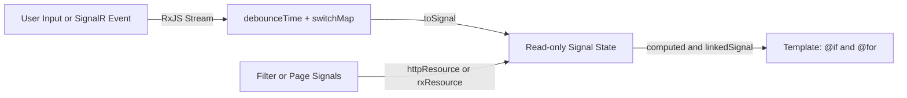

# Chapter 7: The Signals Revolution

## 1. Learning Objectives
By the end of this chapter, you will be able to:
* Understand why Signals were introduced, how Angular's **push-pull dependency graph** achieves glitch-free reactivity, and how Signals enable **zoneless** change detection.
* Master the three core reactive primitives (`signal`, `computed`, `effect`), along with encapsulation (`.asReadonly()`), custom equality (`equal`), `untracked()`, `onCleanup`, and `afterRenderEffect()`.
* Manage resettable derived state cleanly with `linkedSignal()`.
* Replace legacy decorators and lifecycle hooks with Signal Inputs (`input()`), Outputs (`output()`), Models (`model()`), and Signal Queries (`viewChild()`, `contentChild()`).
* Integrate asynchronous streams and BFF HTTP calls using `toSignal()`, `toObservable()`, `resource()`, `rxResource()`, and `httpResource()`, and know when NOT to use Signals or `resource()`.
* Migrate legacy RxJS `BehaviorSubject` stores to Signal-based architectures using Normora's multi-tenant enterprise patterns.

---

## 2. Introduction: Why Signals?

For years, Angular relied on **Zone.js** (a library that monkey-patches browser asynchronous APIs such as `setTimeout`, `addEventListener`, and `fetch`/XHR) to trigger change detection. Whenever an async event finishes, Zone.js tells Angular: *"Something might have changed, go check the entire component tree."*

This **top-down dirty checking** works well for small apps but scales poorly in enterprise applications. If a user clicks a single button deep in a workspace dashboard, Angular traverses hundreds or thousands of components to check whether their template bindings changed.

**RxJS** was heavily used to mitigate this via the `async` pipe and `OnPush` change detection, but RxJS has a steep learning curve, requires careful subscription management to prevent memory leaks, and is optimized for *asynchronous event streams* rather than *synchronous application state*.

### Enter Signals (Angular v16–v22)
A **Signal** is a reactive wrapper around a value that notifies interested consumers when that value changes. Signals became a core primitive in Angular v16, gained signal-based component APIs in v17, `linkedSignal` and `resource` in v19, and power **zoneless Angular** as a first-class default in modern Angular 22 applications.

Unlike Zone.js, which checks the entire application blindly, Signals provide **Fine-Grained Reactivity** (updating only the exact component views or DOM bindings that actually depend on changed data, without scanning unrelated parts of the tree).

### How the Dependency Graph Works: Push-Pull & Glitch-Free Execution
To reach architect-level mastery, you need to understand *how* Signals execute under the hood:
* **Producer:** A reactive node that holds or computes a value (e.g., a `signal()` or `computed()`).
* **Consumer:** A reactive node or template view that reads a Producer (e.g., a `computed()`, an `effect()`, or an Angular component template).
* **Glitch-Free Execution:** A *glitch* occurs in reactive systems when a derived value temporarily calculates an inconsistent intermediate state because one dependency updated before another (a classic problem with RxJS `combineLatest` when two streams emit from the same source).

Angular Signals avoid glitches using a **two-phase Push-Pull algorithm**:
1. **Push Phase (Mark Dirty):** When you call `.set()` or `.update()` on a writable signal, Angular immediately *pushes* a "possibly dirty" notification down the dependency graph to dependent `computed()` signals and `effect()`/template consumers. **No `computed()` callback runs during the push phase.**
2. **Pull Phase (Lazy Recomputation):** Only when a consumer (such as a template render or `effect()`) actually *reads* a `computed()` signal does Angular check dependency version numbers, recompute if needed, and cache the new result.



Because nothing recomputes until all synchronous writes settle and a consumer pulls the value, `computed()` never sees a half-updated state. And because each template tracks the exact signals it reads, **zoneless change detection** can re-render only the affected views directly—no Zone.js required. (We cover the full change-detection scheduler in Chapter 13.)

### Five Real-World Normora Scenarios Where Fine-Grained Reactivity Matters
In **Normora**, an enterprise multi-tenant knowledge and conversational-AI platform, top-down tree checking would waste significant CPU cycles during real-time workflows:
1. **Copilot SSE Token Streaming:** As `NormoraWorkplaceAgent` streams Markdown tokens over Server-Sent Events (SSE) into `CopilotChatComponent`, updating a `streamingMessage` signal updates *only* the active assistant bubble instead of re-checking the entire workspace sidebar and document table.
2. **Background Ingestion Status Badges:** When `Normora.Worker` finishes chunking and embedding a policy PDF via Hangfire and relays an event over the Redis SignalR backplane, only the matching row's `DocumentStatusBadgeComponent` updates from `Processing` to `Ready`.
3. **Expense Simulator Calculations (`ExpenseSimulatorCardComponent`):** When an employee drags the hotel nights stepper inside an A2UI policy-limit card, a `computed()` signal recalculates total allowance instantaneously without triggering change detection in parent conversation threads.
4. **Multi-Currency Billing Switcher:** Changing workspace currency (`INR`, `USD`, `EUR`, etc.) updates `TenantPlanPricingCatalog` signals so only the pricing cards and annual discount badges recalculate, leaving unrelated tenant audit logs untouched.
5. **Live Autonomous Tool Chips:** While the AI agent emits `tool_started` and `tool_finished` events (such as `documents_search` or `calculate_policy_limit`), Signal-backed status chips toggle their spinners independently of the main chat input form.

---

## 3. The Core Reactive Primitives

### 3.1 Writable Signals (`signal`, `.asReadonly()`, and Custom `equal`)
A **writable signal** (`WritableSignal<T>`) holds a value, lets consumers read it by invoking it like a function (`counter()`), and lets owners update it via `.set()` or `.update()`.

```typescript
import { signal } from '@angular/core';

const counter = signal(0);

// Reading a signal requires executing it like a function
console.log(counter()); // Output: 0

// Updating directly
counter.set(5);

// Updating based on the previous value
counter.update(current => current + 1);
```

#### Encapsulation with `.asReadonly()`
In enterprise services and stores, you rarely want arbitrary components calling `.set()` directly on shared state. Keep the `WritableSignal` `private` and expose a read-only `Signal<T>` via `.asReadonly()`:

```typescript
private readonly _isUploading = signal(false);
readonly isUploading = this._isUploading.asReadonly(); // Consumers can read, never mutate
```

#### Equality Semantics (`equal`)
By default, Signals use `Object.is` (strict reference equality) to decide whether a new value actually changed.
* If you mutate an object or array in place, the reference stays identical—so Angular assumes **nothing changed** and notifies zero consumers.
* Conversely, if an HTTP poll or SignalR payload creates a fresh object with identical domain fields, you can pass a custom `equal` function to prevent unnecessary downstream `computed()` or template updates:

```typescript
const syncVersion = signal(
  { tenantId: 't-1', version: 1 },
  { equal: (a, b) => a.tenantId === b.tenantId && a.version === b.version }
);
```

### 3.2 Computed Signals (`computed`)
A **computed signal** (`Signal<T>`) derives its value from one or more other signals. It is **lazy**, **memoized**, and **read-only**.
* **Lazy:** It does not execute the derivation function until a consumer actually reads it.
* **Memoized:** Once calculated, it caches the result. Reading `totalPrice()` ten times in a template evaluates the callback only once unless `price` or `quantity` changes.
* **Dynamic Dependency Tracking:** Dependencies are tracked *per execution*. If a branch inside `computed()` is skipped by an `if` statement, signals read only in that skipped branch are not tracked until that branch runs.

```typescript
import { signal, computed } from '@angular/core';

const price = signal(100);
const quantity = signal(2);

// Derived state. Cannot be manually updated via .set()
const totalPrice = computed(() => price() * quantity());

console.log(totalPrice()); // 200

price.set(150);
console.log(totalPrice()); // 300
```
> **Architect Rule:** Never bind imperative methods or complex getters in your HTML templates (`{{ calculateTotal() }}`). In change detection, methods run repeatedly; `computed()` signals memoize the result and recalculate only when dependencies change.

### 3.3 Effects (`effect`, `untracked()`, `onCleanup`, and `afterRenderEffect()`)
An **effect** schedules a side-effect operation that runs asynchronously when any signal read inside its callback changes. It is built for *outside-the-reactive-graph* side effects (such as updating `document.documentElement`, writing `localStorage`, logging telemetry, or driving third-party libraries).

```typescript
import { effect, signal } from '@angular/core';

const theme = signal<'light' | 'dark'>('dark');

effect(() => {
  // Angular tracks that this effect depends on the 'theme' signal.
  // Toggling the class preserves other Tailwind/layout classes on body/html.
  document.documentElement.classList.toggle('dark', theme() === 'dark');
});
```

#### Injection Context, `untracked()`, and `onCleanup`
1. **Injection Context:** By default, `effect()` must be called inside an **injection context** (a class field initializer, constructor, or `runInInjectionContext`) so Angular can automatically destroy it when the component/service is destroyed. Outside a constructor (for example inside `ngOnInit` or a helper method), pass `{ injector: this.injector }`.
2. **`untracked()`:** Sometimes an `effect()` or `computed()` needs to *read* a signal for context (such as a current filter or user ID) **without** subscribing to future changes of that signal. Wrap that read in `untracked(() => ...)`.
3. **`onCleanup`:** Whenever an effect starts a timer, opens a listener, or creates an `AbortController`, register a teardown callback via `onCleanup(() => ...)`. Angular invokes `onCleanup` before the next effect execution and when the owning component is destroyed.
4. **`afterRenderEffect()` (Angular 19+):** Standard `effect()` runs *before* DOM updates flush. When you must measure DOM geometry, scroll a chat container to the bottom, or resize a canvas chart *after* Angular finishes rendering the updated DOM, use `afterRenderEffect()`.

> **Architect Rule:** Avoid using `effect()` to synchronize state into another `signal()` (this causes redundant cycles or infinite loops). Derive read-only state with `computed()` and resettable derived state with `linkedSignal()`.

### 3.4 Five Real-World Normora Examples (Core Primitives)

#### Example 1: Encapsulated Upload Queue with `.asReadonly()` and Custom `equal`
In `client/src/app/features/documents/`, the upload store tracks tenant upload state while preventing redundant UI updates when SignalR re-broadcasts the same `dataVersion`:

```typescript
import { Injectable, signal } from '@angular/core';

export interface WorkspaceVersion {
  tenantId: string;
  dataVersion: number;
}

@Injectable({ providedIn: 'root' })
export class DocumentUploadState {
  private readonly _activeUploads = signal<number>(0);
  private readonly _workspaceVersion = signal<WorkspaceVersion>(
    { tenantId: '', dataVersion: 0 },
    { equal: (a, b) => a.tenantId === b.tenantId && a.dataVersion === b.dataVersion }
  );

  readonly activeUploads = this._activeUploads.asReadonly();
  readonly workspaceVersion = this._workspaceVersion.asReadonly();

  incrementUploads(): void {
    this._activeUploads.update(count => count + 1);
  }

  decrementUploads(): void {
    this._activeUploads.update(count => Math.max(0, count - 1));
  }

  syncVersion(next: WorkspaceVersion): void {
    this._workspaceVersion.set(next);
  }
}
```

#### Example 2: Multi-Currency Pricing & Free-Tier Guard with `computed()`
In Normora's subscription settings, `Free` tier workspaces must suppress cancellation buttons and renewal countdowns (`AGENTS.md` rule), while paid tiers calculate the 20% annual discount cleanly via `computed()`:

```typescript
import { Component, computed, signal } from '@angular/core';

type PlanTier = 'Free' | 'Pro' | 'Enterprise';
type BillingCycle = 'Monthly' | 'Annual';

@Component({
  selector: 'app-subscription-summary',
  template: `
    <div class="rounded-xl border border-slate-200 dark:border-slate-700 bg-white dark:bg-slate-900 p-6">
      <p class="text-sm text-slate-600 dark:text-slate-300">
        Effective Monthly Price: {{ effectiveMonthlyPrice() }} {{ currency() }}
      </p>
      @if (canCancelSubscription()) {
        <button type="button" class="mt-4 border-none! bg-rose-600 text-white px-4 py-2 rounded-lg">
          Cancel Subscription
        </button>
      }
    </div>
  `
})
export class SubscriptionSummaryComponent {
  readonly tier = signal<PlanTier>('Pro');
  readonly cycle = signal<BillingCycle>('Annual');
  readonly currency = signal<'USD' | 'INR' | 'EUR'>('USD');
  readonly baseMonthlyPrice = signal<number>(49);

  readonly effectiveMonthlyPrice = computed(() => {
    const base = this.baseMonthlyPrice();
    return this.cycle() === 'Annual' ? Math.round(base * 0.8) : base;
  });

  // Enforces Free-tier invariant: never render cancel controls on Free plans
  readonly canCancelSubscription = computed(() => this.tier() !== 'Free');
}
```

#### Example 3: White-Label Dark Mode & Tenant Branding Sync with `effect()`
Normora's `Tenants` module supports white-label branding and mandatory dark mode across all UI surfaces:

```typescript
import { Injectable, effect, signal } from '@angular/core';

@Injectable({ providedIn: 'root' })
export class TenantThemeService {
  private readonly _isDarkMode = signal<boolean>(true);
  private readonly _brandAccentHex = signal<string>('#6366f1');

  readonly isDarkMode = this._isDarkMode.asReadonly();

  constructor() {
    effect(() => {
      const dark = this._isDarkMode();
      const accent = this._brandAccentHex();

      document.documentElement.classList.toggle('dark', dark);
      document.documentElement.style.setProperty('--normora-accent', accent);
      localStorage.setItem('normora_theme', dark ? 'dark' : 'light');
    });
  }

  toggleDarkMode(): void {
    this._isDarkMode.update(v => !v);
  }
}
```

#### Example 4: SignalR `dataVersion` Reload Trigger Using `untracked()`
When `IWorkspaceStateSynchronizer` broadcasts a new `dataVersion` over SignalR, employer tables must reload using the *current* search filter without re-firing just because the user cleared a search box earlier:

```typescript
import { Injectable, effect, signal, untracked } from '@angular/core';

@Injectable({ providedIn: 'root' })
export class WorkspaceSyncMonitor {
  readonly dataVersion = signal<number>(0);
  readonly currentDepartmentFilter = signal<string>('ALL');

  constructor() {
    effect(() => {
      const version = this.dataVersion();
      if (version === 0) return;

      // Read filter for the reload call without subscribing to filter changes here
      const dept = untracked(() => this.currentDepartmentFilter());
      this.reloadEmployerTable(version, dept);
    });
  }

  private reloadEmployerTable(version: number, department: string): void {
    console.debug(`Reloading workspace v${version} for department=${department}`);
  }
}
```

#### Example 5: Managing `AbortController` & Cleanup with `onCleanup`
When switching selected documents in Normora's `ChunkPreviewDrawerComponent`, `onCleanup` aborts any in-flight preview request automatically before starting the next one:

```typescript
import { effect, signal } from '@angular/core';

export class ChunkPreviewLoader {
  readonly selectedDocumentId = signal<string | null>(null);
  readonly previewMarkdown = signal<string>('');

  constructor() {
    effect((onCleanup) => {
      const docId = this.selectedDocumentId();
      if (!docId) return;

      const controller = new AbortController();
      onCleanup(() => controller.abort());

      // Same-origin BFF endpoint uses HttpOnly cookie session
      fetch(`/api/documents/${encodeURIComponent(docId)}/preview`, {
        signal: controller.signal,
        credentials: 'include'
      })
        .then(res => (res.ok ? res.json() : Promise.reject(res.status)))
        .then(data => this.previewMarkdown.set(data.markdown))
        .catch(err => {
          if (err?.name !== 'AbortError') {
            this.previewMarkdown.set('');
          }
        });
    });
  }
}
```

---

## 4. Resettable Derived State with `linkedSignal()` (Angular v19+)

Before Angular v19, engineers hit an awkward gap:
* `computed()` produces a **read-only** derived signal—the user cannot temporarily override it with `.set()`.
* `signal()` is writable, so developers used `effect()` to reset it whenever a parent selection changed—creating anti-patterns and extra change-detection cycles.

**`linkedSignal()`** solves this cleanly. It creates a **writable signal whose value automatically resets to a derived computation whenever its source signal(s) change**, while still allowing local `.set()` and `.update()` overrides in between.

### Shorthand vs. `source` + `computation` Form
1. **Shorthand Form:** Tracks every signal read inside the callback and resets when any of them changes:
   ```typescript
   const selectedDepartment = signal('HR');
   const currentPage = linkedSignal(() => {
     selectedDepartment(); // track department
     return 1;             // reset page to 1 whenever department changes
   });
   ```
2. **Explicit `source` + `computation` Form (with `previous`):** Gives you access to both the new source value and the `previous` `{ source, value }` pair so you can preserve user selection when it is still valid:
   ```typescript
   const availableDepartments = signal<string[]>(['HR', 'Finance', 'Engineering']);
   const activeDepartment = linkedSignal<string[], string>({
     source: availableDepartments,
     computation: (newList, previous) => {
       if (previous && newList.includes(previous.value)) {
         return previous.value; // Keep user's selection if still present
       }
       return newList[0] ?? 'ALL';
     }
   });
   ```



### When NOT to Use `linkedSignal()`
* If the value should **never** be locally overridden by user input, use `computed()`—it is simpler and enforces immutability.
* If the value should **never** reset when another signal changes, use a plain `signal()`.

### Five Real-World Normora Examples (`linkedSignal`)

#### 1. Resetting Document Table Pagination on Department Filter Change
```typescript
readonly selectedDepartmentId = signal<string | 'ALL'>('ALL');
readonly currentPage = linkedSignal({
  source: this.selectedDepartmentId,
  computation: () => 1
});

goToPage(page: number): void {
  this.currentPage.set(page); // Locally writable until department changes again
}
```

#### 2. Resetting Copilot Starter Prompt When Switching Multi-Agent Personas
In Normora's Unified Copilot Workstation (`Ctrl+J` / `Cmd+J`), switching personas (`All-Rounder`, `HR & People Ops`, `Finance & Travel`, `IT & Security`) resets the draft prompt starter unless the user edits it manually:
```typescript
type AgentPersona = 'All-Rounder' | 'HR & People Ops' | 'Finance & Travel' | 'IT & Security';

readonly activePersona = signal<AgentPersona>('All-Rounder');
readonly draftPrompt = linkedSignal({
  source: this.activePersona,
  computation: (persona) => {
    const defaults: Record<AgentPersona, string> = {
      'All-Rounder': '',
      'HR & People Ops': 'Summarize our parental leave policy.',
      'Finance & Travel': 'Calculate meal and hotel limits for a 3-day trip.',
      'IT & Security': 'List SOC2 access review requirements.'
    };
    return defaults[persona];
  }
});
```

#### 3. Preserving Selected Citation Chunk Tab Across Document Refreshes
```typescript
readonly documentChunks = signal<Array<{ id: string; heading: string }>>([]);
readonly selectedChunkId = linkedSignal<Array<{ id: string; heading: string }>, string | null>({
  source: this.documentChunks,
  computation: (chunks, previous) => {
    if (previous?.value && chunks.some(c => c.id === previous.value)) {
      return previous.value;
    }
    return chunks[0]?.id ?? null;
  }
});
```

#### 4. Resetting Billing Cycle Draft When Workspace Switches Between Free and Paid Tiers
```typescript
readonly currentPlanTier = signal<'Free' | 'Pro' | 'Enterprise'>('Free');
readonly checkoutCycle = linkedSignal({
  source: this.currentPlanTier,
  computation: (tier) => (tier === 'Enterprise' ? 'Annual' : 'Monthly')
});
```

#### 5. Resetting Dynamic A2UI Intake Form Draft on New Tool Request
When `workspace_request_form` emits a new `intake_form_card` request ID in chat, any half-typed field state resets cleanly:
```typescript
readonly activeIntakeRequestId = signal<string | null>(null);
readonly intakeNotes = linkedSignal({
  source: this.activeIntakeRequestId,
  computation: () => ''
});
```

---

## 5. Modern Component APIs & Signal Queries

Signals revolutionized how data flows into, out of, and within Angular standalone components. The legacy `@Input()`, `@Output()`, `@ViewChild()`, and `@ContentChild()` decorators are replaced by Signal-based functions.

### 5.1 Signal Inputs (`input()`, `input.required()`, and Transforms)
Instead of `@Input()`, we use `input()`. It returns a read-only `Signal<T>`.

**Old Way:**
```typescript
@Input() chargerId!: string; // Type is string
```
**New Way:**
```typescript
chargerId = input.required<string>(); // Type is InputSignal<string>
```

**Why it's better:** 
With decorators, reacting to an input change required `ngOnChanges` or property setters. With Signal inputs, you simply compose with `computed()`:

```typescript
chargerId = input.required<string>();
// Automatically recalculates whenever chargerId changes!
apiEndpoint = computed(() => `/api/chargers/${this.chargerId()}`);
```

#### Built-in Transforms & Aliases
`input()` supports `transform` functions (such as `booleanAttribute` and `numberAttribute` from `@angular/core`) and `alias`:
```typescript
import { booleanAttribute, input, numberAttribute } from '@angular/core';

isOpen = input(false, { transform: booleanAttribute });
maxCitations = input(5, { transform: numberAttribute, alias: 'citationLimit' });
```

### 5.2 Signal Outputs (`output()`)
Instead of `EventEmitter`, we use `output()` (which is lighter-weight and does not extend RxJS `Subject`):

```typescript
// Old
@Output() delete = new EventEmitter<string>();

// New
delete = output<string>();

triggerDelete() {
  this.delete.emit('CHARGER_123');
}
```

### 5.3 Model Inputs (`model()`) — Two-Way Binding
Angular v17.2 introduced `model()`. It is a **writable** signal that automatically emits a `<name>Change` event back to the parent when its value changes, enabling `[(value)]="..."` two-way binding without boilerplate `@Input()` + `@Output()` pairs.

```typescript
// Child Component
volume = model(50); // Initial value 50

increase() {
  // Updating the signal automatically notifies the parent!
  this.volume.update(v => v + 10);
}
```
> **When NOT to use `model()`:** Avoid threading `model()` across three or more nested component layers. Deep two-way bindings hide where mutations originate and make debugging hard. Reserve `model()` for leaf UI controls (sliders, steppers, toggles, drawer open states) and prefer unidirectional `input()` + `output()` for feature-level state.

### 5.4 Signal Queries (`viewChild()`, `viewChildren()`, `contentChild()`, `contentChildren()`)
Legacy `@ViewChild` properties are `undefined` until `ngAfterViewInit`, forcing awkward lifecycle hooks. **Signal queries** return a reactive `Signal<T | undefined>` (or `Signal<T>` with `.required()`), so you can react to DOM elements or child components inside `computed()` or `afterRenderEffect()`:

```typescript
import { ElementRef, viewChild, viewChildren } from '@angular/core';

readonly scrollContainer = viewChild<ElementRef<HTMLDivElement>>('scrollContainer');
readonly citationChips = viewChildren(CitationChipComponent);
```

### 5.5 Five Real-World Normora Examples (Component APIs & Queries)

#### 1. `DocumentStatusBadgeComponent` (`input.required()` + `computed()` Tailwind v4 Classes)
```typescript
import { Component, computed, input } from '@angular/core';

export type IngestionStatus = 'Pending' | 'Processing' | 'Ready' | 'Failed';

@Component({
  selector: 'app-document-status-badge',
  template: `
    <span [class]="badgeClasses()" class="inline-flex items-center px-2.5 py-0.5 rounded-full text-xs font-medium">
      {{ status() }}
    </span>
  `
})
export class DocumentStatusBadgeComponent {
  readonly status = input.required<IngestionStatus>();

  readonly badgeClasses = computed(() => {
    switch (this.status()) {
      case 'Ready':
        return 'bg-emerald-100 text-emerald-800 dark:bg-emerald-900/40 dark:text-emerald-300';
      case 'Processing':
        return 'bg-amber-100 text-amber-800 dark:bg-amber-900/40 dark:text-amber-300';
      case 'Failed':
        return 'bg-rose-100 text-rose-800 dark:bg-rose-900/40 dark:text-rose-300';
      default:
        return 'bg-slate-100 text-slate-700 dark:bg-slate-800 dark:text-slate-300';
    }
  });
}
```

#### 2. `ChunkPreviewDrawerComponent` (`booleanAttribute` `input()` + `output()` Co-Browsing)
```typescript
import { Component, booleanAttribute, input, output } from '@angular/core';

@Component({
  selector: 'app-chunk-preview-drawer',
  template: `
    @if (isOpen()) {
      <aside class="fixed right-0 top-0 h-full w-96 border-l border-slate-200 dark:border-slate-700 bg-white dark:bg-slate-900 p-4 custom-scrollbar overflow-y-auto">
        <button type="button" (click)="locateInDocuments.emit(documentId())" class="border-none! text-indigo-600 dark:text-indigo-400">
          Locate in Documents
        </button>
      </aside>
    }
  `
})
export class ChunkPreviewDrawerComponent {
  readonly isOpen = input(false, { transform: booleanAttribute });
  readonly documentId = input.required<string>();
  readonly locateInDocuments = output<string>();
}
```

#### 3. `ExpenseSimulatorCardComponent` (`model()` Hotel Night Stepper)
In Normora's A2UI `policy_limit_card`, the stepper uses `model()` so parent simulation cards stay synchronized:
```typescript
import { Component, model } from '@angular/core';

@Component({
  selector: 'app-hotel-nights-stepper',
  template: `
    <div class="flex items-center gap-2 bg-slate-50 dark:bg-slate-800 p-2 rounded-lg">
      <button type="button" (click)="decrement()" class="px-2 py-1 bg-white dark:bg-slate-700 text-slate-900 dark:text-white rounded">-</button>
      <span class="text-sm font-semibold text-slate-900 dark:text-white">{{ nights() }} nights</span>
      <button type="button" (click)="increment()" class="px-2 py-1 bg-white dark:bg-slate-700 text-slate-900 dark:text-white rounded">+</button>
    </div>
  `
})
export class HotelNightsStepperComponent {
  readonly nights = model<number>(1);

  increment(): void {
    this.nights.update(n => n + 1);
  }

  decrement(): void {
    this.nights.update(n => Math.max(1, n - 1));
  }
}
```

#### 4. `CopilotDockComponent` (`viewChild()` + `afterRenderEffect()` for `.custom-scrollbar`)
```typescript
import { Component, ElementRef, afterRenderEffect, input, viewChild } from '@angular/core';

@Component({
  selector: 'app-copilot-dock',
  template: `
    <div #chatViewport class="h-96 overflow-y-auto custom-scrollbar bg-white dark:bg-slate-900">
      @for (msg of messages(); track msg.id) {
        <p class="p-2 text-slate-900 dark:text-slate-100">{{ msg.text }}</p>
      }
    </div>
  `
})
export class CopilotDockComponent {
  readonly messages = input.required<Array<{ id: string; text: string }>>();
  readonly chatViewport = viewChild<ElementRef<HTMLDivElement>>('chatViewport');

  constructor() {
    afterRenderEffect(() => {
      this.messages(); // Track message updates
      const el = this.chatViewport()?.nativeElement;
      if (el) {
        el.scrollTop = el.scrollHeight;
      }
    });
  }
}
```

#### 5. `ApprovalConfirmationCardComponent` (Server-Enforced HITL `input.required()` & `output()`)
```typescript
import { Component, input, output } from '@angular/core';

export interface PendingApproval {
  approvalId: string;
  toolName: string;
  targetTitle: string;
}

@Component({
  selector: 'app-approval-confirmation-card',
  template: `
    <div class="rounded-lg border border-amber-300 dark:border-amber-700 bg-amber-50 dark:bg-amber-950/40 p-4">
      <p class="text-sm text-slate-900 dark:text-slate-100">Confirm {{ approval().toolName }} on "{{ approval().targetTitle }}"?</p>
      <div class="mt-3 flex gap-2">
        <button type="button" (click)="decision.emit({ approvalId: approval().approvalId, approved: true })"
                class="border-none! bg-rose-600 text-white px-3 py-1.5 rounded">Approve</button>
        <button type="button" (click)="decision.emit({ approvalId: approval().approvalId, approved: false })"
                class="border-none! bg-slate-200 dark:bg-slate-700 text-slate-900 dark:text-white px-3 py-1.5 rounded">Reject</button>
      </div>
    </div>
  `
})
export class ApprovalConfirmationCardComponent {
  readonly approval = input.required<PendingApproval>();
  readonly decision = output<{ approvalId: string; approved: boolean }>();
}
```

---

## 6. Async Reactivity: `resource()`, `httpResource()`, and RxJS Interop

### 6.1 Signals vs. RxJS (The Golden Rule)
With Signals arriving, developers often ask: *"Is RxJS dead?"*
Absolutely not. They solve fundamentally different problems (see Chapter 6 for the full RxJS deep dive):

* **When to use Signals:**
  * **Synchronous State:** Storing arrays, objects, strings, booleans, active tenant metadata.
  * **Derived State:** Computing totals, filtering lists, badge styles, UI presentation logic.
  * **DOM Binding:** Anything displayed directly in the HTML template (`@if`, `@for`).
* **When to use RxJS (and NOT pure Signals):**
  * **Asynchronous Event Streams:** WebSockets/SignalR hubs, SSE streaming chunks, browser resize/keyboard event streams.
  * **Time-Based Operators:** Debouncing search inputs (`debounceTime`), throttling scroll events, polling intervals, exponential retry backoff.
  * **Race-Condition Cancellation:** `switchMap`, `concatMap`, `exhaustMap` (e.g., cancelling stale HTTP searches or ignoring double-clicks on checkout).

> **The Enterprise Pattern:** Use RxJS for the *async flow* (fetching data, debouncing searches, streaming SignalR events), and bridge the result into a *Signal* for *UI state*.



### 6.2 RxJS Interoperability (`toSignal()` and `toObservable()`)
From `@angular/core/rxjs-interop`:
* **`toSignal(obs$, options)`:** Subscribes to an Observable inside an injection context, exposes its latest emission as a `Signal<T>`, and automatically unsubscribes on destroy via `DestroyRef`.
  * Pass `{ initialValue: ... }` so the signal never starts as `undefined` when the Observable is async (e.g., `HttpClient`), or `{ requireSync: true }` for synchronous `BehaviorSubject`s.
  * Notice: if the Observable throws an unhandled error, reading the signal rethrows that error unless handled upstream with `catchError`.
* **`toObservable(sig)`:** Converts a Signal into an Observable (using an internal `effect()`), emitting whenever the signal changes so you can apply `debounceTime`, `distinctUntilChanged`, and `switchMap`.

### 6.3 Reactive Data Fetching with `resource()`, `rxResource()`, and `httpResource()`
Introduced across Angular v19–v20+ (and standard in modern Signal-first Angular 22 architectures), the **Resource APIs** represent asynchronous **read** operations driven by Signal parameters:
* **`resource({ params, loader })`:** Promise/fetch-based async loader. Whenever a signal read inside `params()` changes, `resource` cancels the previous in-flight `abortSignal` and runs `loader({ params, abortSignal })`.
* **`rxResource({ params, stream })`:** Observable-based counterpart (from `@angular/core/rxjs-interop`) ideal when integrating existing `HttpClient` service methods.
* **`httpResource<T>(() => url)`:** Declarative `HttpClient`-backed resource (from `@angular/common/http`) that automatically runs `GET` requests when reactive URL/query signals change, integrates with Angular HTTP interceptors (like Normora's Duende BFF CSRF header interceptor), and exposes `.value()`, `.isLoading()`, `.error()`, `.status()`, and `.reload()`.

> **When NOT to use `resource()` / `httpResource()`:** Never use `resource()` for **write mutations** (`POST`, `PUT`, `PATCH`, `DELETE`) such as uploading a document, approving an AI tool call, or cancelling a subscription. Reactive `params` re-execution could accidentally fire duplicate mutations. Use imperative `HttpClient` calls triggered by explicit user actions instead.

### 6.4 Five Real-World Normora Examples (Async Reactivity & RxJS Interop)

#### 1. `httpResource()` for Tenant Document Library Behind Duende BFF Cookies
```typescript
import { httpResource } from '@angular/common/http';
import { Injectable, signal } from '@angular/core';

export interface DocumentSummary {
  id: string;
  title: string;
  departmentName: string;
  status: 'Pending' | 'Processing' | 'Ready' | 'Failed';
}

@Injectable({ providedIn: 'root' })
export class DocumentsReadService {
  readonly departmentFilter = signal<string>('ALL');
  readonly page = signal<number>(1);

  // Automatically re-fetches via BFF HttpOnly cookie session when departmentFilter or page changes
  readonly documentsResource = httpResource<DocumentSummary[]>(() => ({
    url: '/api/documents',
    params: {
      department: this.departmentFilter(),
      page: this.page()
    },
    withCredentials: true
  }));
}
```

#### 2. `toSignal()` Bridging SignalR `dataVersion$` Updates
When `Normora.Infrastructure`'s Redis SignalR backplane pushes a workspace mutation event, `toSignal()` converts the push stream into synchronous state:
```typescript
import { Injectable } from '@angular/core';
import { toSignal } from '@angular/core/rxjs-interop';
import { Observable, map, startWith } from 'rxjs';

@Injectable({ providedIn: 'root' })
export class WorkspaceLiveState {
  // Assume SignalR hub wrapper exposes workspaceVersion$: Observable<number>
  private readonly versionStream$: Observable<number> = this.connectHubStream();

  readonly dataVersion = toSignal(
    this.versionStream$.pipe(startWith(0)),
    { requireSync: true }
  );

  private connectHubStream(): Observable<number> {
    // Hub adapter omitted for brevity; maps SignalR 'WorkspaceUpdated' event to version number
    return new Observable<number>(subscriber => subscriber.next(1)).pipe(map(v => v));
  }
}
```

#### 3. `toObservable()` + `switchMap` + `toSignal()` for Debounced Hybrid Search
In Normora's Copilot conversation history & semantic search bar, typing fires rapid keystrokes; `toObservable` + RxJS prevents wasted pgvector HNSW queries:
```typescript
import { HttpClient } from '@angular/common/http';
import { Injectable, inject, signal } from '@angular/core';
import { toObservable, toSignal } from '@angular/core/rxjs-interop';
import { catchError, debounceTime, distinctUntilChanged, of, switchMap } from 'rxjs';

export interface SearchHit {
  chunkId: string;
  snippet: string;
}

@Injectable({ providedIn: 'root' })
export class HybridSearchState {
  private readonly http = inject(HttpClient);
  readonly query = signal<string>('');

  private readonly results$ = toObservable(this.query).pipe(
    debounceTime(300),
    distinctUntilChanged(),
    switchMap(term => {
      if (!term.trim()) return of<SearchHit[]>([]);
      return this.http
        .get<SearchHit[]>('/api/documents/search', { params: { q: term }, withCredentials: true })
        .pipe(catchError(() => of<SearchHit[]>([])));
    })
  );

  readonly hits = toSignal(this.results$, { initialValue: [] });
}
```

#### 4. `rxResource()` Loading Tenant Audit Logs with Automatic Cancellation
```typescript
import { HttpClient } from '@angular/common/http';
import { Injectable, inject, signal } from '@angular/core';
import { rxResource } from '@angular/core/rxjs-interop';
import { of } from 'rxjs';

export interface AuditLogEntry {
  id: string;
  action: string;
  externalUserId: string;
  occurredAt: string;
}

@Injectable({ providedIn: 'root' })
export class AuditLogStore {
  private readonly http = inject(HttpClient);
  readonly selectedActionType = signal<string>('ALL');
  readonly enabled = signal<boolean>(true);

  readonly logs = rxResource({
    params: () => (this.enabled() ? { action: this.selectedActionType() } : undefined),
    stream: ({ params }) =>
      params
        ? this.http.get<AuditLogEntry[]>('/api/tenants/audit-logs', {
            params: { action: params.action },
            withCredentials: true
          })
        : of([])
  });
}
```

#### 5. Imperative `HttpClient` Mutation with `ApiMessages` (Why Mutations Do NOT Use `resource()`)
Cancelling a workspace subscription calls `POST /api/subscription/cancel` explicitly and maps failures using `ApiMessages`—never hardcoding error strings:
```typescript
import { HttpClient } from '@angular/common/http';
import { Injectable, inject, signal } from '@angular/core';
import { ApiMessages } from '../../core/constants/api-messages';

@Injectable({ providedIn: 'root' })
export class SubscriptionActionsService {
  private readonly http = inject(HttpClient);
  private readonly _isCancelling = signal(false);
  private readonly _errorMessage = signal<string | null>(null);

  readonly isCancelling = this._isCancelling.asReadonly();
  readonly errorMessage = this._errorMessage.asReadonly();

  cancelSubscription(planTier: 'Free' | 'Pro' | 'Enterprise'): void {
    if (planTier === 'Free') {
      this._errorMessage.set(ApiMessages.CannotCancelFreePlan);
      return;
    }
    this._isCancelling.set(true);
    this._errorMessage.set(null);

    this.http.post<void>('/api/subscription/cancel', {}, { withCredentials: true }).subscribe({
      next: () => this._isCancelling.set(false),
      error: () => {
        this._errorMessage.set(ApiMessages.SubscriptionCancelFailed);
        this._isCancelling.set(false);
      }
    });
  }
}
```

---

## 7. Enterprise Case Studies: Migrating `BehaviorSubject` Stores to Signals

### 7.1 Case Study A: EV Dashboard State (Refactored from RxJS)
Let's convert a legacy RxJS `BehaviorSubject` architecture into a clean Signal-based architecture for an EV Charger dashboard.

**Legacy RxJS Store:**
```typescript
export class ChargerStore {
  private chargersSubject = new BehaviorSubject<Charger[]>([]);
  chargers$ = this.chargersSubject.asObservable();

  private filterSubject = new BehaviorSubject<string>('ALL');
  filter$ = this.filterSubject.asObservable();

  // Awkward RxJS combination to derive state
  filteredChargers$ = combineLatest([this.chargers$, this.filter$]).pipe(
    map(([chargers, filter]) =>
      filter === 'ALL' ? chargers : chargers.filter(c => c.status === filter)
    )
  );
}
```

**Modern Signal Store:**
```typescript
import { Injectable, signal, computed } from '@angular/core';

@Injectable({ providedIn: 'root' })
export class ChargerStore {
  // 1. Writable state
  chargers = signal<Charger[]>([]);
  filter = signal<string>('ALL');

  // 2. Computed derived state (Clean, readable, synchronous)
  filteredChargers = computed(() => {
    const currentFilter = this.filter();
    const allChargers = this.chargers();
    
    if (currentFilter === 'ALL') return allChargers;
    return allChargers.filter(c => c.status === currentFilter);
  });
  
  updateFilter(newFilter: string) {
    this.filter.set(newFilter);
  }
}
```
No `.subscribe()`, no `pipe()`, no `combineLatest`, and no memory leaks. The template simply binds to `store.filteredChargers()`.

### 7.2 Case Study B: Normora Document & Copilot Workspace Store
In Normora (`client/src/app/features/documents/`), combining `.asReadonly()`, `computed()`, `linkedSignal()`, SignalR `dataVersion` sync, and `ApiMessages` gives you a production-grade store without NgRx boilerplate:

```typescript
import { HttpClient, HttpErrorResponse } from '@angular/common/http';
import { Injectable, computed, effect, inject, linkedSignal, signal } from '@angular/core';
import { ApiMessages } from '../../core/constants/api-messages';

export interface WorkspaceDocument {
  id: string;
  title: string;
  departmentId: string;
  status: 'Pending' | 'Processing' | 'Ready' | 'Failed';
}

@Injectable({ providedIn: 'root' })
export class NormoraDocumentsStore {
  private readonly http = inject(HttpClient);

  // Private writable state
  private readonly _documents = signal<WorkspaceDocument[]>([]);
  private readonly _selectedDepartmentId = signal<string>('ALL');
  private readonly _searchText = signal<string>('');
  private readonly _dataVersion = signal<number>(0);
  private readonly _error = signal<string | null>(null);

  // Public read-only signals
  readonly documents = this._documents.asReadonly();
  readonly selectedDepartmentId = this._selectedDepartmentId.asReadonly();
  readonly error = this._error.asReadonly();

  // Resettable derived state: page resets to 1 when department changes
  readonly currentPage = linkedSignal({
    source: this._selectedDepartmentId,
    computation: () => 1
  });

  // Memoized derived state
  readonly filteredDocuments = computed(() => {
    const dept = this._selectedDepartmentId();
    const q = this._searchText().trim().toLowerCase();
    return this._documents().filter(doc => {
      const matchesDept = dept === 'ALL' || doc.departmentId === dept;
      const matchesQuery = !q || doc.title.toLowerCase().includes(q);
      return matchesDept && matchesQuery;
    });
  });

  readonly readyCount = computed(
    () => this._documents().filter(d => d.status === 'Ready').length
  );

  constructor() {
    // Auto-reload when SignalR pushes a new tenant dataVersion
    effect(() => {
      if (this._dataVersion() > 0) {
        this.loadDocuments();
      }
    });
  }

  setDepartment(deptId: string): void {
    this._selectedDepartmentId.set(deptId);
  }

  setSearch(query: string): void {
    this._searchText.set(query);
  }

  notifyDataVersion(version: number): void {
    this._dataVersion.set(version);
  }

  loadDocuments(): void {
    this.http.get<WorkspaceDocument[]>('/api/documents', { withCredentials: true }).subscribe({
      next: docs => {
        this._documents.set(docs);
        this._error.set(null);
      },
      error: (err: HttpErrorResponse) => {
        // Respect BOLA (404) / BFLA (403) generic message contracts
        if (err.status === 404) this._error.set(ApiMessages.NotFound);
        else if (err.status === 403) this._error.set(ApiMessages.Forbidden);
        else this._error.set(ApiMessages.DocumentsLoadFailed);
      }
    });
  }
}
```

---

## 8. Common Mistakes & Anti-Patterns

> [!CAUTION]
> **Anti-Pattern 1: Forgetting Parentheses When Reading a Signal**
> ```html
> <!-- WRONG: Prints the Signal function object or checks truthiness of the function itself! -->
> @if (isUploading) {
>   <span>Uploading {{ activeDocument.title }}...</span>
> }
> ```
> **Why it's wrong:** A Signal is a function. Checking `@if (isUploading)` is *always truthy* because the function reference exists, and `activeDocument.title` accesses a property on the function rather than its value.
> ```html
> <!-- FIX: Always invoke the signal with () -->
> @if (isUploading()) {
>   <span>Uploading {{ activeDocument().title }}...</span>
> }
> ```

> [!CAUTION]
> **Anti-Pattern 2: Mutating Objects or Arrays In-Place Inside a Signal**
> ```typescript
> // WRONG: Mutates the existing array/object reference in place
> const citations = signal<string[]>(['Policy §2.1']);
> citations().push('Policy §4.3');
>
> const user = signal({ name: 'John', role: 'Admin' });
> user().name = 'Jane';
> ```
> **Why it's wrong:** Signals check equality with `Object.is` by default. Mutating an array with `.push()` or mutating a property keeps the exact same object reference, so Angular assumes nothing changed and never updates the template or downstream `computed()` values.
> ```typescript
> // FIX: Always return a new reference using .update() or .set()
> citations.update(list => [...list, 'Policy §4.3']);
> user.update(current => ({ ...current, name: 'Jane' }));
> ```

> [!CAUTION]
> **Anti-Pattern 3: Using `effect()` to Synchronize Derived State**
> ```typescript
> // WRONG: Synchronizing one signal from another using effect()
> readonly selectedDept = signal('HR');
> readonly currentPage = signal(1);
>
> constructor() {
>   effect(() => {
>     this.selectedDept();
>     this.currentPage.set(1); // Extra CD cycle and fragile ordering!
>   });
> }
> ```
> **Why it's wrong:** Using `effect()` to write derived state triggers extra change-detection passes, risks circular infinite loops when two effects write to each other's dependencies, and leaves `currentPage()` temporarily stale before the asynchronous effect runs.
> ```typescript
> // FIX: Use computed() for read-only derived state, or linkedSignal() for resettable writable state
> readonly currentPage = linkedSignal({
>   source: this.selectedDept,
>   computation: () => 1
> });
> ```

> [!CAUTION]
> **Anti-Pattern 4: Missing `untracked()` in `effect()` or `computed()`**
> ```typescript
> // WRONG: Every keystroke in searchFilter triggers a full SignalR reload!
> effect(() => {
>   const version = this.dataVersion();
>   this.reloadTable(version, this.searchFilter());
> });
> ```
> **Why it's wrong:** Any signal called anywhere inside an `effect()` or `computed()` becomes a reactive dependency. Reading `this.searchFilter()` directly causes `reloadTable()` to run whenever the user types in the search box, not just when `dataVersion()` changes.
> ```typescript
> // FIX: Wrap contextual reads in untracked()
> effect(() => {
>   const version = this.dataVersion();
>   const filter = untracked(() => this.searchFilter());
>   this.reloadTable(version, filter);
> });
> ```

> [!CAUTION]
> **Anti-Pattern 5: Leaking Timers, Listeners, or `AbortController`s in `effect()` (and Calling `effect()` Outside Injection Context)**
> ```typescript
> // WRONG: Called inside ngOnInit without Injector, and leaks interval on every re-run!
> ngOnInit(): void {
>   effect(() => {
>     const docId = this.selectedDocId();
>     setInterval(() => this.pollStatus(docId), 5000);
>   });
> }
> ```
> **Why it's wrong:** Calling `effect()` inside `ngOnInit` throws `NG0203: effect() can only be used within an injection context`. Even in a constructor, omitting `onCleanup` leaks an additional `setInterval` every time `selectedDocId` changes.
> ```typescript
> // FIX: Pass { injector: this.injector } if outside constructor, and register onCleanup
> private readonly injector = inject(Injector);
>
> ngOnInit(): void {
>   effect((onCleanup) => {
>     const docId = this.selectedDocId();
>     const timer = setInterval(() => this.pollStatus(docId), 5000);
>     onCleanup(() => clearInterval(timer));
>   }, { injector: this.injector });
> }
> ```

> [!CAUTION]
> **Anti-Pattern 6: Using `resource()` / `httpResource()` for Write Mutations or Hardcoding Error Strings**
> ```typescript
> // WRONG: Reactive GET primitive abused for a DELETE mutation + hardcoded magic error string
> deleteTrigger = signal<string | null>(null);
> deleteCall = httpResource(() => `/api/documents/${this.deleteTrigger()}/delete`);
> errorMsg = signal('Document could not be deleted!');
> ```
> **Why it's wrong:** `httpResource` is designed strictly for idempotent read queries and re-executes automatically whenever tracked signals change. Additionally, hardcoding error messages violates Normora's zero-magic-strings policy (`ApiMessages`).
> ```typescript
> // FIX: Trigger imperative HttpClient mutations explicitly and use ApiMessages constants
> this.http.delete(`/api/documents/${encodeURIComponent(id)}`, { withCredentials: true }).subscribe({
>   error: () => this._error.set(ApiMessages.DocumentDeleteFailed)
> });
> ```

> [!CAUTION]
> **Anti-Pattern 7: Threading `model()` Through Multiple Component Layers**
> ```typescript
> // WRONG: Passing model() through Shell -> Drawer -> Panel -> Input
> // Makes state ownership impossible to trace when 4 components mutate the same signal.
> ```
> **Why it's wrong:** Multi-layer two-way bindings recreate the debugging nightmares of AngularJS `$scope` two-way digest loops.
> ```typescript
> // FIX: Use unidirectional input() down + output() up across feature boundaries;
> // reserve model() strictly for direct parent -> leaf UI control bindings.
> ```

---

## 9. Interview Questions

### Junior
**1. Q: Why must you call a Signal like a function (`count()`) when reading it, and what happens if you mutate an array inside a Signal using `.push()`?**
> A: A Signal is an executable getter function (`() => T`) so Angular can detect *when* and *where* it is read—this is how `computed()`, `effect()`, and templates automatically register themselves as consumers without manual `.subscribe()` calls. If you mutate an array in place via `.push()`, the array's memory reference does not change; because Signals use `Object.is` reference equality by default, Angular assumes nothing changed and skips UI updates. Always use `.update(arr => [...arr, item])`.

**2. Q: Explain how `computed()` signals optimize performance compared to using a getter or method in a template.**
> A: If you bind a standard getter or method (e.g., `get total()` or `{{ calculateTotal() }}`) in an Angular template, it executes on *every single change detection cycle*, even if the underlying data has not changed. A `computed()` signal is lazy and memoized: it calculates its value only when read, caches the result, and tracks its exact dependencies. It recalculates only if one of its dependencies changes, saving substantial CPU cycles.

### Senior
**3. Q: What does "glitch-free" reactivity mean in Angular Signals, and how does the push-pull algorithm achieve it?**
> A: A reactive glitch occurs when a derived calculation briefly evaluates an inconsistent intermediate state (for example, `fullName` running after `firstName` updates but before `lastName` updates). Angular prevents this with a two-phase push-pull model: writing a signal only *pushes* a "dirty" marker down the graph without running `computed()` callbacks. Recomputation happens lazily during the *pull* phase when a consumer actually reads the `computed()` signal after all synchronous writes have completed.

**4. Q: When should you choose `linkedSignal()` over `computed()` or `effect()`?**
> A: Use `computed()` when derived state is strictly read-only. Use `linkedSignal()` when a value has a reactive derived default (e.g., resetting pagination to page `1` when a department filter changes, or keeping a selected tab valid across list updates via `previous`) **and** also needs to be locally writable via `.set()` or `.update()`. Never use `effect()` to synchronize derived signal state.

**5. Q: How do `input()`, `output()`, `model()`, and `viewChild()` improve upon legacy Angular decorators?**
> A: Legacy `@Input()` and `@ViewChild()` properties were plain fields synchronized asynchronously via `ngOnChanges` and `ngAfterViewInit`, leading to `undefined` timing bugs and boilerplate setters. Signal inputs (`input()`, `input.required()`) and signal queries (`viewChild()`, `contentChild()`) expose reactive `Signal<T>` values directly, letting you compose derived state with `computed()` and side effects with `afterRenderEffect()` without lifecycle hooks.

**6. Q: Explain `untracked()` and `onCleanup` inside `effect()`, and when `afterRenderEffect()` should be used instead.**
> A: `untracked(() => sig())` reads a signal's current value inside an `effect()` or `computed()` without subscribing to future changes of that signal. `onCleanup(fn)` registers teardown logic (clearing timers, aborting `fetch` requests, unsubscribing listeners) that runs before the next effect execution and on component destruction. `afterRenderEffect()` runs *after* Angular finishes flushing DOM updates, making it the right choice for DOM measurements, canvas sizing, or auto-scrolling chat containers.

### Architect
**7. Q: How do Signals enable "Zoneless" Angular?**
> A: Historically, Zone.js monkey-patched browser async APIs to detect *when* an async event finished, but it had no idea *what* changed—forcing Angular to dirty-check the entire component tree top-down. Signals build a fine-grained Producer-Consumer dependency graph. When a Signal updates via `.set()` or `.update()`, it directly notifies only the specific component views and effects that read it, allowing Angular's scheduler to target-update affected views without Zone.js.

**8. Q: In an enterprise SPA behind a Duende BFF (like Normora), how do you draw the architectural boundary between RxJS, `toSignal()`, `httpResource()`, and imperative `HttpClient` calls?**
> A: Keep synchronous UI state, filtering, and derived view models in Signals (`signal`, `computed`, `linkedSignal`, exposed via `.asReadonly()`). Use `httpResource()` or `rxResource()` for reactive **read (`GET`)** queries driven by Signal parameters with automatic stale-request cancellation. Use RxJS (`toObservable` + `debounceTime`/`switchMap` + `toSignal`, or `takeUntilDestroyed`) for time-based user input, SignalR real-time hubs, and SSE streaming. Keep **write mutations** (`POST`, `PUT`, `DELETE`) in explicit imperative `HttpClient` service methods with `withCredentials: true` and centralized error mapping (e.g., `ApiMessages`) so reactive tracking can never accidentally replay mutations.

---

## 10. Summary
In this chapter, we explored Angular's Signals revolution from fundamentals to enterprise architecture. We covered the push-pull glitch-free reactive graph, core primitives (`signal`, `.asReadonly()`, `equal`, `computed`, `effect`, `untracked`, `onCleanup`, `afterRenderEffect`), resettable state with `linkedSignal()`, modern Signal component APIs and queries (`input()`, `output()`, `model()`, `viewChild()`), and async reactivity (`toSignal()`, `toObservable()`, `resource()`, `rxResource()`, `httpResource()`).

The architectural rule remains clear: **Signals for synchronous & derived UI state, `linkedSignal` for resettable defaults, `httpResource`/`rxResource` for reactive reads, and RxJS + imperative services for streams and mutations.**

In Chapter 8, we will explore Component Communication, mastering how complex components coordinate cleanly in large-scale applications.
