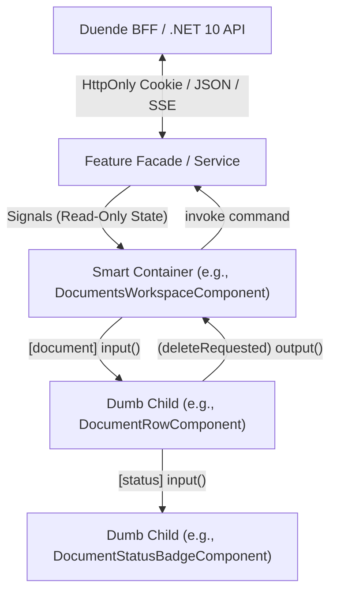
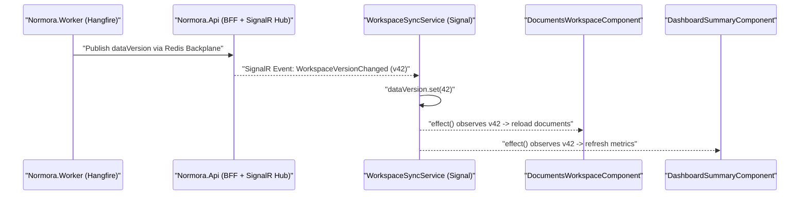
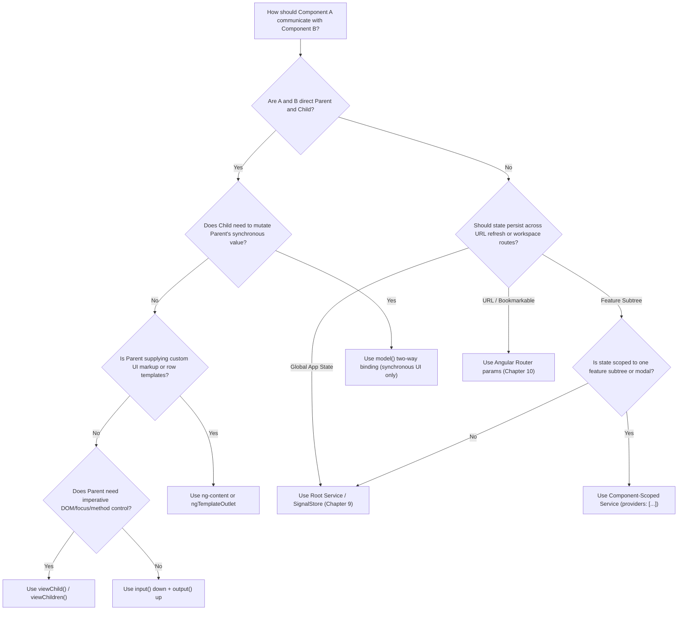

# Chapter 8: Component Communication

## 1. Learning Objectives
By the end of this chapter, you will be able to:
* Architect unidirectional data flow between Smart (Container) and Dumb (Presentational) components.
* Use Angular 22 Signal APIs (`input()`, `output()`, `model()`, `computed()`, and `linkedSignal()`) for type-safe parent-child communication.
* Query component views and projected content safely with Signal queries (`viewChild()`, `viewChildren()`, `contentChild()`, `contentChildren()`) instead of legacy decorators (`@ViewChild`, `@ContentChild`).
* Apply Content Projection (`<ng-content>`) and Template Projection (`ngTemplateOutlet`) to eliminate prop drilling.
* Distinguish between component-scoped services (`providers: [...]`), root singleton services, ancestor DI injection, and real-time SignalR/SSE streams for sibling and subtree communication.
* Select the right communication mechanism for any scenario in an enterprise multi-tenant SPA like Normora.

---

## 2. Introduction: The Container / Presentational Pattern

Before diving into *how* components communicate, we must discuss *why* and *when* they communicate. The gold standard for Enterprise Angular architecture is the **Container / Presentational Pattern** (often called Smart / Dumb components).

### 1. Smart Components (Containers)
These are typically routed feature components (e.g., `ChargerDashboardComponent` or Normora's `DocumentsWorkspaceComponent`).
* **Responsibilities:** Inject services, dispatch HTTP calls to the BFF, manage feature state, handle routing, and enforce UI invariants (such as hiding subscription cancellation controls for Free-tier workspaces).
* **Characteristics:** They hold service dependencies (Signals, RxJS streams, State Stores) and orchestrate layout. They pass immutable data *down* to presentational components and react to semantic events emitted *up*.

### 2. Dumb Components (Presentational)
These are reusable, pure UI blocks (e.g., `ChargerCardComponent`, `StatusBadgeComponent`, or Normora's `DocumentRowComponent`).
* **Responsibilities:** Render UI based strictly on `input()` signals and emit user intentions via `output()` functions.
* **Characteristics:** They inject zero business or HTTP services (at most a pure formatting pipe or localization constant like `ApiMessages`). They know nothing about APIs, Duende BFF sessions, or routing, making them deterministic, easy to test in Vitest, and compatible with zoneless change detection.



### When NOT to Use Smart / Dumb Splitting
* **Trivial leaf routes:** A static "Help & Shortcuts" view or a 25-line confirmation dialog with no reusable sub-elements does not benefit from splitting into a 15-line container and a 20-line presenter. Over-splitting creates pass-through boilerplate with zero reuse gain.
* **Over-fragmenting forms:** Splitting every single `<input>` of a tight Reactive Form into separate Dumb components just for purity can obscure `FormGroup` validation state unless you implement `ControlValueAccessor` or pass explicit `FormControl` references (covered in Chapter 11).

### Real-World Normora Examples (Smart vs. Dumb Boundaries)

1. **Documents Workspace (`DocumentsWorkspaceComponent` → `DocumentRowComponent`):** The container injects `DocumentsApiService` and `WorkspaceSyncService`, tracks pagination and department filters, and passes each `DocumentDto` down to `DocumentRowComponent`, which only emits `(previewRequested)` or `(deleteRequested)`.
2. **Copilot Workstation (`CopilotWorkstationComponent` → `ExpenseSimulatorCardComponent`):** The container owns the SSE stream from `/api/copilotkit` (AG-UI) and renders generative A2UI cards (`policy_limit_card`). `ExpenseSimulatorCardComponent` receives policy limits via `input.required()`, calculates trip totals locally with `computed()`, and emits `(simulationSaved)` without knowing anything about AG-UI or Gemini.
3. **Human-in-the-Loop Approvals (`CopilotWorkstationComponent` → `ApprovalGateCardComponent`):** When a tool like `documents_delete` pauses with a `PendingApproval`, the container passes the approval payload down to `ApprovalGateCardComponent` and handles the `POST` to `ApprovalsController` only when `(decisionSubmitted)` fires.
4. **Subscription Management (`SubscriptionContainerComponent` → `PlanPricingCardComponent`):** Normora's Free-tier invariant mandates suppressing cancellation buttons and danger zones on the `Free` tier. `SubscriptionContainerComponent` resolves the active `TenantPlan` from `TenantPlanPricingCatalog` and passes `[canCancel]="plan().tier !== 'Free'"` down so `PlanPricingCardComponent` remains a pure renderer.
5. **Audit Log Viewer (`AuditLogsContainerComponent` → `AuditLogTableComponent`):** The container enforces tenant-scoped query parameters and handles BFLA `403` error states using `ApiMessages`, while `AuditLogTableComponent` purely renders tabular audit rows with mobile-first Tailwind v4 responsive classes (`grid-cols-1 md:grid-cols-4`) and `dark:` variants.

```typescript
// Dumb Presentational Component (Normora): zero injected HTTP/business services
@Component({
  selector: 'normora-document-row',
  template: `
    <article
      class="flex flex-col sm:flex-row sm:items-center justify-between gap-3 p-4 rounded-lg border border-slate-200 dark:border-slate-700 bg-white dark:bg-slate-900 text-slate-900 dark:text-slate-100"
    >
      <div class="min-w-0">
        <h3 class="font-medium truncate">{{ document().fileName }}</h3>
        <p class="text-xs text-slate-500 dark:text-slate-400">
          {{ document().departmentName }} · {{ document().chunkCount }} chunks
        </p>
      </div>

      <div class="flex items-center gap-2 shrink-0">
        <button
          type="button"
          class="px-3 py-1.5 text-sm rounded-md border border-slate-300 dark:border-slate-600 hover:bg-slate-100 dark:hover:bg-slate-800"
          (click)="previewRequested.emit(document().id)"
        >
          Preview
        </button>
        @if (canDelete()) {
          <button
            type="button"
            class="px-3 py-1.5 text-sm rounded-md bg-rose-600 dark:bg-rose-500 text-white hover:bg-rose-700 dark:hover:bg-rose-600"
            (click)="deleteRequested.emit(document().id)"
          >
            Delete
          </button>
        }
      </div>
    </article>
  `,
})
export class DocumentRowComponent {
  document = input.required<DocumentSummaryDto>();
  canDelete = input<boolean>(false);

  previewRequested = output<string>();
  deleteRequested = output<string>();
}
```

---

## 3. Parent to Child Communication (`input()`, `computed()`, and `linkedSignal()`)

Passing data from a parent component down to a child component is achieved using Signal **Inputs**. In Angular 22, components are standalone by default and use Signal-based `input()` functions rather than `@Input()` decorators, enabling fine-grained reactivity in zoneless applications.

### Modern Signal Inputs (Recommended)
As introduced in Chapter 7, Signal inputs return an `InputSignal<T>` (a read-only signal).

**Child Component (`charger-card.component.ts`)**
```typescript
@Component({
  selector: 'app-charger-card',
  template: `<h2>{{ charger().name }}</h2>`
})
export class ChargerCardComponent {
  // Required input. The compiler throws an error if the parent forgets to bind it.
  charger = input.required<Charger>(); 
  
  // Optional input with a default value
  showDetails = input<boolean>(false);
}
```

**Parent Component Template**
```html
<!-- Passing data DOWN to the child -->
<app-charger-card [charger]="selectedCharger()" [showDetails]="true" />
```

### Input Options: `transform` and `alias`
Signal inputs accept a configuration object `{ alias?: string, transform?: (value: TIn) => TOut }`:
* **`transform`:** Converts raw template values (such as static HTML attributes like `<normora-badge compact />`) into strongly typed values using Angular's built-in `booleanAttribute` / `numberAttribute` or custom normalizers.
* **`alias`:** Decouples the public HTML attribute name from the internal TypeScript property name (useful when migrating designs without breaking templates, or avoiding collisions with native DOM attributes).

### Derived State (`computed`) vs. Writable Resettable State (`linkedSignal`)
In legacy Angular, reacting to `@Input()` changes required implementing `ngOnChanges(changes: SimpleChanges)` with fragile string keys. With Signal inputs:
1. **Read-only derived values:** Use `computed()`. It recalculates lazily and memoizes the result automatically whenever the input signal changes.
2. **Editable local state that resets when an input changes:** Use **`linkedSignal()`**. Introduced in Angular 19 and standard in Angular 22, `linkedSignal()` creates a writable signal whose value automatically resets whenever its source `input()` signal changes—eliminating the anti-pattern of copying inputs inside an `effect()`.

### When NOT to Use `input()`
* **Deep prop drilling (3+ layers):** Passing `tenantBranding` or `currentUser` through intermediate layout components that never read it creates brittle coupling. Use Content Projection (`<ng-content>`) or a shared/scoped service instead.
* **Cross-route application state:** Authentication session details, active workspace slug, or global Copilot dock state belong in core services or Router state, not passed down from `AppComponent` via inputs.

### Real-World Normora Examples (Parent → Child)

1. **`DocumentStatusBadgeComponent` (`transform: booleanAttribute` + `computed()`):** Renders ingestion states (`Pending`, `Processing`, `Ready`, `Failed`) with Tailwind v4 `dark:` badges and accepts `<normora-doc-status-badge [status]="doc.status" compact />` without requiring `[compact]="true"`.
2. **`ChunkPreviewDrawerComponent` (`alias` + `computed()`):** Accepts `[highlightQuery]` aliased internally to `searchTerm`, computing a sanitized highlight preview without `ngOnChanges`.
3. **`TenantPlanCardComponent` (Multi-Currency + Free-Tier Invariant):** Receives a `TenantPlanQuote` from `TenantPlanPricingCatalog` and derives formatted currency labels and button visibility with `computed()`.
4. **`CopilotPersonaChipComponent` (Custom `transform`):** Normalizes raw persona identifiers (`'all-rounder' | 'hr-ops' | 'finance-travel' | 'it-security'`) into trimmed lowercase keys before computing persona badge colors.
5. **`DocumentTitleEditorComponent` (`linkedSignal()`):** Allows inline editing of a document's title; if the user clicks a different document in the parent list while editing, `linkedSignal()` automatically discards the stale draft and syncs to the newly selected `document().title`.

```typescript
import { booleanAttribute, Component, computed, input, linkedSignal } from '@angular/core';

export type IngestionStatus = 'Pending' | 'Processing' | 'Ready' | 'Failed';

// Example 1: transform + computed() in Normora
@Component({
  selector: 'normora-doc-status-badge',
  template: `
    <span
      class="inline-flex items-center rounded-full font-medium"
      [class]="badgeClasses()"
    >
      {{ status() }}
    </span>
  `,
})
export class DocumentStatusBadgeComponent {
  status = input.required<IngestionStatus>();
  compact = input(false, { transform: booleanAttribute });

  badgeClasses = computed(() => {
    const size = this.compact() ? 'px-2 py-0.5 text-xs' : 'px-3 py-1 text-sm';
    const palette: Record<IngestionStatus, string> = {
      Pending: 'bg-amber-100 text-amber-800 dark:bg-amber-950 dark:text-amber-300',
      Processing: 'bg-sky-100 text-sky-800 dark:bg-sky-950 dark:text-sky-300',
      Ready: 'bg-emerald-100 text-emerald-800 dark:bg-emerald-950 dark:text-emerald-300',
      Failed: 'bg-rose-100 text-rose-800 dark:bg-rose-950 dark:text-rose-300',
    };
    return `${size} ${palette[this.status()]}`;
  });
}

// Example 2 & 5: alias + linkedSignal() resetting draft state on parent selection change
@Component({
  selector: 'normora-document-title-editor',
  template: `
    <div class="flex items-center gap-2">
      <input
        type="text"
        [value]="draftTitle()"
        (input)="draftTitle.set($any($event.target).value)"
        [attr.aria-label]="accessibleLabel()"
        class="px-3 py-1.5 rounded-md border border-slate-300 dark:border-slate-600 bg-white dark:bg-slate-900 text-slate-900 dark:text-slate-100 outline-none!"
      />
      @if (isDirty()) {
        <span class="text-xs text-amber-600 dark:text-amber-400">Unsaved</span>
      }
    </div>
  `,
})
export class DocumentTitleEditorComponent {
  document = input.required<{ id: string; title: string }>();
  accessibleLabel = input('Document title', { alias: 'ariaLabel' });

  // Writable signal that automatically resets whenever `document()` changes
  draftTitle = linkedSignal(() => this.document().title);
  isDirty = computed(() => this.draftTitle().trim() !== this.document().title);
}
```

---

## 4. Child to Parent Communication (`output()`, `model()`, and RxJS Interop)

Passing data or events back up from a child to a parent is achieved using **Outputs** for one-way notifications, or **Model Inputs** for synchronous two-way state synchronization.

### Modern Signal Outputs (Recommended)
Angular v17.3 introduced the `output()` function, replacing the clunky `@Output()` decorator and RxJS-backed `EventEmitter` class. Note that `output()` returns an `OutputEmitterRef<T>`—**not** a Signal and **not** an RxJS `Subject`—so you invoke `.emit(value)` rather than `.set()`.

**Child Component (`charger-card.component.ts`)**
```typescript
@Component({
  selector: 'app-charger-card',
  template: `<button (click)="onReboot()">Reboot Charger</button>`
})
export class ChargerCardComponent {
  charger = input.required<Charger>();
  
  // Defines the event and the type of data it emits
  rebootRequested = output<string>(); 

  onReboot() {
    this.rebootRequested.emit(this.charger().id);
  }
}
```

**Parent Component Template**
```html
<!-- Listening to events going UP from the child -->
<app-charger-card 
  [charger]="charger()" 
  (rebootRequested)="handleReboot($event)" 
/>
```

### RxJS Output Interop (`outputFromObservable` & `outputToObservable`)
When a child component manages an asynchronous stream (such as a debounced search box or SignalR notification stream), `outputFromObservable()` in `@angular/core/rxjs-interop` wraps any `Observable<T>` directly into a component output—managing subscription lifecycle and cleanup automatically. Conversely, `outputToObservable(componentRef.instance.someOutput)` lets programmatic consumers subscribe to a component output as an Observable.

### Two-Way Binding (`model()` and `model.required()`)
If a child needs to read a value from a parent *and* update that exact value in the parent synchronously, use `model()` (or `model.required<T>()`). Under the hood, Angular expands `[(isActive)]="chargerIsActive"` into `[isActive]="chargerIsActive()"` and `(isActiveChange)="chargerIsActive.set($event)"` when `chargerIsActive` is a writable `signal` in the parent (notice there are no `()` inside `[(isActive)]="chargerIsActive"`).

```typescript
// Child: status-toggle.component.ts
isActive = model<boolean>(false);

toggle() {
  this.isActive.update(v => !v); // Automatically emits change to parent!
}
```
```html
<!-- Parent HTML: Uses the "banana in a box" syntax bound to parent's chargerIsActive = signal(false) -->
<app-status-toggle [(isActive)]="chargerIsActive" />
```

### When NOT to Use `model()` (Use `input()` + `output()` Instead)
* **Async or server-validated operations:** Never bind `model()` directly to state that requires backend authorization or confirmation (such as Normora's HITL `PendingApproval` deletion or `UpdateTenantCurrencyCommand`). Two-way binding mutates the parent state optimistically before the `.NET` API validates permissions (BFLA/BOLA), leading to UI lies if the server returns `403 Forbidden`.
* **Event-driven workflows:** When the parent needs to inspect, transform, or reject a user action (e.g., logging an audit event or opening a confirmation modal), emit a semantic `output()` event instead.

### Real-World Normora Examples (Child → Parent)

1. **`ApprovalGateCardComponent` (`output()` for Server-Enforced HITL):** Emits `{ approvalId, approved: boolean }` via `decisionSubmitted = output<ApprovalDecision>()` so the parent `CopilotWorkstationComponent` sends the request to `ApprovalsController` and handles `ApiMessages.Forbidden` errors before updating UI state.
2. **`ExpenseSimulatorCardComponent` (`model()` + `output()`):** Uses `hotelNights = model<number>(1)` for an instant, synchronous night-stepper control while emitting `(applyToDraft)` via `output()` when the user confirms the calculation.
3. **`DocumentSearchBarComponent` (`outputFromObservable()`):** Converts a `FormControl.valueChanges` RxJS pipeline (`debounceTime(300)`, `distinctUntilChanged()`) directly into `queryChanged = outputFromObservable(...)` with zero manual `subscribe()` calls.
4. **`WorkspaceCurrencySelectorComponent` (`model.required()`):** Binds `selectedCurrency = model.required<SupportedCurrency>()` to a UI picker inside the billing drawer, while the parent container dispatches `PUT /api/subscription/currency` only when the user clicks "Save Currency".
5. **`CitationChipComponent` (`output({ alias })`):** Emits `(locateInDocuments)` from deep inside an AI markdown response bubble so `CopilotWorkstationComponent` triggers `ChunkPreviewDrawerComponent` or navigates to the source document.

```typescript
import { Component, input, output, signal } from '@angular/core';
import { toObservable, outputFromObservable } from '@angular/core/rxjs-interop';
import { debounceTime, distinctUntilChanged, map } from 'rxjs';

export interface ApprovalDecision {
  approvalId: string;
  approved: boolean;
}

// Example 1: Semantic output() for HITL PendingApproval (never use model() here)
@Component({
  selector: 'normora-approval-gate-card',
  template: `
    <div class="p-4 rounded-lg border border-amber-300 dark:border-amber-700 bg-amber-50 dark:bg-amber-950 text-slate-900 dark:text-slate-100">
      <p class="text-sm font-medium">{{ summary() }}</p>
      <div class="mt-3 flex gap-2">
        <button
          type="button"
          class="px-3 py-1.5 rounded bg-emerald-600 dark:bg-emerald-500 text-white text-sm"
          (click)="decisionSubmitted.emit({ approvalId: approvalId(), approved: true })"
        >
          Approve Action
        </button>
        <button
          type="button"
          class="px-3 py-1.5 rounded border border-slate-300 dark:border-slate-600 text-sm"
          (click)="decisionSubmitted.emit({ approvalId: approvalId(), approved: false })"
        >
          Reject
        </button>
      </div>
    </div>
  `,
})
export class ApprovalGateCardComponent {
  approvalId = input.required<string>();
  summary = input.required<string>();
  decisionSubmitted = output<ApprovalDecision>();
}

// Example 2 & 3: model() stepper + outputFromObservable() debounced search
@Component({
  selector: 'normora-document-search-bar',
  template: `
    <input
      type="search"
      [value]="rawQuery()"
      (input)="rawQuery.set($any($event.target).value)"
      placeholder="Search company policies..."
      class="w-full px-3 py-2 rounded-lg border border-slate-300 dark:border-slate-700 bg-white dark:bg-slate-900 text-slate-900 dark:text-slate-100"
    />
  `,
})
export class DocumentSearchBarComponent {
  protected rawQuery = signal('');

  // Emits debounced values cleanly to parent without manual subscriptions
  queryChanged = outputFromObservable(
    toObservable(this.rawQuery).pipe(
      map(q => q.trim()),
      debounceTime(300),
      distinctUntilChanged()
    )
  );
}
```

---

## 5. Querying the View: `viewChild` and `viewChildren`

Sometimes, a parent component needs to directly invoke an imperative method on a child component (such as `.focus()`, `.scrollTo()`, or `.reset()`), or gain direct access to a DOM element. We achieve this by querying the **View** (elements declared directly inside the component's own template).

### The Modern Signal View Queries
Angular v17.2 introduced signal-based view queries (`viewChild()` and `viewChildren()`), replacing the legacy `@ViewChild` and `@ViewChildren` decorators.

**Child Component (`map-viewer.component.ts`)**
```typescript
@Component({...})
export class MapViewerComponent {
  zoomIn() { /* Complex map logic */ }
}
```

**Parent Component**
```typescript
@Component({
  template: `
    <app-map-viewer #mapViewer />
    <button (click)="triggerZoom()">Zoom</button>
  `
})
export class DashboardComponent {
  // Queries the template for the component. Returns Signal<MapViewerComponent | undefined>!
  map = viewChild(MapViewerComponent);

  // Queries the template for a specific Template Reference Variable (#mapViewer)
  mapRef = viewChild<MapViewerComponent>('mapViewer');

  triggerZoom() {
    // Read the signal to get the component instance, then call its method
    this.map()?.zoomIn();
  }
}
```

> [!NOTE]
> **Zoneless Lifecycle Note:** In the old `@ViewChild` days, the result was `undefined` inside `ngOnInit` and only available in `ngAfterViewInit`. With `viewChild()` signals, you can reference them in `computed()` or `effect()` immediately (they evaluate to `undefined` until the view renders, then reactively update). For one-time post-render DOM measurements or focus calls in zoneless Angular, prefer `afterNextRender()` or `effect()`.

### `viewChild.required()` and the `{ read }` Option
* **`viewChild.required(Target)`:** Returns `Signal<T>` (non-nullable) instead of `Signal<T | undefined>`. Only use `.required()` when the queried element is **always** rendered—never inside `@if` or `@defer`, or Angular throws a runtime error (`NG0951`).
* **Querying DOM Nodes & Directives (`read`):** By default, querying a template reference variable `#searchBox` on an `<input>` returns `ElementRef<HTMLInputElement>`, while querying a component tag returns the component instance. To extract a directive or `ElementRef` from a component host, pass `{ read: ElementRef }`.

### `viewChildren`
Use `viewChildren` to query multiple instances of a component, directive, or element. It returns a reactive `Signal<readonly T[]>` that automatically updates whenever `@for` items are added or removed.

```typescript
// Finds all ChargerCard components in the template
chargerCards = viewChildren(ChargerCardComponent);
```

### When NOT to Use `viewChild` / `viewChildren`
* **Reading or mutating child data:** Never reach into a child with `this.child()?.someState.set(...)` or read `this.child()?.items()`. That breaks encapsulation and couples parent and child internals—use `input()`, `output()`, or a shared service instead.
* **Direct DOM manipulation for styling/visibility:** Never use `ElementRef.nativeElement.style.display = 'none'` when `@if` or `[class]` bindings handle it declaratively and SSR-safely.

### Real-World Normora Examples (View Queries)

1. **`CopilotChatContainerComponent` (Auto-Scrolling SSE Stream):** Queries `#chatScrollContainer` (`ElementRef<HTMLElement>`) via `viewChild.required` and uses an `effect()` watching `messages()` to smoothly scroll `.custom-scrollbar` to the bottom as Gemini tokens stream in.
2. **`CopilotDockComponent` (`Ctrl+J` / `Cmd+J` Prompt Focus):** Queries the prompt `<textarea #promptInput>` via `viewChild<ElementRef<HTMLTextAreaElement>>('promptInput')` and focuses it whenever the global shortcut opens the Copilot panel.
3. **`DocumentsWorkspaceComponent` (`viewChildren` Bulk Collapse):** Queries `viewChildren(DocumentRowComponent)` so clicking "Collapse All Previews" calls `.collapse()` on every currently rendered row without tracking 50 individual booleans in the parent.
4. **`ChunkPreviewDrawerComponent` (Accessible Focus Management):** Queries `#closeDrawerBtn` with `viewChild` and moves keyboard focus to the close button inside an `effect()` when `[isOpen]` flips to `true`.
5. **`IntakeFormCardComponent` (Scroll to First Validation Error):** Queries `viewChildren(FormControlName)` to locate and focus the first invalid dynamic field when an agent-requested intake form fails FluentValidation/Reactive Form checks.

```typescript
import { Component, ElementRef, effect, input, viewChild, viewChildren } from '@angular/core';

// Example 1 & 2: Auto-scrolling Copilot SSE viewport + focusing prompt textarea
@Component({
  selector: 'normora-copilot-chat',
  template: `
    <div class="flex flex-col h-full bg-white dark:bg-slate-900">
      <div #scrollViewport class="flex-1 overflow-y-auto custom-scrollbar p-4 space-y-3">
        @for (msg of messages(); track msg.id) {
          <div class="p-3 rounded-lg bg-slate-100 dark:bg-slate-800 text-slate-900 dark:text-slate-100">
            {{ msg.content }}
          </div>
        }
      </div>
      <textarea
        #promptInput
        rows="2"
        placeholder="Ask Normora about company policies..."
        class="m-3 p-2.5 rounded-lg border border-slate-300 dark:border-slate-700 bg-white dark:bg-slate-950 text-slate-900 dark:text-slate-100"
      ></textarea>
    </div>
  `,
})
export class CopilotChatComponent {
  messages = input.required<Array<{ id: string; content: string }>>();
  isOpen = input<boolean>(false);

  private scrollViewport = viewChild.required<ElementRef<HTMLDivElement>>('scrollViewport');
  private promptInput = viewChild<ElementRef<HTMLTextAreaElement>>('promptInput');

  constructor() {
    effect(() => {
      // Track streamed message updates and scroll viewport
      const count = this.messages().length;
      if (count > 0) {
        queueMicrotask(() => {
          const el = this.scrollViewport().nativeElement;
          el.scrollTop = el.scrollHeight;
        });
      }
    });

    effect(() => {
      if (this.isOpen()) {
        this.promptInput()?.nativeElement.focus();
      }
    });
  }
}
```

---

## 6. Content Projection & Querying Projected Content (`ng-content`, `ngTemplateOutlet`, `contentChild`)

One of the cleanest ways to eliminate prop drilling in Angular is **Content Projection**—passing live UI templates from a parent into a wrapper component via `<ng-content>` instead of passing dozens of configuration `input()` props through intermediate wrappers.

### Single-Slot and Multi-Slot `<ng-content>`
* **Single-slot:** `<ng-content />` renders whatever markup the parent places between the component's opening and closing tags.
* **Multi-slot:** `<ng-content select="[slot-name]" />` routes projected elements into distinct structural regions (header, body, footer). Use `ngProjectAs="[slot-name]"` on `<ng-container>` when projecting multiple elements or custom components into a single named slot without adding extra wrapper DOM nodes.

### Querying Projected Content (`contentChild` & `contentChildren`)
You cannot use `viewChild` for projected content because the markup belongs to the **parent's** template, not the wrapper's template. You must use `contentChild()`, `contentChild.required()`, or `contentChildren()`.

**Wrapper Component (`app-modal.component.ts`)**
```typescript
@Component({
  template: `
    <div class="modal">
      <ng-content></ng-content>
    </div>
  `
})
export class ModalComponent {
  // Finds the form that the parent projected into this modal
  projectedForm = contentChild(NgForm);
  
  validate() {
    console.log(this.projectedForm()?.valid);
  }
}
```

* **`{ descendants: true }`:** By default, `contentChildren()` queries only direct projected children. Pass `{ descendants: true }` when the target component or directive may be nested inside wrapper `<div>` elements in the parent's projected markup.

### Template Projection with `ngTemplateOutlet` (Inversion of Control)
When a child component owns data or iteration (such as a paginated table or virtualized list), `<ng-content>` alone cannot bind per-row data back to the parent's markup. Instead, the parent passes a `TemplateRef` via `input()`, and the child renders it using `[ngTemplateOutlet]` and `[ngTemplateOutletContext]`. This gives the parent full control over row rendering while the child handles pagination, loading states, and dark-mode chrome.

### When NOT to Use Content Projection
* **Strict data validation or layout enforcement:** If a component must inspect, sort, or enforce accessibility structure over every item (e.g., calculating total policy limits across line items), pass structured arrays via `input()` rather than arbitrary HTML via `<ng-content>`.
* **Lazy rendering of heavy panels:** Standard `<ng-content>` instantiates projected children eagerly even if hidden with CSS. Wrap conditional slots in `TemplateRef` + `ngTemplateOutlet` (or `@defer`) when projected content is heavy and initially hidden.

### Real-World Normora Examples (Content & Template Projection)

1. **`NormoraModalShellComponent` (Multi-Slot `<ng-content>`):** Projects `[modal-header]`, default body content, and `[modal-footer]` (used for Invite Employee, Create User Group, and Delete Confirmation dialogs) with consistent Tailwind v4 `dark:` borders and `.custom-scrollbar` overflow.
2. **`NormoraActionCardComponent` (`contentChild` Conditional Footer):** Queries `contentChild(CardActionDirective)` and only renders the bottom border divider when the parent actually projected action buttons.
3. **`DocumentsDataTableComponent` (`ngTemplateOutlet` Row Actions):** Accepts `rowActionsTemplate = input<TemplateRef<{ $implicit: DocumentSummaryDto }>>()` so the Admin Documents page can project Delete/Re-index buttons while the Employee Knowledge Browser projects only Preview/Save buttons.
4. **`WorkspaceNavGroupComponent` (`contentChildren(..., { descendants: true })`):** Queries all projected `NavItemLinkDirective` instances to highlight whether any nested child route is currently active.
5. **`HrEscalationCardComponent` (Custom Timeline Slot):** Projects optional HR ticket metadata into an expandable slot without coupling the timeline shell to specific HR ticket schemas.

```typescript
import { NgTemplateOutlet } from '@angular/common';
import { Component, computed, contentChild, Directive, input, TemplateRef } from '@angular/core';

@Directive({ selector: '[normoraCardActions]' })
export class CardActionDirective {}

// Example 1 & 2: Multi-slot projection + contentChild conditional divider
@Component({
  selector: 'normora-modal-shell',
  template: `
    <section
      role="dialog"
      aria-modal="true"
      class="rounded-xl border border-slate-200 dark:border-slate-700 bg-white dark:bg-slate-900 text-slate-900 dark:text-slate-100 shadow-lg"
    >
      <header class="px-5 py-4 border-b border-slate-200 dark:border-slate-800">
        <ng-content select="[modal-header]" />
      </header>

      <div class="p-5 max-h-96 overflow-y-auto custom-scrollbar">
        <ng-content />
      </div>

      @if (hasFooterActions()) {
        <footer class="px-5 py-3 border-t border-slate-200 dark:border-slate-800 flex justify-end gap-2">
          <ng-content select="[modal-footer]" />
        </footer>
      }
    </section>
  `,
})
export class NormoraModalShellComponent {
  private footerActions = contentChild(CardActionDirective, { descendants: true });
  hasFooterActions = computed(() => this.footerActions() !== undefined);
}

// Example 3: ngTemplateOutlet for parent-controlled per-row actions in Documents table
export interface DocumentRowContext {
  $implicit: { id: string; fileName: string; department: string };
}

@Component({
  selector: 'normora-documents-table',
  imports: [NgTemplateOutlet],
  template: `
    <div class="divide-y divide-slate-200 dark:divide-slate-800 border border-slate-200 dark:border-slate-700 rounded-lg bg-white dark:bg-slate-900">
      @for (doc of documents(); track doc.id) {
        <div class="flex items-center justify-between px-4 py-3 text-slate-900 dark:text-slate-100">
          <div>
            <p class="font-medium">{{ doc.fileName }}</p>
            <p class="text-xs text-slate-500 dark:text-slate-400">{{ doc.department }}</p>
          </div>
          @if (rowActionsTemplate(); as tpl) {
            <ng-container *ngTemplateOutlet="tpl; context: { $implicit: doc }" />
          }
        </div>
      }
    </div>
  `,
})
export class DocumentsTableComponent {
  documents = input.required<Array<{ id: string; fileName: string; department: string }>>();
  rowActionsTemplate = input<TemplateRef<DocumentRowContext>>();
}
```

---

## 7. Sibling, Subtree & Real-Time Communication (Scoped Services, DI Hierarchy & SignalR)

How do two unrelated sibling components—or deeply nested components inside a feature subtree—communicate without **Prop Drilling** (passing inputs and outputs manually through 4+ intermediate layers)?

### 1. Root Singleton Signal Service (Global UI Shell State)
For app-wide UI chrome (sidebar open/closed, global Copilot dock state), inject a `providedIn: 'root'` service exposing read-only signals (`signal.asReadonly()`) and explicit mutation methods.

**`state.service.ts`**
```typescript
@Injectable({ providedIn: 'root' })
export class StateService {
  isSidebarOpen = signal(false);

  toggleSidebar() {
    this.isSidebarOpen.update(v => !v);
  }
}
```

**`header.component.ts`**
```typescript
export class HeaderComponent {
  state = inject(StateService);
  
  onMenuClick() {
    this.state.toggleSidebar();
  }
}
```

**`sidebar.component.ts`**
```typescript
@Component({
  template: `
    <!-- Reacts instantly to the signal change from the Header -->
    <aside [class.open]="state.isSidebarOpen()"></aside>
  `
})
export class SidebarComponent {
  state = inject(StateService);
}
```

### 2. Component-Scoped Services (`providers: [...]` on a Container)
**Crucial Architectural Rule:** Never put transient feature state (such as a multi-step upload queue or modal wizard draft) into a `providedIn: 'root'` singleton. In a multi-tenant SPA like Normora, root singletons survive route navigation and workspace switches, leaking stale data from Tenant A into Tenant B.

Instead, provide a Signal-based coordinator service **directly on the Smart Container's `providers` array**:
* Every child and grandchild inside that container's subtree receives the **same** instance via `inject()`.
* Multiple concurrent instances (e.g., two drawers or tabs) get **isolated** instances.
* When the container is destroyed, Angular automatically destroys the service and cleans up its subscriptions (`DestroyRef`).

### 3. Ancestor-Child DI Communication (Compound Components)
For tightly paired compound components (e.g., `TabGroup` + `TabPanel`, `Accordion` + `AccordionItem`), a child can inject its ancestor directly (`inject(TabGroupComponent, { optional: true })`) to register itself or read active tab signals—avoiding fragile `contentChildren` wiring across arbitrary wrapper `<div>` elements.

### 4. Real-Time Backend-to-Component Sync (SignalR `dataVersion` Broadcast)
In Normora, background ingestion jobs in `Normora.Worker` publish workspace mutations over a Redis backplane to `Normora.Api` SignalR hubs via `IWorkspaceStateSynchronizer` (`dataVersion`). A root `WorkspaceSyncService` holds `dataVersion = signal(0)`. Independent sibling containers (`DocumentsWorkspaceComponent`, `DepartmentMembersComponent`, `AuditLogsContainerComponent`) react via `effect()` or `rxResource` and reload automatically without tight coupling.



### When NOT to Use a Shared Service
* **Direct parent-to-child relationships:** If two components are 1–2 levels apart, `input()` and `output()` are simpler, explicit, and easier to unit test.
* **Bookmarkable or shareable state:** Search queries, selected tabs, or active document IDs belong in **Angular Router query/route params** (Chapter 10) so refreshing the browser or sharing a URL preserves context.
* **Complex normalized entity caches & undo/redo:** Cross-domain entity graphs belong in dedicated State Management (Chapter 9: SignalStore / NgRx).

### Real-World Normora Examples (Sibling, Scoped & Real-Time)

1. **`CopilotDockService` (`providedIn: 'root'`):** Coordinates `Ctrl+J` / `Cmd+J` dock/expand state between `TopNavbarComponent` and `CopilotWorkstationComponent`.
2. **`UploadBatchCoordinator` (Component-Scoped `providers: [UploadBatchCoordinator]`):** Provided on `DocumentsUploadModalComponent` so upload progress signals and error messages (`ApiMessages`) are automatically reset and garbage-collected when the modal closes.
3. **`WorkspaceSyncService` (SignalR `dataVersion`):** Broadcasts tenant-scoped version increments so sibling `DepartmentMembersComponent` and `AuditLogsContainerComponent` refresh seamlessly without page reloads.
4. **`PersonaTabGroupComponent` + `PersonaTabComponent` (Ancestor DI):** `PersonaTabComponent` injects its parent `PersonaTabGroupComponent` to sync active persona selection (`All-Rounder`, `HR & People Ops`, `Finance & Travel`, `IT & Security`).
5. **`WorkspaceNotificationBus` (Interceptor → Shell Banner):** HTTP interceptors catching BFLA `403` (`ApiMessages.Forbidden`) or BOLA `404` (`ApiMessages.NotFound`) emit structured alerts into a root notification signal consumed by `AlertBannerComponent`.

```typescript
import { Component, computed, Injectable, inject, signal } from '@angular/core';
import { ApiMessages } from '../../core/constants/api-messages';

// Example 2: Component-scoped coordinator (destroyed when modal closes!)
@Injectable()
export class UploadBatchCoordinator {
  private readonly _files = signal<Array<{ name: string; progress: number; failed?: boolean }>>([]);
  readonly files = this._files.asReadonly();
  readonly hasFailures = computed(() => this._files().some(f => f.failed));
  readonly errorBanner = computed(() =>
    this.hasFailures() ? ApiMessages.DocumentUploadFailed : null
  );

  enqueue(name: string) {
    this._files.update(list => [...list, { name, progress: 0 }]);
  }

  markFailed(name: string) {
    this._files.update(list =>
      list.map(f => (f.name === name ? { ...f, failed: true } : f))
    );
  }
}

@Component({
  selector: 'normora-upload-modal',
  providers: [UploadBatchCoordinator], // Scoped strictly to this modal instance!
  template: `
    <div class="p-5 rounded-xl bg-white dark:bg-slate-900 text-slate-900 dark:text-slate-100 border border-slate-200 dark:border-slate-700">
      @if (coordinator.errorBanner(); as err) {
        <p class="mb-3 text-sm text-rose-600 dark:text-rose-400">{{ err }}</p>
      }
      <normora-upload-dropzone />
      <normora-upload-queue-list />
    </div>
  `,
})
export class DocumentsUploadModalComponent {
  protected coordinator = inject(UploadBatchCoordinator);
}

// Descendant component automatically shares the modal's scoped coordinator
@Component({
  selector: 'normora-upload-queue-list',
  template: `
    <ul class="space-y-2 max-h-48 overflow-y-auto custom-scrollbar">
      @for (file of coordinator.files(); track file.name) {
        <li class="text-sm text-slate-700 dark:text-slate-300">{{ file.name }} ({{ file.progress }}%)</li>
      }
    </ul>
  `,
})
export class UploadQueueListComponent {
  protected coordinator = inject(UploadBatchCoordinator);
}

// Example 3: SignalR dataVersion reactive synchronization
@Injectable({ providedIn: 'root' })
export class WorkspaceSyncService {
  private readonly _dataVersion = signal(0);
  readonly dataVersion = this._dataVersion.asReadonly();

  onSignalRVersionChanged(nextVersion: number) {
    if (nextVersion > this._dataVersion()) {
      this._dataVersion.set(nextVersion);
    }
  }
}
```

---

## 8. Architectural Decision Guide: Choosing the Right Mechanism

Use this decision tree and comparison matrix when designing component boundaries:



| Mechanism | Direction | Coupling | Lifecycle Scope | Best Normora Use Case |
| :--- | :--- | :--- | :--- | :--- |
| `input()` + `computed()` | Parent → Child | Very Low | Bound to Child | Passing `DocumentSummaryDto` to `DocumentRowComponent` |
| `linkedSignal()` | Parent → Child (resettable) | Low | Bound to Child | Inline title draft that resets when selected doc changes |
| `output()` / `outputFromObservable()` | Child → Parent | Very Low | Bound to Child | Emitting HITL `ApprovalDecision` or debounced search queries |
| `model()` | Two-way (`[(prop)]`) | Medium | Bound to Parent & Child | Synchronous `hotelNights` stepper in `ExpenseSimulatorCardComponent` |
| `<ng-content>` / `ngTemplateOutlet` | Parent → Child UI slot | Very Low | Parent template scope | Multi-slot `NormoraModalShellComponent` & custom table row actions |
| `viewChild()` / `contentChild()` | Parent → Child/DOM ref | Medium–High | View / Content lifecycle | Focusing `#promptInput` on `Ctrl+J` or auto-scrolling SSE chat |
| Component-scoped `providers: [...]` | Any within subtree | Low | Container component lifetime | `UploadBatchCoordinator` inside `DocumentsUploadModalComponent` |
| Root Service (`providedIn: 'root'`) | Any across app | Low–Medium | Application lifetime | `WorkspaceSyncService` SignalR `dataVersion` & `CopilotDockService` |

---

## 9. Common Mistakes & Anti-Patterns

> [!CAUTION]
> **Anti-Pattern 1: Mutating an `input()` Object by Reference**
> While `input<T>()` returns a read-only `InputSignal<T>` (preventing `.set()`), JavaScript objects and arrays passed inside it are still mutable by reference.
> ```typescript
> // WRONG: Mutating parent's object directly inside a child
> export class DocumentRowComponent {
>   document = input.required<DocumentDto>();
>   archiveLocally() {
>     this.document().isArchived = true; // Breaks unidirectional data flow & zoneless CD!
>   }
> }
> ```
> **Why it's wrong:** Mutating parent-owned objects bypasses signal change tracking, causes stale views in zoneless Angular, and creates race conditions when multiple components reference the same object.
> ```typescript
> // FIX: Emit a semantic output() and let the parent/store produce a new immutable reference
> export class DocumentRowComponent {
>   document = input.required<DocumentDto>();
>   archiveRequested = output<string>();
>
>   requestArchive() {
>     this.archiveRequested.emit(this.document().id);
>   }
> }
> ```

> [!CAUTION]
> **Anti-Pattern 2: Using `effect()` to Sync an `input()` into a Writable `signal()`**
> ```typescript
> // WRONG: Copying input() to local writable signal inside effect()
> export class DocumentTitleEditorComponent {
>   document = input.required<{ title: string }>();
>   draftTitle = signal('');
>
>   constructor() {
>     effect(() => {
>       this.draftTitle.set(this.document().title); // Extra scheduling cycle & timing hazards
>     });
>   }
> }
> ```
> **Why it's wrong:** `effect()` runs asynchronously after change detection, causing a flash of stale data, redundant change detection passes, and accidental `NG0600` signal-write errors or infinite feedback loops.
> ```typescript
> // FIX: Use computed() for read-only derived values, or linkedSignal() for writable resettable state
> export class DocumentTitleEditorComponent {
>   document = input.required<{ title: string }>();
>   draftTitle = linkedSignal(() => this.document().title);
> }
> ```

> [!CAUTION]
> **Anti-Pattern 3: Using `model()` for Server-Validated or Destructive Actions**
> ```typescript
> // WRONG: Two-way model() bound directly to a destructive HITL approval flag
> export class ApprovalGateCardComponent {
>   isApproved = model.required<boolean>();
>   approve() {
>     this.isApproved.set(true); // UI claims approved before BFF/ApprovalsController authorizes!
>   }
> }
> ```
> **Why it's wrong:** If `ApprovalsController` throws `BflaException` (`403 Forbidden`) or `BolaException` (`404 Not Found`), the parent state has already flipped optimistically, violating security UX invariants.
> ```typescript
> // FIX: Emit an explicit output() event and update state only after BFF confirmation
> export class ApprovalGateCardComponent {
>   approvalId = input.required<string>();
>   decisionSubmitted = output<{ approvalId: string; approved: boolean }>();
> }
> ```

> [!CAUTION]
> **Anti-Pattern 4: Prop Drilling Across 4+ Layers Instead of Projection or Scoped DI**
> ```html
> <!-- WRONG: Forwarding tenantRole and deleteHandler through unrelated layout shells -->
> <normora-workspace-shell [tenantRole]="role()" (deleteDoc)="onDelete($event)">
>   <normora-split-pane [tenantRole]="role()" (deleteDoc)="onDelete($event)">
>     <normora-doc-list [tenantRole]="role()" (deleteDoc)="onDelete($event)" />
>   </normora-split-pane>
> </normora-workspace-shell>
> ```
> **Why it's wrong:** Every intermediate layout component becomes coupled to domain props it never uses, making refactoring painful and bloating templates.
> **Fix:** Compose layout shells with `<ng-content />` / `ngTemplateOutlet`, or inject a component-scoped service (`providers: [DocumentsWorkspaceCoordinator]`) at the container boundary.

> [!CAUTION]
> **Anti-Pattern 5: Overusing `viewChild()` to Read or Mutate Child Component State**
> ```typescript
> // WRONG: Reaching into child internals via viewChild()
> export class CopilotWorkstationComponent {
>   simulator = viewChild(ExpenseSimulatorCardComponent);
>   submit() {
>     const total = this.simulator()?.localTotalSignal(); // Tightly coupled to child's private property!
>   }
> }
> ```
> **Why it's wrong:** Renaming `localTotalSignal` in the child silently breaks the parent, and the parent cannot react declaratively to user changes.
> ```typescript
> // FIX: Child emits its domain value via output() or binds via model()
> export class ExpenseSimulatorCardComponent {
>   simulationConfirmed = output<ExpenseSimulation>();
> }
> ```

> [!CAUTION]
> **Anti-Pattern 6: Using `viewChild.required()` Inside `@if` or `@defer` Blocks**
> ```typescript
> // WRONG: #promptInput only exists when isCopilotOpen() is true!
> @Component({
>   template: `
>     @if (isCopilotOpen()) {
>       <textarea #promptInput></textarea>
>     }
>   `
> })
> export class CopilotDockComponent {
>   isCopilotOpen = signal(false);
>   prompt = viewChild.required<ElementRef<HTMLTextAreaElement>>('promptInput'); // Throws NG0951!
> }
> ```
> **Why it's wrong:** `viewChild.required()` throws a runtime `NG0951` error whenever the view renders without the queried element present.
> ```typescript
> // FIX: Use optional viewChild() for conditional @if / @defer elements and guard with ?.
> prompt = viewChild<ElementRef<HTMLTextAreaElement>>('promptInput');
> focusPrompt() {
>   this.prompt()?.nativeElement.focus();
> }
> ```

> [!CAUTION]
> **Anti-Pattern 7: Storing Transient Feature/Tenant State in `providedIn: 'root'` Services**
> ```typescript
> // WRONG: Root singleton holds transient upload errors across tenant switches
> @Injectable({ providedIn: 'root' })
> export class UploadModalStateService {
>   errorMessage = signal<string | null>(ApiMessages.DocumentUploadFailed);
> }
> ```
> **Why it's wrong:** When a user closes the upload modal or switches workspaces in multi-tenant Normora, the root singleton stays alive in memory and leaks stale errors or draft filenames into the next workspace.
> **Fix:** Remove `providedIn: 'root'` and declare `providers: [UploadBatchCoordinator]` on `DocumentsUploadModalComponent` so state is isolated and destroyed with the modal.

---

## 10. Interview Questions

### Junior
**1. Q: What is the difference between `input()` and `model()` in Angular 22?**
> **A:** `input()` creates a read-only `InputSignal<T>` for strict one-way Parent → Child data flow. `model()` creates a writable `ModelSignal<T>` that supports two-way binding (`[(prop)]="parentSignal"`): reading the value from the parent *and* automatically emitting `propChange` back to the parent when the child calls `.set()` or `.update()`.

**2. Q: How do you make an `input()` accept a bare HTML attribute like `<normora-badge compact />` without passing `[compact]="true"`?**
> **A:** Pass Angular's built-in `booleanAttribute` transform to the input options: `compact = input(false, { transform: booleanAttribute })`. Whenever the `compact` attribute is present on the host tag, Angular converts `""` to `true`.

### Intermediate
**3. Q: What is the difference between `viewChild` and `contentChild`?**
> **A:** `viewChild` queries elements, directives, or components declared directly inside the component's own template. `contentChild` queries elements that were projected into the component from a parent component via `<ng-content>`.

**4. Q: Why does `output()` not return a Signal, and how can you bridge an RxJS Observable to a component output?**
> **A:** Outputs represent discrete event streams rather than stateful values, so `output<T>()` returns an `OutputEmitterRef<T>` instead of a Signal or `EventEmitter`. To expose an RxJS stream (such as a debounced search input) as a component output with automatic cleanup, use `outputFromObservable(obs$)` from `@angular/core/rxjs-interop`.

### Senior
**5. Q: Why is using `effect()` to copy an `input()` into a local writable `signal()` an anti-pattern, and what should you use instead?**
> **A:** Copying inside `effect()` runs asynchronously after rendering, causing stale-frame flickers, redundant change detection cycles, and potential loop hazards. For read-only derived values, use `computed()`. For local editable state (like a form draft) that must automatically reset whenever the parent's `input()` changes, use `linkedSignal()`.

**6. Q: When should you choose `ngTemplateOutlet` over `<ng-content>`?**
> **A:** Use `<ng-content>` for static structural slots (modal headers/footers) where the parent already owns the data. Use `TemplateRef` + `ngTemplateOutlet` when the **child** owns iteration or internal row state (like a paginated `DocumentsTableComponent`) and needs to pass per-item context (`$implicit`) back to a parent-defined template, or when heavy projected content should be instantiated lazily.

### Architect
**7. Q: Explain the architectural benefits of the Container / Presentational pattern and where you intentionally break it.**
> **A:** Separating Smart Containers from Dumb Presentational components isolates side effects (HTTP calls, BFF error handling, SignalR subscriptions, routing) from pure rendering logic. Dumb components rely solely on `input()` and `output()`, making them trivial to unit test, reuse across features, and optimize under zoneless change detection. However, you should *not* split trivial static pages or tightly coupled form fields where extra wrapper containers only add pass-through boilerplate without reuse value.

**8. Q: In a multi-tenant enterprise SPA like Normora (behind a Duende BFF with SignalR updates), how do you decide between component-scoped DI (`providers: [...]`) and a `providedIn: 'root'` service?**
> **A:** Use `providedIn: 'root'` only for true application-wide infrastructure and cross-feature coordination (such as `WorkspaceSyncService` holding SignalR `dataVersion`, or `CopilotDockService`), ensuring tenant switches explicitly reset or key that state. Use **component-scoped services** (`providers: [FeatureCoordinator]` on the container) for all transient workflow, wizard, upload queue, or modal state so multiple instances stay isolated and Angular automatically destroys the state when the container unmounts or the user switches tenants.

---

## 11. Summary
In this chapter, we explored the arteries of an Angular 22 application: Component Communication. We established the Smart/Dumb boundary, mastered Signal-based `input()`, `computed()`, `linkedSignal()`, `output()`, `outputFromObservable()`, and `model()`, queried views and projected content with `viewChild()` and `contentChild()`, eliminated prop drilling with `<ng-content>` and `ngTemplateOutlet`, and scoped shared state cleanly using component-level DI and SignalR synchronization.

In Chapter 9, we will scale these patterns to application-wide enterprise state management using SignalStore and NgRx.
