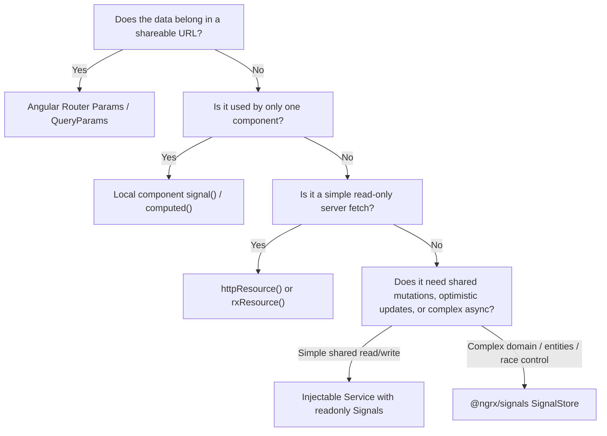
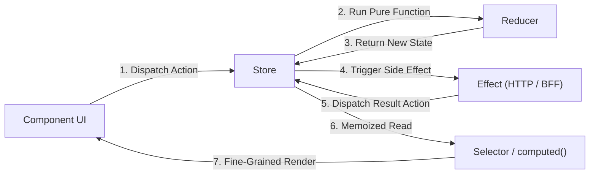
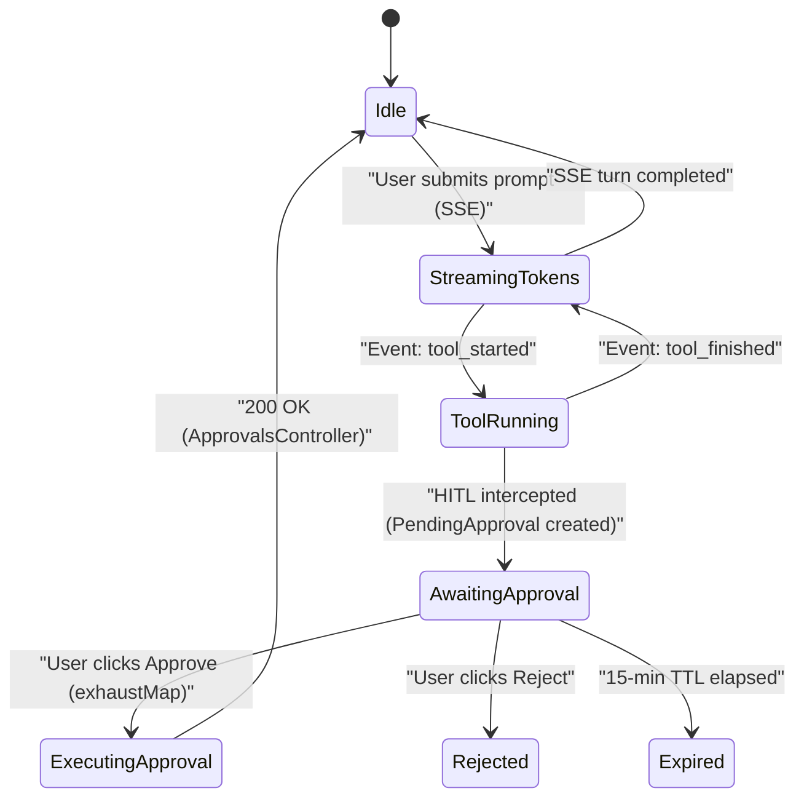
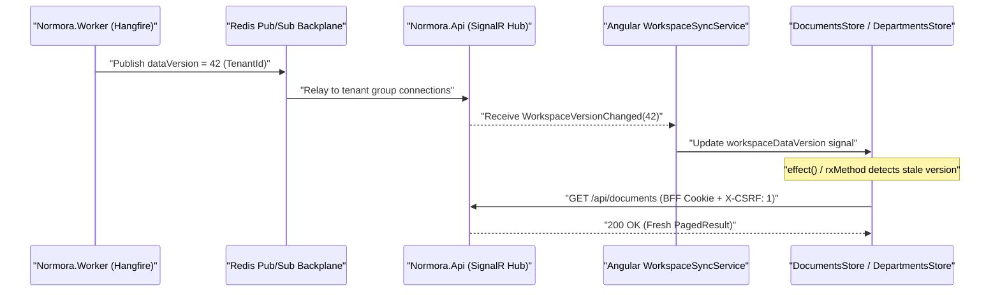

# Chapter 9: Enterprise State Management

## 1. Learning Objectives
By the end of this chapter, you will be able to:
* Classify application state (local UI, URL/router, server cache, shared client domain, and real-time streaming) and decide when an application needs a state store versus a simple service or `httpResource()`.
* Understand the core concepts of Redux (Store, Actions, Reducers, Selectors, Effects, and Normalized Entities) and unidirectional data flow.
* Compare `@ngrx/store`, NGXS, Akita/Elf, Service-with-Signals, and the modern `@ngrx/signals` (`SignalStore`) in an Angular 22 zoneless codebase.
* Build scalable, race-condition-free stores using `withState`, `withComputed`, `withMethods`, `withEntities`, `withHooks`, `signalStoreFeature`, `rxMethod`, and `tapResponse`.
* Architect multi-tenant state isolation, optimistic updates with rollback, and SignalR `dataVersion` synchronization for enterprise platforms like **Normora** (Angular 22 SPA behind a Duende BFF) and the **EV Charging Platform**.

---

## 2. Introduction: The State Management Problem & State Taxonomy

**State** is simply data that your application must remember over time—whether for 200 milliseconds while a tooltip animates, or across an entire user session.

Before choosing a tool, an architect separates state by **lifetime** and **ownership**:
* **Local UI State:** Whether a dropdown or drawer is open, or which tab is active. *(Belongs inside the component as a `signal()`.)*
* **URL / Router State:** Which tenant workspace (`/t/acme-corp`), document ID, or search query is active. *(Belongs in the Angular Router URL and query parameters so links are bookmarkable and shareable.)*
* **Server Cache State:** Data fetched from an API that has a canonical copy on the backend (e.g., paginated documents or audit logs). *(Managed via `httpResource()` or store entity caches with explicit staleness/invalidation.)*
* **Shared Client & Domain State:** Data multiple decoupled components must read and mutate consistently—such as the active tenant profile, an upload queue, or an ongoing AI chat session. *(Belongs in a global or route-scoped Store/Service.)*
* **Ephemeral Real-Time / Streaming State:** High-frequency chunks arriving over **SSE (Server-Sent Events)** or **SignalR** WebSockets (e.g., AI token streams, live tool execution badges, or document ingestion progress).

As enterprise applications grow, ad-hoc data fetching becomes chaotic. If Component A fetches a list of chargers (or policy documents) into a local array and Component B deletes one, Component A has no idea its copy is stale. Worse, in a multi-tenant platform like **Normora**, if a user switches workspaces from `acme-corp` to `globex-labs` and a service forgets to clear cached arrays, **cross-tenant state bleed** occurs—exposing one company's data inside another's UI.

The solution is a **Single Source of Truth (SSOT)** backed by **Immutability** (never mutating objects/arrays in place, instead creating new references so Angular's fine-grained Signal graph detects changes deterministically without Zone.js) and **Unidirectional Data Flow** (state changes only through explicit, traceable methods or actions).

### State Ownership Decision Flowchart



### Real-World Normora Examples: State Classification
1. **Citation Drawer Open/Close (`ChunkPreviewDrawerComponent`):** Whether the markdown chunk preview drawer is open and which heading anchor is highlighted is purely **Local UI State** (`isOpen = signal(false)`), because no other route cares when it closes.
2. **Active Workspace & Thread Selection (`/t/:tenantSlug/chat/:conversationId`):** Storing the active tenant slug or open conversation ID only inside an in-memory service breaks browser refresh and shared links. Keeping `:tenantSlug` and `:conversationId` in **URL / Router State** ensures deep links open the exact workspace and thread after Duende BFF session validation.
3. **Workspace Audit Logs (`AuditLogsComponent`):** Viewing paginated compliance events (`GET /api/audit-logs?page=2`) is read-only **Server Cache State**. Using `httpResource()` or a lightweight query store avoids duplicating mutable client state for append-only backend logs.
4. **Shared Document Repository (`DocumentsStore`):** The Documents table, the Copilot `"Locate in Documents"` co-browsing action, and the `PendingApproval` HITL delete card all read and affect the same document list. Keeping documents in a shared **SignalStore** guarantees every view reflects deletions and ingestion completions immediately.
5. **AG-UI Copilot Streaming Buffer (`CopilotChatStore`):** When `NormoraWorkplaceAgent` streams SSE tokens from `/api/copilotkit` alongside `tool_started` and `tool_finished` badges, that in-progress assistant message is **Ephemeral Streaming State** accumulated in a dedicated SignalStore until the final turn persists to PostgreSQL.

---

## 3. The Traditional Approach: NgRx (Redux) & Ecosystem Comparison

For years, **`@ngrx/store`** (Angular's implementation of the **Redux** pattern) was the gold standard for enterprise state management. Even if you adopt SignalStore today, understanding Redux is essential because SignalStore borrows its architectural discipline—and many legacy or regulated enterprise codebases still run `@ngrx/store`.

### Core Concepts of Redux & Unidirectional Data Flow
Redux enforces **Unidirectional Data Flow (UDF)**—data always travels in a single, predictable circle so you can trace *who* changed state, *when*, and *why*:
1. **The Store:** A single, **immutable** state container holding slices of application data. Components never overwrite properties directly (`state.user = ...` is forbidden).
2. **Actions:** Plain event objects describing *what happened* (not *how* to mutate state), e.g., `[Charger API] Load Chargers Success` or `[Documents Page] Delete Approved`.
3. **Reducers:** **Pure functions** (same inputs always produce the same output, with zero side effects like HTTP calls) that take `(currentState, action)` and return a *new* state reference.
4. **Selectors:** **Memoized** (cached) pure functions that extract or compute derived slices of state. If the underlying slice reference did not change, a selector returns the cached result in `O(1)` time without recomputing.
5. **Effects:** Side-effect listeners (built on RxJS in classic NgRx) that intercept dispatched Actions, perform asynchronous work (HTTP calls to `Normora.Api`, SignalR subscriptions, navigation), and dispatch result Actions (`Success` or `Failure`).



### Normalized State: Why Dictionaries Beat Arrays at Scale
Beginners often store collections as raw arrays (`Document[]`) or deeply nested trees (`Department` containing `User[]` containing `Document[]`). At enterprise scale, nested arrays cause two bugs:
* **`O(n)` Lookups & Slow Updates:** Updating one document out of 2,000 requires scanning the entire array.
* **Duplicated Truth:** If the same document appears inside both `"Recent Uploads"` and `"HR Policies"`, updating its status in one array leaves the other stale.

**Normalized State** models client state like a relational database table:
```typescript
interface NormalizedCollection<T> {
  ids: string[];                 // Preserves display/sort order
  entities: Record<string, T>;   // O(1) lookup by ID
}
```
`@ngrx/entity` (for classic Redux) and `withEntities()` (for SignalStore) automate this pattern.

### State Management Ecosystem Comparison (Angular 22)

| Approach | Core Paradigm | Boilerplate | Zoneless & Signals Native | Best For | When NOT to Use |
|---|---|---|---|---|---|
| **Local `signal()` / `computed()`** | Component-scoped reactivity | Minimal | Yes (100% native) | Modals, accordions, draft UI toggles | State shared across sibling/routed views |
| **Service with Signals** | Singleton DI class + private `signal()` | Low | Yes (100% native) | Small-to-medium apps, simple shared flags (e.g., sidebar collapsed) | Large teams needing strict mutation guardrails, entity maps, or `rxMethod` pipelines |
| **`@ngrx/signals` (SignalStore)** | Functional, composable Signal store | Low–Medium | Yes (100% native) | **Recommended default** for modern Angular 22 enterprise apps (like **Normora**) | Tiny static sites or teams strictly standardized on Redux DevTools action logs |
| **`@ngrx/store` (Classic Redux)** | Action + Reducer + Selector + Effect | High | Partial (`selectSignal` bridge) | Massive teams needing Redux DevTools time-travel debugging and strict action audit trails | New greenfield Angular 22 apps where SignalStore gives the same predictability at 1/5th the code |
| **NGXS** | Class + `@Action` / `@Selector` decorators | Medium | Partial (Signal adapters) | Teams preferring OOP decorators and class inheritance | New zoneless Angular 22 projects avoiding heavy decorator magic |
| **Akita / Elf** | RxJS entity stores (Akita is deprecated/maintenance-only; Elf is its successor) | Low–Medium | No (RxJS-first) | Legacy codebases already built on Akita | Any new Angular 22 project (prefer `@ngrx/signals/entities`) |

### When to Use vs. When NOT to Use Classic `@ngrx/store`
* **Use `@ngrx/store`** if your existing enterprise platform already invests in Redux DevTools time-travel debugging, cross-slice meta-reducers, or hundreds of existing `@ngrx/effects` pipelines.
* **Do NOT use `@ngrx/store`** for new Angular 22 features when `@ngrx/signals` covers your needs. Writing four separate files (`actions.ts`, `reducer.ts`, `selectors.ts`, `effects.ts`) for a feature like Normora's workspace currency switcher adds maintenance friction without extra runtime safety.

### Real-World Normora Examples: Redux & Normalized Concepts
1. **Action Naming (`[Source] Event`):** In Normora, events follow clear domain ownership rather than generic setters: `[Documents Page] Upload Queued`, `[Documents SignalR] Ingestion Completed`, and `[Approvals API] Pending Approval Expired`.
2. **Pure Reducer / State Transition (`Tenants`):** When a workspace upgrades from `Free` to `Pro` via PayU callback, a pure transition replaces the `plan` object (`{ ...state, tier: 'Pro', canCancel: true }`) rather than mutating `state.plan.tier = 'Pro'`, preserving immutability.
3. **Memoized Selector (`Documents`):** Deriving `indexedCount` or filtering `documents` by the active department RBAC scope only recalculates when `documents` or `selectedDepartmentId` changes—not on every keystroke in the Copilot chat box.
4. **Effect Isolation (`Conversations`):** Listening for a `"Save Answer"` button click, firing `POST /api/saved-answers` through the Duende BFF (`X-CSRF: 1`), and translating a `403 Forbidden` BFLA response into `ApiMessages.Forbidden` keeps HTTP orchestration completely out of UI components.
5. **Normalized Entity Map (`Documents` + `Conversations`):** Storing uploaded policy documents in `{ ids, entities }` lets `DocumentsStore` update `status: 'Indexed'` in `O(1)` time when `Normora.Worker` broadcasts an ingestion update over SignalR, updating both the Documents grid and Copilot citation badges simultaneously.

---

## 4. The Modern Approach: NgRx SignalStore (`@ngrx/signals`)

With Signals in Angular, RxJS is no longer needed to represent synchronous application state. The NgRx team built **SignalStore** (`@ngrx/signals`) to deliver the architectural guardrails of NgRx without action/reducer boilerplate.

* **What it is:** A lightweight, functional state container built directly on Angular `signal()` and `computed()` primitives. Every property declared in `withState` is exposed to consumers as a **read-only Signal** (`DeepSignal<T>`), while mutations are encapsulated inside `withMethods` using `patchState`.
* **Why use it:** In Angular 22 **zoneless** applications, reading Signals in templates notifies Angular's fine-grained change detection automatically. `patchState` guarantees immutability, `withComputed` replaces manual selector files, and `rxMethod` integrates RxJS cleanly for HTTP cancellation and debouncing.
* **When NOT to use it:** Do not wrap simple single-component toggle state in a `SignalStore`, and do not use a full `SignalStore` when a read-only `httpResource()` query with zero shared mutations suffices.

### Case Study: The EV Charger SignalStore

Let's build a global store for our EV Chargers using the modern SignalStore.

**`charger.store.ts`**
```typescript
import { computed, inject } from '@angular/core';
import { signalStore, withState, withComputed, withMethods, patchState } from '@ngrx/signals';
import { rxMethod } from '@ngrx/signals/rxjs-interop';
import { tapResponse } from '@ngrx/operators';
import { pipe, switchMap, tap } from 'rxjs';
import { Charger, ChargerService } from './charger.service';

// 1. Define the State Interface
type ChargerState = {
  chargers: Charger[];
  isLoading: boolean;
  filterStatus: 'ALL' | 'CHARGING' | 'FAULTED';
};

const initialState: ChargerState = {
  chargers: [],
  isLoading: false,
  filterStatus: 'ALL'
};

// 2. Create the SignalStore
export const ChargerStore = signalStore(
  { providedIn: 'root' },
  
  // Define State
  withState(initialState),
  
  // Define Selectors (Computed Signals)
  withComputed((store) => ({
    filteredChargers: computed(() => {
      const status = store.filterStatus();
      if (status === 'ALL') return store.chargers();
      return store.chargers().filter(c => c.status === status);
    }),
    totalFaults: computed(() => 
      store.chargers().filter(c => c.status === 'FAULTED').length
    )
  })),

  // Define Methods (Actions & Effects)
  withMethods((store, chargerService = inject(ChargerService)) => ({
    
    // Synchronous Action (Reducer)
    updateFilter(status: ChargerState['filterStatus']) {
      patchState(store, { filterStatus: status });
    },

    // Asynchronous Action (Effect using rxMethod + tapResponse for error safety)
    loadChargers: rxMethod<void>(
      pipe(
        tap(() => patchState(store, { isLoading: true })),
        switchMap(() =>
          chargerService.getAll().pipe(
            tapResponse({
              next: (chargers) => patchState(store, { chargers, isLoading: false }),
              error: () => patchState(store, { isLoading: false }),
            })
          )
        )
      )
    )
  }))
);
```

### Usage in a Component
Notice how exceptionally clean the component becomes. There is no RxJS boilerplate, no `AsyncPipe`, and no manual subscriptions—even under Angular 22 zoneless change detection.

**`dashboard.component.ts`**
```typescript
import { ChangeDetectionStrategy, Component, OnInit, inject } from '@angular/core';
import { ChargerStore } from './charger.store';

@Component({
  selector: 'app-charger-dashboard',
  changeDetection: ChangeDetectionStrategy.OnPush,
  template: `
    @if (store.isLoading()) {
      <p class="text-slate-600 dark:text-slate-300">Loading chargers...</p>
    } @else {
      <h1 class="text-xl font-semibold text-slate-900 dark:text-white">
        Dashboard ({{ store.totalFaults() }} Faults)
      </h1>
      
      <button
        type="button"
        class="rounded-md bg-rose-600 dark:bg-rose-500 px-3 py-1.5 text-white border-none!"
        (click)="store.updateFilter('FAULTED')"
      >
        Show Faults
      </button>
      
      <ul class="mt-4 space-y-2">
        @for (charger of store.filteredChargers(); track charger.id) {
          <li class="rounded border border-slate-200 dark:border-slate-700 bg-white dark:bg-slate-900 p-2 text-slate-800 dark:text-slate-100">
            {{ charger.name }}
          </li>
        }
      </ul>
    }
  `
})
export class DashboardComponent implements OnInit {
  // Inject the store directly
  readonly store = inject(ChargerStore);

  ngOnInit() {
    // Dispatch the effect
    this.store.loadChargers();
  }
}
```

### Enterprise SignalStore Building Blocks

To scale SignalStore across a multi-module platform like **Normora**, combine five core features:

1. **Error-Safe Async Pipelines (`rxMethod` + `tapResponse`):** Always handle errors *inside* the inner HTTP pipe with `tapResponse` (from `@ngrx/operators`). If an inner HTTP Observable errors without `tapResponse` or `catchError`, the outer `rxMethod` stream terminates permanently and stops responding to future calls!
2. **Choosing the Right Concurrency Operator:**
   * `switchMap`: Cancels previous in-flight requests—ideal for **hybrid search typing** or **department filter switches**.
   * `exhaustMap`: Ignores new triggers until the current request completes—ideal for **button-triggered mutations** (`POST /api/approvals/{id}/approve`, `PUT /api/subscription/currency`, document uploads) to prevent double submissions.
   * `concatMap`: Queues requests strictly in order—ideal for **sequential chat message saves** or ordered audit mutations.
3. **Synchronous Signal Reactions (`signalMethod`):** When you want a store method to react to a Signal without dragging in RxJS operators, `@ngrx/signals` provides `signalMethod<T>((input) => ...)`. Passing a Signal into a `signalMethod` automatically tracks it and re-runs cleanly inside an injection context.
4. **Normalized Collections (`withEntities`):** Imported from `@ngrx/signals/entities`, `withEntities<T>()` automatically generates `ids()`, `entityMap()` (`O(1)` lookup), and `entities()` signals, plus immutable updaters like `setAllEntities`, `upsertEntity`, `updateEntity`, and `removeEntity`.
5. **Reusable Store Features (`signalStoreFeature`) & Lifecycle (`withHooks`):** Extract repeated cross-cutting patterns (such as loading/error tracking or pagination) into composable `signalStoreFeature(...)` helpers, and use `withHooks({ onInit(store) { ... }, onDestroy(store) { ... } })` for automatic initialization and SignalR cleanup.

### Real-World Normora SignalStore Examples

#### Example 1: `DocumentsStore` with Search Cancellation, `ApiMessages`, and Tailwind v4 UI
In Normora, `DocumentsStore` manages hybrid-search filtering (`switchMap`) and maps Duende BFF / BOLA (`404`) / BFLA (`403`) errors to centralized `ApiMessages` constants—never hardcoded magic strings.

**`client/src/app/features/documents/state/documents.store.ts`**
```typescript
import { HttpErrorResponse } from '@angular/common/http';
import { computed, inject } from '@angular/core';
import { tapResponse } from '@ngrx/operators';
import { patchState, signalStore, withComputed, withMethods, withState } from '@ngrx/signals';
import { rxMethod } from '@ngrx/signals/rxjs-interop';
import { debounceTime, distinctUntilChanged, pipe, switchMap, tap } from 'rxjs';
import { ApiMessages } from '../../../core/constants/api-messages';
import { DocumentsApiService, DocumentSummaryDto } from '../services/documents-api.service';

type DocumentsState = {
  items: DocumentSummaryDto[];
  searchQuery: string;
  selectedDepartmentId: string | null;
  isLoading: boolean;
  errorMessage: string | null;
};

const initialDocumentsState: DocumentsState = {
  items: [],
  searchQuery: '',
  selectedDepartmentId: null,
  isLoading: false,
  errorMessage: null,
};

export const DocumentsStore = signalStore(
  // Feature/route-scoped stores omit providedIn: 'root' and are provided on the feature route
  withState(initialDocumentsState),

  withComputed((store) => ({
    indexedCount: computed(() =>
      store.items().filter((doc) => doc.ingestionStatus === 'Indexed').length
    ),
    hasError: computed(() => store.errorMessage() !== null),
  })),

  withMethods((store, api = inject(DocumentsApiService)) => ({
    setDepartmentFilter(departmentId: string | null): void {
      patchState(store, { selectedDepartmentId: departmentId });
    },

    searchDocuments: rxMethod<string>(
      pipe(
        debounceTime(250),
        distinctUntilChanged(),
        tap((searchQuery) => patchState(store, { searchQuery, isLoading: true, errorMessage: null })),
        switchMap((query) =>
          api.listDocuments({ query, departmentId: store.selectedDepartmentId() }).pipe(
            tapResponse({
              next: (res) => patchState(store, { items: res.items, isLoading: false }),
              error: (err: HttpErrorResponse) => {
                const msg =
                  err.status === 403
                    ? ApiMessages.Forbidden
                    : err.status === 404
                      ? ApiMessages.NotFound
                      : ApiMessages.UnexpectedError;
                patchState(store, { isLoading: false, errorMessage: msg });
              },
            })
          )
        )
      )
    ),
  }))
);
```

And the matching standalone Angular 22 component uses `@if`/`@for`, `ChangeDetectionStrategy.OnPush`, `.custom-scrollbar`, `dark:` variants on every color, and Tailwind v4 suffix `!important` (`border-none!`):

**`client/src/app/features/documents/documents-page.component.ts`**
```typescript
import { ChangeDetectionStrategy, Component, OnInit, inject } from '@angular/core';
import { DocumentsStore } from './state/documents.store';

@Component({
  selector: 'app-documents-page',
  changeDetection: ChangeDetectionStrategy.OnPush,
  providers: [DocumentsStore], // Destroyed automatically when leaving this route
  template: `
    <main class="p-6 bg-slate-50 dark:bg-slate-950 text-slate-900 dark:text-slate-100">
      <header class="mb-4 flex items-center justify-between">
        <h1 class="text-2xl font-bold text-slate-900 dark:text-white">
          Workspace Documents ({{ store.indexedCount() }} Indexed)
        </h1>
        <input
          type="search"
          placeholder="Search policies..."
          class="rounded-lg bg-white dark:bg-slate-900 px-3 py-2 text-sm text-slate-900 dark:text-slate-100 ring-1 ring-slate-300 dark:ring-slate-700 outline-none!"
          (input)="store.searchDocuments($any($event.target).value)"
        />
      </header>

      @if (store.hasError()) {
        <p role="alert" class="rounded-lg bg-rose-50 dark:bg-rose-950 p-3 text-rose-700 dark:text-rose-200 border border-rose-200 dark:border-rose-800">
          {{ store.errorMessage() }}
        </p>
      } @else if (store.isLoading()) {
        <p class="text-slate-500 dark:text-slate-400">Loading workspace documents...</p>
      } @else {
        <ul class="custom-scrollbar max-h-96 space-y-2 overflow-y-auto">
          @for (doc of store.items(); track doc.id) {
            <li class="flex items-center justify-between rounded-lg bg-white dark:bg-slate-900 p-3 border border-slate-200 dark:border-slate-800">
              <span class="font-medium text-slate-900 dark:text-white">{{ doc.title }}</span>
              <span class="text-xs px-2 py-1 rounded bg-indigo-50 dark:bg-indigo-950 text-indigo-700 dark:text-indigo-300 border-none!">
                {{ doc.ingestionStatus }}
              </span>
            </li>
          } @empty {
            <li class="text-sm text-slate-500 dark:text-slate-400">No documents match your filter.</li>
          }
        </ul>
      }
    </main>
  `,
})
export class DocumentsPageComponent implements OnInit {
  readonly store = inject(DocumentsStore);

  ngOnInit(): void {
    this.store.searchDocuments('');
  }
}
```

#### Example 2: `DocumentEntitiesStore` Using `withEntities` for `O(1)` SignalR Status Updates
When `Normora.Worker` finishes chunking and Gemini `batchEmbedContents` ingestion from `DocumentProcessingOutboxMessage`, it broadcasts status updates (`Extracting` -> `Indexed` or `Failed`) over SignalR. Using `withEntities` lets the store update one document in `O(1)` without cloning or scanning the whole list manually.

```typescript
import { computed } from '@angular/core';
import { patchState, signalStore, withComputed, withMethods } from '@ngrx/signals';
import { setAllEntities, updateEntity, withEntities } from '@ngrx/signals/entities';

export interface WorkspaceDocument {
  id: string;
  title: string;
  ingestionStatus: 'Queued' | 'Extracting' | 'Indexed' | 'Failed';
  chunkCount: number;
}

export const DocumentEntitiesStore = signalStore(
  { providedIn: 'root' },
  withEntities<WorkspaceDocument>(),
  withComputed((store) => ({
    pendingCount: computed(() =>
      store.entities().filter((d) => d.ingestionStatus === 'Queued' || d.ingestionStatus === 'Extracting').length
    ),
  })),
  withMethods((store) => ({
    hydrateAll(docs: WorkspaceDocument[]): void {
      patchState(store, setAllEntities(docs));
    },
    applySignalRStatusUpdate(documentId: string, ingestionStatus: WorkspaceDocument['ingestionStatus'], chunkCount: number): void {
      // O(1) lookup & immutable update via entityMap
      patchState(store, updateEntity({ id: documentId, changes: { ingestionStatus, chunkCount } }));
    },
  }))
);
```

#### Example 3: Composable `withRequestStatus()` Feature (`signalStoreFeature`)
Rather than copy-pasting `isLoading`, `errorMessage`, `setPending()`, and `setError()` into `DepartmentsStore`, `UserGroupsStore`, and `AuditLogsStore`, extract them once into a reusable `signalStoreFeature`:

```typescript
import { computed } from '@angular/core';
import { signalStoreFeature, withComputed, withState } from '@ngrx/signals';

export type RequestStatus = 'idle' | 'pending' | 'fulfilled' | { error: string };

export function withRequestStatus() {
  return signalStoreFeature(
    withState<{ requestStatus: RequestStatus }>({ requestStatus: 'idle' }),
    withComputed(({ requestStatus }) => ({
      isPending: computed(() => requestStatus() === 'pending'),
      isFulfilled: computed(() => requestStatus() === 'fulfilled'),
      errorMessage: computed(() => {
        const status = requestStatus();
        return typeof status === 'object' ? status.error : null;
      }),
    }))
  );
}

// Reused cleanly in Normora's DepartmentsStore:
export const DepartmentsStore = signalStore(
  { providedIn: 'root' },
  withRequestStatus(),
  withState({ departments: [] as { id: string; name: string }[] })
);
```

#### Example 4: `CopilotChatStore` & HITL `PendingApproval` State Machine
Normora's Unified Copilot Workstation (`Ctrl+J` / `Cmd+J`) coordinates streaming AG-UI SSE tokens (`/api/copilotkit`), live autonomous tool badges (`tool_started`, `tool_finished`), `workspace_request_form` (`intake_form_card`), and **server-enforced Human-In-The-Loop (HITL) approvals** (`documents_delete`, 15-minute `PendingApproval` TTL).



Notice why `exhaustMap` is mandatory when transitioning from `AwaitingApproval` to `ExecutingApproval`: double-clicking `"Confirm Delete"` must never fire two `POST /api/approvals/{id}/approve` requests.

#### Example 5: `SubscriptionStore` with Multi-Currency Catalog & Free-Tier Invariants
Normora enforces strict billing invariants across `Tenants`: `Free` tier workspaces cannot cancel or reactivate, and switching currency (`INR`, `USD`, `EUR`, `GBP`, `CAD`, `AUD`, `JPY`, `SGD`) persists via `PUT /api/subscription/currency` before PayU checkout.

```typescript
import { computed, inject } from '@angular/core';
import { tapResponse } from '@ngrx/operators';
import { patchState, signalStore, withComputed, withMethods, withState } from '@ngrx/signals';
import { rxMethod } from '@ngrx/signals/rxjs-interop';
import { exhaustMap, pipe, tap } from 'rxjs';
import { ApiMessages } from '../../../core/constants/api-messages';
import { SubscriptionApiService } from '../services/subscription-api.service';

export type PlanTier = 'Free' | 'Pro' | 'Enterprise';
export type SupportedCurrency = 'INR' | 'USD' | 'EUR' | 'GBP' | 'CAD' | 'AUD' | 'JPY' | 'SGD';

export const SubscriptionStore = signalStore(
  { providedIn: 'root' },
  withState({
    tier: 'Free' as PlanTier,
    currency: 'USD' as SupportedCurrency,
    billingCycle: 'Monthly' as 'Monthly' | 'Annual',
    isSaving: false,
    errorMessage: null as string | null,
  }),
  withComputed((store) => ({
    // Mirrors backend Free-tier invariant: suppress cancellation UI on Free workspaces
    canCancelSubscription: computed(() => store.tier() !== 'Free'),
    annualDiscountPercent: computed(() => (store.billingCycle() === 'Annual' ? 20 : 0)),
  })),
  withMethods((store, api = inject(SubscriptionApiService)) => ({
    updateCurrency: rxMethod<SupportedCurrency>(
      pipe(
        tap(() => patchState(store, { isSaving: true, errorMessage: null })),
        exhaustMap((nextCurrency) => {
          const previousCurrency = store.currency();
          // Optimistic update for instant price catalog rendering
          patchState(store, { currency: nextCurrency });
          return api.updateCurrency(nextCurrency).pipe(
            tapResponse({
              next: () => patchState(store, { isSaving: false }),
              error: () =>
                // Rollback to previous persisted currency if BFF rejects
                patchState(store, {
                  currency: previousCurrency,
                  isSaving: false,
                  errorMessage: ApiMessages.UnexpectedError,
                }),
            })
          );
        })
      )
    ),
  }))
);
```

---

## 5. Architectural Trade-offs, Multi-Tenant Isolation & Real-Time Sync

### Service with Signals vs. SignalStore vs. `httpResource()`

| Pattern | When to Use | When NOT to Use |
|---|---|---|
| **Service with Signals** (`private readonly _items = signal(...)` + `.asReadonly()`) | Tiny apps or simple UI coordination (e.g., sidebar dock state `Ctrl+J` / `Cmd+J`, toast queue) where adding `@ngrx/signals` is overkill. | Domain collections with async race conditions, normalized entities, or large teams needing uniform conventions. |
| **`httpResource()` / `resource()`** | Declarative **read-only** server fetches driven by Signal parameters (e.g., fetching `/api/audit-logs?page=1` whenever `page()` changes). | Workflows requiring client-side mutations, optimistic updates with rollback, or multi-step SSE/SignalR state merging. |
| **`@ngrx/signals` (`SignalStore`)** | Shared mutable domain state, normalized `withEntities` caches, optimistic updates, or complex `rxMethod` pipelines (`switchMap`/`exhaustMap`). | Ephemeral single-component UI flags (keep those as local `signal()` fields). |

> **Architect Recommendation:** For Enterprise SaaS applications like **Normora**, standardize on **`@ngrx/signals`** for domain state, **`httpResource()`** for simple read-only queries, and **local `signal()`** for UI presentation state. Notice also that if you build a Service with Signals, always expose `.asReadonly()`—never expose a public `WritableSignal` that any component can `.set([])` arbitrarily.

### Store Scoping: Root-Scoped vs. Feature/Route-Scoped
* **Root-Scoped (`{ providedIn: 'root' }`):** Lives for the entire browser tab lifetime. Ideal for `TenantSessionStore`, `SubscriptionStore`, and `CopilotChatStore` (the omnipresent docked assistant).
* **Route/Component-Scoped (`providers: [DocumentsStore]`):** Created when the user enters `/t/:slug/documents` and **destroyed automatically** when they navigate away. This prevents stale search filters and large document arrays from consuming memory indefinitely.

### Multi-Tenant State Isolation & SignalR `dataVersion` Synchronization
In Normora, `Normora.Api` runs **Duende BFF** (`HttpOnly`, `SameSite=Strict` cookies) in front of `Tenants`, `Documents`, and `Conversations`. When `Normora.Worker` or an AI agent tool (`workspace_create_department`, `documents_delete`) mutates PostgreSQL, `IWorkspaceStateSynchronizer` increments a monotonic `dataVersion` per tenant and broadcasts it over the Redis-backed SignalR hub.



### Real-World Normora Architecture Examples
1. **Root vs. Route Scoping (`TenantSessionStore` vs. `DocumentUploadStore`):** `TenantSessionStore` stays `{ providedIn: 'root' }` because header branding, `ExternalUserId`, and workspace roles are needed everywhere, whereas `DocumentUploadStore` is provided on the `/documents` route so abandoned upload progress bars disappear cleanly on route exit.
2. **Preventing Cross-Tenant Bleed on Workspace Switch:** When a user switches from `/t/acme-corp` to `/t/globex-labs` (or logs out through `/bff/logout`), a `TenantLifecycleCoordinator` calls `.reset()` on every root-provided store (`DocumentEntitiesStore`, `DepartmentsStore`, `SubscriptionStore`, `CopilotChatStore`) *before* routing completes, guaranteeing zero cross-tenant data leakage.
3. **Reactive `dataVersion` Reloads:** Instead of polling every 5 seconds with `setInterval`, Normora's `DepartmentsStore` tracks `lastSyncedVersion` and triggers `loadDepartments()` via `rxMethod` whenever SignalR pushes a newer `dataVersion` for the active tenant.
4. **Optimistic Saved-Answer Toggle with BOLA/BFLA Rollback:** When a user bookmarks an AI answer in `Conversations`, `SavedAnswersStore` immediately marks `isSaved: true` for instant feedback; if `POST /api/saved-answers` returns `403` (`BflaException`) or `404` (`BolaException`), the store rolls back `isSaved: false` and surfaces `ApiMessages.Forbidden` or `ApiMessages.NotFound`.
5. **Pairing `httpResource()` with `SignalStore`:** Normora's read-only `AuditLogs` viewer uses `httpResource(() => '/api/tenants/audit-logs?page=' + page())` for automatic abort-on-change fetching, while the interactive `Documents` repository and `CopilotChat` workstation use `SignalStore` because they merge SignalR/SSE updates and optimistic mutations.

---

## 6. Common Mistakes & Anti-Patterns

> [!CAUTION]
> **Anti-Pattern 1: Mutating Store Arrays or Objects In Place**
>
> **Wrong:**
> ```typescript
> // Inside a component or store method
> this.store.chargers().push(newCharger); // Mutates the existing array reference!
> ```
> **Why it's wrong:** Signals check reference equality (`Object.is`) by default. Mutating the array in place keeps the same array reference, so `computed()` signals and zoneless `@for` templates never realize the data changed—resulting in silent UI freezes.
>
> **Fix:** Always return a new reference inside a store method using `patchState` (or `addEntity` with `withEntities`):
> ```typescript
> addCharger(newCharger: Charger): void {
>   patchState(store, (state) => ({ chargers: [...state.chargers, newCharger] }));
> }
> ```

> [!CAUTION]
> **Anti-Pattern 2: Missing `tapResponse` / `catchError` Inside `rxMethod` Pipes**
>
> **Wrong:**
> ```typescript
> loadDocuments: rxMethod<void>(
>   pipe(
>     switchMap(() => api.listDocuments()),
>     tap((res) => patchState(store, { items: res.items }))
>   )
> )
> ```
> **Why it's wrong:** In RxJS, an unhandled error in `switchMap` propagates to the outer `rxMethod` stream and **terminates the subscription permanently**. A single `403 Forbidden` (BFLA) or transient `503` will break the store for the rest of the user's session—clicks on Refresh will do nothing.
>
> **Fix:** Always catch errors inside the *inner* Observable using `tapResponse` from `@ngrx/operators` and map status codes to `ApiMessages`:
> ```typescript
> loadDocuments: rxMethod<void>(
>   pipe(
>     tap(() => patchState(store, { isLoading: true, errorMessage: null })),
>     switchMap(() =>
>       api.listDocuments().pipe(
>         tapResponse({
>           next: (res) => patchState(store, { items: res.items, isLoading: false }),
>           error: (err: HttpErrorResponse) =>
>             patchState(store, {
>               isLoading: false,
>               errorMessage: err.status === 403 ? ApiMessages.Forbidden : ApiMessages.UnexpectedError,
>             }),
>         })
>       )
>     )
>   )
> )
> ```

> [!CAUTION]
> **Anti-Pattern 3: Using `effect()` to Synchronize or Derive State**
>
> **Wrong:**
> ```typescript
> constructor() {
>   effect(() => {
>     const docs = this.store.items();
>     this.indexedCount.set(docs.filter((d) => d.ingestionStatus === 'Indexed').length);
>   });
> }
> ```
> **Why it's wrong:** Writing to signals inside `effect()` introduces extra change-detection cycles, risks infinite reactive loops, and scatters derived logic outside the store.
>
> **Fix:** Use `computed()` inside `withComputed()` for derived read-only state (or `linkedSignal()` in Angular 19+ when you need writable state that resets when a source signal changes):
> ```typescript
> withComputed((store) => ({
>   indexedCount: computed(() => store.items().filter((d) => d.ingestionStatus === 'Indexed').length),
> }))
> ```

> [!CAUTION]
> **Anti-Pattern 4: Forgetting to Reset Root-Scoped Stores on Tenant Switch or Logout**
>
> **Wrong:**
> ```typescript
> // User switches from /t/acme-corp to /t/globex-labs
> switchTenant(slug: string): void {
>   this.router.navigate(['/t', slug, 'documents']);
>   // DocumentEntitiesStore (providedIn: 'root') still holds acme-corp's documents!
> }
> ```
> **Why it's wrong:** In a multi-tenant SaaS like Normora, root-scoped stores outlive route transitions. Until the new API call finishes—or worse, if the new call fails with 404 BOLA—the screen flashes or retains the previous tenant's confidential policy titles.
>
> **Fix:** Clear all root-scoped domain stores deterministically on workspace change and BFF logout:
> ```typescript
> switchTenant(slug: string): void {
>   this.documentEntitiesStore.reset();
>   this.copilotChatStore.reset();
>   this.subscriptionStore.reset();
>   this.router.navigate(['/t', slug, 'documents']);
> }
> ```

> [!CAUTION]
> **Anti-Pattern 5: Using `switchMap` for Mutating or Destructive Commands**
>
> **Wrong:**
> ```typescript
> approveDeletion: rxMethod<string>(
>   pipe(
>     switchMap((approvalId) => approvalsApi.approve(approvalId)) // Cancels previous HTTP call!
>   )
> )
> ```
> **Why it's wrong:** `switchMap` aborts the browser's in-flight HTTP request if the user clicks twice, *not* the backend transaction in `Normora.Api`. The server may still execute `documents_delete` while the frontend believes the request was cancelled, causing UI/database divergence.
>
> **Fix:** Use `exhaustMap` (to ignore rapid duplicate clicks while in flight) or `concatMap` (to process distinct approval IDs sequentially):
> ```typescript
> approveDeletion: rxMethod<string>(
>   pipe(exhaustMap((approvalId) => approvalsApi.approve(approvalId).pipe(tapResponse({ ... }))))
> )
> ```

> [!CAUTION]
> **Anti-Pattern 6: Storing Ephemeral UI Flags or BFF Auth Tokens in Global Stores / `localStorage`**
>
> **Wrong:**
> ```typescript
> // Never store OIDC tokens in client state or browser storage in a BFF architecture!
> localStorage.setItem('access_token', token);
> patchState(globalStore, { isCitationDrawerOpen: true, jwt: token });
> ```
> **Why it's wrong:** Putting dropdown/drawer toggles in a global store causes unnecessary coupling across features. Worse, storing OIDC access or refresh tokens in `localStorage` or Signal state violates Normora's **Duende BFF** security model and exposes tokens to XSS attacks.
>
> **Fix:** Keep drawer/modal visibility as local `signal()` inside the owning component (`ChunkPreviewDrawerComponent`), and let `Normora.Api` hold tokens exclusively in encrypted server sessions backed by `HttpOnly`, `SameSite=Strict`, `Secure` cookies.

---

## 7. Interview Questions

### Junior
**Q1: When should state live inside a component's local `signal()` versus a shared `SignalStore`?**
> **A:** Keep state in a local `signal()` if only that component (and its direct children via `input()`/`output()`) cares about it—for example, whether a confirmation modal or citation preview drawer is open. Move it to a shared `SignalStore` only when multiple independent components or routes must read and mutate the same Single Source of Truth (such as workspace documents or the active tenant's subscription tier).

**Q2: Why should you never call `.push()` on an array inside an Angular Signal?**
> **A:** Signals notify dependents using reference equality (`Object.is`) by default. Calling `.push()` mutates the existing array in memory without changing its reference, so `computed()` values and Angular templates will not detect the update. Always replace the array immutably (e.g., `[...current, item]` via `patchState`).

### Senior
**Q3: What is the purpose of a Selector in Redux/NgRx, and how does `SignalStore` achieve the same benefit?**
> **A:** A selector is a pure, memoized function used to derive a specific slice of data from the store. Because it is memoized, it only recalculates when its exact input slices change, avoiding expensive re-filtering on every render. In `SignalStore`, `withComputed()` uses Angular's native `computed()` signals, which are lazy, automatically tracked, and memoized out of the box.

**Q4: Why must `tapResponse` (or `catchError`) always be placed inside the inner Observable of `rxMethod`?**
> **A:** An unhandled error inside an outer `rxMethod` pipe terminates the entire `rxMethod` stream permanently, so subsequent UI actions calling that store method stop working. Placing `tapResponse` inside the `switchMap`/`exhaustMap` inner HTTP Observable handles errors per request while keeping the outer `rxMethod` pipeline alive.

**Q5: How do you choose between `switchMap`, `exhaustMap`, and `concatMap` inside a store's `rxMethod`?**
> **A:** Use `switchMap` for **read/search** operations where only the latest query matters (e.g., hybrid document search typing). Use `exhaustMap` for **idempotent button actions** to ignore double-clicks while a request is in flight (e.g., `PUT /api/subscription/currency` or `POST /api/approvals/{id}/approve`). Use `concatMap` when every triggered mutation must execute **in strict order** without dropping or cancelling earlier calls.

### Architect
**Q6: Explain how `@ngrx/signals` bridges the gap between synchronous state and asynchronous events in a zoneless Angular 22 app.**
> **A:** `SignalStore` represents synchronous state (`withState`) and memoized derivations (`withComputed`) purely with Signals, which notify Angular 22's zoneless change-detection scheduler directly without `Zone.js` dirty checking. For asynchronous orchestration—debouncing, cancellation, and concurrency control—it exposes `rxMethod` (and `signalMethod` for signal-driven side effects), executing RxJS pipelines and committing results back synchronously via `patchState`.

**Q7: How do you prevent cross-tenant state leakage in a multi-tenant SPA behind a Duende BFF?**
> **A:** First, scope feature stores to routes (`providers: [DocumentsStore]`) wherever state does not need to outlive navigation so Angular destroys them automatically. Second, for root-provided stores (`DocumentEntitiesStore`, `SubscriptionStore`, `CopilotChatStore`), enforce an explicit `reset()` method invoked atomically by a workspace-switch/logout coordinator before navigating to the new `:tenantSlug`. Third, rely exclusively on `HttpOnly`, `SameSite=Strict` BFF cookies rather than storing tokens in JS state or `localStorage`.

**Q8: When would you choose `withEntities()` inside a `SignalStore` over a plain `items: T[]` array or `httpResource()`?**
> **A:** Choose `httpResource()` for simple, read-only server queries that don't require client mutations. Choose `withEntities()` inside a `SignalStore` when you manage large, mutable collections updated by multiple sources—such as Normora's documents list receiving real-time `Extracting` -> `Indexed` status patches from SignalR—because `entityMap()` provides `O(1)` ID lookups and eliminates duplicate stale copies across views.

---

## 8. Summary
In this chapter, we mastered **Enterprise State Management** for Angular 22:
* We classified state into five tiers (Local UI, URL/Router, Server Cache, Shared Client Domain, and Real-Time Streaming) so you never over-engineer local UI flags into global stores.
* We covered Redux's unidirectional data flow, normalized entity maps, and compared `@ngrx/store`, NGXS, Akita/Elf, Service-with-Signals, and `@ngrx/signals`.
* We built production-grade `SignalStore` architectures for both the **EV Charging Platform** and **Normora**—using `withEntities`, `signalStoreFeature`, `rxMethod` + `tapResponse`, HITL approval state machines, optimistic rollbacks, multi-tenant resets, and SignalR `dataVersion` sync.

This concludes **Part II: Reactive State**.
In Chapter 10, we will begin **Part III: Routing, Forms & Data**, starting with **Advanced Routing Architecture**.
