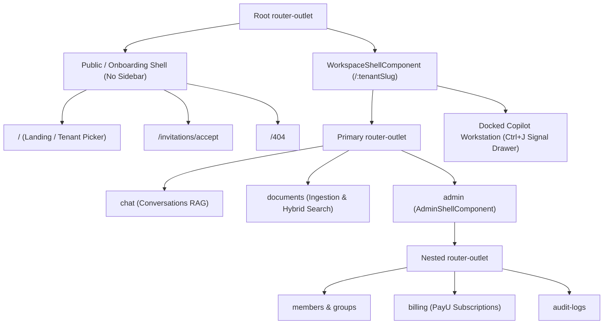
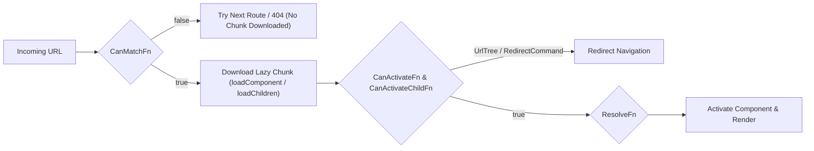
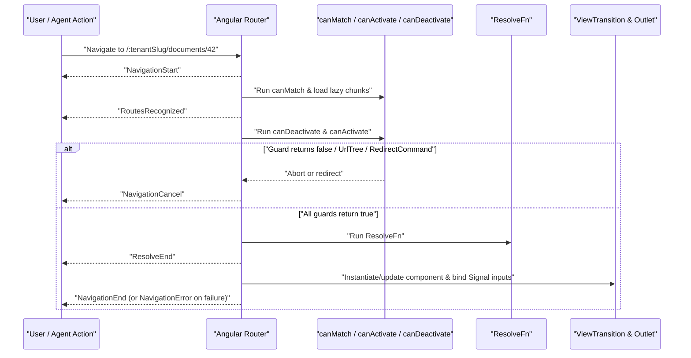

# Chapter 10: Advanced Routing Architecture

## 1. Learning Objectives
By the end of this chapter, you will be able to:
* Configure the Angular 22 Router (`provideRouter`) for **zoneless change detection**, Signal inputs, and **Backend-For-Frontend (BFF)** authentication boundaries.
* Design multi-shell **Nested Routing** architectures with pathless layout routes, named outlets, and Tailwind CSS v4 dark-mode layouts.
* Implement **Lazy Loading**, route-level **Dependency Injection (`EnvironmentInjector`)**, and custom **Preloading Strategies** to optimize bundle size and Largest Contentful Paint (LCP).
* Secure navigation flows using all five modern **Functional Route Primitives** (`CanActivateFn`, `CanActivateChildFn`, `CanMatchFn`, `CanDeactivateFn`, and `ResolveFn`) while respecting zero-trust backend **BOLA (404)** and **BFLA (403)** enforcement.
* Bind inherited path parameters, query parameters, and resolved data directly to component **Signal Inputs** (`withComponentInputBinding` + `paramsInheritanceStrategy: 'always'`).
* Instrument the **Router Lifecycle**, **View Transitions (`withViewTransitions`)**, scrolling restoration, and chunk-load error recovery.
* Architect **multi-tenant path-based routing** (`/:tenantSlug/...`), custom `UrlMatcher`s, `TitleStrategy`, tenant-safe `RouteReuseStrategy`, and safe agentic co-browsing (`navigateActuation`).

---

## 2. Introduction to the Angular Router & Zoneless Navigation

The Angular Router (`@angular/router`) is one of the most sophisticated routing engines in the frontend ecosystem. Unlike third-party routers, it is a first-party Angular package tightly integrated with **Dependency Injection (DI)**, the ahead-of-time (AOT) compiler, **Signals**, and **zoneless change detection**.

It parses browser URLs into structured trees, loads lazy JavaScript bundles on demand, runs asynchronous access and data-loading pipelines, creates scoped DI injectors, and updates Signal-bound inputs—without relying on `zone.js` monkey-patching.

### Core Terminology (From Scratch)
* **`UrlTree`**: An immutable in-memory representation of a parsed URL (segments, query parameters, and fragment `#...`). Guards return a `UrlTree` or `RedirectCommand` to redirect cleanly without mutating `window.location`.
* **`RouterStateSnapshot` & `ActivatedRouteSnapshot`**: Immutable snapshots of the entire active route tree (`RouterStateSnapshot`) and a single matched node (`ActivatedRouteSnapshot`) at the moment a guard or resolver runs.
* **`LocationStrategy`**: Controls how the URL appears in the browser bar. **`PathLocationStrategy`** (the default) uses clean HTML5 History API paths (`/acme-corp/documents`) and is mandatory for SEO and server-side OIDC callbacks. **`HashLocationStrategy`** uses `#/` prefixes (`/index.html#/acme-corp/documents`) and should only be used when you cannot configure a web server to rewrite unknown paths to `index.html`.
* **Backend-For-Frontend (BFF)**: In **Normora**, the Angular SPA sits behind `Normora.Api` (**Duende BFF**). The browser never receives or stores OAuth2/OIDC JWTs from Keycloak; instead, authentication relies on encrypted `HttpOnly`, `SameSite=Strict` session cookies. This directly shapes how Angular routes handle login, logout, and API redirects.

### Configuring `provideRouter` in Angular 22

In standalone Angular 22 applications, you configure the router once in `app.config.ts` by composing functional features into `provideRouter(...)`:

```typescript
// client/src/app/app.config.ts
import { ApplicationConfig, provideZonelessChangeDetection } from '@angular/core';
import {
  provideRouter,
  withComponentInputBinding,
  withInMemoryScrolling,
  withNavigationErrorHandler,
  withPreloading,
  withRouterConfig,
  withViewTransitions,
} from '@angular/router';
import { routes } from './app.routes';
import { RoleAwarePreloadingStrategy } from './core/routing/role-aware-preloading.strategy';
import { handleNavigationError } from './core/routing/navigation-error.handler';

export const appConfig: ApplicationConfig = {
  providers: [
    provideZonelessChangeDetection(),
    provideRouter(
      routes,
      withComponentInputBinding(),
      withRouterConfig({
        paramsInheritanceStrategy: 'always',
        onSameUrlNavigation: 'reload',
      }),
      withPreloading(RoleAwarePreloadingStrategy),
      withInMemoryScrolling({
        scrollPositionRestoration: 'enabled',
        anchorScrolling: 'enabled',
      }),
      withViewTransitions(),
      withNavigationErrorHandler(handleNavigationError),
    ),
  ],
};
```

### When NOT to Use Client-Side Routing
* **External OIDC / BFF Auth Handoffs**: Never route to `/bff/login` or `/bff/logout` with `router.navigate()` or `routerLink`. Duende BFF endpoints live on `Normora.Api` and perform full HTTP `302` redirects to Keycloak; use a standard `<a href="/bff/login">` or `window.location.assign(...)`.
* **Binary Downloads & Signed Storage URLs**: Downloading exported audit logs or raw PDFs from MinIO/API endpoints should use `window.open` or an `<a download>` element, not the Angular Router.
* **Hosted Payment Gateway Forms**: Normora's PayU subscription checkout submits an HTML form POST directly to PayU's hosted gateway and returns via a server callback before redirecting back into the SPA.
* **Ephemeral UI Modals Without Deep-Link Value**: Quick confirm dialogs or hover tooltips do not need dedicated URLs unless users should be able to bookmark, share, or press the browser Back button to close them.

### Real-World Normora Examples (Router Fundamentals)

1. **Root `provideRouter` Configuration (`app.config.ts`)**: Enables `provideZonelessChangeDetection()`, `withComponentInputBinding()`, and `paramsInheritanceStrategy: 'always'` so every feature component under `/:tenantSlug/...` receives the active tenant slug as a reactive `input()` signal.
2. **BFF Login Handshake vs. SPA Navigation**: When an unauthenticated user hits `/acme-corp/documents`, Normora's auth guard captures the attempted URL and triggers a hard browser redirect to `/bff/login?returnUrl=/acme-corp/documents` rather than an internal Angular route, keeping Keycloak tokens strictly on the server.
3. **Programmatic Filter Navigation (`queryParamsHandling: 'merge'`)**: When a user switches hybrid-search mode in Normora's Documents module, `router.navigate([], { relativeTo: this.route, queryParams: { mode: 'hybrid', page: 1 }, queryParamsHandling: 'merge' })` updates `?mode=hybrid&page=1` while preserving existing `?dept=hr` filters.
4. **Accessible Sidebar Links (`routerLinkActive` + `ariaCurrentWhenActive`)**: Normora's navigation rail marks the active module link for both sighted users and screen readers:
```html
<a
  [routerLink]="['/', tenantSlug(), 'documents']"
  routerLinkActive="bg-indigo-50 text-indigo-700 dark:bg-indigo-950/60 dark:text-indigo-300"
  ariaCurrentWhenActive="page"
  class="flex items-center gap-3 rounded-lg px-3 py-2 text-sm font-medium text-slate-700 hover:bg-slate-100 dark:text-slate-300 dark:hover:bg-slate-800"
>
  Documents
</a>
```
5. **Preserving History Cleanliness on Redirects (`replaceUrl: true`)**: After Normora completes workspace onboarding (`/onboarding/create`) for a newly created organization `acme-corp`, the component calls `this.router.navigate(['/', slug, 'chat'], { replaceUrl: true })` so pressing the browser Back button does not re-open the workspace creation wizard.

---

## 3. Shell Architecture (Nested Routing & Outlets)

In Enterprise SaaS applications, the UI is rarely a single full-screen page. It usually consists of a **Shell** (a persistent Sidebar, Header, and global Copilot dock) and a dynamic Main Content area. We achieve this using **Nested Routing** and `<router-outlet>` placeholders.



### The EV Platform Layout Structure

**`app.routes.ts`**
```typescript
export const routes: Routes = [
  {
    path: 'auth',
    component: AuthLayoutComponent, // Full screen, no sidebar
    children: [
      { path: 'login', component: LoginComponent }
    ]
  },
  {
    path: 'dashboard',
    component: MainLayoutComponent, // Contains Sidebar and Header
    children: [
      { path: 'overview', component: OverviewComponent }, // Renders inside MainLayout
      { path: 'chargers', component: ChargerListComponent }
    ]
  },
  { path: '', redirectTo: 'dashboard/overview', pathMatch: 'full' }
];
```

**`main-layout.component.html`**
```html
<div class="enterprise-layout">
  <app-sidebar></app-sidebar>
  <div class="main-column">
    <app-header></app-header>
    <main>
      <!-- Child routes (overview, chargers) render exactly here! -->
      <router-outlet></router-outlet>
    </main>
  </div>
</div>
```

### Pathless Layout Routes & Auxiliary (Named) Outlets

* **Pathless Layout Routes**: A route with `path: ''` and a `component` (without `redirectTo`) groups multiple top-level URLs under a shared visual shell without adding an extra URL segment. For example, `/onboarding` and `/invitations/accept` can share `CenteredCardShellComponent` without forcing `/public/onboarding`.
* **Component-less Grouping Routes**: A route with `path: ':tenantSlug'` and `children: [...]`—or `canActivate` + `children` with no `component`—shares guards, resolvers, and route-level `providers` without inserting an extra DOM wrapper.
* **Auxiliary (Named) Outlets**: Placing `<router-outlet name="preview" />` alongside the primary `<router-outlet />` lets two independent routes render simultaneously (encoded in the URL as `/acme-corp/chat/123(preview:chunk/45)`).

### When NOT to Use Nested Routing or Auxiliary Outlets
* **Deeply Nested Outlets (> 3 Levels)**: More than three nested `<router-outlet>` levels makes layouts brittle on mobile viewports and obscures which component owns scroll containers.
* **Named Outlets for Transient Drawers/Modals**: Named outlets produce parentheses in URLs (`/(copilot:panel)`), which are awkward to share and complicate back-button expectations. In Normora, the omnipresent **Copilot Workstation** (`Ctrl+J`) and **`ChunkPreviewDrawerComponent`** are driven by Signals/services unless a deep link is needed (in which case query parameters like `?previewDoc=...&chunkId=...` are cleaner).

### Real-World Normora Examples (Shell Architecture)

1. **Normora Multi-Shell `app.routes.ts`**: Separates full-screen public/onboarding flows from the authenticated multi-tenant `WorkspaceShellComponent`:
```typescript
// client/src/app/app.routes.ts
export const routes: Routes = [
  {
    path: '',
    component: PublicShellComponent, // Pathless layout route
    children: [
      { path: '', loadComponent: () => import('./features/landing/landing.component') },
      { path: 'invitations/accept', loadComponent: () => import('./features/tenants/accept-invite.component') },
    ],
  },
  {
    path: ':tenantSlug',
    canActivate: [bffAuthGuard, tenantContextGuard],
    loadComponent: () => import('./layout/workspace-shell/workspace-shell.component'),
    children: [
      { path: '', redirectTo: 'chat', pathMatch: 'full' },
      { path: 'chat', loadChildren: () => import('./features/conversations/conversations.routes') },
      { path: 'documents', loadChildren: () => import('./features/documents/documents.routes') },
      { path: 'admin', loadChildren: () => import('./features/tenants/admin.routes') },
    ],
  },
  { path: '**', loadComponent: () => import('./shared/pages/not-found.component') },
];
```
2. **Responsive Tailwind CSS v4 + Dark Mode `WorkspaceShellComponent`**: Uses mobile-first breakpoints (`md:`), `dark:` variants on every surface/border/text color, `.custom-scrollbar` on scrollable regions, and suffix `!important` (`border-none!`) where resetting PrimeNG/utility styles:
```html
<!-- client/src/app/layout/workspace-shell/workspace-shell.component.html -->
<div class="flex h-dvh flex-col bg-slate-50 text-slate-900 md:flex-row dark:bg-slate-950 dark:text-slate-100">
  <app-workspace-sidebar class="hidden border-r border-slate-200 md:block md:w-64 dark:border-slate-800" />
  <div class="flex min-w-0 flex-1 flex-col">
    <app-workspace-header class="border-b border-slate-200 bg-white dark:border-slate-800 dark:bg-slate-900" />
    <main class="custom-scrollbar flex-1 overflow-y-auto p-4 sm:p-6">
      <router-outlet />
    </main>
  </div>
</div>
```
3. **Sub-Shell for Tenant Administration (`AdminShellComponent`)**: Inside `/:tenantSlug/admin`, `AdminShellComponent` renders horizontal tabs on mobile (`overflow-x-auto`) and a vertical settings rail on `lg:` screens (`Members`, `Departments`, `User Groups`, `Branding`, `Billing`, `Audit Logs`) above a nested `<router-outlet />`.
4. **Pathless Onboarding Shell**: `/onboarding/workspace` and `/onboarding/profile` share a minimal centered-card shell (`path: ''`, `component: OnboardingShellComponent`) with zero sidebar navigation so new users complete tenant provisioning without distraction.
5. **Query-Param Driven Side Drawer vs. Named Outlet**: When an AI citation in `ConversationThreadComponent` triggers `Locate in Documents`, Normora routes to `/:tenantSlug/documents/:documentId?chunkId=42` inside the main shell instead of an auxiliary outlet, keeping URLs clean, copy-pasteable, and SEO-friendly.

---

## 4. Lazy Loading, Bundle Splitting & Preloading Strategies

If your application has 500 components, you **must not** load them all when the user first visits the landing page. That would result in a massive multi-megabyte JavaScript payload, hurting **Largest Contentful Paint (LCP)** and mobile startup time.

**Lazy Loading** splits your application into smaller ES module chunks. When a user navigates to a route, the Angular Router fetches only the required JavaScript chunk over the network on demand.

### Modern Standalone Lazy Loading
With Standalone components, lazy loading uses native dynamic `import()` statements.

```typescript
export const routes: Routes = [
  {
    path: 'reports',
    // The browser only downloads this JS file if the user navigates to /reports
    loadComponent: () => import('./features/reports/reports.component')
                           .then(m => m.ReportsComponent)
  }
];
```

> **Architect Tip:** If the component or route array uses a `default` export (`export default class ReportsComponent`), Angular automatically unwraps it—making `.then(m => m.ReportsComponent)` optional! You can also lazy-load entire routing branches using `loadChildren`.

```typescript
  {
    path: 'admin',
    loadChildren: () => import('./features/admin/admin.routes')
                          .then(m => m.adminRoutes)
  }
```

### Preloading Strategies (`withPreloading`)
Strict lazy loading trades initial bundle size for a slight network delay on first navigation to a new tab. **Preloading** downloads selected lazy chunks in the background *after* the initial view renders:
* **`NoPreloading`** (default): Chunks load only when navigated to.
* **`PreloadAllModules`**: Downloads every lazy `loadChildren` / `loadComponent` chunk immediately after startup. Dangerous in large SaaS apps because it wastes bandwidth on admin/billing chunks regular employees never open.
* **Custom `PreloadingStrategy`**: Inspects `route.data`, user role, or `navigator.connection.saveData` to preload only high-probability routes.

### Route-Level Dependency Injection (`providers` on `Route`)
In standalone Angular, a `Route` object can declare its own `providers: [...]` array. When the Router activates that route branch, it creates a dedicated child **`EnvironmentInjector`** scoped strictly to that route and its children—and **destroys** it when the user navigates away. This replaces legacy `NgModule` feature-level injectors without needing a module wrapper.

### When NOT to Lazy Load (or Preload)
* **Critical Startup / LCP Routes**: Do not lazy-load the shell or primary above-the-fold view if every user hits it on page load; an extra waterfall round-trip delays initial paint.
* **Micro-Components (< 5 KB)**: Splitting tiny static pages (like a 30-line `NotFoundComponent`) can cost more in HTTP/manifest overhead than inlining them.
* **Using `PreloadAllModules` with Heavy Third-Party Libraries**: If your admin analytics or document previewer pulls in PDF.js or charting bundles, `PreloadAllModules` forces every mobile employee on cellular data to download admin-only assets.

### Real-World Normora Examples (Lazy Loading & Scoped DI)

1. **Default-Export `loadChildren` for the Documents Module**:
```typescript
// client/src/app/features/documents/documents.routes.ts
const documentsRoutes: Routes = [
  { path: '', loadComponent: () => import('./pages/document-library.component') },
  { path: ':documentId', loadComponent: () => import('./pages/document-detail.component') },
];
export default documentsRoutes;
```
In `app.routes.ts`:
```typescript
{ path: 'documents', loadChildren: () => import('./features/documents/documents.routes') }
```
2. **Lazy-Loading Heavy A2UI / Visualization Views via `loadComponent`**: Normora's tenant usage metrics and PayU invoice history (`BillingHistoryComponent`) are only downloaded when a workspace admin opens `/:tenantSlug/admin/billing`.
3. **Custom Role- & Network-Aware Preloading Strategy**:
```typescript
// client/src/app/core/routing/role-aware-preloading.strategy.ts
@Injectable({ providedIn: 'root' })
export class RoleAwarePreloadingStrategy implements PreloadingStrategy {
  private readonly session = inject(BffSessionStore);

  preload(route: Route, load: () => Observable<unknown>): Observable<unknown> {
    if (route.data?.['preload'] === false) return of(null);

    const conn = (navigator as Navigator & { connection?: { saveData?: boolean } }).connection;
    if (conn?.saveData) return of(null);

    const requiredRole = route.data?.['requiredRole'] as string | undefined;
    if (requiredRole && !this.session.hasRole(requiredRole)) {
      return of(null); // Employees never preload Tenant Admin bundles
    }
    return route.data?.['preload'] ? load() : of(null);
  }
}
```
4. **Route-Scoped `EnvironmentInjector` (`providers`) for `DocumentsStore`**: Declaring `providers: [DocumentsStore, DocumentSignalRBridge]` on the `documents` route branch ensures SignalR document ingestion subscriptions and search caches are instantiated when entering `/:tenantSlug/documents` and automatically cleaned up (`DestroyRef`) when switching tenants or navigating away.
5. **Graceful Chunk-Load Error Recovery After Deployments (`withNavigationErrorHandler`)**: When a rolling Docker deployment of Normora replaces hashed `.js` chunks on the server while a user has an older tab open, navigating to a lazy route throws a `ChunkLoadError`. `withNavigationErrorHandler` catches it, logs telemetry, displays `ApiMessages.AppUpdateAvailable` (no magic strings), and triggers a clean `window.location.assign(event.url)` reload.

---

## 5. Functional Route Guards & Data Resolvers

In Enterprise applications, you must control who can enter routes, which lazy chunks are allowed to match, whether users can leave unsaved forms, and what critical data must exist before rendering.

In modern Angular (v15+), Class-based guards were deprecated in favor of **Functional Route Guards** (`CanActivateFn`, `CanActivateChildFn`, `CanMatchFn`, `CanDeactivateFn`, and `ResolveFn`). They remove boilerplate and use `inject()` directly inside the execution context.



### The Five Functional Router Primitives

| Primitive | When It Runs | Primary Purpose | Normora Use Case |
|---|---|---|---|
| `CanMatchFn` | **Before** route matches & before lazy chunk download | Route polymorphism & preventing unauthorized bundle downloads | Routing `/dashboard` to Admin vs. Employee views; blocking Free-tier billing cancel routes |
| `CanActivateFn` | After route matches & chunk downloads | Entry authorization or BFF session verification | Checking Duende BFF `/bff/user` session before entering `/:tenantSlug` |
| `CanActivateChildFn` | Before activating any child of a parent route | Protecting an entire sub-tree once | Guarding all routes under `/:tenantSlug/admin/*` |
| `CanDeactivateFn<T>` | Before leaving an active component | Preventing accidental loss of unsaved state | Warning before leaving an active document upload or dirty branding form |
| `ResolveFn<T>` | After guards pass, before component activation | Fetching critical metadata or handling BOLA 404 early | Pre-resolving workspace branding or redirecting on `BolaException` (404) |

### Case Study: Protecting the EV Admin Panel

Let's write a guard that checks if the user is authenticated AND has the `admin` role. If not, we redirect them to the login page.

**`admin.guard.ts`**
```typescript
import { inject } from '@angular/core';
import { Router, CanActivateFn } from '@angular/router';
import { AuthService } from '../core/auth.service';

export const adminGuard: CanActivateFn = (_route, _state) => {
  const authService = inject(AuthService);
  const router = inject(Router);

  if (authService.isAuthenticated() && authService.hasRole('admin')) {
    return true; // Navigation allowed
  }

  // Navigation denied, redirect to login
  return router.createUrlTree(['/auth/login']);
};
```

**Applying the Guard in `app.routes.ts`**
```typescript
  {
    path: 'admin',
    canActivate: [adminGuard],
    loadChildren: () => import('./admin.routes').then(m => m.routes)
  }
```
*Note: Guards can return a `MaybeAsync<GuardResult>`—a `boolean`, a `UrlTree`, a `RedirectCommand` (allowing `{ skipLocationChange: true }`), a `Promise`, or an `Observable` (which must complete!).*

### Zero-Trust Security Boundary: BFF, BOLA (404) & BFLA (403)
> [!IMPORTANT]
> **Client-side Route Guards are UX conveniences, NEVER security boundaries.** Anyone can inspect or bypass client JavaScript in DevTools.
> * In Normora, `Normora.Api` (Duende BFF) holds OIDC tokens in encrypted `HttpOnly`, `SameSite=Strict` cookies.
> * Every API request enforces **BFLA** (*Broken Function Level Authorization*, mapped globally to **`403 Forbidden`** via `BflaException`) and **BOLA** (*Broken Object Level Authorization*, mapped globally to **`404 Not Found`** via `BolaException` so attackers cannot enumerate document or tenant IDs).

### When NOT to Use Guards or Resolvers
* **Do NOT use `ResolveFn` for slow, non-critical lists**: Resolvers block navigation completely until every HTTP call resolves—making clicks feel frozen. For Normora's document table or chat history, activate the component immediately and fetch via Signals/`rxResource` inside `@defer` or skeleton placeholders.
* **Do NOT use `canActivate` when you want to hide a lazy bundle**: `canActivate` downloads the JS chunk *first* and evaluates the guard *after*. Use `canMatch` to prevent downloading admin bundles for standard employees.
* **Do NOT use `canDeactivate` on auto-saved or read-only views**: Prompting "Discard changes?" when there is no dirty form state creates alert fatigue.

### Real-World Normora Examples (Guards & Resolvers)

1. **`bffAuthGuard` (`CanActivateFn`) Checking Duende BFF Session**: Queries `BffSessionStore.ensureLoaded()` (backed by `GET /bff/user`). If unauthenticated, it triggers a browser redirect to `/bff/login?returnUrl=${encodeURIComponent(state.url)}` and returns `false` so no protected shell renders.
2. **`tenantAdminChildGuard` (`CanActivateChildFn`) with `ApiMessages`**: Protects all child routes under `/:tenantSlug/admin` (Members, Departments, Audit Logs, Billing). When a standard employee navigates directly to `/acme-corp/admin/audit-logs`, it shows a toast using `ApiMessages.Forbidden` (never a hardcoded string) and returns `new RedirectCommand(router.createUrlTree(['/', tenantSlug, 'chat']))`.
3. **Same-URL Role Polymorphism with `CanMatchFn`**: Under `/:tenantSlug`, `/dashboard` can match `AdminDashboardComponent` when `canMatch: [isTenantAdminMatch]` returns `true`, and fall through to `EmployeeCopilotHomeComponent` otherwise—zero admin bundle bytes downloaded for employees.
4. **Preventing Lost Uploads with `CanDeactivateFn`**:
```typescript
// client/src/app/features/documents/guards/unsaved-upload.guard.ts
export interface HasPendingWork {
  hasUnsavedChanges(): boolean;
}

export const unsavedWorkGuard: CanDeactivateFn<HasPendingWork> = (component) => {
  if (!component.hasUnsavedChanges()) return true;
  return inject(ConfirmDialogService).confirm(ApiMessages.UnsavedChangesConfirm);
};
```
5. **Handling BOLA 404 Gracefully in `ResolveFn` with `RedirectCommand`**: When resolving `/:tenantSlug/documents/:documentId`, if `DocumentsApi.getById` returns `404 Not Found` (which covers both missing documents and unauthorized BOLA access), `documentDetailResolver` catches it and returns `new RedirectCommand(router.createUrlTree(['/', tenantSlug, 'not-found']), { skipLocationChange: true })`, preserving the offending URL while rendering the safe 404 page.

---

## 6. Route Parameters as Component Inputs (`withComponentInputBinding`)

Historically, reading the URL (e.g., `/chargers/123`) required injecting the `ActivatedRoute` service and subscribing to `params`, `queryParams`, and `data` observables.

Modern Angular allows you to bind route parameters, query parameters, route `data`, and resolved data **directly to Component Signal Inputs**.

### 1. Enable the Feature & Parameter Inheritance
Enable `withComponentInputBinding()` in `app.config.ts`. For nested multi-tenant routes (such as `/:tenantSlug/documents/:documentId`), also add `withRouterConfig({ paramsInheritanceStrategy: 'always' })` so child components automatically receive parent route parameters like `tenantSlug`.

```typescript
export const appConfig: ApplicationConfig = {
  providers: [
    provideRouter(
      routes,
      withComponentInputBinding(),
      withRouterConfig({ paramsInheritanceStrategy: 'always' })
    )
  ]
};
```

### 2. Read the Parameter in the Component
Assume the route is `/chargers/:chargerId`.

```typescript
@Component({
  template: `<h1>Viewing Charger {{ chargerId() }}</h1>`
})
export class ChargerDetailComponent {
  // The router automatically pushes the URL param into this Signal Input!
  chargerId = input.required<string>();

  // You can immediately use it in computed signals or effects!
  endpoint = computed(() => `/api/chargers/${this.chargerId()}`);
}
```
This removes `ActivatedRoute` boilerplate and triggers fine-grained Signal updates automatically in zoneless mode.

### Binding Priority & Input Transforms
If multiple sources define the same key name, Angular resolves collisions in this strict precedence order (highest to lowest):
1. Static route **`data`** & **`resolve`** data
2. Path **`params`** (`:documentId`)
3. **`queryParams`** (`?chunkId=12`)

Because URL segments and query parameters arrive as `string | undefined`, use Angular's built-in **`numberAttribute`** and **`booleanAttribute`** transforms (`input(1, { transform: numberAttribute })`) to coerce types safely.

### When NOT to Use `withComponentInputBinding`
* **Reusable Design-System Components**: Components in `client/src/design-system/components` should accept explicit domain props rather than coupling their `input()` names to URL query parameter keys.
* **Name Collisions Across Nested Routes**: If both a parent and child route define `:id` with `paramsInheritanceStrategy: 'always'`, the child parameter shadows the parent `:id`. Use descriptive names (`:tenantSlug`, `:documentId`, `:conversationId`) instead of generic `:id`.
* **Route-Agnostic Services**: Services that track global route state should inject `Router` / `ActivatedRoute` directly rather than expecting component inputs.

### Real-World Normora Examples (`withComponentInputBinding`)

1. **Inherited Multi-Tenant + Document Params (`DocumentDetailComponent`)**: Under `/:tenantSlug/documents/:documentId?chunkId=14`, `DocumentDetailComponent` binds both the inherited parent param and its own path/query params without injecting `ActivatedRoute`:
```typescript
@Component({
  selector: 'app-document-detail',
  template: `...`,
})
export class DocumentDetailComponent {
  tenantSlug = input.required<string>();   // Inherited via paramsInheritanceStrategy: 'always'
  documentId = input.required<string>();   // Path param :documentId
  chunkId = input<string | undefined>();   // Optional query param ?chunkId=14

  apiUrl = computed(() => `/api/documents/${this.documentId()}`);
}
```
2. **Reacting to Route Reuse in `ConversationThreadComponent`**: Navigating from `/acme-corp/chat/conv-1` to `/acme-corp/chat/conv-2` reuses the same component instance. `conversationId = input.required<string>()` updates reactively, triggering `effect()` or `rxResource({ params: () => this.conversationId(), stream: ... })` to fetch the new thread without recreating DOM nodes.
3. **Coercing Search Pagination & Toggles (`numberAttribute` / `booleanAttribute`)**: In `DocumentSearchComponent`, `?page=3&semanticOnly=true` binds cleanly as:
```typescript
page = input(1, { transform: (v: unknown) => (v == null ? 1 : numberAttribute(v, 1)) });
semanticOnly = input(false, { transform: booleanAttribute });
```
4. **Receiving Resolved Data Directly as a Signal Input**: When `adminAuditRoute` uses `resolve: { retentionDays: retentionPolicyResolver }`, `AuditLogComponent` simply declares `retentionDays = input.required<number>()`—no `route.snapshot.data['retentionDays']` casting needed.
5. **Co-Browsing Citation Deep-Link (`ChunkPreviewDrawerComponent`)**: When a user clicks an inline RAG citation inside the Copilot Workstation, `router.navigate(['/', slug, 'documents', docId], { queryParams: { chunkId }, fragment: `chunk-${chunkId}` })` updates `chunkId()` immediately and highlights the exact Markdown chunk.

---

## 7. Router Lifecycle, Events, View Transitions & Error Handling

Every time a user clicks a `[routerLink]` or triggers `router.navigate()`, the Angular Router executes a deterministic, cancelable state machine. Understanding this lifecycle lets you build global progress bars, animated page transitions, OpenTelemetry route spans, and resilient error recovery.



### Observing `Router.events` with Signals
In zoneless Angular 22, convert the `router.events` stream into a Signal (with `toSignal`) or subscribe using `takeUntilDestroyed()` to drive global UI state such as a top progress bar:
* **`NavigationStart`**: Navigation begins (show subtle loading bar).
* **`NavigationEnd`**: Route activated successfully (hide bar, record page view).
* **`NavigationCancel` / `NavigationSkipped`**: Guard blocked or redirected, or user clicked the exact current URL (hide bar).
* **`NavigationError`**: Lazy chunk failed to download or resolver threw an unhandled exception (hide bar, log error, show fallback UI).

### Native View Transitions (`withViewTransitions`) & In-Memory Scrolling
* **`withViewTransitions()`**: Integrates Angular's router with the browser's native **View Transitions API** (`document.startViewTransition`), creating smooth cross-fades or shared-element transitions between routes with zero third-party animation libraries. Pass `onViewTransitionCreated` to skip animations on minor query-string updates.
* **`withInMemoryScrolling({ scrollPositionRestoration: 'enabled', anchorScrolling: 'enabled' })`**: Restores scroll position on browser Back/Forward and scrolls automatically to `#fragment` anchors (such as `#chunk-14`).

### Ephemeral Navigation State (`history.state`)
You can pass transient, non-URL state via `router.navigate(['/', slug, 'billing'], { state: { checkoutStatus: 'success' } })` and read it with `this.router.currentNavigation()?.extras.state` (during navigation) or `history.state` (after activation). Remember that `state` lives in browser session history—it survives Back/Forward within that tab, **not** across a shared URL copied to Slack!

### When NOT to Use `withViewTransitions()` or Global Navigation Spinners
* **Same-Route Filter Typing**: Typing into a search box that updates `?q=...` should not trigger a full-screen cross-fade; skip transitions in `onViewTransitionCreated` when `from.routeConfig === to.routeConfig`.
* **Users with `prefers-reduced-motion: reduce`**: Always pair View Transitions with CSS `@media (prefers-reduced-motion: reduce)` rules to respect accessibility preferences.
* **Sensitive Data in `history.state`**: Never pass PII or tokens in navigation state; it stays readable in `window.history.state` until the tab closes.

### Real-World Normora Examples (Lifecycle, Transitions & Errors)

1. **Zoneless Global Progress Bar in `AppComponent`**:
```typescript
// client/src/app/app.component.ts
const router = inject(Router);
isNavigating = toSignal(
  router.events.pipe(
    filter((e) =>
      e instanceof NavigationStart ||
      e instanceof NavigationEnd ||
      e instanceof NavigationCancel ||
      e instanceof NavigationError
    ),
    map((e) => e instanceof NavigationStart),
  ),
  { initialValue: false },
);
```
Rendered cleanly in Tailwind CSS v4 with dark mode:
```html
@if (isNavigating()) {
  <div class="fixed top-0 right-0 left-0 z-50 h-0.5 animate-pulse bg-indigo-600 dark:bg-indigo-400"></div>
}
```
2. **Selective `withViewTransitions` Skipping Search Query Updates**:
```typescript
withViewTransitions({
  onViewTransitionCreated: ({ transition, from, to }) => {
    const sameRoute = from.firstChild?.routeConfig === to.firstChild?.routeConfig;
    if (sameRoute) transition.skipTransition();
  },
})
```
3. **Citation Anchor Scrolling (`#chunk-42`)**: When a user clicks a cited source in Normora's RAG chat, `withInMemoryScrolling({ anchorScrolling: 'enabled' })` scrolls the document reader directly to `<section id="chunk-42">`.
4. **OpenTelemetry Route Telemetry & Toast on `NavigationError`**: When a network outage or stale container deployment breaks a lazy chunk, Normora's `handleNavigationError` logs the failed URL to OpenTelemetry and notifies the user with `ApiMessages.NavigationFailed` (no magic string literals).
5. **Ephemeral PayU Checkout Result via `history.state`**: After `Normora.Api` validates PayU's `udf3` signature and redirects back to `/acme-corp/admin/billing/callback`, the callback route navigates to `/acme-corp/admin/billing` with `{ replaceUrl: true, state: { paymentResult: 'activated' } }` so the confirmation banner appears once without polluting the shareable URL.

---

## 8. Enterprise Multi-Tenant Routing Patterns in Normora

Normora is a **multi-tenant SaaS** platform where one user can belong to multiple organizations (e.g., `/acme-corp/...` and `/globex-inc/...`). Architecting routing for multi-tenancy requires careful coordination between URL structure, DI scopes, caching, and AI agent actuation.

### Path-Based Tenant Routing (`/:tenantSlug/...`)
Instead of wildcard subdomains (`acme.normora.app`), Normora uses **path-based tenant routing** (`normora.app/:tenantSlug/...`). Why? Wildcard subdomains complicate Keycloak OIDC `redirect_uri` allow-lists and cookie domain scoping for a Duende BFF, whereas path-based routing keeps a single origin (`SameSite=Strict` cookies work reliably) and makes tenant switching an instant client-side navigation.

### Custom `UrlMatcher`
When `:tenantSlug` sits at the root (`/:tenantSlug`), a naive parameter route would accidentally swallow reserved system routes like `/auth/login`, `/bff/user`, or `/onboarding` if route ordering slips. A custom **`UrlMatcher`** validates the first segment against a reserved-slug deny-list and slug regex before matching.

### Custom `TitleStrategy`
Browser tabs and screen readers need accurate titles (e.g., `Employee Handbook — Acme Corp | Normora`). Extending Angular's **`TitleStrategy`** lets you format `document.title` centrally from route `title` resolvers/metadata plus the active workspace name.

### Custom `RouteReuseStrategy` & Multi-Tenant Memory Isolation
By default, Angular destroys a component when you leave its route (e.g., moving from `/acme-corp/chat` to `/acme-corp/documents`) and recreates it on return. A custom **`RouteReuseStrategy`** can detach and cache a component's DOM and Signal state (`DetachedRouteHandle`) so returning to `/acme-corp/chat` is instantaneous and preserves scroll position.
* **Critical Multi-Tenant Rule**: Cache keys **must include `tenantSlug`** (e.g., `${tenantSlug}:${routeConfig.path}`), and **all** detached handles must be destroyed whenever the user switches tenants or logs out via BFF! Otherwise, Tenant A's cached chat DOM leaks into Tenant B's session.

### Agentic UI Actuation & Co-Browsing (`navigateActuation`)
In Normora, `NormoraWorkplaceAgent` (hosted over AG-UI `/api/copilotkit`) can emit UI actuation events (`navigateActuation`)—for example, `Locate in Documents`. An allow-listed **`AgentNavigationBridgeService`** translates structured agent intents into validated `router.navigate(...)` commands inside the active `tenantSlug`, preventing arbitrary or cross-tenant navigation injection.

### When NOT to Use Custom `UrlMatcher` or `RouteReuseStrategy`
* **Do NOT use a custom `UrlMatcher` for static prefixes**: If your routes live under `/t/:tenantSlug/...`, a standard `path: 't/:tenantSlug'` string is simpler, faster, and self-documenting.
* **Do NOT use `RouteReuseStrategy` on Admin/Billing/Security routes**: Forms, audit logs, and PayU subscription views should always initialize fresh server state on entry.
* **Do NOT pass raw LLM strings to `router.navigateByUrl()`**: Always map structured tool parameters (`{ target: 'document', documentId, chunkId }`) through an allow-list inside the active tenant boundary.

### Real-World Normora Examples (Enterprise Multi-Tenant Routing)

1. **`tenantSlugMatcher` Rejecting Reserved System Segments**:
```typescript
// client/src/app/core/routing/tenant-slug.matcher.ts
const RESERVED_SLUGS = new Set(['api', 'bff', 'auth', 'signin-oidc', 'onboarding', 'invitations', '404']);
const SLUG_PATTERN = /^[a-z0-9](?:[a-z0-9-]{1,48}[a-z0-9])?$/;

export const tenantSlugMatcher: UrlMatcher = (segments) => {
  if (segments.length === 0) return null;
  const candidate = segments[0].path.toLowerCase();
  if (RESERVED_SLUGS.has(candidate) || !SLUG_PATTERN.test(candidate)) {
    return null;
  }
  return { consumed: [segments[0]], posParams: { tenantSlug: segments[0] } };
};
```
2. **Synchronizing `TenantContextService` in a Parent Guard**: Before any child route under `/:tenantSlug` activates, `tenantContextGuard` validates membership via `TenantsApi` (passing `X-Tenant-Slug` / resolving tenant ID), sets the active workspace signal, and redirects to `/404` on BOLA (`404`) so unauthorized tenant slugs cannot be probed.
3. **Tenant-Aware `NormoraTitleStrategy`**:
```typescript
// client/src/app/core/routing/normora-title.strategy.ts
@Injectable({ providedIn: 'root' })
export class NormoraTitleStrategy extends TitleStrategy {
  private readonly title = inject(Title);
  private readonly tenantCtx = inject(TenantContextService);

  override updateTitle(snapshot: RouterStateSnapshot): void {
    const pageTitle = this.buildTitle(snapshot);
    const tenantName = this.tenantCtx.activeTenant()?.name;
    const parts = [pageTitle, tenantName, 'Normora'].filter(Boolean);
    this.title.setTitle(parts.join(' | '));
  }
}
```
4. **Tenant-Isolated `ChatRouteReuseStrategy`**: Caches only the `chat/:conversationId` route keyed by `${tenantSlug}::${conversationId}` (so switching between Copilot chat and Documents stays instant), and exposes `clearAll()` invoked automatically whenever `TenantContextService.activeTenantId()` changes or the user clicks Logout.
5. **Safe Agentic Co-Browsing (`AgentNavigationBridgeService`)**:
```typescript
// client/src/app/core/agents/agent-navigation-bridge.service.ts
navigateToCitation(documentId: string, chunkId: string): void {
  const slug = this.tenantCtx.activeSlug();
  if (!slug) return;
  void this.router.navigate(['/', slug, 'documents', documentId], {
    queryParams: { chunkId },
    fragment: `chunk-${chunkId}`,
  });
}
```

---

## 9. Common Mistakes & Anti-Patterns

> [!CAUTION]
> **Mistake 1: Forgetting `pathMatch: 'full'` on Empty-Path Redirects**
>
> **Wrong:**
> ```typescript
> { path: '', redirectTo: 'chat' } // Defaults to pathMatch: 'prefix'!
> ```
> **Why It's Wrong:** Every URL begins with an empty string `''`. With the default `prefix` strategy, Angular matches this redirect on *every* route—trapping the application in an infinite redirect loop.
>
> **Fix:**
> ```typescript
> { path: '', redirectTo: 'chat', pathMatch: 'full' }
> ```

> [!CAUTION]
> **Mistake 2: Returning a Never-Completing `Observable` from a Functional Guard**
>
> **Wrong:**
> ```typescript
> export const authGuard: CanActivateFn = () => {
>   return inject(BffSessionStore).isAuthenticated$; // BehaviorSubject never completes!
> };
> ```
> **Why It's Wrong:** The Angular Router waits for a guard's `Observable` to **complete** (not just emit) before finishing navigation. A `BehaviorSubject` or long-lived store stream never completes, causing the page to hang forever in a blank state.
>
> **Fix:** Read synchronous Signals directly (`inject(BffSessionStore).isAuthenticated()`), or pipe observables with `take(1)` / `firstValueFrom(...)`:
> ```typescript
> export const authGuard: CanActivateFn = () =>
>   inject(BffSessionStore).ensureSessionLoaded().pipe(take(1));
> ```

> [!CAUTION]
> **Mistake 3: Routing to Duende BFF Endpoints with `router.navigate()` (or Trusting Guards for Security)**
>
> **Wrong:**
> ```typescript
> // Trying to use Angular's client-side router for server OIDC endpoints
> return router.createUrlTree(['/bff/login']);
> ```
> **Why It's Wrong:** `/bff/login` and `/bff/logout` are server-side endpoints on `Normora.Api` that set `HttpOnly` cookies and issue `302` redirects to Keycloak. `router.createUrlTree(['/bff/login'])` keeps navigation inside the Angular SPA, hitting Angular's wildcard `**` 404 route! Worse, treating `CanActivateFn` as real authorization leaves APIs exposed if backend BOLA (`404`) / BFLA (`403`) checks are missing.
>
> **Fix:** Perform a full browser navigation for BFF handshakes and rely on backend enforcement for security:
> ```typescript
> window.location.assign(`/bff/login?returnUrl=${encodeURIComponent(state.url)}`);
> return false;
> ```

> [!CAUTION]
> **Mistake 4: Missing `paramsInheritanceStrategy: 'always'` in Multi-Tenant Nested Routes**
>
> **Wrong:**
> ```typescript
> // app.config.ts
> provideRouter(routes, withComponentInputBinding())
> // Inside /:tenantSlug/documents/:documentId -> DocumentDetailComponent
> tenantSlug = input.required<string>(); // Runtime error: input is undefined!
> ```
> **Why It's Wrong:** By default (`emptyOnly`), Angular only passes route parameters from a parent route to a child if the parent has an empty path (`path: ''`) or no component. Because `/:tenantSlug` mounts `WorkspaceShellComponent`, child components do not inherit `:tenantSlug` unless configured.
>
> **Fix:**
> ```typescript
> provideRouter(
>   routes,
>   withComponentInputBinding(),
>   withRouterConfig({ paramsInheritanceStrategy: 'always' }),
> )
> ```

> [!CAUTION]
> **Mistake 5: Reading `ActivatedRoute.snapshot` Once in `ngOnInit` Instead of Signal Inputs**
>
> **Wrong:**
> ```typescript
> ngOnInit(): void {
>   const id = this.route.snapshot.paramMap.get('conversationId');
>   this.loadThread(id!);
> }
> ```
> **Why It's Wrong:** When navigating from `/acme-corp/chat/c1` to `/acme-corp/chat/c2`, Angular reuses the active `ConversationThreadComponent` instance—so `ngOnInit` does **not** run again, leaving stale messages from `c1` on screen under URL `c2`!
>
> **Fix:** Bind `:conversationId` via `withComponentInputBinding()` and react with `computed()` / `effect()` or `rxResource`:
> ```typescript
> conversationId = input.required<string>();
> constructor() {
>   effect(() => this.loadThread(this.conversationId()));
> }
> ```

> [!CAUTION]
> **Mistake 6: Using `canActivate` Instead of `canMatch` for Role- or Tier-Gated Lazy Modules**
>
> **Wrong:**
> ```typescript
> {
>   path: 'admin',
>   canActivate: [tenantAdminGuard],
>   loadChildren: () => import('./features/tenants/admin.routes'),
> }
> ```
> **Why It's Wrong:** Angular downloads the entire lazy `admin.routes` JavaScript chunk *before* evaluating `canActivate`. Standard employees waste bandwidth fetching admin UI code, and `canActivate` cannot let a second route at the same path match instead.
>
> **Fix:** Use `canMatch` so Angular skips downloading the restricted bundle entirely:
> ```typescript
> {
>   path: 'admin',
>   canMatch: [tenantAdminMatchGuard],
>   loadChildren: () => import('./features/tenants/admin.routes'),
> }
> ```

> [!CAUTION]
> **Mistake 7: Caching Routes in `RouteReuseStrategy` Without Tenant Scoping (Cross-Tenant Leak)**
>
> **Wrong:**
> ```typescript
> private cache = new Map<string, DetachedRouteHandle>();
> // Keyed only by route.routeConfig.path ("chat")!
> ```
> **Why It's Wrong:** If a user belongs to both `acme-corp` and `globex-inc` and switches workspaces, a `RouteReuseStrategy` keyed only by `'chat'` re-attaches `acme-corp`'s detached DOM and conversation history inside `globex-inc`'s shell—a severe multi-tenant UI data leak.
>
> **Fix:** Always include `tenantSlug` in the reuse key and purge all cached handles (calling `componentRef.destroy()`) whenever `activeTenantId` changes or the user logs out.

> [!CAUTION]
> **Mistake 8: Using `PreloadAllModules` Indiscriminately & Hardcoding Guard Error Messages**
>
> **Wrong:**
> ```typescript
> provideRouter(routes, withPreloading(PreloadAllModules));
> // ...and inside a guard:
> toast.error('You are not allowed to access admin billing!');
> ```
> **Why It's Wrong:** `PreloadAllModules` forces every user on mobile to download heavy admin/billing/PDF chunks immediately after login, and hardcoded toast strings violate Normora's centralized `ApiMessages` rule (`client/src/app/core/constants/api-messages.ts`).
>
> **Fix:** Use a custom `RoleAwarePreloadingStrategy` driven by `route.data` and user roles, and import every user-facing error message from `ApiMessages` (e.g., `ApiMessages.Forbidden`).

---

## 10. Interview Questions

### Junior
**Q1: What is the difference between `loadComponent` and `loadChildren` in modern routing?**
> A: `loadComponent` lazy-loads a single Standalone Component file (e.g., `BillingHistoryComponent`), while `loadChildren` lazy-loads an entire child `Routes` configuration array (`documents.routes.ts`), making it ideal for modularizing whole domain features and scoping route-level `providers`.

**Q2: Why must `{ path: '', redirectTo: 'chat', pathMatch: 'full' }` include `pathMatch: 'full'`?**
> A: Every URL starts with an empty string `''`. Without `pathMatch: 'full'`, Angular defaults to `pathMatch: 'prefix'`, which matches every route unconditionally and triggers an infinite redirect loop.

### Senior
**Q3: How does the Router decide whether to instantiate a new component or reuse an existing one when the URL changes?**
> A: By default, if you navigate from `/chargers/1` to `/chargers/2` (or `/acme-corp/chat/c1` to `/acme-corp/chat/c2`), the Router *reuses* the existing component instance because the matched `Route` configuration has not changed—only its parameters did. `ngOnInit` does **not** re-run. Binding parameters to Signal Inputs (`withComponentInputBinding()`) ensures `computed()`, `effect()`, and `rxResource()` react automatically in zoneless mode.

**Q4: When should you choose `CanMatchFn` over `CanActivateFn`?**
> A: `CanMatchFn` runs *before* the Router matches a route or downloads its lazy JS chunk, whereas `CanActivateFn` downloads the chunk first and then checks entry permission. Use `CanMatchFn` to prevent unauthorized users from downloading admin bundles and to support multiple routes sharing the same path (e.g., Admin vs. Employee views at `/dashboard`).

**Q5: What are the downsides of putting HTTP calls inside a `ResolveFn`, and what is the modern alternative?**
> A: `ResolveFn` blocks route activation until every resolver completes, making the UI appear frozen on slow connections. Unless the route literally cannot render its shell without that data (or you want early BOLA 404 redirection), activate the component immediately and stream data reactively via Signal `rxResource` / `resource` paired with `@if` / `@defer` skeleton states.

### Architect
**Q6: In a Duende BFF architecture like Normora, how do Angular Route Guards relate to BOLA (404) and BFLA (403) security?**
> A: Client-side guards only protect UX and bundle bandwidth—an attacker can always bypass browser JavaScript. Under Duende BFF, tokens stay server-side in encrypted `HttpOnly`, `SameSite=Strict` cookies; Angular guards check `/bff/user` session state for login redirects (`window.location.assign('/bff/login')`) and hide unauthorized views, while `Normora.Api` strictly enforces BOLA (`BolaException` → `404 Not Found` to stop resource enumeration) and BFLA (`BflaException` → `403 Forbidden`) on every endpoint.

**Q7: How do you safely implement `withComponentInputBinding()` and `RouteReuseStrategy` in a multi-tenant path-based SPA (`/:tenantSlug/...`)?**
> A: First, enable `withRouterConfig({ paramsInheritanceStrategy: 'always' })` so child components deep under `/:tenantSlug` inherit `tenantSlug` directly as a Signal `input()`. Second, if using a custom `RouteReuseStrategy` (e.g., to keep chat scroll state alive), key every `DetachedRouteHandle` by `${tenantSlug}:${routeKey}` and destroy all cached handles whenever the active tenant switches or the user logs out—otherwise Tenant A's DOM state leaks into Tenant B.

**Q8: How do you handle rolling production deployments where an open Angular tab tries to navigate to a lazy chunk whose filename hash no longer exists on the server?**
> A: Register `withNavigationErrorHandler(...)` in `provideRouter`. When a `ChunkLoadError` or dynamic import failure occurs during `NavigationError`, log the error to telemetry (OpenTelemetry), show a localized constant message (`ApiMessages.AppUpdateAvailable`), and trigger a guarded full-page reload (`window.location.assign(errorEvent.url)`)—using a sessionStorage guard to avoid reload loops if the user is offline.

---

## 11. Summary
In this chapter, we progressed from foundational routing to enterprise Angular 22 routing architecture:
* Configured `provideRouter` for **zoneless** Signal-first apps behind a **Duende BFF**.
* Built responsive, dark-mode **Shell architectures** with Tailwind CSS v4, pathless layout routes, and lazy-loaded feature branches with scoped `EnvironmentInjector` `providers`.
* Mastered all five **Functional Router Primitives** (`CanMatchFn`, `CanActivateFn`, `CanActivateChildFn`, `CanDeactivateFn`, `ResolveFn`), `RedirectCommand`, and `withComponentInputBinding()` with `paramsInheritanceStrategy: 'always'`.
* Instrumented **Router lifecycle events**, selective **View Transitions**, and multi-tenant patterns (`tenantSlugMatcher`, `NormoraTitleStrategy`, tenant-isolated `RouteReuseStrategy`, and safe agentic co-browsing).

In Chapter 11, we will tackle **Enterprise Form Design**.
