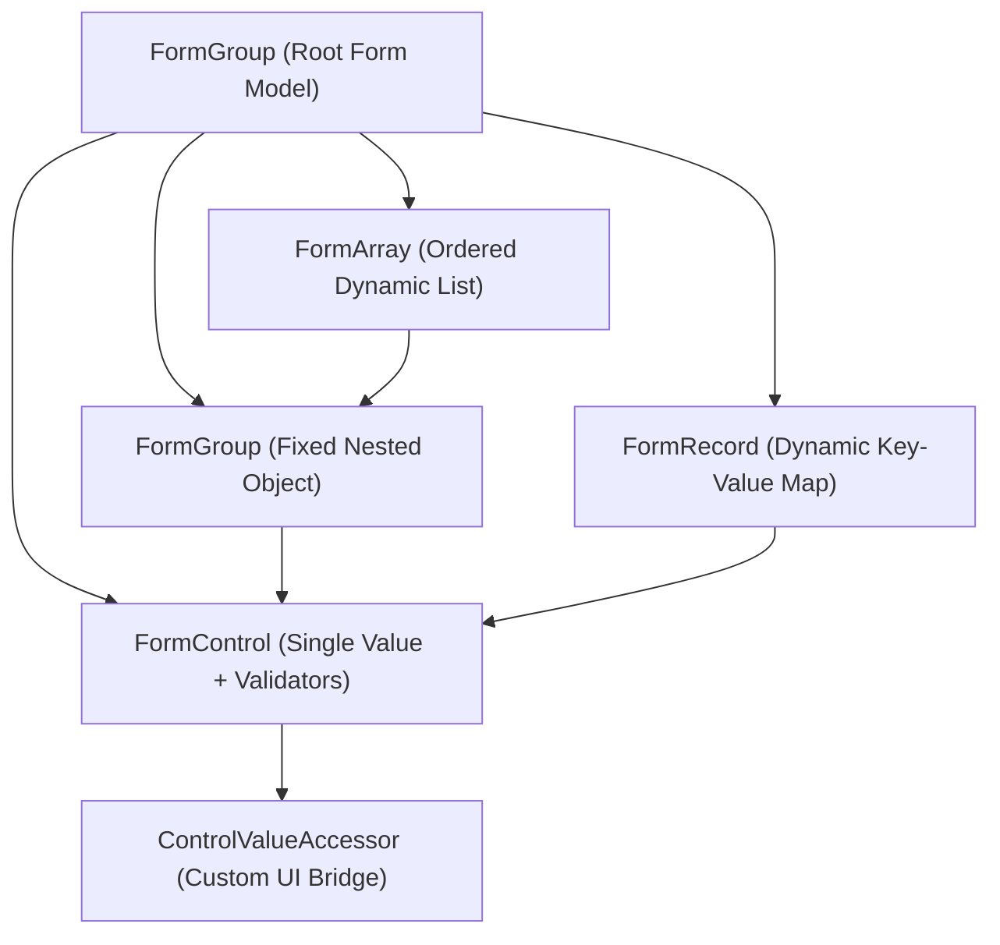
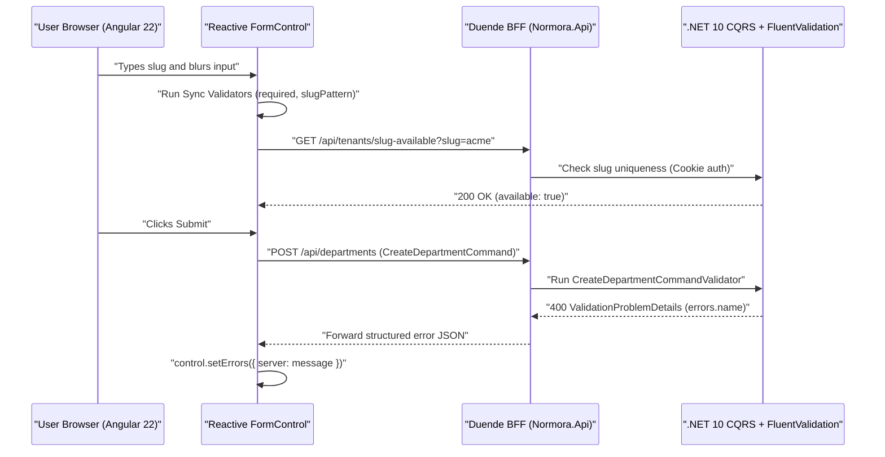
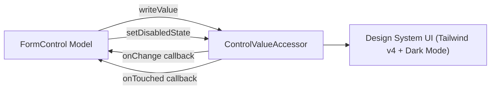
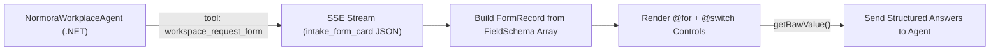

# Chapter 11: Enterprise Form Design

## 1. Learning Objectives
By the end of this chapter, you will be able to:
* Contrast Template-Driven Forms, Reactive Forms, and standalone Angular Signals—and know **when NOT to use** Reactive Forms.
* Build complex, deeply nested `FormGroup`, `FormArray`, and `FormRecord` structures with strict compile-time safety using Typed Forms and `NonNullableFormBuilder`.
* Architect modular, testable forms using Form Factory services and `ControlContainer` sub-form components.
* Implement Synchronous, Cross-Field, Asynchronous, and Backend FluentValidation-mapped validators using `ApiMessages`.
* Bridge Reactive Forms with Angular 22 Signals and Zoneless Change Detection via `AbstractControl.events`, `toSignal()`, and `takeUntilDestroyed()`.
* Author accessible, Tailwind CSS v4 + dark-mode-ready custom form controls using `ControlValueAccessor` (`CVA`).
* Build conditional and schema-driven dynamic forms (such as Normora's AI `intake_form_card`) and multi-step onboarding wizards.

---

## 2. Introduction: The Angular Forms Ecosystem

Data entry is the backbone of any B2B SaaS application. In an enterprise multi-tenant platform like **Normora**—where workspace administrators invite employees, configure white-label branding, define departmental access rules, upload policy documents, and interact with AI-generated intake cards—broken form state directly causes security bugs, invalid billing payloads, or lost user work.

Angular provides two built-in form modules, plus modern Signal primitives for lightweight UI state:

### 1. Template-Driven Forms (`FormsModule`)
Inspired by AngularJS, Template-Driven Forms rely on two-way data binding (`[(ngModel)]`) directly in the HTML template. Angular creates the underlying `FormControl` instances asynchronously behind the scenes using directives.
* **Pros:** Quick to prototype for a one-off static login form in a tiny app.
* **Cons:** Asynchronous control creation makes unit testing without DOM rendering brittle, cross-field validation requires awkward custom directives, and scaling to dynamic nested models is error-prone.

### 2. Reactive Forms (`ReactiveFormsModule`)
The Enterprise standard. The form model is defined explicitly in the TypeScript class as a synchronous, immutable-schema tree of `FormControl`, `FormGroup`, `FormArray`, and `FormRecord` instances. The HTML template simply binds to this tree.
* **Pros:** Synchronous and deterministic, trivially unit-tested in pure TypeScript (no DOM required), strictly typed (Angular v14+), and easily integrated with Angular Signals (`toSignal()`) and RxJS.
* **Cons:** Requires explicit schema definition up front (slightly more boilerplate for trivial 1-field inputs).

### 3. Pure Angular Signals (`signal()` / `model()`) — Without `ReactiveFormsModule`
Not every interactive input on a page is a "form." **Zoneless change detection** (where Angular updates the DOM directly from signal notifications rather than relying on Zone.js monkey-patching browser events) makes standalone Signals (`signal()`, `computed()`, `model()`) ideal for ephemeral UI state that does not need validation error trees, dirty/pristine tracking, or submission lifecycles.

| Dimension | Template-Driven (`FormsModule`) | Reactive Forms (`ReactiveFormsModule`) | Pure Signals (`signal()` / `model()`) |
|---|---|---|---|
| **Model Ownership** | HTML Template (`[(ngModel)]`) | TypeScript Class / Form Factory | Component / Store Signal |
| **Control Creation** | Asynchronous (directive lifecycle) | Synchronous (immediate on construction) | Immediate |
| **Type Safety** | Weak in templates | Strict (`FormControl<T>`, `NonNullableFormBuilder`) | Strict (`WritableSignal<T>`) |
| **Validation Model** | Directives in HTML | Composable TS functions + Async + Server mapping | Manual `computed()` checks |
| **Unit Testability** | Requires `ComponentBed` & `fixture.whenStable()` | Pure TS unit tests (no DOM needed) | Pure TS unit tests |
| **Best Fit in Normora** | Avoid in enterprise apps | Multi-field workflows, modals, dynamic AI forms | Toolbar filters, steppers, persona toggles |

> **Architect Rule:** Do not mix `FormsModule` (`[(ngModel)]`) and `ReactiveFormsModule` (`formControlName`) on the same control. For enterprise data entry with validation, submission, or dirty-tracking, strictly enforce Reactive Forms.

### When NOT to Use Reactive Forms
Over-engineering a simple UI widget with a `FormGroup` adds unnecessary boilerplate and memory overhead:
* **Single-state toggles & segmented pills:** Switching Normora's Copilot persona (`All-Rounder`, `HR & People Ops`, `Finance & Travel`, `IT & Security`) is a single selection signal, not a validated form submission.
* **Interactive calculators without submission:** Normora's `ExpenseSimulatorCardComponent` (`policy_limit_card`) uses location tier buttons and hotel-night steppers to recompute an allowance preview live—`signal()` + `computed()` is cleaner and lighter than `FormGroup`.
* **Instant client-side filter inputs:** Filtering already-loaded conversation threads in the Copilot sidebar only needs a `searchQuery = signal('')` bound to `(input)` (or a `model()`), not `Validators` or `markAllAsTouched()`.

### Real-World Normora Examples: Choosing the Right Paradigm
1. **Employee Invitation Modal (`Tenants` Module):** Uses **Reactive Forms** (`FormGroup` + `FormArray`) to validate email formats, role selection (`Admin`, `Member`), and department assignments before dispatching `InviteEmployeeCommand` through the **Duende BFF** (Backend-For-Frontend, which holds OIDC tokens in encrypted `HttpOnly`, `SameSite=Strict` cookies so the browser never touches raw JWTs).
2. **Workspace White-Label Branding Form (`Tenants` Module):** Uses **Reactive Forms** to manage workspace display name, hex brand colors, and logo upload metadata with dirty-state tracking and reset capability.
3. **Document Upload & Access Scope Drawer (`Documents` Module):** Uses **Reactive Forms** to capture file selection, document title, retention window, and department/user-group visibility permissions before `UploadDocumentCommand` persists metadata and a transactional outbox message.
4. **Dynamic AI Missing-Parameter Card (`Conversations` Module):** When Normora's `workspace_request_form` agent tool asks the user for missing parameters, the frontend renders an `intake_form_card` powered by **Reactive Forms** (`FormRecord` / dynamic `FormGroup`) so validation errors display before sending the structured JSON payload back to the agent.
5. **Copilot Persona Selector & Expense Limit Simulator (`Conversations` Module):** Uses **Pure Signals (`signal()` / `computed()`)** because users toggle personas or increment hotel nights interactively without form submission, reset lifecycles, or backend validation envelopes.

---

## 3. The Core Primitives (Typed Forms)

In Angular v14+, Reactive Forms became **Typed Forms**—every `AbstractControl` carries compile-time generic type parameters, catching mismatched assignments, typoed control names, and partial-update bugs before the code ever reaches the browser.



### `FormControl<T>` and the `nonNullable` Rule
Tracks the value, validation status, and interaction flags (`touched`, `dirty`, `pristine`) of an individual field.

By default, `new FormControl('Normora')` infers type `FormControl<string | null>`, because calling `.reset()` without options sets a control's value to `null`. Passing `{ nonNullable: true }` tells Angular to infer `FormControl<string>` and reset back to its **initial value** (`'Normora'`).

```typescript
// A strictly typed control that holds a string and resets to 'SuperCharger V3' (never null)
name = new FormControl<string>('SuperCharger V3', { nonNullable: true });

// A control that is legitimately optional and can be null
ipAddress = new FormControl<string | null>(null);

this.name.setValue('Tesla V4'); // TypeScript error if you pass a number
this.name.reset();              // Resets to 'SuperCharger V3', NOT null
```

> **When to keep a control nullable:** Use `FormControl<string | null>(null)` for genuinely optional database foreign keys (e.g., Normora's optional `departmentHeadId: string | null`) so the API receives `null` rather than an empty string `""` that fails GUID parsing.

### `FormGroup`
Tracks a fixed, known schema of named child controls and aggregates their values into a typed object and their statuses (`VALID`, `INVALID`, `PENDING`, `DISABLED`) into one group status.

```typescript
const chargerForm = new FormGroup({
  name: new FormControl<string>('', { nonNullable: true }),
  status: new FormControl<'ACTIVE' | 'OFFLINE'>('OFFLINE', { nonNullable: true }),
  location: new FormGroup({
    lat: new FormControl<number>(0, { nonNullable: true }),
    lng: new FormControl<number>(0, { nonNullable: true })
  })
});

// Resulting Value Shape:
// { name: string, status: 'ACTIVE'|'OFFLINE', location: { lat: number, lng: number } }
```

### `FormArray`
Tracks an ordered, dynamically sized array of controls. Crucial for repeatable rows where order matters (e.g., adding multiple connectors to a charging station, or bulk-inviting multiple employees in Normora).

```typescript
const connectors = new FormArray([
  new FormControl('CCS2', { nonNullable: true }),
  new FormControl('CHAdeMO', { nonNullable: true })
]);

connectors.push(new FormControl('Type 2', { nonNullable: true }));
```

### `FormRecord<TControl>` (Dynamic Dictionary Maps)
Unlike `FormGroup` (whose keys are known at compile time), `FormRecord` is a `FormGroup` variant where **keys are added and removed dynamically at runtime**, while every control shares the **same value type**.

* **When to use `FormRecord`:** Permission matrices keyed by dynamic `departmentId` UUIDs, or dynamic fields emitted by Normora's AI `workspace_request_form` tool.
* **When NOT to use `FormRecord`:** Whenever keys are statically known (e.g., `email`, `role`, `tenantSlug`)—always prefer `FormGroup` so TypeScript enforces exact property names.

```typescript
// Dynamic map of Department ID -> Boolean access toggle
const departmentAccess = new FormRecord<FormControl<boolean>>({});
departmentAccess.addControl('dept-hr-01', new FormControl(true, { nonNullable: true }));
departmentAccess.addControl('dept-fin-02', new FormControl(false, { nonNullable: true }));
// getRawValue() => { 'dept-hr-01': true, 'dept-fin-02': false }
```

### Real-World Normora Examples: Typed Form Primitives
1. **Tenant Workspace Slug (`FormControl<string>`):** `new FormControl('', { nonNullable: true, validators: [Validators.required] })` for the tenant onboarding URL slug (`normora.app/acme-corp`), resetting safely to `''` rather than `null`.
2. **Department Creation (`FormGroup`):** Models `{ name: FormControl<string>, description: FormControl<string | null>, parentDepartmentId: FormControl<string | null> }` matching `CreateDepartmentCommand` in `server/Modules/Tenants/`.
3. **Bulk Employee Invitations (`FormArray`):** Models an array of `{ email: FormControl<string>, role: FormControl<'Admin' | 'Member'> }` groups so workspace admins can add/remove up to 25 invite rows before submitting.
4. **User Group Permission Matrix (`FormRecord<FormControl<boolean>>`):** Dynamically maps each tenant department UUID fetched from `workspace_list_departments` to a checkbox `FormControl<boolean>` without hardcoding department names.
5. **Subscription Currency & Billing Cycle (`FormGroup`):** Strictly types `currency: FormControl<'INR' | 'USD' | 'EUR' | 'GBP' | 'CAD' | 'AUD' | 'JPY' | 'SGD'>` and `billingCycle: FormControl<'Monthly' | 'Annual'>` to match `TenantPlanPricingCatalog` in `Normora.Modules.Tenants.Domain`.

---

## 4. Enterprise Form Composition: FormBuilder, Factories & Sub-Forms

Manual `new FormControl(...)` instantiation grows verbose quickly. Angular's `NonNullableFormBuilder` removes boilerplate while automatically setting `{ nonNullable: true }` on every control you declare.

### Enterprise Case Study: The Charger Registration Form

Let's inspect a structured form for registering a new EV Charger using `NonNullableFormBuilder` and `FormArray`.

**`charger-registration.component.ts`**
```typescript
import { Component, inject } from '@angular/core';
import { NonNullableFormBuilder, ReactiveFormsModule, Validators } from '@angular/forms';

@Component({
  selector: 'app-charger-registration',
  standalone: true,
  imports: [ReactiveFormsModule],
  templateUrl: './charger-registration.component.html'
})
export class ChargerRegistrationComponent {
  // NonNullableFormBuilder automatically enforces nonNullable: true on all controls
  private fb = inject(NonNullableFormBuilder);

  // Define the highly typed Form Model
  form = this.fb.group({
    id: ['', Validators.required],
    model: ['', Validators.required],
    maxPowerKw: [50, [Validators.required, Validators.min(10), Validators.max(350)]],
    connectors: this.fb.array([
      this.createConnectorGroup() // Start with one connector
    ])
  });

  // Helper to generate a typed FormGroup for a Connector
  private createConnectorGroup() {
    return this.fb.group({
      type: ['CCS2', Validators.required],
      status: ['AVAILABLE', Validators.required]
    });
  }

  // Getter for easy access in the HTML template
  get connectors() {
    return this.form.controls.connectors;
  }

  addConnector() {
    this.connectors.push(this.createConnectorGroup());
  }

  removeConnector(index: number) {
    this.connectors.removeAt(index);
  }

  save() {
    if (this.form.invalid) {
      this.form.markAllAsTouched(); // Triggers all validation UI errors
      return;
    }
    
    // this.form.getRawValue() returns the exact TypeScript interface defined above!
    const payload = this.form.getRawValue(); 
    console.log(payload);
  }
}
```

### Scaling Large Forms: Form Factories & `ControlContainer` Sub-Forms
When an enterprise screen has 25+ fields (such as Normora's Tenant White-Label Branding + Billing + SSO settings), stuffing the entire `FormGroup` and UI markup into a single component violates the Single Responsibility Principle.

Use two complementary patterns:
1. **Injectable Form Factory:** Extract form creation and typed `FormGroup` types into a dedicated `.form.ts` or `@Injectable()` factory so multiple components (and unit tests) can instantiate the exact schema without rendering a template.
2. **`ControlContainer` Sub-Form Components:** Split sections into standalone child components that read the parent's `FormGroup` via `viewProviders: [{ provide: ControlContainer, useExisting: FormGroupDirective }]`—or receive a typed `input.required<FormGroup<...>>()` directly via Angular Signal inputs! Passing the typed `FormGroup` via `input.required()` gives superior compile-time safety in Angular 22.

* **When NOT to split into sub-forms:** If a form has fewer than ~6–8 fields (like a simple "Rename Department" modal), splitting into sub-form components adds indirection with zero maintainability gain.

### Real-World Normora Examples: Form Composition
1. **`WorkspaceBrandingFormFactory` (`Tenants` Module):** Dedicated factory building `{ displayName, primaryHex, accentHex, supportEmail, customLogoFileId }` so both the Onboarding Wizard and Settings Page reuse identical validators.
2. **Typed Signal-Input Sub-Form (`DocumentAccessSubformComponent` in `Documents` Module):** Receives `accessGroup = input.required<FormGroup<{ visibility: FormControl<'ORG' | 'DEPT' | 'GROUP'>; departmentIds: FormControl<string[]>; userGroupIds: FormControl<string[]> }>>()` so access scoping is modular across Upload and Edit drawers.
3. **Bulk Employee Invitation Form (`InviteEmployeesModalComponent` in `Tenants` Module):** Uses `NonNullableFormBuilder.array(...)` with `@for (row of invites.controls; track row; let i = $index)` and Tailwind v4 dark-mode styling (`bg-white dark:bg-slate-900 border-slate-200 dark:border-slate-700`).
4. **Create User Group Form (`UserGroupFormComponent` in `Tenants` Module):** Combines a `FormGroup` for group metadata (`name`, `departmentId`) with a `FormControl<string[]>` for assigned `memberIds` and submits via `CreateUserGroupCommand`.
5. **Saved Answer Editor (`SaveAnswerModalComponent` in `Conversations` Module):** Encapsulates `{ title, categoryTag, markdownBody, isSharedWithTeam }` with `NonNullableFormBuilder`, preventing null payloads when users clear and reset the draft.

```typescript
// Normora Example #1 & #3: Bulk Invite Form with Tailwind v4 + Dark Mode + Signals
import { Component, inject, signal } from '@angular/core';
import { NonNullableFormBuilder, ReactiveFormsModule, Validators } from '@angular/forms';
import { ApiMessages } from '@core/constants/api-messages';

@Component({
  selector: 'app-invite-employees-modal',
  standalone: true,
  imports: [ReactiveFormsModule],
  template: `
    <form [formGroup]="form" (ngSubmit)="submit()"
          class="space-y-4 rounded-xl bg-white dark:bg-slate-900 p-6 border border-slate-200 dark:border-slate-700">
      <h2 class="text-lg font-semibold text-slate-900 dark:text-white">Invite Workspace Members</h2>

      <div formArrayName="invites" class="space-y-3 max-h-72 overflow-y-auto custom-scrollbar">
        @for (row of invites.controls; track row; let i = $index) {
          <div [formGroupName]="i" class="flex flex-col sm:flex-row gap-2 items-start">
            <input
              formControlName="email"
              type="email"
              placeholder="colleague@company.com"
              class="w-full rounded-lg border border-slate-300 dark:border-slate-600 bg-white dark:bg-slate-800 px-3 py-2 text-sm text-slate-900 dark:text-white focus:outline-none!" />
            <select
              formControlName="role"
              class="rounded-lg border border-slate-300 dark:border-slate-600 bg-white dark:bg-slate-800 px-3 py-2 text-sm text-slate-900 dark:text-white">
              <option value="Member">Member</option>
              <option value="Admin">Admin</option>
            </select>
            @if (invites.length > 1) {
              <button type="button" (click)="removeRow(i)"
                class="text-xs text-red-600 dark:text-red-400 px-2 py-2">Remove</button>
            }
          </div>
        }
      </div>

      @if (serverError()) {
        <p class="text-sm text-red-600 dark:text-red-400" role="alert">{{ serverError() }}</p>
      }

      <div class="flex justify-between pt-2">
        <button type="button" (click)="addRow()"
          class="text-sm font-medium text-indigo-600 dark:text-indigo-400">+ Add another</button>
        <button type="submit" [disabled]="isSubmitting()"
          class="rounded-lg bg-indigo-600 dark:bg-indigo-500 px-4 py-2 text-sm font-medium text-white disabled:opacity-50">
          Send Invitations
        </button>
      </div>
    </form>
  `
})
export class InviteEmployeesModalComponent {
  private readonly fb = inject(NonNullableFormBuilder);
  readonly isSubmitting = signal(false);
  readonly serverError = signal<string | null>(null);
  readonly messages = ApiMessages;

  readonly form = this.fb.group({
    invites: this.fb.array([this.createInviteRow()])
  });

  get invites() {
    return this.form.controls.invites;
  }

  private createInviteRow() {
    return this.fb.group({
      email: ['', [Validators.required, Validators.email]],
      role: ['Member' as 'Member' | 'Admin', Validators.required]
    });
  }

  addRow() {
    if (this.invites.length < 25) {
      this.invites.push(this.createInviteRow());
    }
  }

  removeRow(index: number) {
    this.invites.removeAt(index);
  }

  submit() {
    if (this.form.invalid) {
      this.form.markAllAsTouched();
      this.serverError.set(this.messages.ValidationFailed);
      return;
    }
    this.serverError.set(null);
    const payload = this.form.getRawValue();
    // Dispatch InviteEmployeeCommand via BFF HTTP service...
  }
}
```

---

## 5. Validation Architecture: Sync, Cross-Field, Async & Server Mapping

Angular provides built-in validators (`required`, `email`, `min`, `max`, `minLength`, `pattern`), but enterprise B2B apps require multi-layer validation: field-level rules, cross-field business invariants, asynchronous uniqueness checks, and authoritative backend **FluentValidation** enforcement (the .NET validation library used in Normora's CQRS command validators such as `CreateDepartmentCommandValidator`).

> **Security Rule:** Client-side validators exist for UX, never security. Every command submitted through Normora's **Duende BFF** is re-validated on the .NET 10 backend via FluentValidation, and unauthorized object/function access still triggers `BolaException` (404) or `BflaException` (403).

### Synchronous Field Validators
A synchronous `ValidatorFn` receives an `AbstractControl` and immediately returns a `ValidationErrors` object (or `null` if valid).

```typescript
import { AbstractControl, ValidationErrors, ValidatorFn, Validators } from '@angular/forms';

// Validation Rule: The charger ID must start with 'EV-'
export function evIdValidator(): ValidatorFn {
  return (control: AbstractControl): ValidationErrors | null => {
    const value = control.value as string;
    if (!value) return null; // Let the 'required' validator handle empty strings
    
    const isValid = value.startsWith('EV-');
    return isValid ? null : { invalidPrefix: { expected: 'EV-', actual: value } };
  };
}

// Usage
// id: ['', [Validators.required, evIdValidator()]]
```

### Cross-Field (Group-Level) Validation
When validity depends on **two or more fields** (for example, `effectiveFrom <= effectiveTo`, `confirmEmail === email`, or `seatLimit <= planMaxSeats`), attach a `ValidatorFn` directly to the parent `FormGroup` (third parameter of `fb.group(controls, { validators })`).

* **When NOT to attach a validator to the child control:** Never make Control A reach up into `control.parent?.get('controlB')` inside a single control's validator without careful lifecycle handling—when Control B changes, Control A's validator will not re-run automatically unless triggered. Put cross-field rules on the shared `FormGroup`!

```typescript
// Normora Cross-Field Validator: Policy retention effective date window
export const retentionWindowValidator: ValidatorFn = (group: AbstractControl): ValidationErrors | null => {
  const from = group.get('effectiveFrom')?.value as string | null;
  const to = group.get('effectiveTo')?.value as string | null;
  if (!from || !to) return null;

  return new Date(to) >= new Date(from)
    ? null
    : { invalidDateWindow: true };
};
```

### Asynchronous Validators & `updateOn` Tuning
An `AsyncValidatorFn` queries an external API and returns an `Observable<ValidationErrors | null>` or `Promise<ValidationErrors | null>`. While running, Angular sets `control.status` to `'PENDING'` so you can show a spinner.

> **Crucial Rule:** Async validators run *only after* all synchronous validators pass, and by default fire on **every keystroke** (`updateOn: 'change'`). Notice how `timer(500)` + `switchMap` works: each new keystroke causes Angular to **unsubscribe** from the previous `AsyncValidatorFn` Observable, automatically cancelling the pending `timer(500)` before an HTTP request ever leaves the browser. For expensive checks, combine this with `{ updateOn: 'blur' }` so validation only fires when the user leaves the input.

```typescript
import { timer, of, Observable } from 'rxjs';
import { switchMap, map, catchError } from 'rxjs/operators';
import { AbstractControl, AsyncValidatorFn, ValidationErrors } from '@angular/forms';

export class ChargerValidators {
  static uniqueId(apiService: ApiService): AsyncValidatorFn {
    return (control: AbstractControl): Observable<ValidationErrors | null> => {
      if (!control.value) return of(null);
      
      return timer(500).pipe( // Debounce for 500ms
        switchMap(() => apiService.checkIdExists(control.value)),
        map(isTaken => isTaken ? { idTaken: true } : null),
        catchError(() => of(null)) // Ignore network errors during validation
      );
    };
  }
}
```

### Mapping Backend FluentValidation Errors & `ApiMessages`
Never hardcode UI error strings—Normora centralizes user-facing messages in `ApiMessages` (`client/src/app/core/constants/api-messages.ts`). When the .NET API returns a `400 Bad Request` validation dictionary (field name -> error message/code), map it directly onto the matching `FormControl` with `setErrors({ server: message })`:



### Real-World Normora Examples: Validation Architecture
1. **Sync Workspace Slug Validator (`Tenants` Module):** Rejects reserved slugs (`api`, `admin`, `scalar`, `hangfire`, `auth`) and enforces lowercase kebab-case (`^[a-z0-9-]+$`) before hitting the backend.
2. **Cross-Field Department Quota Validator (`Tenants` Module):** Group-level validator ensuring `allocatedSeats <= tenantPlanMaxSeats` when creating or resizing a workspace department.
3. **Async Slug Availability Validator (`Tenants` Module):** Uses `{ updateOn: 'blur' }` + `timer(400)` + `switchMap` against `/api/tenants/check-slug` with `catchError(() => of(null))` so transient offline blips don't permanently lock the submit button.
4. **Hex Contrast & Brand Color Validator (`Tenants` Module):** Synchronous `ValidatorFn` verifying white-label primary/accent hex codes (`^#[0-9A-Fa-f]{6}$`) for `UpdateWorkspaceBrandingCommand`.
5. **FluentValidation Server Error Mapper (`Documents` / `Tenants` Modules):** Utility function `applyServerValidationErrors(form, problemDetails)` that iterates `Object.entries(errors)`, converts PascalCase .NET property names (`DepartmentName`) to camelCase (`departmentName`), calls `control.setErrors({ server: msg })`, and falls back to `ApiMessages.ValidationFailed` for unmapped keys.

```typescript
// Normora Example #5: Mapping .NET FluentValidation errors onto Typed Reactive Forms
import { AbstractControl, FormGroup } from '@angular/forms';
import { ApiMessages } from '@core/constants/api-messages';

export function applyServerValidationErrors(
  form: FormGroup,
  fieldErrors: Record<string, string[]> | undefined,
  fallbackBanner: (msg: string) => void
): void {
  if (!fieldErrors) {
    fallbackBanner(ApiMessages.UnexpectedError);
    return;
  }

  let matchedAnyControl = false;
  for (const [pascalKey, messages] of Object.entries(fieldErrors)) {
    const camelKey = pascalKey.charAt(0).toLowerCase() + pascalKey.slice(1);
    const control: AbstractControl | null = form.get(camelKey);
    if (control && messages.length > 0) {
      control.setErrors({ ...control.errors, server: messages[0] });
      control.markAsTouched();
      matchedAnyControl = true;
    }
  }

  if (!matchedAnyControl) {
    fallbackBanner(ApiMessages.ValidationFailed);
  }
}
```

---

## 6. Signals, Zoneless Change Detection & Reactive Reactivity

Traditionally, Reactive Forms exposed RxJS Observables (`valueChanges`, `statusChanges`). In **Angular 22**, applications run with **Zoneless change detection** and **Signals**. Subscribing manually inside `ngOnInit()` without cleanup leaks memory—and mutating plain component properties inside `.subscribe()` without notifying a Signal may fail to trigger UI updates in zoneless mode!

### Bridging Forms to Signals (`AbstractControl.events` + `toSignal()`)
Introduced in Angular 18, every `AbstractControl` exposes a unified **`events`** Observable emitting strongly typed `ControlEvent` instances:
* `ValueChangeEvent<T>` (value updated)
* `StatusChangeEvent` (`VALID`, `INVALID`, `PENDING`, `DISABLED`)
* `TouchedChangeEvent` (blurred / `markAsTouched()`)
* `PristineChangeEvent` (edited / `markAsPristine()`)
* `FormResetEvent` & `FormSubmittedEvent` (only on `FormGroup`/`FormArray`)

Wrapping `form.valueChanges` or `form.events` with `toSignal()` converts form state into a glitch-free Signal that automatically unsubscribes when the component is destroyed and natively schedules zoneless template updates!

```typescript
// Modern Angular 22 Pattern: Zoneless-safe reactivity with toSignal & takeUntilDestroyed
import { Component, computed, inject } from '@angular/core';
import { takeUntilDestroyed, toSignal } from '@angular/core/rxjs-interop';
import { NonNullableFormBuilder, ReactiveFormsModule } from '@angular/forms';

@Component({
  selector: 'app-charger-power-panel',
  standalone: true,
  imports: [ReactiveFormsModule],
  template: `
    <form [formGroup]="form">
      <select formControlName="model">
        <option value="HOME_L2">Home L2</option>
        <option value="DC_FAST">DC Fast</option>
      </select>
      <input type="number" formControlName="maxPowerKw" />
      <p>Estimated Charge Time (60 kWh): {{ estimatedHours() }} hrs</p>
    </form>
  `
})
export class ChargerPowerPanelComponent {
  private readonly fb = inject(NonNullableFormBuilder);

  readonly form = this.fb.group({
    model: ['DC_FAST'],
    maxPowerKw: [150]
  });

  // 1. Signal derived from valueChanges (auto-unsubscribes + triggers zoneless CD)
  private readonly formValue = toSignal(this.form.valueChanges, {
    initialValue: this.form.getRawValue()
  });

  readonly estimatedHours = computed(() => {
    const kw = this.formValue().maxPowerKw ?? 1;
    return Math.max(0.2, +(60 / kw).toFixed(1));
  });

  constructor() {
    // 2. Side-effect reactions use takeUntilDestroyed() in the injection context
    this.form.controls.model.valueChanges
      .pipe(takeUntilDestroyed())
      .subscribe(modelType => {
        if (modelType === 'HOME_L2') {
          this.form.controls.maxPowerKw.setValue(11, { emitEvent: false });
          this.form.controls.maxPowerKw.disable({ emitEvent: false });
        } else {
          this.form.controls.maxPowerKw.enable({ emitEvent: false });
        }
      });
  }
}
```
*Note: Using `.disable()` excludes that control's value from `this.form.value`. If you need the disabled value in the final payload, always call `this.form.getRawValue()`. Passing `{ emitEvent: false }` prevents `setValue` / `disable` from firing redundant recursive `valueChanges` notifications.*

### Real-World Normora Examples: Signals & Zoneless Interop
1. **Live Subscription Pricing Preview (`Tenants` Module):** Uses `toSignal(this.subscriptionForm.valueChanges, { initialValue: ... })` inside a `computed()` that queries `TenantPlanPricingCatalog` rules in the UI—recomputing the 20% annual discount instantly in INR, USD, EUR, or GBP as the user toggles billing cycles.
2. **Zoneless Validation Error Signals (`Tenants` / `Documents` Modules):** Converts `form.events` via `toSignal(this.form.events)` so `@if (emailErrorVisible())` reacts synchronously to `TouchedChangeEvent` and `FormSubmittedEvent` without Zone.js.
3. **Currency Persistence Autosave (`Tenants` Module):** Pipes `currencyControl.valueChanges` through `debounceTime(300)`, `distinctUntilChanged()`, `takeUntilDestroyed()`, and `switchMap(currency => subscriptionApi.updateCurrency(currency))` (`PUT /api/subscription/currency`), preventing race conditions when users rapidly click currency pills.
4. **SignalR `dataVersion` Conflict Guard (`Tenants` Module):** Normora's `IWorkspaceStateSynchronizer` broadcasts `dataVersion` bumps over SignalR. An `effect()` reloads workspace table defaults *only* when `!this.settingsForm.dirty`, preventing background SignalR refreshes from overwriting an admin's unsaved form edits.
5. **Linked Department & UserGroup Exclusion (`Documents` Module):** When an admin selects `"Organization-Wide"` visibility, a `takeUntilDestroyed()` listener disables `departmentIds` and clears `userGroupIds` using `{ emitEvent: false }` so cross-control updates never trigger infinite loops.

---

## 7. Custom Form Controls with ControlValueAccessor (CVA)

Native `<input>` and `<select>` elements know how to talk to `formControlName` automatically. Custom design-system components (located in Normora's `client/src/design-system/components/`) do not—unless they implement **`ControlValueAccessor` (`CVA`)**, Angular's standardized bridge between a `FormControl` model and any custom UI widget.



### How CVA Works (4 Required Methods)
1. **`writeValue(value)`**: Angular pushes a new value from the TypeScript `FormControl` into your component (e.g., on initialization, `setValue`, or `reset`).
2. **`registerOnChange(fn)`**: Angular passes you a callback; invoke `fn(newValue)` whenever the user changes the UI state.
3. **`registerOnTouched(fn)`**: Angular passes you a callback; invoke `fn()` on blur/selection so `control.touched` flips to `true` and validation errors appear.
4. **`setDisabledState(isDisabled)`**: Angular notifies your component when `control.disable()` or `control.enable()` is called.

Register the component via `NG_VALUE_ACCESSOR` with `forwardRef(() => MyComponent)` and `multi: true`. If the custom control also enforces internal validation rules, implement `Validator` and provide `NG_VALIDATORS`.

### CVA vs. Signal `model()` Inputs
* **Use `ControlValueAccessor`** whenever your custom component must participate in `ReactiveFormsModule` (`formControlName`, `FormGroup.invalid`, `markAllAsTouched()`, `dirty`, and `reset()`).
* **Use `model()`** when building standalone interactive widgets *outside* of Reactive Forms (e.g., a chat filter toggle or stepper inside `ExpenseSimulatorCardComponent`).

### Accessibility & Tailwind CSS v4 Standards
Every enterprise form control must link labels via `for`/`id`, expose `aria-invalid` when errors are visible, reference error text with `aria-describedby`, support full `dark:` variants, and place Tailwind v4 `!important` modifiers as a **suffix** (`border-red-500!`, never `!border-red-500`).

```typescript
// Normora Example #1: CurrencyPillSelectorComponent (CVA + Signals + Tailwind v4 + Dark Mode)
import { Component, forwardRef, input, signal } from '@angular/core';
import { ControlValueAccessor, NG_VALUE_ACCESSOR } from '@angular/forms';

export type NormoraCurrency = 'INR' | 'USD' | 'EUR' | 'GBP' | 'CAD' | 'AUD' | 'JPY' | 'SGD';

@Component({
  selector: 'app-currency-pill-selector',
  standalone: true,
  providers: [
    {
      provide: NG_VALUE_ACCESSOR,
      useExisting: forwardRef(() => CurrencyPillSelectorComponent),
      multi: true
    }
  ],
  template: `
    <div role="radiogroup" [attr.aria-label]="label()" [attr.aria-invalid]="invalid()"
         class="flex flex-wrap gap-2">
      @for (code of currencies; track code) {
        <button
          type="button"
          role="radio"
          [attr.aria-checked]="selected() === code"
          [disabled]="disabled()"
          (click)="select(code)"
          (blur)="markTouched()"
          [class]="selected() === code
            ? 'rounded-lg px-3 py-1.5 text-xs font-semibold bg-indigo-600 dark:bg-indigo-500 text-white border border-indigo-600!'
            : 'rounded-lg px-3 py-1.5 text-xs font-medium bg-slate-100 dark:bg-slate-800 text-slate-700 dark:text-slate-200 border border-slate-200 dark:border-slate-700'">
          {{ code }}
        </button>
      }
    </div>
  `
})
export class CurrencyPillSelectorComponent implements ControlValueAccessor {
  readonly label = input('Workspace Currency');
  readonly invalid = input(false);
  readonly currencies: NormoraCurrency[] = ['INR', 'USD', 'EUR', 'GBP', 'CAD', 'AUD', 'JPY', 'SGD'];

  readonly selected = signal<NormoraCurrency>('USD');
  readonly disabled = signal(false);

  private onChange: (val: NormoraCurrency) => void = () => {};
  private onTouched: () => void = () => {};

  writeValue(value: NormoraCurrency | null): void {
    if (value) this.selected.set(value);
  }

  registerOnChange(fn: (val: NormoraCurrency) => void): void {
    this.onChange = fn;
  }

  registerOnTouched(fn: () => void): void {
    this.onTouched = fn;
  }

  setDisabledState(isDisabled: boolean): void {
    this.disabled.set(isDisabled);
  }

  select(code: NormoraCurrency): void {
    if (this.disabled()) return;
    this.selected.set(code);
    this.onChange(code);
    this.onTouched();
  }

  markTouched(): void {
    this.onTouched();
  }
}
```

### Real-World Normora Examples: Custom Form Controls (`CVA`)
1. **`CurrencyPillSelectorComponent` (`Tenants` Billing):** Lets admins pick among `INR`, `USD`, `EUR`, `GBP`, `CAD`, `AUD`, `JPY`, and `SGD` inside `SubscriptionSettingsForm`, automatically syncing `setDisabledState` when a PayU checkout redirect is in flight.
2. **`DepartmentMultiSelectComponent` (`Documents` & `Tenants` Modules):** Implements `ControlValueAccessor` + `Validator` (`NG_VALIDATORS`) to manage `string[]` department IDs with keyboard navigation, `aria-multiselectable="true"`, and minimum-selection enforcement.
3. **`HexColorPickerControlComponent` (`Tenants` White-Label Branding):** Wraps a native `<input type="color">` + hex text input behind one `FormControl<string>`, normalizing uppercase hex values and calling `onChange` only when valid 6-digit hex is entered.
4. **`FileDropzoneControlComponent` (`Documents` Upload):** Bridges drag-and-drop `File | null` selection into a `FormControl<File | null>`, validating MIME type and max file size via `NG_VALIDATORS` before `UploadDocumentCommand` runs.
5. **`VisibilityScopeControlComponent` (`Documents` Access Scoping):** Custom segmented selector switching between `'ORG'`, `'DEPARTMENT'`, and `'USER_GROUP'` with `dark:` focus rings and `aria-describedby` help text.

---

## 8. Dynamic & Schema-Driven Forms (AI Intake & Multi-Step Wizards)

Enterprise forms rarely stay static. Fields appear conditionally based on earlier choices, or are generated entirely from backend JSON schemas.

### 1. Conditional Validators (`setValidators` + `updateValueAndValidity`)
When toggling a field's requirement dynamically (for example, requiring a PO Number only when switching to Normora's Enterprise Invoice billing), update validators and **always** call `updateValueAndValidity()`:

```typescript
// Toggle Purchase Order validator when switching between PayU Card and Enterprise Invoice
this.form.controls.paymentMethod.valueChanges
  .pipe(takeUntilDestroyed())
  .subscribe(method => {
    const poCtrl = this.form.controls.purchaseOrderNumber;
    if (method === 'ENTERPRISE_INVOICE') {
      poCtrl.setValidators([Validators.required, Validators.minLength(5)]);
    } else {
      poCtrl.clearValidators();
    }
    poCtrl.updateValueAndValidity({ emitEvent: false });
  });
```

### 2. Schema-Driven Forms (`workspace_request_form` -> `intake_form_card`)
In Normora's `Conversations` module, when an AI agent tool lacks parameters, the backend tool `workspace_request_form` streams an `intake_form_card` JSON schema over SSE/AG-UI. Instead of hardcoding every tool's modal, a **Schema-Driven Form** builds a `FormRecord` dynamically from the JSON field definitions and renders them with `@for` and `@switch`:



```typescript
// Normora Example #2: Dynamic AI Intake Form rendered from agent metadata
export interface IntakeFieldSchema {
  key: string;
  label: string;
  type: 'text' | 'number' | 'select';
  required: boolean;
  options?: string[];
}

export function buildIntakeFormRecord(fields: IntakeFieldSchema[]): FormRecord<FormControl<string>> {
  const record = new FormRecord<FormControl<string>>({});
  for (const field of fields) {
    const validators = field.required ? [Validators.required] : [];
    record.addControl(field.key, new FormControl<string>('', { nonNullable: true, validators }));
  }
  return record;
}
```

### 3. Multi-Step Wizards & Dirty-State Protection
For long onboarding flows, split one master `FormGroup` into nested step groups (`step1Account`, `step2Departments`, `step3Billing`) so you can validate `form.controls.step1Account.valid` before advancing the stepper, while calling `form.getRawValue()` once at the final step. Protect against accidental navigation loss by exposing `hasUnsavedChanges = () => this.form.dirty && !this.isSubmitted()` to a `CanDeactivate` route guard (covered in Chapter 10).

* **When NOT to build a dynamic schema engine:** If a form only has 1–2 conditional toggles (like hiding `maxPowerKw` for `HOME_L2`), a plain typed `FormGroup` with `@if` is far simpler, safer, and easier to refactor than a JSON schema renderer.

### Real-World Normora Examples: Dynamic & Schema-Driven Forms
1. **Enterprise Billing Conditional PO & GST/VAT Fields (`Tenants` Module):** Dynamically attaches `Validators.required` to `taxId` and `billingAddress` only when upgrading from `Free` to `Pro` or `Enterprise`, hiding all cancellation danger zones when on the `Free` tier.
2. **Copilot AI `intake_form_card` Renderer (`Conversations` Module):** Dynamically turns `workspace_request_form` schemas (e.g., collecting travel city, nights, and department when invoking `calculate_policy_limit`) into a validated `FormRecord` inline inside the chat stream.
3. **Document Purge & Retention Policy Controls (`Documents` Module):** Conditionally adds `retentionDays` (`Validators.min(30)`) controls when `"Auto-Purge After Retention"` is toggled on during upload.
4. **3-Step Tenant Onboarding Wizard (`Tenants` Module):** Uses nested groups (`organization`, `initialDepartments`, `branding`) to validate each wizard step independently before creating the tenant workspace.
5. **RAG Policy Filter Builder (`Conversations` / `Documents` Modules):** Uses a `FormArray` of `{ field, operator, value }` groups where changing `field` swaps the `value` control's validators (date vs department dropdown).

---

## 9. Common Mistakes & Anti-Patterns

> [!CAUTION]
> **1. Mixing Template-Driven (`[(ngModel)]`) and Reactive (`formControlName`) Directives**
> ```html
> <!-- WRONG -->
> <input formControlName="email" [(ngModel)]="userEmail" />
> ```
> **Why it's wrong:** Angular throws deprecation/runtime synchronization conflicts because two competing directives fight to write to the same DOM element and `ControlValueAccessor`.
> **The Fix:** Choose `ReactiveFormsModule` exclusively and bind only `formControlName="email"` (read values via `form.controls.email.value` or `toSignal()`).

> [!CAUTION]
> **2. Subscribing to `valueChanges` in `ngOnInit` Without Cleanup (Leaks + Zoneless Staleness)**
> ```typescript
> // WRONG
> ngOnInit() {
>   this.form.controls.currency.valueChanges.subscribe(val => {
>     this.selectedCurrency = val;
>   });
> }
> ```
> **Why it's wrong:** Opening and closing Normora modals (like `InviteEmployeesModalComponent`) repeatedly leaks active subscriptions in memory, and mutating a plain class property `this.selectedCurrency` will not notify Zoneless Change Detection!
> **The Fix:** Derive UI state with `toSignal(this.form.controls.currency.valueChanges, { initialValue: 'USD' })`, or pipe side-effect subscriptions with `takeUntilDestroyed()` inside the constructor/injection context.

> [!CAUTION]
> **3. Submitting `form.value` Instead of `form.getRawValue()` When Controls Are Disabled**
> ```typescript
> // WRONG: workspaceSlug was disabled after tenant creation
> this.workspaceForm.controls.slug.disable();
> const payload = this.workspaceForm.value; // slug is undefined!
> ```
> **Why it's wrong:** Angular omits every disabled control from `form.value`, silently dropping required identifiers (`slug`, `currency`, or locked `maxPowerKw`) from your API payload.
> **The Fix:** Always call `this.workspaceForm.getRawValue()` when constructing command payloads for the backend.

> [!CAUTION]
> **4. Mutating Validators Without `updateValueAndValidity()` (or Creating Infinite Loops)**
> ```typescript
> // WRONG: UI stays valid even though required was added
> this.form.controls.taxId.setValidators([Validators.required]);
> ```
> **Why it's wrong:** `setValidators()` and `clearValidators()` only update the validator list—they do *not* re-run validation until the next user edit. Conversely, calling `setValue()` inside `valueChanges` without `{ emitEvent: false }` triggers an infinite recursion loop.
> **The Fix:** Always pair validator mutations with `control.updateValueAndValidity({ emitEvent: false })`, and pass `{ emitEvent: false }` when mutating sibling controls from a `valueChanges` listener.

> [!CAUTION]
> **5. Using Nullable Controls by Default and Calling `.reset()`**
> ```typescript
> // WRONG: infers FormControl<'Monthly' | null>
> billingCycle = new FormControl<'Monthly' | 'Annual'>('Monthly');
> resetForm() {
>   this.billingCycle.reset(); // billingCycle.value is now null, breaking pricing math!
> }
> ```
> **Why it's wrong:** Without `{ nonNullable: true }` (or `NonNullableFormBuilder`), `.reset()` resets every control to `null`, causing runtime null-reference bugs and backend deserialization failures.
> **The Fix:** Inject `NonNullableFormBuilder` or pass `{ nonNullable: true }` so `.reset()` restores the initial `'Monthly'` value.

> [!CAUTION]
> **6. Firing Un-Debounced `AsyncValidatorFn` on Every Keystroke**
> ```typescript
> // WRONG: hits GET /api/tenants/check-slug on every single character typed
> slug: ['', [], [(ctrl) => this.tenantApi.checkSlug(ctrl.value).pipe(map(...))]]
> ```
> **Why it's wrong:** Rapid typing floods the Duende BFF and PostgreSQL with redundant queries, races responses, and degrades responsiveness.
> **The Fix:** Wrap async validators with `timer(400).pipe(switchMap(...))` (Angular unsubscribes on each keystroke, cancelling the timer) and/or configure `{ updateOn: 'blur' }` on the control.

> [!CAUTION]
> **7. Hardcoding Error Strings & Relying Only on Client Validation**
> ```html
> <!-- WRONG: magic string + no server error display + Tailwind v3 prefix -->
> @if (form.controls.name.invalid) {
>   <span class="!border-none text-red-500">Department name is bad!</span>
> }
> ```
> **Why it's wrong:** Hardcoded strings violate Normora's `ApiMessages` rule (`client/src/app/core/constants/api-messages.ts`), `!border-none` is invalid in Tailwind CSS v4 (which requires suffix `border-none!`), missing `dark:` variants break dark mode, and ignoring `errors['server']` hides FluentValidation responses from `.NET`.
> **The Fix:** Read messages from `ApiMessages`, render `errors['server']` returned by the API, include `dark:text-red-400`, and always use Tailwind v4 suffix syntax (`border-none!`).

> [!CAUTION]
> **8. Putting 500-Line Form Schemas & Dynamic Logic Inside Smart Components**
> ```typescript
> // WRONG: Component owns 40 FormControls, 12 validators, and API mapping inline
> export class TenantAdminMegaSettingsComponent { /* 650 lines */ }
> ```
> **Why it's wrong:** Monolithic form components are impossible to unit test cleanly, violate Single Responsibility, and duplicate validation rules across create/edit flows.
> **The Fix:** Extract form schemas into injectable Form Factories (`.form.ts`) and split large sections into typed standalone sub-form components accepting `input.required<FormGroup<...>>()`.

---

## 10. Interview Questions

### Junior
**1. Q: Why do enterprise Angular applications prefer Reactive Forms over Template-Driven Forms?**
> A: Reactive Forms define the entire form tree (`FormControl`, `FormGroup`, `FormArray`) synchronously in TypeScript, making them strictly typed, trivially unit-testable without rendering a DOM, and composable with `toSignal()` / RxJS streams. Template-Driven Forms create controls asynchronously via HTML directives, which scales poorly for nested or dynamic schemas.

**2. Q: What is the difference between `form.value` and `form.getRawValue()`?**
> A: `form.value` returns an object containing only *enabled* controls—any control disabled with `.disable()` is omitted. `form.getRawValue()` ignores disabled states and returns every control in the group, which is essential when submitting full payloads to backend commands.

### Senior
**3. Q: How do Typed Forms (v14+) and `NonNullableFormBuilder` prevent runtime bugs with `setValue()`, `patchValue()`, and `reset()`?**
> A: Typed Forms enforce exact property keys and value types at compile time: `setValue()` requires every key in the group with exact types, while `patchValue()` accepts partial objects whose supplied keys must still match the schema types. Using `NonNullableFormBuilder` (or `{ nonNullable: true }`) ensures `.reset()` restores each control's initial value rather than setting it to `null`.

**4. Q: How do you implement a custom design-system input that works seamlessly with `formControlName`?**
> A: Implement the `ControlValueAccessor` interface (`writeValue`, `registerOnChange`, `registerOnTouched`, `setDisabledState`) and register the component under the `NG_VALUE_ACCESSOR` multi-provider token using `forwardRef`. If the custom widget enforces its own internal rules, also implement `Validator` and provide `NG_VALIDATORS`.

**5. Q: How do you make Reactive Forms work cleanly with Angular 22 Signals and Zoneless Change Detection?**
> A: Bridge `form.valueChanges` or `form.events` into Signals using `toSignal()`, and wrap imperative side-effect listeners with `takeUntilDestroyed()`. Because `toSignal()` updates a Signal synchronously on `ValueChangeEvent`, `StatusChangeEvent`, `TouchedChangeEvent`, and `FormSubmittedEvent`, templates using `@if` update reliably without Zone.js and never leak subscriptions.

### Architect
**6. Q: Why does `timer(500).pipe(switchMap(...))` inside an `AsyncValidatorFn` prevent excessive backend requests even though each keystroke invokes the validator function?**
> A: Angular's `AbstractControl` automatically unsubscribes from the previous `AsyncValidatorFn` Observable whenever a new value arrives before the previous run completes. That cancellation aborts the active `timer(500)` before `switchMap` ever executes the HTTP call. Pairing this with `{ updateOn: 'blur' }` eliminates mid-typing requests entirely.

**7. Q: When designing a multi-tenant SaaS like Normora, how do you align frontend Reactive Forms with backend FluentValidation and BOLA/BFLA security?**
> A: Treat frontend validators strictly as fast UX feedback, mirroring backend FluentValidation rules and mapping `400 ValidationProblemDetails` field errors back onto controls via `setErrors({ server })` and `ApiMessages`. Never trust disabled/hidden UI controls for authorization—the .NET API enforces tenant isolation, BOLA (`404`), and BFLA (`403`) server-side behind the Duende BFF.

**8. Q: How would you architect a chat-embedded dynamic form where an AI agent requests arbitrary missing parameters at runtime?**
> A: Define a typed JSON schema contract (like Normora's `intake_form_card` emitted by `workspace_request_form`), translate it into an Angular `FormRecord<FormControl<string>>` at runtime, render controls via `@for` + `@switch` with shared accessibility/dark-mode styles, and return `record.getRawValue()` only after `record.valid` passes. For static forms with known fields, avoid `FormRecord` and use a typed `FormGroup` instead.

---

## 11. Summary
In this chapter, we mastered Enterprise Form Design for Angular 22. We contrasted Template-Driven Forms, Reactive Forms, and standalone Signals; built strictly typed schemas with `FormGroup`, `FormArray`, `FormRecord`, and `NonNullableFormBuilder`; composed modular forms using Factories and sub-forms; implemented Sync, Cross-Field, Async, and FluentValidation-mapped validation; bridged Reactive Forms to Zoneless Signals via `AbstractControl.events` and `toSignal()`; built accessible Tailwind v4 `ControlValueAccessor` controls; and architected dynamic schema-driven AI intake forms.

In Chapter 12, we will complete Part III by mastering **HTTP & API Integration**, learning how to securely send these validated form payloads through interceptors and the Duende BFF.
