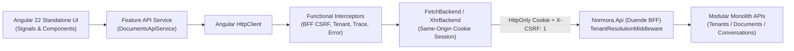
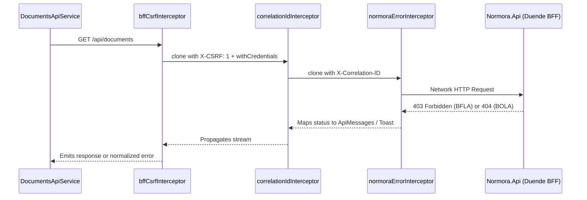
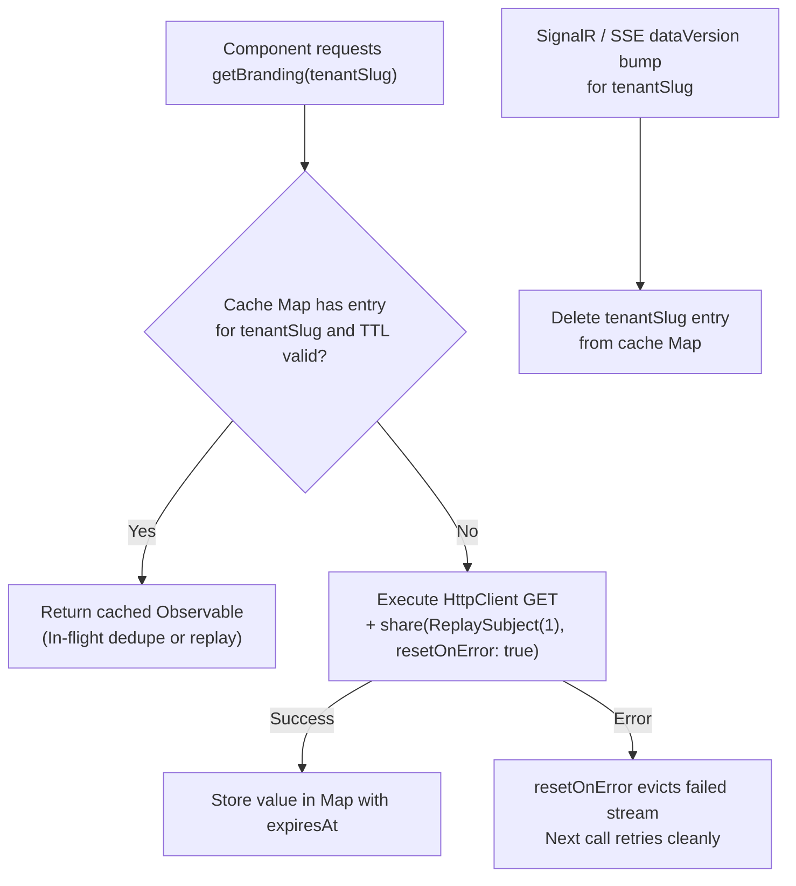

# Chapter 12: HTTP & API Integration

## 1. Learning Objectives
By the end of this chapter, you will be able to:
* Configure `provideHttpClient` in a Standalone, zoneless Angular 22 application, choosing the right `with*` feature flags (`withFetch`, `withInterceptors`, `withXsrfConfiguration`).
* Design strongly typed API services using `HttpParams`, `HttpHeaders`, `HttpContext`, multipart file uploads with progress tracking, and `Blob` downloads.
* Bridge `HttpClient` Observables with Angular Signals (`toSignal`, `httpResource`) and know when to step outside `HttpClient` (SSE streaming, SignalR).
* Implement Functional Interceptors for Duende BFF anti-CSRF (`X-CSRF: 1`), multi-tenant headers, OpenTelemetry correlation, and BOLA/BFLA-aware error handling using `ApiMessages`.
* Build resilient HTTP pipelines with idempotency-safe exponential backoff, concurrency control (`switchMap`, `exhaustMap`, `concatMap`), request cancellation, and error-safe multi-tenant caching.

---

## 2. Introduction: The Angular HttpClient

Angular does not ask you to sprinkle raw `fetch()` calls across components. Instead, it provides a dedicated, DI-managed **`HttpClient`** abstraction in `@angular/common/http`.

### What It Is & Why It Exists
`HttpClient` is a unified HTTP client layer built on top of a swappable `HttpBackend` (`FetchBackend` via `withFetch()`, or `HttpXhrBackend` by default). Why use `HttpClient` over raw `fetch()`?
* **Cold Observables & Instant Cancellation:** Every request returns a cold RxJS `Observable`. Nothing hits the network until subscribed, and unsubscribing immediately cancels the in-flight request via `AbortController` (with `FetchBackend`) or `xhr.abort()` (with `XhrBackend`).
* **Global Interceptor Pipeline:** Cross-cutting concerns—anti-CSRF headers, tenant context, W3C trace correlation, retries, and centralized 401/403/404 handling—live in one composable chain rather than duplicated `fetch` wrappers.
* **Typed JSON & Automatic Parsing:** Generic methods like `this.http.get<PagedResult<DocumentDto>>(...)` enforce compile-time contracts and automatically parse JSON payloads (or `Blob`, `ArrayBuffer`, `text` when requested).
* **Zoneless Compatibility:** In Angular 22's zoneless change detection, `HttpClient` does not rely on Zone.js monkey-patching `XMLHttpRequest` or `fetch`. When your component binds HTTP results to Signals (via `toSignal()`, `httpResource()`, or a SignalStore), Signal notifications schedule change detection deterministically.
* **SSR TransferState Hydration:** During Server-Side Rendering, `HttpClient` automatically caches `GET` responses in `TransferState` and replays them on client hydration, preventing duplicate API calls and UI flicker.

### When NOT to Use `HttpClient`
An architect knows the boundaries of a tool:
* **Real-Time Bidirectional Events:** Do not poll `HttpClient` in a timer for live workspace updates. Normora uses **SignalR** WebSockets (`@microsoft/signalr`) backed by Redis pub/sub for document ingestion status changes and `dataVersion` synchronization.
* **Token-by-Token AI Streaming (SSE):** `HttpClient` buffers standard HTTP responses until completion by default (though `observe: 'events'` + `reportProgress` can read `HttpDownloadProgressEvent` text chunks awkwardly). For Normora's `/api/copilotkit` AG-UI **Server-Sent Events (SSE)** token stream, use native `fetch()` + `ReadableStream` (or the AG-UI client) so tokens render incrementally, while still including BFF cookies and `X-CSRF: 1`.
* **Static Asset Links:** ``, `<a download>`, or CSS `url(...)` should reference public or BFF-proxied URLs directly rather than buffering files in JavaScript memory, *unless* the endpoint requires custom headers or error interception.

### Normora End-to-End HTTP Topology



### Real-World Normora `HttpClient` Use Cases
1. **Listing Workspace Documents (`DocumentsApiService`):** `GET /api/documents` returning `PagedResult<DocumentSummaryDto>` with `HttpParams` for pagination, department filters, and search terms.
2. **Uploading Policy PDFs (`DocumentsApiService`):** `POST /api/documents` with `FormData` (`observe: 'events'`, `reportProgress: true`) to stream upload percentage bars while `Normora.Api` writes metadata and a `DocumentProcessingOutboxMessage` atomically.
3. **Resolving Active Tenant Context (`TenantsApiService`):** `GET /api/tenants/current` to load white-label branding, subscription tier (`Free`, `Pro`, `Enterprise`), and user role claims.
4. **Confirming HITL Destructive Actions (`ApprovalsApiService`):** `POST /api/approvals/{id}/approve` to authorize a `PendingApproval` created by the `documents_delete` agent tool.
5. **Updating Workspace Billing Currency (`SubscriptionApiService`):** `PUT /api/subscription/currency` to persist `TenantPlan.Currency` (`INR`, `USD`, `EUR`, etc.) before generating a PayU hosted checkout payload.

---

## 3. Configuring the HttpClient (Modern Standalone API)

Historically, you imported `HttpClientModule` into an `NgModule`. In modern standalone Angular, you configure HTTP globally using `provideHttpClient(...)` in `app.config.ts`.

**`charger.app.config.ts` (Baseline Example)**
```typescript
import { ApplicationConfig } from '@angular/core';
import { provideHttpClient, withInterceptors, withFetch } from '@angular/common/http';

export const appConfig: ApplicationConfig = {
  providers: [
    provideHttpClient(
      // Uses the native fetch API under the hood (improves SSR performance)
      withFetch(), 
      // Registers our functional interceptors
      withInterceptors([authInterceptor, errorInterceptor])
    )
  ]
};
```

### Understanding `provideHttpClient` Feature Functions

| Feature Function | What It Does | When to Use / Avoid |
|---|---|---|
| `withFetch()` | Switches `HttpBackend` from `XMLHttpRequest` to native `fetch()` + `AbortController`. | **Use** as default in Angular 22 & SSR apps. **Avoid** if you strictly need `HttpEventType.UploadProgress` across all browsers (see below). |
| `withInterceptors([...])` | Registers functional `HttpInterceptorFn` functions in array order. | **Always use** for new Angular code. |
| `withInterceptorsFromDi()` | Bridges legacy class-based `HTTP_INTERCEPTORS` multi-providers. | **Only use** temporarily while migrating third-party or legacy libraries. |
| `withXsrfConfiguration(...)` | Customizes Angular's built-in XSRF cookie/header names (`XSRF-TOKEN` / `X-XSRF-TOKEN`). | **Use** when your backend issues a readable `XSRF-TOKEN` cookie; Normora's Duende BFF uses `X-CSRF: 1` instead. |
| `withNoXsrfProtection()` | Disables Angular's automatic XSRF token reading/attaching. | **Use** only if XSRF is handled exclusively via custom headers like Duende BFF's `X-CSRF: 1` (and you want zero cookie-lookup overhead). |
| `withRequestsMadeViaParent()` | Forwards HTTP requests in a lazy-loaded child injector up to the parent injector's `HttpClient`. | **Use** when providing a scoped service in a lazy route that still needs root interceptors. |
| `withJsonpSupport()` | Enables legacy JSONP `<script>` tag requests. | **Do NOT use** in modern apps; JSONP bypasses CORS safely only via legacy hacks and introduces XSS surface. Use CORS or a BFF proxy. |

> [!NOTE]
> **`withFetch()` and Upload Progress Events:** Native browser `fetch()` does not universally expose upload byte progress events (`UploadProgress`) the way `XMLHttpRequest.upload.onprogress` does. If an enterprise feature like Normora's large PDF ingestion uploader requires smooth `0% -> 100%` upload progress bars, either omit `withFetch()` if uploads dominate, or inject `HttpXhrBackend` specifically for the upload client.

### Real-World Normora Configuration Examples

#### Example 1: Root `app.config.ts` with Duende BFF Pipeline
```typescript
// client/src/app/app.config.ts
import { ApplicationConfig, InjectionToken, provideZonelessChangeDetection } from '@angular/core';
import {
  provideHttpClient,
  withFetch,
  withInterceptors,
  withNoXsrfProtection
} from '@angular/common/http';
import { provideRouter } from '@angular/router';
import { routes } from './app.routes';
import { environment } from '../environments/environment';
import { bffCsrfInterceptor } from './core/interceptors/bff-csrf.interceptor';
import { correlationIdInterceptor } from './core/interceptors/correlation-id.interceptor';
import { tenantHeaderInterceptor } from './core/interceptors/tenant-header.interceptor';
import { normoraErrorInterceptor } from './core/interceptors/normora-error.interceptor';

export interface NormoraApiConfig {
  readonly bffBaseUrl: string;
  readonly requestTimeoutMs: number;
}

export const NORMORA_API_CONFIG = new InjectionToken<NormoraApiConfig>('NORMORA_API_CONFIG');

export const appConfig: ApplicationConfig = {
  providers: [
    provideZonelessChangeDetection(),
    provideRouter(routes),
    {
      provide: NORMORA_API_CONFIG,
      useValue: {
        bffBaseUrl: environment.bffBaseUrl, // e.g. '' for same-origin BFF proxy
        requestTimeoutMs: 15_000
      }
    },
    provideHttpClient(
      withFetch(),
      // Duende BFF enforces SameSite=Strict HttpOnly cookies + static 'X-CSRF: 1' header
      withNoXsrfProtection(),
      withInterceptors([
        bffCsrfInterceptor,
        correlationIdInterceptor,
        tenantHeaderInterceptor,
        normoraErrorInterceptor
      ])
    )
  ]
};
```

#### Example 2: Environment Files Swapped at Build Time
```typescript
// client/src/environments/environment.ts (local Angular dev server proxying to Normora.Api :5000)
export const environment = {
  production: false,
  bffBaseUrl: '' // Relies on proxy.conf.json forwarding /api and /bff to http://localhost:5000
};
```

#### Example 3: Dedicated XHR `HttpClient` for Upload Progress
When `withFetch()` is enabled globally, you can still construct an isolated XHR-backed `HttpClient` for upload progress bars:
```typescript
// client/src/app/core/http/upload-http-client.provider.ts
import { HttpClient, HttpXhrBackend } from '@angular/common/http';
import { InjectionToken } from '@angular/core';

export const UPLOAD_HTTP_CLIENT = new InjectionToken<HttpClient>('UPLOAD_HTTP_CLIENT');

export function provideXhrUploadBackend() {
  return [
    HttpXhrBackend,
    {
      provide: UPLOAD_HTTP_CLIENT,
      useFactory: (xhrBackend: HttpXhrBackend) => new HttpClient(xhrBackend),
      deps: [HttpXhrBackend]
    }
  ];
}
```
*(Note: A standalone `new HttpClient(xhrBackend)` bypasses root `withInterceptors`; for BFF endpoints, prefer attaching `X-CSRF: 1` and `withCredentials: true` explicitly or omitting `withFetch()` globally when upload progress is a first-class requirement).*

#### Example 4: Route-Scoped Feature Config with `withRequestsMadeViaParent()`
If a lazy-loaded `admin.routes.ts` registers a specialized feature interceptor while still wanting all root BFF/error interceptors to run:
```typescript
// client/src/app/features/tenants/tenants.routes.ts
import { Routes } from '@angular/router';
import { provideHttpClient, withInterceptors, withRequestsMadeViaParent } from '@angular/common/http';
import { auditReasonInterceptor } from './interceptors/audit-reason.interceptor';

export const TENANTS_ROUTES: Routes = [
  {
    path: 'billing',
    providers: [
      provideHttpClient(
        withRequestsMadeViaParent(),
        withInterceptors([auditReasonInterceptor])
      )
    ],
    loadComponent: () => import('./billing-settings.component').then(m => m.BillingSettingsComponent)
  }
];
```

#### Example 5: Standard XSRF Cookie Mode (Non-Duende Reference)
If an external micro-frontend or partner integration uses traditional Angular double-submit XSRF cookies rather than Duende BFF's static `X-CSRF: 1`:
```typescript
provideHttpClient(
  withFetch(),
  withXsrfConfiguration({
    cookieName: 'NORMORA-XSRF-TOKEN',
    headerName: 'X-NORMORA-XSRF-TOKEN'
  })
)
```

---

## 4. Writing an API Service

An API service should be a stateless `@Injectable({ providedIn: 'root' })` singleton. Its job is strictly transport and contract mapping:
* Build typed request parameters (`HttpParams`), headers (`HttpHeaders`), and per-request metadata (`HttpContext`).
* Execute strongly typed `HttpClient` calls returning `Observable<T>` (never subscribing inside the service!).
* Normalize errors and map backend DTOs to clean frontend domain models without leaking UI concerns (toasts, routing) into the transport layer.

### Baseline Case Study: `charger.service.ts`
```typescript
import { Injectable, inject } from '@angular/core';
import { HttpClient } from '@angular/common/http';
import { Observable, catchError, retry, throwError } from 'rxjs';

@Injectable({ providedIn: 'root' })
export class ChargerService {
  private http = inject(HttpClient);
  private apiUrl = '/api/v1/chargers'; // Ideally injected via InjectionToken

  // Returns an Observable of Chargers
  getAll(): Observable<Charger[]> {
    return this.http.get<Charger[]>(this.apiUrl).pipe(
      // Automatically retry the request up to 2 times if it fails (see Section 6 for safe retry rules!)
      retry(2),
      catchError(this.handleError)
    );
  }

  // Create a new charger
  create(charger: Partial<Charger>): Observable<Charger> {
    return this.http.post<Charger>(this.apiUrl, charger).pipe(
      catchError(this.handleError)
    );
  }

  private handleError(error: unknown) {
    console.error('API Error:', error);
    // Transform the error into a user-friendly message
    return throwError(() => new Error('Failed to communicate with the Charger API.'));
  }
}
```

### Core `HttpClient` Building Blocks (What, Why, How, When Not To)
* **`HttpParams` (Query Strings):** Always use `new HttpParams({ fromObject: ... })` or chain immutable `.set()` calls (`params = params.set('page', 1)`). Never concatenate query strings manually with `+` or template literals, which skips URL encoding and breaks on special characters like `&` or `#`.
* **`HttpContext` & `HttpContextToken`:** Carries typed, per-request metadata through the interceptor pipeline *without* polluting HTTP headers sent over the wire. Use it to toggle silent error handling, custom timeouts, or retry policies on specific calls.
* **`observe` Option (`'body'` | `'response'` | `'events'`):**
  * `'body'` (default): Emits only the parsed payload `T`.
  * `'response'`: Emits `HttpResponse<T>` so you can inspect status codes or response headers (e.g., `X-Total-Count`, `ETag`, `Content-Disposition`, `Retry-After`).
  * `'events'`: Emits a stream of `HttpEvent<T>` (`Sent`, `UploadProgress`, `ResponseHeader`, `DownloadProgress`, `Response`)—essential for progress bars.
* **`responseType` Option (`'json'` | `'blob'` | `'text'` | `'arraybuffer'`):** Use `'blob'` when downloading binary files (PDFs, CSV exports) so Angular does not try to `JSON.parse()` raw bytes.
* **Bridging to Angular 22 Signals (`toSignal` & `httpResource`):**
  * For **declarative, signal-driven `GET` reads** driven by reactive parameters (search query, selected department, page number), Angular's `httpResource()` automatically tracks Signal dependencies, cancels stale requests on parameter changes, and exposes `.value()`, `.isLoading()`, and `.error()` Signals.
  * **When NOT to use `httpResource()`:** Never use `httpResource()` for imperative mutations (`POST`, `PUT`, `PATCH`, `DELETE`), file uploads with progress tracking, or sequential multi-step workflows. Keep those as explicit `HttpClient` methods returning `Observable<T>`.

### Real-World Normora API Service Examples

#### Example 1: Paginated `GET` with `HttpParams` and Typed `ApiResponse` (`DocumentsApiService`)
Normora wraps responses in typed envelopes and avoids magic strings by using `ApiMessages` from `client/src/app/core/constants/api-messages.ts`.
```typescript
// client/src/app/features/documents/services/documents-api.service.ts
import { HttpClient, HttpParams } from '@angular/common/http';
import { Injectable, inject } from '@angular/core';
import { Observable, map } from 'rxjs';
import { NORMORA_API_CONFIG } from '../../../app.config';

export interface ApiResponse<T> {
  readonly success: boolean;
  readonly data: T;
  readonly message?: string;
}

export interface PagedResult<T> {
  readonly items: readonly T[];
  readonly totalCount: number;
  readonly page: number;
  readonly pageSize: number;
}

export interface DocumentSummaryDto {
  readonly id: string;
  readonly title: string;
  readonly status: 'Pending' | 'Processing' | 'Indexed' | 'Failed';
  readonly departmentId: string | null;
  readonly updatedAtUtc: string;
}

export interface DocumentQueryFilter {
  readonly page: number;
  readonly pageSize: number;
  readonly search?: string;
  readonly departmentId?: string;
}

@Injectable({ providedIn: 'root' })
export class DocumentsApiService {
  private readonly http = inject(HttpClient);
  private readonly config = inject(NORMORA_API_CONFIG);
  private readonly baseUrl = `${this.config.bffBaseUrl}/api/documents`;

  listDocuments(filter: DocumentQueryFilter): Observable<PagedResult<DocumentSummaryDto>> {
    let params = new HttpParams()
      .set('page', filter.page)
      .set('pageSize', filter.pageSize);

    if (filter.search?.trim()) {
      params = params.set('search', filter.search.trim());
    }
    if (filter.departmentId) {
      params = params.set('departmentId', filter.departmentId);
    }

    return this.http
      .get<ApiResponse<PagedResult<DocumentSummaryDto>>>(this.baseUrl, { params })
      .pipe(map((res) => res.data));
  }
}
```

#### Example 2: Multipart File Upload with `HttpEventType.UploadProgress`
When uploading policies to `Normora.Api` (which writes metadata + `DocumentProcessingOutboxMessage` in PostgreSQL and streams bytes to MinIO), track progress with `observe: 'events'` and `reportProgress: true`:
```typescript
// Inside DocumentsApiService
import { HttpEvent, HttpEventType } from '@angular/common/http';

export type UploadProgressState =
  | { readonly kind: 'progress'; readonly percent: number }
  | { readonly kind: 'completed'; readonly documentId: string };

uploadDocument(file: File, departmentId: string | null): Observable<UploadProgressState> {
  const formData = new FormData();
  formData.append('file', file, file.name);
  if (departmentId) {
    formData.append('departmentId', departmentId);
  }

  return this.http
    .post<ApiResponse<{ id: string }>>(this.baseUrl, formData, {
      observe: 'events',
      reportProgress: true
    })
    .pipe(
      map((event: HttpEvent<ApiResponse<{ id: string }>>) => {
        if (event.type === HttpEventType.UploadProgress && event.total) {
          const percent = Math.round((100 * event.loaded) / event.total);
          return { kind: 'progress', percent } as const;
        }
        if (event.type === HttpEventType.Response && event.body) {
          return { kind: 'completed', documentId: event.body.data.id } as const;
        }
        return { kind: 'progress', percent: 0 } as const;
      })
    );
}
```

#### Example 3: Binary `Blob` Download with Header Inspection & Memory Cleanup (`DocumentsApiService`)
Using `observe: 'response'` + `responseType: 'blob'` lets you extract the server's `Content-Disposition` filename while preventing memory leaks via `URL.revokeObjectURL`:
```typescript
// Inside DocumentsApiService
import { tap } from 'rxjs';

downloadOriginal(documentId: string, fallbackName: string): Observable<Blob> {
  return this.http
    .get(`${this.baseUrl}/${documentId}/download`, {
      observe: 'response',
      responseType: 'blob'
    })
    .pipe(
      tap((response) => {
        const blob = response.body;
        if (!blob) return;

        const disposition = response.headers.get('content-disposition');
        const fileNameMatch = disposition?.match(/filename="?([^"]+)"?/i);
        const fileName = fileNameMatch?.[1] ?? fallbackName;

        const objectUrl = URL.createObjectURL(blob);
        const link = document.createElement('a');
        link.href = objectUrl;
        link.download = fileName;
        link.click();
        URL.revokeObjectURL(objectUrl);
      }),
      map((response) => response.body as Blob)
    );
}
```

#### Example 4: `HttpContextToken` + `PUT` Currency Mutation (`SubscriptionApiService`)
Normora requires workspace currency updates (`PUT /api/subscription/currency`) to persist to `TenantPlan.Currency` before checkout. Using `HttpContext` lets the service tell the global error interceptor to let the billing component render an inline validation banner instead of a generic toast:
```typescript
// client/src/app/core/http/http-context-tokens.ts
import { HttpContext, HttpContextToken } from '@angular/common/http';

export const SILENT_ERROR_TOAST = new HttpContextToken<boolean>(() => false);
export const REQUEST_TIMEOUT_MS = new HttpContextToken<number>(() => 15_000);

// client/src/app/features/tenants/services/subscription-api.service.ts
import { HttpClient, HttpContext } from '@angular/common/http';
import { Injectable, inject } from '@angular/core';
import { Observable, map } from 'rxjs';
import { ApiResponse } from '../../documents/services/documents-api.service';
import { SILENT_ERROR_TOAST } from '../../../core/http/http-context-tokens';

export type SupportedCurrency = 'INR' | 'USD' | 'EUR' | 'GBP' | 'CAD' | 'AUD' | 'JPY' | 'SGD';

@Injectable({ providedIn: 'root' })
export class SubscriptionApiService {
  private readonly http = inject(HttpClient);

  updateCurrency(currency: SupportedCurrency): Observable<void> {
    const context = new HttpContext().set(SILENT_ERROR_TOAST, true);
    return this.http
      .put<ApiResponse<void>>('/api/subscription/currency', { currency }, { context })
      .pipe(map(() => undefined));
  }
}
```

#### Example 5: Signal-Reactive `httpResource()` for Read-Only Workspace Audits (`AuditLogsState`)
In Angular 22, when reading paginated `AuditLogs` keyed by reactive filter Signals, `httpResource` eliminates manual `Subscription` wiring while still routing through all `HttpClient` interceptors:
```typescript
// client/src/app/features/tenants/state/audit-logs.resource.ts
import { httpResource } from '@angular/common/http';
import { signal } from '@angular/core';
import { ApiResponse, PagedResult } from '../../documents/services/documents-api.service';

export interface AuditLogDto {
  readonly id: string;
  readonly action: string;
  readonly actorExternalUserId: string;
  readonly occurredAtUtc: string;
}

export function createAuditLogsResource() {
  const page = signal(1);
  const actionFilter = signal('');

  // Automatically re-fetches and cancels stale requests when page() or actionFilter() changes
  const logsResource = httpResource<ApiResponse<PagedResult<AuditLogDto>>>(() => ({
    url: '/api/tenants/audit-logs',
    method: 'GET',
    params: {
      page: page(),
      pageSize: 25,
      ...(actionFilter() ? { action: actionFilter() } : {})
    }
  }));

  return { page, actionFilter, logsResource };
}
```
And in a Tailwind v4 component template using Angular 22 control flow (`@if` / `@for`), dark mode `dark:` variants, and suffix `!important` (`border-none!`):
```html
<div class="rounded-lg border border-slate-200 dark:border-slate-700 bg-white dark:bg-slate-900 p-4">
  @if (logsResource.isLoading()) {
    <p class="text-sm text-slate-500 dark:text-slate-400">Loading audit logs...</p>
  } @else if (logsResource.error()) {
    <button
      type="button"
      (click)="logsResource.reload()"
      class="border-none! bg-red-50 dark:bg-red-950/40 text-red-700 dark:text-red-300 px-3 py-1.5 rounded">
      Retry loading logs
    </button>
  } @else if (logsResource.hasValue()) {
    @for (entry of logsResource.value().data.items; track entry.id) {
      <div class="py-2 border-b border-slate-100 dark:border-slate-800 text-slate-900 dark:text-slate-100">
        {{ entry.action }}
      </div>
    }
  }
</div>
```

---

## 5. Functional Interceptors

Interceptors sit between `HttpClient` and the network `HttpBackend`. Every outgoing `HttpRequest` passes forward through the chain, and every incoming `HttpEvent` (including `HttpResponse` and `HttpErrorResponse`) flows backward through the exact same chain.

In Angular v15+, class-based `HttpInterceptor` services were deprecated in favor of **Functional Interceptors** (`HttpInterceptorFn`). Functional interceptors are tree-shakable, require zero boilerplate classes, and use Angular's `inject()` function directly inside the interceptor body.

### How Interceptor Ordering Works (The Onion Model)
Interceptors execute in the exact order listed in `withInterceptors([A, B, C])`:
* **Outgoing request:** `A -> B -> C -> HttpBackend -> Network`
* **Incoming response / error:** `Network -> HttpBackend -> C -> B -> A`



> [!IMPORTANT]
> **Order matters!** Put header-mutating interceptors (`bffCsrfInterceptor`, `tenantHeaderInterceptor`) *before* retry or error interceptors so that retried requests keep the attached headers, and put your global error interceptor *after* retry logic so transient retries happen before a final error toast is triggered.

### When NOT to Use an Interceptor
* **Do NOT put endpoint-specific business logic in an interceptor.** An interceptor stuffed with `if (req.url.includes('/documents') && req.method === 'POST')` breaks cohesion. Use `HttpContextToken` flags or handle it inside the owning API service.
* **Do NOT attach internal headers (`X-CSRF`, `X-Tenant-Slug`, `Authorization`, `withCredentials: true`) to external third-party URLs** (such as presigned MinIO S3 URLs or external CDN links). Doing so leaks tenant metadata or fails CORS preflight checks! Always scope interceptors to relative `/api/` or `/bff/` paths (or your configured `bffBaseUrl`).

### Case Study: The JWT Authentication Interceptor (Traditional OAuth SPA)

In traditional OAuth SPAs (such as our baseline EV Platform) where the browser holds an access token in memory, almost every API request requires a Bearer token in the `Authorization` header. We should not manually add this to every request in our Services. An Interceptor can do it globally.

**`auth.interceptor.ts`**
```typescript
import { HttpInterceptorFn } from '@angular/common/http';
import { inject } from '@angular/core';
import { AuthService } from '../auth.service';

export const authInterceptor: HttpInterceptorFn = (req, next) => {
  const authService = inject(AuthService);
  const token = authService.getToken();

  // If we have a token, clone the request and add the Authorization header
  if (token) {
    const clonedRequest = req.clone({
      setHeaders: {
        Authorization: `Bearer ${token}`
      }
    });
    
    // Pass the cloned, modified request to the next handler
    return next(clonedRequest);
  }

  // If no token, pass the original request unchanged
  return next(req);
};
```

### Case Study: The Global Error Interceptor (Traditional SPA)

What if a user's token expires, and the API starts returning `401 Unauthorized`? We need an interceptor to catch this globally, log the user out, and redirect them to the login page.

**`error.interceptor.ts`**
```typescript
import { HttpInterceptorFn, HttpErrorResponse } from '@angular/common/http';
import { inject } from '@angular/core';
import { Router } from '@angular/router';
import { catchError, throwError } from 'rxjs';
import { AuthService } from '../auth.service';

export const errorInterceptor: HttpInterceptorFn = (req, next) => {
  const router = inject(Router);
  const authService = inject(AuthService);

  return next(req).pipe(
    catchError((error: HttpErrorResponse) => {
      
      if (error.status === 401) {
        // Token expired or invalid
        authService.logout();
        router.navigate(['/auth/login']);
      } 
      else if (error.status === 403) {
        // RBAC denial
        router.navigate(['/unauthorized']);
      }

      // Re-throw the error so the local service can still catch it if it wants to
      return throwError(() => error);
    })
  );
};
```

> [!NOTE]
> **BFF vs Browser Bearer Tokens:** In a traditional OAuth SPA, Angular reads tokens from memory and handles `401` by calling a refresh-token endpoint (carefully queueing concurrent requests so only *one* refresh call runs). **Normora avoids browser tokens completely** by using the **Duende BFF** pattern: Keycloak OIDC tokens stay encrypted on the server in `Normora.Api`, while Angular uses `HttpOnly`, `SameSite=Strict`, `Secure` cookies plus anti-CSRF headers.

### Real-World Normora Interceptor Suite (5 Production Patterns)

#### Example 1: Duende BFF Anti-CSRF & Cookie Session Interceptor (`bffCsrfInterceptor`)
Duende BFF protects `/api/*` and `/bff/*` routes against Cross-Site Request Forgery (CSRF) by requiring the custom `X-CSRF: 1` header (which browsers block cross-origin sites from sending without CORS preflight approval) alongside the `HttpOnly` session cookie:
```typescript
// client/src/app/core/interceptors/bff-csrf.interceptor.ts
import { HttpInterceptorFn } from '@angular/common/http';

export const bffCsrfInterceptor: HttpInterceptorFn = (req, next) => {
  const isBffOrApiRoute = req.url.startsWith('/api/') || req.url.startsWith('/bff/');
  if (!isBffOrApiRoute) {
    return next(req); // Never leak BFF cookies or CSRF headers to third-party origins
  }

  const securedReq = req.clone({
    withCredentials: true,
    setHeaders: {
      'X-CSRF': '1'
    }
  });

  return next(securedReq);
};
```

#### Example 2: Multi-Tenant Context Header Interceptor (`tenantHeaderInterceptor`)
Normora resolves tenant workspaces via path/slug (`TenantResolutionMiddleware`). Attaching `X-Tenant-Slug` on `/api/*` calls (excluding global `/bff/*` endpoints) keeps tenant context explicit for cross-cutting logging and API routing:
```typescript
// client/src/app/core/interceptors/tenant-header.interceptor.ts
import { HttpInterceptorFn } from '@angular/common/http';
import { inject } from '@angular/core';
import { TenantContextStore } from '../state/tenant-context.store';

export const tenantHeaderInterceptor: HttpInterceptorFn = (req, next) => {
  if (!req.url.startsWith('/api/')) {
    return next(req);
  }

  const activeSlug = inject(TenantContextStore).activeSlug();
  if (!activeSlug) {
    return next(req);
  }

  return next(
    req.clone({
      setHeaders: {
        'X-Tenant-Slug': activeSlug
      }
    })
  );
};
```

#### Example 3: OpenTelemetry Correlation ID Interceptor (`correlationIdInterceptor`)
Normora runs distributed tracing via OpenTelemetry across `Normora.Api` and `Normora.Worker`. Attaching a unique `X-Correlation-ID` per client action allows support engineers to trace a failing browser upload straight into backend Hangfire job logs:
```typescript
// client/src/app/core/interceptors/correlation-id.interceptor.ts
import { HttpInterceptorFn } from '@angular/common/http';

export const correlationIdInterceptor: HttpInterceptorFn = (req, next) => {
  if (!req.url.startsWith('/api/') || req.headers.has('X-Correlation-ID')) {
    return next(req);
  }

  return next(
    req.clone({
      setHeaders: {
        'X-Correlation-ID': crypto.randomUUID()
      }
    })
  );
};
```

#### Example 4: Context-Driven Timeout & Idempotent Retry Interceptor (`timeoutAndRetryInterceptor`)
Using `REQUEST_TIMEOUT_MS` from `HttpContext`, this interceptor protects the UI from hung sockets and retries **only safe, idempotent `GET`/`HEAD` requests** on transient `502`/`503`/`504` gateway errors:
```typescript
// client/src/app/core/interceptors/timeout-and-retry.interceptor.ts
import { HttpErrorResponse, HttpInterceptorFn } from '@angular/common/http';
import { retry, timeout, timer } from 'rxjs';
import { REQUEST_TIMEOUT_MS } from '../http/http-context-tokens';

const IDEMPOTENT_METHODS = new Set(['GET', 'HEAD', 'OPTIONS']);
const TRANSIENT_STATUSES = new Set([0, 502, 503, 504]);

export const timeoutAndRetryInterceptor: HttpInterceptorFn = (req, next) => {
  const timeoutMs = req.context.get(REQUEST_TIMEOUT_MS);
  const canRetry = IDEMPOTENT_METHODS.has(req.method.toUpperCase());

  return next(req).pipe(
    timeout(timeoutMs),
    retry({
      count: canRetry ? 2 : 0,
      delay: (error, retryIndex) => {
        if (!(error instanceof HttpErrorResponse) || !TRANSIENT_STATUSES.has(error.status)) {
          throw error; // Immediately fail on 400, 401, 403, 404, 422, 500
        }
        const backoffMs = Math.min(1000 * 2 ** (retryIndex - 1), 4000);
        return timer(backoffMs);
      }
    })
  );
};
```

#### Example 5: BOLA / BFLA & `ApiMessages` Global Error Interceptor (`normoraErrorInterceptor`)
Normora's backend maps BOLA (Broken Object Level Authorization) to `404 Not Found` and BFLA (Broken Function Level Authorization) to `403 Forbidden`, and never exposes raw exception stacks (CWE-209). The frontend interceptor mirrors that discipline using `ApiMessages` from `client/src/app/core/constants/api-messages.ts` (never magic strings!):
```typescript
// client/src/app/core/interceptors/normora-error.interceptor.ts
import { HttpErrorResponse, HttpInterceptorFn } from '@angular/common/http';
import { inject } from '@angular/core';
import { Router } from '@angular/router';
import { catchError, throwError } from 'rxjs';
import { ApiMessages } from '../constants/api-messages';
import { SILENT_ERROR_TOAST } from '../http/http-context-tokens';
import { ToastService } from '../services/toast.service';

export const normoraErrorInterceptor: HttpInterceptorFn = (req, next) => {
  const router = inject(Router);
  const toast = inject(ToastService);
  const isSilent = req.context.get(SILENT_ERROR_TOAST);

  return next(req).pipe(
    catchError((error: unknown) => {
      if (!(error instanceof HttpErrorResponse)) {
        if (!isSilent) toast.error(ApiMessages.UnexpectedError);
        return throwError(() => error);
      }

      if (error.status === 401) {
        // Duende BFF session expired -> trigger full browser navigation to OIDC login
        const returnUrl = encodeURIComponent(window.location.pathname + window.location.search);
        window.location.assign(`/bff/login?returnUrl=${returnUrl}`);
      } else if (error.status === 403) {
        // BFLA: User lacks permission for this action
        if (!isSilent) toast.error(ApiMessages.Forbidden);
        router.navigate(['/forbidden']);
      } else if (error.status === 404) {
        // BOLA-safe: Generic not-found message without revealing whether resource ID exists
        if (!isSilent) toast.warn(ApiMessages.NotFound);
      } else if (error.status === 429) {
        if (!isSilent) toast.warn(ApiMessages.RateLimitExceeded);
      } else if (error.status >= 500) {
        // CWE-209: Never display raw backend exception traces to the user
        if (!isSilent) toast.error(ApiMessages.ServerError);
      }

      return throwError(() => error);
    })
  );
};
```

---

## 6. HTTP Resilience, Caching Strategies & Request Cancellation

Enterprise SPAs do not just send HTTP requests; they coordinate **concurrency**, **caching**, **cancellation**, and **failure recovery**.

### 6.1 Concurrency Control & Request Cancellation
Because `HttpClient` returns cold RxJS Observables, flattening operators control what happens when a user triggers overlapping requests:

| Operator | Behavior on New Emission | Use When | Avoid When |
|---|---|---|---|
| `switchMap` | **Cancels** the previous in-flight HTTP request (`AbortController.abort()`). | Search typeahead, pagination, filter toggles, route param reads. | **Never** use for `POST`/`PUT`/`DELETE` mutations—you could abort a save mid-flight! |
| `exhaustMap` | **Ignores** new triggers while a request is already in flight. | Login, PayU checkout, HITL `ApprovalsController` confirmation, submit buttons. | Search bars (typing would be dropped while an old search finishes). |
| `concatMap` | **Queues** requests strictly one after another in order. | Sequential multi-file uploads or ordered audit step mutations. | Independent reads where parallelism improves latency. |
| `mergeMap` | Runs all requests **concurrently** without cancelling any. | Fetching independent items in parallel (e.g., multiple chunk previews). | Unbounded user-triggered loops or ordered writes. |

### 6.2 HTTP Caching Strategies & Multi-Tenant Invalidation
Enterprise applications often fetch reference data that rarely changes (e.g., workspace branding, departments, or charger models). Re-fetching on every route change wastes bandwidth and causes UI flicker.

#### Baseline Case Study: `reference-data.service.ts`
```typescript
@Injectable({ providedIn: 'root' })
export class ReferenceDataService {
  private http = inject(HttpClient);
  
  // Create an observable property, not a function!
  private categoriesCache$: Observable<Category[]> | null = null;

  getCategories(): Observable<Category[]> {
    // If the cache exists, return it instantly. No HTTP call made.
    if (this.categoriesCache$) {
      return this.categoriesCache$;
    }

    // Otherwise, make the HTTP call, and cache the result
    this.categoriesCache$ = this.http.get<Category[]>('/api/categories').pipe(
      // Cache the last 1 emitted value. 
      // Keep the cache alive even if all subscribers unsubscribe.
      shareReplay(1) 
    );

    return this.categoriesCache$;
  }
  
  clearCache() {
    this.categoriesCache$ = null;
  }
}
```

#### Two Production Pitfalls with Naive `shareReplay(1)`
1. **Error Caching Forever:** If the `GET` fails once due to a 5-second Wi-Fi drop, `shareReplay(1)` caches the **error** notification and replays that failure to every future subscriber until `clearCache()` is called. Always reset on error using `catchError` or RxJS `share({ connector: () => new ReplaySubject(1), resetOnError: true, resetOnComplete: false, resetOnRefCountZero: false })`.
2. **Cross-Tenant Data Leaks:** In a multi-tenant SaaS like Normora, a singleton (`providedIn: 'root'`) cache **must be keyed by `tenantSlug`**. If a user switches from `acme` workspace to `globex` workspace, an unkeyed `departmentsCache$` would render `acme`'s departments inside `globex`!



### Real-World Normora Resilience & Caching Examples

#### Example 1: Tenant-Keyed, Error-Safe, TTL Cache (`TenantBrandingCacheService`)
Caches white-label tenant branding per workspace slug with automatic eviction on error and a 5-minute TTL (matching Normora's backend Redis caching strategy):
```typescript
// client/src/app/features/tenants/services/tenant-branding-cache.service.ts
import { HttpClient } from '@angular/common/http';
import { Injectable, inject } from '@angular/core';
import { Observable, ReplaySubject, map, share } from 'rxjs';
import { ApiResponse } from '../../documents/services/documents-api.service';

export interface TenantBrandingDto {
  readonly tenantSlug: string;
  readonly displayName: string;
  readonly logoUrl: string | null;
  readonly primaryColorHex: string;
}

interface CacheEntry {
  readonly expiresAt: number;
  readonly stream$: Observable<TenantBrandingDto>;
}

@Injectable({ providedIn: 'root' })
export class TenantBrandingCacheService {
  private readonly http = inject(HttpClient);
  private readonly cache = new Map<string, CacheEntry>();
  private readonly ttlMs = 5 * 60_000;

  getBranding(tenantSlug: string): Observable<TenantBrandingDto> {
    const existing = this.cache.get(tenantSlug);
    if (existing && existing.expiresAt > Date.now()) {
      return existing.stream$;
    }

    const stream$ = this.http
      .get<ApiResponse<TenantBrandingDto>>(`/api/tenants/${encodeURIComponent(tenantSlug)}/branding`)
      .pipe(
        map((res) => res.data),
        share({
          connector: () => new ReplaySubject<TenantBrandingDto>(1),
          resetOnError: true,
          resetOnComplete: false,
          resetOnRefCountZero: false
        })
      );

    this.cache.set(tenantSlug, { expiresAt: Date.now() + this.ttlMs, stream$ });
    return stream$;
  }

  invalidate(tenantSlug?: string): void {
    if (tenantSlug) {
      this.cache.delete(tenantSlug);
    } else {
      this.cache.clear();
    }
  }
}
```

#### Example 2: Cancelling Stale Hybrid RAG Searches (`HybridSearchService`)
When an employee types in Normora's knowledge search bar, `switchMap` immediately aborts the previous pgvector HNSW + full-text RRF HTTP request so out-of-order network responses never overwrite newer results:
```typescript
// client/src/app/features/documents/services/hybrid-search.service.ts
import { HttpClient, HttpParams } from '@angular/common/http';
import { Injectable, inject } from '@angular/core';
import { Observable, debounceTime, distinctUntilChanged, map, of, switchMap } from 'rxjs';
import { ApiResponse } from './documents-api.service';

export interface SearchChunkDto {
  readonly chunkId: string;
  readonly documentId: string;
  readonly breadcrumb: string;
  readonly snippet: string;
  readonly rrfScore: number;
}

@Injectable({ providedIn: 'root' })
export class HybridSearchService {
  private readonly http = inject(HttpClient);

  connectSearchInput(query$: Observable<string>): Observable<readonly SearchChunkDto[]> {
    return query$.pipe(
      map((q) => q.trim()),
      debounceTime(250),
      distinctUntilChanged(),
      switchMap((term) => {
        if (term.length < 2) {
          return of([]);
        }
        const params = new HttpParams().set('q', term).set('topK', 10);
        return this.http
          .get<ApiResponse<readonly SearchChunkDto[]>>('/api/documents/search', { params })
          .pipe(map((res) => res.data));
      })
    );
  }
}
```

#### Example 3: Double-Click Protection for HITL Approvals (`ApprovalsActionService`)
Normora's `documents_delete` agent tool creates a `PendingApproval` record with a 15-minute TTL. Using `exhaustMap` ensures rapid double-clicks on "Confirm Delete" send only one `POST` request:
```typescript
// client/src/app/features/conversations/services/approvals-action.service.ts
import { HttpClient } from '@angular/common/http';
import { Injectable, inject } from '@angular/core';
import { Observable, Subject, exhaustMap, map } from 'rxjs';
import { ApiResponse } from '../../documents/services/documents-api.service';

@Injectable({ providedIn: 'root' })
export class ApprovalsActionService {
  private readonly http = inject(HttpClient);

  approveStream(approveClicks$: Subject<string>): Observable<string> {
    return approveClicks$.pipe(
      exhaustMap((approvalId) =>
        this.http
          .post<ApiResponse<{ approvalId: string }>>(`/api/approvals/${approvalId}/approve`, {})
          .pipe(map((res) => res.data.approvalId))
      )
    );
  }
}
```

#### Example 4: Reactive Cache Invalidation via `dataVersion` SignalR Sync (`DepartmentsCacheService`)
Normora broadcasts workspace `dataVersion` increments over SignalR/SSE (`IWorkspaceStateSynchronizer`). An Angular `effect()` watches that Signal and invalidates the HTTP cache automatically whenever another admin mutates departments:
```typescript
// client/src/app/features/tenants/services/departments-cache.service.ts
import { HttpClient } from '@angular/common/http';
import { Injectable, effect, inject, signal } from '@angular/core';
import { Observable, ReplaySubject, map, share } from 'rxjs';
import { ApiResponse } from '../../documents/services/documents-api.service';
import { WorkspaceSyncStore } from '../../../core/state/workspace-sync.store';
import { TenantContextStore } from '../../../core/state/tenant-context.store';

export interface DepartmentDto {
  readonly id: string;
  readonly name: string;
}

@Injectable({ providedIn: 'root' })
export class DepartmentsCacheService {
  private readonly http = inject(HttpClient);
  private readonly syncStore = inject(WorkspaceSyncStore);
  private readonly tenantStore = inject(TenantContextStore);

  private readonly cache = new Map<string, Observable<readonly DepartmentDto[]>>();
  readonly cacheVersion = signal(0);

  constructor() {
    effect(() => {
      // Track live SignalR dataVersion; whenever it changes, clear the current tenant's cache
      const version = this.syncStore.dataVersion();
      const slug = this.tenantStore.activeSlug();
      if (version > 0 && slug) {
        this.cache.delete(slug);
        this.cacheVersion.update((v) => v + 1);
      }
    });
  }

  getDepartments(tenantSlug: string): Observable<readonly DepartmentDto[]> {
    const cached = this.cache.get(tenantSlug);
    if (cached) return cached;

    const stream$ = this.http
      .get<ApiResponse<readonly DepartmentDto[]>>('/api/tenants/departments')
      .pipe(
        map((res) => res.data),
        share({
          connector: () => new ReplaySubject<readonly DepartmentDto[]>(1),
          resetOnError: true,
          resetOnComplete: false,
          resetOnRefCountZero: false
        })
      );

    this.cache.set(tenantSlug, stream$);
    return stream$;
  }
}
```

#### Example 5: Exponential Backoff with Jitter & `Retry-After` Respect (`ResilientMetricsService`)
When querying document ingestion metrics under load, respect HTTP `429 Retry-After` headers and add random jitter so thousands of browser tabs do not retry at the exact same millisecond (preventing a thundering herd):
```typescript
// client/src/app/features/documents/services/resilient-metrics.service.ts
import { HttpClient, HttpErrorResponse } from '@angular/common/http';
import { Injectable, inject } from '@angular/core';
import { Observable, map, retry, timer } from 'rxjs';
import { ApiResponse } from './documents-api.service';

export interface DocumentMetricsDto {
  readonly totalDocuments: number;
  readonly totalChunks: number;
  readonly failedCount: number;
}

@Injectable({ providedIn: 'root' })
export class ResilientMetricsService {
  private readonly http = inject(HttpClient);

  getMetrics(): Observable<DocumentMetricsDto> {
    return this.http.get<ApiResponse<DocumentMetricsDto>>('/api/documents/metrics').pipe(
      retry({
        count: 3,
        delay: (error, retryCount) => {
          if (!(error instanceof HttpErrorResponse) || ![429, 502, 503, 504].includes(error.status)) {
            throw error;
          }
          const retryAfterSec = Number(error.headers.get('Retry-After'));
          if (!Number.isNaN(retryAfterSec) && retryAfterSec > 0) {
            return timer(retryAfterSec * 1000);
          }
          const baseMs = 500 * 2 ** (retryCount - 1);
          const jitterMs = Math.floor(Math.random() * 250);
          return timer(baseMs + jitterMs);
        }
      }),
      map((res) => res.data)
    );
  }
}
```

---

## 7. Common Mistakes & Anti-Patterns

> [!CAUTION]
> **Anti-Pattern 1: Mutating `HttpRequest` or `HttpParams` in Place**
>
> **Wrong Code:**
> ```typescript
> export const brokenInterceptor: HttpInterceptorFn = (req, next) => {
>   req.headers.set('X-CSRF', '1'); // Silently returns a NEW HttpHeaders and discards it!
>   return next(req);
> };
> ```
> **Why It's Wrong:** `HttpRequest`, `HttpHeaders`, and `HttpParams` are strictly immutable in Angular. Calling `.set()` or `.append()` returns a brand-new instance without modifying the original object—so `X-CSRF: 1` is never sent, and Duende BFF rejects the request with `403` / `400`.
>
> **The Fix:**
> ```typescript
> export const fixedInterceptor: HttpInterceptorFn = (req, next) => {
>   return next(req.clone({ setHeaders: { 'X-CSRF': '1' } }));
> };
> ```

> [!CAUTION]
> **Anti-Pattern 2: Storing JWTs in `localStorage` and Sending Bearer Headers in a BFF App**
>
> **Wrong Code:**
> ```typescript
> const token = localStorage.getItem('access_token');
> return next(req.clone({ setHeaders: { Authorization: `Bearer ${token}` } }));
> ```
> **Why It's Wrong:** Any XSS vulnerability in a third-party script can read `localStorage` and exfiltrate long-lived tokens. In Normora's Duende BFF architecture, tokens never enter the browser—sessions are anchored in `HttpOnly`, `SameSite=Strict`, `Secure` cookies.
>
> **The Fix:** Let `Normora.Api` manage Keycloak OIDC tokens server-side and send `withCredentials: true` + `X-CSRF: 1` only to same-origin `/api/` and `/bff/` routes.

> [!CAUTION]
> **Anti-Pattern 3: Blindly Applying `retry(2)` to All Requests (Including `POST` & `4xx`)**
>
> **Wrong Code:**
> ```typescript
> createDepartment(name: string) {
>   return this.http.post('/api/tenants/departments', { name }).pipe(retry(2));
> }
> ```
> **Why It's Wrong:** If the backend committed the department and the response timed out on a flaky mobile network, `retry(2)` fires two more `POST` calls—creating duplicate records or failing with `409 Conflict` / `400 Validation` errors (and retrying `401`/`403`/`404` wastes server capacity).
>
> **The Fix:** Restrict automatic retries to idempotent methods (`GET`, `HEAD`, `OPTIONS`) and transient status codes (`429`, `502`, `503`, `504`) using exponential backoff with jitter. For critical `POST` mutations, require a backend `Idempotency-Key` header before ever retrying.

> [!CAUTION]
> **Anti-Pattern 4: Caching Errors Forever & Cross-Tenant Leakage with Naive `shareReplay(1)`**
>
> **Wrong Code:**
> ```typescript
> private departments$?: Observable<DepartmentDto[]>;
> getDepartments() {
>   return (this.departments$ ??= this.http.get<DepartmentDto[]>('/api/tenants/departments').pipe(shareReplay(1)));
> }
> ```
> **Why It's Wrong:** Two severe bugs: (1) If the first `GET` fails with `503`, `shareReplay(1)` caches the error and replays it to every future component forever; (2) In multi-tenant Normora, switching workspaces serves the previous tenant's cached departments!
>
> **The Fix:** Key the cache `Map` by `tenantSlug`, use `share({ connector: () => new ReplaySubject(1), resetOnError: true, resetOnComplete: false, resetOnRefCountZero: false })`, and invalidate on `dataVersion` updates.

> [!CAUTION]
> **Anti-Pattern 5: Using `switchMap` for Writes, Deletes, or Approvals**
>
> **Wrong Code:**
> ```typescript
> this.deleteClicks$.pipe(
>   switchMap((docId) => this.http.delete(`/api/documents/${docId}`))
> ).subscribe();
> ```
> **Why It's Wrong:** If an admin clicks Delete on Document A and immediately clicks Delete on Document B, `switchMap` aborts Document A's in-flight `DELETE` HTTP request—leaving the UI out of sync with PostgreSQL and MinIO.
>
> **The Fix:** Use `exhaustMap` for single-action buttons (preventing double-submits) or `concatMap` when deleting multiple distinct items sequentially.

> [!CAUTION]
> **Anti-Pattern 6: Calling `.subscribe()` Inside API Services or Forgetting Cleanup**
>
> **Wrong Code:**
> ```typescript
> // Inside a component or service
> loadDocuments() {
>   this.http.get('/api/documents').subscribe((docs) => this.docs.set(docs));
> }
> ```
> **Why It's Wrong:** (1) Subscribing inside an API service prevents callers from composing `switchMap`, `forkJoin`, or cancelling the request; (2) Subscribing inside a component without `takeUntilDestroyed()` or `toSignal()` keeps polling/streaming observables alive after navigation, leaking memory and triggering errors on destroyed views.
>
> **The Fix:** Return `Observable<T>` from API services; in components, use `httpResource()`, `toSignal()`, `AsyncPipe`, or `.pipe(takeUntilDestroyed(this.destroyRef))`.

> [!CAUTION]
> **Anti-Pattern 7: Magic Error Strings & Leaking Backend Exceptions (CWE-209)**
>
> **Wrong Code:**
> ```typescript
> catchError((err: HttpErrorResponse) => {
>   this.toast.error(err.error?.exceptionMessage ?? 'Something went wrong!');
>   return throwError(() => err);
> })
> ```
> **Why It's Wrong:** Hardcoded magic strings drift across teams, and displaying raw server exception messages violates CWE-209 security rules. Moreover, treating BOLA `404` with a detailed message ("Document exists in Tenant B") leaks existence to attackers.
>
> **The Fix:** Map HTTP status codes strictly to centralized constants in `ApiMessages` (`client/src/app/core/constants/api-messages.ts`), treating `404` generically (`ApiMessages.NotFound`) and `403` as BFLA (`ApiMessages.Forbidden`).

> [!CAUTION]
> **Anti-Pattern 8: Assuming `withFetch()` Supports Upload Progress Across All Browsers**
>
> **Wrong Code:**
> ```typescript
> // app.config.ts enables withFetch(), and uploader relies on HttpEventType.UploadProgress
> this.http.post('/api/documents', formData, { observe: 'events', reportProgress: true });
> ```
> **Why It's Wrong:** The browser `Fetch` specification still lacks universal upload stream progress reporting (`ReadableStream` request bodies are restricted or unsupported for upload progress in major browsers), so `HttpEventType.UploadProgress` may never fire under `FetchBackend`—leaving Normora's upload bar stuck at `0%` until `100%`.
>
> **The Fix:** Either omit `withFetch()` when XHR `UploadProgress` is required app-wide, or use a dedicated `HttpXhrBackend`-backed `HttpClient` token for large file upload services.

---

## 8. Interview Questions

### Junior / Intermediate
**1. Q: Why does `HttpClient.get()` not send a network request until you call `.subscribe()`, and how do you cancel an ongoing request?**
> A: `HttpClient` returns **cold Observables**—they are lazy blueprints that execute only when subscribed (or consumed via `httpResource`, `toSignal`, or `AsyncPipe`). Unsubscribing (manually, via `takeUntilDestroyed()`, or via `switchMap`) automatically cancels the underlying request via `AbortController.abort()` (`FetchBackend`) or `xhr.abort()` (`XhrBackend`).

**2. Q: Why do `req.headers.set(...)` and `params.set(...)` seem to "do nothing" if you don't reassign or clone?**
> A: `HttpRequest`, `HttpHeaders`, and `HttpParams` are immutable value objects. Calling `.set()` returns a new instance; in interceptors you must pass `req.clone({ setHeaders: ... })` to `next(...)`, and when building query params you must reassign `params = params.set(...)`.

### Senior
**3. Q: Explain the order of execution when you register multiple functional `HttpInterceptorFn`s.**
> A: Interceptors execute in the exact order listed in `withInterceptors([A, B, C])`:
> * Outgoing Request: `A -> B -> C -> HttpBackend -> Network`
> * Incoming Response / Error: `Network -> HttpBackend -> C -> B -> A`
> Place header-injecting interceptors before retry/error interceptors so retried attempts retain auth/CSRF/trace headers and errors are caught only after retries exhaust.

**4. Q: Compare `switchMap`, `exhaustMap`, and `concatMap` for `HttpClient` calls.**
> A: `switchMap` cancels the previous in-flight request—ideal for search typeaheads or route-driven reads, dangerous for writes. `exhaustMap` drops new triggers while one request is pending—ideal for submit/approval buttons to prevent double-charging or duplicate writes. `concatMap` queues requests sequentially—ideal for ordered batch uploads.

**5. Q: What happens when an HTTP request fails inside a naive `shareReplay(1)` cache, and how do you fix it?**
> A: `shareReplay(1)` caches and replays the **error** notification to every subsequent subscriber forever, permanently breaking the feature until reload. Fix it with `share({ connector: () => new ReplaySubject(1), resetOnError: true, resetOnComplete: false, resetOnRefCountZero: false })` (and key the cache by `tenantSlug` in multi-tenant apps).

**6. Q: What is `HttpContextToken` and when should you use it instead of a custom HTTP header?**
> A: `HttpContextToken` attaches typed, in-memory metadata to an `HttpRequest` (`new HttpContext().set(SILENT_ERROR_TOAST, true)`) for interceptors to read **without** transmitting an extra header over the network. Use it to toggle client-side behaviors (suppressing global error toasts, overriding timeouts) without triggering CORS preflights or polluting wire payloads.

### Architect
**7. Q: Why does Normora use a Duende BFF (`HttpOnly` cookie + `X-CSRF: 1`) instead of storing OAuth JWTs in browser `localStorage` and attaching `Authorization: Bearer` in an interceptor?**
> A: Storing access/refresh tokens in `localStorage` or `sessionStorage` exposes them to any XSS payload. With Duende BFF, OIDC tokens stay encrypted on the server (`Normora.Api`), while the Angular SPA uses an `HttpOnly`, `SameSite=Strict`, `Secure` cookie invisible to JavaScript. Adding `X-CSRF: 1` strictly on same-origin `/api/` and `/bff/` routes prevents CSRF because browsers disallow cross-origin custom headers without explicit server CORS approval.

**8. Q: How do you handle `withFetch()` vs `HttpXhrBackend` in a large enterprise Angular 22 app that uses SSR AND requires upload progress bars?**
> A: `withFetch()` improves SSR performance and uses standard `AbortController`, but native `fetch()` lacks universal `UploadProgress` events across browsers. An architect either keeps `HttpXhrBackend` for upload-heavy client apps or keeps `withFetch()` globally for SSR/reads and injects a dedicated `HttpXhrBackend`-backed `HttpClient` exclusively for multipart upload services.

**9. Q: When should an Angular 22 team choose `HttpClient`, `httpResource()`, native `fetch()` `ReadableStream`, or SignalR?**
> A: Use **`httpResource()`** for declarative, signal-driven `GET` reads tied to UI filters; **`HttpClient`** for imperative mutations (`POST`/`PUT`/`DELETE`), file uploads/downloads, and interceptor-heavy REST pipelines; **native `fetch()` + `ReadableStream`** for incremental SSE AI token streams (like `/api/copilotkit`); and **SignalR** WebSockets for server-pushed real-time state sync (like Normora's `dataVersion` updates and ingestion progress).

---

## 9. Summary
In this chapter, we mastered Angular 22's `HttpClient` architecture from fundamentals to enterprise scale:
* Configuring `provideHttpClient` with `withFetch()`, `withInterceptors()`, and `withNoXsrfProtection()` for a **Duende BFF** topology.
* Writing stateless, typed API services with `HttpParams`, `HttpContextToken`, `Blob` downloads, XHR upload progress, and Angular 22 `httpResource()` Signal integration.
* Composing Functional Interceptors for BFF anti-CSRF (`X-CSRF: 1`), multi-tenant slug headers, OpenTelemetry `X-Correlation-ID` tracing, and BOLA (`404`) / BFLA (`403`) error normalization via `ApiMessages`.
* Designing resilient pipelines with `switchMap`/`exhaustMap`/`concatMap`, jittered exponential backoff on idempotent reads, and tenant-keyed, error-safe caching synchronized with SignalR `dataVersion` events.

This completes **Part III**. In Chapter 13, we enter **Part IV: Performance & Internals**, starting with a deep dive into Angular's Change Detection mechanism and zoneless execution.
