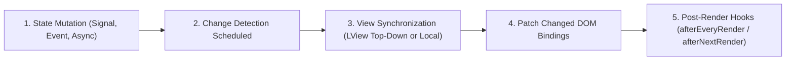
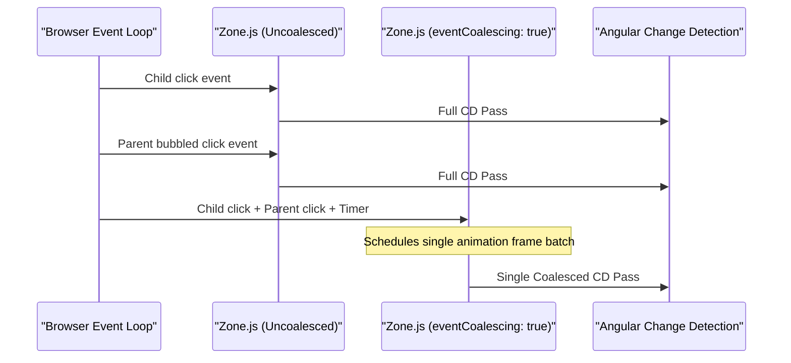
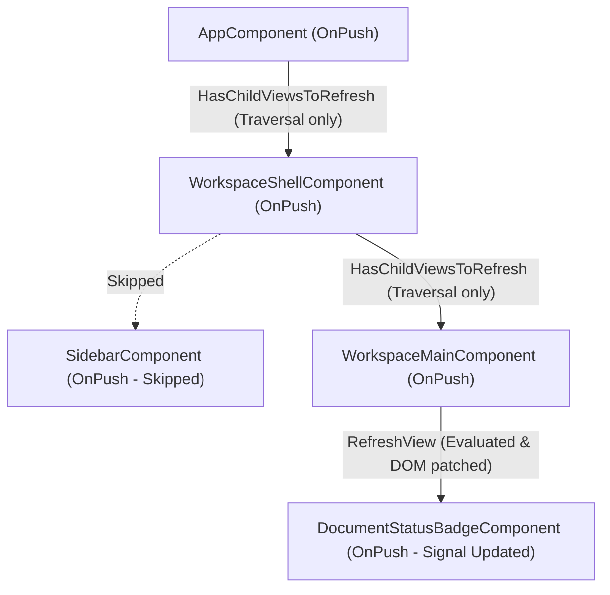
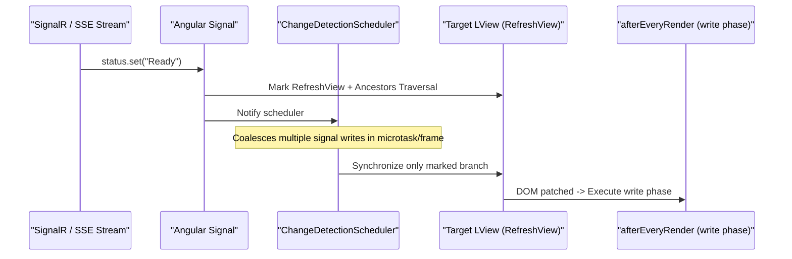

# Chapter 13: Change Detection Deep Dive

## 1. Learning Objectives
By the end of this chapter, you will be able to:
* Explain the internal mechanics of Angular's Change Detection and View (`LView`) synchronization pipeline, including Unidirectional Data Flow.
* Understand the role of `Zone.js`, `NgZone.runOutsideAngular()`, Event/Run Coalescing, and why Zone.js is phased out in modern Angular.
* Differentiate between `Default`, `OnPush`, and Signal-driven **Local Change Detection** (`RefreshView` vs `HasChildViewsToRefresh`).
* Control rendering manually using `ChangeDetectorRef` (`markForCheck`, `detectChanges`, `detach`, `reattach`), `ApplicationRef.tick()`, and `PendingTasks`.
* Architect true **Zoneless Angular 22** applications using `provideZonelessChangeDetection()` and phased DOM render hooks (`afterNextRender`, `afterEveryRender`, `afterRenderEffect`).

---

## 2. Introduction: What is Change Detection & Unidirectional Data Flow?

When application state changes—such as a user toggling a billing cycle, a SignalR hub delivering a document ingestion milestone, or an SSE stream appending AI response tokens—the framework must synchronize the browser's **DOM (Document Object Model)** to match the new state. The process of reading component state, comparing or tracking what changed, and updating the affected DOM bindings is called **Change Detection**.

Under the hood, Angular compiles every component template into an internal runtime data structure called a **Logical View (`LView`)**—an array-like structure holding the component instance, its DOM node references, child views, and the last-evaluated values of every template binding. Change detection is the process of synchronizing a component's `LView` with its DOM.

### Unidirectional Data Flow (UDF)
Angular enforces **Unidirectional Data Flow**: during a single change detection pass, data flows strictly **top-down** from parent components to child components. Once Angular checks a parent's bindings and passes values into a child's inputs, the parent's check for that pass is considered **final**.

> [!IMPORTANT]
> **Why UDF Matters:** If a child component mutates a parent's bound state *synchronously while the check pass is still running* (for example, inside `ngAfterViewInit`), Angular detects an inconsistency between the value it already rendered and the new value—throwing `NG0100: ExpressionChangedAfterItHasBeenCheckedError` in development mode.



### When NOT to Trigger Change Detection
Not every state change belongs in Angular's view synchronization loop:
* **Off-DOM telemetry or analytics buffers** (e.g., batching OpenTelemetry spans or typing timestamps before sending them).
* **60–120 FPS pointer or scroll coordinates** where updating CSS custom properties directly or running inside `NgZone.runOutsideAngular()` avoids rebuilding templates on every pixel moved.
* **Non-visual background caches** (e.g., pre-warming a `Map` of parsed Markdown chunks before the user opens a drawer).

### Five Real-World Normora Examples: What Triggers Change Detection
1. **SignalR Document Ingestion Pipeline:** When `Normora.Worker` finishes chunking and embedding a PDF (`UploadDocumentCommandHandler` outbox -> `IDocumentNotificationService`), the Redis backplane pushes a status update (`Queued` -> `Extracting` -> `Chunking` -> `Embedding` -> `Ready`) to the Angular SPA, triggering change detection on the document row badge.
2. **Copilot SSE Token Streaming:** As `NormoraWorkplaceAgent` streams tokens and live tool lifecycle events (`tool_started`, `tool_finished`) from `/api/copilotkit`, each chunk updates the active message Signal in the Conversations feature, synchronizing only the streaming message bubble.
3. **Expense Simulator Calculations (`ExpenseSimulatorCardComponent`):** When a user steps the hotel nights counter or switches location tiers in the `policy_limit_card`, the `model()` signal updates and recalculates the total allowance via `computed()`, re-rendering only the summary breakdown.
4. **Multi-Currency Workspace Switch (`UpdateTenantCurrencyCommand`):** When a tenant admin changes workspace currency from `USD` to `INR` (`PUT /api/subscription/currency`), the billing store updates the persisted `TenantPlan.Currency` signal, updating all tier prices from `TenantPlanPricingCatalog` across the pricing table.
5. **Citation Drawer & Co-Browsing (`ChunkPreviewDrawerComponent`):** Clicking an inline RAG citation badge updates the selected chunk signal, opening the slide-over drawer, rendering the Markdown section breadcrumb, and highlighting the target chunk when navigating to Documents.

---

## 3. The Legacy Engine: Zone.js, NgZone, and Event Coalescing

For Angular v2 through v17, the framework relied by default on a library called **`Zone.js`** to know *when* application state might have changed.

### How Zone.js Works (Monkey-Patching)
**Monkey-patching** means replacing a built-in browser function at runtime with a wrapper that runs extra code before or after the original function. When an application boots with `Zone.js`, it monkey-patches nearly every asynchronous browser API:
* `setTimeout`, `setInterval`, and `requestAnimationFrame`
* DOM event listeners (`click`, `mousemove`, `keydown`, `scroll`)
* `XMLHttpRequest` and `fetch`
* `Promise.then()` and `WebSocket` callbacks

Whenever one of these asynchronous callbacks finishes executing inside Angular's zone (`NgZone`), `Zone.js` notifies Angular (`onMicrotaskEmpty`): *"An async task just finished. I don't know which component's data changed, so run change detection."*

### The "Top-Down" Dirty Check
Because `Zone.js` has zero knowledge of *which* variable changed, a traditional Zone-based app defaults to a **Top-Down dirty check**:
1. It starts at the Root Component (`AppComponent`).
2. It walks down the entire Component Tree.
3. For every component (unless `OnPush` and clean), it compares the current template binding values against the previous values stored in `LView`.
4. If a binding changed, it patches that specific DOM node.

**The Problem:** If an enterprise dashboard has 5,000 component views and a user clicks a deeply nested dropdown, `Default` change detection checks all 5,000 components. Even worse, a high-frequency timer or `mousemove` listener inside `NgZone` fires hundreds of full-tree checks per second.

### Escaping the Zone: `NgZone.runOutsideAngular()` and `NgZone.run()`
In Zone-based applications, Angular exposes `NgZone` so you can step out of monkey-patched change detection for high-frequency or third-party work, and step back in only when the UI actually needs to update.

```typescript
import {
  ChangeDetectionStrategy,
  Component,
  DestroyRef,
  ElementRef,
  NgZone,
  afterNextRender,
  inject,
  signal,
  viewChild
} from '@angular/core';

@Component({
  selector: 'normora-chunk-preview-scroll',
  template: `
    <div
      #scrollBox
      class="custom-scrollbar max-h-96 overflow-y-auto border border-slate-200 bg-white dark:border-slate-700 dark:bg-slate-900">
      <!-- Rendered chunk markdown -->
    </div>
    @if (showBackToTop()) {
      <button
        type="button"
        (click)="scrollToTop()"
        class="mt-2 rounded border-none! bg-indigo-600 px-3 py-1 text-white dark:bg-indigo-500">
        Back to top
      </button>
    }
  `,
  changeDetection: ChangeDetectionStrategy.OnPush
})
export class ChunkScrollTrackerComponent {
  private readonly ngZone = inject(NgZone);
  private readonly destroyRef = inject(DestroyRef);
  private readonly scrollBox = viewChild.required<ElementRef<HTMLDivElement>>('scrollBox');
  readonly showBackToTop = signal(false);

  constructor() {
    afterNextRender(() => {
      const el = this.scrollBox().nativeElement;
      const onScroll = () => {
        const shouldShow = el.scrollTop > 240;
        if (shouldShow !== this.showBackToTop()) {
          // Re-enter Angular only when the boolean threshold actually flips
          this.ngZone.run(() => this.showBackToTop.set(shouldShow));
        }
      };

      // Attach listener outside NgZone so every pixel scrolled does NOT trigger CD
      this.ngZone.runOutsideAngular(() => {
        el.addEventListener('scroll', onScroll, { passive: true });
      });

      this.destroyRef.onDestroy(() => el.removeEventListener('scroll', onScroll));
    });
  }

  scrollToTop(): void {
    this.scrollBox().nativeElement.scrollTo({ top: 0, behavior: 'smooth' });
  }
}
```

> [!NOTE]
> **When NOT to use `NgZone.runOutsideAngular()`:**
> * In a **Zoneless** Angular 22 application (`provideZonelessChangeDetection()`), `Zone.js` is not loaded at all—`NgZone` is a no-op stub. Calling `runOutsideAngular()` will **not** stop a `signal.set()` call from scheduling change detection.
> * Don't wrap ordinary HTTP calls or button handlers in `runOutsideAngular()`; only use it for noisy, high-frequency listeners (`scroll`, `mousemove`, `ResizeObserver`, chart animations) in legacy Zone-based apps.

### Event Coalescing & Run Coalescing
By default in Zone-based Angular, if a parent and child both listen to a `click` event (event bubbling), or if multiple `NgZone.run()` calls fire in the same frame, Angular can run multiple redundant change detection passes.

In `app.config.ts` (for applications still migrating off `Zone.js`), enable **Event Coalescing** and **Run Coalescing**:

```typescript
import { ApplicationConfig, provideZoneChangeDetection } from '@angular/core';

export const appConfig: ApplicationConfig = {
  providers: [
    provideZoneChangeDetection({
      eventCoalescing: true,
      runCoalescing: true
    })
  ]
};
```
* **`eventCoalescing: true`:** Batches multiple DOM events firing in the same browser frame (e.g., event bubbling or rapid consecutive events) into a single `requestAnimationFrame` change detection pass.
* **`runCoalescing: true`:** Coalesces multiple nested or back-to-back `ngZone.run()` invocations into one check.
* **When NOT to use `eventCoalescing`:** If legacy code synchronously reads updated DOM layout immediately after dispatching a synthetic event without waiting for a render hook (a brittle pattern that should be refactored to `afterNextRender`).



### Five Real-World Normora Examples: Zone.js & `NgZone`
1. **SignalR Connection Heartbeat Outside Zone:** Normora's SignalR client (`AddNormoraSignalR` over the Redis backplane) exchanges periodic keepalive pings; running low-level connection timers outside `NgZone` prevents waking the entire Angular component tree every 15 seconds when no `DocumentStatusChanged` or `dataVersion` event arrived.
2. **Coalesced Copilot Dock Expand (`Ctrl+J` / `Cmd+J`):** Pressing the keyboard shortcut fires `keydown` at both the input and document levels; `eventCoalescing: true` collapses those bubbled listeners into one frame when toggling the Copilot workstation drawer.
3. **Document Table Column Resize Drag:** Dragging a column divider in the Documents inventory fires dozens of `pointermove` events per second; updating the column width CSS variable inside `runOutsideAngular()` keeps dragging at 60 FPS without re-checking rows.
4. **Copilot Chat Auto-Scroll Observer (`ResizeObserver`):** Observing height growth of the `.custom-scrollbar` chat container during markdown rendering runs inside `runOutsideAngular()`, adjusting `scrollTop` directly on the DOM element without triggering Angular view checks.
5. **Legacy Third-Party PrimeNG Overlay Listeners:** Older overlay scroll/resize handlers inside third-party widgets can flood `Zone.js` with `scroll` events across Normora's workspace tables; `runCoalescing: true` prevents duplicate tree walks when multiple overlays reposition simultaneously.

---

## 4. Optimizing Tree Traversal: `OnPush` and Local Change Detection

To solve the `Zone.js` full-tree traversal bottleneck, Angular introduced `ChangeDetectionStrategy.OnPush` (in contrast to `ChangeDetectionStrategy.Default`, which checks every component on every cycle).

When you set a component to `OnPush`, you tell Angular: *"Skip checking this subtree during the Top-Down pass unless an explicit signal, input, event, or manual flag marks it for refresh."*

Here is an existing case study component updated to Angular 22 standalone + Signal `input()` syntax (historically written with `@Input() charger!: Charger`):

```typescript
import { ChangeDetectionStrategy, Component, input } from '@angular/core';

@Component({
  selector: 'app-charger-card',
  template: `<h2 class="text-slate-900 dark:text-slate-100">{{ charger().name }}</h2>`,
  changeDetection: ChangeDetectionStrategy.OnPush
})
export class ChargerCardComponent {
  readonly charger = input.required<Charger>();
}
```

### When does an `OnPush` component get checked?
If a component uses `OnPush`, Angular skips it (and its descendants) during a change detection pass *unless* one of the following occurs:
1. **Input Reference Change:** The parent passes a new object reference to an `input()` (or legacy `@Input()`). Mutating a property inside the same object reference does **not** trigger a check.
2. **Template DOM Event:** A DOM event (e.g., `(click)`, `(input)`) originates from within this component or any of its child views.
3. **Signal or `AsyncPipe` Notification:** A `Signal` read in the template changes, or an `Observable` bound via `| async` emits a new value (which calls `markForCheck()` internally).
4. **Manual Trigger:** Developer code calls `ChangeDetectorRef.markForCheck()` or `ComponentRef.setInput()`.

### Local Change Detection (Angular 17+ / 22)
In classic `OnPush`, calling `markForCheck()` (or receiving a DOM event or `| async` emission) marked the target component **and every ancestor up to the root** as `Dirty`. Angular then walked from the root down, checking every `Default` or `Dirty` ancestor along that path.

Modern Angular (v17+ through Angular 22) introduces **Signal-driven Local Change Detection**:
* When a `Signal` read inside an `OnPush` component's template changes, Angular sets `RefreshView` **only on that specific component's `LView`**.
* Ancestor views are marked only with `HasChildViewsToRefresh` (a lightweight traversal flag, **not** `Dirty`).
* During synchronization, Angular walks down the path of `HasChildViewsToRefresh` flags **without re-evaluating clean `OnPush` ancestors or sibling subtrees**, refreshing only the exact view whose Signal changed.



> [!TIP]
> **Architect Rule:** In Enterprise Angular 22 applications, **every single component** should use `ChangeDetectionStrategy.OnPush`. Configure `schematics` in `angular.json` so `ng generate component` applies `OnPush` automatically.

### When NOT to Use `Default` (or Flip `OnPush` Blindly)
* **When NOT to use `Default`:** Never in new Angular 22 components. `Default` forces full re-evaluation whenever any parent or Zone cycle runs.
* **When NOT to flip `OnPush` blindly during legacy migrations:** If an older component mutates plain class properties inside raw `setTimeout`, `setInterval`, or third-party callbacks without Signals or `markForCheck()`, flipping it to `OnPush` will silently freeze its UI until you migrate its state to Signals.

### Five Real-World Normora Examples: `OnPush` & Local Change Detection
1. **`ExpenseSimulatorCardComponent` (`policy_limit_card`):** Uses `OnPush` with `model()` signals for hotel nights and location tier; adjusting the night stepper refreshes only the simulator card without re-checking the surrounding Copilot message list.
2. **`HrEscalationCardComponent` (`hr_escalation_card`):** Receives an immutable escalation DTO via `input.required<HrEscalation>()`; its 3-stage timeline (`Dispatched` -> `Under Review` -> `Resolution`) updates locally when the parent passes a new immutable state object or signal update.
3. **`DocumentStatusBadgeComponent`:** In a Documents table of 200 rows, each row's badge reads a per-document status signal (`Queued` / `Extracting` / `Chunking` / `Embedding` / `Ready`); when SignalR updates document `#42`, Local Change Detection refreshes only row `#42`'s badge instead of all 200 rows.
4. **`ToolLifecycleChipComponent`:** Displays live autonomous tool execution (`tool_started` -> `tool_finished`) inside a streaming assistant turn; using `OnPush` + `input.required<ToolExecutionChip>()` isolates frequent streaming updates from completed historical chat turns.
5. **`TenantPlanCardComponent`:** Uses `OnPush` and `computed()` over `TenantPlanPricingCatalog` currency and billing cycle signals; toggling Monthly/Annual (20% discount) or switching `Free`/`Pro`/`Enterprise` re-renders only the pricing cards and suppresses cancellation buttons on the `Free` tier.

---

## 5. Manual Change Detection Control: `ChangeDetectorRef`, `ApplicationRef`, and `PendingTasks`

Even in modern Signal-first codebases, integrating imperative third-party SDKs, high-frequency canvas/grid widgets, or SSR stability tracking occasionally requires stepping into manual change detection APIs.

### 1. `ChangeDetectorRef.markForCheck()`
Marks the current component and its ancestor chain so Angular knows to inspect it on the next scheduled pass (and in Zoneless Angular, schedules that pass via `ChangeDetectionScheduler`).

```typescript
import { ChangeDetectionStrategy, ChangeDetectorRef, Component, OnInit, inject } from '@angular/core';

@Component({
  selector: 'app-polling-legacy',
  template: `<span class="text-slate-800 dark:text-slate-200">{{ status }}</span>`,
  changeDetection: ChangeDetectionStrategy.OnPush
})
export class PollingComponent implements OnInit {
  private readonly cdr = inject(ChangeDetectorRef);
  status = 'Idle';

  ngOnInit(): void {
    // Legacy pattern: mutating a plain property asynchronously.
    // OnPush (and Zoneless) will ignore this unless markForCheck() is called!
    setTimeout(() => {
      this.status = 'Complete';
      this.cdr.markForCheck(); // Marks view dirty & schedules check on next cycle
    }, 1000);
  }
}
```
* **When NOT to use `markForCheck()`:** For ordinary application or UI state—use a `signal()` instead, which notifies Angular automatically without manual plumbing.

### 2. `ChangeDetectorRef.detectChanges()`
Synchronously runs change detection **right now** on this component and its non-detached child views, bypassing the normal scheduler.
* **Best for:** Unit tests (verifying DOM immediately after state changes) or imperative DOM portals that must measure rendered height synchronously after inserting dynamic content.
* **When NOT to use `detectChanges()`:** Never call it inside `ngAfterViewInit` to silence `NG0100`, inside tight loops, or as a substitute for `markForCheck()`—synchronous mid-cycle checks break Unidirectional Data Flow and cause cascading layout thrashing.

### 3. `ChangeDetectorRef.detach()` and `reattach()`
Disconnects a component's `LView` completely from the tree's change detection traversal. Angular will **never** check the component (even on parent updates) until you call `reattach()` or explicitly call `detectChanges()`.
* **Best for:** Extreme throughput bottlenecks (e.g., streaming hundreds of log lines per second or a custom drag-and-drop canvas) where you want to batch updates every 100ms via `detectChanges()`.
* **When NOT to use `detach()`:** On standard business forms, cards, or tables—detaching blocks parent `input()` updates from reaching the view automatically, creating subtle stale-UI bugs.

### 4. `ApplicationRef.tick()`
Triggers a full change detection pass across every root view attached to the Angular application. Almost never needed in feature code; reserved for custom micro-frontend bootstraps or root-level debugging.

### 5. `PendingTasks` (Crucial for Zoneless & SSR Stability)
In Zone-based apps, `Zone.js` tracked every open `fetch` or `setTimeout`, telling Angular `ApplicationRef.isStable` when async work finished. In **Zoneless** Angular 22, Angular has no `Zone.js` visibility into raw async tasks!

Inject `PendingTasks` (`@angular/core`) whenever custom async work (like a non-`HttpClient` `fetch`, WebSocket/SignalR initial handshake, or SSR hydration bootstrap) must delay stability:

```typescript
import { Injectable, PendingTasks, inject } from '@angular/core';

@Injectable({ providedIn: 'root' })
export class BffSessionBootstrapService {
  private readonly pendingTasks = inject(PendingTasks);

  async loadSessionFromBff(): Promise<void> {
    // Angular waits for this task before marking ApplicationRef.isStable = true
    await this.pendingTasks.run(async () => {
      const response = await fetch('/bff/user', { credentials: 'include' });
      if (!response.ok) return;
      // Populate session signals...
    });
  }
}
```
* **When NOT to use `PendingTasks`:** Never wrap long-lived open streams (like an endless SignalR connection or `setInterval` heartbeat) in `PendingTasks`—`isStable` will stay `false` forever, hanging SSR rendering and Playwright/E2E stability checks!

### Five Real-World Normora Examples: Manual Change Detection Control
1. **`PendingTasks` for Duende BFF `/bff/user` Bootstrap:** Normora stores auth in `HttpOnly`, `SameSite=Strict` cookies rather than browser tokens; wrapping the initial `/bff/user` + workspace branding fetch in `PendingTasks.run()` ensures hydration and route guards wait cleanly in Zoneless mode.
2. **`detach()` on Live Audit Log Stream:** When an enterprise admin opens a real-time audit log tail with thousands of rows during bulk ingestion, detaching the inactive background tab's grid view prevents wasted checks while the user inspects another tab, then `reattach()` restores sync on tab focus.
3. **`markForCheck()` Inside CopilotKit / Third-Party JS Adapter:** When integrating an imperative third-party AG-UI / Markdown plugin callback that delivers a parsed AST outside Angular's reactive primitives, calling `cdr.markForCheck()` schedules a safe Zoneless refresh.
4. **`detectChanges()` in Vitest Component Tests:** When testing `PendingApproval` HITL confirmation cards (`documents_delete` two-phase approval), `fixture.detectChanges()` synchronously flushes the template so Vitest can assert the 15-minute TTL warning and `ApiMessages` prompt text.
5. **Avoid `PendingTasks` on SignalR Hub Lifecycle:** Only the initial `hubConnection.start()` handshake (with a timeout) should touch `PendingTasks` if needed—never the persistent WebSocket connection itself, otherwise `ApplicationRef.isStable` never settles.

---

## 6. The Modern Engine: Zoneless Angular (Angular 22)

The introduction of Signals (Angular v16+) fundamentally removed Angular's need for `Zone.js` monkey-patching. After an experimental preview in v18–v19 (`provideExperimentalZonelessChangeDetection()`), Zoneless Change Detection graduated to stable in v20 (`provideZonelessChangeDetection()`) and is the standard architecture in **Angular 22**.

### How Zoneless Works Under the Hood
Without `Zone.js`, Angular relies on its internal **`ChangeDetectionScheduler`** instead of monkey-patched browser APIs. Change detection is scheduled **only** when Angular receives an explicit reactive notification from one of five sources:
1. A **`Signal`** read in a component template changes (marking that view with `RefreshView` and its ancestors with `HasChildViewsToRefresh`).
2. A **template-bound DOM event** fires (`(click)`, `(submit)`, etc.).
3. **`ChangeDetectorRef.markForCheck()`** is called (including internally by the `| async` pipe when an `Observable` emits).
4. **`ComponentRef.setInput()`** updates a dynamically created component's input.
5. A view is **attached or detached** (e.g., via `@if`, `@for`, or `ViewContainerRef`).

Multiple notifications occurring in the same tick are automatically coalesced by the Zoneless scheduler into a single synchronization pass—no `Zone.js` bundle (~15 KB gzipped), cleaner stack traces, faster initial boot, and zero wasted checks on irrelevant timers.

### Enabling Zoneless Angular 22
In `app.config.ts`, configure `provideZonelessChangeDetection()` and remove `zone.js` from `angular.json` (`polyfills`) and `package.json`:

**`client/src/app/app.config.ts`**
```typescript
import { ApplicationConfig, provideZonelessChangeDetection } from '@angular/core';
import { provideRouter } from '@angular/router';
import { provideHttpClient } from '@angular/common/http';

export const appConfig: ApplicationConfig = {
  providers: [
    provideZonelessChangeDetection(),
    provideRouter([]),
    provideHttpClient()
  ]
};
```

> [!WARNING]
> To run Zoneless, your UI state must flow through Signals, template events, `AsyncPipe`, or `markForCheck()`. If you mutate a raw class property inside a `setTimeout` or WebSocket callback (`this.status = 'Ready'`) without a Signal or `markForCheck()`, the DOM will **never** update.

### Post-Render Lifecycle Hooks: `afterNextRender`, `afterEveryRender`, and `afterRenderEffect`
In legacy Zone-based apps, engineers often wrote `setTimeout(..., 0)` inside `ngAfterViewInit` to measure DOM dimensions or scroll containers after Angular finished patching the DOM. In Zoneless Angular 22, use **Render Hooks** (`@angular/core`), which run **only in the browser** (never during SSR) right after Angular finishes synchronizing the DOM, and organize work into explicit phases to prevent **layout thrashing** (interleaved DOM reads and writes forcing synchronous browser reflows):

```typescript
import { ChangeDetectionStrategy, Component, ElementRef, afterEveryRender, input, viewChild } from '@angular/core';

@Component({
  selector: 'normora-copilot-thread',
  template: `
    <div #threadScroll class="custom-scrollbar h-96 overflow-y-auto border-none! bg-slate-50 p-4 dark:bg-slate-900">
      @for (msg of messages(); track msg.id) {
        <article class="mb-3 rounded-lg bg-white p-3 text-slate-900 dark:bg-slate-800 dark:text-slate-100">
          {{ msg.content }}
        </article>
      }
    </div>
  `,
  changeDetection: ChangeDetectionStrategy.OnPush
})
export class CopilotThreadComponent {
  readonly messages = input.required<ReadonlyArray<{ id: string; content: string }>>();
  private readonly threadScroll = viewChild.required<ElementRef<HTMLDivElement>>('threadScroll');

  constructor() {
    // Runs after Angular finishes patching the DOM when messages change
    afterEveryRender({
      write: () => {
        const el = this.threadScroll().nativeElement;
        el.scrollTop = el.scrollHeight;
      }
    });
  }
}
```
Render hook phases execute in strict order across all components on the page: `earlyRead` -> `write` -> `mixedReadWrite` -> `read`. Use `afterNextRender` for one-time initialization (e.g., focusing an intake form input or measuring a citation popover) and `afterRenderEffect` when DOM side effects should re-run only when specific Signals change.

### When NOT to Switch to Zoneless Yet
Do **not** drop `Zone.js` in an existing brownfield application if it still relies on unmaintained third-party libraries or legacy components that mutate plain non-signal Angular properties inside raw callbacks (`setInterval`, `WebSocket`, jQuery/D3 plugins) without calling `markForCheck()`. Migrate state to Signals (or wrap third-party callbacks with `markForCheck()`) first, verify under `provideZonelessChangeDetection()` in staging, and then remove `zone.js`.



### Five Real-World Normora Examples: Zoneless Angular 22
1. **`app.config.ts` with `provideZonelessChangeDetection()`:** Normora's Angular 22 SPA boots without `zone.js`, shrinking initial client bundle payload and keeping stack traces clean across Duende BFF HTTP interceptors and Copilot streaming handlers.
2. **SSE Token Streaming (`NormoraWorkplaceAgent`):** As `/api/copilotkit` emits token deltas, a `signal()` in the active conversation turn updates and schedules a coalesced Zoneless pass for only the streaming message component, while `afterEveryRender({ write })` pins `.custom-scrollbar` to the bottom without `setTimeout`.
3. **Reactive Workspace Synchronization (`dataVersion` + `effect()`):** When `IWorkspaceStateSynchronizer` broadcasts a workspace `dataVersion` bump over SignalR or SSE, Normora updates a `dataVersion` signal; an `effect()` triggers reloading employer management tables (Departments, User Groups, Employees) with zero page reloads or Zone triggers.
4. **`afterNextRender({ read })` on `ChunkPreviewDrawerComponent`:** When a user clicks an inline RAG citation badge, `afterNextRender` measures the scrolled position of the highlighted Markdown heading inside the drawer once the DOM is painted—preventing forced synchronous reflows.
5. **Dynamic Missing-Parameter Intake Form (`workspace_request_form`):** When an agent streams an `intake_form_card`, Angular mounts the Reactive Form dynamically and `afterNextRender({ write })` focuses the first missing field cleanly in Zoneless mode.

---

## 7. Architectural Decision Matrix: Choosing the Right Trigger

| Mechanism | Triggers CD in Zone Mode? | Triggers CD in Zoneless? | Traversal Scope | Best For | When NOT to Use |
|---|---|---|---|---|---|
| Plain class property (`Default`) | Yes (on any Zone event) | **No** | Whole tree | Legacy prototypes only | New Angular 22 enterprise apps |
| `OnPush` + immutable `input()` | Yes (on reference change) | Yes (signal input change) | Branch from parent to child | Presentational cards & badges | Deep mutable object graphs |
| `OnPush` + `AsyncPipe` | Yes (`markForCheck`) | Yes (`markForCheck`) | Root-to-target dirty path | Legacy RxJS template streams | Synchronous UI state (prefer `signal()`) |
| `OnPush` + `signal()` / `computed()` | Yes (`RefreshView`) | Yes (`RefreshView`) | **Local view only** | **Default choice for Angular 22 UI** | 120Hz mouse/scroll pixel coordinates |
| `NgZone.runOutsideAngular()` / CSS vars | No | No | Zero Angular CD | Pointer tracking, canvas loops | Ordinary app state; ineffective in Zoneless |
| `detach()` + `detectChanges()` | Manual only | Manual only | Detached subtree only | Extreme high-throughput grids | Standard forms, dialogs, or CRUD views |

### Five Real-World Normora Examples: Matching the Tool to the Problem
1. **`WorkspaceStore.dataVersion` -> `signal()` + `OnPush`:** Workspace mutations need instant, localized UI refreshes across employer tables without polling or Zone overhead.
2. **Hybrid Search Debounced Query -> `toSignal()` / `rxResource()`:** Combining `Documents` pgvector HNSW + full-text RRF search benefits from RxJS `debounceTime`/`switchMap` cancellation bridged into a Signal for Zoneless rendering.
3. **`ExpenseSimulatorCardComponent` Night Stepper -> `model()` + `computed()`:** Synchronous two-way binding and derived travel allowance totals fit Signals cleanly with zero RxJS boilerplate.
4. **Copilot Panel Split-Pane Drag Resizer -> Direct CSS Custom Property (`--copilot-width`) + Pointer Listener:** Updating panel width on `pointermove` via `style.setProperty` avoids triggering Angular CD 120 times per second; only commit the final width to a Signal on `pointerup`.
5. **BFLA/BOLA Error Banner -> Global Interceptor + `signal(ApiMessages.Forbidden)`:** HTTP `403` (`BflaException`) and `404` (`BolaException`) responses map to centralized `ApiMessages` constants stored in a toast Signal, rendering consistently across Zone or Zoneless hosts.

---

## 8. Common Mistakes & Anti-Patterns

> [!CAUTION]
> **Anti-Pattern 1: Mutating Arrays or Objects In Place with `OnPush` / Signals**
>
> **Wrong:**
> ```typescript
> @Component({
>   selector: 'normora-group-list',
>   template: `@for (g of groups(); track g.id) { <li>{{ g.name }}</li> }`,
>   changeDetection: ChangeDetectionStrategy.OnPush
> })
> export class GroupListComponent {
>   readonly groups = signal<UserGroup[]>([{ id: '1', name: 'Engineering' }]);
>
>   addGroup(newGroup: UserGroup): void {
>     // BAD: Mutates the existing array reference; Signal equality check sees the same reference!
>     this.groups().push(newGroup);
>   }
> }
> ```
> **Why it's wrong:** `signal.set()` and `OnPush` input checks compare by reference (`Object.is`). Mutating an array with `.push()` or modifying `plan.currency = 'INR'` in place leaves the reference unchanged, so Angular skips updating the view.
>
> **The Fix:** Always produce a new array or object reference with `.update()`:
> ```typescript
> addGroup(newGroup: UserGroup): void {
>   this.groups.update(current => [...current, newGroup]);
> }
> ```

> [!CAUTION]
> **Anti-Pattern 2: Calling Heavy Methods or Returning Fresh Object References in Templates**
>
> **Wrong:**
> ```html
> <!-- BAD: filterVisibleChunks() runs on EVERY change detection pass for this view,
>      and returning a new array reference defeats downstream OnPush memoization! -->
> @for (chunk of filterVisibleChunks(allChunks()); track chunk.id) {
>   <normora-chunk-card [chunk]="chunk" [styleConfig]="buildCardTheme()" />
> }
> ```
> **Why it's wrong:** Any method called in a template executes every time that component is checked. Worse, helper methods like `buildCardTheme()` return a brand-new object literal (`{ ... }`) on every check, forcing child `OnPush` components to re-check unnecessarily even when nothing changed.
>
> **The Fix:** Replace template methods with memoized `computed()` signals (or pure pipes):
> ```typescript
> readonly visibleChunks = computed(() =>
>   this.allChunks().filter(chunk => chunk.departmentId === this.selectedDepartmentId())
> );
> readonly cardTheme = computed(() => ({ compact: this.isCompactMode() }));
> ```

> [!CAUTION]
> **Anti-Pattern 3: Violating Unidirectional Data Flow (`NG0100`) in `ngAfterViewInit`**
>
> **Wrong:**
> ```typescript
> // BAD: Child mutates a parent/shared Signal or property synchronously during view check
> ngAfterViewInit(): void {
>   this.drawerState.title.set(ApiMessages.DocumentPreviewTitle);
> }
> ```
> **Why it's wrong:** Angular evaluates parent bindings *before* initializing child views. Updating a binding read by an ancestor synchronously inside `ngAfterViewInit` violates Unidirectional Data Flow and throws `NG0100: ExpressionChangedAfterItHasBeenCheckedError` in development mode.
>
> **The Fix:** Derive state declaratively with `computed()`, pass inputs cleanly top-down, or schedule legitimate post-render DOM updates inside `afterNextRender()` rather than mutating parent-bound state in `ngAfterViewInit`.

> [!CAUTION]
> **Anti-Pattern 4: Mutating Plain Properties in Async Callbacks in a Zoneless App**
>
> **Wrong:**
> ```typescript
> // BAD in Zoneless Angular 22 (provideZonelessChangeDetection)
> export class DocumentRowComponent {
>   statusLabel = 'Queued';
>   errorMessage = '';
>
>   onSignalRStatus(status: string, failed: boolean): void {
>     this.statusLabel = status; // View NEVER updates without Zone.js!
>     if (failed) {
>       this.errorMessage = ApiMessages.DocumentProcessingFailed;
>     }
>   }
> }
> ```
> **Why it's wrong:** Without `Zone.js`, Angular does not intercept SignalR WebSocket callbacks, `setTimeout`, or raw `fetch` promises. Mutating plain fields leaves the DOM frozen forever.
>
> **The Fix:** Store view state in `signal()` (or call `ChangeDetectorRef.markForCheck()` if integrating legacy non-signal state):
> ```typescript
> readonly statusLabel = signal('Queued');
> readonly errorMessage = signal<string | null>(null);
>
> onSignalRStatus(status: string, failed: boolean): void {
>   this.statusLabel.set(status);
>   this.errorMessage.set(failed ? ApiMessages.DocumentProcessingFailed : null);
> }
> ```

> [!CAUTION]
> **Anti-Pattern 5: Using `effect()` Instead of `computed()` for Derived UI State**
>
> **Wrong:**
> ```typescript
> // BAD: Imperative effect writes to another signal, scheduling an extra CD pass
> readonly nights = signal(3);
> readonly dailyRate = signal(150);
> readonly totalAllowance = signal(0);
>
> constructor() {
>   effect(() => {
>     this.totalAllowance.set(this.nights() * this.dailyRate());
>   });
> }
> ```
> **Why it's wrong:** Using `effect()` to copy derived state into a second writable signal causes redundant change detection cycles, risks infinite update loops, and can leave `totalAllowance` temporarily stale before the effect flushes.
>
> **The Fix:** Always use `computed()` for derived state—it is synchronous, lazy, memoized, and glitch-free:
> ```typescript
> readonly nights = signal(3);
> readonly dailyRate = signal(150);
> readonly totalAllowance = computed(() => this.nights() * this.dailyRate());
> ```

> [!CAUTION]
> **Anti-Pattern 6: Relying on `NgZone.runOutsideAngular()` in Zoneless Apps or Updating Signals at 120Hz**
>
> **Wrong:**
> ```typescript
> // BAD: Expecting runOutsideAngular() to suppress Signal-driven CD in Zoneless mode,
> // AND updating a Signal on every raw pointermove pixel
> constructor() {
>   this.ngZone.runOutsideAngular(() => {
>     window.addEventListener('pointermove', (e) => {
>       this.splitterX.set(e.clientX); // Still schedules CD on every frame in Zoneless!
>     });
>   });
> }
> ```
> **Why it's wrong:** In Zoneless Angular 22, `Zone.js` is absent, so `NgZone.runOutsideAngular()` does **not** prevent a `signal.set()` call from scheduling change detection. Firing `signal.set()` on every `pointermove` pixel forces unnecessary template passes during dragging.
>
> **The Fix:** Update a CSS custom property or `element.style` directly during the drag, and update the Signal only once on `pointerup` (and use `DestroyRef` to clean up listeners):
> ```typescript
> // Update DOM style directly during drag; commit to Signal on pointerup
> paneEl.style.setProperty('--drawer-width', `${nextWidth}px`);
> ```
> And if styling Tailwind overrides cleanly, remember Tailwind v4 uses suffix modifiers like `border-none!` and explicit `dark:` pairs (`bg-white dark:bg-slate-900 border-slate-200 dark:border-slate-700`).

---

## 9. Interview Questions

### Junior
**Q1: What is Change Detection in Angular, and why do we prefer `ChangeDetectionStrategy.OnPush` over `Default`?**
> A: Change detection is the process of synchronizing component state with the DOM. With `Default`, Angular checks every component in the tree on every cycle. With `OnPush`, Angular skips a component subtree unless its `input()` reference changes, a local DOM event fires, a bound Signal/`| async` Observable updates, or `markForCheck()` is called—dramatically cutting CPU work.

**Q2: Why does mutating an array with `.push()` fail to update an `OnPush` or Signal-based component?**
> A: Both `OnPush` input checks and Signals (`Object.is`) check object references, not deep contents. Pushing onto an existing array keeps the same memory reference, so Angular assumes nothing changed. Replacing it with `[...items, newItem]` creates a new reference and triggers the update.

**Q3: Why should you never call a heavy helper method directly inside an HTML interpolation like `{{ calculateTotal() }}`?**
> A: Angular must re-run that method on every change detection check of the component because it cannot know whether the return value changed without executing it. Replace template methods with memoized `computed()` signals or pure pipes.

### Senior
**Q4: Explain the exact mechanism of `ChangeDetectorRef.markForCheck()`. Does it run change detection immediately?**
> A: No. `markForCheck()` walks *up* the `LView` tree from the current component to the root, marking views along that ancestor path as dirty, and notifies Angular's scheduler (which is essential in Zoneless mode). Actual DOM synchronization happens on the next scheduled change detection pass, not synchronously on that line.

**Q5: How does Signal-driven Local Change Detection improve upon classic `OnPush` + `markForCheck()`?**
> A: Classic `markForCheck()` marked the entire ancestor chain as dirty so all `Default` or marked ancestors were re-checked top-down. With Signal-driven Local Change Detection (Angular 17+ through 22), only the view that actually reads the changed Signal is flagged `RefreshView`, while ancestors receive only a lightweight `HasChildViewsToRefresh` traversal flag—skipping clean `OnPush` ancestors and sibling subtrees.

**Q6: When should you use `ChangeDetectorRef.detectChanges()` vs `markForCheck()`?**
> A: Use `markForCheck()` (or better, a `signal()`) in production code to schedule a coalesced check on the next pass without breaking Unidirectional Data Flow. Reserve `detectChanges()` for unit tests or rare imperative DOM scenarios where you must synchronously flush a local view (or a `detach()`ed subtree) immediately.

### Architect
**Q7: What are Event Coalescing and Run Coalescing (`provideZoneChangeDetection`), and when do they still matter?**
> A: In Zone-based apps, multiple synchronous events (such as a child click bubbling to a parent handler) or nested `NgZone.run()` calls can fire redundant full-tree checks in the same frame. Enabling `provideZoneChangeDetection({ eventCoalescing: true, runCoalescing: true })` batches them into a single `requestAnimationFrame` pass. They are a key stepping stone when stabilizing legacy Zone apps prior to a full `provideZonelessChangeDetection()` migration.

**Q8: How does `PendingTasks` replace `Zone.js` task tracking in Zoneless Angular 22, and what is the main pitfall?**
> A: Without `Zone.js`, Angular has no visibility into raw `fetch()`, WebSocket handshakes, or custom timers when computing `ApplicationRef.isStable` (critical for SSR serialization and E2E test synchronization). Wrapping discrete startup async work in `PendingTasks.run(...)` keeps `isStable` false until complete. The pitfall is wrapping persistent streams (like a SignalR connection or `setInterval` heartbeat) in `PendingTasks`, which blocks stability indefinitely.

**Q9: How do `afterNextRender` and `afterEveryRender` phases prevent layout thrashing in Zoneless Angular 22?**
> A: Interleaving DOM reads (`getBoundingClientRect`, `scrollHeight`) and DOM writes (`scrollTop = ...`, `style.width = ...`) across different components forces the browser to recalculate layout multiple times per frame (layout thrashing). Angular's render hooks group all callbacks across the page into ordered global phases (`earlyRead` -> `write` -> `mixedReadWrite` -> `read`) and execute only in the browser after view synchronization completes.

---

## 10. Summary
In this chapter, we dissected Angular 22's rendering and change detection engine from first principles to enterprise architecture:
* We traced how `LView` synchronization and **Unidirectional Data Flow** keep parent-to-child rendering consistent (and why breaking UDF triggers `NG0100`).
* We contrasted the legacy **`Zone.js`** monkey-patching engine (`NgZone.runOutsideAngular()`, `eventCoalescing`, `runCoalescing`) against **`OnPush`** and Signal-driven **Local Change Detection** (`RefreshView` + `HasChildViewsToRefresh`).
* We mastered manual escape hatches (`ChangeDetectorRef`, `ApplicationRef.tick()`, and **`PendingTasks`** for Zoneless stability) alongside true **Zoneless Angular 22** (`provideZonelessChangeDetection()` and phased `afterNextRender` / `afterEveryRender` hooks).

In Chapter 14, we will shift from runtime synchronization to build-time optimization by analyzing the **Angular Compiler & Build Pipeline**.
