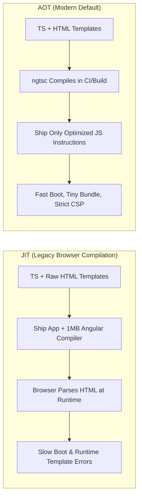
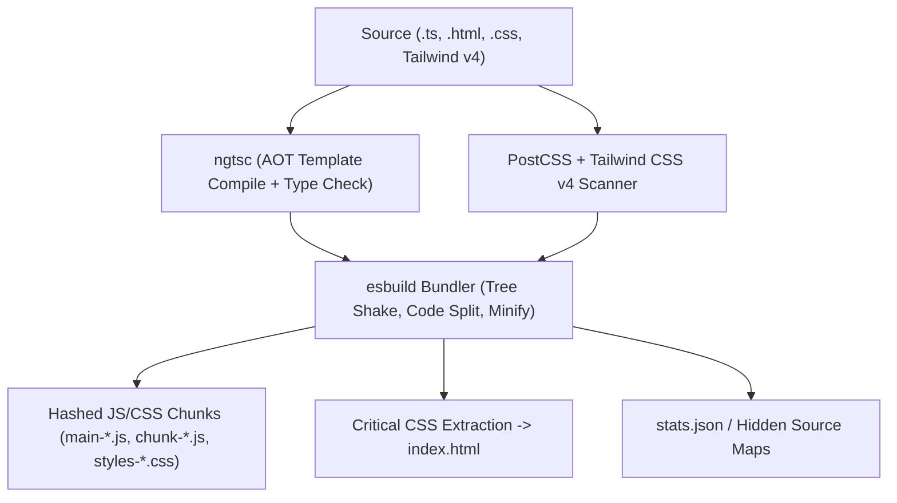
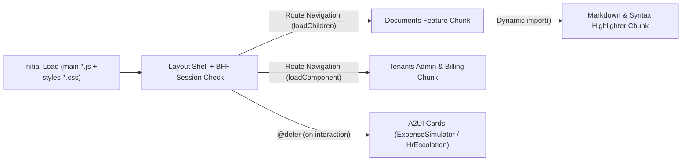

# Chapter 14: Angular Compiler & Build Optimization

## 1. Learning Objectives
By the end of this chapter, you will be able to:
* Understand the full **`ngtsc` (Angular Compiler)** pipeline, from Abstract Syntax Tree (AST) template parsing and `strictTemplates` type-checking to JavaScript instruction emit.
* Contrast **JIT (Just-In-Time)** and **AOT (Ahead-Of-Time)** compilation, including their impact on bundle size, startup time, and Content Security Policy (`CSP`).
* Understand the **Ivy** rendering engine, **Locality**, static `consts` hoisting, creation vs. update blocks, and how **zoneless** Angular 22 eliminates `zone.js` polyfill overhead.
* Configure Angular 22's `@angular/build:application` pipeline (**esbuild** + **Vite** + **Tailwind CSS v4**), including `optimization` flags, `outputHashing`, and `hidden` source maps.
* Master **Tree Shaking**, **Dead Code Elimination**, `sideEffects: false`, barrel-file pitfalls, and Tailwind CSS v4 static class scanning.
* Architect **Code Splitting** boundaries (route-level, `@defer`, dynamic `import()`, and library secondary entry points) and enforce **`angular.json` bundle budgets**.
* Analyze and shrink production bundles using `source-map-explorer`, `ng build --stats-json` (esbuild metafile analyzer), and Brotli/Gzip compression.

---

## 2. Introduction: The Angular Compiler (`ngc` / `ngtsc`)

Unlike React, where Babel simply transpiles JSX into `React.createElement` calls, Angular operates a highly sophisticated standalone compiler (`ngc`, powered internally by the Ivy compiler **`ngtsc`**).

When you run `ng build`, the Angular Compiler does not just transpile TypeScript to JavaScript. It statically analyzes your entire application, parses your HTML templates into an **Abstract Syntax Tree (AST)** (a structured tree representation of every HTML tag, binding, and `@if`/`@for`/`@defer` block), checks the templates for strict type safety, and generates heavily optimized, framework-specific DOM instructions.

### The Two Phases of `ngtsc`
1. **Analysis & Template Type-Checking (`TypeCheckBlock`)**:
   `ngtsc` generates synthetic TypeScript type-check blocks (`TCB`) in memory for every `@Component` template. If you pass a `string` into a signal `input<number>()` or misspell a property on a Signal, the TypeScript compiler catches it at build time—not in a user's browser.
2. **Transformation & Code Emit**:
   `ngtsc` strips decorator metadata (`@Component`, `@Injectable`, `@Directive`, `@Pipe`) and replaces each class with static properties (`ɵcmp`, `ɵprov`, `ɵdir`, `ɵpipe`, `ɵfac`). These static definitions tell Angular's runtime how to instantiate and render the class without needing `reflect-metadata` or runtime template parsing.

### Strict Compiler Flags in `tsconfig.json`
Enterprise Angular 22 workspaces enforce strict template checking inside `angularCompilerOptions`:
```json
{
  "angularCompilerOptions": {
    "strictTemplates": true,
    "strictInjectionParameters": true,
    "strictInputAccessModifiers": true,
    "strictStandalone": true
  }
}
```
* **`strictTemplates`**: Validates every template binding, `@for` loop variable, and event `$event` payload against component TypeScript types.
* **`strictInjectionParameters`**: Fails the build if a class uses DI without `@Injectable()` or injects an untyped parameter.
* **`strictStandalone`**: Enforces standalone components, directives, and pipes across the workspace (Angular 22's default).

> [!TIP]
> **When NOT to Disable `strictTemplates`:**
> Never turn off `strictTemplates` (or fall back to `$any(...)` casts everywhere) to silence template compiler errors during a refactor or Angular upgrade. Disabling `strictTemplates` turns build-time type errors into silent runtime `undefined` bugs in production. Fix the underlying signal or DTO type instead.

### Real-World Normora Examples: Compiler & Strict Template Safety
1. **Type-Checking `ApiMessages` Constants in Templates**: When a Normora component in `client/src/app/features/documents/` binds an empty-state banner or validation hint to `ApiMessages.DocumentNotFound`, `strictTemplates` verifies at compile time that the exposed property exists on `ApiMessages` from `client/src/app/core/constants/api-messages.ts`—preventing typos from slipping into production.
2. **Enforcing Standalone Boundaries (`strictStandalone`)**: Normora enforces standalone components (`AGENTS.md` Rule 5). Setting `"strictStandalone": true` ensures that no developer accidentally introduces a legacy `NgModule` inside `client/src/app/features/conversations/` or `client/src/design-system/`.
3. **Signal `input()` Type Safety in A2UI Cards**: In `ExpenseSimulatorCardComponent` (`policy_limit_card`), location tier and hotel night inputs use Signal `input.required<ExpensePolicyData>()`. `ngtsc` type-checks the parent Copilot message renderer's template binding so mismatched backend SSE payloads fail during CI builds.
4. **Control Flow Narrowing in `HrEscalationCardComponent`**: Using Angular 22's `@if (escalation(); as item)` narrows nullable Signal state inside the template AST. `ngtsc` verifies that `item.referenceHash` and `item.status` cannot be `null` or `undefined` inside the block.
5. **Catching Invalid PrimeNG & Tailwind v4 Attribute Bindings**: In `ChunkPreviewDrawerComponent`, `ngtsc` checks every `[visible]` and `(onHide)` binding on PrimeNG's drawer component at build time, while static template analysis ensures Tailwind v4 classes like `border-none!` and `dark:bg-slate-900` remain plain static strings.

---

## 3. JIT vs AOT Compilation

Historically (pre-Angular 9), Angular developers wrestled with two different compilation targets.



### JIT (Just-In-Time)
In JIT mode, the Angular compiler was packaged *inside* the JavaScript bundle shipped to the browser.
1. The browser downloads the app.
2. The browser downloads `@angular/compiler` (adding substantial weight to the initial bundle).
3. The app boots up, and the Compiler parses the HTML templates into JavaScript *in the browser's memory* using dynamic code evaluation.
4. **Result:** Massive bundle size, slow initial load time, runtime template errors, and relaxed Content Security Policy requirements.

### AOT (Ahead-Of-Time)
In AOT mode, compilation happens on your developer machine or CI/CD build server.
1. `ngtsc` parses all HTML templates and converts them directly into optimized JavaScript instructions.
2. `@angular/compiler` is *excluded* and never shipped to the browser.
3. **Result:** Smaller bundle size, near-instant startup time, all template errors caught during the build phase, and full compatibility with strict **Content Security Policy (CSP)** headers (no `unsafe-eval` required).

> **Modern Standard:** Since Angular 9 (the Ivy Engine), **AOT is enforced by default** for both development (`ng serve`) and production (`ng build`). JIT is effectively dead in modern production Angular applications.

> [!NOTE]
> **When NOT to Use JIT (and the Rare Exception):**
> Never enable JIT in production (`"aot": false` in `angular.json`). It bloats initial downloads, exposes uncompiled template strings, and forces you to weaken CSP headers with `'unsafe-eval'`, violating enterprise security baselines. The only remaining niche use case for `@angular/compiler` is an interactive in-browser sandbox/playground (like a live CMS template editor) that must compile user-authored Angular templates dynamically—even then, prefer server-driven JSON schemas (like Normora's `intake_form_card`) over runtime template compilation.

### Real-World Normora Examples: AOT & Security
1. **Strict CSP Compatibility Behind Duende BFF**: Normora hardens `Normora.Api` with strict Security Headers (`docs/security_headers.md`), forbidding `'unsafe-eval'` in `script-src`. Because Normora's Angular 22 SPA builds exclusively with AOT, zero runtime template compilation or `Function()` evaluation occurs in the browser.
2. **Zero `@angular/compiler` Weight on Tenant Login**: When an employee opens Normora to authenticate via Keycloak OIDC and Duende BFF, the initial JavaScript payload contains precompiled Ivy DOM instructions—not the Angular template compiler—keeping first-load latency minimal on corporate VPNs.
3. **Build-Time Validation of RAG Citation Templates**: In `client/src/app/features/conversations/`, citation badges and markdown preview drawers are verified during `ng build` in CI. Any broken property binding in a template fails the pipeline before Docker image assembly.
4. **Interactive Intake Forms Without JIT (`workspace_request_form`)**: When an AI agent tool needs missing parameters, Normora does *not* ship JIT to compile dynamic HTML strings. Instead, the backend streams a structured `intake_form_card` JSON schema rendered safely by precompiled AOT Angular Reactive Forms components.
5. **Fast Dev Inner Loop with AOT + Vite (`ng serve`)**: Even during local development against `http://localhost:5000`, `ng serve` runs AOT compilation per component on-demand via Vite, ensuring developers catch template bugs immediately without waiting for a separate production build.

---

## 4. The Ivy Engine, Locality & Modern Build Pipeline

Ivy is the codename for Angular's compilation and rendering pipeline. Its primary architectural breakthrough was **Locality**.

In the pre-Ivy (View Engine) days, compiling one component often required the compiler to analyze the entire `NgModule` tree and metadata JSON files from every imported library. This made enterprise builds brutally slow and fragile.

With Ivy, every component is compiled independently based on its own `@Component` metadata (specifically the `imports: []` array in Standalone components). This **Locality** enables incremental compilation, aggressive caching (`.angular/cache`), and library distribution without proprietary metadata blobs.

### What Does Ivy Output Look Like?

When you write a template:
```html
<h1 class="title">Hello {{ user() }}</h1>
```

The Ivy compiler strips out the HTML and generates raw JavaScript instructions inside a static `ɵcmp` definition:
```javascript
// Simplified Ivy Output (consts hoisted once outside the template function)
const _c0 = [1, "title"]; // Static class attribute hoisted for zero-allocation reuse

function MyComponent_Template(rf, ctx) {
  if (rf & 1) { // Creation Phase (runs ONCE when the component is created)
    ɵɵelementStart(0, "h1", 0); // Open <h1>, apply consts[0] ('title')
    ɵɵtext(1);                  // Create empty text node at slot 1
    ɵɵelementEnd();             // Close </h1>
  }
  if (rf & 2) { // Update Phase (runs during Change Detection)
    ɵɵadvance(1);               // Move instruction pointer to text node slot 1
    ɵɵtextInterpolate1("Hello ", ctx.user(), ""); // Update text node with Signal value
  }
}
```
Notice three critical optimizations here:
1. **No Runtime HTML Parsing**: The browser executes direct DOM creation calls rather than parsing HTML strings.
2. **Static `consts` Hoisting**: Static attributes and Tailwind classes (`_c0`) are extracted into module-level constants once, rather than re-allocated on every change detection cycle.
3. **Creation vs. Update Separation (`rf & 1` vs. `rf & 2`)**: Structural DOM creation happens once; subsequent signal updates only jump to dynamic slots (`ɵɵadvance`) and patch changed bindings.

### Modern Angular 22 Build Pipeline (`@angular/build:application`)

Starting in Angular v17+ and standard in Angular 22, `@angular/build:application` replaces legacy Webpack with a unified, ultra-fast toolchain:



* **Development (`ng serve`)**: Uses **Vite** to serve native ES modules on demand with Hot Module Replacement (HMR) and fast incremental `ngtsc` compilation.
* **Production (`ng build`)**: Uses **esbuild** (written in Go) for parallel bundling, tree shaking, scope hoisting, code splitting, and minification, plus **Lightning CSS** / PostCSS for CSS optimization.
* **Build Cache (`.angular/cache`)**: Stores compiled intermediate artifacts on disk so repeated builds only recompile modified files. Run `npx ng cache clean` if a dependency upgrade leaves stale artifacts.

### Critical Production Flags in `angular.json`
In `configurations.production`, an architect tunes the `optimization`, `outputHashing`, and `sourceMap` blocks deliberately:

```json
"production": {
  "outputHashing": "all",
  "namedChunks": false,
  "optimization": {
    "scripts": true,
    "styles": {
      "minify": true,
      "inlineCritical": true
    },
    "fonts": {
      "inline": false
    }
  },
  "sourceMap": {
    "scripts": true,
    "styles": false,
    "hidden": true
  }
}
```

* **`outputHashing: "all"`**: Appends content hashes (`main-A4F9C2.js`) to JS, CSS, and media bundles. This lets CDNs and NGINX set `Cache-Control: public, max-age=31536000, immutable` on static chunks while keeping `index.html` at `no-cache` so users always receive new releases cleanly.
* **`optimization.styles.inlineCritical`**: Extracts only the CSS rules needed for above-the-fold rendering and inlines them into `<style>` inside `index.html`, deferring the full `styles-*.css` stylesheet so rendering isn't blocked.
* **`optimization.fonts.inline`**: Downloads and inlines external Google Fonts CSS at build time.
* **`sourceMap.hidden: true`**: Generates `.map` files in `dist/` for private upload to error-tracking tools (e.g., Sentry or OpenTelemetry sourcemaps) *without* appending `//# sourceMappingURL=...` comments to the public JS files.

> [!WARNING]
> **When NOT to Enable `inlineCritical` or `fonts.inline`:**
> - **Disable `inlineCritical: false`** if your platform enforces a strict **Content Security Policy (`style-src 'self'`)** without cryptographic hashes or per-request nonces—an injected inline `<style>` tag will be blocked by the browser, causing an unstyled flash. (Alternatively, configure CSP hashes/nonces in your BFF/reverse proxy.)
> - **Disable `fonts.inline: false`** in air-gapped enterprise environments or strict GDPR deployments where the CI build server cannot (or must not) fetch external font stylesheets from `fonts.googleapis.com`; self-host WOFF2 fonts inside `client/public/` instead.

### Real-World Normora Examples: Ivy & `@angular/build:application`
1. **Static `consts` Hoisting on Tailwind CSS v4 Classes**: In Normora's document table and sidebar navigation, verbose Tailwind v4 strings like `flex items-center gap-2 rounded-lg bg-white dark:bg-slate-900 border-slate-200 dark:border-slate-700 border-none!` are hoisted by Ivy into static `consts` arrays—never re-parsed during SignalR `dataVersion` table refreshes.
2. **Zoneless Build Savings (`polyfills: []`)**: Because Normora uses Angular 22 **zoneless change detection** driven by Signals (`signal`, `computed`, `effect`), `zone.js` is omitted from `polyfills` in `client/angular.json`. That immediately eliminates ~35 KB raw (~13 KB gzipped) of monkey-patching runtime code from `polyfills.js` and skips Zone wrapping on SSE streams and SignalR WebSockets.
3. **Self-Hosted Fonts (`optimization.fonts.inline: false`)**: Enterprise Normora tenants operate behind strict corporate proxies and security policies (`docs/security_headers.md`). Normora disables external font inlining and serves fonts locally so `ng build` never depends on external network fetches during container builds.
4. **Immutable Asset Caching Behind `Normora.Api` / NGINX**: Setting `"outputHashing": "all"` ensures that deploying a new Normora phase (such as updated A2UI card templates) never serves stale cached JS to existing users whose BFF session cookie is still active.
5. **Hidden Source Maps for Observability Without Source Exposure**: Setting `"sourceMap": { "scripts": true, "hidden": true }` lets Normora upload `.map` artifacts to internal observability storage matching OpenTelemetry traces while preventing external users from reading unminified proprietary TypeScript in browser DevTools.

---

## 5. Tree Shaking, Dead Code Elimination & Tailwind CSS v4 Purging

**Tree Shaking** is the process of statically analyzing your dependency graph and removing unreachable exports from the final production bundle. **Dead Code Elimination (DCE)** goes one step further by stripping unreachable branches (`if (false) { ... }`), unused local helpers, and unused variables inside functions.

### How ESM Enables Tree Shaking (vs. CommonJS)
Tree shaking relies strictly on **ECMAScript Modules (ESM)** static syntax (`import { x } from 'y'`, `export function x()`). Because ESM imports are resolved statically before execution, esbuild knows with mathematical certainty which exports are never referenced.

By contrast, **CommonJS** (`require(...)`, `module.exports = ...`) allows dynamic property lookups at runtime. When you install a CommonJS package, esbuild cannot prove which exports are unused and often bundles the entire library—triggering an Angular CLI build warning (`CommonJS or AMD dependencies can cause optimization bailouts`).

### `sideEffects: false` and `@__PURE__` Annotations
Even with ESM, a bundler hesitates to delete an unused import if executing that file at module load time could mutate global state (a **side effect**, such as polyfilling `Array.prototype` or registering a global stylesheet).
* Setting `"sideEffects": false` in a library's `package.json` (or `"sideEffects": ["*.css"]` when CSS imports exist) promises esbuild that files with zero used exports can be dropped completely.
* Angular's compiler (`ngtsc`) automatically emits `/*#__PURE__*/` annotations on static class definitions (`ɵcmp`, `ɵprov`) so esbuild knows unused components and services can be safely pruned.

### How Angular Services & DI Interact With Tree Shaking
1. **`@Injectable({ providedIn: 'root' })` (Tree-Shakeable)**: If a service is declared with `providedIn: 'root'` and *no* component or service injects it, esbuild drops it completely from the bundle. Even better: if only lazy-loaded routes inject it, esbuild places it in the lazy chunk rather than `main.js`.
2. **Component or Route `providers: [MyService]` (Hard Reference)**: Adding a service to a component's `providers` array creates an explicit reference to the class constructor. Even if the service is never injected in that subtree, the bundler **cannot** tree-shake it.

> [!TIP]
> **When NOT to Use `providedIn: 'root'` or Barrel Files:**
> - **Use component `providers: [...]`** intentionally when you *need* an isolated per-instance service lifetime scoped to a component's **NodeInjector** (for example, per-card state in an interactive wizard), or **route `providers: [...]`** on lazy routes to ensure feature-scoped state stays out of `main.js`.
> - **Avoid massive barrel files (`shared/index.ts`)** that re-export dozens of unrelated components, directives, and heavy third-party utilities if any file in that barrel has top-level side effects or CommonJS dependencies. Deep imports (e.g., `@design-system/components/button`) give esbuild cleaner chunk boundaries.

### Tailwind CSS v4 Build Optimization (CSS-First & Static Scanning)
Normora uses **Tailwind CSS v4**, which compiles CSS directly through a high-speed Rust engine (Oxide) integrated into PostCSS/Vite:
* **Static Class Scanning**: Tailwind v4 scans your `.html` and `.ts` files for complete utility token strings (`bg-white`, `dark:bg-slate-900`, `border-none!`) and emits **only** the CSS rules your app actually uses.
* **Dark Mode & Suffix `!important` Efficiency**: Both `dark:` variants (`bg-slate-50 dark:bg-slate-950`) and v4 suffix `!important` modifiers (`border-none!`, `shadow-none!`) are tree-shaken at the CSS level—unused color palettes or unused `dark:` shades add zero bytes to `styles-*.css`.
* **Never Build Dynamic Class Strings**: Constructing `'bg-' + tierColor() + '-500'` prevents the static scanner from detecting the class, dropping it from the production CSS bundle. Always map variants to complete, static class strings.

### Real-World Normora Examples: Tree Shaking & Tailwind v4 Purging
1. **Pruning Unused Design-System Exports (`client/src/design-system/`)**: If Normora's design system exposes 25 UI primitives and a feature only imports `ButtonComponent`, ESM static imports let esbuild drop unused primitives from that bundle rather than shipping the entire catalog on initial load.
2. **Eliminating `zone.js` & Unused `@angular/common` Pipes**: Because Normora uses Angular 22 standalone components with `@if`/`@for` instead of importing `CommonModule` everywhere, unused legacy directives and pipes are never referenced in component `imports: []` arrays and stay out of feature chunks.
3. **Tree-Shakeable `ApiMessages` & Shared Helpers (`client/src/app/core/constants/api-messages.ts`)**: Organizing domain helpers as pure named ESM exports (avoiding `export default { ... }` megamaps with side effects) lets esbuild strip unused formatting or validation helpers from client bundles.
4. **Static Tailwind v4 Status Mapping for Document Ingestion**: When rendering ingestion badges (`Pending`, `Processing`, `Indexed`, `Failed`) in `client/src/app/features/documents/`, Normora maps each status via a static lookup table containing full Tailwind v4 tokens (`bg-emerald-50 dark:bg-emerald-950 text-emerald-700 dark:text-emerald-300 border-none!`), guaranteeing Tailwind v4 includes every `dark:` shade in production CSS.
5. **Isolating Feature Services via Lazy Route `providers`**: Feature-specific state services (such as a Copilot thread search filter or a Tenants PayU checkout draft store) can live in `providers` on their lazy-loaded route rather than polluting `main.js`, while singleton `HttpClient`/auth/BFF services stay `providedIn: 'root'`.

---

## 6. Code Splitting, Chunking Strategies & Bundle Budgets

**Code Splitting** breaks one monolithic `main.js` file into smaller JavaScript **chunks** loaded only when needed. Smaller initial bundles dramatically improve **First Contentful Paint (FCP)** and **Time to Interactive (TTI)**—especially on mobile or throttled corporate VPN connections.



### Three Levels of Code Splitting in Angular 22
1. **Route-Level Splitting (`loadComponent` / `loadChildren`)**:
   Each feature domain (`Documents`, `Tenants`, `Conversations`) is loaded lazily only when the user navigates to its route in `app.routes.ts`.
2. **Template-Level Splitting (`@defer`)**:
   Angular 22's `@defer` block automatically instructs the compiler and esbuild to extract referenced standalone components (like heavy charts or drawers) into separate lazy chunks loaded on triggers such as `on viewport`, `on interaction`, or `when condition()` (covered in depth in Chapter 15).
3. **Programmatic Dynamic `import()`**:
   For heavy imperative libraries (PDF exporters, Excel generators, syntax highlighters, code editors) that are only triggered inside a button click handler:
   ```typescript
   async exportAuditLogPdf(rows: AuditLogEntry[]): Promise<void> {
     const { default: pdfMake } = await import('pdfmake/build/pdfmake');
     pdfMake.createPdf(this.buildDocDefinition(rows)).download('normora-audit.pdf');
   }
   ```

### Preloading & The Over-Splitting Anti-Pattern
By default, lazy chunks download only when triggered. You can also configure router preloading (`withPreloading(PreloadAllModules)` or a custom predictive strategy) to fetch secondary routes quietly during browser idle time.

> [!NOTE]
> **When NOT to Split Every Component:**
> Do **not** wrap tiny 2 KB components (buttons, badges, small form inputs) in individual `@defer` blocks or micro-chunks. Creating 150 tiny JS chunks causes:
> - **HTTP Request Waterfalls**: Browsers throttle concurrent requests and waste round-trips resolving dozens of small files.
> - **Worse Compression Ratios**: Brotli/Gzip compression dictionaries work far better on cohesive 40–100 KB feature chunks than on fragmented 1 KB files.
> - **Split on heavy weight or rare paths** (rich editors, charting libs, admin-only pages, secondary drawers), not on trivial UI atoms.

### Enforcing Performance SLAs with `angular.json` Budgets
Bundle size tends to creep upward silently—one careless dependency upgrade can add 400 KB overnight. **Budgets** in `angular.json` turn bundle size into an automated CI gate:

```json
"budgets": [
  {
    "type": "initial",
    "maximumWarning": "500kB",
    "maximumError": "1MB"
  },
  {
    "type": "anyComponentStyle",
    "maximumWarning": "4kB",
    "maximumError": "8kB"
  }
]
```
* **`initial`**: Guards total JS/CSS downloaded on first page load (`main.js` + `polyfills.js` + `styles.css`).
* **`anyComponentStyle`**: Guards per-component stylesheet size. Because Angular encapsulates component CSS in JS, putting a global `@import` inside a component's `.css`/`.scss` duplicates it across components and trips this budget immediately.

### Real-World Normora Examples: Code Splitting & Budgets
1. **Route-Splitting Tenants Admin & PayU Billing (`client/src/app/features/tenants/`)**: Regular employees chatting with the RAG copilot never visit Workspace Subscriptions, Audit Logs, or Department Management. Lazy-loading the `tenants` routes via `loadChildren` keeps PayU checkout state and admin tables completely out of `main.js`.
2. **Deferring `ChunkPreviewDrawerComponent` Until Citation Click**: Users may read dozens of Copilot responses without opening raw document chunks. Wrapping `ChunkPreviewDrawerComponent` and its Markdown renderer in `@defer (when activeCitation() !== null)` keeps the Markdown parsing engine out of the initial chat bundle.
3. **On-Demand A2UI Simulators (`ExpenseSimulatorCardComponent` & `HrEscalationCardComponent`)**: Generative A2UI cards are streamed by the backend only when specific agent tools (`calculate_policy_limit`, `escalate_hr_inquiry`) execute. Splitting these cards into lazy chunks ensures normal policy Q&A sessions never download calculator or timeline UI code unnecessarily.
4. **Dynamic `import()` for Heavy Document Preview / Export SDKs**: Inside `client/src/app/features/documents/`, exporting compliance audit logs or rendering specialized rich-file previews uses dynamic `await import(...)` inside the action handler rather than top-level static imports.
5. **Protecting `anyComponentStyle` with Tailwind v4 Utility Classes**: Normora enforces Tailwind v4 utilities (`bg-white dark:bg-slate-900 text-slate-900 dark:text-white`) and `.custom-scrollbar` from global styles rather than duplicating SCSS mixins inside every component stylesheet, keeping component style budgets well under the `4kB` warning threshold.

---

## 7. Enterprise Case Study: Bundle Analysis & Compression Pipeline

In a large SaaS platform like our **EV Charging Management Platform**, dependencies can spiral out of control. A junior developer might install `moment.js` (which is famously massive and un-tree-shakeable because of bundled locales) instead of a modern tree-shakeable alternative like `date-fns` or native `Intl.DateTimeFormat`.

To detect bloat before users feel it, you must inspect the compiled output objectively.

### Step 1: Build with Source Maps or Esbuild Stats JSON
Angular 22 offers two complementary inspection artifacts:
```bash
# Option A: Generate source maps for source-map-explorer
npx ng build --source-map

# Option B: Generate esbuild's exact dependency metafile (stats.json)
npx ng build --stats-json
```
* **`--stats-json`** writes `dist/<app>/stats.json`, which records not only the exact minified byte size of every file in every chunk, but also the **import chain** explaining *why* a dependency ended up in `main.js`.

### Step 2: Visualize the Bundle
* **With `source-map-explorer`** (great for treemap inspection of `.js` bundles):
  ```bash
  npx source-map-explorer dist/ev-platform/browser/*.js
  ```
* **With esbuild Bundle Size Analyzer**: Upload `dist/<app>/stats.json` to `https://esbuild.github.io/analyze/` (runs 100% locally in your browser—no source code leaves your machine) to trace module inclusion chains across `main.js` and lazy `chunk-*.js` files.

### Step 3: Analyze the Output
A visual treemap opens in your browser:
* **Inspect `main-*.js`**: If third-party libraries (e.g., `moment`, full `lodash`, unsplit PrimeNG modules, or Markdown parsers) occupy 60–80% of `main.js`, refactor them to tree-shakeable ESM equivalents or push them into lazy chunks.
* **Inspect `styles-*.css`**: Verify that PrimeNG themes and Tailwind v4 utilities aren't shipping unused component styles or duplicated CSS imports.

### Step 4: Static Pre-Compression (Brotli & Gzip)
Even after tree shaking and minification, HTTP transport compression cuts transfer size by another **70–80%**:
* **Gzip (`.gz`)**: Universally supported baseline compression.
* **Brotli (`.br`)**: Typically **15–20% smaller** than Gzip for JS/CSS/HTML text assets. Enterprise NGINX or CDN edges serve pre-compressed `.br` / `.gz` files (`gzip_static on; brotli_static on;`) at zero per-request CPU cost.

> [!CAUTION]
> **When NOT to Ship Public Source Maps:**
> Never run `ng build --source-map` and deploy `.js.map` files (with `//# sourceMappingURL=` comments intact) to a public production web server. Public source maps expose your complete unminified TypeScript source code, internal comments, and client-side validation logic to anyone opening DevTools. Use `"hidden": true` in `angular.json` and upload `.map` files privately to your error-tracking/observability backend, then delete `.map` files from the NGINX/CDN container image.

### Real-World Normora Examples: Bundle Analysis & Compression
1. **Replacing `moment.js` with `Intl` / `date-fns` in Audit Logs**: During bundle review of `client/src/app/features/tenants/` audit logs and subscription renewal timers, `stats.json` immediately flags bloated locale bundles if a developer accidentally adds `moment`, letting the team switch to native `Intl.DateTimeFormat` (0 KB) or tree-shakeable `date-fns`.
2. **Auditing PrimeNG & CopilotKit Weight in `main.js`**: Running `npx source-map-explorer dist/normora/browser/*.js` verifies whether PrimeNG components (tables, dialogs, drawers) and CopilotKit UI modules are isolated inside their lazy feature chunks rather than pulled eagerly into the root layout shell.
3. **Verifying Tailwind CSS v4 Output Size in `styles-*.css`**: Inspecting the built `styles-*.css` file confirms Tailwind v4 purged unused utility colors and kept only the active palette, `dark:` variants, and `.custom-scrollbar` rules.
4. **Hidden Source Maps + OpenTelemetry / Error Monitoring**: Normora builds production artifacts with `"sourceMap": { "scripts": true, "hidden": true }` so CI uploads `.map` files to internal telemetry before stripping them from the final static NGINX container stage.
5. **Brotli Pre-Compression for Global Tenant Workspaces**: Because Normora serves multi-tenant workspaces (`client/`) behind NGINX / `Normora.Api`, pre-compressing hashed `*.js` and `*.css` chunks with Brotli (`.br`) shrinks the initial SPA payload significantly for remote employees accessing the Copilot workstation over slow links.

---

## 8. Browser Targets, Browserslist & Polyfills (Replacing Differential Loading)

In earlier versions of Angular, the CLI performed **Differential Loading**, compiling two separate builds:
1. An ES2015 bundle (smaller, faster) for modern browsers (Chrome, Edge, Safari).
2. An ES5 bundle (larger, heavily polyfilled) for Internet Explorer 11.

As of modern Angular (and Angular 22), **Internet Explorer 11 is completely unsupported**. The CLI builds a single modern ES2022+ bundle, halving CI build times and shrinking payload sizes.

### Controlling Syntax Downleveling with `.browserslistrc`
Angular reads your workspace `.browserslistrc` (or defaults to Angular's **Baseline Widely Available** browser matrix) to decide which modern JavaScript and CSS features can be emitted natively versus **downleveled** (rewritten into older, larger helper code) by esbuild and Lightning CSS:

```text
# .browserslistrc (Modern Enterprise Baseline)
last 2 Chrome versions
last 2 Edge versions
last 2 Firefox versions
last 2 Safari major versions
not dead
```

### Zoneless Polyfills Optimization (`polyfills` in `angular.json`)
Historically, every Angular app shipped `zone.js` inside `polyfills.js` so Angular could monkey-patch `setTimeout`, `Promise`, `fetch`, and DOM events to guess when to run change detection.
* In **Angular 22 zoneless mode** (`provideZonelessChangeDetection()`, the default in modern workspaces), you remove `"zone.js"` from `architect.build.options.polyfills` in `angular.json`—leaving `polyfills: []` (unless you need a specific browser API polyfill like `@angular/localize/init` for compile-time i18n).

> [!TIP]
> **When NOT to Widen `.browserslistrc`:**
> Do not copy old `.browserslistrc` rules (`> 0.2%`, `ie 11`, `chrome 49`) from legacy projects. Widening browser targets forces esbuild to downlevel modern `async/await`, optional chaining (`?.`), class fields, and CSS nesting—inflating bundle size and slowing execution for 99.9% of modern corporate users.

### Real-World Normora Examples: Targets & Polyfills
1. **Zero `zone.js` in `client/angular.json` `polyfills`**: Normora relies on Signals (`signal`, `computed`, `effect`) and zoneless change detection, eliminating `zone.js` from `polyfills.js` and avoiding monkey-patching of SignalR WebSockets and SSE streams.
2. **Native `async/await` & SSE Streams Without Downleveling**: Targeting modern Evergreen browsers in `.browserslistrc` lets esbuild emit native `async/await` and `ReadableStream` code directly for CopilotKit's `/api/copilotkit` SSE token streaming without bulky generator polyfills.
3. **CSS Custom Properties & Tailwind v4 Native Features**: Tailwind CSS v4 relies on modern CSS cascade layers (`@layer`), `oklch()`/`color-mix()`, and CSS custom properties (`client/src/design-system/tokens`). A modern `.browserslistrc` ensures CSS isn't bloated with legacy fallback hacks.
4. **Same-Origin BFF Cookies Instead of Legacy Token Polyfills**: Because Normora delegates OIDC tokens to Duende BFF (`HttpOnly`, `SameSite=Strict` cookies), the Angular bundle drops third-party OIDC client crypto/iframe-silent-renew polyfills entirely.
5. **Selective Polyfills Only for Real Requirements**: If an enterprise Normora deployment later adds build-time multi-language `$localize` bundles (`@angular/localize`), only `@angular/localize/init` is added to `polyfills`, keeping `zone.js` permanently out.

---

## 9. Common Mistakes & Anti-Patterns

> [!CAUTION]
> **Anti-Pattern 1: Importing Entire CommonJS/Namespace Libraries (`import * as _`)**
>
> **Wrong Code:**
> ```typescript
> import * as _ from 'lodash';
> import moment from 'moment';
>
> export class AuditFormatter {
>   clone(data: unknown) { return _.cloneDeep(data); }
>   format(date: string) { return moment(date).format('YYYY-MM-DD'); }
> }
> ```
> **Why It's Wrong:** `lodash` (CommonJS) and `moment` (bundled locales + mutable prototype chain) defeat static ESM tree shaking, pulling hundreds of kilobytes of unused utilities and translations straight into `main.js`.
>
> **The Fix:**
> ```typescript
> import { cloneDeep } from 'lodash-es'; // Or native structuredClone(data)!
>
> export class AuditFormatter {
>   clone<T>(data: T): T { return structuredClone(data); }
>   format(date: string): string {
>     return new Intl.DateTimeFormat('en-CA').format(new Date(date));
>   }
> }
> ```

> [!CAUTION]
> **Anti-Pattern 2: Silencing `angular.json` Budget Failures by Raising Limits**
>
> **Wrong Code:**
> ```json
> // Raising the initial budget to hide an accidental 2.4 MB main.js bundle
> { "type": "initial", "maximumWarning": "3MB", "maximumError": "5MB" }
> ```
> **Why It's Wrong:** Raising budget ceilings masks architectural regressions (eagerly imported chart libs, PrimeNG full themes, or unsplit admin routes) and silently degrades startup performance for every tenant user.
>
> **The Fix:** Keep strict budgets (`500kB` warning / `1MB` error), run `npx ng build --stats-json` or `npx source-map-explorer`, locate the oversized module, and move it behind a lazy route, `@defer`, or dynamic `import()`.

> [!CAUTION]
> **Anti-Pattern 3: Eagerly Importing Heavy On-Demand SDKs at the Top of a Component**
>
> **Wrong Code:**
> ```typescript
> import pdfMake from 'pdfmake/build/pdfmake'; // Shipped in initial/route chunk!
>
> export class ComplianceExportComponent {
>   exportPdf(rows: unknown[]) {
>     pdfMake.createPdf({ content: rows }).download();
>   }
> }
> ```
> **Why It's Wrong:** Even if only 2% of workspace admins ever click "Export PDF", static top-level imports force 100% of users visiting that route to download and parse the entire PDF engine.
>
> **The Fix:**
> ```typescript
> export class ComplianceExportComponent {
>   async exportPdf(rows: unknown[]): Promise<void> {
>     const { default: pdfMake } = await import('pdfmake/build/pdfmake');
>     pdfMake.createPdf({ content: rows }).download();
>   }
> }
> ```

> [!CAUTION]
> **Anti-Pattern 4: Constructing Dynamic Tailwind CSS v4 Class Names or Using Prefix `!`**
>
> **Wrong Code:**
> ```html
> <!-- Dynamic concatenation hides classes from Tailwind v4's build scanner,
>      and !border-none uses legacy v3 prefix syntax (broken in Tailwind v4!) -->
> <div [class]="'bg-' + tone() + '-100 !border-none'">
>   {{ message() }}
> </div>
> ```
> **Why It's Wrong:** Tailwind CSS v4 purges classes not found verbatim in source files, so `'bg-' + tone() + '-100'` produces missing background styles in production. Furthermore, Tailwind v4 requires `!important` as a **suffix** (`border-none!`), never a prefix (`!border-none`).
>
> **The Fix:**
> ```html
> <div
>   class="border-none! text-slate-900 dark:text-white"
>   [class.bg-emerald-100]="tone() === 'success'"
>   [class.dark:bg-emerald-950]="tone() === 'success'"
>   [class.bg-rose-100]="tone() === 'error'"
>   [class.dark:bg-rose-950]="tone() === 'error'">
>   {{ message() }}
> </div>
> ```

> [!CAUTION]
> **Anti-Pattern 5: Registering Unused Services in Component `providers: [...]` or Shipping Unhidden Source Maps**
>
> **Wrong Code:**
> ```typescript
> // 1) Hard-referenced in eager root component -> blocks tree shaking even if unused
> @Component({
>   selector: 'nm-root',
>   providers: [HeavyAnalyticsExportService],
>   template: `<router-outlet />`
> })
> export class AppComponent {}
> ```
> ```json
> // 2) angular.json production config exposing full TypeScript source to the public web
> "sourceMap": true
> ```
> **Why It's Wrong:** Putting a service in an eager component's `providers` array prevents esbuild from tree-shaking it and pulls it into `main.js`. Setting `"sourceMap": true` in production ships readable source code maps (`//# sourceMappingURL=`) to every user's browser.
>
> **The Fix:** Use `@Injectable({ providedIn: 'root' })` (or lazy route `providers: [...]` for feature-scoped state) so unused or lazy services never bloat `main.js`, and set `"sourceMap": { "scripts": true, "styles": false, "hidden": true }` in `angular.json`, stripping `.map` files after private observability upload.

---

## 10. Interview Questions

### Junior / Intermediate
**Q1: What is AOT compilation and why is it superior to JIT?**
> A: Ahead-of-Time (AOT) compilation compiles Angular HTML templates and components into optimized JavaScript instructions during the build, before the browser downloads anything. It is superior to JIT because it excludes `@angular/compiler` from the shipped bundle, speeds up initial startup, catches template binding errors at build time, and removes the need for `'unsafe-eval'` in Content Security Policy (CSP) headers.

**Q2: Why does `import { cloneDeep } from 'lodash-es'` shrink bundles compared to `import * as _ from 'lodash'`?**
> A: `lodash` uses CommonJS (`require`/`module.exports`), which prevents static dependency analysis and forces esbuild to bundle the whole library. `lodash-es` uses ES Modules (`import`/`export`), enabling tree shaking to retain only `cloneDeep` and drop the rest. (Even better, modern browsers support native `structuredClone()` at zero bundle cost.)

**Q3: Why does Tailwind CSS v4 require complete static class strings and suffix modifiers like `border-none!`?**
> A: Tailwind CSS v4 builds a minimal stylesheet by statically scanning template and TypeScript files for exact utility tokens—dynamic concatenations like `'bg-' + color` are invisible to the scanner and get purged in production. In v4, `!important` is a suffix (`border-none!`) rather than a v3 prefix (`!border-none`).

### Senior
**Q4: How do `@Injectable({ providedIn: 'root' })` and component/route `providers: [...]` affect code splitting and tree shaking?**
> A: A `providedIn: 'root'` service without eager references is completely tree-shaken if unused, and if only lazy routes inject it, esbuild places it in a lazy chunk rather than `main.js`. By contrast, adding a service to a component's `providers: [...]` creates a hard constructor reference that prevents tree shaking whenever that component is bundled; using `providers` on a lazy route keeps the service isolated to that route's chunk.

**Q5: How do `outputHashing: "all"` and `"sourceMap": { "hidden": true }` work together in an enterprise production deployment?**
> A: `outputHashing: "all"` appends content hashes (`main-X9A2.js`) to JS/CSS assets so CDNs and NGINX can cache chunks aggressively (`immutable`) while `index.html` stays uncached for instant rollouts. `hidden: true` generates `.map` files for private upload to error-tracking/OpenTelemetry tools without embedding `//# sourceMappingURL=` comments in the served JS, protecting proprietary source code.

**Q6: When should you *disable* `optimization.styles.inlineCritical` or `optimization.fonts.inline` in `angular.json`?**
> A: Disable `inlineCritical` if your strict CSP blocks inline `<style>` tags (no hashes/nonces configured), as the browser will reject the inlined critical CSS. Disable `fonts.inline` in air-gapped CI/CD environments or strict GDPR deployments where the build container must not make outbound HTTP requests to Google Fonts—self-host WOFF2 fonts in `public/` instead.

### Architect
**Q7: Explain how the Ivy rendering engine achieved "Locality" and why that improved build times for enterprise Monorepos.**
> A: Prior to Ivy, compiling a component required global knowledge of the `NgModule` tree and metadata JSON from every library dependency, causing cascading rebuilds across the app. Ivy compiles each component independently using only its own decorator metadata (and standalone `imports: []`). This locality lets `ngtsc`, Vite, esbuild, and Nx cache compilation units cleanly and perform rapid incremental builds.

**Q8: An Angular 22 dashboard has a 1.8 MB `main.js` and 600 KB `styles.css`. Walk through your systematic diagnosis and optimization plan.**
> A: First, run `npx ng build --stats-json` (and `npx source-map-explorer`) to trace exact byte sizes and import chains in `main.js` and `styles.css`. Second, verify `zone.js` is removed from `polyfills` if running zoneless, replace any CommonJS/heavy libs (`moment`, full `lodash`) with ESM/native equivalents, and move admin/rare routes behind `loadChildren`/`loadComponent`. Third, wrap heavy above-the-fold-optional widgets (drawers, charts, simulators) in `@defer` and move imperative SDKs (PDF/Excel) to dynamic `import()`. Finally, ensure global CSS isn't duplicated inside component stylesheets (`anyComponentStyle` budget), verify `.browserslistrc` targets modern browsers, enable Brotli (`.br`) static compression at NGINX/CDN, and lock in CI budgets in `angular.json`.

---

## 11. Summary
In this chapter, we mastered Angular 22's compiler and build optimization pipeline. We traced how `ngtsc` performs strict AST template type-checking and emits locality-driven Ivy instructions, why AOT and zoneless builds eliminate runtime compiler and `zone.js` overhead, how esbuild and Tailwind CSS v4 tree-shake dead code and unused styles, and how to enforce strict bundle budgets, code splitting, hidden source maps, and Brotli compression using `source-map-explorer` and `ng build --stats-json`.

In Chapter 15, we will conclude Part IV by focusing on **Performance Engineering**, mastering runtime techniques like Deferrable Views (`@defer`), Virtual Scrolling, SSR (Server-Side Rendering), and Hydration.
