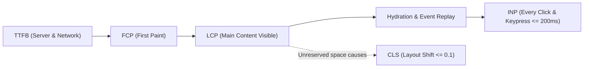
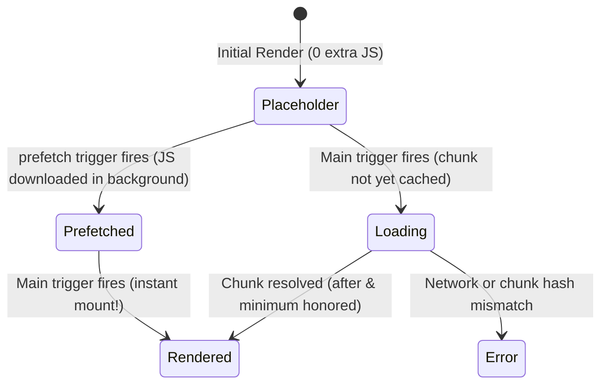
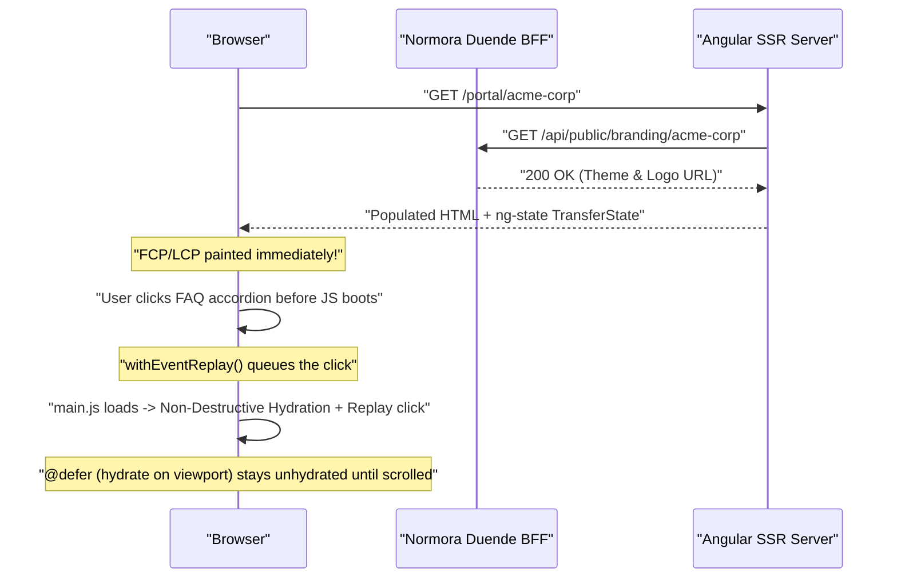
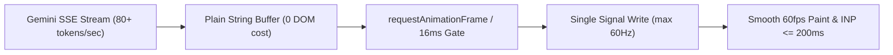

# Chapter 15: Performance Engineering

## 1. Learning Objectives
By the end of this chapter, you will be able to:
* Measure and enforce **Core Web Vitals** (LCP, INP, CLS, FCP, TTFB) and Angular production performance budgets.
* Implement **Deferrable Views (`@defer`)** with prefetching, minimum/after timers, and incremental hydration to cut initial JavaScript execution.
* Utilize **CDK Virtual Scrolling**, custom paged `DataSource`s, and CSS `content-visibility: auto` to render massive datasets at 60fps.
* Architect **Server-Side Rendering (SSR)**, **Non-Destructive & Incremental Hydration**, **Event Replay**, and **`TransferState`** safely behind a Duende BFF.
* Eliminate main-thread stalls using **`NgOptimizedImage`**, **Web Workers**, and **frame-budgeted SSE/SignalR stream batching**.
* Hunt down memory leaks (RxJS, SignalR/SSE handles, DOM observers, unbounded caches) using Chrome DevTools Heap Snapshots and report RUM metrics via OpenTelemetry.

---

## 2. Introduction: The Performance Mandate & Core Web Vitals

In enterprise SaaS, performance is a feature—and a security/reliability boundary. If an EV Charging dashboard takes 4 seconds to load and drops frames when scrolling through 5,000 charging stations, or if **Normora's** Copilot Workstation freezes the browser tab while streaming a multi-tool RAG response across 10,000 indexed policy chunks, users lose trust immediately.

Performance engineering in Angular splits into two complementary disciplines:
1. **Load-Time Performance:** How quickly the application becomes visible and interactive (SSR/SSG, `TransferState`, Route Lazy Loading, `@defer`, `NgOptimizedImage`).
2. **Runtime Performance:** How smoothly the application responds to user interactions and high-frequency streams over multi-hour sessions (Zoneless/Signals & `OnPush` from Chapter 13, Virtual Scrolling, Stream Batching, Web Workers, Memory Management).

*(Note: Change Detection internals and Zoneless Signal scheduling are covered in Chapter 13; AOT compilation, Ivy, Tree Shaking, and bundle analysis with `source-map-explorer` are covered in Chapter 14. This chapter focuses on architectural rendering, hydration, main-thread scheduling, and memory engineering.)*

### Core Web Vitals & Performance Metrics
Before optimizing, you must know what the browser actually measures. Google's **Core Web Vitals** define user-centric thresholds:

| Metric | Full Name | What It Measures | Target ("Good") | Primary Angular Levers |
| :--- | :--- | :--- | :--- | :--- |
| **TTFB** | Time to First Byte | Server + network latency before the first byte arrives | <= 800 ms | CDN/App Shell, Duende BFF caching, fast SSR |
| **FCP** | First Contentful Paint | Time until the first text/image paints | <= 1.8 s | Inline critical CSS, SSR/SSG, small initial bundle |
| **LCP** | Largest Contentful Paint | Time until the main hero element (table, heading, logo) renders | <= 2.5 s | Never `@defer` LCP; use `NgOptimizedImage` `priority` |
| **INP** | Interaction to Next Paint | Worst-case latency from click/keypress to next visual frame | <= 200 ms | Signal batching, Web Workers, `withIncrementalHydration()` |
| **CLS** | Cumulative Layout Shift | Unexpected visual jumping while elements load | <= 0.1 | Explicit `width`/`height`, `@placeholder (minimum ...)`, `min-h` skeletons |



### Enforcing Performance Budgets in `angular.json`
Never rely on willpower to keep bundles small. Configure strict **Performance Budgets** in `angular.json` so CI fails the build if a developer imports a massive un-tree-shakeable dependency into the initial bundle:

```json
{
  "budgets": [
    {
      "type": "initial",
      "maximumWarning": "400kB",
      "maximumError": "550kB"
    },
    {
      "type": "anyComponentStyle",
      "maximumWarning": "6kB",
      "maximumError": "12kB"
    }
  ]
}
```

> [!TIP]
> **When NOT to over-optimize upfront:** Never introduce complex Web Workers, custom virtual scrollers, or SSR infrastructure for a 30-row admin settings page. Measure with Chrome DevTools Performance traces and Lighthouse first, then apply targeted optimizations where Long Tasks (> 50 ms) or LCP (> 2.5 s) actually occur.

---

## 3. Load-Time Optimization: Deferrable Views (`@defer`)

Introduced in Angular v17 and mature in Angular 22, `@defer` is a built-in template control-flow block that declaratively lazy-loads standalone components, directives, and pipes into separate JavaScript chunks.

**Why it matters:** Route-level lazy loading only splits code *per URL*. Within a single complex screen—such as a dashboard or Normora's Copilot Workstation—80% of the heavy UI (drawers, charts, rich-text editors, interactive A2UI simulators) is hidden on initial render. Without `@defer`, all of that JavaScript is downloaded, parsed, and compiled on page boot.

**How it works under the hood:** During AOT compilation (Chapter 14), the Angular compiler detects standalone dependencies used *exclusively* inside a `@defer` block and rewrites their static imports into dynamic `import()` promises. Esbuild then emits separate lazy JS chunks automatically.

### Syntax, Sub-Blocks, and Flicker Prevention
A production `@defer` block uses four sub-blocks to manage both lazy loading and **CLS** (Cumulative Layout Shift):

```html
<!-- Existing Case Study: EV Charging Dashboard Chart -->
@defer (on viewport; prefetch on idle) {
  <app-massive-chart [data]="chartData()" />
} @placeholder (minimum 300ms) {
  <!-- Shown immediately in initial HTML; reserves exact height to prevent CLS -->
  <div class="h-72 w-full rounded-xl border border-slate-200 dark:border-slate-700 bg-slate-100 dark:bg-slate-800 p-4">
    Chart area ready — scroll to load
  </div>
} @loading (after 100ms; minimum 400ms) {
  <!-- Only shown if chunk download takes > 100ms; stays >= 400ms to prevent flash -->
  <div class="h-72 w-full animate-pulse rounded-xl bg-slate-200 dark:bg-slate-700"></div>
} @error {
  <div class="h-72 w-full rounded-xl border border-red-300 dark:border-red-800 bg-red-50 dark:bg-red-950/30 p-4 text-red-700 dark:text-red-300">
    Failed to load analytics module.
  </div>
}
```

Why do `after` and `minimum` matter?
* `@loading (after 100ms)`: On fast corporate fiber or warm browser cache, the chunk arrives in 15 ms. Without `after 100ms`, the user sees a jarring 15 ms spinner flash.
* `@loading (minimum 400ms)` / `@placeholder (minimum 300ms)`: Prevents rapid layout/spinner strobing when chunks resolve just over the `after` threshold.

### Complete Trigger & Prefetch Matrix

| Trigger / Modifier | Behavior | Best Use Case |
| :--- | :--- | :--- |
| `on idle` *(default)* | Loads via `requestIdleCallback` once the browser main thread is idle | Non-critical sidebars, secondary tabs, background widgets |
| `on viewport` | Uses `IntersectionObserver` on `@placeholder` (or a `#ref` element) | Below-the-fold analytics charts, long document footers |
| `on interaction` | Loads on `click` or `keydown` on `@placeholder` (or `#ref`) | Drawers, modals, expandable settings accordions |
| `on hover` | Loads on `mouseenter` / `focusin` | Tooltips, rich preview popovers, quick-inspect panels |
| `on immediate` | Starts fetching right after initial render without waiting for idle | Heavy panels visible on screen that shouldn't block boot |
| `on timer(2s)` | Loads after a fixed delay | Onboarding tours, feedback prompts |
| `when signalExpr()` | Declarative boolean condition (one-way: once loaded, stays loaded) | Dynamic A2UI cards, role-gated admin panels |
| `prefetch on <trigger>` | Downloads the JS chunk early *without* rendering the component yet | `on interaction; prefetch on hover` for zero-latency modals |



### When NOT to Use `@defer`
> [!WARNING]
> `@defer` is **not** free. Every `@defer` boundary creates an extra JS chunk, an extra HTTP request, and an asynchronous render delay.
1. **Never `@defer` Above-The-Fold LCP Content:** If the main header, primary chat input, or top document table is wrapped in `@defer`, Angular must download `main.js`, bootstrap the root tree, *and only then* discover and fetch the deferred chunk—wrecking your LCP.
2. **Never `@defer` Tiny Components:** Splitting a 1.5 KB badge or button adds HTTP waterfall overhead larger than the bytes saved.
3. **Watch Out for Accidental Eager Imports:** If `ChunkPreviewDrawerComponent` is inside `@defer` in Template A, **but also eagerly imported and rendered** in Template B on the same route, the bundler pulls it back into the parent bundle and `@defer` will NOT create a separate chunk.

### Real-World Normora Examples (`@defer`)

#### Normora Example 1: Citation `ChunkPreviewDrawerComponent` (`on interaction` + `prefetch on hover`)
In Normora's `Conversations` module, AI answers display citation pills (e.g., `[HR-Policy.pdf §3.2]`). Most users read the answer without opening the heavy Markdown + syntax-highlighted drawer, so we defer the drawer and prefetch it the instant the user hovers over a citation pill:

```typescript
// client/src/app/features/conversations/citation-viewer.component.ts
import { ChangeDetectionStrategy, Component, input, signal } from '@angular/core';
import { ChunkPreviewDrawerComponent } from './chunk-preview-drawer.component';

export interface CitationRef {
  chunkId: string;
  documentTitle: string;
  sectionBreadcrumb: string;
}

@Component({
  selector: 'normora-citation-viewer',
  changeDetection: ChangeDetectionStrategy.OnPush,
  imports: [ChunkPreviewDrawerComponent],
  template: `
    <button
      #citeTrigger
      type="button"
      (click)="drawerOpen.set(true)"
      class="inline-flex items-center gap-1 rounded-md border border-indigo-200 dark:border-indigo-800 bg-indigo-50 dark:bg-indigo-950/50 px-2 py-0.5 text-xs font-medium text-indigo-700 dark:text-indigo-300 hover:bg-indigo-100 dark:hover:bg-indigo-900/60"
    >
      {{ citation().documentTitle }}
    </button>

    @defer (when drawerOpen(); prefetch on hover(citeTrigger)) {
      @if (drawerOpen()) {
        <normora-chunk-preview-drawer
          [chunkId]="citation().chunkId"
          (closed)="drawerOpen.set(false)"
        />
      }
    } @placeholder {
      <span class="sr-only">Citation drawer collapsed</span>
    } @loading (after 80ms; minimum 300ms) {
      <div class="fixed inset-y-0 right-0 z-40 w-96 border-l border-slate-200 dark:border-slate-700 bg-white dark:bg-slate-900 p-6 shadow-xl">
        <div class="h-6 w-2/3 animate-pulse rounded bg-slate-200 dark:bg-slate-700"></div>
      </div>
    }
  `
})
export class CitationViewerComponent {
  readonly citation = input.required<CitationRef>();
  protected readonly drawerOpen = signal(false);
}
```

#### Normora Example 2: Dynamic A2UI `ExpenseSimulatorCardComponent` (`when` + `prefetch on idle`)
Normora's Copilot Workstation renders rich A2UI generative cards (`policy_limit_card`, `hr_escalation_card`, `intake_form_card`) only when `NormoraWorkplaceAgent` executes a matching tool. Deferring them with `when` keeps the core chat shell lightweight:

```html
<!-- Inside client/src/app/features/conversations/copilot-message.component.html -->
@defer (when message().a2uiCardType === 'policy_limit_card'; prefetch on idle) {
  <normora-expense-simulator-card
    [payload]="message().a2uiPayload"
    (simulated)="onLimitSimulated($event)"
  />
} @placeholder {
  @if (message().a2uiCardType === 'policy_limit_card') {
    <div class="h-44 w-full rounded-xl border border-slate-200 dark:border-slate-700 bg-slate-50 dark:bg-slate-800/60 p-4"></div>
  }
} @error {
  <p class="text-sm text-red-600 dark:text-red-400">{{ apiMessages.GenericError }}</p>
}
```

#### Normora Example 3: Below-the-Fold `TenantAuditLogsAnalyticsComponent` (`on viewport`)
In the `Tenants` admin dashboard, `workspace_get_dashboard_summary` KPIs are above the fold (never deferred!), while the heavy historical audit log charts sit below the fold:

```html
<!-- client/src/app/features/tenants/dashboard/tenant-dashboard.component.html -->
<section aria-label="Workspace KPIs" class="grid grid-cols-1 sm:grid-cols-2 lg:grid-cols-4 gap-4">
  <!-- Eagerly rendered LCP KPI cards -->
  <normora-kpi-strip [summary]="summary()" />
</section>

<section aria-label="Audit Trends" class="mt-8">
  @defer (on viewport) {
    <normora-audit-logs-analytics [tenantId]="tenantId()" />
  } @placeholder (minimum 300ms) {
    <div class="h-80 w-full rounded-2xl border border-slate-200 dark:border-slate-700 bg-white dark:bg-slate-900 p-6 text-slate-500 dark:text-slate-400">
      Scroll to inspect workspace audit activity...
    </div>
  } @loading (after 100ms; minimum 400ms) {
    <div class="h-80 w-full animate-pulse rounded-2xl bg-slate-200 dark:bg-slate-800"></div>
  }
</section>
```

#### Normora Example 4: Document Markdown & Diagram Renderer (`on idle` + `@error` using `ApiMessages`)
In `Documents`, previewing uploaded Markdown policy manuals pulls in a heavy syntax-highlighter and diagram parser. Deferring it `on idle` ensures document metadata and permissions render instantaneously while the rich viewer loads immediately after:

```typescript
// client/src/app/features/documents/document-reader.component.ts
import { ChangeDetectionStrategy, Component, input } from '@angular/core';
import { ApiMessages } from '../../core/constants/api-messages';
import { RichMarkdownViewerComponent } from '../../shared/components/rich-markdown-viewer.component';

@Component({
  selector: 'normora-document-reader',
  changeDetection: ChangeDetectionStrategy.OnPush,
  imports: [RichMarkdownViewerComponent],
  template: `
    <article class="rounded-xl border border-slate-200 dark:border-slate-700 bg-white dark:bg-slate-900 p-6">
      <h1 class="text-xl font-semibold text-slate-900 dark:text-white">{{ title() }}</h1>

      @defer (on idle) {
        <normora-rich-markdown-viewer [markdown]="rawMarkdown()" />
      } @placeholder {
        <pre class="mt-4 whitespace-pre-wrap text-sm text-slate-600 dark:text-slate-300">{{ rawMarkdown() }}</pre>
      } @error {
        <p class="mt-4 text-sm text-red-600 dark:text-red-400">{{ messages.DocumentPreviewUnavailable }}</p>
      }
    </article>
  `
})
export class DocumentReaderComponent {
  readonly title = input.required<string>();
  readonly rawMarkdown = input.required<string>();
  protected readonly messages = ApiMessages;
}
```

#### Normora Example 5: White-Label Branding Color & Logo Studio (`on interaction`)
Only tenant admins who click "Customize Workspace Branding" need the color-picker + MinIO logo cropper bundle (`Tenants` module):

```html
<!-- client/src/app/features/tenants/branding/branding-settings.component.html -->
<button
  #openStudioBtn
  type="button"
  (click)="studioExpanded.set(true)"
  class="rounded-lg border border-slate-300 dark:border-slate-600 bg-white dark:bg-slate-800 px-4 py-2 text-sm font-medium text-slate-900 dark:text-slate-100"
>
  Customize Workspace Branding
</button>

@defer (on interaction(openStudioBtn); prefetch on hover(openStudioBtn)) {
  @if (studioExpanded()) {
    <normora-white-label-studio [currentBranding]="branding()" />
  }
} @placeholder {
  <p class="mt-2 text-xs text-slate-500 dark:text-slate-400">
    Click above to load the interactive branding studio.
  </p>
}
```

---

## 4. Runtime Optimization: Virtual Scrolling & Large Dataset Rendering

What happens if an API returns an array of 10,000 EV charging sessions—or 25,000 `AuditLogs` entries in Normora—and you render them all using `@for`?
The browser creates 10,000+ DOM nodes, style recalculation spikes into hundreds of milliseconds, scrolling drops to single-digit FPS, and mobile tabs run out of memory.

### Baseline Hygiene: Mandatory `track` Identity in `@for`
Before reaching for virtual scrolling, ensure every standard `@for` loop uses a stable unique key (`track item.id`), never `$index` for mutable/sortable lists. In Angular's built-in control flow, `track` is mandatory: when a Signal array updates (such as SignalR bumping a document's ingestion status), Angular reuses existing DOM elements by identity instead of tearing down and recreating nodes.

### The Solution: `@angular/cdk/scrolling` (DOM Windowing)
For lists exceeding ~200–500 rows, the Angular Component Dev Kit (CDK) provides `cdk-virtual-scroll-viewport`. Instead of mounting 10,000 nodes, it measures the viewport height and `itemSize`, rendering *only the visible window* (e.g., 15–20 rows) plus configurable pixel buffers (`minBufferPx` / `maxBufferPx`). As the user scrolls, Angular recycles those DOM views via `*cdkVirtualFor`.

**Existing Case Study: `session-log.component.html`**
```html
<cdk-virtual-scroll-viewport itemSize="50" minBufferPx="200" maxBufferPx="400" class="viewport">
  <!-- *cdkVirtualFor performs DOM windowing; trackBy preserves row view instances -->
  <div *cdkVirtualFor="let session of sessions(); trackBy: trackById" class="row">
    <span>{{ session.id }}</span>
    <span>{{ session.kwhDelivered }}</span>
  </div>
</cdk-virtual-scroll-viewport>
```

**`session-log.component.scss`**
```css
.viewport {
  height: 500px; /* The viewport MUST have an explicit height */
  width: 100%;
}
.row {
  height: 50px; /* Must match the itemSize input exactly */
}
```

### Handling Variable-Height Content & Huge Datasets
Fixed `itemSize` virtual scrolling breaks when rows have wildly different heights (such as Normora's AI chat answers containing multi-paragraph Markdown, tables, and A2UI cards). You have two architect-grade alternatives:
1. **CSS `content-visibility: auto` + `contain-intrinsic-size`:** The browser skips layout and paint for off-screen elements natively while keeping browser Find-in-Page (`Ctrl+F`) and variable heights working effortlessly.
2. **Custom CDK `DataSource<T>` with Backend Paging:** Instead of loading 50,000 records into a Signal array (which still bloats JS heap memory), extend CDK's `DataSource<T>` and react to `viewChange` ranges to fetch 100-item pages on demand from Normora's paginated APIs.

### When NOT to Use Virtual Scrolling
1. **Small Lists (< 100 items):** Virtual scroll listeners and transform calculations add unnecessary overhead compared to a plain `@for` loop.
2. **Ctrl+F / Full-DOM Accessibility or SEO Pages:** Because off-screen rows do not exist in the DOM, browser `Ctrl+F` search and crawlers cannot see them. Prefer CSS `content-visibility: auto` or server pagination when `Ctrl+F` matters.
3. **Highly Variable-Height Cards Without Fixed Bounds:** Fixed `itemSize` causes severe scrollbar jumping; use `content-visibility: auto` or cursor pagination instead.

### Real-World Normora Examples (Virtual Scrolling & Large Lists)

#### Normora Example 1: `TenantAuditLogsViewportComponent` (Fixed-Height Virtual Scroll)
In Normora's `Tenants` module, enterprise security admins audit thousands of workspace events (`workspace_get_audit_logs`). Each log row is locked to `56px` height (`h-14`), uses `.custom-scrollbar` and full Tailwind v4 `dark:` styling:

```typescript
// client/src/app/features/tenants/audit-logs/audit-logs-viewport.component.ts
import { ChangeDetectionStrategy, Component, input } from '@angular/core';
import { ScrollingModule } from '@angular/cdk/scrolling';

export interface AuditLogItem {
  id: string;
  actorExternalUserId: string;
  action: string;
  occurredAtIso: string;
}

@Component({
  selector: 'normora-audit-logs-viewport',
  changeDetection: ChangeDetectionStrategy.OnPush,
  imports: [ScrollingModule],
  template: `
    <cdk-virtual-scroll-viewport
      [itemSize]="56"
      [minBufferPx]="280"
      [maxBufferPx]="560"
      class="custom-scrollbar h-[560px] w-full rounded-xl border border-slate-200 dark:border-slate-700 bg-white dark:bg-slate-900"
    >
      <div
        *cdkVirtualFor="let entry of logs(); trackBy: trackByLogId"
        class="flex h-14 items-center justify-between border-b border-slate-100 dark:border-slate-800 px-4 text-sm text-slate-800 dark:text-slate-200"
      >
        <span class="truncate font-medium">{{ entry.action }}</span>
        <span class="text-xs text-slate-500 dark:text-slate-400">{{ entry.occurredAtIso }}</span>
      </div>
    </cdk-virtual-scroll-viewport>
  `
})
export class AuditLogsViewportComponent {
  readonly logs = input.required<readonly AuditLogItem[]>();
  protected readonly trackByLogId = (_: number, item: AuditLogItem) => item.id;
}
```

#### Normora Example 2: Paged `DocumentChunksDataSource` (Zero Heap Bloat for `Documents`)
An enterprise compliance manual in Normora's `Documents` module can split into 15,000+ Markdown chunks. Fetching all 15,000 chunks into memory defeats the purpose of virtual scrolling. Extending `DataSource<DocumentChunkDto>` fetches pages lazily as the viewport scrolls:

```typescript
// client/src/app/features/documents/document-chunks.datasource.ts
import { CollectionViewer, DataSource } from '@angular/cdk/collections';
import { HttpClient } from '@angular/common/http';
import { BehaviorSubject, Subscription } from 'rxjs';

export interface DocumentChunkDto {
  id: string;
  breadcrumb: string;
  tokenCount: number;
}

export class DocumentChunksDataSource extends DataSource<DocumentChunkDto | undefined> {
  private readonly pageSize = 50;
  private readonly cachedChunks = Array.from<DocumentChunkDto | undefined>({ length: 0 });
  private readonly fetchedPages = new Set<number>();
  private readonly dataStream = new BehaviorSubject<(DocumentChunkDto | undefined)[]>([]);
  private subscription?: Subscription;

  constructor(
    private readonly http: HttpClient,
    private readonly documentId: string,
    totalCount: number
  ) {
    super();
    this.cachedChunks.length = totalCount;
    this.dataStream.next(this.cachedChunks);
  }

  connect(collectionViewer: CollectionViewer) {
    this.subscription = collectionViewer.viewChange.subscribe(range => {
      const startPage = Math.floor(range.start / this.pageSize);
      const endPage = Math.floor(range.end / this.pageSize);
      for (let page = startPage; page <= endPage; page++) {
        this.fetchPage(page);
      }
    });
    return this.dataStream.asObservable();
  }

  disconnect(): void {
    this.subscription?.unsubscribe();
  }

  private fetchPage(page: number): void {
    if (this.fetchedPages.has(page)) return;
    this.fetchedPages.add(page);

    this.http
      .get<DocumentChunkDto[]>(`/api/documents/${this.documentId}/chunks`, {
        params: { page, pageSize: this.pageSize }
      })
      .subscribe(items => {
        this.cachedChunks.splice(page * this.pageSize, items.length, ...items);
        this.dataStream.next([...this.cachedChunks]);
      });
  }
}
```

#### Normora Example 3: `CopilotThreadHistoryComponent` (`Conversations` Sidebar)
Power users accumulate thousands of Copilot threads (`conversations_list`). Coupling a `computed()` filter signal with a `44px` fixed-height virtual scroll keeps the `Ctrl+J` workstation drawer silky smooth:

```typescript
// client/src/app/features/conversations/thread-history-list.component.ts
import { ChangeDetectionStrategy, Component, computed, input, output, signal } from '@angular/core';
import { ScrollingModule } from '@angular/cdk/scrolling';

export interface ThreadSummary {
  id: string;
  title: string;
}

@Component({
  selector: 'normora-thread-history-list',
  changeDetection: ChangeDetectionStrategy.OnPush,
  imports: [ScrollingModule],
  template: `
    <input
      type="search"
      [value]="query()"
      (input)="query.set($any($event.target).value)"
      placeholder="Filter conversations..."
      class="mb-2 w-full rounded-lg border border-slate-200 dark:border-slate-700 bg-white dark:bg-slate-900 px-3 py-1.5 text-sm text-slate-900 dark:text-slate-100 outline-none!"
    />
    <cdk-virtual-scroll-viewport itemSize="44" class="custom-scrollbar h-96 w-full">
      <button
        *cdkVirtualFor="let thread of filteredThreads(); trackBy: trackThread"
        type="button"
        (click)="selected.emit(thread.id)"
        class="flex h-11 w-full items-center truncate rounded-md px-3 text-left text-sm text-slate-700 dark:text-slate-200 hover:bg-slate-100 dark:hover:bg-slate-800"
      >
        {{ thread.title }}
      </button>
    </cdk-virtual-scroll-viewport>
  `
})
export class ThreadHistoryListComponent {
  readonly threads = input.required<readonly ThreadSummary[]>();
  readonly selected = output<string>();
  protected readonly query = signal('');

  protected readonly filteredThreads = computed(() => {
    const term = this.query().trim().toLowerCase();
    return term ? this.threads().filter(t => t.title.toLowerCase().includes(term)) : this.threads();
  });

  protected readonly trackThread = (_: number, item: ThreadSummary) => item.id;
}
```

#### Normora Example 4: `TenantMembershipsDirectoryComponent` (10k+ Employee Directory)
When rendering large `TenantMemberships` tables (`workspace_list_employees`) in `Tenants`, virtual scrolling preserves `60fps` scrolling while showing a localized `ApiMessages` empty state when BOLA/filtering yields zero rows:

```html
<!-- client/src/app/features/tenants/members/members-directory.component.html -->
@if (members().length === 0) {
  <p class="p-6 text-center text-sm text-slate-500 dark:text-slate-400">
    {{ apiMessages.NoMembersFound }}
  </p>
} @else {
  <cdk-virtual-scroll-viewport
    [itemSize]="60"
    class="custom-scrollbar h-[480px] w-full rounded-xl border border-slate-200 dark:border-slate-700 bg-white dark:bg-slate-900"
  >
    <div
      *cdkVirtualFor="let member of members(); trackBy: trackByMemberId"
      class="flex h-[60px] items-center justify-between border-b border-slate-100 dark:border-slate-800 px-4"
    >
      <span class="font-medium text-slate-900 dark:text-slate-100">{{ member.displayName }}</span>
      <span class="text-xs text-slate-500 dark:text-slate-400">{{ member.departmentName }}</span>
    </div>
  </cdk-virtual-scroll-viewport>
}
```

#### Normora Example 5: `RagTranscriptStreamComponent` (Variable-Height Messages with `content-visibility: auto`)
Because Copilot messages mix short 2-line answers, large Markdown tables, `ExpenseSimulatorCardComponent`, and `HrEscalationCardComponent` timelines, fixed `itemSize` breaks. CSS `content-visibility: auto` skips off-screen layout/paint natively while keeping `Ctrl+F` intact:

```html
<!-- client/src/app/features/conversations/rag-transcript-stream.component.html -->
<div class="custom-scrollbar flex flex-col gap-4 overflow-y-auto p-4 bg-slate-50 dark:bg-slate-950">
  @for (turn of turns(); track turn.id) {
    <article
      class="rounded-xl border border-slate-200 dark:border-slate-700 bg-white dark:bg-slate-900 p-4 shadow-xs"
      style="content-visibility: auto; contain-intrinsic-size: auto 160px;"
    >
      <normora-markdown-message [content]="turn.markdown" />
    </article>
  }
</div>
```

---

## 5. Server-Side Rendering (SSR), Hydration & Event Replay

By default, Angular is a Client-Side Rendered (CSR) Single Page Application (SPA):
1. The server sends a nearly empty `index.html`.
2. The browser downloads `main.js`.
3. Angular boots up and generates the HTML DOM in the browser.

For public pages, CSR hurts **SEO** and delays **FCP/LCP** on slower mobile networks.

### Modern Angular SSR & Non-Destructive Hydration
Modern Angular provides a built-in SSR pipeline (Node.js / Express or edge adapters):
1. The user requests a URL.
2. The Node server executes Angular in memory, resolves route data, and streams fully populated HTML.
3. The browser renders the content immediately (fast FCP and LCP).
4. Once `main.js` loads, Angular performs **Non-Destructive Hydration** (`provideClientHydration()`): instead of destroying and recreating the server DOM (which used to cause visible flickering), it walks the existing DOM nodes, binds Signal expressions, and attaches event listeners in place.

### Event Replay (`withEventReplay()`) & Incremental Hydration (`withIncrementalHydration()`)
Two Angular capabilities solve the biggest historical flaws of SSR:
* **The "Dead Click" Problem (`withEventReplay()`):** Suppose SSR renders a "Approve Deletion" button in 120 ms, and the user clicks it at 300 ms—before `main.js` finishes hydrating at 900 ms. Without event replay, the click vanishes into thin air. `withEventReplay()` captures user interactions on unhydrated DOM nodes and replays them automatically the instant Angular finishes hydrating that block.
* **The "Total Blocking Time" Problem (`withIncrementalHydration()`):** Hydrating an entire complex page synchronously can block the main thread for hundreds of milliseconds (hurting INP). With `withIncrementalHydration()`, you can annotate `@defer` blocks with hydration triggers:
  * `@defer (hydrate on viewport)`: Keeps server-rendered HTML visible immediately, but does *not* download or hydrate its JS until scrolled into view.
  * `@defer (hydrate on interaction)`: Hydrates only when clicked/focused.
  * `@defer (hydrate never)`: Renders static HTML on the server (e.g., legal footers) and ships **zero client JavaScript** to hydrate it!

### Avoiding Duplicate API Calls with `TransferState` & `HttpTransferCache`
When SSR runs an `HttpClient.get(...)` call, the server already fetched the JSON. Without `TransferState`, the browser would immediately repeat the exact same HTTP request during hydration!
`provideClientHydration()` enables **HTTP Transfer Cache** automatically for `GET`/`HEAD` requests: the server serializes cached responses into `<script id="ng-state">` in the HTML, and the browser reads them synchronously on boot.



### When NOT to Use SSR (The Duende BFF Reality Check)
> [!IMPORTANT]
> **Architecture Trade-off for Normora:** Normora's authenticated workspace sits behind a **Duende BFF** issuing encrypted `HttpOnly`, `SameSite=Strict`, `Secure` session cookies.
> * **Where SSR/SSG Shines:** Public white-label tenant login portals, public knowledge-base landing pages, pricing pages, and marketing routes where SEO and anonymous FCP/LCP matter.
> * **Where NOT to Use SSR:** Deeply authenticated internal workspaces (Copilot Workstation, Admin Audit Logs, Document Upload) where:
>   1. Pages have zero SEO value and require per-user `ExternalUserId` + RBAC checks.
>   2. Forwarding `HttpOnly` cookies from browser -> Node SSR -> Duende BFF adds extra network hops and risks **cross-tenant `TransferState` or CDN cache poisoning** if any proxy caches HTML!
>   3. Use Angular's per-route `RenderMode.Server` / `RenderMode.Prerender` / `RenderMode.Client` (`app.routes.server.ts`) so public pages use SSR/SSG while authenticated `/app/**` routes remain `RenderMode.Client`!

### SSR Architectural Traps: Browser-Only APIs & Render Phases
On the SSR server, `window`, `document`, `localStorage`, and `ResizeObserver` do not exist.
* **Trap:** Calling `document.getElementById(...)` or `window.matchMedia(...)` inside `ngOnInit` or a constructor throws `ReferenceError: window is not defined` on the Node SSR host.
* **Solution 1 (`PLATFORM_ID`):** Inject `PLATFORM_ID` and guard with `isPlatformBrowser(platformId)`.
* **Solution 2 (`afterNextRender` / `afterEveryRender`):** Guaranteed to run *only* in the browser after Angular commits the DOM. Moreover, Angular lets you specify explicit render phases (`earlyRead`, `write`, `mixedReadWrite`, `read`) so multiple components batch DOM reads before DOM writes—preventing **layout thrashing**!

**Existing Case Study: `DashboardComponent`**
```typescript
import { afterNextRender, Component } from '@angular/core';

@Component({ selector: 'app-dashboard', template: `<canvas id="chart"></canvas>` })
export class DashboardComponent {
  constructor() {
    afterNextRender(() => {
      // Safe! Guaranteed to only run in the browser, never on the Node SSR server.
      const chartCanvas = document.getElementById('chart');
      if (chartCanvas) {
        initializeHeavyChartLibrary(chartCanvas);
      }
    });
  }
}
```

### Real-World Normora Examples (SSR, Hydration & Browser-Safe Rendering)

#### Normora Example 1: `app.config.ts` Hydration with BFF Security Exclusions
Configure `withEventReplay()`, `withIncrementalHydration()`, and `withHttpTransferCacheOptions` so authenticated `/bff/` and `/api/copilotkit` routes are **never** serialized into HTML `TransferState`:

```typescript
// client/src/app/app.config.ts
import { ApplicationConfig } from '@angular/core';
import {
  provideClientHydration,
  withEventReplay,
  withHttpTransferCacheOptions,
  withIncrementalHydration
} from '@angular/platform-browser';

export const appConfig: ApplicationConfig = {
  providers: [
    provideClientHydration(
      withEventReplay(),
      withIncrementalHydration(),
      withHttpTransferCacheOptions({
        filter: req => !req.url.startsWith('/bff/') && !req.url.startsWith('/api/copilotkit')
      })
    )
  ]
};
```

#### Normora Example 2: Public White-Label Portal with `@defer (hydrate on ...)`
On Normora's public tenant portal (`/portal/:slug`), the tenant's brand header hydrates immediately, the interactive policy FAQ preview uses `hydrate on viewport`, and the static legal footer uses `hydrate never` (0 KB JS shipped for the footer):

```html
<!-- client/src/app/features/tenants/public-portal/public-portal.component.html -->
<header class="border-b border-slate-200 dark:border-slate-700 bg-white dark:bg-slate-900 px-6 py-4">
  <h1 class="text-2xl font-bold text-slate-900 dark:text-white">{{ portalTitle() }}</h1>
</header>

@defer (hydrate on viewport) {
  <normora-public-faq-preview [tenantSlug]="slug()" />
} @placeholder {
  <div class="h-64 w-full bg-slate-100 dark:bg-slate-800"></div>
}

@defer (hydrate never) {
  <footer class="mt-12 border-t border-slate-200 dark:border-slate-800 py-6 text-xs text-slate-500 dark:text-slate-400">
    Powered by Normora Knowledge Platform
  </footer>
}
```

#### Normora Example 3: `BrandThemeTransferService` Using `TransferState` (Zero Theme FOUC)
Public white-label themes (stored via `MinioBrandingStorageService`) are fetched once on the SSR server and handed cleanly to the client via `TransferState` so there is zero Flash of Unstyled Content (FOUC):

```typescript
// client/src/app/core/services/brand-theme-transfer.service.ts
import { inject, Injectable, makeStateKey, TransferState } from '@angular/core';

export interface PublicBrandTheme {
  primaryHex: string;
  logoUrl: string;
}

const BRAND_THEME_KEY = makeStateKey<PublicBrandTheme>('normora_public_brand_theme');

@Injectable({ providedIn: 'root' })
export class BrandThemeTransferService {
  private readonly transferState = inject(TransferState);

  saveForClient(theme: PublicBrandTheme): void {
    this.transferState.set(BRAND_THEME_KEY, theme);
  }

  consumeFromServer(): PublicBrandTheme | null {
    if (!this.transferState.hasKey(BRAND_THEME_KEY)) return null;
    const theme = this.transferState.get(BRAND_THEME_KEY, null);
    this.transferState.remove(BRAND_THEME_KEY);
    return theme;
  }
}
```

#### Normora Example 4: `CopilotFocusDirective` with `afterNextRender`
Normora's Unified Copilot Workstation supports `Ctrl+J` / `Cmd+J` auto-focusing the prompt box. Measuring element focus and viewport dimensions happens inside `afterNextRender` so SSR never touches `HTMLElement.focus()`:

```typescript
// client/src/app/features/conversations/copilot-focus.directive.ts
import { afterNextRender, Directive, ElementRef, inject } from '@angular/core';

@Directive({
  selector: '[normoraAutoFocus]'
})
export class CopilotFocusDirective {
  private readonly host = inject<ElementRef<HTMLTextAreaElement>>(ElementRef);

  constructor() {
    afterNextRender(() => {
      this.host.nativeElement.focus({ preventScroll: true });
    });
  }
}
```

#### Normora Example 5: `BffSessionBootstrapService` Guarded by `isPlatformBrowser`
Real-time SignalR connections (`/hubs/workspace`) and system dark-mode `matchMedia` listeners must never run on the Node SSR host:

```typescript
// client/src/app/core/services/bff-session-bootstrap.service.ts
import { isPlatformBrowser } from '@angular/common';
import { inject, Injectable, PLATFORM_ID, signal } from '@angular/core';

@Injectable({ providedIn: 'root' })
export class BffSessionBootstrapService {
  private readonly platformId = inject(PLATFORM_ID);
  readonly prefersDark = signal(false);

  initBrowserCapabilities(): void {
    if (!isPlatformBrowser(this.platformId)) {
      return; // Skip WebSocket/SignalR & window listeners during SSR
    }
    const media = window.matchMedia('(prefers-color-scheme: dark)');
    this.prefersDark.set(media.matches);
  }
}
```

---

## 6. Main-Thread Scheduling, Streaming Batching & Asset Optimization

Fast initial HTML is only half the battle. An Angular app feels sluggish when **Long Tasks (> 50 ms)** saturate the browser's single JavaScript main thread, delaying clicks (**INP > 200 ms**) or causing un-sized images to shift text (**CLS > 0.1**).

### Image & LCP Optimization with `NgOptimizedImage` (`ngSrc`)
Images are the #1 cause of poor LCP and CLS. Angular's built-in `NgOptimizedImage` directive enforces best practices automatically at compile and runtime:
* **`priority` attribute:** Automatically sets `fetchpriority="high"`, disables lazy loading, and warns in dev mode if a `<link rel="preconnect">` hint is missing for your image origin (such as Normora's MinIO endpoint).
* **Mandatory `width` and `height` (or `fill`):** Eliminates CLS by reserving exact aspect-ratio space before the image downloads.
* **Automatic Lazy Loading & `srcset`:** Non-priority images default to `loading="lazy"` and can generate responsive `srcset` URLs via custom image loaders.

**When NOT to use `NgOptimizedImage` (`ngSrc`):**
* Do **not** use `ngSrc` for inline `<svg>` icons, `data:` Base64 preview thumbnails, or CSS `background-image` gradients.

### High-Frequency Stream Batching (SSE & SignalR)
In conversational AI and real-time dashboards, network streams arrive faster than the human eye (or browser 60 Hz display at 16.6 ms/frame) can process.
* **The Problem:** If `NormoraWorkplaceAgent` streams 80 Gemini tokens/second over SSE (`/api/copilotkit`) and each token writes directly to a Signal that re-runs a Markdown + syntax highlighter parser, you trigger 80 full DOM/AST passes per second—freezing the scroll bar and input box.
* **The Fix (Frame-Budgeted Batching):** Buffer incoming text chunks in a plain string variable and flush them into your Angular Signal once per animation frame (`requestAnimationFrame`, ~16 ms) or with RxJS `auditTime(16)` / `bufferTime(50)`.



### Web Workers & Avoiding Layout Thrashing
* **Web Workers (`ng generate web-worker`):** Offload CPU-intensive synchronous work (e.g., searching 5,000 cached conversation transcripts, exporting 20,000 `AuditLogs` rows to CSV) off the main thread so button clicks remain instant.
* **When NOT to use Web Workers:** Never spin up a Web Worker for small array filters (< 1,000 items)—structured-cloning data across `postMessage` costs more than filtering inline!
* **Avoiding Layout Thrashing (Forced Synchronous Reflow):** Reading a layout property (`offsetHeight`, `getBoundingClientRect()`) immediately after mutating DOM styles forces the browser to recalculate layout synchronously. Group all DOM reads first (`afterEveryRender({ earlyRead: ... })`) and all DOM writes second (`afterEveryRender({ write: ... })`).

### Real-World Normora Examples (Main-Thread & Asset Optimization)

#### Normora Example 1: `TenantLogoComponent` with `NgOptimizedImage` (`priority` for LCP)
The tenant's white-label header logo stored in MinIO (`IBrandingStorageService`) is above the fold on every page. Using `ngSrc` with `priority` and explicit `width`/`height` protects both LCP and CLS:

```typescript
// client/src/app/layout/tenant-logo.component.ts
import { NgOptimizedImage } from '@angular/common';
import { ChangeDetectionStrategy, Component, input } from '@angular/core';

@Component({
  selector: 'normora-tenant-logo',
  changeDetection: ChangeDetectionStrategy.OnPush,
  imports: [NgOptimizedImage],
  template: `
    
  `
})
export class TenantLogoComponent {
  readonly logoUrl = input.required<string>();
  readonly workspaceName = input.required<string>();
}
```

#### Normora Example 2: `CopilotStreamService` Frame-Budgeted SSE Token Batching
Instead of updating `streamingText` on every single SSE chunk from `/api/copilotkit`, `CopilotStreamService` accumulates deltas and flushes at most once per animation frame:

```typescript
// client/src/app/features/conversations/copilot-stream.service.ts
import { Injectable, signal } from '@angular/core';

@Injectable({ providedIn: 'root' })
export class CopilotStreamService {
  readonly streamingAnswer = signal('');
  private pendingBuffer = '';
  private rafScheduled = false;

  appendTokenDelta(delta: string): void {
    this.pendingBuffer += delta;
    if (this.rafScheduled) return;

    this.rafScheduled = true;
    requestAnimationFrame(() => {
      this.streamingAnswer.update(current => current + this.pendingBuffer);
      this.pendingBuffer = '';
      this.rafScheduled = false;
    });
  }

  reset(): void {
    this.pendingBuffer = '';
    this.streamingAnswer.set('');
  }
}
```

#### Normora Example 3: `DocumentIngestionTrackerService` Throttling SignalR Burst Events
When an admin bulk-uploads 50 policy PDFs, `Normora.Worker` emits rapid `DocumentStatusChanged` and `dataVersion` notifications over the Redis SignalR backplane. Using `auditTime(150)` collapses 50 bursts into 1 table refresh:

```typescript
// client/src/app/features/documents/document-ingestion-tracker.service.ts
import { inject, Injectable } from '@angular/core';
import { takeUntilDestroyed } from '@angular/core/rxjs-interop';
import { auditTime, Subject } from 'rxjs';

@Injectable({ providedIn: 'root' })
export class DocumentIngestionTrackerService {
  private readonly versionBump$ = new Subject<number>();

  constructor() {
    this.versionBump$
      .pipe(auditTime(150), takeUntilDestroyed())
      .subscribe(latestVersion => this.reloadDocumentTable(latestVersion));
  }

  onSignalRDataVersion(version: number): void {
    this.versionBump$.next(version);
  }

  private reloadDocumentTable(_version: number): void {
    // Executes a single paginated GET /api/documents refresh instead of 50 redundant calls
  }
}
```

#### Normora Example 4: Offloading Conversation Index Search to a Web Worker
For power users searching across 5,000+ cached messages in the Copilot Workstation, a dedicated Web Worker keeps typing latency (`INP`) under 16 ms:

```typescript
// client/src/app/features/conversations/conversation-search.service.ts
import { DestroyRef, inject, Injectable, signal } from '@angular/core';

@Injectable()
export class ConversationSearchService {
  private readonly destroyRef = inject(DestroyRef);
  readonly matches = signal<string[]>([]);
  private worker?: Worker;

  constructor() {
    if (typeof Worker !== 'undefined') {
      this.worker = new Worker(new URL('./conversation-search.worker', import.meta.url));
      this.worker.onmessage = ({ data }: MessageEvent<string[]>) => this.matches.set(data);
      this.destroyRef.onDestroy(() => this.worker?.terminate());
    }
  }

  search(query: string): void {
    this.worker?.postMessage({ query });
  }
}
```

#### Normora Example 5: `ResizableCopilotPaneDirective` Avoiding Layout Thrashing
Dragging Normora's Dock & Expand Copilot pane resizes the layout. Separating DOM measurement (`earlyRead`) from width mutation (`write`) via `afterEveryRender` (or `requestAnimationFrame`) eliminates forced synchronous reflows:

```typescript
// client/src/app/layout/resizable-copilot-pane.directive.ts
import { afterEveryRender, Directive, ElementRef, inject, signal } from '@angular/core';

@Directive({ selector: '[normoraResizablePane]' })
export class ResizableCopilotPaneDirective {
  private readonly el = inject<ElementRef<HTMLElement>>(ElementRef);
  readonly targetWidthPx = signal(420);

  constructor() {
    afterEveryRender({
      write: () => {
        this.el.nativeElement.style.width = `${this.targetWidthPx()}px`;
      }
    });
  }
}
```

---

## 7. Memory Profiling, Leak Prevention & Production Observability

Memory leaks are the silent killers of enterprise Single Page Applications. If a Normora workspace admin leaves the Operations or Copilot Workstation open for 8 hours, does browser RAM stay steady at ~120 MB or climb to 2 GB until the tab crashes with `Aw, Snap!`?

### 1. Untracked RxJS Subscriptions & `takeUntilDestroyed`
If you subscribe to a long-lived `Observable` (such as `Router.events`, an SSE stream wrapper, or a shared SignalR `Subject`) inside a component and fail to unsubscribe when the component destroys, the subscription holds a closure reference to `this`, pinning the entire component tree and its DOM nodes in memory forever.

**Existing Case Study: `ChargerComponent`**
```typescript
import { takeUntilDestroyed } from '@angular/core/rxjs-interop';

export class ChargerComponent {
  constructor() {
    this.globalService.data$.pipe(
      // Automatically unsubscribes when the injection context (component/service) is destroyed
      takeUntilDestroyed()
    ).subscribe(data => console.log(data));
  }
}
```

> [!NOTE]
> **The Injection Context Rule:** Calling `takeUntilDestroyed()` with **no arguments** only works inside an *injection context* (class field initializer or `constructor`). If you subscribe later inside `ngOnInit()` or a button click handler, inject `private readonly destroyRef = inject(DestroyRef)` as a class field and pass `takeUntilDestroyed(this.destroyRef)`.

### 2. Beyond RxJS: The Other 4 Enterprise Memory Leaks
Even in 100% Signals-based Angular 22 apps, memory leaks still happen through non-RxJS channels:
1. **Unclosed SignalR Handlers & SSE `AbortController`s:** Registering `hubConnection.on('DocumentIngested', callback)` without calling `hubConnection.off(...)` in `DestroyRef.onDestroy(...)`, or leaving a `fetch()` SSE stream open when switching Copilot threads.
2. **Orphaned DOM Listeners & Observers:** `window.addEventListener('keydown', ...)` (e.g., `Ctrl+J`), `ResizeObserver`, and `IntersectionObserver` live outside Angular's template bindings and must be disconnected in `DestroyRef.onDestroy(...)`.
3. **Unbounded Root Service Caches:** A `providedIn: 'root'` service storing every fetched document chunk or conversation thread in an infinite `Map<string, Chunk>` leaks linearly over an 8-hour workday. Always enforce a bounded **LRU (Least Recently Used)** eviction cap.
4. **Detached DOM Nodes:** Third-party canvas/chart/diagram widgets that cache references to `<canvas>` or `<div>` elements after Angular removes them from the DOM. Always call `.destroy()` / `.dispose()` on third-party instances in `DestroyRef.onDestroy(...)`.

### 3. Hunting Leaks Systematically: The 3-Snapshot Technique & Angular DevTools
1. **Use the "Three-Snapshot" Technique in Chrome DevTools -> Memory:**
   * Navigate to a baseline route (e.g., `/dashboard`), click **Collect garbage** (trash icon), and take **Snapshot 1**.
   * Navigate to the suspect route (e.g., `/documents/123`), open/close its drawer, navigate back to `/dashboard`, and repeat 3 times.
   * Click **Collect garbage** again and take **Snapshot 2**. (Repeat one more cycle for **Snapshot 3** to rule out one-time lazy singletons).
   * In Snapshot 3, select **"Objects allocated between Snapshot 1 and Snapshot 2"**, filter by your component class name (e.g., `ChunkPreviewDrawerComponent`) or `Detached HTMLElement`, and inspect the **Retainers** tree at the bottom. The top retainer chain points directly to the leaked closure, `HubConnection`, or listener.
2. **Profile Change Detection with Angular DevTools:** Use the **Profiler** tab in the Angular DevTools browser extension to record user interactions and spot components spending > 16 ms per cycle or re-rendering unexpectedly.
3. **Track Production Performance (RUM) via OpenTelemetry:** Synthetic lab tests (Lighthouse) miss real corporate VPN latency and slow employee laptops. Capture **Real User Monitoring (RUM)** Core Web Vitals (`web-vitals` library) and export them to Normora's OpenTelemetry pipeline (sanitizing route templates so tenant slugs or document IDs never become high-cardinality labels or leak PII).

### Real-World Normora Examples (Memory Safety & Observability)

#### Normora Example 1: `DocumentSignalRService` Cleanup via `DestroyRef.onDestroy`
Registering a SignalR callback inside a feature-scoped component/service without `.off()` leaks every closed instance into the shared `HubConnection`:

```typescript
// client/src/app/features/documents/document-live-status.service.ts
import { DestroyRef, inject, Injectable, signal } from '@angular/core';
import { HubConnection } from '@microsoft/signalr';

@Injectable()
export class DocumentLiveStatusService {
  private readonly destroyRef = inject(DestroyRef);
  readonly latestDataVersion = signal(0);

  attachToHub(connection: HubConnection): void {
    const handler = (payload: { dataVersion: number }) => {
      this.latestDataVersion.set(payload.dataVersion);
    };

    connection.on('WorkspaceDataVersionChanged', handler);
    this.destroyRef.onDestroy(() => {
      connection.off('WorkspaceDataVersionChanged', handler);
    });
  }
}
```

#### Normora Example 2: `CopilotSseClient` Aborting In-Flight Streams on Destroy or Thread Switch
When a user switches threads in the Copilot Workstation mid-answer, the old `AbortController` must abort immediately so Gemini SSE chunks don't keep mutating dead state:

```typescript
// client/src/app/features/conversations/copilot-sse.client.ts
import { DestroyRef, inject, Injectable } from '@angular/core';

@Injectable()
export class CopilotSseClient {
  private readonly destroyRef = inject(DestroyRef);
  private activeController?: AbortController;

  constructor() {
    this.destroyRef.onDestroy(() => this.abortCurrent());
  }

  async startTurn(prompt: string): Promise<Response> {
    this.abortCurrent();
    this.activeController = new AbortController();

    return fetch('/api/copilotkit', {
      method: 'POST',
      headers: { 'Content-Type': 'application/json', 'X-CSRF': '1' },
      body: JSON.stringify({ prompt }),
      signal: this.activeController.signal
    });
  }

  abortCurrent(): void {
    this.activeController?.abort();
    this.activeController = undefined;
  }
}
```

#### Normora Example 3: Bounded LRU `ChunkPreviewCacheService`
Caching recently inspected `ChunkPreviewDrawerComponent` payloads avoids repeat `Documents` queries without letting a root singleton grow indefinitely:

```typescript
// client/src/app/features/documents/chunk-preview-cache.service.ts
import { Injectable } from '@angular/core';

@Injectable({ providedIn: 'root' })
export class ChunkPreviewCacheService {
  private readonly maxEntries = 50;
  private readonly cache = new Map<string, string>();

  get(chunkId: string): string | undefined {
    const value = this.cache.get(chunkId);
    if (value !== undefined) {
      // Refresh recency by re-inserting at the end of Map iteration order
      this.cache.delete(chunkId);
      this.cache.set(chunkId, value);
    }
    return value;
  }

  set(chunkId: string, markdown: string): void {
    if (this.cache.has(chunkId)) {
      this.cache.delete(chunkId);
    } else if (this.cache.size >= this.maxEntries) {
      const oldestKey = this.cache.keys().next().value;
      if (oldestKey !== undefined) this.cache.delete(oldestKey);
    }
    this.cache.set(chunkId, markdown);
  }
}
```

#### Normora Example 4: `CopilotShortcutListener` Disconnecting `window` & `ResizeObserver`
Attaching the global `Ctrl+J` / `Cmd+J` Copilot toggle inside `afterNextRender` and cleaning it up with `DestroyRef.onDestroy` prevents SSR crashes and listener accumulation:

```typescript
// client/src/app/layout/copilot-shortcut.directive.ts
import { afterNextRender, DestroyRef, Directive, inject, output } from '@angular/core';

@Directive({ selector: '[normoraCopilotShortcut]' })
export class CopilotShortcutDirective {
  private readonly destroyRef = inject(DestroyRef);
  readonly toggled = output<void>();

  constructor() {
    afterNextRender(() => {
      const onKeyDown = (event: KeyboardEvent) => {
        if ((event.ctrlKey || event.metaKey) && event.key.toLowerCase() === 'j') {
          event.preventDefault();
          this.toggled.emit();
        }
      };

      window.addEventListener('keydown', onKeyDown);
      this.destroyRef.onDestroy(() => window.removeEventListener('keydown', onKeyDown));
    });
  }
}
```

#### Normora Example 5: `WebVitalsTelemetryService` Feeding Normora's OpenTelemetry Pipeline
Reports real-user LCP, INP, and CLS metrics to the BFF telemetry endpoint once per page lifecycle using `navigator.sendBeacon` (never blocking tab unload):

```typescript
// client/src/app/core/telemetry/web-vitals-telemetry.service.ts
import { isPlatformBrowser } from '@angular/common';
import { inject, Injectable, PLATFORM_ID } from '@angular/core';
import { onCLS, onINP, onLCP, Metric } from 'web-vitals';

@Injectable({ providedIn: 'root' })
export class WebVitalsTelemetryService {
  private readonly platformId = inject(PLATFORM_ID);

  init(): void {
    if (!isPlatformBrowser(this.platformId)) return;

    const report = (metric: Metric) => {
      const payload = JSON.stringify({
        name: metric.name,
        value: Math.round(metric.value),
        rating: metric.rating
      });
      navigator.sendBeacon('/api/telemetry/web-vitals', payload);
    };

    onLCP(report);
    onINP(report);
    onCLS(report);
  }
}
```

---

## 8. Common Mistakes & Anti-Patterns

> [!CAUTION]
> **Anti-Pattern 1: Deferring Above-The-Fold LCP Content**
>
> **Wrong Code:**
> ```html
> <!-- Main Copilot prompt & workspace hero wrapped in @defer -->
> @defer (on idle) {
>   <normora-copilot-hero-workspace />
> }
> ```
> **Why It's Wrong:** The browser must download `main.js`, boot Angular, wait for `requestIdleCallback`, and *only then* start downloading the hero chunk. You introduce a multi-roundtrip waterfall right on your **Largest Contentful Paint (LCP)** element.
>
> **The Fix:** Render above-the-fold LCP UI eagerly, and reserve `@defer` strictly for below-the-fold analytics, collapsed drawers, or conditional A2UI widgets:
> ```html
> <normora-copilot-hero-workspace />
> @defer (on viewport) {
>   <normora-audit-logs-analytics />
> } @placeholder (minimum 300ms) {
>   <div class="h-80 w-full rounded-xl bg-slate-100 dark:bg-slate-800"></div>
> }
> ```

> [!CAUTION]
> **Anti-Pattern 2: Missing Viewport Height / `itemSize` (or Unpaged 100k Arrays) in Virtual Scroll**
>
> **Wrong Code:**
> ```html
> <!-- No explicit height on viewport and mismatched row height -->
> <cdk-virtual-scroll-viewport itemSize="50">
>   <div *cdkVirtualFor="let log of hundredThousandLogs()" class="p-4">
>     {{ log.action }}
>   </div>
> </cdk-virtual-scroll-viewport>
> ```
> **Why It's Wrong:** Without an explicit CSS height on `cdk-virtual-scroll-viewport`, the viewport collapses to `0px` (or renders everything). If row CSS height doesn't match `itemSize`, scroll offsets drift violently. Furthermore, holding 100,000 objects in a single array still bloats the JS heap.
>
> **The Fix:** Lock both viewport height (`h-[560px]`) and row height (`h-14` matching `[itemSize]="56"`), and use a paged CDK `DataSource<T>` for massive backend datasets:
> ```html
> <cdk-virtual-scroll-viewport [itemSize]="56" class="custom-scrollbar h-[560px] w-full">
>   <div *cdkVirtualFor="let log of auditDataSource; trackBy: trackById" class="h-14 px-4">
>     {{ log?.action }}
>   </div>
> </cdk-virtual-scroll-viewport>
> ```

> [!CAUTION]
> **Anti-Pattern 3: Calling `takeUntilDestroyed()` Outside an Injection Context**
>
> **Wrong Code:**
> ```typescript
> export class DocumentUploadModalComponent {
>   onSubmitUpload(): void {
>     // Runtime crash: NG0203: takeUntilDestroyed() can only be used within an injection context!
>     this.uploadService.progress$.pipe(takeUntilDestroyed()).subscribe();
>   }
> }
> ```
> **Why It's Wrong:** `takeUntilDestroyed()` calls `inject(DestroyRef)` internally when no argument is passed, which fails outside a constructor or field initializer.
>
> **The Fix:** Capture `DestroyRef` as a class field and pass it explicitly:
> ```typescript
> export class DocumentUploadModalComponent {
>   private readonly destroyRef = inject(DestroyRef);
>
>   onSubmitUpload(): void {
>     this.uploadService.progress$
>       .pipe(takeUntilDestroyed(this.destroyRef))
>       .subscribe();
>   }
> }
> ```

> [!CAUTION]
> **Anti-Pattern 4: Accessing `window` / `document` During SSR & Omitting `withEventReplay()`**
>
> **Wrong Code:**
> ```typescript
> export class ThemeInitializerComponent implements OnInit {
>   ngOnInit(): void {
>     // Crashes the Node.js SSR server with ReferenceError: window is not defined!
>     const dark = window.matchMedia('(prefers-color-scheme: dark)').matches;
>   }
> }
> ```
> **Why It's Wrong:** SSR executes component `constructor` and `ngOnInit` inside Node.js where `window`, `document`, and `localStorage` do not exist. Separately, omitting `withEventReplay()` causes clicks on SSR HTML before hydration to silently vanish.
>
> **The Fix:** Guard with `afterNextRender()` or `isPlatformBrowser(inject(PLATFORM_ID))`, and enable `withEventReplay()` in `provideClientHydration(...)`:
> ```typescript
> export class ThemeInitializerComponent {
>   constructor() {
>     afterNextRender(() => {
>       const dark = window.matchMedia('(prefers-color-scheme: dark)').matches;
>     });
>   }
> }
> ```

> [!CAUTION]
> **Anti-Pattern 5: Caching Authenticated Tenant/BOLA Responses in `HttpTransferCache`**
>
> **Wrong Code:**
> ```typescript
> // Default provideClientHydration() caches ALL GET requests into HTML <script id="ng-state">
> provideClientHydration()
> ```
> **Why It's Wrong:** In a multi-tenant BFF app like Normora, if an SSR response is ever accidentally cached by an edge proxy or CDN, tenant-scoped `GET /api/documents` or `/bff/user` payloads serialized into `<script id="ng-state">` could leak across tenants!
>
> **The Fix:** Exclude `/bff/` and authenticated `/api/` paths via `withHttpTransferCacheOptions`, and keep authenticated workspace routes on `RenderMode.Client`:
> ```typescript
> provideClientHydration(
>   withEventReplay(),
>   withHttpTransferCacheOptions({
>     filter: req => req.url.startsWith('/api/public/')
>   })
> )
> ```

> [!CAUTION]
> **Anti-Pattern 6: Unbatched Signal Writes on Every SSE Token**
>
> **Wrong Code:**
> ```typescript
> // Fires 80+ signal updates & full Markdown AST parses per second during Gemini streaming
> eventSource.onmessage = event => {
>   this.markdownText.update(prev => prev + event.data);
> };
> ```
> **Why It's Wrong:** Re-parsing Markdown, recalculating syntax highlighting, and laying out the chat stream 80 times a second saturates the main thread, spiking **INP** above 500 ms and making the "Stop Generating" button unresponsive.
>
> **The Fix:** Buffer incoming token deltas in a plain string and flush at most once per animation frame (`requestAnimationFrame`):
> ```typescript
> onDelta(delta: string): void {
>   this.buffer += delta;
>   if (!this.scheduled) {
>     this.scheduled = true;
>     requestAnimationFrame(() => {
>       this.markdownText.update(prev => prev + this.buffer);
>       this.buffer = '';
>       this.scheduled = false;
>     });
>   }
> }
> ```

> [!CAUTION]
> **Anti-Pattern 7: Layout Thrashing (Interleaved DOM Reads & Writes in Loops)**
>
> **Wrong Code:**
> ```typescript
> // Forces the browser to recalculate layout synchronously on EVERY iteration!
> for (const card of cards) {
>   const height = card.offsetHeight; // Read (forces layout)
>   card.style.height = `${height + 16}px`; // Write (invalidates layout)
> }
> ```
> **Why It's Wrong:** Reading `offsetHeight` after invalidating styles forces a **Forced Synchronous Reflow**, turning an $O(n)$ loop into catastrophic $O(n^2)$ layout work.
>
> **The Fix:** Batch all reads first, then perform all writes (or use `afterEveryRender({ earlyRead, write })`):
> ```typescript
> const heights = cards.map(card => card.offsetHeight); // All reads together
> cards.forEach((card, i) => {
>   card.style.height = `${heights[i] + 16}px`; // All writes together
> });
> ```

---

## 9. Interview Questions

### Junior
**Q1: Why is `@placeholder (minimum 300ms)` and `@loading (after 100ms; minimum 400ms)` recommended inside `@defer` blocks?**
> **A:** Without `after 100ms`, fast networks or warm browser caches cause a loading spinner to flash for 15–30 ms ("spinner flicker"), which makes the UI feel janky. Without `minimum`, if a chunk finishes loading right after `@loading` appears, the skeleton snaps away immediately. Setting `after` skips the spinner on fast loads, and `minimum` guarantees smooth visual transitions while reserving layout dimensions to keep **CLS** near zero.

**Q2: What two CSS/input requirements must always be satisfied for `cdk-virtual-scroll-viewport` to work correctly?**
> **A:** First, the `<cdk-virtual-scroll-viewport>` element **must** have an explicit fixed height (e.g., `h-[500px]`), otherwise CDK cannot compute how many visible rows fit inside it. Second, for fixed-size virtual scrolling, the `[itemSize]` input (in pixels) must match the rendered CSS height of each row item; otherwise scroll positions and blank gaps will drift as the user scrolls.

### Senior
**Q3: Explain the difference between Server-Side Rendering (SSR) and Client-Side Rendering (CSR). Why is Non-Destructive Hydration necessary in SSR?**
> **A:** In CSR, the browser downloads an empty HTML shell and relies on JavaScript to build the entire UI, hurting initial FCP/LCP and SEO. In SSR, the server executes Angular and returns fully populated HTML, making content visible immediately. However, that HTML is initially static (event handlers aren't attached). Non-Destructive Hydration lets Angular walk the existing server-rendered DOM nodes and attach signal bindings and event listeners in place—eliminating the visible flicker and wasted CPU of destroying and recreating the DOM.

**Q4: How does `withEventReplay()` complement `provideClientHydration()`, and how does `withIncrementalHydration()` improve INP?**
> **A:** `withEventReplay()` solves the "dead click" gap between FCP and hydration: if a user clicks an SSR-rendered button before `main.js` finishes hydrating, Angular records the DOM event and replays it automatically once that component hydrates. `withIncrementalHydration()` lets you annotate `@defer (hydrate on viewport)` or `@defer (hydrate on interaction)` so server-rendered HTML stays visible while its JavaScript hydration is postponed until needed—cutting Total Blocking Time and improving **INP**.

**Q5: Why does `takeUntilDestroyed()` fail when called inside `ngOnInit()` or a click handler, and how do you fix it?**
> **A:** When called without arguments, `takeUntilDestroyed()` calls `inject(DestroyRef)`, which is only legal inside an Angular injection context (constructor or field initializer). Inside lifecycle hooks or event handlers, you inject `private readonly destroyRef = inject(DestroyRef)` as a class field and pass `takeUntilDestroyed(this.destroyRef)` explicitly.

### Architect
**Q6: In an enterprise SaaS like Normora (Angular 22 SPA behind a Duende BFF with `HttpOnly`, `SameSite=Strict` cookies), when should you use SSR/SSG versus pure Client-Side Rendering (`RenderMode.Client`)?**
> **A:** Use SSG/SSR (`RenderMode.Prerender` / `RenderMode.Server`) strictly for unauthenticated public routes (marketing pages, pricing, public white-label tenant portals) where SEO and anonymous LCP matter. Keep authenticated `/app/**` workspace routes on `RenderMode.Client` (app shell): authenticated SaaS routes have zero SEO value, forwarding `HttpOnly` BFF cookies through a Node SSR tier adds latency and operational surface area, and misconfigured `HttpTransferCache` or CDN caching on SSR HTML risks cross-tenant data exposure.

**Q7: Normora's Copilot Workstation streams 80+ Gemini tokens per second over SSE while users scroll a long conversation transcript. How do you architect the frontend to keep INP <= 200 ms and frame rate at 60fps?**
> **A:** First, decouple network arrival from UI rendering by buffering incoming SSE deltas in a plain string and flushing to the Angular Signal at most once per animation frame (`requestAnimationFrame`, ~16 ms) instead of 80 times/second. Second, render historical conversation turns with CSS `content-visibility: auto` and `contain-intrinsic-size` so the browser skips layout/paint for off-screen Markdown turns without breaking `Ctrl+F` or variable heights. Third, offload expensive client-side search across thousands of cached threads to a Web Worker, and abort in-flight `AbortController` streams immediately on thread switch or destroy.

**Q8: You suspect a memory leak in a long-lived enterprise SPA—a component is not garbage collected after navigation. How do you definitively prove the leak and locate its root cause?**
> **A:** Using the Chrome DevTools **Memory** tab, I run the **3-Snapshot Technique**: force GC and take Snapshot 1 at a baseline route; navigate to the target component, exercise its drawers/streams, navigate back to baseline, and repeat 3 times; force GC and take Snapshots 2 and 3. Filtering Snapshot 3 for allocations between Snapshots 1 and 2 by the component's class name (or `Detached HTMLElement`) confirms retained instances. Inspecting the **Retainers** tree reveals the exact root holding the reference—typically an unclosed SignalR `.on()` callback, an un-aborted SSE reader, a `window` listener, or an untracked RxJS subscription.

---

## 10. Summary
In this chapter, we engineered Angular 22 applications for enterprise-grade speed, responsiveness, and endurance:
* **Load-Time & Core Web Vitals:** We targeted LCP <= 2.5 s, INP <= 200 ms, and CLS <= 0.1 using `angular.json` budgets, `NgOptimizedImage` (`priority`), and `@defer` with `prefetch`, `after`, and `minimum` timing guards.
* **Massive Datasets:** We combined `@for` `track` hygiene, `cdk-virtual-scroll-viewport`, paged CDK `DataSource<T>`s, and CSS `content-visibility: auto` to handle 10,000+ audit logs and variable-height AI transcripts smoothly.
* **SSR Behind a BFF:** We separated public SSR/SSG routes (`withEventReplay()`, `withIncrementalHydration()`, `TransferState`) from authenticated Duende BFF CSR routes, while guarding browser APIs with `afterNextRender()` and `PLATFORM_ID`.
* **Main-Thread & Memory Discipline:** We batched high-frequency Gemini SSE and SignalR bursts via `requestAnimationFrame` / `auditTime`, prevented layout thrashing, bounded root caches with LRU eviction, cleaned up SignalR/SSE/DOM listeners with `DestroyRef`, and instrumented RUM metrics into OpenTelemetry.

This completes **Part IV: Performance & Internals**.
In Chapter 16, we will enter the final section of the book, **Part V: Enterprise SaaS & Cloud Native**, starting with Enterprise Architecture Patterns (Nx and Micro Frontends).
