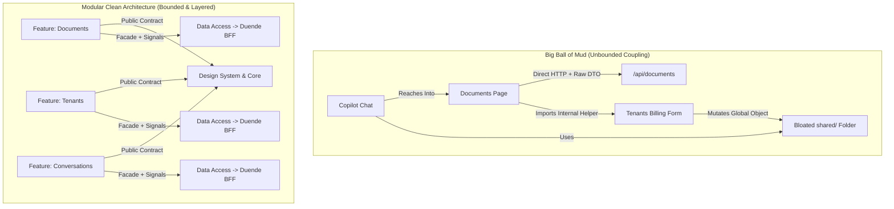
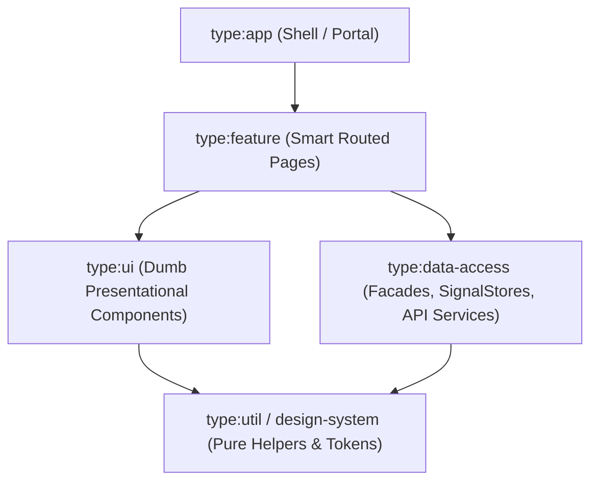
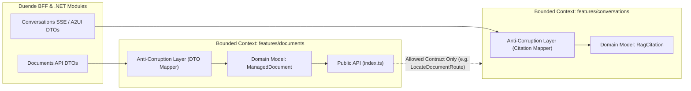
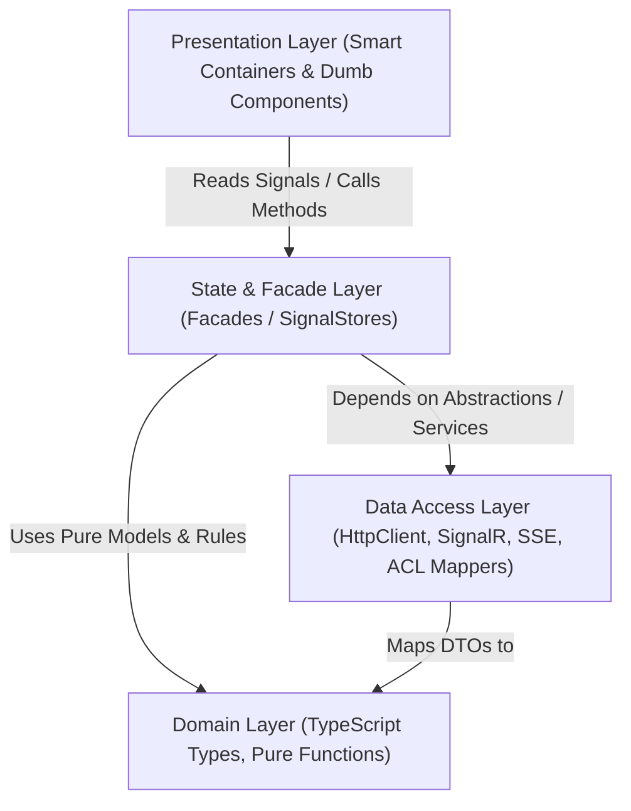
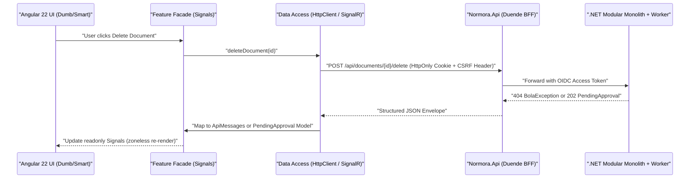
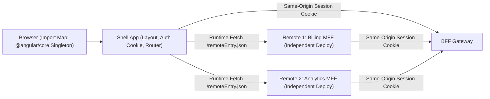

# Chapter 16: Enterprise Architecture Patterns

## 1. Learning Objectives
By the end of this chapter, you will be able to:
* Contrast Polyrepos, Modular Monolith SPAs, Nx Monorepos, and Micro Frontends (Native Federation).
* Apply Domain-Driven Design (DDD) concepts—Bounded Contexts, Ubiquitous Language, Anti-Corruption Layers, and Public APIs—to large Angular 22 applications.
* Implement Clean Architecture layer separation (Domain, Data Access, State/Facade, and Presentation) using Angular 22 Signals, standalone components, and `InjectionToken` abstractions.
* Architect clean boundaries around a Duende BFF, SignalR/SSE real-time streams, and a Tailwind CSS v4 Design System.
* Enforce architectural integrity with automated fitness functions (`@nx/enforce-module-boundaries`, ESLint rules, bundle budgets) and evaluate when NOT to use heavy patterns.

---

## 2. Introduction: Scaling Beyond the Basics

Building a 10-page application is easy. Building a 500-page enterprise platform maintained by 50 different developers across 10 different teams is an entirely different engineering discipline.

Without a strict architectural strategy, an enterprise codebase quickly devolves into a **"Big Ball of Mud"**—a software system that lacks perceptible structure, where every module can reach into every other module's internals. Components become tightly coupled to specific API endpoints, the `shared/` folder becomes a dumping ground for highly specific business logic, and deploying a change to the User Profile breaks the Admin Dashboard.

Two core architectural principles prevent this decay:
* **High Cohesion:** Code that changes together for the same business reason lives together (e.g., all document upload, chunking-status, and search UI logic stays inside the `documents` feature).
* **Low Coupling:** Modules communicate through small, explicit contracts rather than reaching into each other's internal files or database shapes.

Throughout this chapter, we will apply these principles to two real-world systems:
1. **The EV Charging Platform:** A multi-application suite (`driver-app`, `operator-portal`, `admin-portal`) demonstrating multi-app Nx Monorepo scaling.
2. **Normora:** An enterprise multi-tenant knowledge management and conversational-AI platform built with an **Angular 22 SPA** (Signals, standalone components, zoneless change detection, Tailwind CSS v4) behind a **.NET 10 Duende BFF** (*Backend-For-Frontend*) modular monolith (`Tenants`, `Documents`, and `Conversations` modules).



In Part V of this book, we elevate our perspective from *Writing Code* to *Architecting Systems*.

---

## 3. Enterprise Workspace Topology: Modular Monolith SPA vs. Nx Monorepo

As briefly discussed in Chapter 2, enterprise frontend codebases generally organize at scale using either a **Modular Monolith SPA** (a single well-structured Angular workspace) or an **Nx Monorepo** (multiple applications and libraries in one repository).

### Option A: The Modular Monolith SPA (Single App, Strict Slices)
When an organization builds **one** cohesive web portal—even a complex one—splitting it into multiple separate apps can introduce unnecessary build and deployment overhead. Instead, you structure a single Angular 22 workspace into strict vertical **feature slices** and horizontal **foundation layers**.

Look at how **Normora** structures its Angular 22 client (`client/`):

```text
client/src/
├── design-system/
│   ├── tokens/               # CSS custom properties, Tailwind v4 theme tokens
│   └── components/           # Pure UI primitives (buttons, modals, badges)
├── app/
│   ├── core/                 # App-wide singletons: BFF auth guard, ApiMessages, HTTP interceptors
│   ├── layout/               # App shell, navigation rail, Copilot dock frame
│   ├── shared/               # Reusable domain-agnostic pipes, directives, helpers
│   └── features/             # Vertical business slices mirroring backend bounded contexts
│       ├── tenants/          # Workspace settings, RBAC, departments, PayU billing
│       ├── documents/        # Upload outbox UI, ingestion status, search, metrics
│       └── conversations/    # Copilot chat, RAG citations, A2UI interactive cards
└── environments/
```

Notice how Normora's frontend mirrors its backend modular monolith (`Tenants`, `Documents`, `Conversations`). Each folder under `features/` owns its routes, facades, data-access services, and UI components.

### Option B: The Nx Monorepo (Multiple Apps, Shared Libraries)
Enterprise organizations often ship **multiple distinct applications** that share UI primitives, auth, or domain models.
Our EV Charging Platform consists of:
1. `driver-app` (Mobile-first PWA for drivers to find chargers).
2. `operator-portal` (Dashboard for station owners to set pricing).
3. `admin-portal` (Super-admin dashboard to manage the whole system).

#### Why an Nx Monorepo?
If we put these in 3 separate Git repositories (**Polyrepo**), sharing the `ButtonComponent` or the `AuthService` requires publishing them to a private NPM registry. Every minor fix forces a package release, version bump, and pull request across three repositories—causing versioning nightmares.

An **Nx Monorepo** stores all 3 applications and their shared libraries in a single Git repository.

```text
ev-platform-monorepo/
├── apps/
│   ├── driver-app/
│   ├── operator-portal/
│   └── admin-portal/
├── libs/
│   ├── shared/
│   │   ├── ui/              (type:ui — Buttons, Modals, Badges)
│   │   └── util-auth/       (type:util — BFF/OIDC session helpers)
│   ├── chargers/
│   │   ├── feature-list/    (type:feature — Smart routed pages)
│   │   ├── data-access/     (type:data-access — Signals store, API client)
│   │   └── ui/              (type:ui — Charger card, status pill)
│   └── billing/
│       └── data-access/     (type:data-access — Invoices, Stripe/PayU integration)
```

#### The Magic of Nx: Computation Caching & Affected Graph
The historic problem with Monorepos was CI/CD time. If you change a button, do you have to run tests and builds for all 3 apps?

Nx solves this using a **Dependency Graph**. When you commit a change to `shared-auth`, Nx statically analyzes the graph (`nx affected`) and determines that only the `operator-portal` and `admin-portal` depend on that library. It skips building the `driver-app` entirely, retrieving its previous build output from a **remote computation cache** (replayable across CI runners and developer machines).

#### Library Tagging & Dependency Rules
In Nx, every library carries metadata tags in its `project.json`—typically a **`scope:`** tag (which business domain owns it) and a **`type:`** tag (which architectural layer it belongs to):



Using `@nx/enforce-module-boundaries` in ESLint, you forbid `type:ui` from importing `type:data-access`, and forbid `scope:documents` from importing `scope:conversations`.

### When NOT to Use an Nx Monorepo
* **Single cohesive SPA with a small/medium team (1–15 engineers):** Introducing Nx generators, workspace executors, and library boilerplate for a single portal like Normora's `client/` adds maintenance friction without multi-app payoff. Start with a well-disciplined **Modular Monolith SPA** (`core/`, `design-system/`, `features/`) and ESLint folder-boundary rules; you can migrate to Nx later if you add a second app (e.g., a dedicated `normora-public-docs` portal or `normora-superadmin-console`).
* **Completely unrelated tech stacks or zero shared code:** Putting an unrelated marketing WordPress site and an Angular enterprise portal in the same Nx workspace yields little benefit.

### Real-World Normora Examples: Workspace Topology
1. **Single SPA behind Duende BFF:** Normora keeps its entire user and workspace-admin experience inside `client/` rather than splitting into separate `employee-app` and `employer-app` repositories, because both personas authenticate via the same Duende BFF session cookie and navigate shared routes (e.g., Copilot co-browsing from chat into `/documents`).
2. **Design System Isolation (`client/src/design-system/`):** Tokens (`tokens/`) and base Tailwind v4 primitives (`components/`) live outside `src/app/` so feature slices depend on stable visual building blocks without pulling in routing, SignalR, or business state.
3. **Vertical Feature Slicing (`client/src/app/features/`):** Normora mirrors the .NET modular monolith by separating `features/tenants/`, `features/documents/`, and `features/conversations/`, ensuring a change to PayU currency billing inside `tenants` never breaks RAG citation rendering in `conversations`.
4. **Core Singleton Boundary (`client/src/app/core/`):** App-wide cross-cutting concerns—such as `core/constants/api-messages.ts`, BFF anti-CSRF/error interceptors, and tenant-resolution route guards—reside exclusively in `core/`, never inside a specific feature folder.
5. **When Normora Would Adopt Nx:** If Normora later launched a standalone `normora-widget` (an embeddable customer-facing AI support widget) alongside the main `client/` portal, migrating to an Nx Monorepo with `libs/design-system`, `libs/conversations-data-access`, and `apps/portal` + `apps/widget` would allow instant code sharing with `nx affected` caching.

---

## 4. Domain-Driven Design (DDD) in Angular

**Domain-Driven Design (DDD)** is a software engineering philosophy introduced by Eric Evans that says the structure of your code should mirror the structure and language of the business domain—not generic technical buckets like `components/`, `services/`, and `models/`.

### Core Building Blocks of Frontend DDD

1. **Ubiquitous Language:** Backend engineers, frontend engineers, and product managers use the exact same terminology. In Normora, a user does not belong to an "org" on the frontend and a "tenant" on the backend—both sides use **Tenant**, **Department**, **UserGroup**, **DocumentChunk**, and **PendingApproval**.
2. **The Bounded Context:** A clear boundary within which a particular domain model has a specific meaning.
   * *EV Charging Platform:* A "Charger" means different things to different people. To the Driver, a `Charger` has a Location and a Current Price (`libs/driver-domain/`). To the Admin, a `Charger` has an IP Address, Firmware Version, and Maintenance Schedule (`libs/admin-domain/`). Instead of one bloated `Charger` interface, each Bounded Context owns its own tailored model.
   * *Normora:* A "Document" in the **Documents** context represents an uploaded file progressing through outbox ingestion (`Pending -> Extracting -> Chunking -> Indexed`). In the **Conversations** context, a "Document" is simply a read-only **Citation** (`ChunkPreview`) attached to an AI answer.
3. **Anti-Corruption Layer (ACL):** An **Anti-Corruption Layer** is a translation boundary (usually mapper functions inside your Data Access layer) that converts raw backend Data Transfer Objects (DTOs) and external webhook shapes into clean, frontend-tailored domain models. If the backend renames `file_name_v2` to `title`, or changes how `TenantPlanPricingCatalog` serializes annual discounts, only the ACL mapper changes—your UI components never see raw API JSON.
4. **Public API Encapsulation (`index.ts`):** Every Bounded Context exposes a single `index.ts` barrel file declaring what other modules are allowed to import (e.g., routes, public contracts, or shared event tokens). Everything else inside that folder is private.



### Access Rules & Boundary Enforcement
Using tools like Nx (`@nx/enforce-module-boundaries`) or ESLint's `eslint-plugin-boundaries`, we enforce strict architectural linting rules:
* In the EV Charging Platform, `driver-app` is strictly forbidden from importing anything from `libs/admin-domain/`.
* In Normora, `features/conversations` cannot import `DocumentsUploadService` or internal table components from `features/documents`—it can only navigate via public route contracts or consume shared `core/` contracts.
* If a developer breaks a boundary rule, `ng lint` / CI fails immediately.

### When NOT to Use Strict DDD
* **Small CRUD apps or short-lived prototypes (< 10 screens):** Creating separate bounded contexts, mappers, and barrel boundaries for a 3-page internal admin tool slows down delivery for no architectural gain.
* **Purely presentational marketing sites:** Static landing pages have no complex domain invariants to isolate.

### Real-World Normora Examples: DDD in Action
1. **Context-Specific "Document" Models:** `features/documents` models `ManagedDocument` (storage key, ingestion status, department visibility, soft-delete flag), whereas `features/conversations` models `ChunkPreview` (document title, markdown excerpt, heading breadcrumb, similarity score).
2. **Decoupled External Identity (`ExternalUserId`):** Normora's frontend domain models never reference vendor-specific names like `KeycloakUserId`. User identity models use `ExternalUserId` so swapping Keycloak for Entra ID or Auth0 later touches zero domain types.
3. **Authoritative Pricing via Anti-Corruption Layer (`TenantPlanPricingCatalog`):** The frontend never duplicates hardcoded subscription pricing switch-statements. `features/tenants` fetches authoritative currency and tier totals (`Free`, `Pro`, `Enterprise`) from the backend catalog and maps them cleanly into `WorkspacePlanView` models, ensuring Free-tier cancellation buttons are deterministically suppressed.
4. **Security-Preserving Error Translation (BOLA/BFLA):** Normora's backend maps Broken Object Level Authorization (**BOLA**, accessing another user's or tenant's resource) to `404 Not Found` and Broken Function Level Authorization (**BFLA**, lacking role permission for an action) to `403 Forbidden`. The frontend's ACL error mapper translates those HTTP statuses into `ApiMessages` constants (`ApiMessages.NotFound`, `ApiMessages.Forbidden`) rather than leaking raw server details.
5. **Cross-Context Co-Browsing Contract:** When a user clicks a citation badge inside `ChunkPreviewDrawerComponent` (`features/conversations`) and triggers `Locate in Documents`, `Conversations` dispatches a typed navigation contract (`documentId`, `chunkId`) to the router—never importing internal `DocumentsFacade` state directly.

---

## 5. Clean Architecture & Layer Separation in Angular 22

Clean Architecture organizes code into concentric layers with one golden rule—**The Dependency Rule**: source code dependencies must only point **inward**. High-level domain concepts and UI components must never depend on low-level HTTP mechanics, storage SDKs, or transport protocols.



### 1. The Domain Layer (Models & Pure Rules)
* **What it does:** Defines pure TypeScript interfaces, union types, and framework-free business helpers (e.g., formatting currency display rules or validating state transitions).
* **What it knows:** Nothing about Angular, `HttpClient`, Signals, or DOM APIs. Zero framework imports makes it trivially unit-testable in milliseconds.

### 2. The Data Access Layer (API & Real-Time Transport Services)
* **What it does:** Injects `HttpClient` (talking to Duende BFF endpoints), manages SignalR/SSE connections, and runs Anti-Corruption Layer mappers that convert raw JSON DTOs into Domain Models.
* **What it knows:** Knows BFF route paths, HTTP status codes (404 BOLA / 403 BFLA), and backend DTO schemas.
* **Dependency Inversion with `InjectionToken`:** When a feature needs swappable behavior (e.g., a payment gateway adapter or telemetry sink), the State/Facade layer injects an abstract `InjectionToken` rather than a concrete vendor service.

### 3. The State / Facade Layer (Signals & `SignalStore`)
* **What it does:** Holds feature state using Angular 22 `signal()` and derives view projections with `computed()`. Exposes `readonly` signals (`.asReadonly()`) and intent-revealing methods (`uploadDocument()`, `approveToolCall()`) to the Presentation Layer. Uses `effect()` strictly for synchronizing external side effects (like reacting to SignalR `dataVersion` bumps).
* **What it knows:** Knows the Data Access Layer and `ApiMessages`, never DOM selectors or PrimeNG component internals.

### 4. The Presentation Layer (Smart Containers vs. Dumb Components)
Modern Angular 22 cleanly splits UI components into two roles:
* **Smart (Container) Components:** Routed feature views that inject the **Facade** (never `HttpClient`), wire route parameters, and pass signals down to dumb components.
* **Dumb (Presentational) Components:** Pure UI components using `input()` / `input.required()`, `output()`, and `model()`, rendered with `@if` / `@for` / `@defer`, styled with **Tailwind CSS v4** (including `dark:` variants on every color and suffix `!important` like `border-none!`), and fully compatible with **zoneless change detection**.

### Complete Angular 22 Case Study: Normora Documents Slice

Here is how all four layers work together cleanly for Normora's document management feature:

**1. Domain Layer (`features/documents/models/managed-document.model.ts`)**
```typescript
export type IngestionStatus = 'Pending' | 'Extracting' | 'Chunking' | 'Indexed' | 'Failed';

export interface ManagedDocument {
  readonly id: string;
  readonly fileName: string;
  readonly status: IngestionStatus;
  readonly chunkCount: number;
  readonly uploadedAtIso: string;
}
```

**2. Data Access Layer (`features/documents/data-access/documents-api.service.ts`)**
```typescript
import { HttpClient, HttpErrorResponse } from '@angular/common/http';
import { Injectable, inject } from '@angular/core';
import { Observable, catchError, map, throwError } from 'rxjs';
import { ApiMessages } from '../../../core/constants/api-messages';
import { IngestionStatus, ManagedDocument } from '../models/managed-document.model';

interface DocumentSummaryDto {
  documentId: string;
  originalFileName: string;
  processingState: IngestionStatus;
  totalChunks: number;
  createdAtUtc: string;
}

@Injectable({ providedIn: 'root' })
export class DocumentsApiService {
  private readonly http = inject(HttpClient);
  private readonly baseUrl = '/api/documents';

  listDocuments(): Observable<ManagedDocument[]> {
    return this.http.get<DocumentSummaryDto[]>(this.baseUrl).pipe(
      // Anti-Corruption Layer: map raw BFF DTOs into clean Domain Models
      map((dtos) => dtos.map((dto) => this.toDomain(dto))),
      catchError((err: HttpErrorResponse) => throwError(() => new Error(this.mapErrorMessage(err))))
    );
  }

  private toDomain(dto: DocumentSummaryDto): ManagedDocument {
    return {
      id: dto.documentId,
      fileName: dto.originalFileName,
      status: dto.processingState,
      chunkCount: dto.totalChunks,
      uploadedAtIso: dto.createdAtUtc,
    };
  }

  private mapErrorMessage(err: HttpErrorResponse): string {
    // BOLA maps to 404, BFLA maps to 403 — always use centralized ApiMessages
    if (err.status === 404) return ApiMessages.NotFound;
    if (err.status === 403) return ApiMessages.Forbidden;
    return ApiMessages.UnexpectedError;
  }
}
```

**3. State / Facade Layer (`features/documents/state/documents.facade.ts`)**
```typescript
import { Injectable, computed, effect, inject, signal } from '@angular/core';
import { firstValueFrom } from 'rxjs';
import { WorkspaceSyncService } from '../../../core/services/workspace-sync.service';
import { DocumentsApiService } from '../data-access/documents-api.service';
import { ManagedDocument } from '../models/managed-document.model';

@Injectable()
export class DocumentsFacade {
  private readonly api = inject(DocumentsApiService);
  private readonly workspaceSync = inject(WorkspaceSyncService);

  private readonly _documents = signal<ManagedDocument[]>([]);
  private readonly _isLoading = signal(false);
  private readonly _errorMessage = signal<string | null>(null);

  // Public readonly Signals for Smart Containers (zoneless-ready)
  readonly documents = this._documents.asReadonly();
  readonly isLoading = this._isLoading.asReadonly();
  readonly errorMessage = this._errorMessage.asReadonly();
  readonly indexedCount = computed(
    () => this._documents().filter((d) => d.status === 'Indexed').length
  );

  constructor() {
    // Reactively reload when SignalR broadcasts a new tenant dataVersion
    effect(() => {
      const version = this.workspaceSync.dataVersion();
      if (version > 0) {
        void this.loadDocuments();
      }
    });
  }

  async loadDocuments(): Promise<void> {
    this._isLoading.set(true);
    this._errorMessage.set(null);
    try {
      const docs = await firstValueFrom(this.api.listDocuments());
      this._documents.set(docs);
    } catch (error) {
      this._errorMessage.set(error instanceof Error ? error.message : null);
    } finally {
      this._isLoading.set(false);
    }
  }
}
```

**4. Presentation Layer: Dumb Component (`features/documents/ui/document-row-card.component.ts`)**
```typescript
import { ChangeDetectionStrategy, Component, input, output } from '@angular/core';
import { ManagedDocument } from '../models/managed-document.model';

@Component({
  selector: 'app-document-row-card',
  changeDetection: ChangeDetectionStrategy.OnPush,
  template: `
    <article
      class="flex items-center justify-between rounded-lg border border-slate-200 dark:border-slate-700 bg-white dark:bg-slate-900 p-4 shadow-none!"
    >
      <div>
        <h3 class="text-sm font-semibold text-slate-900 dark:text-slate-100">
          {{ document().fileName }}
        </h3>
        <p class="text-xs text-slate-500 dark:text-slate-400">
          Status: {{ document().status }} · {{ document().chunkCount }} chunks
        </p>
      </div>
      <button
        type="button"
        (click)="inspect.emit(document().id)"
        class="rounded-md border-none! bg-indigo-600 dark:bg-indigo-500 px-3 py-1.5 text-xs font-medium text-white dark:text-slate-950 hover:bg-indigo-700 dark:hover:bg-indigo-400"
      >
        Inspect
      </button>
    </article>
  `,
})
export class DocumentRowCardComponent {
  readonly document = input.required<ManagedDocument>();
  readonly inspect = output<string>();
}
```

**5. Presentation Layer: Smart Container (`features/documents/pages/documents-page.component.ts`)**
```typescript
import { ChangeDetectionStrategy, Component, OnInit, inject } from '@angular/core';
import { DocumentsFacade } from '../state/documents.facade';
import { DocumentRowCardComponent } from '../ui/document-row-card.component';

@Component({
  selector: 'app-documents-page',
  providers: [DocumentsFacade],
  imports: [DocumentRowCardComponent],
  changeDetection: ChangeDetectionStrategy.OnPush,
  template: `
    <section class="space-y-4 bg-slate-50 dark:bg-slate-950 p-6">
      <h1 class="text-xl font-bold text-slate-900 dark:text-white">
        Workspace Documents ({{ facade.indexedCount() }} indexed)
      </h1>

      @if (facade.errorMessage(); as error) {
        <p class="rounded-md bg-red-50 dark:bg-red-950 p-3 text-sm text-red-700 dark:text-red-300">
          {{ error }}
        </p>
      }

      @if (facade.isLoading()) {
        <p class="text-sm text-slate-500 dark:text-slate-400">Loading documents...</p>
      } @else {
        <div class="space-y-2">
          @for (doc of facade.documents(); track doc.id) {
            <app-document-row-card [document]="doc" (inspect)="onInspect($event)" />
          } @empty {
            <p class="text-sm text-slate-500 dark:text-slate-400">No documents uploaded yet.</p>
          }
        </div>
      }

      @defer (on viewport) {
        <p class="text-xs text-slate-400 dark:text-slate-500">Metrics drawer ready when scrolled.</p>
      } @placeholder {
        <div class="h-6"></div>
      }
    </section>
  `,
})
export class DocumentsPageComponent implements OnInit {
  protected readonly facade = inject(DocumentsFacade);

  ngOnInit(): void {
    void this.facade.loadDocuments();
  }

  onInspect(documentId: string): void {
    // Route or open drawer using documentId
  }
}
```

### Why This Matters
If the backend team decides to switch from REST to GraphQL, migrate from Hangfire polling to SignalR push, or rename fields in `DocumentSummaryDto`, you **only** modify the Data Access Layer. The Facade, Signals, and UI Components remain completely untouched.

### When NOT to Use Full 4-Layer Clean Architecture
* **Simple static views or thin read-only modals:** Wrapping a static "About" page or a 2-field confirmation dialog in a Domain Model + DTO Mapper + Facade + Container + Dumb Component is over-engineering (often called *ceremonial boilerplate*).
* **Rapid exploratory spikes:** When validating a UX idea with users in a throwaway branch, keep code simple first, then extract layers once the domain behavior stabilizes.

### Real-World Normora Examples: Clean Architecture in Practice
1. **Documents Ingestion & Search (`DocumentsFacade` + `DocumentsApiService`):** `DocumentsUploadPageComponent` binds Signal state and renders `@if`/`@for` lists without knowing about `DocumentProcessingOutboxMessage` or MinIO presigned URLs.
2. **Server-Enforced HITL Approvals (`ApprovalsFacade`):** When an AI agent invokes `documents_delete`, `Conversations` streams a `PendingApproval` A2UI confirmation card. The card emits `approve` / `reject` outputs; `ApprovalsFacade` calls `ApprovalsController` via `ApprovalsApiService`, keeping HTTP endpoints completely outside the generative UI card.
3. **Reactive `dataVersion` Synchronization (`WorkspaceSyncFacade`):** `IWorkspaceStateSynchronizer` broadcasts tenant `dataVersion` mutations over SignalR and SSE. `TenantsFacade` observes `dataVersion()` in an `effect()` to refresh employer department/user-group tables without page reloads or component-level WebSocket listeners.
4. **Copilot A2UI Simulators (`ExpenseSimulatorCardComponent` & `HrEscalationCardComponent`):** Both generative chat cards are pure dumb components accepting `input()` parameters (`locationTier`, `nights`, `inquiryRef`) and emitting `output()` events—zero `HttpClient` or agent-streaming imports inside the card UI.
5. **Swappable Billing Adapter via `InjectionToken` (`SubscriptionFacade`):** Workspace currency selection (`PUT /api/subscription/currency`) and PayU checkout launch go through a provider-neutral `PAYMENT_GATEWAY` `InjectionToken` in the Data Access layer, isolating the `BillingPageComponent` from PayU's `udf3` callback parameter format.

---

## 6. Architectural Boundaries in Practice: BFF, Design Systems & Governance

Enterprise architecture is not just folders—it is how your Angular SPA integrates safely with backend APIs, shares visual primitives without coupling domains, and stays clean two years after launch.

### 1. The Duende BFF Boundary (Zero Tokens in the Browser)
Historically, SPAs stored OAuth2 access and refresh tokens in `localStorage` or `sessionStorage`, making them vulnerable to Cross-Site Scripting (XSS) theft and tightly coupling Angular features to Keycloak/OIDC token parsing.

Normora places its Angular 22 SPA behind a **Backend-For-Frontend (BFF)** host (`Normora.Api` running **Duende BFF**):
* **Cookie-Only Session:** The browser only holds encrypted `HttpOnly`, `SameSite=Strict`, `Secure` session cookies. Angular components never inspect JWTs or talk directly to Keycloak.
* **Unified Transport Gateway:** Standard REST APIs (`/api/documents`), AG-UI SSE streams (`/api/copilotkit`), and SignalR hubs all cross the same BFF host boundary with anti-CSRF header enforcement.
* **Centralized Error Envelope (`ApiMessages`):** The BFF returns structured `ApiResponse` errors using `Normora.Shared.Constants.ApiMessages`. The Angular `core/` layer mirrors those constants in `client/src/app/core/constants/api-messages.ts` so UI layers never hardcode error strings.



### 2. Design System vs. `shared/` vs. `features/`
A major architectural failure is mixing visual primitives with business logic. Split them into three distinct tiers:
* **`design-system/tokens/` & `design-system/components/`:** Strictly domain-agnostic primitives (buttons, drawers, badges, spacing/color tokens, Tailwind v4 `@theme` rules, dark mode variants). They know nothing about Tenants, Documents, or Chargers.
* **`app/shared/`:** Angular-specific reusable pipes, formatting directives, or generic empty-state components that are still **domain-agnostic** (e.g., `.custom-scrollbar` helpers or relative-date pipes).
* **`app/features/{context}/`:** Domain-aware components (`DocumentStatusBadgeComponent`, `ExpenseSimulatorCardComponent`, `ChargerPricingModalComponent`).

### 3. Architectural Fitness Functions & Governance
An **Architectural Fitness Function** is an automated check in your build or CI pipeline that verifies an architectural rule has not been violated as the team scales:
* **Import Boundary Linting:** ESLint rules (`@nx/enforce-module-boundaries` or `eslint-plugin-boundaries`) blocking `features/tenants` from importing `features/documents` internals, or blocking `ui/` components from importing `HttpClient`.
* **Bundle Size Budgets (`angular.json`):** Enforcing initial bundle ceilings (e.g., `maximumError: 500kB`) so one feature team cannot accidentally ship a 4 MB dependency into the root chunk.
* **Circular Dependency Detection:** Running `npx madge --circular src/` in CI to catch `ServiceA -> ServiceB -> ServiceA` cycles early.
* **Architecture Decision Records (ADRs):** Short 1-page Markdown docs in `docs/adr/` explaining *why* a major trade-off was chosen (e.g., *"ADR-004: Use Signal Facades instead of NgRx Redux for Normora SPA"*).

### When NOT to Add Heavy Governance
* **Early 1–2 developer MVP before domain boundaries settle:** Overly rigid ESLint barrel rules and ADR ceremonies during week-one prototyping slow down discovery. Introduce automated fitness functions as soon as a second team or a third feature domain joins the codebase.

### Real-World Normora Examples: Boundaries & Governance
1. **BFF Cookie Immunity:** Normora's `client/src/app/core/` contains zero OIDC token-refresh timers or `localStorage` token keys; Duende BFF silently attaches the Keycloak bearer token server-side before dispatching to `Tenants`, `Documents`, or `Conversations`.
2. **Design System Separation (`client/src/design-system/`):** Base drawer, modal, and button primitives live in `design-system/components/`, while Normora-specific `ChunkPreviewDrawerComponent` lives in `features/conversations/`, composing the design-system drawer without polluting it with RAG chunk concepts.
3. **Zero Magic Error Strings (`ApiMessages`):** A global HTTP interceptor and feature facades import `ApiMessages` from `client/src/app/core/constants/api-messages.ts` instead of scattering `'Access denied'` or `'Document missing'` string literals across 40 components.
4. **Cross-Host Real-Time Boundary (`Normora.Worker` -> SignalR -> `WorkspaceSyncService`):** When `Normora.Worker` finishes chunking a PDF via Hangfire, it publishes a Redis backplane event relayed by `Normora.Api` SignalR hubs. Angular's `core/` SignalR service increments a `dataVersion` Signal—keeping SignalR hub URLs and reconnect logic completely isolated from feature components.
5. **Architecture Decision Record (ADR) Discipline:** Normora keeps `AGENTS.md` and `docs/` synchronized on every architectural change (like enforcing `ExternalUserId` naming and parameterless EF configurations), acting as living fitness documentation alongside automated architecture tests.

---

## 7. Micro Frontends and Native Federation

What if your organization grows so large that the Driver team and the Admin team—or three separate business units—need to build, version, and deploy their UIs **completely independently**, without waiting for a unified Monorepo CI/CD pipeline?

This is where **Micro Frontends** come in.

### Webpack Module Federation vs. Native Federation (Angular 22)
Older Angular setups (Webpack-based) used **Webpack Module Federation** to load separately deployed remote bundles at runtime. Modern Angular 22 uses the Vite/esbuild **Application Builder** (`@angular/build:application`), so the modern standard is **`@angular-architects/native-federation`**:
* **Native Federation** is bundler-agnostic and builds on standard **ES Modules** and browser **Import Maps** (`<script type="importmap">`).
* Shared libraries (like `@angular/core`, `@angular/router`, and Signals runtime) are mapped once in the browser's import map as **singletons**, preventing duplicate Angular runtimes from loading.



### The Architecture & Integration Patterns
1. **The Shell App (Host):** A lightweight Angular application that provides the outer layout (Header, Sidebar, BFF Session Guard) and top-level routing.
2. **The Remote Apps:** Independent Angular applications (e.g., `BillingApp`, `ChargerApp`) built and deployed to separate servers or CDN paths. When a user clicks "Billing" in the Shell App, Angular Router's `loadRemoteModule` dynamically fetches the remote's `remoteEntry.json` manifest and mounts its standalone routes or components just like a local lazy-loaded route (`loadChildren` / `loadComponent`).
3. **Alternative Lightweight Patterns:**
   * **Reverse-Proxy / BFF Path Routing:** Serving two completely separate SPAs under `/app/` and `/admin/` via YARP/Nginx/BFF—zero runtime JS sharing overhead, at the cost of a full browser page reload between apps.
   * **Web Components (`@angular/elements`):** Wrapping an Angular standalone widget as a standard Custom Element (`<normora-copilot-widget>`) when embedding into a non-Angular host (e.g., React or legacy MVC).

### When to Use—and When NOT to Use—Micro Frontends
> [!WARNING]
> **Architect Warning — The Distributed Monolith Trap:** Micro Frontends are the most complex architectural pattern in frontend engineering. They introduce severe operational challenges: cross-remote state sharing, Tailwind/CSS specificity collisions, E2E integration testing across independent deployments, and **version drift** (what if the Shell upgrades to Angular 22 while a Remote is still pinned to Angular 20 and expects an incompatible router contract?).
>
> **Rule of Thumb:** Do **NOT** use Micro Frontends unless you have **over ~80–100 frontend developers** across autonomous product verticals where independent deployment cadence outweighs codebase simplicity. For 95% of enterprise projects—including complex multi-domain platforms—a **Modular Monolith SPA** or an **Nx Monorepo** is vastly faster, safer, and cheaper to maintain.

### Real-World Normora Examples: Evaluating Micro Frontends
1. **Why Normora Avoids Micro Frontends Today:** Normora has three rich bounded contexts (`Tenants`, `Documents`, `Conversations`), yet deploys them as one Angular 22 Modular Monolith SPA. A single team can ship a new Copilot tool (`documents_delete`) and its HITL approval UI (`ApprovalsController`) in one atomic PR without coordinating three separate `remoteEntry.json` releases.
2. **Hypothetical Enterprise Split (Shell + Remotes):** If Normora scaled to 120 frontend engineers across separate business units, `client/src/app/layout/` (sidebar + `Ctrl+J` Copilot dock) would become the **Shell**, while `features/tenants/` (billing/IAM) and `features/documents/` (ingestion studio) would become **Native Federation Remotes** sharing the same Duende BFF cookie.
3. **Shared Singleton Constraint (SignalR & `dataVersion`):** If `Documents` and `Tenants` were separate remotes, instantiating a `WorkspaceSyncService` inside each remote would open duplicate SignalR WebSocket connections per tab. A Micro Frontend setup would require exporting `WorkspaceSyncService` as a shared singleton contract in `federation.config.js`.
4. **CSS & Tailwind v4 Isolation Risk:** If a Billing remote compiled its own Tailwind v4 CSS bundle with conflicting utility resets alongside the Shell's `design-system/tokens`, styles would clash at runtime unless all remotes shared a single compiled design-system stylesheet or scoped CSS layers (`@layer`).
5. **Embeddable Widget via Web Components (`@angular/elements`):** If a customer wanted Normora's Copilot assistant embedded inside their internal SharePoint or Confluence portal, packaging `Conversations` chat as a standalone Web Component (`@angular/elements`) would be far more practical than forcing SharePoint to act as a Native Federation Shell.

---

## 8. Common Mistakes & Anti-Patterns

> [!CAUTION]
> ### 1. The `shared/` Dumping Ground (Senior Mistake)
> **Wrong Code:**
> ```typescript
> // client/src/app/shared/components/document-ingestion-badge.component.ts
> // (Or in EV Platform: libs/shared/ui/charger-status-badge.component.ts)
> import { ManagedDocument } from '../../features/documents/models/managed-document.model';
> import { Component, input } from '@angular/core';
>
> @Component({
>   selector: 'app-document-ingestion-badge',
>   template: `<span class="bg-emerald-100 text-emerald-800">{{ document().status }}</span>`,
> })
> export class DocumentIngestionBadgeComponent {
>   readonly document = input.required<ManagedDocument>();
> }
> ```
> **Why It's Wrong:** Putting domain-specific widgets (`DocumentIngestionBadge`, `ChargerStatusBadge`, `TenantPlanBanner`) inside `app/shared/` (or `libs/shared`) creates reverse dependencies from `shared/` back into `features/`. Every feature now pulls in unrelated domain models, `shared/` balloons into a Big Ball of Mud, and Nx affected builds end up rebuilding every app whenever one domain changes. Also note the missing `dark:` variants!
>
> **The Fix:** Keep `design-system/components/` and `app/shared/` strictly domain-agnostic (`StatusPillComponent` accepting `label` and `tone` inputs). Put `DocumentIngestionBadgeComponent` inside `features/documents/ui/` (and `ChargerStatusBadgeComponent` inside `libs/chargers/ui/`):
> ```typescript
> // client/src/design-system/components/status-pill.component.ts
> import { ChangeDetectionStrategy, Component, input } from '@angular/core';
>
> @Component({
>   selector: 'ds-status-pill',
>   changeDetection: ChangeDetectionStrategy.OnPush,
>   template: `
>     <span class="rounded-full px-2.5 py-0.5 text-xs font-medium bg-slate-100 dark:bg-slate-800 text-slate-800 dark:text-slate-200">
>       {{ label() }}
>     </span>
>   `,
> })
> export class StatusPillComponent {
>   readonly label = input.required<string>();
> }
> ```

> [!CAUTION]
> ### 2. Leaky Clean Architecture: `HttpClient` Inside UI Components
> **Wrong Code:**
> ```typescript
> // features/conversations/ui/hr-escalation-card.component.ts
> @Component({
>   selector: 'app-hr-escalation-card',
>   template: `<button (click)="submit()">Escalate</button>`,
> })
> export class HrEscalationCardComponent {
>   private readonly http = inject(HttpClient);
>
>   submit() {
>     this.http.post('/api/conversations/escalations', { keycloakUserId: '123' }).subscribe();
>   }
> }
> ```
> **Why It's Wrong:** The UI component now knows backend URLs, HTTP verbs, raw DTO field names, and vendor-coupled naming (`keycloakUserId` instead of `ExternalUserId`). You cannot unit-test the card without mocking `HttpClientTestingModule`, and changing the BFF endpoint or adding a HITL approval step forces edits across dozens of UI templates.
>
> **The Fix:** Keep `HrEscalationCardComponent` as a pure presentational component using `input()` and `output()`, delegating side effects through a Feature Facade and Data Access service:
> ```typescript
> @Component({
>   selector: 'app-hr-escalation-card',
>   changeDetection: ChangeDetectionStrategy.OnPush,
>   template: `
>     <button
>       type="button"
>       (click)="escalate.emit(inquiryRef())"
>       class="rounded-md border-none! bg-amber-600 dark:bg-amber-500 px-3 py-1.5 text-white dark:text-slate-950"
>     >
>       Escalate {{ inquiryRef() }}
>     </button>
>   `,
> })
> export class HrEscalationCardComponent {
>   readonly inquiryRef = input.required<string>();
>   readonly escalate = output<string>();
> }
> ```

> [!CAUTION]
> ### 3. Cross-Bounded-Context Spaghetti Imports
> **Wrong Code:**
> ```typescript
> // features/conversations/state/copilot-chat.facade.ts
> import { DocumentsApiService } from '../../documents/data-access/documents-api.service';
> import { DocumentsFacade } from '../../documents/state/documents.facade';
> ```
> **Why It's Wrong:** Reaching directly into another Bounded Context's internal `data-access` or `state` creates tight coupling between `Conversations` and `Documents` (just as injecting `IRetrievalService` directly across backend modules violates Normora's Modular Monolith rules). Refactoring `DocumentsFacade` will silently break `Conversations`.
>
> **The Fix:** Communicate across Bounded Contexts only through public contracts (`index.ts`), router navigation commands, or `core/` abstractions—mirroring Normora's backend MediatR contract boundary:
> ```typescript
> // features/conversations/state/copilot-chat.facade.ts
> import { inject } from '@angular/core';
> import { Router } from '@angular/router';
> import { DOCUMENT_LOCATE_ROUTE } from '../../documents'; // Public API barrel only
>
> export class CopilotChatFacade {
>   private readonly router = inject(Router);
>
>   locateCitationInDocuments(documentId: string, chunkId: string): void {
>     void this.router.navigate([DOCUMENT_LOCATE_ROUTE, documentId], { queryParams: { chunkId } });
>   }
> }
> ```

> [!CAUTION]
> ### 4. Hardcoding Error Strings & Bypassing `ApiMessages` / BOLA-BFLA Contracts
> **Wrong Code:**
> ```typescript
> // features/tenants/data-access/subscription-api.service.ts
> catchError((err: HttpErrorResponse) => {
>   if (err.status === 404) return throwError(() => new Error('Tenant document #42 belongs to another workspace'));
>   return throwError(() => new Error('Cannot cancel free plan right now'));
> })
> ```
> **Why It's Wrong:** Hardcoding magic strings scatters inconsistent copy across the app and risks leaking sensitive authorization details (e.g., confirming whether an object ID exists across tenants violates Normora's BOLA `404` / BFLA `403` defense-in-depth).
>
> **The Fix:** Always map HTTP status codes and domain failures through centralized `ApiMessages` constants (`client/src/app/core/constants/api-messages.ts`):
> ```typescript
> import { ApiMessages } from '../../../core/constants/api-messages';
>
> catchError((err: HttpErrorResponse) => {
>   if (err.status === 404) return throwError(() => new Error(ApiMessages.NotFound));
>   if (err.status === 403) return throwError(() => new Error(ApiMessages.Forbidden));
>   return throwError(() => new Error(ApiMessages.UnexpectedError));
> })
> ```

> [!CAUTION]
> ### 5. Premature Micro Frontends (Architect Mistake)
> **Wrong Setup:**
> ```text
> # A 10-developer team splits one cohesive SaaS portal into 4 independent apps:
> normora-shell-app/         (Repo 1, CI/CD 1, Angular 22.0)
> normora-tenants-remote/    (Repo 2, CI/CD 2, Angular 22.0)
> normora-documents-remote/  (Repo 3, CI/CD 3, Angular 22.1)
> normora-copilot-remote/    (Repo 4, CI/CD 4, Angular 21.8)
> ```
> **Why It's Wrong:** Splitting a small or mid-sized team into Micro Frontends creates a **Distributed Monolith**: shipping one cross-cutting feature (like adding a new `ApprovalCard` that spans `Conversations` and `Documents`) requires four coordinated PRs, four CI pipelines, runtime import-map debugging, and version-drift crashes across Angular minor releases.
>
> **The Fix:** Default to a **Modular Monolith SPA** (`client/src/app/features/*`) for a single cohesive portal, or an **Nx Monorepo** when shipping multiple distinct apps. Adopt Native Federation Micro Frontends only when organizational scale (> 80–100 frontend engineers) demands independent team release cycles.

> [!CAUTION]
> ### 6. Tailwind CSS v4 Legacy `!important`, Missing `dark:` Variants & Zone-Assumed Mutation
> **Wrong Code:**
> ```typescript
> @Component({
>   selector: 'app-workspace-banner',
>   template: `
>     <div class="!border-none bg-white text-slate-900 p-4">
>       {{ stats.totalDocs }} documents
>     </div>
>   `,
> })
> export class WorkspaceBannerComponent {
>   stats = { totalDocs: 0 };
>   onSignalRUpdate(count: number) {
>     this.stats.totalDocs = count; // Mutates plain object, assuming Zone.js dirty-checking
>   }
> }
> ```
> **Why It's Wrong:** Three modern Angular 22 / Normora violations happen here: (1) `!border-none` is Tailwind v3 prefix syntax and fails in **Tailwind CSS v4**; (2) `bg-white text-slate-900` lacks `dark:` variants, breaking dark mode contrast; and (3) mutating a plain property (`this.stats.totalDocs = count`) does not notify **zoneless** Angular 22 change detection.
>
> **The Fix:** Use Tailwind v4 suffix `!important` (`border-none!`), provide `dark:` variants on every color class, and store reactive state in Angular Signals:
> ```typescript
> @Component({
>   selector: 'app-workspace-banner',
>   changeDetection: ChangeDetectionStrategy.OnPush,
>   template: `
>     <div class="border-none! bg-white dark:bg-slate-900 text-slate-900 dark:text-slate-100 p-4">
>       {{ totalDocs() }} documents
>     </div>
>   `,
> })
> export class WorkspaceBannerComponent {
>   readonly totalDocs = signal(0);
>   onSignalRUpdate(count: number): void {
>     this.totalDocs.set(count);
>   }
> }
> ```

---

## 9. Interview Questions

### Junior
1. **Q: What is the difference between a Smart (Container) component and a Dumb (Presentational) component in Angular 22?**
   > **A:** A Smart component is usually routed, injects a Feature Facade or Store to orchestrate data loading, and passes state down. A Dumb component has no knowledge of services or APIs—it receives data strictly via `input()`, emits user actions via `output()`, uses `OnPush`/zoneless-safe Signals, and renders pure UI primitives.

2. **Q: What belongs in `core/`, `design-system/`, `shared/`, and `features/`?**
   > **A:** `design-system/` holds domain-agnostic UI primitives and CSS tokens. `core/` holds app-wide singletons (auth guards, HTTP interceptors, `ApiMessages`, SignalR root connection). `shared/` holds domain-agnostic Angular utilities, pipes, and directives. `features/` holds vertical business domains (`tenants`, `documents`, `conversations`) containing their own routes, facades, data-access services, and domain components.

3. **Q: Why should UI components never inject `HttpClient` directly?**
   > **A:** Injecting `HttpClient` in components couples the template to API URLs, HTTP verbs, and raw backend DTO shapes, making components fragile when backend payloads change and forcing slow HTTP mocking in UI unit tests.

### Senior
4. **Q: Explain the Facade Pattern in Angular 22 using Signals.**
   > **A:** A Facade is an `@Injectable` service acting as the single entry point between a UI component and the state/data-access layers. It holds private writable signals (`signal()`), exposes `readonly` projections (`asReadonly()`, `computed()`), runs asynchronous side effects via Data Access services, and exposes intent-revealing methods (`loadDocuments()`), shielding UI components from HTTP, SignalR, or NgRx complexity.

5. **Q: What is an Anti-Corruption Layer (ACL) in frontend architecture, and how does Normora use it?**
   > **A:** An ACL is a translation boundary (typically DTO-to-Domain mappers and error mappers in the Data Access layer) that prevents backend schema quirks or vendor terms from leaking into UI code. In Normora, Data Access services map backend DTOs to clean TypeScript domain models (using `ExternalUserId` rather than `KeycloakUserId`) and translate `404` (BOLA) / `403` (BFLA) responses into centralized `ApiMessages` constants.

6. **Q: How does an Nx Monorepo speed up CI/CD and prevent architectural erosion?**
   > **A:** Nx uses a static Dependency Graph (`nx affected`) so CI only tests and builds apps/libraries impacted by a commit, pulling unchanged outputs from a remote computation cache. It prevents erosion via `@nx/enforce-module-boundaries` ESLint rules driven by `scope:` and `type:` library tags.

### Architect
7. **Q: What is the difference between lazy-loading a standalone route in an Angular SPA versus loading a Remote via Native Federation?**
   > **A:** A standard lazy-loaded route (`loadChildren` / `loadComponent`) is compiled during the same build as the main app, guaranteeing identical versions of `@angular/core`, `@angular/router`, and shared services. A Native Federation Remote is built and deployed independently by a separate pipeline and loaded at runtime over HTTP using browser Import Maps and `remoteEntry.json`, requiring strict singleton sharing and runtime version contracts.

8. **Q: When would you choose a Modular Monolith SPA behind a Duende BFF over Micro Frontends?**
   > **A:** Choose a Modular Monolith SPA when a team (< ~80 frontend engineers) ships one cohesive product sharing authentication cookies, design tokens, and real-time connections (like Normora's `Tenants`, `Documents`, and `Conversations` portals). Splitting into Micro Frontends prematurely creates a Distributed Monolith with high DevOps overhead, duplicate WebSocket risks, CSS collisions, and version drift.

9. **Q: How do you ensure a large Angular codebase does not degrade into a Big Ball of Mud two years after launch?**
   > **A:** Enforce Bounded Contexts with public API barrel files (`index.ts`), implement **Architectural Fitness Functions** in CI (ESLint boundary rules forbidding cross-feature internal imports and `ui -> data-access` imports, circular-dependency checks, and `angular.json` bundle budgets), and document key trade-offs in Architecture Decision Records (ADRs).

---

## 10. Summary
In this chapter, we elevated our perspective to Enterprise Architecture. We compared Modular Monolith SPAs and Nx Monorepos, applied Domain-Driven Design (Bounded Contexts, Ubiquitous Language, Anti-Corruption Layers, and Public APIs), built a 4-layer Clean Architecture using Angular 22 Signals and Tailwind CSS v4, explored Duende BFF and Design System boundaries protected by automated fitness functions, and evaluated the trade-offs of Native Federation Micro Frontends.

In Chapter 17, we will dive into **Multi-Tenant SaaS Patterns**, exploring how to build an application that dynamically changes its branding, features, and authentication based on which enterprise customer is logging in.
