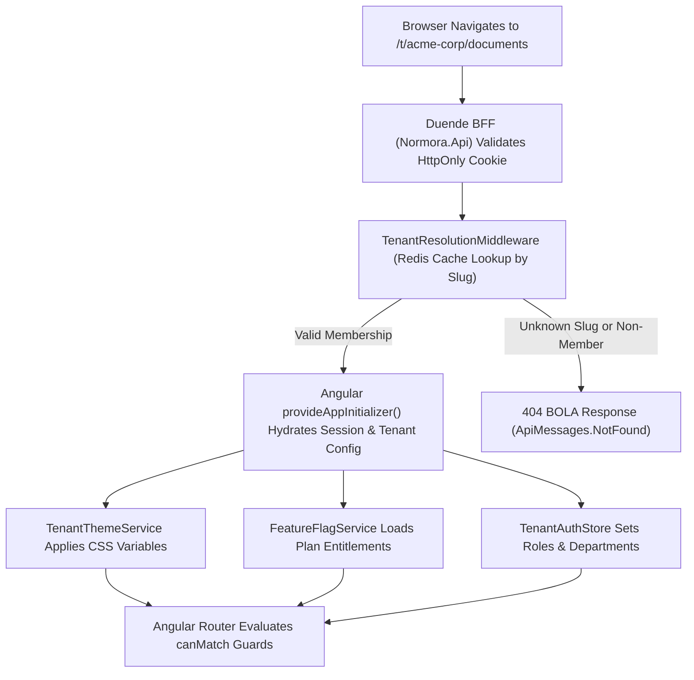
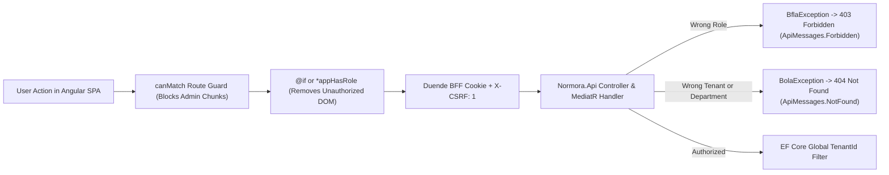
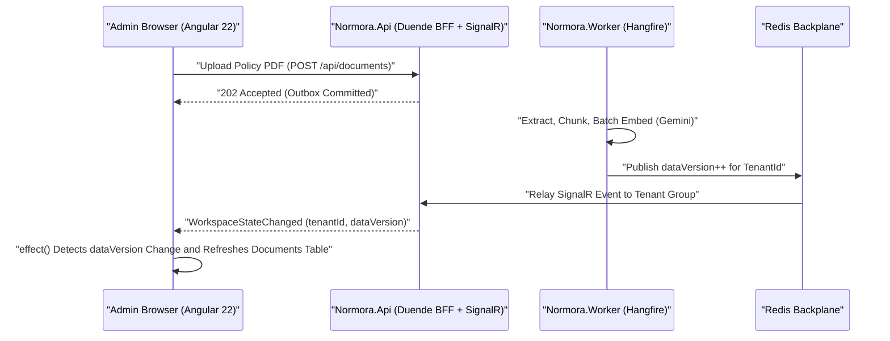

# Chapter 17: Multi-Tenant SaaS Patterns

## 1. Learning Objectives
By the end of this chapter, you will be able to:
* Architect a single-build Angular 22 SPA capable of dynamically adapting to isolated enterprise tenants behind a Backend-For-Frontend (BFF).
* Resolve and isolate tenant context cleanly using `provideAppInitializer()`, path/slug routing, and cross-tenant state resets on workspace switches.
* Implement runtime White-Labeling with CSS Custom Properties, Tailwind CSS v4 `@theme` tokens, dark mode `dark:` variants, and strict CSS/XSS sanitization.
* Design a reactive, Signal-based Feature Flag and Plan Entitlement engine paired with `@defer` lazy-loading and subscription invariants.
* Enforce defense-in-depth Role-Based Access Control (RBAC) and departmental isolation using `canMatch` guards, reactive `@if`/directive checks, and BOLA (`404`) / BFLA (`403`) handling.
* Synchronize multi-tenant workspace state in real time via SignalR `dataVersion` events without leaking data across tenants.

---

## 2. Introduction: The SaaS Paradigm & Tenant Resolution

In a true B2B **Software-as-a-Service (SaaS)** platform, you do not build and deploy a separate copy of your codebase for every customer organization. Instead, you deploy a **single instance** of your frontend and backend that dynamically adapts at runtime based on **which tenant (organization/workspace)** the authenticated user is currently operating inside.

For example, in a multi-tenant EV Charging Platform, enterprise tenants like "ChargePoint" and "Tesla" share one deployed Angular bundle while seeing different branding and features. In **Normora**—our enterprise multi-tenant knowledge management and conversational AI platform built with an Angular 22 SPA behind a **Duende BFF (Backend-For-Frontend)** and a .NET 10 modular monolith (`Tenants`, `Documents`, and `Conversations` modules)—the same compiled frontend serves completely isolated corporate workspaces (e.g., `acme-corp` and `globex-labs`).

When a user authenticates in Normora, the Angular SPA must immediately:
1. **Resolve the Active Tenant Context**: Identify the workspace slug, tenant ID, and user membership via the BFF session without exposing raw OIDC tokens to JavaScript.
2. **Apply White-Label Branding**: Inject the tenant's brand colors, dark-mode surface pairings, custom logo, and favicon at runtime.
3. **Hydrate Feature Flags & Plan Entitlements**: Enable or disable capabilities based on the workspace's subscription tier (`Free`, `Pro`, `Enterprise`) and feature toggles.
4. **Enforce Tenant-Scoped RBAC & Departmental Boundaries**: Restrict routes and DOM actions to the user's role *within that specific tenant*, while isolating documents and AI RAG citations by Department and User Group.

### Multi-Tenancy Isolation Models (What, Why, How)

Before writing Angular code, a senior frontend architect must understand the backend isolation model their SPA talks to:

* **Silo Model (Dedicated Instance/Database per Tenant)**: Highest physical isolation, simplest query logic, highest infrastructure cost and deployment overhead.
* **Pool Model (Shared Compute & Shared Database with `TenantId` Discriminator)**: Every table includes a `TenantId` column, enforced by row-level or EF Core global query filters. Most cost-effective and scalable for SaaS, and the model Normora uses across `TenantsDbContext`, `DocumentsDbContext`, and `ConversationsDbContext`.
* **Bridge Model (Shared Compute, Schema-per-Tenant)**: Middle ground, though migrations become expensive at thousands of tenants.

Because Normora uses a shared SPA and modular monolith pool model, **every HTTP request, route, Signal store, and WebSocket subscription must carry unambiguous tenant identity**—and switching tenants in the browser must behave like a clean boundary reset.

### Frontend Tenant Resolution Strategies

| Strategy | URL / Transport Pattern | Pros | Cons | When NOT to Use |
| :--- | :--- | :--- | :--- | :--- |
| **Path / Slug Routing** (Normora) | `https://app.normora.io/t/acme-corp/documents` | Zero DNS/TLS provisioning per tenant; shareable deep links; easy local dev (`localhost:4200/t/acme-corp`) | Requires consistent `:tenantSlug` route prefixing across links and guards | Avoid if enterprise contracts strictly mandate custom white-label domains (`docs.acme.com`) |
| **Subdomain / Custom Domain** | `https://acme-corp.normora.io` | Clean URLs; native cookie scoping per subdomain; strong brand feel | Complex wildcard TLS, CORS/CSP allowlisting, and OIDC redirect URI management | Avoid for early-stage or self-serve SaaS where instant workspace creation is key |
| **Header / Session-Only** | `https://app.normora.io/documents` + `X-Tenant-Id` | Shortest URLs | Links break or open the wrong tenant when shared between multi-workspace users | Avoid when users frequently collaborate across multiple workspaces via copied URLs |



### Bootstrapping Tenant Context in Angular 22 (`provideAppInitializer`)

In older Angular versions, teams used the `APP_INITIALIZER` injection token. **In Angular 19 through Angular 22, `APP_INITIALIZER` is deprecated** in favor of `provideAppInitializer()`. By awaiting the BFF session and tenant bootstrap inside `provideAppInitializer()`, you guarantee that roles, feature flags, and CSS theme variables are populated *before* the Router executes its first guard or renders a single component—eliminating flickering UI and redirect race conditions.

> [!NOTE]
> **What is a BFF (Backend-For-Frontend)?** A BFF is a server-side security proxy sitting directly in front of the SPA. In Normora, `Normora.Api` runs **Duende BFF**, which handles Keycloak OIDC logins on the server and issues encrypted `HttpOnly`, `SameSite=Strict` cookies to the browser. The Angular SPA calls `/bff/user` and `/api/...` with cookies and an anti-CSRF header (`X-CSRF: 1`), meaning browser JavaScript never touches JWT access or refresh tokens.

```typescript
// client/src/app/app.config.ts
import { ApplicationConfig, inject, provideAppInitializer, provideZonelessChangeDetection } from '@angular/core';
import { provideHttpClient, withInterceptors } from '@angular/common/http';
import { provideRouter, withComponentInputBinding } from '@angular/router';
import { firstValueFrom } from 'rxjs';
import { TenantBootstrapService } from './core/tenant/tenant-bootstrap.service';
import { bffCsrfInterceptor } from './core/http/bff-csrf.interceptor';
import { tenantErrorInterceptor } from './core/http/tenant-error.interceptor';
import { routes } from './app.routes';

export const appConfig: ApplicationConfig = {
  providers: [
    provideZonelessChangeDetection(),
    provideRouter(routes, withComponentInputBinding()),
    provideHttpClient(
      withInterceptors([bffCsrfInterceptor, tenantErrorInterceptor])
    ),
    provideAppInitializer(() => {
      const bootstrap = inject(TenantBootstrapService);
      return firstValueFrom(bootstrap.initializeSessionAndTenant());
    }),
  ],
};
```

### Workspace Switching & State Isolation

A subtle failure mode in multi-tenant SPAs is **Cross-Tenant State Contamination**: User Sarah is an `Admin` in `acme-corp` and a `Viewer` in `globex-labs`. She switches workspaces without doing a full browser reload, and cached Signals from `acme-corp` remain visible inside `globex-labs`!

**Rule:** Switching tenants must execute an atomic teardown and re-hydration sequence:
1. Abort in-flight tenant-scoped HTTP requests (using `AbortController` or RxJS `switchMap`).
2. Leave the previous tenant's SignalR group (`{TenantId}:{ExternalUserId}`) and clear chat/citation drawers.
3. Reset all tenant-scoped Signal stores (`DocumentsStore`, `ConversationsStore`, `DepartmentsStore`).
4. Namespace any `localStorage` UI preferences by tenant ID (e.g., `normora:${tenantId}:sidebar-collapsed`), never bare keys.

### Real-World Normora Examples: Tenant Resolution & Lifecycle

1. **Path-Based Workspace Bootstrap**: Navigating to `/t/acme-corp/chat` triggers `TenantBootstrapService` to fetch `/api/tenants/acme-corp/context`, hydrating `tenantId`, `slug`, `planTier`, `branding`, and `roles` before the Copilot chat view mounts.
2. **Workspace Switcher State Flush**: When a consultant switches from `acme-corp` to `globex-labs` in the top navbar, `TenantContextService.switchWorkspace('globex-labs')` clears `ConversationsStore`, closes `ChunkPreviewDrawerComponent`, resets `WorkspaceDataVersionService`, and navigates to `/t/globex-labs/dashboard`.
3. **Duende BFF Anti-CSRF & Cookie Transport**: `bffCsrfInterceptor` automatically appends `X-CSRF: 1` and `withCredentials: true` on `/api/**` calls so `Normora.Api` validates the `HttpOnly` session cookie without ever storing Keycloak tokens in `localStorage`.
4. **Cross-Tenant Draft Isolation**: Unsent Copilot prompt drafts in `localStorage` are keyed as `normora:draft:${tenantId}:${externalUserId}` so switching workspaces never leaks an Acme HR query into Globex's chat box.
5. **Graceful Anonymous / Unauthenticated Shell**: On public landing or login routes, `provideAppInitializer()` handles a `401` from `/bff/user` cleanly as an unauthenticated state rather than crashing the bootstrap promise, allowing public routes to render immediately.

> [!TIP]
> **When NOT to use `provideAppInitializer()` for everything:** Only block initial app startup on lightweight, critical context (session user, active tenant metadata, theme tokens, and entitlements). Never block `provideAppInitializer()` on heavy data fetches like document lists, audit logs, or conversation histories—load those lazily inside feature routes or `@defer` blocks.

---

## 3. White-Labeling (Dynamic Theming)

Historically, theming an Angular application meant maintaining separate SCSS variable files and compiling entirely different production bundles per tenant (e.g., `ng build --configuration=acme`). That approach breaks CI/CD pipelines and container caching as soon as you onboard dozens or thousands of tenants.

The modern enterprise standard is **CSS Custom Properties (Variables)** wired into **Tailwind CSS v4 `@theme` design tokens**.

### Step 1: Define Semantic Design Tokens in Tailwind CSS v4
In Normora's design tokens stylesheet (`client/src/design-system/tokens/theme.css`), define semantic defaults under `:root`, dark mode overrides under `.dark`, and expose them to Tailwind v4 via `@theme`. Notice that Tailwind CSS v4 uses **utility suffixes** for `!important` (e.g., `border-none!`, never `!border-none`).

```css
/* client/src/design-system/tokens/theme.css */
@import "tailwindcss";

:root {
  --brand-primary: #4f46e5;
  --brand-primary-foreground: #ffffff;
  --brand-surface: #f8fafc;
  --brand-border: #e2e8f0;
  --font-brand: 'Inter', system-ui, sans-serif;
}

.dark {
  --brand-surface: #0f172a;
  --brand-border: #334155;
}

@theme inline {
  --color-brand-primary: var(--brand-primary);
  --color-brand-primary-fg: var(--brand-primary-foreground);
  --color-brand-surface: var(--brand-surface);
  --color-brand-border: var(--brand-border);
  --font-sans: var(--font-brand);
}
```

### Step 2: Bind Standalone Components with Tailwind v4 & Dark Mode Variants
Because `@theme inline` maps Tailwind utility classes directly to CSS custom properties, your Angular components stay purely declarative while adapting dynamically at runtime—and still supporting full `dark:` mode contrast.

```html
<!-- Tenant-branded header button in Normora -->
<header class="bg-white dark:bg-slate-900 border-b border-brand-border dark:border-slate-700 px-4 py-3">
  <button
    type="button"
    class="bg-brand-primary text-brand-primary-fg border-none! shadow-none! rounded-lg px-4 py-2 font-medium hover:opacity-90 transition-opacity"
  >
    Ask Normora AI
  </button>
</header>
```

### Step 3: Inject, Sanitize, and Contrast-Check the Tenant Theme at Runtime
When `provideAppInitializer()` resolves the active tenant configuration from `Normora.Api`, `TenantThemeService` updates the CSS custom properties on `document.documentElement`.

**Critical Security & UX Safeguards:**
1. **CSS Injection & XSS Defense**: Never blindly pass raw database strings into `<style>` tags or `url(...)`. Validate hex colors against a strict regex (`^#[0-9a-fA-F]{6}$`) and validate logo/font URLs against an explicit HTTPS/relative-path allowlist (such as Normora's BFF-proxied branding endpoint backed by `MinioBrandingStorageService`).
2. **WCAG Contrast Protection**: If a tenant admin sets a bright yellow `#fde047` primary color, white button text becomes unreadable. Compute relative luminance and set `--brand-primary-foreground` to `#0f172a` or `#ffffff` automatically.
3. **Preventing FOUC (Flash of Unstyled Content)**: Because `TenantThemeService.applyTheme()` runs inside `provideAppInitializer()`, default neutral tokens render during bootstrap and tenant brand colors apply before the first routed view mounts. You can also cache the last active tenant's safe hex palette in `sessionStorage` keyed by `tenantSlug` for instant pre-paint restoration.

```typescript
// client/src/app/core/tenant/tenant-theme.service.ts
import { DOCUMENT } from '@angular/common';
import { Injectable, inject, signal } from '@angular/core';

export interface TenantBrandingConfig {
  tenantId: string;
  workspaceName: string;
  primaryHex: string;
  logoUrl: string | null;
  faviconUrl: string | null;
}

const HEX_COLOR_PATTERN = /^#[0-9a-fA-F]{6}$/;

@Injectable({ providedIn: 'root' })
export class TenantThemeService {
  private readonly document = inject(DOCUMENT);

  readonly activeBranding = signal<TenantBrandingConfig | null>(null);

  applyTenantBranding(config: TenantBrandingConfig): void {
    const root = this.document.documentElement;
    const safePrimary = HEX_COLOR_PATTERN.test(config.primaryHex)
      ? config.primaryHex
      : '#4f46e5';

    const foregroundHex = this.pickAccessibleForeground(safePrimary);

    root.style.setProperty('--brand-primary', safePrimary);
    root.style.setProperty('--brand-primary-foreground', foregroundHex);

    this.updateFavicon(config.faviconUrl);
    this.document.title = `${config.workspaceName} — Normora`;
    this.activeBranding.set({ ...config, primaryHex: safePrimary });
  }

  resetToDefault(): void {
    const root = this.document.documentElement;
    root.style.removeProperty('--brand-primary');
    root.style.removeProperty('--brand-primary-foreground');
    this.document.title = 'Normora';
    this.activeBranding.set(null);
  }

  private pickAccessibleForeground(hex: string): string {
    const r = parseInt(hex.slice(1, 3), 16) / 255;
    const g = parseInt(hex.slice(3, 5), 16) / 255;
    const b = parseInt(hex.slice(5, 7), 16) / 255;
    const luminance = 0.2126 * r + 0.7152 * g + 0.0722 * b;
    return luminance > 0.55 ? '#0f172a' : '#ffffff';
  }

  private updateFavicon(url: string | null): void {
    if (!url || !url.startsWith('/api/branding/')) return;
    const link = this.document.querySelector<HTMLLinkElement>('link[rel="icon"]');
    if (link) {
      link.href = url;
    }
  }
}
```

### Real-World Normora Examples: White-Labeling
1. **MinIO-Backed Tenant Logo & Favicon**: The `Tenants` module stores uploaded corporate logos via `MinioBrandingStorageService` (`IBrandingStorageService`) and serves them through an authenticated BFF endpoint (`/api/branding/{tenantId}/logo`), which the Angular navbar renders with a clean fallback SVG when `logoUrl()` is `null`.
2. **Dark-Mode Aware Copilot Workstation Accent**: Changing `--brand-primary` updates the Copilot dock toggle (`Ctrl+J`), active citation pills, and send button across both light (`bg-white`) and dark (`dark:bg-slate-900`) themes without overriding dark slate surfaces.
3. **Accessible Contrast on Tenant Action Cards**: When a customer sets a pastel corporate color in Workspace Settings, `pickAccessibleForeground()` switches `--brand-primary-foreground` to `#0f172a` so buttons inside `ExpenseSimulatorCardComponent` stay WCAG AA compliant.
4. **White-Label Live Preview in Tenant Settings**: As an Admin drags a color picker in the Branding settings form, calling `applyTenantBranding()` updates the live app shell immediately using Signals—and reverts via `resetToDefault()` if the user cancels without saving.
5. **Browser Tab & Document Title Scoping**: Multi-workspace users with three open tabs (`Acme Corp — Normora`, `Globex Labs — Normora`) can distinguish environments at a glance because `TenantThemeService` updates `document.title` and the workspace favicon per tenant.

> [!TIP]
> **When NOT to use CSS Variable White-Labeling:** Do not force CSS custom properties when two customers require **fundamentally different DOM structures, compliance layouts, or navigation flows** (for instance, an embedded mobile kiosk vs. a full desktop analyst portal), or for **internal platform super-admin consoles** where consistent operator muscle memory matters more than customer branding. Use separate feature routes or micro-frontends for structurally divergent UX.

---

## 4. Feature Flags, Plan Entitlements & Subscription Invariants

Not all tenants pay for—or participate in—every capability. **Feature Flags** and **Plan Entitlements** allow one Angular build to tailor available workflows per tenant without branching codebases.

### Operational Flags vs. Plan Entitlements (Know the Difference)
A common architectural mistake is treating all boolean toggles the same way:
* **Plan Entitlements** reflect commercial billing tiers (`Free`, `Pro`, `Enterprise`) governed authoritatively by `TenantPlanPricingCatalog` on Normora's backend. Changing a tier requires an explicit subscription upgrade or downgrade.
* **Operational Feature Flags** are runtime release toggles (e.g., gradual rollout of a new Gemini streaming visualizer or an emergency kill-switch for an external MCP connector) controlled independently of billing.

### The Signal-Based Feature Flag & Entitlement Service
Using Angular Signals (`signal` and `computed`) makes entitlement checks synchronous, glitch-free under zoneless change detection, and immediately reactive when a tenant upgrades their plan or switches workspaces.

```typescript
// client/src/app/core/tenant/feature-flag.service.ts
import { Injectable, Signal, computed, signal } from '@angular/core';

export type PlanTier = 'Free' | 'Pro' | 'Enterprise';

export type NormoraFeatureKey =
  | 'AUDIT_LOGS'
  | 'CUSTOM_BRANDING'
  | 'MCP_SERVER_ACCESS'
  | 'COPILOT_MULTI_PERSONA'
  | 'UNLIMITED_USER_GROUPS';

export interface TenantEntitlements {
  planTier: PlanTier;
  currency: string;
  flags: Partial<Record<NormoraFeatureKey, boolean>>;
}

@Injectable({ providedIn: 'root' })
export class FeatureFlagService {
  private readonly state = signal<TenantEntitlements>({
    planTier: 'Free',
    currency: 'USD',
    flags: {},
  });

  readonly planTier = computed(() => this.state().planTier);
  readonly isFreeTier = computed(() => this.state().planTier === 'Free');
  readonly currency = computed(() => this.state().currency);

  loadEntitlements(entitlements: TenantEntitlements): void {
    this.state.set(entitlements);
  }

  reset(): void {
    this.state.set({ planTier: 'Free', currency: 'USD', flags: {} });
  }

  hasFeature(featureKey: NormoraFeatureKey): Signal<boolean> {
    return computed(() => Boolean(this.state().flags[featureKey]));
  }
}
```

### Template Usage with `@defer` Bundle Isolation
Combine Signal feature checks with `@defer` (Chapter 15) so tenants on the `Free` tier never even download the JavaScript bundle for `Enterprise`-only dashboards:

```typescript
// client/src/app/features/dashboard/workspace-dashboard.component.ts
import { ChangeDetectionStrategy, Component, inject } from '@angular/core';
import { FeatureFlagService } from '../../core/tenant/feature-flag.service';
import { AuditLogTimelineComponent } from './audit-log-timeline.component';

@Component({
  selector: 'app-workspace-dashboard',
  imports: [AuditLogTimelineComponent],
  changeDetection: ChangeDetectionStrategy.OnPush,
  template: `
    <section class="p-6 bg-white dark:bg-slate-900 rounded-xl border border-slate-200 dark:border-slate-700">
      <h2 class="text-lg font-semibold text-slate-900 dark:text-white">Workspace Overview</h2>

      @if (canViewAuditLogs()) {
        @defer (on idle) {
          <app-audit-log-timeline />
        } @placeholder {
          <p class="text-sm text-slate-500 dark:text-slate-400">Loading compliance timeline...</p>
        }
      } @else {
        <div class="mt-4 p-4 rounded-lg bg-slate-50 dark:bg-slate-800 border border-slate-200 dark:border-slate-700">
          <p class="text-sm text-slate-700 dark:text-slate-300">
            Compliance audit logs are available on Pro and Enterprise plans.
          </p>
        </div>
      }
    </section>
  `,
})
export class WorkspaceDashboardComponent {
  private readonly features = inject(FeatureFlagService);
  protected readonly canViewAuditLogs = this.features.hasFeature('AUDIT_LOGS');
}
```

> [!IMPORTANT]
> **Subscription Invariants Must Match Backend Rules:** In Normora, `Free` tier workspaces do not have an active paid subscription to cancel or reactivate (`CancelSubscriptionCommandHandler` throws `ApiMessages.CannotCancelFreePlan`). In the Angular Billing Settings page, wrap all cancellation buttons, danger zones, cancellation confirmation modals, and renewal countdowns inside `@if (!featureFlags.isFreeTier())` so users never see impossible actions.

### Route-Level Feature Flag Guard (`canMatch`)
To prevent unauthorized routes—and their lazy-loaded chunks—from matching at all:

```typescript
// client/src/app/core/guards/feature-flag.guard.ts
import { inject } from '@angular/core';
import { CanMatchFn, Router } from '@angular/router';
import { FeatureFlagService, NormoraFeatureKey } from '../tenant/feature-flag.service';

export function requireFeatureGuard(featureKey: NormoraFeatureKey): CanMatchFn {
  return () => {
    const features = inject(FeatureFlagService);
    const router = inject(Router);
    return features.hasFeature(featureKey)()
      ? true
      : router.createUrlTree(['/upgrade'], { queryParams: { feature: featureKey } });
  };
}
```

### Real-World Normora Examples: Feature Flags & Entitlements
1. **Audit Log & Compliance Gating (`AUDIT_LOGS`)**: Workspaces on `Pro`/`Enterprise` unlock the `/t/:slug/admin/audit-logs` route via `requireFeatureGuard('AUDIT_LOGS')`, while `Free` workspaces see an upgrade prompt without downloading the audit table bundle.
2. **Free-Tier Danger Zone Suppression**: In Subscription Settings, `@if (!isFreeTier())` hides the "Cancel Subscription" danger zone, renewal countdown badge, and reactivation button so the UI mirrors `CancelSubscriptionCommandHandler` invariants.
3. **Multi-Agent Mesh Persona Gating (`COPILOT_MULTI_PERSONA`)**: When enabled for a tenant, the Copilot workstation exposes specialized personas (`HR & People Ops`, `Finance & Travel`, `IT & Security`); otherwise, users converse solely with the `All-Rounder` persona.
4. **MCP Endpoint Integration Panel (`MCP_SERVER_ACCESS`)**: Enterprise workspaces see the `/api/mcp` JSON-RPC 2.0 credential generator in Developer Settings, gated both by `FeatureFlagService` in Angular and `BflaException` on `McpController`.
5. **Multi-Currency Checkout Synchronization**: Switching workspace currency (`INR`, `USD`, `EUR`, `GBP`, `CAD`, `AUD`, `JPY`, `SGD`) updates `TenantPlan.Currency` via `PUT /api/subscription/currency` and reloads `FeatureFlagService`, ensuring `TenantPlanPricingCatalog` prices and PayU hosted checkout parameters match the active billing cycle.

> [!TIP]
> **When NOT to use Frontend Feature Flags:** Never rely on a client-side feature flag as a security control—an attacker can flip signals or hit `/api/mcp` directly, so the backend MUST enforce tier limits and return `403 Forbidden` (`BflaException`). Also avoid leaving temporary rollout flags in templates indefinitely; delete flags once a rollout reaches 100% to prevent combinatorial dead code.

---

## 5. Granular RBAC, Departmental Isolation & Zero-Trust UI Security

**Role-Based Access Control (RBAC)** governs what a user can do inside their active tenant (for example, in the EV Charging domain, an Admin deletes chargers while a Viewer only reads telemetry; in **Normora**, an `Owner` or `Admin` manages departments, invitations, and billing, while a `Member` or `Viewer` queries permitted knowledge).

In enterprise SaaS, RBAC alone is rarely enough—Normora layers **Departmental & User Group Compartmentalization** (Attribute-Based Access Control / ABAC) and **Zero-Trust API Enforcement** on top of roles:



### 1. Route-Level Protection: `canMatch` vs. `canActivate`
Prefer `canMatch` over `canActivate` for role-restricted admin sections:
* `canActivate` downloads the lazy-loaded JavaScript chunk first and only blocks activation afterward.
* `canMatch` prevents the Angular Router from even matching the route or fetching its lazy chunk if the user lacks the required tenant role.

```typescript
// client/src/app/core/guards/role.guard.ts
import { inject } from '@angular/core';
import { CanMatchFn, Router } from '@angular/router';
import { TenantAuthStore, TenantRole } from '../auth/tenant-auth.store';

export function requireRoleGuard(allowedRoles: readonly TenantRole[]): CanMatchFn {
  return () => {
    const auth = inject(TenantAuthStore);
    const router = inject(Router);
    return auth.hasAnyRole(allowedRoles)()
      ? true
      : router.createUrlTree(['/forbidden']);
  };
}
```

### 2. Component-Level Protection: Reactive `*appHasRole` vs. `@if`
In Angular 22, components and directives are **standalone by default** (you do not need `standalone: true` in Angular 19+). Avoid the legacy `@Input() set` pattern for permission directives—a setter runs only when the input string changes, so if a user switches workspaces and their `userRoles()` Signal updates from `Admin` to `Viewer`, a setter-based directive stays stale!

Instead, pair Signal `input.required()` with `effect()` and `TemplateRef<unknown>` (never `any`):

```typescript
// client/src/app/shared/directives/has-role.directive.ts
import { Directive, TemplateRef, ViewContainerRef, effect, inject, input } from '@angular/core';
import { TenantAuthStore, TenantRole } from '../../core/auth/tenant-auth.store';

@Directive({
  selector: '[appHasRole]',
})
export class HasRoleDirective {
  private readonly templateRef = inject(TemplateRef<unknown>);
  private readonly viewContainer = inject(ViewContainerRef);
  private readonly authStore = inject(TenantAuthStore);

  readonly appHasRole = input.required<TenantRole | readonly TenantRole[]>();

  private hasView = false;

  constructor() {
    effect(() => {
      const required = this.appHasRole();
      const roles = Array.isArray(required) ? required : [required];
      const isAuthorized = this.authStore.hasAnyRole(roles)();

      if (isAuthorized && !this.hasView) {
        this.viewContainer.createEmbeddedView(this.templateRef);
        this.hasView = true;
      } else if (!isAuthorized && this.hasView) {
        this.viewContainer.clear();
        this.hasView = false;
      }
    });
  }
}
```

**Usage in a Normora Document Action Bar:**
```html
<button
  *appHasRole="['Owner', 'Admin']"
  type="button"
  class="bg-red-600 dark:bg-red-700 text-white border-none! rounded-lg px-3 py-1.5 text-sm font-medium"
  (click)="requestDocumentDelete(doc.id)"
>
  Delete Policy Document
</button>
```

> [!NOTE]
> **When to use `@if` instead of `*appHasRole`:** Angular's built-in `@if (auth.hasAnyRole(['Owner', 'Admin'])())` requires zero directive imports, supports `@else` fallback blocks cleanly, and plays nicely with `@defer`. Reserve `*appHasRole` for reusable permission shorthand across large teams or when combining with custom telemetry directives.

### 3. BOLA (`404`) and BFLA (`403`) on the Frontend
In Normora's zero-trust security model, the frontend must align with backend exception semantics and **never hardcode magic error strings** (all user-facing error messages come from `ApiMessages` in `client/src/app/core/constants/api-messages.ts`):
* **BOLA (Broken Object Level Authorization) -> `404 Not Found`**: If a user manually alters a document GUID in the URL to access another tenant's or restricted department's file, the API throws `BolaException`, mapped globally to `404` with `ApiMessages.NotFound`. Returning `404` instead of `403` prevents attackers from enumerating valid resource IDs.
* **BFLA (Broken Function Level Authorization) -> `403 Forbidden`**: If a `Member` attempts an admin-only action (such as creating a department or calling an admin endpoint), the API throws `BflaException`, mapped globally to `403` with `ApiMessages.Forbidden`.

```typescript
// client/src/app/core/http/tenant-error.interceptor.ts
import { HttpErrorResponse, HttpInterceptorFn } from '@angular/common/http';
import { inject } from '@angular/core';
import { catchError, throwError } from 'rxjs';
import { ApiMessages } from '../constants/api-messages';
import { ToastService } from '../ui/toast.service';

export const tenantErrorInterceptor: HttpInterceptorFn = (req, next) => {
  const toast = inject(ToastService);

  return next(req).pipe(
    catchError((error: HttpErrorResponse) => {
      if (error.status === 403) {
        toast.error(ApiMessages.Forbidden);
      } else if (error.status === 404) {
        toast.error(ApiMessages.NotFound);
      }
      return throwError(() => error);
    })
  );
};
```

### Real-World Normora Examples: RBAC & Zero-Trust Security
1. **Admin Route Isolation via `canMatch`**: Routes under `/t/:slug/admin/*` (Memberships, User Groups, Billing, Audit Logs) use `requireRoleGuard(['Owner', 'Admin'])` so `Member` and `Viewer` sessions never even download the admin feature chunks.
2. **Reactive Role Directive on Workspace Switch**: When a user switches from a workspace where they are `Owner` to one where they are `Viewer`, `HasRoleDirective`'s `effect()` immediately clears the "Invite Employee" and "Delete Department" buttons from the DOM.
3. **Server-Enforced HITL Approval for `documents_delete`**: Even when an AI agent proposes deleting a document via the `documents_delete` tool, `Normora.Api` intercepts it into a `PendingApproval` record (15-minute TTL) and streams an interactive confirmation card—only an authorized user confirming through `ApprovalsController` completes the deletion.
4. **Department & User Group Scoping in Citations**: When a user clicks a RAG citation badge, `ChunkPreviewDrawerComponent` opens `/api/documents/{id}/chunks`; if the user was just removed from that User Group, `BolaException` returns `404` and the interceptor displays `ApiMessages.NotFound` instead of confirming the file exists.
5. **BFLA `403` Envelope Parsing on Restricted Actions**: If a stale browser tab triggers `POST /api/departments` right after an Admin demotes the user to `Member`, `Normora.Api` returns a structured `403` JSON envelope, handled centrally via `ApiMessages.Forbidden`.

> [!TIP]
> **When NOT to silently hide a UI control:** Hide controls when a user **lacks permission** (`RBAC` / `BFLA`). Do **not** silently hide controls when a user *has* permission but hit a **plan quota or temporary state** (e.g., max document upload count reached on the `Free` tier)—render the button disabled with a clear tooltip or upgrade callout so the user understands why it cannot be clicked.

---

## 6. Real-Time Multi-Tenant State Synchronization & Cross-Tenant Isolation

Modern enterprise SaaS workspaces are collaborative: an HR Admin uploads a new travel policy in Tab A while an employee chats with Copilot in Tab B, or `Normora.Worker` finishes chunking and embedding a PDF via Hangfire seconds after upload.

### The `dataVersion` Synchronization Pattern
Normora tracks a monotonic **`dataVersion`** counter per tenant via `IWorkspaceStateSynchronizer`. Whenever a mutation occurs (in `Normora.Api` or asynchronously inside `Normora.Worker`), the event publishes across the **Redis SignalR backplane** to connected browser clients in that specific tenant group.

In Angular 22, a Signal-based `WorkspaceSyncService` exposes `dataVersion` as a read-only Signal. Feature components declare an `effect()` watching `dataVersion()` to reload tables automatically—without full-page refreshes or manual polling timers.



```typescript
// client/src/app/core/sync/workspace-sync.service.ts
import { Injectable, computed, signal } from '@angular/core';

@Injectable({ providedIn: 'root' })
export class WorkspaceSyncService {
  private readonly activeTenantId = signal<string | null>(null);
  private readonly versionByTenant = signal<Record<string, number>>({});

  readonly currentDataVersion = computed(() => {
    const tenantId = this.activeTenantId();
    return tenantId ? (this.versionByTenant()[tenantId] ?? 0) : 0;
  });

  bindTenant(tenantId: string): void {
    this.activeTenantId.set(tenantId);
  }

  onServerDataVersion(tenantId: string, newVersion: number): void {
    // Defense-in-depth: ignore stale or cross-tenant events
    if (tenantId !== this.activeTenantId()) return;
    this.versionByTenant.update((map) => ({ ...map, [tenantId]: newVersion }));
  }

  clearOnTenantSwitch(): void {
    this.activeTenantId.set(null);
  }
}
```

### Real-World Normora Examples: Multi-Tenant Real-Time Sync & Isolation
1. **Worker-to-Browser Document Ingestion Status**: After uploading a PDF, `Normora.Worker` finishes Gemini Vision OCR and pgvector indexing, pushes an event over the Redis SignalR backplane, and the Angular Documents grid updates status from `Processing` to `Indexed` automatically.
2. **Department & User Group Live Table Sync**: When an Admin creates a new department via the Copilot tool `workspace_create_department`, `IWorkspaceStateSynchronizer` bumps `dataVersion` so the open Employer Management table reloads via `effect()` with zero manual refresh.
3. **Partitioned Copilot Session Threads**: On the backend, `NormoraAgentIsolationKeyProvider` keys AI conversations by `{TenantId}:{ExternalUserId}`. On the frontend, switching workspaces clears the active AG-UI Copilot thread buffer so `acme-corp` chat history never bleeds into `globex-labs`.
4. **Multi-Tab BFF Session Expiration Sync**: If a user logs out in Tab 1 (clearing the Duende BFF `HttpOnly` cookie), a `BroadcastChannel('normora-session')` notification tells Tab 2 to reset Signal stores and redirect cleanly to login instead of firing orphaned API requests.
5. **Tenant-Guarded SignalR Event Filtering**: Even if a delayed WebSocket frame arrives during a fast workspace switch, `onServerDataVersion(tenantId, newVersion)` discards any payload whose `tenantId` does not match `activeTenantId()`.

> [!TIP]
> **When NOT to use SignalR `dataVersion` auto-reloads:** Avoid triggering full table reloads on `dataVersion` while a user has an **unsaved inline edit or open form modal** (such as editing a Department name or filling a `workspace_request_form` intake card). Defer the refresh or show a non-destructive "Workspace updated — Reload" banner so you don't wipe user input.

---

## 7. Common Mistakes & Anti-Patterns

> [!CAUTION]
> **Anti-Pattern 1: Hiding Restricted Actions with CSS Instead of Removing DOM Elements**
>
> ```html
> <!-- WRONG: Element remains in the DOM and clickable via DevTools -->
> <button
>   [class.hidden]="!auth.isAdmin()"
>   (click)="deleteWorkspace()"
> >
>   Delete Workspace
> </button>
> ```
>
> **Why it is wrong:** Tailwind's `hidden` (`display: none`) or `[style.display]="'none'"` only hides the button visually. Any user can inspect the DOM, remove `hidden`, and trigger the click handler—or inspect sensitive labels in the markup.
>
> **The fix:** Remove unauthorized elements completely with `@if` or `*appHasRole`, **and** enforce BFLA (`403`) / BOLA (`404`) on the backend API:
>
> ```html
> @if (auth.hasAnyRole(['Owner', 'Admin'])()) {
>   <button
>     type="button"
>     class="bg-red-600 dark:bg-red-700 text-white border-none! rounded-lg px-3 py-1.5"
>     (click)="deleteWorkspace()"
>   >
>     Delete Workspace
>   </button>
> }
> ```

> [!CAUTION]
> **Anti-Pattern 2: Hardcoding Tenant Slugs or IDs in Components**
>
> ```typescript
> // WRONG: Violates Open-Closed Principle and leaks customer identity into source bundles
> if (this.tenantService.slug() === 'acme-corp') {
>   this.showCustomComplianceBanner = true;
> }
> ```
>
> **Why it is wrong:** Every new enterprise customer requires code edits and redeployments, and every tenant's browser bundle exposes other customers' names in readable JavaScript.
>
> **The fix:** Drive conditional UI solely through backend-issued generic capability flags (`NormoraFeatureKey`) and plan entitlements:
>
> ```typescript
> protected readonly showComplianceBanner = this.featureFlags.hasFeature('AUDIT_LOGS');
> ```

> [!CAUTION]
> **Anti-Pattern 3: Legacy `@Input()` Setter Directives & Unflushed Stores on Workspace Switch**
>
> ```typescript
> // WRONG: Never reacts when userRoles() Signal updates during a workspace switch!
> @Directive({ selector: '[appHasRole]' })
> export class BrokenHasRoleDirective {
>   @Input() set appHasRole(role: string) {
>     if (this.auth.userRoles().includes(role)) {
>       this.vcr.createEmbeddedView(this.tpl);
>     }
>   }
> }
> ```
>
> **Why it is wrong:** Setter inputs only fire when the input binding changes (`'Admin'`), not when `this.auth.userRoles()` changes after switching from `acme-corp` to `globex-labs`. Worse, failing to clear Signal stores and `localStorage` drafts on switch causes cross-tenant data leakage.
>
> **The fix:** Use `input.required()` + `effect()` inside `HasRoleDirective` (as shown in Section 5) and invoke an atomic `resetAllTenantStores()` routine during every workspace switch.

> [!CAUTION]
> **Anti-Pattern 4: Unsanitized White-Label CSS/URLs & Tailwind v4 Syntax Errors**
>
> ```typescript
> // WRONG: Allows CSS/JS injection from malicious tenant branding payloads + invalid Tailwind v4 prefix
> document.head.insertAdjacentHTML('beforeend', `<style>:root { --brand: ${config.rawCss}; }</style>`);
> ```
> ```html
> <!-- WRONG: Tailwind v4 uses suffix !important, and lacks dark: variants -->
> <div class="!border-none bg-white text-slate-900">...</div>
> ```
>
> **Why it is wrong:** Interpolating untrusted tenant config into `<style>` enables Stored CSS Injection / XSS, `!border-none` fails in Tailwind CSS v4 (which requires the suffix `border-none!`), and omitting `dark:` variants breaks dark mode readability.
>
> **The fix:** Validate hex colors with `^#[0-9a-fA-F]{6}$`, set values exclusively via `element.style.setProperty()`, restrict logo URLs to safe BFF endpoints, and follow Tailwind v4 + dark mode rules:
>
> ```html
> <div class="border-none! bg-white dark:bg-slate-900 text-slate-900 dark:text-white">...</div>
> ```

> [!CAUTION]
> **Anti-Pattern 5: Storing JWTs in `localStorage`, Hardcoding Error Strings, or Showing Free-Tier Cancel Buttons**
>
> ```typescript
> // WRONG: Exposes tokens to XSS, uses magic strings, and renders invalid Free-tier cancellation UI
> const token = localStorage.getItem('keycloak_access_token');
> this.toast.error('You cannot cancel the free plan');
> ```
>
> **Why it is wrong:** Storing access tokens in `localStorage` defeats BFF token immunity; hardcoded strings drift from backend contracts; and rendering a "Cancel Subscription" modal for a `Free` workspace contradicts `CancelSubscriptionCommandHandler` (`ApiMessages.CannotCancelFreePlan`).
>
> **The fix:** Rely on Duende BFF `HttpOnly` cookies + `X-CSRF: 1`, import `ApiMessages` from `client/src/app/core/constants/api-messages.ts`, and gate paid subscription danger zones behind `@if (!featureFlags.isFreeTier())`.

---

## 8. Interview Questions

### Junior
**1. Why should a multi-tenant Angular SaaS app never keep a "Delete Admin" button in the DOM with CSS `display: none`?**
> Because `display: none` (or Tailwind's `hidden`) only hides the element visually. Anyone can open browser DevTools, remove the style, and trigger the click event. You must remove unauthorized controls from the DOM using `@if` or a reactive structural directive, and always enforce the permission check on the backend API (`403 Forbidden`).

**2. In Tailwind CSS v4, how do you apply an `!important` utility and dark mode colors on a tenant-themed card?**
> In Tailwind CSS v4, the `!important` modifier is a **suffix** (`border-none!`, `shadow-none!`), never a prefix (`!border-none`). Every color utility must also include a `dark:` variant (for example, `bg-white dark:bg-slate-900 text-slate-900 dark:text-white border-slate-200 dark:border-slate-700`) so white-labeled components remain legible in dark mode.

### Senior
**3. Why are CSS Custom Properties (Variables) vastly superior to SCSS variables for white-labeling a SaaS application?**
> SCSS variables are resolved at compile time, forcing you to build and deploy a separate production bundle for every tenant—which destroys CI/CD scalability. CSS Custom Properties are resolved by the browser at runtime, allowing a single compiled Angular bundle to inject a tenant's verified colors and tokens dynamically upon authentication.

**4. Why does `APP_INITIALIZER` get replaced by `provideAppInitializer()` in modern Angular, and what should run inside it for a SaaS app?**
> `APP_INITIALIZER` was deprecated in Angular 19 in favor of the cleaner functional `provideAppInitializer(() => ...)` API, which supports `inject()` directly without manual `deps` arrays. In a multi-tenant SaaS app, use it to fetch lightweight critical context—BFF user session, active tenant metadata, CSS branding tokens, feature flags, and roles—before the Router evaluates its first guard, avoiding UI flicker and redirect loops.

**5. What is the difference between `canMatch` and `canActivate` for tenant feature flags and RBAC routes?**
> `canActivate` still downloads the route's lazy-loaded JavaScript bundle before deciding whether to block activation. `canMatch` runs during route matching and prevents non-entitled or unauthorized users from even downloading restricted admin or Enterprise JS chunks—pairing cleanly with `@defer` for bundle isolation.

**6. How does a reactive Signal-based `HasRoleDirective` differ from an `@Input()` setter directive in Angular 22?**
> An `@Input()` setter executes only when the template's input expression changes. If the user's roles signal changes later (for example, switching from an `Admin` workspace to a `Viewer` workspace without a page reload), the setter will not re-run. Combining `input.required()` with `effect()` inside the directive automatically tracks both the required role input and the `TenantAuthStore` roles Signal, updating the DOM immediately even in zoneless Angular.

### Architect
**7. How do you prevent Cross-Tenant State Contamination when a multi-workspace user switches tenants inside an Angular SPA?**
> Switching tenants must trigger an atomic reset before hydrating the new workspace: cancel in-flight tenant HTTP calls, leave the old SignalR tenant group and ignore stale frames where `event.tenantId !== activeTenantId()`, clear all tenant-scoped Signal stores (documents, conversations, departments, `dataVersion`), reset `TenantThemeService` and `FeatureFlagService`, and namespace any persisted browser storage keys by `tenantId` and `externalUserId`.

**8. How do BOLA (`404`) and BFLA (`403`) map between a multi-tenant backend like Normora and the Angular SPA?**
> BOLA (Broken Object Level Authorization) occurs when a user requests a specific resource ID outside their tenant or permitted department/User Group; Normora throws `BolaException`, mapped globally to `404 Not Found` (`ApiMessages.NotFound`) so attackers cannot enumerate valid IDs across tenants. BFLA (Broken Function Level Authorization) occurs when a user invokes an operation their role lacks permission for; Normora throws `BflaException`, mapped to `403 Forbidden` (`ApiMessages.Forbidden`). The Angular HTTP error interceptor handles both centrally using `ApiMessages` constants without leaking internal details.

**9. How do you secure runtime white-labeling against Stored XSS / CSS Injection and accessibility regressions?**
> Never inject raw tenant CSS strings into `<style>` tags or `[innerHTML]`. Validate brand colors against a strict hex regex (`^#[0-9a-fA-F]{6}$`), apply them via `document.documentElement.style.setProperty()`, restrict logos and favicons to authenticated BFF/object-storage URL prefixes, and compute relative luminance at runtime to pick a high-contrast foreground color (`#0f172a` vs `#ffffff`) meeting WCAG AA contrast standards.

---

## 9. Summary
In this chapter, we architected a production-grade Multi-Tenant SaaS frontend in Angular 22 behind a Duende BFF. We covered path/slug tenant resolution and `provideAppInitializer()` bootstrapping, atomic workspace switching to prevent cross-tenant data leaks, Tailwind CSS v4 + CSS Custom Property white-labeling with XSS and contrast safeguards, Signal-based feature flags paired with `@defer` and subscription tier invariants, defense-in-depth RBAC (`canMatch`, reactive `HasRoleDirective`, BOLA `404` / BFLA `403`), and real-time SignalR `dataVersion` synchronization.

In Chapter 18, we will explore **Testing Strategy**, learning how to test these multi-tenant guards, Signals, interceptors, and end-to-end flows reliably.
