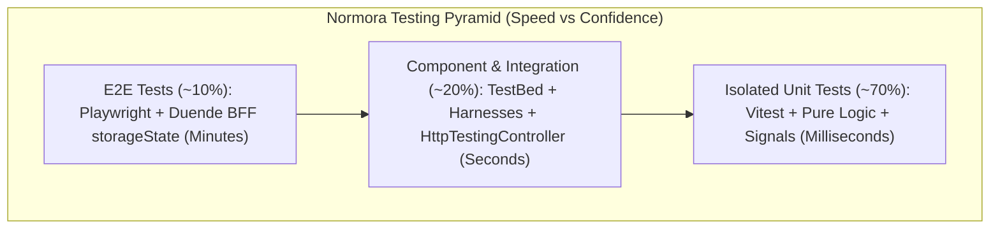
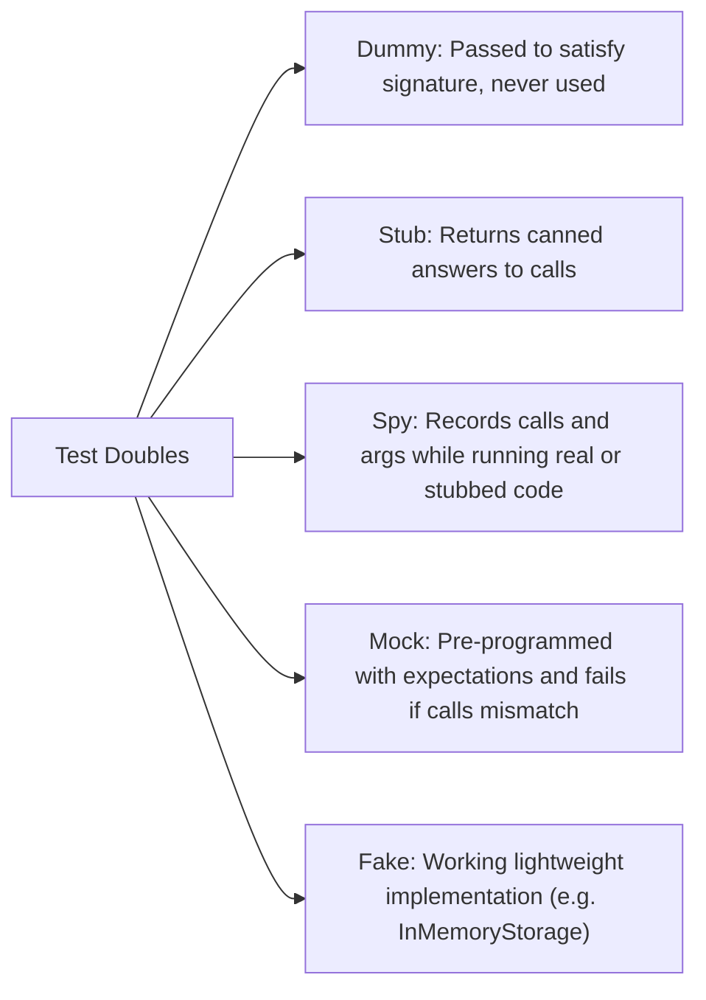
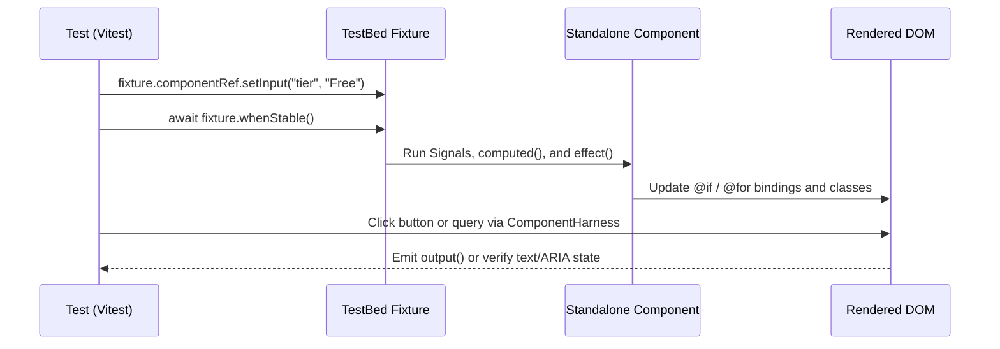
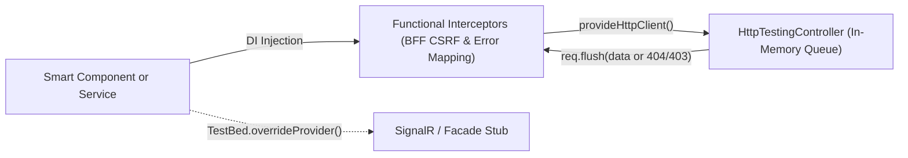
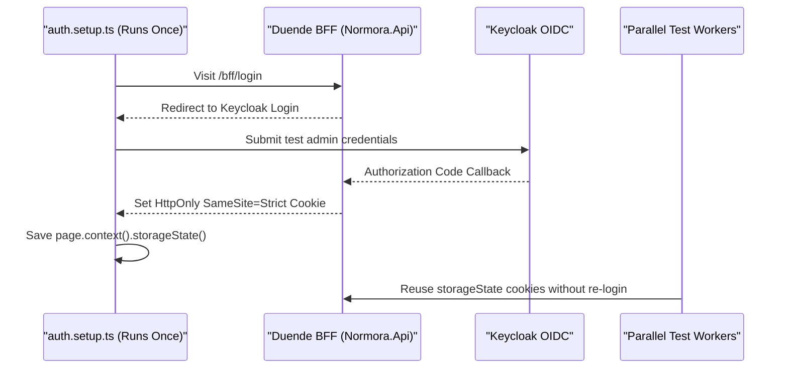

# Chapter 18: Testing Strategy

## 1. Learning Objectives
By the end of this chapter, you will be able to:
* Design an enterprise testing strategy using the **Testing Pyramid**, **Testing Trophy**, and the **5 Test Doubles** (Dummy, Stub, Spy, Mock, Fake).
* Choose the right test runner for Angular 22 (**Vitest** vs. Jest vs. legacy Karma/Jasmine) and configure deterministic test suites.
* Write fast, isolated Unit Tests for Pipes, domain calculators, and **Signal-based stores/effects** using `TestBed.runInInjectionContext` and `TestBed.tick()`.
* Test Angular 22 **Zoneless** standalone components (`input()`, `output()`, `model()`, `@if`/`@for`/`@defer`) using `TestBed`, `TestHostComponent`, and **CDK Component Harnesses**.
* Mock HTTP calls (`HttpTestingController`), functional interceptors (Duende BFF CSRF & BOLA/BFLA error handling), **Router guards** (`RouterTestingHarness`), and real-time SignalR/SSE streams.
* Architect fast **Playwright** End-to-End (E2E) suites behind a **Duende BFF** using `storageState` session reuse, accessibility checks, and visual regression testing.

---

## 2. Introduction: The Testing Pyramid, Trophy, and Test Doubles

Testing in enterprise software is not optional. A lack of tests in a multi-tenant platform like **Normora** guarantees that deploying a billing update in the `Tenants` module UI will silently break document ingestion badges in `Documents` or streaming citations in `Conversations`.

### What Is the Testing Strategy?
A testing strategy defines *what* you test, *at which layer* you test it, and *how much confidence* each layer buys relative to its execution cost.

To maintain velocity safely, we rely on the **Testing Pyramid** (and its modern integration-weighted cousin, the **Testing Trophy**):
1. **Unit Tests (The Base — ~70%):** Fast, isolated tests targeting pure logic (Pipes, domain calculators, validators, Signal stores, and helper functions). They run in milliseconds with zero DOM or browser overhead.
2. **Component & Integration Tests (The Middle — ~20%):** Tests that instantiate standalone Component classes *with* their HTML templates via `TestBed`, plus multi-class collaborations (Service + Functional Interceptor + `HttpTestingController`, or Smart Container + real Dumb children).
3. **End-to-End (E2E) Tests (The Peak — ~10%):** Slower, full-stack tests that drive a real browser (Chromium, Firefox, WebKit) against your running Angular SPA, Duende BFF, and backend APIs.

> [!NOTE]
> **Testing Pyramid vs. Testing Trophy:** In modern Angular 22 apps with Signals and thin templates, many architects shift slightly from a pure Pyramid toward the **Testing Trophy** (investing heavily in Component Integration tests with `TestBed` + `HttpTestingController` because mocking every child component hides template binding bugs).



### Angular 22 Test Runners: Vitest vs. Jest vs. Legacy Karma/Jasmine
* **Karma + Jasmine (Legacy):** Karma launched a real browser for every unit test run and was officially **deprecated** by the Angular team. You will still see Jasmine syntax (`jasmine.createSpyObj`, `.toBeTrue()`) in older codebases.
* **Jest:** Popular Node-based runner with jsdom, though historically required extra ESM/CommonJS configuration for Angular libraries.
* **Vitest (Modern Standard & Normora's Runner):** Native ESM, Vite-powered, blazingly fast watch mode, and first-class support in modern Angular CLI (`@angular/build:unit-test`). Uses `describe`/`it`/`expect`, `vi.fn()`, `vi.spyOn()`, and `vi.useFakeTimers()`.

### The 5 Test Doubles (Know Your Vocabulary)
Before writing a single mock, distinguish the five standard **Test Doubles** (coined by Gerard Meszaros):



| Test Double | What It Does | When to Use | When NOT to Use |
|---|---|---|---|
| **Dummy** | Placeholder object (e.g., empty `TenantSummary`) never read by the test. | Satisfying required TypeScript parameters unrelated to the assertion. | When the code under test inspects its fields (use a Stub). |
| **Stub** | Returns hardcoded values (`vi.fn().mockReturnValue(...)`). | Controlling inputs from services (`DocumentsApiService`) to test component states. | When you need to assert *how many times* or *with what arguments* it was called. |
| **Spy** | Wraps a function/method (`vi.spyOn`) to record invocations and arguments. | Verifying an event handler, router navigation, or `ApiMessages` toast call fired. | Over-spying on private internal methods (couples tests to implementation). |
| **Mock** | Verifies strict interaction expectations (e.g., `HttpTestingController.expectOne` + `verify()`). | Enforcing exact HTTP contracts, BOLA/BFLA status handling, and zero stray calls. | Everywhere by default—strict mocks make refactoring painful. |
| **Fake** | Lightweight working substitute (e.g., `InMemorySignalRHub` or `FakeLocalStorage`). | Stateful workflows like SSE streaming or workspace `dataVersion` sync across ticks. | Simple stateless getters where a 1-line Stub is clearer. |

### When NOT to Test Everything at 100% Coverage
Chasing **100% code coverage** is an anti-pattern. Do **not** write unit tests for:
* Angular framework internals (testing that `signal()` updates when `.set()` is called).
* Trivial one-line pass-through getters or static `ApiMessages` constant objects.
* Third-party library behavior (testing that PrimeNG's `<p-dialog>` opens when `visible=true`—test *your* component's state trigger instead).

### 5 Real-World Normora Strategy Examples

1. **Unit Layer — `TenantPlanPricingCatalog` Helper:** Testing annual 20% discount math across `INR`, `USD`, `EUR`, and `JPY` (zero-decimal currency rounding) with pure Vitest functions—no `TestBed` needed.
2. **Unit Layer (Fake) — `WorkspaceStateSynchronizer`:** Using an in-memory `FakeSignalREventBus` to assert that incrementing `dataVersion` triggers a debounced reload signal.
3. **Component Layer (Stub) — `HrEscalationCardComponent`:** Stubbing clipboard API and passing an `HrEscalationPayload` via `fixture.componentRef.setInput()` to verify the 3-stage timeline (`Dispatched`, `Under Review`, `Resolution`).
4. **Integration Layer (Mock) — `DocumentsApiService` + `bffCsrfInterceptor`:** Using `HttpTestingController` to verify `X-CSRF: 1` is attached and a `404` BOLA response maps to `ApiMessages.NotFound`.
5. **E2E Layer (Real Browser) — `CopilotWorkstation` HITL Flow:** Using Playwright with a saved Duende BFF `storageState` cookie to trigger `documents_delete` in chat, inspect the `PendingApproval` card, and confirm deletion.

---

## 3. Isolated Unit Testing (Pure Logic, Signals, and Services)

### What, Why, and How
**Isolated Unit Testing** tests TypeScript functions, Pipes, domain models, and pure Services without compiling any Angular templates. Pure classes and functions are instantiated directly with `new` or called directly, running in **sub-millisecond** time.

When a Signal-based Service or Store uses Angular's `inject()` function or `effect()`, you still avoid DOM rendering—you simply execute inside `TestBed.runInInjectionContext()` (with zero component compilation) and flush pending effects with `TestBed.tick()`.

### When NOT to Use Direct `new` Instantiation
* Do **not** instantiate a service with `new MyService()` if it calls `inject(HttpClient)` or `inject(DestroyRef)` internally—`inject()` throws `NG0203: inject() must be called from an injection context`. Use `TestBed.configureTestingModule({ providers: [MyService] })` + `TestBed.inject(MyService)` instead.
* Do **not** use isolated unit tests to verify `@if`, `@for`, Tailwind classes, or ARIA attributes—those belong in `TestBed` Component tests.

### Existing Case Study: Testing a Pure Pipe
Because a pure Pipe has no external dependencies, it is trivial to test with `new`:

**`kwh.pipe.spec.ts`**
```typescript
import { KwhPipe } from './kwh.pipe';

describe('KwhPipe', () => {
  let pipe: KwhPipe;

  beforeEach(() => {
    pipe = new KwhPipe();
  });

  it('should transform 5.1234 to "5.12 kWh"', () => {
    expect(pipe.transform(5.1234)).toBe('5.12 kWh');
  });

  it('should handle null values gracefully', () => {
    expect(pipe.transform(null)).toBe('0.00 kWh');
  });
});
```

### 5 Real-World Normora Unit Testing Examples

#### Example 1: Pure Pipe (`RelevanceScorePipe` for RAG Citations)
Formats pgvector + Reciprocal Rank Fusion (RRF) similarity scores into human-readable confidence badges.
```typescript
// client/src/app/shared/pipes/relevance-score.pipe.spec.ts
import { RelevanceScorePipe } from './relevance-score.pipe';

describe('RelevanceScorePipe', () => {
  const pipe = new RelevanceScorePipe();

  it('clamps scores above 1 and formats as percentage', () => {
    expect(pipe.transform(0.946)).toBe('95% match');
    expect(pipe.transform(1.2)).toBe('100% match');
  });

  it('handles null or negative scores safely', () => {
    expect(pipe.transform(null)).toBe('0% match');
    expect(pipe.transform(-0.1)).toBe('0% match');
  });
});
```

#### Example 2: Pure Multi-Currency Billing Calculator (`TenantPlanPricing`)
Verifies the 20% annual discount and zero-decimal rounding (`JPY`) matching Normora's `TenantPlanPricingCatalog`.
```typescript
// client/src/app/features/billing/utils/plan-pricing.util.spec.ts
import { calculateAnnualTotal } from './plan-pricing.util';

describe('calculateAnnualTotal', () => {
  it('applies 20% annual discount for Pro tier in USD', () => {
    expect(calculateAnnualTotal({ monthlyPrice: 49, currency: 'USD', cycle: 'Annual' })).toBe(470.4);
  });

  it('rounds JPY to whole integer yen without decimals', () => {
    expect(calculateAnnualTotal({ monthlyPrice: 7500, currency: 'JPY', cycle: 'Annual' })).toBe(72000);
  });
});
```

#### Example 3: Pure Reactive Form Validator with `ApiMessages` (No Magic Strings)
Checks file type and byte-size limits before `UploadDocumentCommand` is dispatched, returning `ApiMessages` keys rather than hardcoded strings.
```typescript
// client/src/app/features/documents/validators/document-file.validator.spec.ts
import { FormControl } from '@angular/forms';
import { ApiMessages } from '../../../core/constants/api-messages';
import { documentFileValidator } from './document-file.validator';

describe('documentFileValidator', () => {
  const validator = documentFileValidator({ maxSizeMb: 25, allowedMimeTypes: ['application/pdf'] });

  it('returns ApiMessages error key for unsupported MIME types', () => {
    const exeFile = new File(['MZ'], 'payload.exe', { type: 'application/x-msdownload' });
    const control = new FormControl<File | null>(exeFile);

    expect(validator(control)).toEqual({
      unsupportedFileType: ApiMessages.UnsupportedDocumentType,
    });
  });

  it('returns null for a valid PDF within size limit', () => {
    const pdfFile = new File(['%PDF-1.7'], 'hr-policy.pdf', { type: 'application/pdf' });
    const control = new FormControl<File | null>(pdfFile);

    expect(validator(control)).toBeNull();
  });
});
```

#### Example 4: Testing a Signal Store (`CopilotPersonaStore` with `signal` & `computed`)
Tests synchronous Signals and derived `computed()` state for Normora's Multi-Agent Mesh Persona Switching (`All-Rounder`, `HR & People Ops`, `Finance & Travel`, `IT & Security`) without instantiating any component.
```typescript
// client/src/app/features/copilot/state/copilot-persona.store.spec.ts
import { TestBed } from '@angular/core/testing';
import { CopilotPersonaStore } from './copilot-persona.store';

describe('CopilotPersonaStore', () => {
  it('updates prompt framing and contextual suggestions when persona switches', () => {
    TestBed.configureTestingModule({ providers: [CopilotPersonaStore] });
    const store = TestBed.inject(CopilotPersonaStore);

    expect(store.activePersona()).toBe('All-Rounder');

    store.selectPersona('Finance & Travel');

    expect(store.activePersona()).toBe('Finance & Travel');
    expect(store.suggestedPrompts()).toContain('Calculate trip per diem allowance');
  });
});
```

#### Example 5: Testing `effect()` and `dataVersion` Synchronization (`TestBed.tick()`)
When `WorkspaceStateSynchronizer` receives a higher `dataVersion` over SignalR/SSE, its `effect()` triggers a reload callback. Because Angular `effect()` runs asynchronously during change detection, you must call `TestBed.tick()` (or `TestBed.flushEffects()` in pre-v20 codebases) before asserting!
```typescript
// client/src/app/core/state/workspace-sync.service.spec.ts
import { TestBed } from '@angular/core/testing';
import { vi } from 'vitest';
import { WorkspaceSyncService } from './workspace-sync.service';

describe('WorkspaceSyncService', () => {
  it('invokes registered reload handler when dataVersion increments', () => {
    TestBed.configureTestingModule({ providers: [WorkspaceSyncService] });
    const sync = TestBed.inject(WorkspaceSyncService);
    const reloadSpy = vi.fn();

    sync.onVersionChange(reloadSpy);
    TestBed.tick(); // Flush initial effect execution (v1)
    reloadSpy.mockClear();

    sync.applyServerVersion(2);
    TestBed.tick(); // Flush effect after signal update

    expect(reloadSpy).toHaveBeenCalledTimes(1);
    expect(sync.dataVersion()).toBe(2);
  });
});
```

---

## 4. Component Testing with `TestBed` and Zoneless Angular 22

### What, Why, and How
When you need to verify that Signal `input()` values, `@if` / `@for` / `@defer` blocks, Tailwind v4 dark-mode classes, and user clicks actually update the DOM and emit `output()` events, you use Angular's `TestBed`. `TestBed` dynamically compiles your standalone component inside an isolated Angular environment.

### Zoneless Testing in Angular 22
Angular 22 runs **Zoneless** by default (`provideZonelessChangeDetection()`). In a Zoneless test environment:
1. **No Zone.js monkey-patching:** `setTimeout`, `Promise`, and `addEventListener` do not automatically trigger global dirty checking.
2. **Signal-driven updates & `whenStable()`:** Calling `fixture.componentRef.setInput('status', ...)` marks the component dirty; calling `await fixture.whenStable()` (or `fixture.detectChanges()` for synchronous initial render) runs Angular's change detection and waits for pending microtasks/effects.
3. **`fakeAsync()` / `tick()` is obsolete in Zoneless:** `fakeAsync` depends on `zone.js/testing`. In Vitest + Zoneless Angular, use **`vi.useFakeTimers()`** and **`await vi.advanceTimersByTimeAsync(ms)`** followed by `await fixture.whenStable()`.



### Advanced Component Testing Patterns
* **Testing `output()` and `model()`:** Subscribe directly (`component.previewRequested.subscribe(...)`) or update `model()` via `fixture.componentRef.setInput()` and assert two-way emissions.
* **Testing `@defer` Blocks:** Configure `TestBed.configureTestingModule({ deferBlockBehavior: DeferBlockBehavior.Manual, imports: [...] })`, retrieve blocks with `const blocks = await fixture.getDeferBlocks()`, and explicitly transition them via `await blocks[0].render(DeferBlockState.Complete)`.
* **The `TestHostComponent` Pattern:** When testing `<ng-content>` projection, directives, or `[(model)]` two-way binding from a parent template, declare a minimal test-only host component inside the `.spec.ts` file.
* **CDK Component Harnesses (`@angular/cdk/testing`):** A **Component Harness** is a test API wrapper (extending `ComponentHarness`) that hides brittle CSS selectors (`.p-dropdown-trigger`) behind semantic methods (`await deptHarness.selectOption('Finance')`).
  * *When to use:* Reusable design-system widgets (`client/src/design-system/components/`) and PrimeNG wrappers shared across dozens of tests.
  * *When NOT to use:* One-off feature components where native semantic queries (`fixture.nativeElement.querySelector('button[aria-label="..."]')`) are simpler and direct.

### When NOT to Use `TestBed`
* Do **not** spin up `TestBed` to test pure math, string formatting, or stateless validators—isolated unit tests are 10x–50x faster.

### Existing Case Study: Testing the Charger Badge
Let's test the `ChargerBadgeComponent` built in Chapter 3. Since it is a Standalone Component, it goes directly into `imports`:

**`charger-badge.component.spec.ts`**
```typescript
import { ComponentFixture, TestBed } from '@angular/core/testing';
import { ChargerBadgeComponent } from './charger-badge.component';

describe('ChargerBadgeComponent', () => {
  let component: ChargerBadgeComponent;
  let fixture: ComponentFixture<ChargerBadgeComponent>;

  beforeEach(async () => {
    // 1. Configure the Testing Module
    await TestBed.configureTestingModule({
      imports: [ChargerBadgeComponent] // Standalone components go in imports!
    }).compileComponents();

    // 2. Instantiate the Component and its DOM
    fixture = TestBed.createComponent(ChargerBadgeComponent);
    component = fixture.componentInstance;
  });

  it('should render "🟢 Ready" and apply correct CSS class when AVAILABLE', async () => {
    // Arrange: Set the input (Modern Signal Input via componentRef)
    fixture.componentRef.setInput('status', 'AVAILABLE');

    // Act: Run change detection (detectChanges or await fixture.whenStable())
    await fixture.whenStable();

    // Assert: Query the DOM
    const badgeElement: HTMLElement = fixture.nativeElement.querySelector('.badge');

    expect(badgeElement.textContent).toContain('Ready');
    expect(badgeElement.classList.contains('status-available')).toBe(true);
  });
});
```

### 5 Real-World Normora Component Testing Examples

#### Example 1: Dumb Component with `input.required()` & `output()` (`CitationBadgeComponent`)
Verifies clickable RAG citation chips that render Tailwind v4 classes (suffix `!`, full `dark:` support) and emit the chunk ID to open `ChunkPreviewDrawerComponent`.
```typescript
// client/src/app/features/copilot/components/citation-badge.component.spec.ts
import { ComponentFixture, TestBed } from '@angular/core/testing';
import { vi } from 'vitest';
import { CitationBadgeComponent } from './citation-badge.component';

describe('CitationBadgeComponent', () => {
  let fixture: ComponentFixture<CitationBadgeComponent>;

  beforeEach(async () => {
    await TestBed.configureTestingModule({
      imports: [CitationBadgeComponent],
    }).compileComponents();

    fixture = TestBed.createComponent(CitationBadgeComponent);
  });

  it('renders document title with dark-mode/v4 classes and emits chunkId on click', async () => {
    const spy = vi.fn();
    fixture.componentInstance.locateChunk.subscribe(spy);

    fixture.componentRef.setInput('citation', {
      chunkId: 'chk-42',
      documentTitle: 'Travel Policy 2026.pdf',
      pageNumber: 4,
    });
    await fixture.whenStable();

    const btn: HTMLButtonElement = fixture.nativeElement.querySelector('button');
    expect(btn.textContent).toContain('Travel Policy 2026.pdf');
    expect(btn.className).toContain('border-none!');
    expect(btn.className).toContain('dark:bg-slate-800');

    btn.click();
    expect(spy).toHaveBeenCalledWith('chk-42');
  });
});
```

#### Example 2: Interactive A2UI Simulator with `model()` & `computed()` (`ExpenseSimulatorCardComponent`)
Tests Normora's interactive `policy_limit_card` where changing `nights` via `model()` updates the `computed()` total allowance in the DOM.
```typescript
// client/src/app/features/copilot/components/expense-simulator-card.component.spec.ts
import { TestBed } from '@angular/core/testing';
import { ExpenseSimulatorCardComponent } from './expense-simulator-card.component';

describe('ExpenseSimulatorCardComponent', () => {
  it('recalculates total trip allowance when hotel nights stepper increments', async () => {
    await TestBed.configureTestingModule({
      imports: [ExpenseSimulatorCardComponent],
    }).compileComponents();

    const fixture = TestBed.createComponent(ExpenseSimulatorCardComponent);
    fixture.componentRef.setInput('nightlyCapUsd', 200);
    fixture.componentRef.setInput('nights', 2);
    await fixture.whenStable();

    const totalEl = () => fixture.nativeElement.querySelector('[data-testid="total-allowance"]');
    expect(totalEl().textContent).toContain('$400');

    const incrementBtn: HTMLButtonElement = fixture.nativeElement.querySelector('[aria-label="Increase nights"]');
    incrementBtn.click();
    await fixture.whenStable();

    expect(fixture.componentInstance.nights()).toBe(3);
    expect(totalEl().textContent).toContain('$600');
  });
});
```

#### Example 3: Free-Tier Billing Guard (`SubscriptionDangerZoneComponent`)
Enforces Normora's strict Free-tier invariant: cancellation buttons, danger zones, and renewal countdowns MUST be suppressed when `planTier()` is `'Free'`.
```typescript
// client/src/app/features/billing/components/subscription-danger-zone.component.spec.ts
import { TestBed } from '@angular/core/testing';
import { SubscriptionDangerZoneComponent } from './subscription-danger-zone.component';

describe('SubscriptionDangerZoneComponent', () => {
  it('suppresses cancellation button and danger zone on the Free tier', async () => {
    await TestBed.configureTestingModule({
      imports: [SubscriptionDangerZoneComponent],
    }).compileComponents();

    const fixture = TestBed.createComponent(SubscriptionDangerZoneComponent);
    fixture.componentRef.setInput('planTier', 'Free');
    await fixture.whenStable();

    expect(fixture.nativeElement.querySelector('[data-testid="cancel-subscription-btn"]')).toBeNull();

    fixture.componentRef.setInput('planTier', 'Pro');
    await fixture.whenStable();

    expect(fixture.nativeElement.querySelector('[data-testid="cancel-subscription-btn"]')).not.toBeNull();
  });
});
```

#### Example 4: Testing `@defer` Blocks & `TestHostComponent` (`ChunkPreviewDrawerComponent`)
Uses `DeferBlockBehavior.Manual` to test `@defer` loading/complete states in Normora's markdown chunk preview drawer, wrapped in a `TestHostComponent` to verify projected header actions.
```typescript
// client/src/app/features/documents/components/chunk-preview-drawer.component.spec.ts
import { Component, signal } from '@angular/core';
import { DeferBlockBehavior, DeferBlockState, TestBed } from '@angular/core/testing';
import { ChunkPreviewDrawerComponent } from './chunk-preview-drawer.component';

@Component({
  standalone: true,
  imports: [ChunkPreviewDrawerComponent],
  template: `
    <app-chunk-preview-drawer [markdownContent]="markdown()">
      <button drawer-actions class="border-none! bg-slate-100 dark:bg-slate-800">Locate in Documents</button>
    </app-chunk-preview-drawer>
  `,
})
class HostComponent {
  markdown = signal('## Expense Rules\nMeals capped at $75/day.');
}

describe('ChunkPreviewDrawerComponent', () => {
  it('renders placeholder first and projects content once @defer completes', async () => {
    await TestBed.configureTestingModule({
      imports: [HostComponent],
      deferBlockBehavior: DeferBlockBehavior.Manual,
    }).compileComponents();

    const fixture = TestBed.createComponent(HostComponent);
    await fixture.whenStable();

    const blocks = await fixture.getDeferBlocks();
    await blocks[0].render(DeferBlockState.Loading);
    expect(fixture.nativeElement.textContent).toContain('Rendering chunk...');

    await blocks[0].render(DeferBlockState.Complete);
    expect(fixture.nativeElement.textContent).toContain('Meals capped at $75/day.');
    expect(fixture.nativeElement.textContent).toContain('Locate in Documents');
  });
});
```

#### Example 5: CDK Component Harness (`DepartmentFilterHarness`) & Fake Timers in Zoneless Mode
Demonstrates decoupling tests from PrimeNG/Design System DOM markup while using Vitest's `vi.useFakeTimers()` for debounced search instead of Zone.js `fakeAsync`.
```typescript
// client/src/app/features/documents/testing/department-filter.harness.ts
import { ComponentHarness } from '@angular/cdk/testing';

export class DepartmentFilterHarness extends ComponentHarness {
  static hostSelector = 'app-department-filter';
  private getSearchInput = this.locatorFor('input[type="search"]');

  async search(term: string): Promise<void> {
    const input = await this.getSearchInput();
    await input.clear();
    await input.sendKeys(term);
  }
}

// client/src/app/features/documents/components/department-filter.component.spec.ts
import { TestBed } from '@angular/core/testing';
import { TestbedHarnessEnvironment } from '@angular/cdk/testing/testbed';
import { vi } from 'vitest';
import { DepartmentFilterComponent } from './department-filter.component';
import { DepartmentFilterHarness } from '../testing/department-filter.harness';

describe('DepartmentFilterComponent', () => {
  afterEach(() => vi.useRealTimers());

  it('debounces search input by 300ms in zoneless mode', async () => {
    vi.useFakeTimers();
    await TestBed.configureTestingModule({ imports: [DepartmentFilterComponent] }).compileComponents();

    const fixture = TestBed.createComponent(DepartmentFilterComponent);
    const emitted: string[] = [];
    fixture.componentInstance.filterChanged.subscribe((val) => emitted.push(val));

    const loader = TestbedHarnessEnvironment.loader(fixture);
    const harness = await loader.getHarness(DepartmentFilterHarness);

    await harness.search('Engineering');
    expect(emitted).toEqual([]);

    await vi.advanceTimersByTimeAsync(300);
    await fixture.whenStable();
    expect(emitted).toEqual(['Engineering']);
  });
});
```

---

## 5. Mocking Dependencies: DI Overrides, HTTP, Interceptors, Router, and Real-Time Streams

### What, Why, and How
When testing a component, guard, or service that talks to APIs, routes, or SignalR WebSockets, **you must never hit real network endpoints**. Real APIs are slow, nondeterministic, and mutate shared database state. Instead, you replace external boundaries via:
1. **`HttpTestingController` (`provideHttpClientTesting()`):** Intercepts `HttpClient` requests in memory so you can inspect headers, methods, and payloads, then flush synthetic responses or BOLA (`404`)/BFLA (`403`) errors.
2. **DI Overrides (`providers`, `TestBed.overrideProvider`, `overrideComponent`):** Swaps real Facades, `InjectionToken`s, or SignalR services with Stubs or Fakes.
3. **`RouterTestingHarness` (`provideRouter(routes)`):** Modern replacement for the deprecated `RouterTestingModule`; renders routed components and tests `CanActivateFn` guards and resolvers cleanly.



### When NOT to Mock
* Do **not** use `TestBed.overrideComponent(..., { set: { imports: [MockChild] } })` to stub every dumb presentational child component (Shallow Testing). Let real dumb children render, and mock only at the **Service / HTTP / Hub** boundary.
* Do **not** mock `HttpClient` manually with `vi.fn()`—you skip Angular's interceptor pipeline. Always use `provideHttpClient()` + `provideHttpClientTesting()` so interceptors actually run!

### Existing Case Study: HTTP Mocking with `HttpTestingController`

**`charger.service.spec.ts`**
```typescript
import { TestBed } from '@angular/core/testing';
import { provideHttpClient } from '@angular/common/http';
import { HttpTestingController, provideHttpClientTesting } from '@angular/common/http/testing';
import { ChargerService } from './charger.service';

describe('ChargerService', () => {
  let service: ChargerService;
  let httpMock: HttpTestingController;

  beforeEach(() => {
    TestBed.configureTestingModule({
      providers: [
        ChargerService,
        provideHttpClient(),
        provideHttpClientTesting() // Intercepts all HTTP requests!
      ]
    });

    service = TestBed.inject(ChargerService);
    httpMock = TestBed.inject(HttpTestingController);
  });

  afterEach(() => {
    // Ensure no unexpected requests were made
    httpMock.verify(); 
  });

  it('should fetch a list of chargers', () => {
    const mockData = [{ id: '1', name: 'Tesla V3' }];

    // 1. Trigger the method
    service.getAll().subscribe(chargers => {
      expect(chargers.length).toBe(1);
      expect(chargers[0].name).toBe('Tesla V3');
    });

    // 2. Expect an HTTP GET request to a specific URL
    const req = httpMock.expectOne('/api/v1/chargers');
    expect(req.request.method).toBe('GET');

    // 3. Resolve the request with our mock data
    req.flush(mockData);
  });
});
```

### 5 Real-World Normora Mocking & Integration Examples

#### Example 1: `DocumentsApiService` — Outbox Upload & BOLA `404` / BFLA `403` Error Mapping
Tests Normora's upload endpoint and verifies that BOLA (`404`) and BFLA (`403`) server responses preserve structured `ApiMessages` envelopes.
```typescript
// client/src/app/features/documents/services/documents-api.service.spec.ts
import { TestBed } from '@angular/core/testing';
import { HttpErrorResponse, provideHttpClient } from '@angular/common/http';
import { HttpTestingController, provideHttpClientTesting } from '@angular/common/http/testing';
import { ApiMessages } from '../../../core/constants/api-messages';
import { DocumentsApiService } from './documents-api.service';

describe('DocumentsApiService', () => {
  let api: DocumentsApiService;
  let httpMock: HttpTestingController;

  beforeEach(() => {
    TestBed.configureTestingModule({
      providers: [DocumentsApiService, provideHttpClient(), provideHttpClientTesting()],
    });
    api = TestBed.inject(DocumentsApiService);
    httpMock = TestBed.inject(HttpTestingController);
  });

  afterEach(() => httpMock.verify());

  it('surfaces generic ApiMessages.NotFound on BOLA 404 without leaking resource existence', () => {
    let capturedError: HttpErrorResponse | undefined;
    api.getDocumentById('doc-secret-99').subscribe({ error: (err) => (capturedError = err) });

    const req = httpMock.expectOne('/api/documents/doc-secret-99');
    req.flush({ message: ApiMessages.NotFound }, { status: 404, statusText: 'Not Found' });

    expect(capturedError?.status).toBe(404);
    expect(capturedError?.error.message).toBe(ApiMessages.NotFound);
  });
});
```

#### Example 2: Functional HTTP Interceptor (`bffSecurityInterceptor`) Behind Duende BFF
Normora's Angular SPA sends encrypted `HttpOnly`, `SameSite=Strict` cookies managed by Duende BFF and attaches `X-CSRF: 1` on API calls while redirecting `401` sessions.
```typescript
// client/src/app/core/interceptors/bff-security.interceptor.spec.ts
import { TestBed } from '@angular/core/testing';
import { HttpClient, provideHttpClient, withInterceptors } from '@angular/common/http';
import { HttpTestingController, provideHttpClientTesting } from '@angular/common/http/testing';
import { vi } from 'vitest';
import { bffSecurityInterceptor } from './bff-security.interceptor';
import { ToastService } from '../services/toast.service';
import { ApiMessages } from '../constants/api-messages';

describe('bffSecurityInterceptor', () => {
  it('adds X-CSRF: 1 header and shows ApiMessages.Forbidden toast on BFLA 403', () => {
    const toastStub = { error: vi.fn() };

    TestBed.configureTestingModule({
      providers: [
        { provide: ToastService, useValue: toastStub },
        provideHttpClient(withInterceptors([bffSecurityInterceptor])),
        provideHttpClientTesting(),
      ],
    });

    const http = TestBed.inject(HttpClient);
    const httpMock = TestBed.inject(HttpTestingController);

    http.put('/api/subscription/currency', { currency: 'EUR' }).subscribe({ error: () => {} });

    const req = httpMock.expectOne('/api/subscription/currency');
    expect(req.request.headers.get('X-CSRF')).toBe('1');
    expect(req.request.withCredentials).toBe(true);

    req.flush({ message: ApiMessages.Forbidden }, { status: 403, statusText: 'Forbidden' });
    expect(toastStub.error).toHaveBeenCalledWith(ApiMessages.Forbidden);

    httpMock.verify();
  });
});
```

#### Example 3: Modern Route Guard Testing with `RouterTestingHarness`
Replaces legacy `RouterTestingModule` to test Normora's `workspaceAdminGuard`, blocking standard employees from `/t/acme/billing` and redirecting to `/unauthorized`.
```typescript
// client/src/app/core/guards/workspace-admin.guard.spec.ts
import { Component } from '@angular/core';
import { TestBed } from '@angular/core/testing';
import { provideRouter } from '@angular/router';
import { RouterTestingHarness } from '@angular/router/testing';
import { workspaceAdminGuard } from './workspace-admin.guard';
import { TenantSessionStore } from '../state/tenant-session.store';

@Component({ standalone: true, template: '<h1>Billing</h1>' })
class DummyBillingComponent {}

@Component({ standalone: true, template: '<h1>Forbidden</h1>' })
class DummyForbiddenComponent {}

describe('workspaceAdminGuard', () => {
  it('redirects non-admin members away from tenant billing routes', async () => {
    TestBed.configureTestingModule({
      providers: [
        { provide: TenantSessionStore, useValue: { isAdmin: () => false } },
        provideRouter([
          { path: 't/:slug/billing', component: DummyBillingComponent, canActivate: [workspaceAdminGuard] },
          { path: 'forbidden', component: DummyForbiddenComponent },
        ]),
      ],
    });

    const harness = await RouterTestingHarness.create();
    await harness.navigateByUrl('/t/acme/billing', DummyForbiddenComponent);

    expect(harness.routeNativeElement?.textContent).toContain('Forbidden');
  });
});
```

#### Example 4: Smart Container DI Override (`DocumentsPageComponent` + `dataVersion` Sync)
Overrides `DocumentsFacade` and `SignalRNotificationService` via `providers` to test that Smart containers reload table data automatically when `dataVersion` increments.
```typescript
// client/src/app/features/documents/pages/documents-page.component.spec.ts
import { signal } from '@angular/core';
import { TestBed } from '@angular/core/testing';
import { vi } from 'vitest';
import { DocumentsPageComponent } from './documents-page.component';
import { DocumentsFacade } from '../state/documents.facade';
import { WorkspaceSyncService } from '../../../core/state/workspace-sync.service';

describe('DocumentsPageComponent', () => {
  it('triggers document list reload when SignalR bumps workspace dataVersion', async () => {
    const dataVersion = signal(1);
    const facadeStub = { documents: signal([]), loading: signal(false), loadDocuments: vi.fn() };

    await TestBed.configureTestingModule({
      imports: [DocumentsPageComponent],
      providers: [
        { provide: DocumentsFacade, useValue: facadeStub },
        { provide: WorkspaceSyncService, useValue: { dataVersion } },
      ],
    }).compileComponents();

    const fixture = TestBed.createComponent(DocumentsPageComponent);
    await fixture.whenStable();
    facadeStub.loadDocuments.mockClear();

    dataVersion.set(2);
    await fixture.whenStable();

    expect(facadeStub.loadDocuments).toHaveBeenCalledTimes(1);
  });
});
```

#### Example 5: Mocking AG-UI / SSE Streaming Tool Events (`CopilotStreamService`)
Tests live autonomous tool chips (`tool_started`, `tool_finished`) and HITL `PendingApproval` card streaming from `/api/copilotkit` without opening a real network stream.
```typescript
// client/src/app/features/copilot/services/copilot-stream.service.spec.ts
import { TestBed } from '@angular/core/testing';
import { Subject } from 'rxjs';
import { CopilotStreamService, AgUiEvent } from './copilot-stream.service';
import { SseTransport } from '../../../core/http/sse-transport.service';

describe('CopilotStreamService', () => {
  it('tracks active tool lifecycle chips and surfaces HITL approval cards', () => {
    const stream$ = new Subject<AgUiEvent>();
    TestBed.configureTestingModule({
      providers: [
        CopilotStreamService,
        { provide: SseTransport, useValue: { connect: () => stream$.asObservable() } },
      ],
    });

    const service = TestBed.inject(CopilotStreamService);
    service.sendMessage('Delete outdated Q1 handbook');

    stream$.next({ type: 'tool_started', toolName: 'documents_delete' });
    expect(service.activeTools()).toEqual(['documents_delete']);

    stream$.next({ type: 'hitl_approval_required', approvalId: 'apr-77', action: 'documents_delete' });
    stream$.next({ type: 'tool_finished', toolName: 'documents_delete' });

    expect(service.activeTools()).toEqual([]);
    expect(service.pendingApproval()?.approvalId).toBe('apr-77');
  });
});
```

---

## 6. End-to-End (E2E) Testing: The Modern Era Behind Duende BFF

For years, Angular shipped with **Protractor** as the default E2E testing framework. It was notoriously flaky, slow, and relied on the deprecated WebDriver API. The Angular team officially deprecated Protractor.

Today, enterprise teams use one of two tools: **Cypress** or **Playwright**.

### Why Playwright?
Playwright (by Microsoft) is the industry standard for modern Angular SPAs:
* **Speed:** Runs tests in parallel across isolated browser contexts (`BrowserContext`) natively.
* **Auto-Waiting:** Automatically waits for elements to be visible, stable, and enabled before clicking, eliminating `setTimeout` hacks.
* **Multiple Browsers:** Tests Chromium, WebKit (Safari), and Firefox from one test suite.
* **Duende BFF Cookie Compatibility:** Because Normora stores sessions in encrypted `HttpOnly`, `SameSite=Strict` cookies (never `localStorage` tokens), Playwright's `storageState` captures and restores BFF session cookies seamlessly across parallel workers.

### Architecting E2E Auth Behind Duende BFF (`storageState`)
Logging in through Keycloak OIDC in every single test wastes minutes per CI run. Instead, run a one-time `auth.setup.ts` project that logs in once, waits for the Duende BFF session cookie, saves `playwright/.auth/admin.json`, and mounts it into all parallel tests.



### When NOT to Use E2E Tests
* Do **not** test every form validation permutation, currency rounding edge case, or BOLA `404` status code via Playwright—use Vitest unit/integration tests.
* Do **not** stub *every* API with `page.route()` in E2E tests; if you mock the entire backend, your E2E test becomes an expensive `TestBed` test. Reserve `page.route()` only for non-deterministic external third parties (like hosted PayU checkout gateways or Gemini rate-limit simulations).

### Existing Case Study: Playwright Test (EV Login Flow)
E2E tests do not know that Angular exists. They interact with the browser exactly like a human driver.

**`login.spec.ts`**
```typescript
import { test, expect } from '@playwright/test';

test('User can log in and view the dashboard', async ({ page }) => {
  // Navigate to the app
  await page.goto('http://localhost:4200/auth/login');

  // Fill out the form
  await page.getByLabel('Email Address').fill('admin@ev-platform.com');
  await page.getByLabel('Password').fill('SecurePassword123');
  
  // Click submit
  await page.getByRole('button', { name: 'Log In' }).click();

  // Assert the URL changed to the dashboard
  await expect(page).toHaveURL(/.*dashboard/);

  // Assert the success toast appeared
  await expect(page.locator('.toast-success')).toHaveText('Welcome back, Admin!');
});
```

### 5 Real-World Normora Playwright E2E Examples

#### Example 1: One-Time Duende BFF + Keycloak `auth.setup.ts` (`storageState`)
Authenticates once via Keycloak OIDC and saves `HttpOnly` BFF session cookies for all downstream feature tests.
```typescript
// client/e2e/auth.setup.ts
import { test as setup, expect } from '@playwright/test';

const adminAuthFile = 'playwright/.auth/admin.json';

setup('authenticate admin via Keycloak and Duende BFF', async ({ page }) => {
  await page.goto('http://localhost:4200');
  await page.getByRole('button', { name: 'Sign In' }).click();

  await page.getByLabel('Username or email').fill(process.env.E2E_ADMIN_EMAIL!);
  await page.getByLabel('Password').fill(process.env.E2E_ADMIN_PASSWORD!);
  await page.getByRole('button', { name: 'Sign In' }).click();

  await expect(page).toHaveURL(/\/t\/.+\/dashboard/);
  await page.context().storageState({ path: adminAuthFile });
});
```

#### Example 2: Document Upload & Real-Time SignalR Ingestion Status E2E
Uploads a policy PDF, verifies it transitions from `Processing` to `Indexed` via SignalR without a manual reload, and opens `ChunkPreviewDrawerComponent`.
```typescript
// client/e2e/documents-ingestion.spec.ts
import { test, expect } from '@playwright/test';

test('uploads PDF, receives SignalR Indexed status, and opens chunk preview', async ({ page }) => {
  await page.goto('/t/acme/documents');

  await page.getByTestId('document-file-input').setInputFiles('e2e/fixtures/travel-policy.pdf');
  await expect(page.getByRole('row', { name: /travel-policy\.pdf/i })).toContainText('Indexed', {
    timeout: 15_000,
  });

  await page.getByRole('button', { name: 'Preview Chunks' }).first().click();
  await expect(page.getByRole('dialog', { name: 'Chunk Preview' })).toBeVisible();
});
```

#### Example 3: Copilot Workstation (`Ctrl+J`) & HITL `PendingApproval` Flow
Tests Normora's two-phase Human-In-The-Loop approval card when an agent invokes `documents_delete`.
```typescript
// client/e2e/copilot-hitl.spec.ts
import { test, expect } from '@playwright/test';

test('streams HITL confirmation card before executing documents_delete', async ({ page }) => {
  await page.goto('/t/acme/dashboard');
  await page.keyboard.press('Control+j');

  const promptBox = page.getByPlaceholder('Ask Normora anything...');
  await promptBox.fill('Delete the outdated Q1 travel policy');
  await promptBox.press('Enter');

  const approvalCard = page.getByTestId('hitl-approval-card');
  await expect(approvalCard).toBeVisible();
  await expect(approvalCard).toContainText('documents_delete');

  await approvalCard.getByRole('button', { name: 'Cancel' }).click();
  await expect(approvalCard).toContainText('Action cancelled');
});
```

#### Example 4: Multi-Currency Persistence & Free-Tier Invariant E2E
Verifies `PUT /api/subscription/currency` survives a full page reload and confirms Free-tier workspaces never expose cancellation buttons.
```typescript
// client/e2e/billing-currency.spec.ts
import { test, expect } from '@playwright/test';

test('persists EUR currency selection across reload and hides cancel button on Free tier', async ({ page }) => {
  await page.goto('/t/acme/billing');

  await expect(page.getByTestId('cancel-subscription-btn')).toHaveCount(0);

  await page.getByLabel('Workspace Currency').selectOption('EUR');
  await expect(page.getByTestId('billing-summary')).toContainText('€');

  await page.reload();
  await expect(page.getByTestId('billing-summary')).toContainText('€');
});
```

#### Example 5: Automated Accessibility (`axe-core`) & Dark-Mode Visual Regression E2E
Scans Normora's Copilot drawer for WCAG violations and captures pixel snapshots in dark mode.
```typescript
// client/e2e/accessibility-visual.spec.ts
import { test, expect } from '@playwright/test';
import AxeBuilder from '@axe-core/playwright';

test('Copilot drawer passes WCAG AA accessibility and dark mode visual snapshot', async ({ page }) => {
  await page.goto('/t/acme/dashboard');
  await page.evaluate(() => document.documentElement.classList.add('dark'));
  await page.keyboard.press('Control+j');

  const results = await new AxeBuilder({ page }).include('[data-testid="copilot-drawer"]').analyze();
  expect(results.violations).toEqual([]);

  await expect(page.getByTestId('copilot-drawer')).toHaveScreenshot('copilot-drawer-dark.png');
});
```

---

## 7. Common Mistakes & Anti-Patterns

> [!CAUTION]
> **1. Forgetting `await fixture.whenStable()` or `TestBed.tick()` in Zoneless Signal Tests**
> 
> **Wrong Code:**
> ```typescript
> it('shows error banner when upload fails', () => {
>   fixture.componentRef.setInput('errorMessage', ApiMessages.UploadFailed);
>   expect(fixture.nativeElement.textContent).toContain(ApiMessages.UploadFailed); // FAILS!
> });
> ```
> **Why It's Wrong:** Calling `setInput()` updates the input Signal and marks the view dirty, but Angular `TestBed` does not synchronously re-render the DOM or flush `effect()` callbacks until change detection runs.
> 
> **Fixed Code:**
> ```typescript
> it('shows error banner when upload fails', async () => {
>   fixture.componentRef.setInput('errorMessage', ApiMessages.UploadFailed);
>   await fixture.whenStable(); // Triggers Zoneless CD and flushes effects
>   expect(fixture.nativeElement.textContent).toContain(ApiMessages.UploadFailed);
> });
> ```

> [!CAUTION]
> **2. Using Zone.js `fakeAsync()` / `tick()` in a Zoneless Angular 22 App**
> 
> **Wrong Code:**
> ```typescript
> it('debounces search query', fakeAsync(() => {
>   component.onQueryChange('handbook');
>   tick(300); // Throws or fails without zone.js/testing!
>   expect(searchSpy).toHaveBeenCalled();
> }));
> ```
> **Why It's Wrong:** `fakeAsync` and `tick` patch Zone.js task queues. In Zoneless Angular 22 apps running Vitest without `zone.js`, `fakeAsync` either throws immediately or silently drifts from real timer behavior.
> 
> **Fixed Code:**
> ```typescript
> it('debounces search query', async () => {
>   vi.useFakeTimers();
>   component.onQueryChange('handbook');
>   await vi.advanceTimersByTimeAsync(300);
>   await fixture.whenStable();
>   expect(searchSpy).toHaveBeenCalledWith('handbook');
>   vi.useRealTimers();
> });
> ```

> [!CAUTION]
> **3. Omitting `httpMock.verify()` in `afterEach`**
> 
> **Wrong Code:**
> ```typescript
> afterEach(() => {
>   // Nothing here!
> });
> ```
> **Why It's Wrong:** If an `effect()` or duplicate subscription accidentally fires a second `GET /api/documents` call, the test still passes silently—hiding N+1 request storms and duplicate mutations.
> 
> **Fixed Code:**
> ```typescript
> afterEach(() => {
>   httpMock.verify(); // Fails immediately if any unexpected or un-flushed HTTP request exists
> });
> ```

> [!CAUTION]
> **4. Shallow-Testing Over-Mocking (`overrideComponent` Replacing Every Child)**
> 
> **Wrong Code:**
> ```typescript
> TestBed.overrideComponent(CopilotPanelComponent, {
>   set: { imports: [MockCitationBadge, MockExpenseSimulator, MockHrEscalationCard] },
> });
> ```
> **Why It's Wrong:** You are testing your mocks rather than your real templates. If someone renames an `input()` on `CitationBadgeComponent` from `citation` to `sourceChunk`, this test stays green while production breaks!
> 
> **Fixed Code:**
> Render real dumb child components (`CitationBadgeComponent`, `ExpenseSimulatorCardComponent`), and only mock external I/O boundaries (`CopilotStreamService`, `DocumentsApiService`) via `providers`.

> [!CAUTION]
> **5. Testing Private Methods or Brittle CSS Selectors + Hardcoded Magic Error Strings**
> 
> **Wrong Code:**
> ```typescript
> expect((component as any).formatCurrency(49)).toBe('$49.00');
> expect(fixture.nativeElement.querySelector('div > div > span.text-red-500').textContent).toBe('Access denied');
> ```
> **Why It's Wrong:** Casting `as any` to test private methods blocks safe refactoring, structural CSS selectors break when Tailwind classes change, and hardcoding `'Access denied'` violates Normora's `ApiMessages` no-magic-strings rule.
> 
> **Fixed Code:**
> ```typescript
> expect(fixture.nativeElement.querySelector('[role="alert"]').textContent).toContain(ApiMessages.Forbidden);
> ```

> [!CAUTION]
> **6. The Ice Cream Cone Anti-Pattern & Repeating Keycloak Logins in Every Playwright Test**
> 
> **Wrong Code:**
> Writing 400 Playwright specs where every `beforeEach` opens `/auth/login` and types Keycloak credentials, while keeping only 15 Vitest unit tests.
> 
> **Why It's Wrong:** Repeated OIDC roundtrips make E2E suites take 30+ minutes, trigger Keycloak rate limits, and bury root-cause failures inside slow browser logs.
> 
> **Fixed Code:**
> Keep ~70% fast Vitest unit tests, ~20% `TestBed` integration tests, and ~10% Playwright critical paths authenticated once via `auth.setup.ts` + `storageState`.

---

## 8. Interview Questions

### Junior
**Q1: Why is `httpMock.verify()` placed in `afterEach()` when using `HttpTestingController`?**
> **A:** `httpMock.verify()` asserts that no unexpected or un-flushed HTTP requests remain open after a test finishes. Without it, a service bug that fires duplicate requests or misses a request goes completely undetected.

**Q2: How do you pass a value to a modern Signal `input()` or `input.required()` inside a `TestBed` component test?**
> **A:** Use `fixture.componentRef.setInput('myInput', value)` followed by `await fixture.whenStable()` (or `fixture.detectChanges()`). Never assign directly to `component.myInput` because Signal inputs are read-only `InputSignal` functions.

### Intermediate / Senior
**Q3: When would you use Isolated Unit Testing versus `TestBed` Component Testing?**
> **A:** Isolated Unit Testing instantiates a class or calls a function directly in Vitest without compiling templates, running in sub-millisecond time. Use it for pure Pipes, calculators, validators, and non-DI helpers. Use `TestBed` when you need Angular's Dependency Injection (`inject()`), `effect()` scheduling (`TestBed.tick()`), HTTP interceptors, `RouterTestingHarness`, or DOM/template verification (`@if`, `@for`, `@defer`, `output()`).

**Q4: How do you test debounced logic or `setTimeout` in a Zoneless Angular 22 app if `fakeAsync()` and `tick()` rely on Zone.js?**
> **A:** Replace `fakeAsync`/`tick` with Vitest's `vi.useFakeTimers()` and `await vi.advanceTimersByTimeAsync(ms)`, followed by `await fixture.whenStable()` so Angular runs Zoneless change detection after the timer callback mutates a Signal. Always restore `vi.useRealTimers()` in `afterEach`.

**Q5: How do you test an `@defer` block in Angular without waiting for real viewport intersections or network idle?**
> **A:** Configure `TestBed.configureTestingModule({ deferBlockBehavior: DeferBlockBehavior.Manual, imports: [...] })`, call `const blocks = await fixture.getDeferBlocks()`, and explicitly transition the block through `DeferBlockState.Placeholder`, `DeferBlockState.Loading`, `DeferBlockState.Error`, and `DeferBlockState.Complete` via `await blocks[0].render(...)`.

**Q6: Why should you test functional HTTP interceptors using `provideHttpClient(withInterceptors([...]))` + `HttpTestingController` instead of mocking `HttpClient`?**
> **A:** Mocking `HttpClient` bypasses the interceptor chain completely. Combining `provideHttpClient(withInterceptors([...]))` with `provideHttpClientTesting()` executes your real interceptor pipeline in memory so you can assert headers (like Duende BFF `X-CSRF: 1`) and `403`/`404` `ApiMessages` error mapping accurately.

### Architect
**Q7: Explain how to properly test a Smart (Container) Component versus a Dumb (Presentational) Component.**
> **A:** A **Dumb component** (e.g., `CitationBadgeComponent` or `ExpenseSimulatorCardComponent`) has no external service dependencies; test it by passing inputs via `fixture.componentRef.setInput()`, interacting with the DOM or a CDK Harness, and asserting rendered output and emitted `output()` events.
>
> A **Smart component** (e.g., `DocumentsPageComponent`) orchestrates state and side effects; test it by providing Stubs or Fakes for its injected Facades/Services via `providers`, letting real Dumb child components render (avoiding shallow over-mocking), and verifying that Signal/Facade state updates flow cleanly into the template and trigger expected Facade calls.

**Q8: How do you architect fast, parallel Playwright E2E tests for an Angular SPA secured by a Duende BFF (`HttpOnly` cookies) instead of `localStorage` JWTs?**
> **A:** Because browser JavaScript cannot read `HttpOnly` cookies, you cannot inject a JWT into `localStorage` via `page.addInitScript()`. Instead, create a Playwright `setup` project (`auth.setup.ts`) that performs the real Keycloak OIDC login once, captures the resulting encrypted `HttpOnly` session cookies via `page.context().storageState({ path: 'playwright/.auth/admin.json' })`, and configures all parallel worker projects to reuse that `storageState`.

**Q9: Why does chasing 100% code coverage hurt an enterprise Angular codebase, and what should architects measure instead?**
> **A:** Chasing 100% line coverage incentivizes low-value tests (testing static constants, pass-through getters, or over-mocked internals) that break on every refactor without catching real bugs. Architects instead enforce high coverage on **critical domain logic, security guards, BOLA/BFLA error mapping, and multi-tenant invariants** (e.g., Free-tier suppression), combine **Testing Trophy** integration tests with **CDK Harnesses** for design-system stability, and track **test flakiness rate and mutation/regression catch rate** in CI.

---

## 9. Summary
In this chapter, we built an architect-grade Angular 22 Testing Strategy:
* Balanced speed and confidence using the **Testing Pyramid**, **Testing Trophy**, and the **5 Test Doubles** (`Dummy`, `Stub`, `Spy`, `Mock`, `Fake`).
* Wrote millisecond-fast **Vitest** isolated unit tests for Pipes, multi-currency billing rules, validators (`ApiMessages`), Signal stores, and `effect()` synchronization (`TestBed.tick()`).
* Tested **Zoneless** standalone components (`input()`, `output()`, `model()`, `@defer`, `TestHostComponent`) with `fixture.whenStable()`, `vi.useFakeTimers()`, and **CDK Component Harnesses**.
* Verified HTTP contracts, BOLA (`404`)/BFLA (`403`) envelopes, **Duende BFF** functional interceptors, **Router guards** (`RouterTestingHarness`), and AG-UI/SignalR streams without hitting real networks.
* Designed parallel **Playwright** E2E suites reusing Duende BFF `storageState` cookies alongside `axe-core` accessibility and dark-mode visual regression checks.

In Chapter 19, we will dive into **Security Best Practices**, learning how Angular and Normora's BFF protect applications from XSS, CSRF, BOLA, and BFLA.
