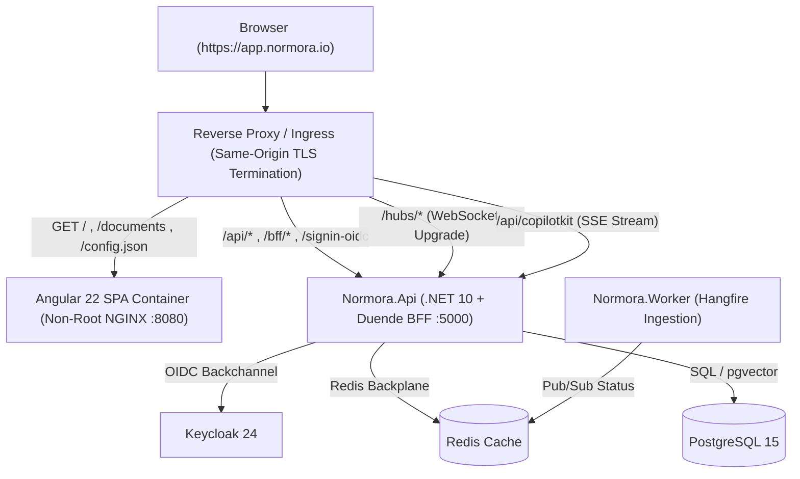
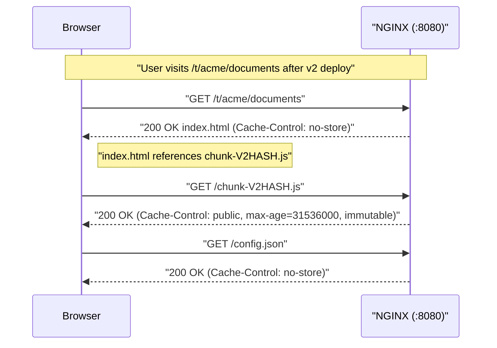

# Chapter 20: Deployment & Cloud Native Architectures

## 1. Learning Objectives
By the end of this chapter, you will be able to:
* Differentiate between **Client-Side Rendering (CSR)**, **Static Site Generation (SSG / Prerendering)**, **Server-Side Rendering (SSR)**, and **BFF-Proxied SPA** topologies—and know when *not* to use each.
* Containerize an Angular 22 application using a hardened, non-root multi-stage **Dockerfile** and **NGINX** with proper `Cache-Control`, `try_files`, WebSocket, and Server-Sent Events (SSE) reverse-proxy rules.
* Implement **Build Once, Run Anywhere** runtime configuration injection using Angular 22's `provideAppInitializer`, Signals, `public/config.json`, `envsubst`, and Kubernetes `ConfigMap`s.
* Architect an enterprise **CI/CD pipeline** (GitHub Actions) featuring fail-fast quality gates, container vulnerability scanning, immutable SHA promotion, hidden source maps, and zero-downtime deployment strategies.
* Mitigate **SPA Version Skew (`ChunkLoadError`)** during rolling updates.

---

## 2. Introduction: The Final Mile

Writing the application is only half the battle. In an enterprise environment, your code must be type-checked, linted, tested, compiled, scanned, and deployed automatically to a highly available, scalable cloud infrastructure—without leaking secrets or breaking active user sessions mid-release.

How you deploy Angular depends on two core architectural decisions:
1. **Rendering Strategy:** Is your application **Client-Side Rendered (CSR)**, **Prerendered (SSG)**, or **Server-Side Rendered (SSR)**?
2. **Authentication & API Topology:** Does the browser talk directly to APIs with Bearer tokens, or does it sit behind a **Backend-For-Frontend (BFF)** like **Normora's Duende BFF** (`Normora.Api`)?

---

## 3. Deployment Paradigms

With Angular's unified `@angular/build:application` builder, every build outputs to `dist/<project-name>/`:
* `browser/` contains static HTML, CSS, hashed JS chunks, and everything from `client/public/`.
* `server/` (only when SSR/SSG is enabled) contains the Node.js server entry (`server.mjs`) and prerendered routes.

### 1. CSR (Static SPA Hosting)
If your Angular application is purely Client-Side Rendered, the build output is strictly static files inside `dist/<app>/browser/`: `index.html`, hashed JS bundles (`main-*.js`, `chunk-*.js`), `styles-*.css`, and static assets.
* **What it needs:** A static file server or CDN (NGINX, Azure Blob Storage Static Websites, AWS S3 + CloudFront, Cloudflare Pages).
* **Cost & Scale:** Practically free to serve; scales effortlessly at edge PoPs.
* **When NOT to use CSR:** Public content portals where Search Engine Optimization (SEO) crawlers, OpenGraph link previews, or sub-second First Contentful Paint (FCP) on slow mobile networks are business-critical.

### 2. SSG / Prerendering (Build-Time HTML Generation)
Static Site Generation (`RenderMode.Prerender` in `@angular/ssr`) executes your Angular routes *during `ng build`* and saves ready-made `.html` files into `browser/`.
* **What it needs:** Only a static file server (just like CSR!)—no Node.js runtime in production.
* **When NOT to use SSG:** Routes whose content depends on authenticated user identity, tenant-specific RBAC permissions, or real-time data (e.g., an AI chat thread or private document vault).

### 3. SSR (Node.js Compute Hosting)
With Angular SSR (`RenderMode.Server`), a Node.js server dynamically renders HTML per incoming HTTP request and Angular hydrates it on the client (Chapter 15).
* **What it needs:** Active compute capable of running Node.js (Kubernetes pods, AWS Fargate, Google Cloud Run, Azure App Service).
* **Cost & Complexity:** Higher cost, requires horizontal autoscaling for CPU/memory, and introduces server-side state isolation concerns (never share mutable module-level variables across requests, and forward auth cookies carefully).
* **When NOT to use SSR:** Authenticated B2B SaaS dashboards behind a login wall where crawlers never visit, or architectures where adding a Node.js SSR tier complicates BFF `HttpOnly` cookie termination without measurable SEO/LCP gains.

### 4. The BFF-Proxied SPA Architecture (Normora's Production Topology)
In enterprise SaaS platforms like **Normora**, security rules forbid storing OAuth2/OIDC tokens in `localStorage`. Instead, the Angular 22 SPA sits behind **Duende BFF** (`Normora.Api`), which holds tokens server-side and issues encrypted `HttpOnly`, `SameSite=Strict`, `Secure` cookies.

Because `SameSite=Strict` cookies are **only** sent to the exact same origin (scheme + domain + port), your deployment infrastructure (NGINX, YARP, or Kubernetes Ingress) acts as a **unified reverse proxy**:



> [!TIP]
> **Why Same-Origin Proxying Matters:** If you host Angular on `https://app.normora.io` and `Normora.Api` on `https://api.normora.io`, they are cross-origin (and cross-site if using separate domains), forcing you to weaken `SameSite=Strict` cookies and manage brittle CORS preflight headers. Routing both behind one origin eliminates CORS in production and keeps cookies locked down.

### Real-World Normora Examples: Choosing the Right Paradigm

1. **Normora Authenticated Workspace (`client/` as CSR behind Duende BFF):**
   Normora's core app (`/t/:slug/documents`, `/t/:slug/chat`, `/t/:slug/settings`) is behind Keycloak OIDC authentication. Search engines cannot index private tenant policies, so Normora compiles `client/` as a pure CSR bundle (`dist/normora-client/browser`) served by NGINX behind the same origin as `Normora.Api`.
2. **Normora Public Landing & Pricing Pages (SSG Prerendering):**
   Normora's public marketing pages and multi-currency pricing calculator overview (`Free`, `Pro`, `Enterprise`) have zero per-user secrets and benefit from SEO. Rendering them with `RenderMode.Prerender` generates static HTML at build time with zero Node.js server cost.
3. **Normora SSR Cookie Pitfall on Private Tenant Routes (When NOT to Use SSR):**
   If Normora enabled `RenderMode.Server` for `/t/:slug/documents` without custom cookie-forwarding middleware, the Node.js SSR server would call `/api/documents` *without* the browser's `HttpOnly` Duende BFF session cookie—receiving `401 Unauthorized` on the server, falling back to CSR anyway, and doubling infrastructure cost for zero benefit.
4. **Normora SignalR Real-Time Document Status (`/hubs/notifications`):**
   When `Normora.Worker` finishes chunking and embedding a PDF via `DocumentProcessingJob`, it publishes status updates over Redis to `Normora.Api`'s SignalR hub. A pure static CDN like S3 alone cannot handle persistent WebSocket (`wss://`) upgrades; the edge reverse proxy must explicitly route `/hubs/*` to `Normora.Api`.
5. **Normora AG-UI Copilot SSE Streaming (`/api/copilotkit`):**
   `NormoraWorkplaceAgent` streams AI tokens, `tool_started`/`tool_finished` chips, and A2UI cards (`policy_limit_card`, `hr_escalation_card`) via Server-Sent Events (SSE). Unlike REST JSON, SSE responses must stay open and unbuffered—any CDN or proxy that caches or buffers responses will stall token streaming until the entire LLM response completes.

---

## 4. Containerizing Angular (Docker & Production NGINX)

In modern enterprise architectures, applications are packaged as **OCI/Docker containers** so the exact same web server, compression settings, and static bundle run identically on a developer's laptop, in CI smoke tests, and in production Kubernetes pods.

### Baseline Multi-Stage CSR Build
For a static SPA, we never ship Node.js or source code into production. We use a **Multi-Stage Build**: Stage 1 compiles the bundle with Node.js, and Stage 2 copies only `dist/*/browser` into a minimal NGINX image (shrinking the image from ~1.1 GB to ~45 MB).

**Baseline `Dockerfile` (EV Platform Case Study)**
```dockerfile
# STAGE 1: Build the Angular App
FROM node:22-alpine AS build
WORKDIR /app

COPY package*.json ./
RUN npm ci

COPY . .
RUN npm run build -- --configuration=production

# STAGE 2: Serve the App using NGINX
FROM nginx:alpine
COPY --from=build /app/dist/ev-platform/browser /usr/share/nginx/html

EXPOSE 80
CMD ["nginx", "-g", "daemon off;"]
```

### The NGINX Fallback Routing Rule
When hosting an Angular SPA on NGINX, if a user refreshes the browser at `/chargers/123` (or `/t/acme/documents`), NGINX looks for a physical file or folder on disk and returns `404 Not Found`. You must configure NGINX to fall back to `index.html` so Angular's client-side router resolves the route:

```nginx
server {
    listen 80;
    location / {
        root /usr/share/nginx/html;
        index index.html index.htm;
        # Fallback to index.html for Angular client-side routes
        try_files $uri $uri/ /index.html;
    }
}
```

### Enterprise Hardening: What the Baseline Misses
A senior architect never ships the 10-line baseline above to production. Five critical hardening layers are required:
1. **`.dockerignore`:** Without it, `docker build` uploads `node_modules` (hundreds of MBs of host-OS binaries), `.angular/cache`, and `.git` into the Docker daemon context.
2. **Non-Root Container (`nginxinc/nginx-unprivileged:alpine`):** Standard `nginx:alpine` starts as `root` to bind privileged port `80`. Kubernetes Pod Security Standards (`restricted`) reject containers running as UID `0`. Running unprivileged on port `8080` eliminates root escalation risk.
3. **Differentiated `Cache-Control` Headers:** Angular hashes JS/CSS filenames (`main-X8K2P9Q1.js`), so those files are **immutable** and should be cached for 1 year. Conversely, `index.html` and `config.json` have *unhashed* filenames—if cached by browsers or CDNs, users keep loading yesterday's `index.html` pointing to deleted chunk hashes!
4. **Compression & Security Headers:** Enable Gzip (and Brotli if compiled) for text/JS/CSS/JSON payloads, and emit defense-in-depth headers (`X-Content-Type-Options: nosniff`, `Referrer-Policy`, `X-Frame-Options: DENY`—see Chapter 19).
5. **BFF, WebSocket & SSE Proxy Rules:** When NGINX sits in front of a Duende BFF (`Normora.Api`), it must forward `X-Forwarded-*` headers (for OIDC redirect URIs), upgrade WebSockets (`/hubs/`), and disable response buffering for SSE (`/api/copilotkit`).



> [!NOTE]
> **When NOT to Use Docker + NGINX for Angular:** If your Angular app is a purely public static site (no Duende BFF same-origin cookie requirement, no internal Kubernetes ingress constraints), deploying `dist/<app>/browser` directly to **Cloudflare Pages**, **AWS S3 + CloudFront**, or **Azure Static Web Apps** gives you global edge caching, zero container patching, and near-zero cost.

### Real-World Normora Examples: Hardened Container & NGINX Setup

#### Example 1: Normora `.dockerignore` (`client/.dockerignore`)
Prevents host `node_modules`, `.angular/cache`, Vitest coverage reports, and `.env` files from entering the Docker build context.
```dockerignore
node_modules
dist
.angular
.git
.vscode
coverage
playwright-report
test-results
*.log
.env*
```

#### Example 2: Normora Non-Root Multi-Stage `Dockerfile` (`client/Dockerfile`)
Uses `node:22-alpine` for deterministic compilation and `nginxinc/nginx-unprivileged:alpine` (UID `101`, port `8080`) with a built-in `/healthz` check.
```dockerfile
# STAGE 1: Deterministic Angular 22 Build
FROM node:22-alpine AS build
WORKDIR /app

COPY package.json package-lock.json ./
RUN npm ci --ignore-scripts

COPY . .
RUN npm run build -- --configuration=production

# STAGE 2: Hardened Non-Root NGINX Runtime
FROM nginxinc/nginx-unprivileged:alpine AS runtime

# Remove default site config and apply hardened Normora config
COPY nginx.conf /etc/nginx/conf.d/default.conf
COPY --from=build /app/dist/normora-client/browser /usr/share/nginx/html

EXPOSE 8080

HEALTHCHECK --interval=30s --timeout=3s --start-period=5s --retries=3 \
  CMD wget -qO- http://127.0.0.1:8080/healthz || exit 1
```

#### Example 3: Normora `nginx.conf` — Cache-Control, Compression & SPA Fallback
Serves unhashed `index.html` and `config.json` with `no-store` while caching content-hashed Angular bundles for 1 year, and safely omits `.map` files even if present.
```nginx
server {
    listen 8080;
    server_name _;
    root /usr/share/nginx/html;
    index index.html;

    # Hide NGINX version from Server response header
    server_tokens off;

    # Gzip compression for Angular JS, CSS, SVG, JSON
    gzip on;
    gzip_vary on;
    gzip_min_length 1024;
    gzip_types text/plain text/css application/javascript application/json image/svg+xml;

    # Defense-in-depth security headers (Chapter 19)
    add_header X-Content-Type-Options "nosniff" always;
    add_header X-Frame-Options "DENY" always;
    add_header Referrer-Policy "strict-origin-when-cross-origin" always;

    # Liveness / Readiness probe endpoint
    location = /healthz {
        access_log off;
        return 200 "healthy\n";
        add_header Content-Type text/plain;
    }

    # Block accidental exposure of source maps in production
    location ~* \.map$ {
        return 404;
    }

    # NEVER cache runtime config or the SPA entrypoint
    location = /config.json {
        add_header Cache-Control "no-store, no-cache, must-revalidate" always;
        try_files $uri =404;
    }

    location = /index.html {
        add_header Cache-Control "no-store, no-cache, must-revalidate" always;
        try_files $uri =404;
    }

    # Content-hashed JS/CSS/font bundles are immutable for 1 year
    location ~* \.(?:js|css|woff2?|svg|png|webp)$ {
        add_header Cache-Control "public, max-age=31536000, immutable" always;
        try_files $uri =404;
    }

    # SPA fallback for Angular routes (/t/:slug/documents, /t/:slug/chat, etc.)
    location / {
        add_header Cache-Control "no-store, no-cache, must-revalidate" always;
        try_files $uri $uri/ /index.html;
    }
}
```

#### Example 4: Normora `nginx.conf` — Reverse Proxy for Duende BFF, SignalR & AG-UI SSE
When the NGINX container also acts as the unified edge proxy in Docker Compose or a single-ingress setup, it proxies `/api/`, `/bff/`, `/signin-oidc`, `/hubs/`, and `/api/copilotkit` to `Normora.Api` while preserving `SameSite=Strict` same-origin cookies.
```nginx
upstream normora_api {
    server normora-api:5000;
}

# Preserve scheme/host so Duende BFF builds valid Keycloak OIDC redirect_uri values
proxy_set_header Host $http_host;
proxy_set_header X-Real-IP $remote_addr;
proxy_set_header X-Forwarded-For $proxy_add_x_forwarded_for;
proxy_set_header X-Forwarded-Proto $scheme;
proxy_set_header X-Forwarded-Host $http_host;

# 1. AG-UI CopilotKit SSE Stream (MUST disable buffering and caching)
location = /api/copilotkit {
    proxy_pass http://normora_api;
    proxy_http_version 1.1;
    proxy_buffering off;
    proxy_cache off;
    chunked_transfer_encoding on;
    proxy_read_timeout 300s;
}

# 2. SignalR Hubs (WebSocket Upgrade for real-time ingestion & dataVersion sync)
location /hubs/ {
    proxy_pass http://normora_api;
    proxy_http_version 1.1;
    proxy_set_header Upgrade $http_upgrade;
    proxy_set_header Connection "upgrade";
    proxy_read_timeout 3600s;
}

# 3. Duende BFF Auth & Modular Monolith REST Endpoints
location ~ ^/(api|bff|signin-oidc|signout-callback-oidc|mcp)/ {
    proxy_pass http://normora_api;
    proxy_http_version 1.1;
}
```

#### Example 5: Normora Kubernetes Deployment with SecurityContext & Probes
Runs the non-root container with a read-only root filesystem (mounting writable `/tmp` and `/var/cache/nginx` `emptyDir` volumes for NGINX temp buffers) and probes `/healthz` on port `8080`.
```yaml
apiVersion: apps/v1
kind: Deployment
metadata:
  name: normora-client
spec:
  replicas: 2
  selector:
    matchLabels:
      app: normora-client
  template:
    metadata:
      labels:
        app: normora-client
    spec:
      securityContext:
        runAsNonRoot: true
        runAsUser: 101
        seccompProfile:
          type: RuntimeDefault
      containers:
        - name: normora-client
          image: ghcr.io/normora/normora-client:a1b2c3d
          ports:
            - containerPort: 8080
          securityContext:
            allowPrivilegeEscalation: false
            readOnlyRootFilesystem: true
            capabilities:
              drop: ["ALL"]
          readinessProbe:
            httpGet:
              path: /healthz
              port: 8080
            initialDelaySeconds: 3
            periodSeconds: 10
          livenessProbe:
            httpGet:
              path: /healthz
              port: 8080
            initialDelaySeconds: 10
            periodSeconds: 30
          volumeMounts:
            - name: nginx-cache
              mountPath: /var/cache/nginx
            - name: tmp-dir
              mountPath: /tmp
      volumes:
        - name: nginx-cache
          emptyDir: {}
        - name: tmp-dir
          emptyDir: {}
```

---

## 5. Environment Variables: The Cloud Native Way

Historically, Angular developers hardcoded environment-specific settings inside `src/environments/environment.ts` and `environment.prod.ts` and used `fileReplacements` in `angular.json` at compile time.

**The Problem:** If you build a Docker image for Staging, test and sign off on it, and then want to promote that *exact same artifact* to Production, `environment.prod.ts` settings are already baked into `main-*.js`. Rebuilding the image for Production means Production runs a brand-new binary that was never tested in Staging—violating the core cloud-native principle: **Build Once, Run Anywhere**.

### The Solution: Runtime Configuration Injection
Instead of baking environment variables into JavaScript at compile time, Angular fetches a lightweight JSON file (`/config.json`, stored in `client/public/config.json` under Angular 22's `application` builder) *before* mounting the root component using `provideAppInitializer`.

> [!NOTE]
> **Angular 19–22 API Modernization:** Prior to Angular 19, runtime initialization used the verbose `APP_INITIALIZER` multi-provider token with `useFactory` and `deps` arrays. `APP_INITIALIZER` is now deprecated in favor of **`provideAppInitializer(() => ...)`**, which runs inside an injection context so you can use `inject()` directly with full type safety.

### When NOT to Use Runtime `config.json`
1. **Secrets, API Keys, or Private Tokens:** Anything delivered to the browser (`config.json` or `environment.ts`) is 100% readable in Chrome DevTools. Keys like `GEMINI_API_KEY`, `RESEND_API_KEY`, or Keycloak client secrets belong strictly in `Normora.Api` / `Normora.Worker` or a secret vault.
2. **Dead-Code Elimination (`ngDevMode`):** If you want debug-only tooling stripped completely from the production bundle tree, use compile-time flags (`isDevMode()` / `ngDevMode`), not runtime JSON.
3. **High-Latency Cold Starts Without Fallbacks:** `provideAppInitializer` pauses initial rendering until its returned `Promise` or `Observable` settles. Keep `config.json` tiny (< 1 KB), serve it from the same NGINX container (`< 5 ms`), and always attach a short `timeout` + safe default fallback so a transient fetch glitch never leaves users on a blank white screen.

### Two Injection Mechanisms: Kubernetes ConfigMap vs. Docker `envsubst`
* **Kubernetes (`ConfigMap` Volume Mount):** Build the Docker image once with safe local defaults in `/usr/share/nginx/html/config.json`. At deploy time, Kubernetes mounts an environment-specific `ConfigMap` directly over `/usr/share/nginx/html/config.json`. (Remember to disable `readOnlyRootFilesystem` conflict by mounting the single file path via `subPath: config.json`!).
* **Docker Compose / Azure Container Apps / ECS (`envsubst`):** When orchestrators only pass OS environment variables (`NORMORA_API_BASE_URL`, `NORMORA_ENV_LABEL`) rather than ConfigMap files, an entrypoint script in `/docker-entrypoint.d/20-envsubst-config.sh` renders `config.template.json` into `config.json` at container boot.

### Real-World Normora Examples: Runtime Configuration

#### Example 1: Typed Runtime Config & `client/public/config.json`
Normora defines strict TypeScript contracts (`NormoraRuntimeConfig`) in `client/src/app/core/config/`—never `any`—and places local defaults in `client/public/config.json` (which Angular copies to `/config.json` at build root).
```json
// client/public/config.json
{
  "environmentName": "Local",
  "bffBaseUrl": "",
  "copilotEndpoint": "/api/copilotkit",
  "signalRHubUrl": "/hubs/notifications",
  "telemetryEnabled": false,
  "features": {
    "expenseSimulator": true,
    "multiAgentPersona": true
  }
}
```
```typescript
// client/src/app/core/config/normora-runtime-config.model.ts
export interface NormoraFeatureFlags {
  readonly expenseSimulator: boolean;
  readonly multiAgentPersona: boolean;
}

export interface NormoraRuntimeConfig {
  readonly environmentName: 'Local' | 'Staging' | 'Production';
  readonly bffBaseUrl: string;
  readonly copilotEndpoint: string;
  readonly signalRHubUrl: string;
  readonly telemetryEnabled: boolean;
  readonly features: NormoraFeatureFlags;
}

export const DEFAULT_NORMORA_CONFIG: NormoraRuntimeConfig = {
  environmentName: 'Production',
  bffBaseUrl: '',
  copilotEndpoint: '/api/copilotkit',
  signalRHubUrl: '/hubs/notifications',
  telemetryEnabled: true,
  features: {
    expenseSimulator: true,
    multiAgentPersona: true,
  },
};
```

#### Example 2: Signals-Based `RuntimeConfigService`
Stores the loaded configuration in a private writable `signal` and exposes read-only `computed()` selectors so zoneless Angular 22 components reactively read feature flags without RxJS subscriptions.
```typescript
// client/src/app/core/config/runtime-config.service.ts
import { computed, Injectable, signal } from '@angular/core';
import {
  DEFAULT_NORMORA_CONFIG,
  NormoraRuntimeConfig,
} from './normora-runtime-config.model';

@Injectable({ providedIn: 'root' })
export class RuntimeConfigService {
  private readonly _config = signal<NormoraRuntimeConfig>(DEFAULT_NORMORA_CONFIG);

  readonly config = this._config.asReadonly();
  readonly environmentName = computed(() => this._config().environmentName);
  readonly copilotEndpoint = computed(() => this._config().copilotEndpoint);
  readonly isNonProduction = computed(
    () => this._config().environmentName !== 'Production'
  );
  readonly isExpenseSimulatorEnabled = computed(
    () => this._config().features.expenseSimulator
  );

  setConfig(nextConfig: Partial<NormoraRuntimeConfig>): void {
    this._config.set({
      ...DEFAULT_NORMORA_CONFIG,
      ...nextConfig,
      features: {
        ...DEFAULT_NORMORA_CONFIG.features,
        ...(nextConfig.features ?? {}),
      },
    });
  }
}
```

#### Example 3: Angular 22 `app.config.ts` with `provideAppInitializer`
Replaces deprecated `APP_INITIALIZER`. Uses `provideZonelessChangeDetection()`, `inject(HttpClient)`, `firstValueFrom`, a 3-second timeout, and a safe fallback using `ApiMessages` so a transient `/config.json` failure never deadlocks app startup.
```typescript
// client/src/app/app.config.ts
import { HttpClient, provideHttpClient, withFetch } from '@angular/common/http';
import {
  ApplicationConfig,
  inject,
  provideAppInitializer,
  provideZonelessChangeDetection,
} from '@angular/core';
import { catchError, firstValueFrom, of, timeout } from 'rxjs';
import { ApiMessages } from './core/constants/api-messages';
import {
  DEFAULT_NORMORA_CONFIG,
  NormoraRuntimeConfig,
} from './core/config/normora-runtime-config.model';
import { RuntimeConfigService } from './core/config/runtime-config.service';

export const appConfig: ApplicationConfig = {
  providers: [
    provideZonelessChangeDetection(),
    provideHttpClient(withFetch()),
    provideAppInitializer(async () => {
      const http = inject(HttpClient);
      const configService = inject(RuntimeConfigService);

      const loaded = await firstValueFrom(
        http.get<Partial<NormoraRuntimeConfig>>('/config.json').pipe(
          timeout(3000),
          catchError(() => {
            console.warn(ApiMessages.RuntimeConfigFallback);
            return of(DEFAULT_NORMORA_CONFIG);
          })
        )
      );

      configService.setConfig(loaded);
    }),
  ],
};
```

#### Example 4: Docker `envsubst` Template for Docker Compose & Azure Container Apps
`nginxinc/nginx-unprivileged` automatically executes executable `.sh` scripts inside `/docker-entrypoint.d/` before starting NGINX. Note that `/usr/share/nginx/html` is replaced or written to a writable path if `readOnlyRootFilesystem` is enabled.
```json
// client/config.template.json
{
  "environmentName": "${NORMORA_ENV_NAME}",
  "bffBaseUrl": "${NORMORA_BFF_BASE_URL}",
  "copilotEndpoint": "${NORMORA_COPILOT_ENDPOINT}",
  "signalRHubUrl": "${NORMORA_SIGNALR_HUB_URL}",
  "telemetryEnabled": ${NORMORA_TELEMETRY_ENABLED},
  "features": {
    "expenseSimulator": ${NORMORA_FEATURE_EXPENSE_SIMULATOR},
    "multiAgentPersona": ${NORMORA_FEATURE_MULTI_AGENT_PERSONA}
  }
}
```
```sh
#!/bin/sh
# client/docker/20-envsubst-config.sh
set -eu

: "${NORMORA_ENV_NAME:=Production}"
: "${NORMORA_BFF_BASE_URL:=}"
: "${NORMORA_COPILOT_ENDPOINT:=/api/copilotkit}"
: "${NORMORA_SIGNALR_HUB_URL:=/hubs/notifications}"
: "${NORMORA_TELEMETRY_ENABLED:=true}"
: "${NORMORA_FEATURE_EXPENSE_SIMULATOR:=true}"
: "${NORMORA_FEATURE_MULTI_AGENT_PERSONA:=true}"

envsubst < /etc/normora/config.template.json > /usr/share/nginx/html/config.json
```

#### Example 5: Kubernetes `ConfigMap` Overriding `/config.json` at Runtime
Promotes the exact same Staging container digest to Production by mounting a Production `ConfigMap` over `/usr/share/nginx/html/config.json`.
```yaml
apiVersion: v1
kind: ConfigMap
metadata:
  name: normora-client-config
data:
  config.json: |
    {
      "environmentName": "Production",
      "bffBaseUrl": "",
      "copilotEndpoint": "/api/copilotkit",
      "signalRHubUrl": "/hubs/notifications",
      "telemetryEnabled": true,
      "features": {
        "expenseSimulator": true,
        "multiAgentPersona": true
      }
    }
---
# Inside Deployment spec.template.spec.containers[0].volumeMounts:
# - name: runtime-config
#   mountPath: /usr/share/nginx/html/config.json
#   subPath: config.json
#   readOnly: true
```

#### Example 6: Standalone Angular 22 Component Reading Runtime Config (`EnvironmentBannerComponent`)
Demonstrates modern `@if`, Signals (`isNonProduction()`), Tailwind CSS v4 suffix `!important` (`border-none!`), and full `dark:` variants.
```typescript
// client/src/app/layout/components/environment-banner.component.ts
import { Component, inject } from '@angular/core';
import { RuntimeConfigService } from '../../core/config/runtime-config.service';

@Component({
  selector: 'app-environment-banner',
  standalone: true,
  template: `
    @if (configService.isNonProduction()) {
      <aside
        role="status"
        class="w-full px-4 py-1.5 text-center text-xs font-medium border-none! bg-amber-100 text-amber-900 dark:bg-amber-950 dark:text-amber-200"
      >
        Normora Workspace Environment: {{ configService.environmentName() }}
      </aside>
    }
  `,
})
export class EnvironmentBannerComponent {
  protected readonly configService = inject(RuntimeConfigService);
}
```

---

## 6. Continuous Integration / Continuous Deployment (CI/CD) & Progressive Delivery

A CI/CD pipeline automates verification, packaging, security scanning, and promotion from commit to production. For an enterprise Angular + .NET platform, a mature pipeline follows the **Fail-Fast Pyramid**: cheapest checks (type-checking and linting) run in seconds so broken PRs fail before expensive Docker builds or End-to-End (E2E) suites start.

### The Enterprise Pipeline Stages
1. **Static Verification (`< 30s`):** `npm ci`, strict TypeScript check (`npx tsc --noEmit`), and `ng lint`.
2. **Unit & Component Tests (`< 60s`):** Headless Vitest execution (`npx vitest run`) verifying Signals, Pipes, Guards, and Validators (Chapter 18).
3. **Production AOT Build & Bundle Budgets:** `ng build --configuration=production` fails automatically if initial bundle sizes exceed `angular.json` budgets.
4. **Container Build, SBOM & Vulnerability Scan:** Build the multi-stage Docker image with BuildKit caching, scan with **Trivy**, and tag immutably with the Git SHA (`${{ github.sha }}`)—never `:latest` in production.
5. **Coordinated Schema Migration & Artifact Promotion:** Run `dotnet Normora.Api.dll --migrate` (ephemeral migration host) *before* rolling out new `Normora.Api` and `normora-client` pods in Staging, verify with Playwright smoke tests, then promote the **exact same image digest** to Production.

```mermaid
flowchart LR
    PR["Pull Request"] --> Gate["Static Gate: tsc, ng lint, Vitest"]
    Gate --> Build["ng build --configuration=production"]
    Build --> Docker["Docker BuildKit + Trivy Scan"]
    Docker --> Push["Push Immutable Image SHA Tag"]
    Push --> MigrateStg["Run Normora.Api --migrate (Staging)"]
    MigrateStg --> DeployStg["Deploy Staging + ConfigMap"]
    DeployStg --> Smoke["Playwright BFF Smoke Suite"]
    Smoke --> Approval["Manual Production Gate"]
    Approval --> MigrateProd["Run Normora.Api --migrate (Prod)"]
    MigrateProd --> Canary["Progressive Rollout (Canary / Blue-Green)"]
```



### Zero-Downtime Strategies & The SPA Version Skew (`ChunkLoadError`) Problem
* **Rolling Update:** Replaces pods gradually (`maxUnavailable: 0, maxSurge: 1`). Low resource overhead, *but* creates a window where Pod v1 and Pod v2 coexist.
* **Blue-Green:** Runs a full v2 stack alongside v1, runs smoke checks, then flips the Ingress/Load Balancer atomically. Instant rollback; costs 2x compute briefly.
* **Canary:** Routes 5–10% of production traffic to v2 while monitoring OpenTelemetry error rates and latency before scaling to 100%.

**Why SPAs Break During Rolling Updates (`ChunkLoadError`):**
Suppose a user opens Normora on Pod v1 (`index.html` references `documents-chunk-AAA.js`). Seconds later, a rolling deploy replaces all pods with v2 (which only contains `documents-chunk-BBB.js`). When the user clicks **Documents**, Angular lazy-loads `documents-chunk-AAA.js`—and NGINX returns `404`!

**Three-Layer Defense Against Version Skew:**
1. **Asset Retention (CDN / Object Storage):** Publish hashed chunks (`*.js`, `*.css`) to shared CDN/object storage retaining the previous 24–72 hours of chunks during rollouts.
2. **Blue-Green / Session Affinity During Rollout:** Route existing sessions or keep the old asset revision reachable until active sessions drain.
3. **Global Angular `ErrorHandler` Recovery:** Catch dynamic import failures (`ChunkLoadError` / `Loading chunk ... failed`) and surface a Signal-driven reload prompt (or auto-reload once via `sessionStorage` guard to prevent infinite reload loops).

### Hidden Source Maps & OpenTelemetry Release Correlation
Never deploy unhidden `.map` files to a public NGINX container—they expose your readable TypeScript source code to anyone opening DevTools. Instead, configure `"hidden": true` source maps in `angular.json`, upload `.map` files privately in CI to your error-tracking/observability backend tagged with `${{ github.sha }}`, and delete `.map` files before copying `dist/` into NGINX.

> [!NOTE]
> **When NOT to Use Heavy Multi-Stage Promotion Pipelines:** For early-stage internal prototypes or hackathon MVPs with zero SLA, a simple single-stage deploy-on-push to Cloudflare Pages or Azure Static Web Apps beats maintaining Trivy scans, Canary traffic splitters, and manual approval gates.

### Real-World Normora Examples: CI/CD & Production Delivery

#### Example 1: Normora Fail-Fast PR Quality Gate (`.github/workflows/client-ci.yml`)
Runs Node 22 LTS with npm caching, strict TypeScript checking, ESLint, Vitest, and Angular production build budgets on every pull request touching `client/`.
```yaml
name: Normora Client CI
on:
  pull_request:
    paths: ["client/**", ".github/workflows/client-ci.yml"]

jobs:
  verify:
    runs-on: ubuntu-latest
    defaults:
      run:
        working-directory: client
    steps:
      - uses: actions/checkout@v4
      - uses: actions/setup-node@v4
        with:
          node-version: "22"
          cache: "npm"
          cache-dependency-path: client/package-lock.json

      - name: Install dependencies
        run: npm ci

      - name: TypeScript strict check
        run: npx tsc --noEmit

      - name: Lint Angular & Tailwind v4 templates
        run: npx ng lint

      - name: Run Vitest unit & component suite
        run: npx vitest run

      - name: Build production bundle & verify budgets
        run: npx ng build --configuration=production
```

#### Example 2: Normora Container Build, Trivy Vulnerability Scan & Immutable SHA Push
Builds the `client/Dockerfile` with BuildKit layer caching, blocks `CRITICAL`/`HIGH` CVEs using Trivy, and pushes an immutable image tagged by commit SHA.
```yaml
  package-and-scan:
    runs-on: ubuntu-latest
    if: github.ref == 'refs/heads/main' && github.event_name == 'push'
    permissions:
      contents: read
      packages: write
    steps:
      - uses: actions/checkout@v4
      - uses: docker/setup-buildx-action@v3

      - name: Log in to GitHub Container Registry
        uses: docker/login-action@v3
        with:
          registry: ghcr.io
          username: ${{ github.actor }}
          password: ${{ secrets.GITHUB_TOKEN }}

      - name: Build OCI image locally for scanning
        uses: docker/build-push-action@v6
        with:
          context: ./client
          load: true
          tags: ghcr.io/normora/normora-client:${{ github.sha }}
          cache-from: type=gha
          cache-to: type=gha,mode=max

      - name: Scan container image with Trivy
        uses: aquasecurity/trivy-action@0.28.0
        with:
          image-ref: ghcr.io/normora/normora-client:${{ github.sha }}
          format: table
          exit-code: "1"
          ignore-unfixed: true
          severity: CRITICAL,HIGH

      - name: Push scanned immutable image
        run: docker push ghcr.io/normora/normora-client:${{ github.sha }}
```

#### Example 3: Normora Multi-Environment Promotion (Staging -> Production)
Demonstrates **Build Once, Run Anywhere**: Staging and Production deploy the exact same `${{ github.sha }}` container image while running `Normora.Api --migrate` first so EF Core schemas (`tenants`, `documents`, `conversations`) match new client payloads.
```yaml
  deploy-staging:
    needs: package-and-scan
    runs-on: ubuntu-latest
    environment: staging
    steps:
      - name: Run ephemeral database migrations (Staging)
        run: kubectl run normora-migrate-${{ github.run_id }} --rm -i --restart=Never --image=ghcr.io/normora/normora-api:${{ github.sha }} -- --migrate

      - name: Deploy immutable client image with Staging ConfigMap
        run: |
          kubectl set image deployment/normora-client normora-client=ghcr.io/normora/normora-client:${{ github.sha }} -n normora-staging
          kubectl rollout status deployment/normora-client -n normora-staging --timeout=120s

  deploy-production:
    needs: deploy-staging
    runs-on: ubuntu-latest
    environment: production # Requires manual reviewer approval in GitHub
    steps:
      - name: Run ephemeral database migrations (Production)
        run: kubectl run normora-migrate-${{ github.run_id }} --rm -i --restart=Never --image=ghcr.io/normora/normora-api:${{ github.sha }} -- --migrate

      - name: Promote exact Staging image to Production
        run: |
          kubectl set image deployment/normora-client normora-client=ghcr.io/normora/normora-client:${{ github.sha }} -n normora-prod
          kubectl rollout status deployment/normora-client -n normora-prod --timeout=180s
```

#### Example 4: Normora `ChunkLoadError` Version-Skew Recovery (`GlobalErrorHandler`)
Catches lazy-route `ChunkLoadError` exceptions when a rolling deployment swaps chunk hashes underneath an open browser tab, updating a Signal banner with `ApiMessages` instead of crashing silently.
```typescript
// client/src/app/core/errors/global-error.handler.ts
import { ErrorHandler, Injectable, inject, signal } from '@angular/core';
import { ApiMessages } from '../constants/api-messages';

@Injectable({ providedIn: 'root' })
export class AppUpdateNoticeService {
  readonly updateAvailable = signal(false);
  readonly message = signal(ApiMessages.AppUpdateRequired);

  triggerReload(): void {
    window.location.reload();
  }
}

@Injectable()
export class GlobalErrorHandler implements ErrorHandler {
  private readonly updateNotice = inject(AppUpdateNoticeService);

  handleError(error: unknown): void {
    const text = error instanceof Error ? error.message : String(error);
    const isChunkError =
      /ChunkLoadError|Loading chunk .* failed|Failed to fetch dynamically imported module/i.test(text);

    if (isChunkError) {
      this.updateNotice.updateAvailable.set(true);
      return;
    }

    console.error(error);
  }
}
```
```typescript
// client/src/app/layout/components/app-update-banner.component.ts
import { Component, inject } from '@angular/core';
import { AppUpdateNoticeService } from '../../core/errors/global-error.handler';

@Component({
  selector: 'app-update-banner',
  standalone: true,
  template: `
    @if (notice.updateAvailable()) {
      <div
        role="alert"
        class="flex items-center justify-between gap-4 px-4 py-2 text-sm border-none! bg-indigo-600 text-white dark:bg-indigo-900 dark:text-indigo-100"
      >
        <span>{{ notice.message() }}</span>
        <button
          type="button"
          (click)="notice.triggerReload()"
          class="rounded px-3 py-1 font-medium border-none! bg-white text-indigo-700 dark:bg-indigo-700 dark:text-white"
        >
          Refresh
        </button>
      </div>
    }
  `,
})
export class AppUpdateBannerComponent {
  protected readonly notice = inject(AppUpdateNoticeService);
}
```

#### Example 5: Normora Hidden Source Maps (`angular.json`) & Stripping Before NGINX Copy
Generates hidden `.map` files during CI builds so OpenTelemetry/error tracking can de-minify production stack traces, while deleting `.map` files before packaging the NGINX container.
```json
// client/angular.json (production configuration excerpt)
"configurations": {
  "production": {
    "sourceMap": {
      "scripts": true,
      "styles": false,
      "hidden": true
    },
    "budgets": [
      { "type": "initial", "maximumWarning": "500kB", "maximumError": "1MB" },
      { "type": "anyComponentStyle", "maximumWarning": "6kB", "maximumError": "12kB" }
    ]
  }
}
```
```dockerfile
# Inside Stage 1 of client/Dockerfile (or CI upload step before Stage 2):
# 1. CI uploads dist/normora-client/browser/*.map to private observability storage
# 2. Strip maps before copying static assets into the public NGINX container:
RUN find /app/dist/normora-client/browser -name "*.map" -delete
```

---

## 7. Common Mistakes & Anti-Patterns

> [!CAUTION]
> **Caching `index.html` and `config.json` Aggressively**
>
> **Wrong:**
> ```nginx
> location / {
>     add_header Cache-Control "public, max-age=86400";
>     try_files $uri $uri/ /index.html;
> }
> ```
> **Why it's wrong:** Browsers cache `index.html` for 24 hours. After a deployment, users keep executing yesterday's `index.html`, which requests deleted `chunk-*.js` hashes (`ChunkLoadError`) and stale `/config.json` feature flags.
>
> **Fix:** Serve `index.html`, `/config.json`, and the `/` fallback with `Cache-Control: no-store, no-cache, must-revalidate`, and apply `max-age=31536000, immutable` *only* to content-hashed assets (`*.js`, `*.css`, fonts).

> [!CAUTION]
> **Using Deprecated `APP_INITIALIZER` Without Timeout or Fallback**
>
> **Wrong:**
> ```typescript
> {
>   provide: APP_INITIALIZER,
>   useFactory: (http: HttpClient, cfg: ConfigService) => () =>
>     http.get('/assets/config.json').pipe(tap(c => cfg.setConfig(c))),
>   deps: [HttpClient, ConfigService],
>   multi: true
> }
> ```
> **Why it's wrong:** `APP_INITIALIZER` is deprecated in Angular 19–22, `/assets/` is the legacy folder (Angular 22 uses `public/` -> `/config.json`), and an unhandled network error or slow proxy hangs Angular bootstrap indefinitely on a blank page.
>
> **Fix:** Use `provideAppInitializer(() => ...)` with `inject()`, `firstValueFrom()`, `timeout(3000)`, and `catchError(() => of(DEFAULT_NORMORA_CONFIG))`.

> [!CAUTION]
> **Buffering SSE Streams or Dropping WebSocket / Forwarded Headers in NGINX**
>
> **Wrong:**
> ```nginx
> location /api/ {
>     proxy_pass http://normora-api:5000;
> }
> ```
> **Why it's wrong:** Default NGINX proxies buffer responses (`proxy_buffering on`), which stalls Normora's `/api/copilotkit` AG-UI token streaming until the LLM finishes. It also drops WebSocket `Upgrade` headers on `/hubs/` (breaking SignalR) and strips `X-Forwarded-Proto`/`X-Forwarded-Host` (causing Duende BFF to send `http://localhost` OIDC redirect URIs to Keycloak).
>
> **Fix:** Create dedicated location blocks: disable `proxy_buffering` and `proxy_cache` on `/api/copilotkit`, pass `Upgrade` and `Connection "upgrade"` on `/hubs/`, and forward `X-Forwarded-Proto` and `X-Forwarded-Host` on all BFF routes.

> [!CAUTION]
> **Leaking Secrets or Unhidden Source Maps in the Frontend Container**
>
> **Wrong:**
> ```json
> // client/public/config.json
> {
>   "apiUrl": "https://api.normora.io",
>   "geminiApiKey": "AIzaSy...",
>   "payuSalt": "secret_salt_123"
> }
> ```
> **Why it's wrong:** Every byte served by NGINX (`main-*.js`, `config.json`, unhidden `.map` files) is downloaded into the user's browser and trivially inspected in DevTools.
>
> **Fix:** Keep all vendor secrets (`GEMINI_API_KEY`, `RESEND_API_KEY`, PayU salts) strictly inside `Normora.Api` / `Normora.Worker`. Enable `"hidden": true` source maps in `angular.json` and delete `.map` files before copying `dist/` into NGINX.

> [!CAUTION]
> **Hosting Angular on a Separate Origin From Duende BFF (`SameSite=Strict` Breakage)**
>
> **Wrong:**
> Deploying Angular to `https://app.normora.io` and `Normora.Api` to `https://normora-api.azurewebsites.net`, then falling back to storing JWTs in `localStorage` when cookies fail.
>
> **Why it's wrong:** Different domains are cross-site, so browsers refuse to attach Duende BFF's `SameSite=Strict` session cookies to XHR/fetch requests—and moving tokens to `localStorage` exposes them to XSS theft (Chapter 19).
>
> **Fix:** Terminate both the Angular SPA container and `Normora.Api` behind the same origin (`https://app.normora.io`) via NGINX or Kubernetes Ingress path routing.

> [!CAUTION]
> **Running NGINX as `root`, Omitting `.dockerignore`, and Deploying `:latest`**
>
> **Wrong:**
> ```dockerfile
> FROM nginx:alpine
> COPY . /app
> # Tagged and deployed as normora-client:latest
> ```
> **Why it's wrong:** Without `.dockerignore`, `COPY .` uploads `node_modules` and `.git`. `nginx:alpine` runs as UID `0` (rejected by hardened Kubernetes clusters), and `:latest` is mutable—breaking rollbacks and making Staging-to-Production promotion non-deterministic.
>
> **Fix:** Add a strict `.dockerignore`, run `nginxinc/nginx-unprivileged:alpine` on port `8080`, and tag/promote immutable Git SHA digests (`ghcr.io/normora/normora-client:${{ github.sha }}`).

---

## 8. Interview Questions

### Junior
**Q1: Why does refreshing `/t/acme/documents` on an NGINX-hosted Angular app return `404 Not Found`, and how do you fix it?**
> **A:** NGINX looks for a physical directory or file at `/usr/share/nginx/html/t/acme/documents`, which does not exist in a single-page application. Adding `try_files $uri $uri/ /index.html;` instructs NGINX to fall back to `index.html` so Angular's client-side router can render the route.

**Q2: Why should you run `npm ci` instead of `npm install` inside a Dockerfile and CI pipeline?**
> **A:** `npm ci` performs a clean, deterministic install strictly from `package-lock.json` and fails immediately if `package.json` and the lockfile are out of sync. `npm install` may resolve newer minor/patch versions or mutate the lockfile, causing "works on my machine" drift.

### Senior
**Q3: How do you achieve "Build Once, Run Anywhere" in Angular 22 without `environment.ts` file replacements?**
> **A:** Place runtime defaults in `client/public/config.json` and load `/config.json` during startup using `provideAppInitializer` with `inject(HttpClient)`, storing the parsed result in a Signals-based service (`RuntimeConfigService`). At deploy time, inject environment-specific values by mounting a Kubernetes `ConfigMap` or rendering `config.json` via `envsubst` in `/docker-entrypoint.d/`—without ever rebuilding the JavaScript bundle.

**Q4: Explain the exact `Cache-Control` headers required for an Angular production deployment and why getting them wrong breaks production.**
> **A:** Content-hashed bundles (`main-*.js`, `chunk-*.js`, `styles-*.css`) should be served with `Cache-Control: public, max-age=31536000, immutable` because their filenames change whenever their content changes. Conversely, `index.html` and `/config.json` have unhashed names and must be served with `Cache-Control: no-store, no-cache, must-revalidate`. Caching `index.html` causes returning users to request old chunk hashes that no longer exist on the server (`ChunkLoadError`).

**Q5: How does Angular's `provideAppInitializer` improve on `APP_INITIALIZER`, and what resilience safeguards should you add when fetching `/config.json`?**
> **A:** `provideAppInitializer` (introduced in Angular 19 and standard in Angular 22) eliminates boilerplate `useFactory`/`deps`/`multi: true` syntax and executes inside an injection context so services are resolved cleanly via `inject()`. Because it blocks initial application rendering until resolved, you must apply a short `timeout()` and `catchError()` fallback to safe defaults so a transient failure never leaves users stuck on a blank screen.

### Architect
**Q6: Why does Normora deploy `client/` as CSR behind a same-origin Duende BFF reverse proxy rather than using Angular SSR on a separate API subdomain?**
> **A:** Normora's tenant workspaces require Keycloak authentication and rely on Duende BFF issuing `HttpOnly`, `SameSite=Strict`, `Secure` cookies for token immunity against XSS. Same-origin reverse proxying (`/api/*`, `/bff/*`, `/hubs/*` -> `Normora.Api`; everything else -> Angular NGINX) guarantees cookies flow seamlessly without CORS or weakened `SameSite` settings. Meanwhile, private authenticated routes gain zero SEO benefit from SSR, and SSR would require forwarding incoming `Cookie` headers on every server-side `HttpClient` call while paying for Node.js compute.

**Q7: During a zero-downtime rolling deployment in Kubernetes, active users navigating to lazy-loaded routes experience `ChunkLoadError`. Why does this happen and how do you architecturally eliminate it?**
> **A:** This is **SPA Version Skew**: a user downloaded `index.html` from Pod v1 (referencing `chunk-V1.js`), then Pod v1 terminated and Pod v2 only serves `chunk-V2.js`. When the user navigates to a lazy route, the browser requests `chunk-V1.js` and gets a 404. Architecturally, you solve this by: (1) uploading hashed chunks to shared CDN/object storage with a 24–72h retention window so old chunks remain fetchable, or using Blue-Green deployments with gradual drain, and (2) catching dynamic import failures in a global `ErrorHandler` to notify the user and trigger a clean reload.

**Q8: When deploying Normora's NGINX container in front of `Normora.Api`, what specific proxy configurations are required for SignalR (`/hubs/`), AG-UI CopilotKit (`/api/copilotkit`), and Keycloak OIDC (`/signin-oidc`)?**
> **A:** Three distinct rules are required: (1) `/api/copilotkit` uses Server-Sent Events (SSE), so NGINX must set `proxy_buffering off` and `proxy_cache off` (plus an extended `proxy_read_timeout`) so AI tokens stream immediately instead of buffering; (2) `/hubs/` uses SignalR WebSockets, requiring `proxy_http_version 1.1`, `Upgrade $http_upgrade`, and `Connection "upgrade"`; and (3) all BFF routes must forward `X-Forwarded-Proto` and `X-Forwarded-Host` so `Normora.Api` constructs valid HTTPS `redirect_uri` values for Keycloak.

---

## 9. Final Words from the Author

Congratulations! You have completed **Mastering Angular: From Fundamentals to Enterprise SaaS Architecture**.

We have journeyed from the basics of Components and Dependency Injection, through the Reactive revolution of RxJS and Signals, into the depths of Enterprise State Management and Advanced Routing, and finally conquered the complexities of Performance Optimization, Security, and Cloud Native Deployments.

You are no longer just writing code. You are architecting enterprise systems.

**Now, go build something incredible.**
