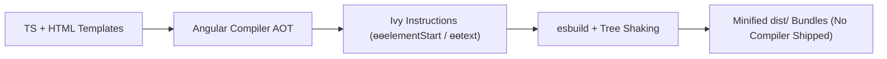
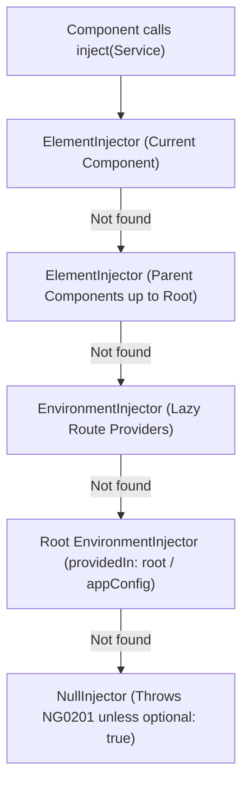
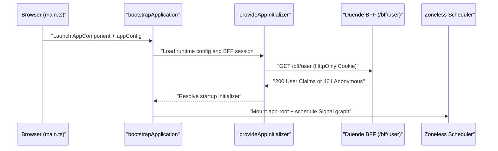

# Appendix 1: Fundamentals & CLI Interview Questions

This section covers the absolute basics of Angular 22, transitioning into senior and architect-level questions regarding compilation, Ivy locality, zoneless bootstrapping, workspace configurations, and enterprise build pipelines — grounded in **Normora's** Angular 22 SPA behind a Duende BFF.

---

## Junior Level Questions

### 1. What is Angular and how does it differ from AngularJS?
**Answer:**
Angular is a TypeScript-based, component-driven framework for building scalable web applications, created by Google.
AngularJS (v1.x) was the original JavaScript-based framework. It relied heavily on two-way data binding (`ng-model`), controllers, and `$scope` digest cycles, which led to unpredictable cascades and severe performance degradation at scale. Angular (v2+, currently Angular 22) is a complete rewrite that enforces unidirectional data flow, compiles templates into direct **Incremental DOM** instructions (no Virtual DOM tree-diffing overhead), uses **Signals** and **zoneless change detection** for fine-grained reactivity, and enforces strict TypeScript typing.

**Normora Example:**
Normora's frontend (`client/src/app/`) is an Angular 22 SPA communicating with a `.NET 10` modular monolith via a Duende BFF. Rather than mutating global `$scope` objects, features like `Conversations` and `Documents` use strict TypeScript DTOs, unidirectional Signal state (`signal()`, `computed()`), and centralized constants (`ApiMessages` in `client/src/app/core/constants/api-messages.ts`) so template binding errors fail at compile time rather than in production.

### 2. What is the difference between a Component, a Directive, and a Pipe?
**Answer:**
* **Component:** A class with a view (HTML template) and scoped styles. It is the core building block of the UI and is technically a Directive with a template. In Angular 19–22, components are **standalone by default**.
* **Directive:** A class that attaches behavior or modifies the appearance/DOM of an existing element without owning a template. Attribute directives alter attributes/behavior; structural directives alter DOM layout.
* **Pipe:** A pure transformation function used in templates (`{{ value | myPipe }}`) to format data for display without mutating the underlying state.

**Normora Examples:**
* **Component:** `<app-chunk-preview-drawer>` (`ChunkPreviewDrawerComponent`) renders cited policy chunks with a markdown view and a "Locate in Documents" button.
* **Directive:** An attribute directive such as `[appAutoResizeTextarea]` on Normora's Copilot chat input adjusts textarea height on input without creating a wrapper component.
* **Pipe:** `{{ doc.sizeBytes | fileSize }}` or `{{ auditLog.createdAt | relativeTime }}` formats document sizes and audit timestamps cleanly inside `Tenants` and `Documents` tables.

### 3. What does `ng serve` do behind the scenes?
**Answer:**
`ng serve` invokes Angular CLI's development server builder (`@angular/build:dev-server` paired with `@angular/build:application`). Behind the scenes, it uses **esbuild** to bundle TypeScript/JavaScript and **Vite** to serve modules in memory with fast **Hot Module Replacement (HMR)** — meaning edits to styles or templates update in the browser without writing physical artifacts to `dist/`. It also optionally runs `proxy.conf.json` middleware so API/auth calls appear same-origin during local development. (Similarly, `ng test` in modern Angular 21+/22 workspaces like Normora executes unit tests via **Vitest** rather than legacy Karma/Jasmine.)

**Normora Example:**
When running Normora locally, `ng serve` serves the SPA on `http://localhost:4200` and proxies `/api`, `/bff`, `/signin-oidc`, and `/hubs` (WebSockets for SignalR) to `Normora.Api` at `http://localhost:5000`, allowing Duende BFF's `HttpOnly; SameSite=Strict` session cookies to work seamlessly without CORS workarounds.

### 4. What is the difference between `constructor` and `ngOnInit`?
**Answer:**
* **`constructor`:** A standard JavaScript/TypeScript class feature executed when Angular instantiates the class and resolves Dependency Injection (`inject()` or constructor parameters). At this moment, legacy `@Input()` properties are **not yet bound**, and DOM queries are unavailable. Keep constructors free of side effects and HTTP calls.
* **`ngOnInit`:** An Angular lifecycle hook invoked once after Angular initializes the component's inputs and first change-detection bindings. Historically used for initial API fetches and RxJS subscriptions; in Angular 22, reactive **Signal inputs (`input()`)** combined with `effect()`, `computed()`, or `resource()` often replace `ngOnInit` input-watching boilerplate, while `ngOnInit` remains useful for one-time imperative setup (e.g., subscribing to a SignalR hub stream).

**Normora Example (Modern Angular 22 vs. Legacy Pitfall):**
```typescript
import { Component, OnInit, effect, inject, input } from '@angular/core';
import { DocumentsApiService } from '../../core/services/documents-api.service';

@Component({
  selector: 'app-document-preview',
  template: `
    <section class="bg-white dark:bg-slate-900 text-slate-900 dark:text-white border border-slate-200 dark:border-slate-700 p-4 rounded-lg">
      <h2 class="text-base font-semibold">Document {{ documentId() }}</h2>
    </section>
  `
})
export class DocumentPreviewComponent implements OnInit {
  private readonly documentsApi = inject(DocumentsApiService);

  // Angular 22 Signal input (preferred over @Input() decorator)
  readonly documentId = input.required<string>();

  constructor() {
    // Runs whenever documentId() changes; safe because effect() schedules after input binding
    effect(() => {
      const id = this.documentId();
      this.documentsApi.loadMetadata(id);
    });
  }

  ngOnInit(): void {
    // One-time setup after initial inputs are resolved (e.g., SignalR listener registration)
    this.documentsApi.joinDocumentStatusGroup(this.documentId());
  }
}
```

---

## Mid-Level Questions

### 5. Explain the difference between Ahead-of-Time (AOT) and Just-in-Time (JIT) compilation.
**Answer:**
* **JIT (Just-in-Time):** The Angular compiler (`@angular/compiler`) is shipped inside the browser bundle. The browser downloads the app, parses HTML templates, and compiles them into JavaScript at runtime, causing larger bundles, slower Time to Interactive (TTI), and runtime-only template errors.
* **AOT (Ahead-of-Time):** The Angular compiler runs during `ng build` on the build machine/CI runner. It transforms every template into optimized Ivy JavaScript instructions *before* assets leave the server, so the compiler itself is never shipped to users. AOT catches template typos, missing standalone imports, and type mismatches at build time. Modern Angular uses AOT exclusively for production (and `ng serve` with Vite/esbuild also pre-compiles templates via Ivy).



**Normora Example:**
In Normora's CI pipeline, AOT catches mistakes such as referencing `{{ doc.fileName }}` when the `DocumentSummaryDto` actually exposes `title`, or forgetting `()` on a Signal like `@if (isStreaming)` instead of `@if (isStreaming())` — failing the build immediately before Docker packaging.

### 6. What are Standalone Components, and how did they evolve from Angular 14 to Angular 22?
**Answer:**
Prior to Angular 14, every component, directive, and pipe had to be declared in an `NgModule`. This created boilerplate, blurred ownership boundaries, made granular lazy loading awkward, and produced bloated `SharedModule` files that hurt tree shaking.
Standalone Components let each component declare its own template dependencies directly via `imports: [...]`. **Crucial Angular 19–22 update:** Starting in Angular 19, `standalone: true` is the **default** — you omit `standalone: true` from `@Component` and only specify `standalone: false` for legacy `NgModule`-bound components. Furthermore, with built-in control flow (`@if`, `@for`, `@switch`), you no longer need `CommonModule` unless you explicitly use its pipes (and importing individual pipes like `DatePipe` is cleaner).

**Normora Example (`client/src/app/features/tenants/`):**
```typescript
import { DatePipe } from '@angular/common';
import { Component, input } from '@angular/core';

@Component({
  selector: 'app-tenant-badge',
  // standalone: true is implicit by default in Angular 22
  imports: [DatePipe],
  template: `
    <div class="inline-flex items-center gap-2 px-3 py-1 rounded-full bg-slate-100 dark:bg-slate-800 text-slate-900 dark:text-slate-100 border border-slate-200 dark:border-slate-700">
      <span class="font-medium">{{ workspaceName() }}</span>
      <span class="text-xs text-slate-500 dark:text-slate-400">Renewed {{ renewedAt() | date:'mediumDate' }}</span>
    </div>
  `
})
export class TenantBadgeComponent {
  readonly workspaceName = input.required<string>();
  readonly renewedAt = input.required<string>();
}
```

### 7. What is `trackBy` in `*ngFor` / `track` in `@for`, and why is it crucial for performance?
**Answer:**
When a list bound to a loop is replaced with a new array reference (for example, after a Signal update or API refresh), Angular needs a stable identity key to match old DOM nodes to new items. Without tracking (or with naive index tracking on mutable arrays), Angular tears down and recreates DOM nodes unnecessarily — losing focus, scroll positions, input state, and animations.
* In legacy `*ngFor`, developers had to remember an optional `trackBy` method.
* In modern Angular (`@for`), `track` is **mandatory** at compile time, preventing accidental un-tracked loops, and pairs cleanly with `@empty`.

**Normora Example:**
```html
<!-- Normora Documents list & RAG citations -->
<ul class="space-y-2 custom-scrollbar">
  @for (doc of documents(); track doc.id) {
    <li class="p-3 rounded-lg bg-white dark:bg-slate-900 border border-slate-200 dark:border-slate-700">
      <span class="text-slate-900 dark:text-white font-medium">{{ doc.title }}</span>
      <span class="text-xs text-slate-500 dark:text-slate-400">{{ doc.status }}</span>
    </li>
  } @empty {
    <li class="text-sm text-slate-500 dark:text-slate-400">No documents uploaded yet.</li>
  }
</ul>
```
*Note:* Never use `track $index` on Normora's live SignalR ingestion table or streaming SSE chat messages where rows are prepended, filtered, or deleted — always track by a stable unique identifier (`doc.id`, `message.id`).

### 8. What is the purpose of `environment.ts` files, and why are they insufficient for containerized enterprise apps?
**Answer:**
`environment.ts` and `environment.prod.ts` provide **compile-time** configuration via `fileReplacements` in `angular.json`. When you run `ng build --configuration=production`, the CLI swaps `environment.ts` for `environment.prod.ts` before bundling.
However, in Docker/Kubernetes pipelines you want **build once, deploy anywhere** (promoting the exact same immutable container image from QA to Staging to Production). Bake-in `environment.ts` values force a rebuild per environment. Instead, fetch runtime settings (like telemetry endpoints or feature flags) via `config.json` in `provideAppInitializer` (which replaced the deprecated `APP_INITIALIZER` token in Angular 19+), and route API/auth calls through relative same-origin BFF paths (`/api/...`, `/bff/...`).

**Normora Example:**
In `client/src/environments/`, build-time flags toggle local dev conveniences, while API and authentication endpoints always use relative BFF paths (`/api/documents`, `/api/copilotkit`, `/bff/login`) so the same Normora container image works behind any customer domain or reverse proxy without rebuilding.

### 9. How do `@if`, `@for`, and `@defer` improve over legacy structural directives, and when should you NOT use `@defer`?
**Answer:**
Built-in control flow (`@if`/`@else`, `@for`/`@empty`, `@switch`) is compiled directly into the template by Ivy without requiring `CommonModule` imports, offers significantly faster diffing (especially `@for`), and removes the `<ng-container>` wrapper clutter.
`@defer` enables **template-level lazy loading**: Angular splits the deferred standalone component's JavaScript into a separate chunk and only downloads and renders it when a trigger (`on viewport`, `on interaction`, `on idle`, or `when condition()`) fires — complete with `@placeholder`, `@loading`, and `@error` blocks.

**When NOT to use `@defer`:**
* **Above-the-fold critical UI** (such as navigation shells, login buttons, or `TenantHeaderComponent`) — deferring it triggers Cumulative Layout Shift (CLS) and delays First Contentful Paint (FCP).
* **Tiny components** (<5 KB) — the extra network round-trip for a split chunk costs more than bundling it inline.

**Normora Example:**
Normora defers heavy interactive chat cards and drawers like `<app-expense-simulator-card>` (`ExpenseSimulatorCardComponent`) or `<app-chunk-preview-drawer>` (`ChunkPreviewDrawerComponent`) until an agent tool card streams or the user clicks a citation badge, keeping the initial workspace bundle lean.

---

## Senior Level Questions

### 10. How does Angular's Dependency Injection (DI) system resolve a dependency? Explain the injector hierarchy.
**Answer:**
Angular's DI system resolves dependencies through two linked hierarchical trees when `inject(MyService)` is called:
1. **ElementInjector (NodeInjector) Hierarchy:** Angular checks the requesting element/component's `@Component({ providers: [...] })` (or `viewProviders`), then walks up parent DOM components until it hits the root component.
2. **EnvironmentInjector Hierarchy:** If not found in the ElementInjector tree, Angular jumps to the route's `EnvironmentInjector` (from `providers` on lazy routes), up through parent route injectors, to the root `EnvironmentInjector` (`providedIn: 'root'` and `appConfig.providers`), and finally the PlatformInjector.
3. **NullInjector:** If resolution reaches the top without finding a provider, Angular throws `NG0201: No provider for ...` unless `{ optional: true }` was passed. You can also constrain traversal with `inject(Svc, { self: true })`, `{ skipSelf: true }`, or `{ host: true }`.



**Normora Example:**
`BffSessionService` and `WorkspaceStateService` live in the root `EnvironmentInjector` (`providedIn: 'root'`) so every route (`Documents`, `Conversations`, `Tenants`) shares one authenticated workspace context, while an optional parent toolbar context can be read safely with `inject(CopilotDockContext, { optional: true })`.

### 11. What is the difference between `providedIn: 'root'` and adding a Service to a Component's `providers` array?
**Answer:**
* **`@Injectable({ providedIn: 'root' })`:** Registers a single application-wide **Singleton** in the root `EnvironmentInjector`. It is fully **tree-shakeable** — if no live code calls `inject()` on it, esbuild omits it from the bundle. State persists for the lifetime of the browser tab.
* **`@Component({ providers: [MyService] })`:** Creates a **fresh instance** scoped to each instantiation of that component and its child view tree. When the component is destroyed, Angular automatically destroys the service (and runs `DestroyRef.onDestroy` / `ngOnDestroy`).

**Normora Example:**
Normora's `WorkspaceStateSynchronizerService` uses `providedIn: 'root'` because its SignalR `dataVersion` counter coordinates refreshes across the whole SPA. Conversely, an ephemeral `DocumentUploadDraftService` placed in `UploadDocumentModalComponent`'s `providers: [...]` resets cleanly every time the user closes and reopens the upload dialog, with zero manual cleanup bugs.

### 12. Explain "View Encapsulation" and the difference between `Emulated`, `None`, and `ShadowDom`.
**Answer:**
View Encapsulation controls how a component's CSS rules are scoped so styles don't accidentally leak across features:
* **`ViewEncapsulation.Emulated` (Default):** Angular rewrites selectors at compile time with unique host/content attributes (e.g., `_nghost-ng-c123`, `_ngcontent-ng-c123`). Component CSS cannot leak out, while global utility styles (like Tailwind CSS v4) still apply inside the component.
* **`ViewEncapsulation.None`:** Angular injects the component's CSS into `<head>` globally with zero scoping. Useful only for intentional third-party theme overrides (e.g., customizing a PrimeNG overlay), and dangerous otherwise.
* **`ViewEncapsulation.ShadowDom`:** Attaches a native browser Shadow Root (`attachShadow`). Enforces strict two-way CSS isolation, which blocks global Tailwind utility classes and design-system tokens from entering the component unless explicitly imported inside the shadow root.

**Normora Example:**
Normora keeps `Emulated` encapsulation on components like `HrEscalationCardComponent` and `ConversationChatComponent` so component-specific rules coexist cleanly with global Tailwind v4 utilities (`bg-white dark:bg-slate-900`), design tokens in `client/src/design-system/tokens/`, and the shared `.custom-scrollbar` utility class.

### 13. How do you prevent CSS classes from being stripped out during an AOT + Tailwind CSS v4 production build?
**Answer:**
Modern Angular builds combine AOT compilation with Tailwind CSS v4's Oxide scanner. If you construct class names dynamically via string concatenation (such as `` `bg-${color}-500` ``), Tailwind never sees the complete token in source files and omits the rule from the generated CSS bundle.
To ensure classes survive production builds:
1. **Use static lookup maps** containing full, literal class strings (including `dark:` variants and suffix `!important` modifiers like `border-none!`, never `!border-none`).
2. **Use Angular class bindings** (`[class.ring-2]="isSelected()"`) so references remain statically visible.
3. **Use Tailwind v4 `@source inline(...)`** in your main stylesheet only when a finite set of tokens truly comes from external data (e.g., CMS or server-driven themes).

**Normora Example (Document Ingestion Status Badges):**
```typescript
// Complete static Tailwind v4 classes (with dark: variants) survive CSS tree shaking
const STATUS_BADGE_CLASSES: Record<DocumentStatus, string> = {
  Queued: 'bg-slate-100 dark:bg-slate-800 text-slate-700 dark:text-slate-300 border-slate-200 dark:border-slate-700',
  Processing: 'bg-amber-50 dark:bg-amber-950 text-amber-700 dark:text-amber-300 border-amber-200 dark:border-amber-800',
  Indexed: 'bg-emerald-50 dark:bg-emerald-950 text-emerald-700 dark:text-emerald-300 border-emerald-200 dark:border-emerald-800',
  Failed: 'bg-rose-50 dark:bg-rose-950 text-rose-700 dark:text-rose-300 border-rose-200 dark:border-rose-800 border-none!'
};
```

### 14. How does Angular CLI's `proxy.conf.json` work during `ng serve`, and why is it critical in a Duende BFF architecture like Normora?
**Answer:**
In Normora, browser clients never hold OAuth2/OIDC access tokens — Duende BFF (`Normora.Api` on port `5000`) issues encrypted `HttpOnly`, `SameSite=Strict` session cookies. If `ng serve` (on `http://localhost:4200`) called `http://localhost:5000/api/...` directly, cross-origin/cross-port cookie rules and CORS preflights would break `SameSite=Strict` authentication and antiforgery checks.
Configuring `proxyConfig` in `angular.json` (`serve.options.proxyConfig`) instructs Vite's dev-server proxy to forward matching paths from `:4200` to `:5000` server-side, making API calls, OIDC callbacks, and SignalR WebSockets strictly same-origin for the browser.

**Normora Example (`client/proxy.conf.json`):**
```json
{
  "/api": { "target": "http://localhost:5000", "secure": false },
  "/bff": { "target": "http://localhost:5000", "secure": false },
  "/signin-oidc": { "target": "http://localhost:5000", "secure": false },
  "/signout-callback-oidc": { "target": "http://localhost:5000", "secure": false },
  "/hubs": { "target": "http://localhost:5000", "secure": false, "ws": true }
}
```
Notice `"ws": true` on `/hubs` — without it, Normora's SignalR real-time document ingestion notifications cannot upgrade to WebSockets during local development.

### 15. What are Angular CLI Bundle Budgets (`budgets` in `angular.json`), and how do you diagnose a sudden bundle size regression?
**Answer:**
Bundle budgets in `angular.json` (`configurations.production.budgets`) enforce hard size guardrails during `ng build` — emitting warnings or failing CI if the `initial` bundle or `anyComponentStyle` exceeds thresholds.
To diagnose a sudden regression:
1. Run `ng build --stats-json` (generates `dist/<app>/stats.json` with `@angular/build:application`).
2. Inspect the dependency graph using **esbuild Bundle Size Analyzer** (`https://esbuild.github.io/analyze/`) or `npx source-map-explorer`.
3. Look for non-tree-shakeable CommonJS imports, barrel-file (`index.ts`) re-exports pulling entire icon/chart suites into the `initial` chunk, or heavy feature components accidentally imported eagerly instead of lazy-loaded via routes or `@defer`.

**Normora Example:**
In `client/angular.json`, setting `"type": "initial", "maximumWarning": "500kB", "maximumError": "1MB"` and `"type": "anyComponentStyle", "maximumError": "8kB"` prevents someone from accidentally importing a full markdown/PDF library eagerly into `AppComponent` instead of deferring it inside `ChunkPreviewDrawerComponent`.

---

## Architect Level Questions

### 16. What is the Ivy Rendering Engine, and how does it achieve "Locality"?
**Answer:**
Ivy is Angular's compilation and rendering pipeline.
**Locality** means Ivy compiles each component strictly from its own `@Component` metadata (`template`, `imports`, `styles`) without needing global knowledge of other components or `NgModule` graphs. Under the hood, Ivy translates HTML templates into **Incremental DOM** instructions (`ɵɵelementStart`, `ɵɵtextInterpolate`, `ɵɵelementEnd`) that mutate the real DOM directly in place rather than allocating and diffing a separate Virtual DOM tree.
Locality enables incremental rebuilds, precise per-component tree shaking, library publishing without full re-compilation overhead, and the standalone component model.

**Normora Example:**
When an engineer edits `ExpenseSimulatorCardComponent`'s template in Normora, Ivy only needs to recompile that single standalone file rather than rebuilding an entire `ConversationsModule`, keeping Vite HMR updates near-instant.

### 17. You are migrating a massive legacy application from AngularJS (or legacy NgModule Angular) to Angular 22. What is the architectural strategy?
**Answer:**
A "Big Bang" rewrite almost always stalls delivery on enterprise apps. The proven strategy is **Incremental Migration**:
1. **From AngularJS (v1.x) via `@angular/upgrade`:** Bootstrap both frameworks side by side, migrate leaf/presentational components bottom-up, expose new Angular components to AngularJS with `downgradeComponent`, render remaining AngularJS views inside Angular routes via `UpgradeComponent`, and remove `@angular/upgrade` once all routes are migrated.
2. **From Legacy Angular (v12–16 `NgModule` + Zone.js) to Angular 22:** Run Angular CLI's official automated schematics step-by-step via `ng update` — specifically `ng generate @angular/core:standalone` (converting declarations to standalone), `@angular/core:control-flow` (`*ngIf`/`*ngFor` to `@if`/`@for`), `@angular/core:signal-input-migration` (`@Input()` to `input()`), and finally switching `app.config.ts` to `provideZonelessChangeDetection()` once mutable non-signal state is replaced with Signals.

### 18. Explain how the Angular Compiler handles "Dead Code Elimination" (Tree Shaking) regarding Services vs. Components.
**Answer:**
* **Services:** Using `@Injectable({ providedIn: 'root' })` makes a service tree-shakeable because the provider metadata lives on the service itself, not in an `appConfig` array. If no reachable code calls `inject(MyService)`, esbuild drops it completely. Conversely, listing a service directly in `providers: [MyService]` creates a hard reference that prevents tree shaking even if it is never injected.
* **Components:** In legacy `NgModule` apps, importing a `SharedModule` pulled in *every* declared component in that module. In Angular 22's standalone architecture, each component's `imports: [...]` array forms an explicit, analyzable dependency graph — any unreferenced standalone component is eliminated, and routes (`loadComponent`) or `@defer` blocks split remaining heavy components into separate lazy chunks.

**Normora Example:**
In Normora, heavy conversational widgets like `HrEscalationCardComponent` and `ExpenseSimulatorCardComponent` are only referenced inside lazy feature routes or `@defer` blocks, and external backend SDKs (like `Minio` or `Google.GenAI`) never exist in `client/package.json` at all — keeping the initial workspace shell small.

### 19. How does Angular 22's Standalone Bootstrap process work under the hood, and how does Zoneless execution behave in Normora?
**Answer:**
In a standalone Angular 22 app (`client/src/main.ts`), `bootstrapApplication(AppComponent, appConfig)` performs the following sequence:
1. Creates the root `EnvironmentInjector` from `appConfig.providers` (router, HTTP client with BFF/CSRF interceptors, global error listeners, and `provideZonelessChangeDetection()`).
2. Runs any `provideAppInitializer(...)` hooks (replacing legacy `APP_INITIALIZER` tokens) *before* activating the initial route — ideal for loading runtime `config.json` and checking `/bff/user`.
3. Instantiates `AppComponent` on `<app-root>` and performs the initial change detection pass.
4. **Zoneless Reactivity:** Without `zone.js` monkey-patching `setTimeout`, `Promise`, or `WebSocket`, Angular's `ChangeDetectionScheduler` schedules synchronization only when a **Signal** updates, an `async` pipe emits, a template event fires, or `ChangeDetectorRef.markForCheck()` is called.



**Normora Example (`client/src/app/app.config.ts`):**
```typescript
import { ApplicationConfig, inject, provideAppInitializer, provideBrowserGlobalErrorListeners, provideZonelessChangeDetection } from '@angular/core';
import { provideHttpClient, withFetch, withInterceptors } from '@angular/common/http';
import { provideRouter, withComponentInputBinding } from '@angular/router';
import { routes } from './app.routes';
import { bffCsrfInterceptor } from './core/interceptors/bff-csrf.interceptor';
import { BffSessionService } from './core/services/bff-session.service';

export const appConfig: ApplicationConfig = {
  providers: [
    provideBrowserGlobalErrorListeners(),
    provideZonelessChangeDetection(),
    provideRouter(routes, withComponentInputBinding()),
    provideHttpClient(withFetch(), withInterceptors([bffCsrfInterceptor])),
    provideAppInitializer(() => inject(BffSessionService).hydrateSession())
  ]
};
```
*Crucial Zoneless Gotcha:* When Normora's SignalR hub pushes a `DocumentStatusChanged` or `dataVersion` event from outside Angular, the SignalR handler **must** update a `signal()` (e.g., `this.dataVersion.set(v)`) rather than mutating a plain class field — otherwise a zoneless component will not re-render.

### 20. Your CI/CD build is taking 45 minutes on a large enterprise monorepo. How do you architect a solution to reduce this to under 5 minutes?
**Answer:**
1. **Modern Angular Builder + Persistent Cache:** Ensure every app uses `@angular/build:application` (esbuild + Vite, up to 60%+ faster than legacy Webpack) and persists `.angular/cache` across CI steps where appropriate.
2. **Nx Monorepo + Dependency Graph (`affected`):** Let Nx analyze changed files in the PR and run `npx nx affected -t build,test,lint` instead of rebuilding untouched apps and libraries.
3. **Remote Computation Caching (Nx Cloud / Self-Hosted Cache):** Cache build/test outputs keyed by input hash so identical library builds download in milliseconds rather than recompiling.
4. **Split Docker Stages & Parallelize:** Build `client/` (Node/Angular) and `server/` (`.NET 10`) in parallel CI jobs, leveraging `npm ci` / `pnpm` lockfile caching before copying `client/dist/` into the final runtime image.

### 21. Why does Normora run an Angular 22 Client-Side SPA behind Duende BFF instead of Server-Side Rendering (SSR), and when would you enable `@angular/ssr`?
**Answer:**
**SSR (`@angular/ssr`)** renders Angular templates on a Node.js server into HTML before hydrating in the browser, improving First Contentful Paint (FCP) and search engine crawlability.
**Why Normora uses an SPA behind Duende BFF:**
* Normora's core application is an **authenticated, multi-tenant workspace** (`Tenants`, `Documents`, `Conversations`) gated behind `HttpOnly`, `SameSite=Strict` cookies managed by `Normora.Api` (Duende BFF). Search engines must never index tenant policies or private chat threads, and running an intermediate Node.js SSR server adds hop complexity for forwarding `HttpOnly` cookies, SignalR WebSockets, and AG-UI SSE streams.
* Serving static AOT-compiled `dist/` assets directly behind `Normora.Api` (or CDN/Nginx) keeps the architecture stateless, simple, and aligned with zero-trust cookie isolation.

**When you WOULD use `@angular/ssr` / SSG:**
* Public, unauthenticated marketing pages, pricing calculators, or public documentation portals where SEO metadata (`Meta`/`Title`) and sub-second organic landing FCP directly drive acquisition — using **Prerendering (SSG)** at build time or SSR with `afterNextRender()` guarding any browser-only `window`/`document` APIs.

### 22. How do you structure an enterprise Angular 22 workspace (`core/`, `features/`, `shared/`, `design-system/`) to prevent circular dependencies and Tailwind v4 style drift?
**Answer:**
Large Angular codebases rot when features import directly from each other (`features/documents` importing internals from `features/conversations`) or redefine ad-hoc colors and error messages.
Establish strict **unidirectional dependency layers** enforced by ESLint (`@nx/enforce-module-boundaries` or `eslint-plugin-boundaries`):
1. **`client/src/design-system/` (`tokens/`, `components/`):** Zero business logic; defines Tailwind CSS v4 `@theme` tokens, mandatory `dark:` surface/text pairs, and base UI primitives.
2. **`client/src/app/core/`:** App-wide singletons (`BffSessionService`, `bffCsrfInterceptor`, `ApiMessages` in `client/src/app/core/constants/api-messages.ts`).
3. **`client/src/app/shared/`:** Reusable stateless pipes, directives, and UI components (e.g., `FileSizePipe`, `.custom-scrollbar` wrappers).
4. **`client/src/app/features/` (`tenants/`, `documents/`, `conversations/`):** Isolated domain slices matching Normora's backend modules. Features may import from `core`, `shared`, and `design-system`, but **never** cross-import another feature's internal components or services (shared cross-feature contracts live in `core/` or route-level shell actuation).

---

## Common Mistakes & Anti-Patterns

> [!CAUTION]
> **1. Using Legacy Tailwind `!prefix` or Missing `dark:` Variants (Tailwind CSS v4)**
> ```html
> <!-- WRONG: Legacy v3 prefix syntax breaks in v4, and missing dark: breaks dark mode -->
> <div class="!border-none bg-white text-slate-900">
>   Document Status
> </div>
> ```
> **Why it's wrong:** In Tailwind CSS v4, `!` is a **suffix**, not a prefix, so `!border-none` is ignored. Omitting `dark:` variants leaves bright white cards blinding users in dark mode.
> ```html
> <!-- FIX: Suffix ! modifier + explicit dark: variants on every color -->
> <div class="border-none! bg-white dark:bg-slate-900 text-slate-900 dark:text-white">
>   Document Status
> </div>
> ```

> [!CAUTION]
> **2. Using `track $index` in `@for` on Dynamic or Streaming Lists**
> ```html
> <!-- WRONG: Mutating/prepending items reuses DOM state for the wrong record -->
> @for (doc of documents(); track $index) {
>   <app-document-row [document]="doc" />
> }
> ```
> **Why it's wrong:** When Normora receives a SignalR ingestion event or inserts a newly uploaded document at index `0`, tracking by `$index` shifts every index binding and causes row selection/animation state to attach to the wrong document.
> ```html
> <!-- FIX: Always track by a stable unique identifier -->
> @for (doc of documents(); track doc.id) {
>   <app-document-row [document]="doc" />
> }
> ```

> [!CAUTION]
> **3. Mutating Plain Properties Inside External Callbacks in a Zoneless App**
> ```typescript
> // WRONG: SignalR callback mutates a plain field; zoneless Angular never sees it
> export class IngestionBannerComponent {
>   status = 'Queued';
>   onSignalREvent(newStatus: string) {
>     this.status = newStatus; // UI stays stuck on 'Queued'!
>   }
> }
> ```
> **Why it's wrong:** Without `zone.js`, asynchronous WebSocket/SignalR callbacks do not trigger global dirty checking.
> ```typescript
> // FIX: Store reactive view state in a Signal so Angular's scheduler marks the view dirty
> export class IngestionBannerComponent {
>   readonly status = signal<DocumentStatus>('Queued');
>   onSignalREvent(newStatus: DocumentStatus) {
>     this.status.set(newStatus);
>   }
> }
> ```

> [!CAUTION]
> **4. Calling `inject()` Outside an Injection Context or Hardcoding Error Strings**
> ```typescript
> // WRONG: Runtime NG0203 error + hardcoded magic string violating Normora rules
> ngOnInit(): void {
>   const toast = inject(ToastService); // Throws NG0203!
>   toast.error('Failed to upload document'); // Magic string!
> }
> ```
> **Why it's wrong:** `inject()` only works during class construction, field initialization, factory functions, or `runInInjectionContext`. Hardcoding error strings bypasses `ApiMessages` centralization.
> ```typescript
> // FIX: Inject as a readonly class field and reference ApiMessages
> private readonly toast = inject(ToastService);
> 
> handleUploadFailure(): void {
>   this.toast.error(ApiMessages.DocumentUploadFailed);
> }
> ```

> [!CAUTION]
> **5. Baking Environment-Specific URLs or Secrets into `environment.ts`**
> ```typescript
> // WRONG: Forces separate builds per environment and leaks config into client JS
> export const environment = {
>   apiUrl: 'https://staging-api.normora.internal',
>   geminiKey: 'AIzaSy...' // NEVER put API keys in Angular!
> };
> ```
> **Why it's wrong:** Everything in `environment.ts` is compiled into public browser JavaScript and locks a Docker image to a single environment.
> ```typescript
> // FIX: Keep secrets strictly on Normora.Api / Normora.Worker and use relative BFF paths
> export const environment = {
>   apiBasePath: '/api',
>   bffBasePath: '/bff'
> };
> ```
