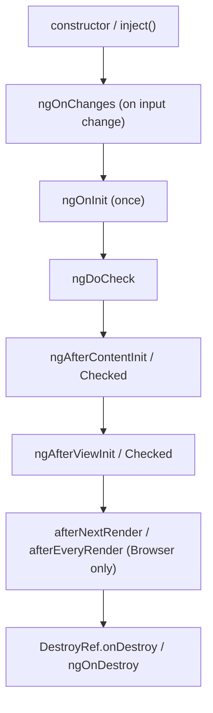
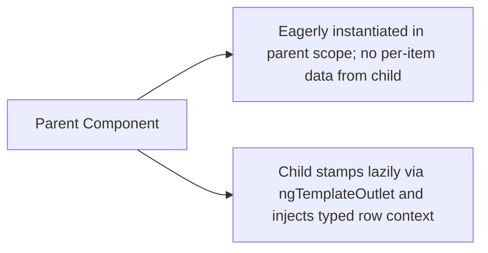
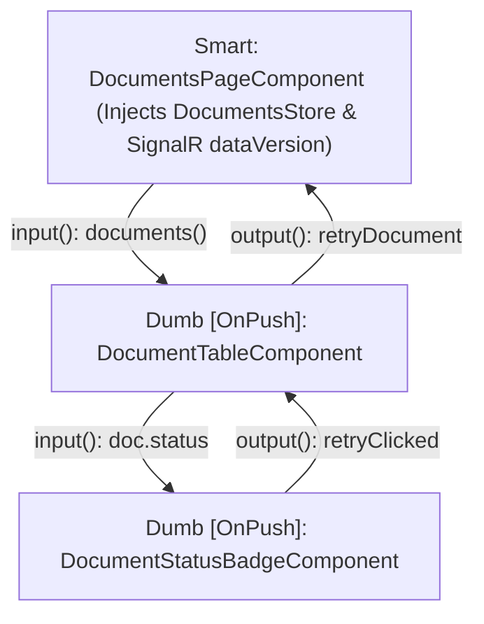

# Appendix 2: Components & Directives Interview Questions

This section covers the core building blocks of Angular 22 UI architecture, including standalone-by-default components, signal-based inputs/outputs/queries, component lifecycles and SSR-safe render hooks, structural and attribute directives, directive composition (`hostDirectives`), content projection, dynamic A2UI rendering, and Smart/Dumb zoneless patterns — illustrated with examples from **Normora** (`client/src/app/`).

---

## Junior Level Questions

### 1. What are the key differences between `@Input()` and `@Output()` (and their Angular 22 Signal equivalents)?
**Answer:**
* **`@Input()` / `input()`** passes data **down** from a parent component to a child component (unidirectional data flow).
* **`@Output()` / `output()`** emits events **up** from a child component to a parent component.
* **Angular 22 Standard (`input()` & `output()`):**
  * `input<T>()` and `input.required<T>()` return a read-only `InputSignal<T>`. Because it is a signal, you can derive state with `computed()` and react with `effect()` without implementing `ngOnChanges`, and it integrates directly with zoneless change detection.
  * `output<T>()` returns an `OutputEmitterRef<T>`, which is lighter than the legacy RxJS-backed `EventEmitter<T>` while preserving `(eventName)="handler($event)"` template syntax.
  * Standalone components are the default in Angular 22, so `standalone: true` does not need to be explicitly specified in `@Component`.

**Normora Example (`CitationBadgeComponent` in `Conversations`):**
```typescript
import { ChangeDetectionStrategy, Component, computed, input, output } from '@angular/core';

export interface CitationRef {
  documentId: string;
  chunkId: string;
  title: string;
}

@Component({
  selector: 'app-citation-badge',
  changeDetection: ChangeDetectionStrategy.OnPush,
  template: `
    <button
      type="button"
      (click)="openPreview.emit(citation())"
      class="inline-flex items-center gap-1.5 rounded-md border border-slate-200 bg-slate-50 px-2 py-0.5 text-xs font-medium text-slate-700 hover:bg-slate-100 dark:border-slate-700 dark:bg-slate-800 dark:text-slate-200 dark:hover:bg-slate-700"
    >
      <span>{{ label() }}</span>
    </button>
  `
})
export class CitationBadgeComponent {
  readonly citation = input.required<CitationRef>();
  readonly index = input<number>(1);
  readonly openPreview = output<CitationRef>();

  readonly label = computed(() => `[${this.index()}] ${this.citation().title}`);
}
```
*(Legacy decorator equivalent for older codebases: `@Input({ required: true }) citation!: CitationRef;` and `@Output() openPreview = new EventEmitter<CitationRef>();`)*

### 2. What is the difference between an Attribute Directive and a Structural Directive?
**Answer:**
* **Attribute Directives** modify the appearance, attributes, or behavior of an existing DOM element or component without adding or removing it from the DOM (e.g., `ngClass`, or a custom `[appCopyReference]` directive).
* **Structural Directives** alter the DOM layout by adding, removing, or repeating elements using an embedded `TemplateRef` and `ViewContainerRef`. Historically prefixed with an asterisk (`*ngIf`, `*ngFor`, `*ngSwitch`), built-in structural directives are now superseded in Angular 22 by built-in **control-flow blocks** (`@if`, `@for`, `@switch`), which are compiler primitives requiring zero imports and enforcing `track` in `@for`.
* **When to still write a custom Structural Directive:** When you need reusable structural gating tied to cross-cutting logic (such as tenant RBAC permission checks or feature flags) rather than simple boolean conditions.

**Normora Example (Attribute Directive vs. Custom Structural Directive):**
```typescript
// 1. Attribute Directive: copies an HR inquiry reference on HrEscalationCardComponent
import { Directive, input, output } from '@angular/core';

@Directive({
  selector: '[appCopyReference]',
  host: {
    '(click)': 'copy()'
  }
})
export class CopyReferenceDirective {
  readonly referenceId = input.required<string>({ alias: 'appCopyReference' });
  readonly copied = output<string>();

  async copy(): Promise<void> {
    await navigator.clipboard.writeText(this.referenceId());
    this.copied.emit(this.referenceId());
  }
}
```
```typescript
// 2. Structural Directive: hides/removes workspace admin controls without leaking DOM nodes
import { Directive, effect, inject, input, TemplateRef, ViewContainerRef } from '@angular/core';
import { TenantPermissionService } from '../../core/services/tenant-permission.service';

@Directive({
  selector: '[appRequiresPermission]'
})
export class RequiresPermissionDirective {
  private readonly templateRef = inject(TemplateRef<unknown>);
  private readonly vcr = inject(ViewContainerRef);
  private readonly permissions = inject(TenantPermissionService);
  private hasView = false;

  readonly permission = input.required<string>({ alias: 'appRequiresPermission' });

  constructor() {
    effect(() => {
      const allowed = this.permissions.hasPermission(this.permission());
      if (allowed && !this.hasView) {
        this.vcr.createEmbeddedView(this.templateRef);
        this.hasView = true;
      } else if (!allowed && this.hasView) {
        this.vcr.clear();
        this.hasView = false;
      }
    });
  }
}
```

### 3. Explain the Angular Component Lifecycle hooks and Angular 22 render hooks in order.
**Answer:**
1. **`constructor`:** Class instantiation and dependency injection via `inject()`. Signal and decorator inputs are **not** yet resolved (though signal `input()` properties exist as functions, reading them in `constructor` returns defaults/undefined before bindings run).
2. **`ngOnChanges`:** Fires before `ngOnInit` and whenever an `@Input()` (or `input()`) binding changes. *(In Angular 22, prefer `computed()` or `effect()` over `ngOnChanges`.)*
3. **`ngOnInit`:** Fires once after the first input bindings are set. Used for component initialization (e.g., triggering initial data fetches).
4. **`ngDoCheck`:** Fires during every change detection run for custom dirty-checking (avoid heavy work here).
5. **`ngAfterContentInit` & `ngAfterContentChecked`:** Fire after external content projected via `<ng-content>` is initialized / checked.
6. **`ngAfterViewInit` & `ngAfterViewChecked`:** Fire after the component's own view and child views are initialized / checked.
7. **`afterNextRender()` & `afterEveryRender()` (Angular 17–22+):** Registered in an injection context (`constructor`). They execute **only in the browser** after Angular finishes flushing DOM updates — making them the SSR-safe replacement for DOM reads/writes in `ngAfterViewInit`.
8. **`ngOnDestroy` / `DestroyRef.onDestroy()`:** Fires just before the component is destroyed. Used for cleanup (closing SignalR listeners, clearing timers).



**Normora Example (`ChunkPreviewDrawerComponent`):**
```typescript
import { afterNextRender, Component, DestroyRef, ElementRef, inject, viewChild } from '@angular/core';

@Component({
  selector: 'app-chunk-preview-drawer',
  template: `
    <aside class="custom-scrollbar overflow-y-auto bg-white dark:bg-slate-900">
      <div #highlightedChunk>...</div>
    </aside>
  `
})
export class ChunkPreviewDrawerComponent {
  private readonly chunkEl = viewChild<ElementRef<HTMLElement>>('highlightedChunk');
  private readonly destroyRef = inject(DestroyRef);

  constructor() {
    afterNextRender({
      write: () => {
        this.chunkEl()?.nativeElement.scrollIntoView({ behavior: 'smooth', block: 'center' });
      }
    });

    const controller = new AbortController();
    this.destroyRef.onDestroy(() => controller.abort());
  }
}
```

---

## Mid-Level Questions

### 4. What is Content Projection and how does `<ng-content>` work (including Fallback Content and `ngProjectAs`)?
**Answer:**
Content Projection allows a parent component to inject HTML content or child components directly into designated slots inside a wrapper component. This is how you build reusable design-system primitives like cards, drawers, and modals.
* **Multi-slot projection (`select`):** Uses CSS selectors (`select="[card-header]"`, `select="footer"`) to route projected nodes to specific slots, while an un-attributed `<ng-content></ng-content>` acts as the default catch-all slot.
* **Fallback content (Angular 18+):** Content placed *inside* `<ng-content>Fallback</ng-content>` renders automatically when the parent projects nothing into that slot.
* **`ngProjectAs`:** Allows an `<ng-container>` or wrapper element to match a projection `select` selector without introducing extra DOM nodes (e.g., `<ng-container ngProjectAs="[card-header]">`).

**Normora Example (`NormoraPanelCardComponent` in `client/src/design-system/components/`):**
```html
<!-- Child: normora-panel-card.component.html -->
<section class="rounded-xl border border-slate-200 bg-white p-4 shadow-sm dark:border-slate-700 dark:bg-slate-900">
  <header class="mb-3 border-b border-slate-100 pb-2 dark:border-slate-800">
    <ng-content select="[card-header]">
      <h2 class="text-sm font-semibold text-slate-900 dark:text-white">Workspace Details</h2>
    </ng-content>
  </header>
  <div class="text-slate-700 dark:text-slate-300">
    <ng-content />
  </div>
</section>
```
```html
<!-- Parent: Tenants Billing Overview -->
<app-normora-panel-card>
  <ng-container ngProjectAs="[card-header]">
    <h2 class="text-base font-semibold text-slate-900 dark:text-white">Subscription &amp; Currency</h2>
  </ng-container>
  <p>Current plan details render in the default body slot.</p>
</app-normora-panel-card>
```

### 5. What is the difference between `@ViewChild` / `viewChild()` and `@ContentChild` / `contentChild()`?
**Answer:**
* **`@ViewChild` / `viewChild()`** queries elements, directives, or components that exist directly inside the component's **own template**.
* **`@ContentChild` / `contentChild()`** queries elements, directives, or components that were **projected** into the component from a parent using `<ng-content>`.
* **Timing vs. Signal Queries:** With legacy decorators, `@ViewChild` is only resolved by `ngAfterViewInit` and `@ContentChild` by `ngAfterContentInit` (unless `{ static: true }` is set for non-conditional elements). In Angular 22, **`viewChild()`, `viewChild.required()`, `viewChildren()`, `contentChild()`, and `contentChildren()`** return Signals, so they integrate cleanly with `computed()` and `effect()` without manual lifecycle boilerplate.

**Normora Example (`CopilotWorkstationComponent` auto-scrolling SSE stream):**
```typescript
import { Component, effect, ElementRef, viewChild } from '@angular/core';

@Component({
  selector: 'app-copilot-workstation',
  template: `
    <div #chatViewport class="custom-scrollbar h-96 overflow-y-auto bg-slate-50 dark:bg-slate-950">
      <!-- Streamed RAG messages -->
    </div>
  `
})
export class CopilotWorkstationComponent {
  private readonly chatViewport = viewChild.required<ElementRef<HTMLDivElement>>('chatViewport');

  constructor() {
    effect(() => {
      const el = this.chatViewport().nativeElement;
      el.scrollTop = el.scrollHeight;
    });
  }
}
```

### 6. How do you trigger an Angular lifecycle hook and test signal inputs during a Unit Test?
**Answer:**
When using `TestBed`, calling `TestBed.createComponent(...)` instantiates the component without running change detection or lifecycle hooks.
* Call **`fixture.detectChanges()`** (or `await fixture.whenStable()` in zoneless tests) to run `ngOnInit`, evaluate template bindings, and flush initial effects.
* To update inputs and trigger `ngOnChanges` or reactive signal updates, **never** assign directly like `component.title = 'New'` — that throws a TypeScript error and fails at runtime for signal `input()`. Always use **`fixture.componentRef.setInput('propName', value)`**, then call `fixture.detectChanges()` (and `TestBed.flushEffects()` if testing standalone `effect()` side effects before rendering).

**Normora Example (Vitest test for `CitationBadgeComponent`):**
```typescript
import { provideZonelessChangeDetection } from '@angular/core';
import { TestBed } from '@angular/core/testing';
import { CitationBadgeComponent } from './citation-badge.component';

describe('CitationBadgeComponent', () => {
  it('updates computed label when citation input changes', () => {
    TestBed.configureTestingModule({
      imports: [CitationBadgeComponent],
      providers: [provideZonelessChangeDetection()]
    });

    const fixture = TestBed.createComponent(CitationBadgeComponent);
    fixture.componentRef.setInput('citation', {
      documentId: 'doc-1',
      chunkId: 'chk-9',
      title: 'Travel Policy 2026'
    });
    fixture.detectChanges();

    expect(fixture.nativeElement.textContent).toContain('[1] Travel Policy 2026');
  });
});
```

### 7. What are `@HostBinding` / `@HostListener`, and why does Angular 22 prefer the `host` metadata object?
**Answer:**
Both `@HostBinding` and `@HostListener` allow a component or directive to bind properties/classes/attributes and listen to DOM events on its **host element** without manually injecting `ElementRef` or `Renderer2`.
* **`@HostBinding('class.active')`**: Binds a host class, style, or attribute to a field/getter.
* **`@HostListener('keydown', ['$event'])`**: Subscribes to a host or `document`/`window` event.
* **Angular 22 Best Practice (`host` metadata):** The Angular team recommends using the **`host` property inside `@Component` or `@Directive`** instead of `@HostBinding`/`@HostListener` decorators. The `host` object is more tree-shakeable, requires zero extra decorator metadata, and binds directly to Signal getters (`'isOpen()'`).

**Normora Example (Global Copilot Shortcut `Ctrl+J` / `Cmd+J` via `host` metadata):**
```typescript
import { Directive, output, signal } from '@angular/core';

@Directive({
  selector: '[appCopilotToggleHost]',
  host: {
    '[attr.aria-expanded]': 'isOpen()',
    '[class.ring-2]': 'isOpen()',
    '(document:keydown.control.j)': 'onShortcut($event)',
    '(document:keydown.meta.j)': 'onShortcut($event)'
  }
})
export class CopilotToggleHostDirective {
  readonly isOpen = signal(false);
  readonly toggled = output<boolean>();

  onShortcut(event: KeyboardEvent): void {
    event.preventDefault();
    this.isOpen.update(open => !open);
    this.toggled.emit(this.isOpen());
  }
}
```

### 8. What is the Directive Composition API (`hostDirectives`), and when should you use it instead of inheritance?
**Answer:**
`hostDirectives` allows a standalone component or directive to **compose reusable behaviors from other standalone directives directly onto its host element** — favoring composition over class inheritance (`extends BaseCardComponent`).
* You declare `hostDirectives: [...]` inside `@Component` or `@Directive`.
* By default, inputs and outputs of composed directives are **hidden** from consumers unless explicitly re-exposed (and optionally aliased) via `inputs: [...]` and `outputs: [...]`.
* **When NOT to use `hostDirectives`:** Do not use it if the behavior must be toggled conditionally at runtime (host directives are statically attached for the component's lifetime) or if the composed behavior needs its own HTML template.

**Normora Example (`HrEscalationCardComponent` composing `CopyReferenceDirective`):**
```typescript
import { ChangeDetectionStrategy, Component, inject } from '@angular/core';
import { CopyReferenceDirective } from '../../../shared/directives/copy-reference.directive';

@Component({
  selector: 'app-hr-escalation-card',
  changeDetection: ChangeDetectionStrategy.OnPush,
  hostDirectives: [
    {
      directive: CopyReferenceDirective,
      inputs: ['appCopyReference: referenceId'],
      outputs: ['copied: referenceCopied']
    }
  ],
  template: `
    <div class="rounded-lg border border-amber-200 bg-amber-50 p-3 dark:border-amber-800 dark:bg-amber-950/40">
      <span class="text-xs font-semibold text-amber-900 dark:text-amber-200">
        HR Escalation #{{ copyDir.referenceId() }}
      </span>
    </div>
  `
})
export class HrEscalationCardComponent {
  protected readonly copyDir = inject(CopyReferenceDirective);
}
```

---

## Senior Level Questions

### 9. Explain the "Banana in a Box" syntax `[()]` and how to implement two-way data binding with `model()`.
**Answer:**
`[(ngModel)]` is syntactical sugar combining a property binding `[prop]` and an event binding `(propChange)`.
* **Legacy Decorator Approach:** Define `@Input() size!: number;` and `@Output() sizeChange = new EventEmitter<number>();` (the output name must strictly be `<inputName>Change`). Angular compiles `<app-child [(size)]="currentSize">` down to `<app-child [size]="currentSize" (sizeChange)="currentSize = $event">`.
* **Angular 22 Standard (`model()`):** The `model<T>()` function creates a `ModelSignal<T>` — a writable signal that automatically exposes both the input and the `<name>Change` output in one line, and works seamlessly with `[(...)]` and signals.

**Normora Example (`ExpenseSimulatorCardComponent` hotel-night stepper):**
```typescript
import { ChangeDetectionStrategy, Component, model } from '@angular/core';

@Component({
  selector: 'app-expense-simulator-card',
  changeDetection: ChangeDetectionStrategy.OnPush,
  template: `
    <div class="flex items-center gap-2 rounded-lg border border-slate-200 bg-white p-2 dark:border-slate-700 dark:bg-slate-900">
      <button type="button" (click)="adjust(-1)" class="px-2 py-1 text-slate-700 dark:text-slate-200">-</button>
      <span class="text-sm font-medium text-slate-900 dark:text-white">{{ hotelNights() }} nights</span>
      <button type="button" (click)="adjust(1)" class="px-2 py-1 text-slate-700 dark:text-slate-200">+</button>
    </div>
  `
})
export class ExpenseSimulatorCardComponent {
  readonly hotelNights = model<number>(1);

  adjust(delta: number): void {
    this.hotelNights.update(n => Math.max(1, n + delta));
  }
}
```
```html
<!-- Parent binds directly to a writable signal or property -->
<app-expense-simulator-card [(hotelNights)]="selectedNights" />
```

### 10. Why is mutating `@Input` or Signal arrays/objects a bad practice, and how does it break `OnPush` and Zoneless change detection?
**Answer:**
If a parent passes an array `@Input() documents` (or holds `signal<DocumentDto[]>([])`) and mutates it in place via `this.documents.push(newDoc)`, the **memory reference** of the array does not change.
* Under `ChangeDetectionStrategy.OnPush`, Angular compares input references (`Object.is(oldDocs, newDocs)`). Since the reference is identical, Angular skips re-rendering the child subtree.
* Under **Angular 22 Signals & Zoneless**, `signal()` also uses `Object.is` equality by default. Calling `.push()` on the underlying array does not notify `computed()`, `effect()`, or template consumers, leaving the UI stale.
* **Solution:** Always treat inputs and signal state as immutable using `.update()` and spread/filter operations (`docs => [...docs, newDoc]`).

**Normora Example (Updating document list on SignalR `DocumentStatusChanged`):**
```typescript
// Updates cleanly in OnPush + Zoneless
onDocumentStatusChanged(updated: DocumentStatusEvent): void {
  this.documents.update(list =>
    list.map(doc => (doc.id === updated.documentId ? { ...doc, status: updated.status } : doc))
  );
}
```

### 11. How do you dynamically create and render a Component at runtime (and pass Signal inputs)?
**Answer:**
There are two clean ways in Angular 22 to instantiate components whose concrete class is only known at runtime:
1. **Declarative (`NgComponentOutlet`):** Best when rendering a component class selected by a signal/computed value, passing an `inputs` record directly.
2. **Imperative (`ViewContainerRef.createComponent`):** Best when you need programmatic `ComponentRef` lifecycle control. Crucially, **never** assign `componentRef.instance.title = 'Hello'` if the child uses signal `input()` — use `componentRef.setInput('title', 'Hello')` or Angular 20+ binding helpers (`inputBinding`, `outputBinding`).

**Normora Example (Rendering A2UI Generative Cards from `NormoraWorkplaceAgent` SSE payloads):**
```typescript
import { NgComponentOutlet } from '@angular/common';
import { ChangeDetectionStrategy, Component, computed, input, Type } from '@angular/core';
import { ExpenseSimulatorCardComponent } from './cards/expense-simulator-card.component';
import { HrEscalationCardComponent } from './cards/hr-escalation-card.component';
import { IntakeFormCardComponent } from './cards/intake-form-card.component';

const A2UI_CARD_REGISTRY: Record<string, Type<unknown>> = {
  policy_limit_card: ExpenseSimulatorCardComponent,
  hr_escalation_card: HrEscalationCardComponent,
  intake_form_card: IntakeFormCardComponent
};

@Component({
  selector: 'app-a2ui-card-host',
  imports: [NgComponentOutlet],
  changeDetection: ChangeDetectionStrategy.OnPush,
  template: `
    @if (cardComponent(); as cmp) {
      <ng-container *ngComponentOutlet="cmp; inputs: payload()" />
    }
  `
})
export class A2uiCardHostComponent {
  readonly cardType = input.required<string>();
  readonly payload = input.required<Record<string, unknown>>();

  readonly cardComponent = computed(() => A2UI_CARD_REGISTRY[this.cardType()] ?? null);
}
```

### 12. How does `<ng-content>` differ from `<ng-template>` + `ngTemplateOutlet`, and how do you type-check template contexts?
**Answer:**
* **`<ng-content>`** projects **already-instantiated** DOM/components from the parent. Even if wrapped inside `@if (false)` in the child, Angular eagerly creates the projected component unless deferred via `<ng-template>`. It also cannot receive per-row data back from the child.
* **`<ng-template>` + `[ngTemplateOutlet]`** passes a *blueprint* to the child. The child decides **when** (lazy instantiation) and **how many times** (e.g., per table row) to stamp it, and can pass typed context (`$implicit`, named fields) back into the parent's template.
* **Strict Type-Checking (`ngTemplateContextGuard`):** Add a `static ngTemplateContextGuard<T>(dir: MyCellDirective<T>, ctx: unknown): ctx is MyCellContext<T>` method to a helper directive so Angular's compiler validates `let-row` inside the parent template!



**Normora Example (`NormoraDataTableComponent` custom row template for Documents):**
```typescript
import { Directive, input } from '@angular/core';

export interface TableCellContext<T> {
  $implicit: T;
  rowIndex: number;
}

@Directive({ selector: 'ng-template[appTableCell]' })
export class TableCellDirective<T> {
  readonly dataType = input.required<T[]>({ alias: 'appTableCell' });

  static ngTemplateContextGuard<T>(
    _dir: TableCellDirective<T>,
    ctx: unknown
  ): ctx is TableCellContext<T> {
    return true;
  }
}
```

### 13. How should Angular components safely render AI-generated Markdown or rich HTML (such as Gemini RAG responses) without introducing XSS?
**Answer:**
In Normora, `NormoraWorkplaceAgent` streams Markdown and document excerpts from Google Gemini and uploaded company files into `ChunkPreviewDrawerComponent` and the Copilot chat stream. Uploaded documents or prompt-injected content could contain malicious payloads (e.g., ``).
* **Never call `DomSanitizer.bypassSecurityTrustHtml()`** on LLM output, document chunks, or user-submitted content — it completely disables Angular's built-in XSS sanitization.
* **Preferred Approach:** Parse Markdown into a safe **AST** (e.g., `marked` / `remark` token stream) and render it using Angular `@for` / `@switch` templates (zero `innerHTML`), OR sanitize any generated HTML string through a strict allowlist sanitizer like **DOMPurify** before binding `[innerHTML]` (and still rely on CSP headers as defense-in-depth).

**Normora Example (Safe Markdown rendering pattern in `ChunkPreviewDrawerComponent`):**
```typescript
import { ChangeDetectionStrategy, Component, computed, input } from '@angular/core';
import DOMPurify from 'dompurify';
import { marked } from 'marked';

@Component({
  selector: 'app-markdown-viewer',
  changeDetection: ChangeDetectionStrategy.OnPush,
  template: `
    <div
      class="prose prose-slate dark:prose-invert max-w-none text-sm text-slate-800 dark:text-slate-200"
      [innerHTML]="safeHtml()"
    ></div>
  `
})
export class MarkdownViewerComponent {
  readonly markdown = input.required<string>();

  readonly safeHtml = computed(() => {
    const rawHtml = marked.parse(this.markdown(), { async: false }) as string;
    return DOMPurify.sanitize(rawHtml, { USE_PROFILES: { html: true } });
  });
}
```

### 14. Why is `::ng-deep` discouraged when customizing PrimeNG or child components with Tailwind CSS v4, and what are the clean alternatives?
**Answer:**
* `::ng-deep` has been deprecated for years because it breaks `ViewEncapsulation.Emulated`: any CSS rule after `::ng-deep` without `:host` leaks globally across the entire application, causing unpredictable style collisions. Switching a component to `ViewEncapsulation.None` causes the same global leak.
* **Clean Alternatives in Normora (PrimeNG + Tailwind v4):**
  1. **PrimeNG PassThrough (`pt`) & Design Tokens:** Pass Tailwind v4 classes directly into internal PrimeNG sub-elements (`[pt]="{ root: { class: 'border-none! bg-white dark:bg-slate-900' } }"`). Remember that in Tailwind CSS v4, the `!important` modifier is a **suffix** (`border-none!`), never a prefix (`!border-none`).
  2. **CSS Custom Properties (`--p-*` / `--normora-*`):** Override design tokens on `:host` without piercing encapsulation.
  3. **Global `@layer components` in `styles.css`:** Define shared overrides (like `.custom-scrollbar`) in a single controlled stylesheet layer.

---

## Architect Level Questions

### 15. Explain how the `@defer` control block handles dependency chunking, prefetching, and error fallback.
**Answer:**
When the Angular compiler encounters an `@defer` block in a template, it statically analyzes standalone components, directives, and pipes used exclusively inside the main `@defer` body, extracts them from the main JavaScript bundle, and compiles them into a separate lazy-loaded chunk.
* **Requirements for actual chunk splitting:** The deferred component must be **standalone**, and it must **not** be eagerly referenced in TypeScript inside the host component (for example, via a `viewChild(MyDeferredComponent)` class reference) — otherwise the bundler keeps it in the eager chunk.
* **Shared chunks:** If multiple `@defer` blocks reference the same component, the bundler places it in a shared chunk so it is downloaded once.
* **Sub-blocks & Triggers:** Combine triggers (`on viewport`, `on interaction`, `when condition()`) with `prefetch on idle`, `@placeholder (minimum 200ms)`, `@loading (after 100ms; minimum 300ms)` to avoid layout shift, and `@error` to handle offline/BFF chunk fetch failures gracefully.

**Normora Example (Deferring `ChunkPreviewDrawerComponent` until a citation is clicked):**
```html
@defer (when activeCitation() !== null; prefetch on idle) {
  <app-chunk-preview-drawer [citation]="activeCitation()!" (closed)="activeCitation.set(null)" />
} @loading (after 100ms; minimum 250ms) {
  <div class="p-4 text-sm text-slate-500 dark:text-slate-400">Loading document preview...</div>
} @error {
  <div class="p-4 text-sm text-red-600 dark:text-red-400">{{ apiMessages.PreviewLoadFailed }}</div>
}
```

### 16. How do you build components or UI primitives that safely interact with the DOM without breaking Server-Side Rendering (SSR)?
**Answer:**
You must never access browser globals (`window`, `document`, `localStorage`, `ResizeObserver`) directly in component constructors, field initializers, or `ngOnInit`, because they do not exist in Node.js SSR runtimes.
1. Inject **`DOCUMENT`** from `@angular/core` via `inject(DOCUMENT)` instead of referencing the global `document`.
2. Use **`Renderer2`** (or `host` bindings) instead of mutating `element.nativeElement.classList` directly.
3. Wrap browser-only DOM measurements or third-party DOM libraries in **`afterNextRender()`** or **`afterEveryRender()`** (specifying `earlyRead`, `write`, `mixedReadWrite`, or `read` phases to prevent layout thrashing) — Angular automatically skips these callbacks on the server.
4. For conditional non-render logic (e.g., `matchMedia` dark-mode detection), guard with `isPlatformBrowser(inject(PLATFORM_ID))`.

**Normora Example (SSR-safe viewport observation in `DocumentChunkListComponent`):**
```typescript
import { afterNextRender, Component, DestroyRef, DOCUMENT, ElementRef, inject, viewChild } from '@angular/core';

@Component({
  selector: 'app-document-chunk-list',
  template: `<div #sentinel class="h-1"></div>`
})
export class DocumentChunkListComponent {
  private readonly document = inject(DOCUMENT);
  private readonly destroyRef = inject(DestroyRef);
  private readonly sentinel = viewChild.required<ElementRef<HTMLElement>>('sentinel');

  constructor() {
    afterNextRender({
      read: () => {
        const observer = new IntersectionObserver(entries => {
          if (entries[0]?.isIntersecting && this.document.visibilityState === 'visible') {
            // Trigger next page load
          }
        });
        observer.observe(this.sentinel().nativeElement);
        this.destroyRef.onDestroy(() => observer.disconnect());
      }
    });
  }
}
```

### 17. What is the `ControlValueAccessor` interface, and when is it architecturally necessary (vs. over-engineering)?
**Answer:**
`ControlValueAccessor` (`CVA`) bridges a custom UI component to Angular's Reactive Forms (`[formControl]`, `formControlName`, `[(ngModel)]`) via the `NG_VALUE_ACCESSOR` multi-provider token (using `forwardRef(() => ...)` because the class is referenced inside its own `@Component` decorator before evaluation completes).
It requires 4 methods:
* `writeValue(value)`: Form model pushes a new value into the UI.
* `registerOnChange(fn)`: Component notifies Angular when the user modifies the value.
* `registerOnTouched(fn)`: Component notifies Angular when the control loses focus/is interacted with.
* `setDisabledState(isDisabled)`: Form model toggles the disabled state of the UI.

**When NOT to use CVA:** For feature-specific sub-forms inside a single workflow (such as Normora's dynamic `intake_form_card` or a wizard step), passing a typed `FormControl` / `FormGroup` via `input.required<FormGroup>()` or using `model()` is far simpler and preserves strict form typing. Reserve `CVA` for **reusable design-system form controls** in `client/src/design-system/components/` (like `DepartmentMultiSelectComponent` used across both `UploadDocumentModalComponent` and `InviteEmployeeModalComponent`).

**Normora Example (`DepartmentMultiSelectComponent` CVA registration):**
```typescript
import { ChangeDetectionStrategy, Component, forwardRef, signal } from '@angular/core';
import { ControlValueAccessor, NG_VALUE_ACCESSOR } from '@angular/forms';

@Component({
  selector: 'app-department-multi-select',
  changeDetection: ChangeDetectionStrategy.OnPush,
  providers: [
    {
      provide: NG_VALUE_ACCESSOR,
      useExisting: forwardRef(() => DepartmentMultiSelectComponent),
      multi: true
    }
  ],
  template: `
    <div class="rounded-lg border border-slate-200 bg-white p-2 dark:border-slate-700 dark:bg-slate-900">
      <!-- Department chips -->
    </div>
  `
})
export class DepartmentMultiSelectComponent implements ControlValueAccessor {
  readonly selectedIds = signal<string[]>([]);
  readonly disabled = signal(false);

  private onChange: (value: string[]) => void = () => {};
  private onTouched: () => void = () => {};

  writeValue(value: string[] | null): void {
    this.selectedIds.set(value ?? []);
  }
  registerOnChange(fn: (value: string[]) => void): void {
    this.onChange = fn;
  }
  registerOnTouched(fn: () => void): void {
    this.onTouched = fn;
  }
  setDisabledState(isDisabled: boolean): void {
    this.disabled.set(isDisabled);
  }

  toggleDepartment(id: string): void {
    if (this.disabled()) return;
    this.selectedIds.update(ids => (ids.includes(id) ? ids.filter(x => x !== id) : [...ids, id]));
    this.onChange(this.selectedIds());
    this.onTouched();
  }
}
```

### 18. What are the performance implications of a deeply nested component tree, and how do Smart/Dumb components plus Zoneless Signals solve it?
**Answer:**
In legacy Zone.js default change detection, any browser event or async callback traverses and dirty-checks the entire component tree from the root down.
The **Container/Presentational (Smart/Dumb) Pattern** isolates state orchestration from rendering:
* **Smart Containers** (e.g., `DocumentsPageComponent`) inject services/stores, handle BFF API errors via `ApiMessages`, and manage SignalR `dataVersion` sync.
* **Dumb Presentational Components** (e.g., `DocumentTableComponent`, `DocumentStatusBadgeComponent`) use `ChangeDetectionStrategy.OnPush` and only receive `input()` signals and emit `output()` events.
* **Angular 22 Zoneless + Signals Advantage:** When a signal read inside a template updates, Angular marks **only that specific component view** (and its ancestor traversal path) rather than checking the whole tree — giving O(changed views) updates instead of O(tree size).



### 19. Scenario (Normora): You encounter `NG0100` (`ExpressionChangedAfterItHasBeenCheckedError`) or an infinite `effect()` loop in `CopilotWorkstationComponent`. Why does this happen, and how do you architecturally fix it?
**Answer:**
* **Why `NG0100` happens:** Angular enforces unidirectional data flow during a change-detection pass. If a child or `ngAfterViewInit` hook synchronously updates a parent-bound property (e.g., measuring `chatViewport` height in `ngAfterViewInit` and writing `this.isDocked.set(true)`), the parent's binding value changes *after* Angular already checked it.
* **Why infinite `effect()` loops happen:** Writing to a signal inside an `effect()` that *also* reads that same signal (or triggers a downstream `computed()` read by the effect) creates a reactive cycle.
* **Architectural Fixes in Angular 22:**
  1. **Derive instead of sync:** Replace `effect()` state syncing with `computed()` whenever a value is purely derived from inputs/signals.
  2. **Use `linkedSignal()`** when a component needs local writable state (e.g., `selectedPersona`) that resets automatically whenever an `input()` (e.g., `tenantId`) changes — never sync inputs into local state via `effect()`.
  3. **Use `afterNextRender()`** for post-render DOM measurements, and wrap non-reactive reads inside `untracked(() => ...)` when an `effect()` genuinely needs to write to a separate UI signal.

### 20. Scenario (Normora): How do you architect a `TenantBrandingDirective` for multi-tenant white-label theming and mandatory Dark Mode across encapsulated components?
**Answer:**
Normora's `Tenants` module supports per-tenant white-label branding (`IBrandingStorageService`) alongside mandatory Tailwind v4 `dark:` variants on every color. Modifying global `<style>` tags or disabling `ViewEncapsulation` breaks component isolation and leaks styles across workspace switches.
* **Architecture:**
  1. Attach a `TenantBrandingDirective` on the authenticated shell root (`WorkspaceShellComponent`) using `host` CSS custom-property bindings (`'[style.--normora-brand-primary]': 'branding().primaryColor'`).
  2. Reference `var(--normora-brand-primary)` inside Tailwind v4 arbitrary/theme tokens (`bg-(--normora-brand-primary)`) across encapsulated components — CSS custom properties inherit naturally across `ViewEncapsulation.Emulated` boundaries!
  3. Toggle the `.dark` class on `document.documentElement` via `Renderer2` / `DOCUMENT` (`inject(DOCUMENT)`) so every Tailwind `dark:` variant activates cleanly without per-component theme inputs.
  4. **Free Tier Invariant:** Keep subscription UI gating declarative via `@if (planTier() !== 'Free')` inside billing components so cancellation buttons, danger zones, and countdowns are never even instantiated on the Free tier.

---

## Common Mistakes & Anti-Patterns

> [!CAUTION]
> **1. Mutating `signal()` or `input()` Arrays/Objects In Place**
> ```typescript
> // WRONG: mutates array in place; Object.is check passes, OnPush/Zoneless UI stays stale
> this.documents().push(newDocument);
>
> // FIX: replace the reference immutably via .update()
> this.documents.update(docs => [...docs, newDocument]);
> ```

> [!CAUTION]
> **2. Assigning Dynamic Component Signal Inputs via `.instance`**
> ```typescript
> // WRONG: throws or fails silently when the child uses input<T>()
> const ref = this.vcr.createComponent(HrEscalationCardComponent);
> ref.instance.referenceId = 'ESC-402';
>
> // FIX: use setInput() or Angular 20+ inputBinding() / NgComponentOutlet
> ref.setInput('referenceId', 'ESC-402');
> ```

> [!CAUTION]
> **3. Using Tailwind v3 `!important` Prefix or Missing `dark:` Variants**
> ```html
> <!-- WRONG: Tailwind v4 ignores !border-none and lacks dark mode colors -->
> <div class="!border-none bg-white text-slate-900">...</div>
>
> <!-- FIX: Tailwind v4 uses suffix ! and dark: variants on every color -->
> <div class="border-none! bg-white text-slate-900 dark:bg-slate-900 dark:text-white">...</div>
> ```

> [!CAUTION]
> **4. Bypassing Angular Sanitization on Gemini AI Output or Document Chunks**
> ```typescript
> // WRONG: opens Stored / Prompt-Injection XSS via uploaded documents or LLM responses
> readonly unsafeHtml = computed(() => this.sanitizer.bypassSecurityTrustHtml(this.chunkHtml()));
>
> // FIX: render Markdown via an AST component tree or sanitize with DOMPurify first
> readonly safeHtml = computed(() => DOMPurify.sanitize(marked.parse(this.markdown(), { async: false }) as string));
> ```

> [!CAUTION]
> **5. Direct Browser DOM Access in `ngOnInit` / Constructor (Breaks SSR)**
> ```typescript
> // WRONG: ReferenceError: document is not defined during SSR or server prerendering
> ngOnInit() {
>   document.getElementById('chat-box')?.scrollTo(0, 999);
> }
>
> // FIX: inject DOCUMENT from @angular/core and defer DOM work to afterNextRender()
> constructor() {
>   afterNextRender({ write: () => this.chatBox().nativeElement.scrollTo(0, 999) });
> }
> ```

> [!CAUTION]
> **6. Hardcoding Error Toast/Alert Strings in Components**
> ```typescript
> // WRONG: violates Normora's zero-magic-strings rule
> this.toast.error('You do not have permission to delete this document.');
>
> // FIX: always import centralized ApiMessages constants
> import { ApiMessages } from '../../core/constants/api-messages';
> this.toast.error(ApiMessages.Forbidden);
> ```
