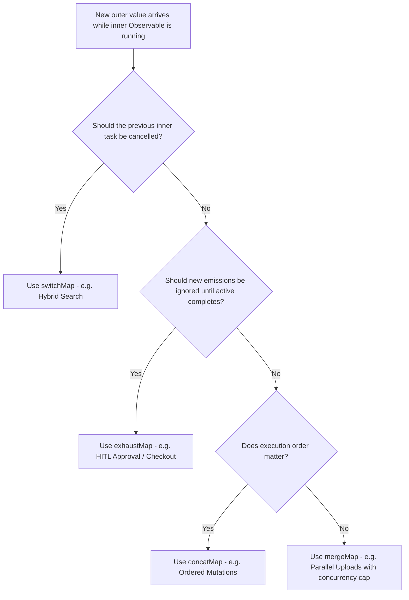
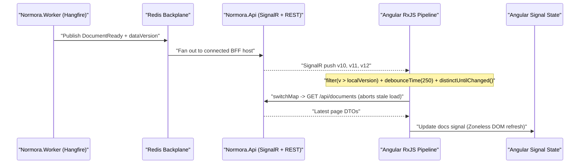

# Appendix 3: RxJS & Observables Interview Questions

This section covers Reactive Programming using **RxJS**, a core dependency of Angular, updated for **Angular 22** (standalone components, Signals, `@if`/`@for`, and Zoneless Change Detection). It progresses from Observable fundamentals to Higher-Order Mapping, Signals interop, BFF/SignalR real-time architecture, and deterministic testing.

> [!NOTE]
> **Normora Context:** Throughout this guide, examples use **Normora**, an enterprise multi-tenant knowledge management and conversational-AI platform built with an Angular 22 SPA behind a **Duende BFF (Backend-for-Frontend)**—where authentication lives in encrypted `HttpOnly`, `SameSite=Strict` cookies rather than browser tokens—and a `.NET 10` modular monolith (`Tenants`, `Documents`, `Conversations`).

---

## Junior Level Questions

### 1. What is the difference between an Observable and a Promise?
**Answer:**
* **Promise:** Represents a **single** future value. It is **eager** (starts executing the moment it is constructed), cannot be cancelled once started, and settles exactly once (resolves or rejects).
* **Observable:** Represents a **stream** of zero, one, or many values over time. It is **lazy** (nothing runs until `.subscribe()` is called, or a bridge like `toSignal()`/`async` pipe subscribes), can emit multiple values, supports declarative operator pipelines (`debounceTime`, `retry`, `switchMap`), and is **cancellable** via `.unsubscribe()`.

**Normora Example:**
* **Observable (`HttpClient`):** Searching company policies via `this.http.post('/api/documents/search', query)` returns a cold, cancellable `Observable`. If the user types a new character, cancelling the previous subscription aborts the in-flight HTTP request before pgvector wastes backend CPU.
* **Multiple-value stream:** Normora's `/api/copilotkit` AI responses stream dozens of Server-Sent Events (SSE) (`tool_started`, `policy_limit_card`, text tokens) over several seconds—impossible with a single-value `Promise`.
* **When to convert to a Promise:** When an Angular route guard or `async/await` helper genuinely needs a single final emission (such as a one-time BFF health check), use `firstValueFrom(obs$)` instead of `.toPromise()` (which was removed in RxJS 8).

### 2. What is the difference between a `Subject` and a `BehaviorSubject`?
**Answer:**
* **`Subject`:** Both an `Observable` and an `Observer` that **multicasts** values to all currently active subscribers. It holds **no memory** of past values—late subscribers miss everything emitted before they subscribed.
* **`BehaviorSubject`:** A `Subject` that **requires an initial value** and always stores the latest emitted value. Any late subscriber immediately and synchronously receives the current value upon subscribing (and you can read `.getValue()` synchronously, though pipelines are preferred).

**Normora Example:**
```typescript
// Subject: stateless event trigger (e.g., user clicks "Retry Document Ingestion")
private readonly retryIngestion$ = new Subject<string>(); // emits documentId

// BehaviorSubject: RxJS pipeline tracking the active workspace slug for HTTP orchestration
private readonly activeTenantSlug$ = new BehaviorSubject<string>('acme-corp');
this.activeTenantSlug$.next('globex-inc');
this.activeTenantSlug$.subscribe(slug => console.log(slug)); // Instantly logs 'globex-inc'
```
> **When NOT to use `BehaviorSubject` in Angular 22:** For synchronous UI state inside components (such as whether Normora's Copilot drawer is docked or expanded), avoid `BehaviorSubject`. Use Angular `signal(false)` and `computed()` instead—they require no subscriptions and integrate natively with Zoneless Change Detection.

### 3. What does the `AsyncPipe` (`| async`) do in Angular templates, and how does it compare to `toSignal()` in Angular 22?
**Answer:**
The `AsyncPipe` subscribes to an `Observable` (or `Promise`) directly in an HTML template, schedules view updates whenever a new value arrives (calling `markForCheck()` under the hood, which works in both Zone-based and Zoneless Angular 22), and **automatically unsubscribes** when the component is destroyed—preventing memory leaks.

**Template Example (Normora Document Feed with Angular 22 `@if`/`@for` & Tailwind v4):**
```html
@if (documents$ | async; as docs) {
  <ul class="divide-y divide-slate-200 dark:divide-slate-700">
    @for (doc of docs; track doc.id) {
      <li class="p-3 bg-white dark:bg-slate-900 text-slate-900 dark:text-white border-none!">
        {{ doc.title }}
      </li>
    }
  </ul>
}
```
**Pitfall & Angular 22 Alternative (`toSignal()`):**
* **Duplicate subscription trap:** Writing `{{ (user$ | async)?.name }}` and `{{ (user$ | async)?.role }}` in two places subscribes **twice** (potentially firing two `GET /bff/user` calls unless `shareReplay` is applied). Use `@if (user$ | async; as user)` once, or convert the stream with `toSignal()`.
* **`toSignal()` advantage:** In Angular 22, `readonly docs = toSignal(this.documents$, { initialValue: [] });` lets you read `docs()` synchronously across the template and inside `computed()` without pipes, null-checking friction, or multiple subscriptions.

---

## Mid-Level Questions

### 4. Explain the difference between `map` and `switchMap` in RxJS.
**Answer:**
* **`map`:** Synchronously transforms each emitted value into another value or object (just like JavaScript `Array.prototype.map`). It does **not** flatten inner Observables—returning `this.http.get(...)` inside `map()` produces an `Observable<Observable<T>>`.
* **`switchMap`:** A **Higher-Order Mapping** (flattening) operator. It projects each outer value into a new *inner* Observable, subscribes to it, and emits its values onto the outer stream. If the outer Observable emits again before the inner Observable completes, `switchMap` immediately **unsubscribes (aborts)** the previous inner Observable and switches to the new one.

**Normora Example:**
* Use `map` to project a raw `DocumentDto` response into a badge-ready UI view-model.
* Use `switchMap` when Normora's document search bar emits a new query string so `POST /api/documents/search` cancels any stale pgvector hybrid search still in flight.

### 5. Compare all four Higher-Order Mapping operators: `switchMap`, `mergeMap`, `concatMap`, and `exhaustMap`.
**Answer:**
Choosing the wrong flattening operator causes race conditions, dropped writes, or duplicate mutations.

| Operator | When a new outer emission arrives while inner is active | Normora Use Case |
|---|---|---|
| **`switchMap`** | **Cancels** the active inner Observable and starts the new one | Document search typeahead (`POST /api/documents/search`), route param changes |
| **`mergeMap`** | Keeps both running **concurrently** (order not guaranteed) | Parallel file uploads (`POST /api/documents/upload` with concurrency cap `mergeMap(fn, 3)`) |
| **`concatMap`** | **Queues** the new inner Observable until the active one completes | Sequential ordered operations (e.g., applying ordered department RBAC updates) |
| **`exhaustMap`** | **Ignores** new outer emissions until the active one completes | Preventing double-submit on HITL destructive approval (`POST /api/approvals/{id}/approve`) or PayU checkout |



> [!TIP]
> **Concurrency Cap:** For bulk operations in Normora (like uploading 20 policy PDFs at once), pass the second argument to `mergeMap(file => this.uploadFile(file), 3)` so only 3 uploads run concurrently instead of exhausting browser HTTP connections or hitting MinIO/API rate limits.

### 6. What is a "Cold" Observable vs a "Hot" Observable?
**Answer:**
* **Cold Observable:** The data producer is created **inside** the Observable execution block. Every `.subscribe()` starts a brand-new independent execution (unicast).
  * *Normora Example:* `this.http.get('/api/tenants/current/departments')` is Cold—subscribing 3 times fires 3 separate HTTP requests through the Duende BFF.
* **Hot Observable:** The data producer exists **outside** the Observable (multicast). Multiple subscribers share the same live event source and receive emissions at the moment they occur.
  * *Normora Example:* `fromEvent<KeyboardEvent>(document, 'keydown')` for Normora's `Ctrl+J` / `Cmd+J` Copilot shortcut, or a shared SignalR `DocumentStatusUpdated` hub stream.

### 7. How do you convert a Cold Observable into a Hot Observable, and what is the `shareReplay(1)` memory-leak trap?
**Answer:**
You multicast a Cold Observable using **`shareReplay()`** or **`share()`**.

**The `shareReplay(1)` Trap:**
Calling `shareReplay(1)` sets `refCount: false` by default. That creates two production bugs if misused:
1. **Memory / Connection Leak:** On an infinite stream (like `ActivatedRoute.params` or a SignalR hub listener), `refCount: false` **never unsubscribes** from the source even after every component using it is destroyed.
2. **Permanent Error Caching:** If `GET /api/tenants/current/branding` fails once due to a transient network blip, `shareReplay(1)` caches that error and replays the same failure to every future subscriber.

**Modern Fix (Normora Tenant Branding / BFF User Context):**
```typescript
// Option A: Auto-unsubscribe when subscriber count hits 0
this.branding$ = this.http.get<TenantBrandingDto>('/api/tenants/current/branding').pipe(
  shareReplay({ bufferSize: 1, refCount: true })
);

// Option B (RxJS 7+): Fine-grained reset control via share()
this.bffUser$ = this.http.get<BffClaim[]>('/bff/user').pipe(
  share({
    connector: () => new ReplaySubject<BffClaim[]>(1),
    resetOnError: true,
    resetOnComplete: false,
    resetOnRefCountZero: false
  })
);
```

### 8. Compare `Subject`, `BehaviorSubject`, `ReplaySubject`, and `AsyncSubject`.
**Answer:**
| Subject Type | Initial Value Required? | What Late Subscribers Receive | Normora Use Case |
|---|---|---|---|
| **`Subject<T>`** | No | Only future emissions | Imperative click/command streams (`retryUpload$`) |
| **`BehaviorSubject<T>`** | Yes | Latest single value synchronously | Current workspace filter state within an RxJS pipeline |
| **`ReplaySubject<T>(n)`** | No | Up to the last `n` emitted values | Caching `/bff/user` auth claims without needing a dummy `null` initial value |
| **`AsyncSubject<T>`** | No | Only the **final** value, and only after `.complete()` | Rare; deferred single-result computations |

**Why `ReplaySubject(1)` often beats `BehaviorSubject(null)` for async bootstrap:**
With `BehaviorSubject<BffUser | null>(null)`, every downstream consumer has to filter out the fake `null` initial state (`filter(Boolean)`) before the `/bff/user` HTTP call returns. A `ReplaySubject<BffUser>(1)` holds nothing until the real user resolves, then replays it synchronously to all future subscribers.

---

## Senior Level Questions

### 9. What is the difference between `forkJoin`, `combineLatest`, and `withLatestFrom`?
**Answer:**
* **`forkJoin`:** Waits for all provided Observables to **complete**, then emits a single object/array of their **final** values (like `Promise.all` for Observables).
  * *Normora Example:* Loading the workspace dashboard (`summary`, `departments`, `subscriptionUsage`) in parallel on initial route entry.
  * *Gotcha:* If **any** inner Observable errors (and isn't caught locally with `catchError`), the entire `forkJoin` fails immediately; if an Observable completes without ever emitting, `forkJoin` completes empty without emitting.
* **`combineLatest`:** Does not wait for completion. Once **every** source has emitted at least once, it emits the latest combination whenever **any** source emits thereafter.
  * *Normora Example:* Filtering the Documents table whenever `searchTerm$`, `departmentId$`, or `ingestionStatus$` changes.
  * *Gotcha:* Always ensure every stream has an initial emission (e.g., via `startWith('')`), otherwise `combineLatest` stays silent forever.
* **`withLatestFrom`:** Attaches the latest value from secondary streams **only when the primary source emits**. Changing a secondary stream does **not** trigger an emission.
  * *Normora Example:* Clicking "Export Audit Logs" (`exportClick$.pipe(withLatestFrom(this.tenantSlug$, this.dateRange$))`)—changing the date filter shouldn't automatically download a CSV!

### 10. Explain `debounceTime`, `throttleTime`, and `auditTime` — and when NOT to use `throttleTime` for form submissions.
**Answer:**
All three rate-limit high-frequency streams, typically DOM events:
* **`debounceTime(300)`:** Waits for 300ms of **silence** after the last emission before emitting. Used with `distinctUntilChanged()` for Normora's document search and Copilot conversation filter so keystrokes don't hammer pgvector.
* **`throttleTime(300)`:** Emits the **first** value immediately, then ignores all subsequent emissions for 300ms (configurable with `{ leading: true, trailing: true }`). Ideal for scroll-position tracking or window resize telemetry.
* **`auditTime(300)`:** Waits 300ms after an emission arrives, then emits the **most recent** value seen during that window. Useful when batching rapid SignalR ingestion progress events.

> **When NOT to use `throttleTime`:** Never rely on `throttleTime(1000)` to prevent double-clicks on Normora's "Approve Destructive Action" or "Checkout" buttons. A slow network call taking 2.5 seconds outlasts the 1-second timer, allowing a second click through. Use **`exhaustMap`** instead so new clicks are ignored until the HTTP request actually finishes.

### 11. How do you cleanly manage manual subscriptions and teardown in Angular 22 components?
**Answer:**
While `toSignal()` and `AsyncPipe` eliminate most manual `.subscribe()` calls, side-effect streams (such as listening to Normora's `Ctrl+J` keyboard shortcut or SignalR hub notifications) require automatic cleanup when the component is destroyed.

The modern Angular solution is **`takeUntilDestroyed()`** from `@angular/core/rxjs-interop`:

```typescript
import { Component, DestroyRef, OnInit, inject } from '@angular/core';
import { takeUntilDestroyed } from '@angular/core/rxjs-interop';

@Component({ /* standalone: true */ })
export class DocumentsTableComponent implements OnInit {
  private readonly destroyRef = inject(DestroyRef);
  private readonly notifications = inject(DocumentNotificationService);

  constructor() {
    // Inside an injection context: no argument needed
    this.notifications.statusChanged$
      .pipe(takeUntilDestroyed())
      .subscribe(evt => this.handleStatusUpdate(evt));
  }

  ngOnInit(): void {
    // Outside constructor (ngOnInit or event handlers): MUST pass this.destroyRef
    // Calling takeUntilDestroyed() without destroyRef here throws NG0203!
    this.notifications.connectionState$
      .pipe(takeUntilDestroyed(this.destroyRef))
      .subscribe(state => this.connectionState.set(state));
  }
}
```
* **Non-RxJS Teardown:** Use `this.destroyRef.onDestroy(() => hubConnection.off('DocumentStatusUpdated'))` for imperative SDK listeners.
* **Legacy Pattern:** Before Angular v16, developers created `private readonly destroy$ = new Subject<void>()`, piped `takeUntil(this.destroy$)`, and called `next()` + `complete()` in `ngOnDestroy()`.

### 12. How do RxJS and Angular Signals interoperate (`toSignal`, `toObservable`), and when should you NOT bridge them?
**Answer:**
In **Zoneless Angular 22**, Signals own synchronous UI state while RxJS owns asynchronous event pipelines. `@angular/core/rxjs-interop` bridges the two:
* **`toSignal(obs$, { initialValue })`:** Subscribes to an `Observable` in an injection context, exposes its latest emission as a read-only `Signal`, and automatically unsubscribes via `DestroyRef`.
  * *Gotcha 1:* Without `initialValue` (or `requireSync: true` for `BehaviorSubject` / synchronous streams), its type is `Signal<T | undefined>`.
  * *Gotcha 2:* If the Observable errors and has no `catchError`, reading the signal in a template throws that error.
* **`toObservable(mySignal)`:** Converts a `Signal` into an `Observable` backed by an internal `effect()`.
  * *Glitch-free batching:* Because `effect()` schedules asynchronously, setting `query.set('a'); query.set('ab');` in the same tick emits only `'ab'`—never intermediate glitches.

**Normora Example (Signal Input -> Debounced RxJS HTTP -> Signal Output):**
```typescript
export class DocumentSearchComponent {
  readonly searchQuery = signal('');

  private readonly searchResults$ = toObservable(this.searchQuery).pipe(
    map(q => q.trim()),
    debounceTime(300),
    distinctUntilChanged(),
    switchMap(q => q ? this.docsApi.hybridSearch(q) : of([]))
  );

  readonly results = toSignal(this.searchResults$, { initialValue: [] });
}
```
> **When NOT to bridge:**
> 1. **One-off mutations:** Don't wrap `POST /api/documents/upload` or `DELETE /api/documents/{id}` in `toSignal()`. Trigger them with `.subscribe()` + `takeUntilDestroyed(this.destroyRef)` or `firstValueFrom`.
> 2. **Purely synchronous state:** Don't convert a `signal()` to an `Observable` just to filter an in-memory array—use `computed()` directly.

### 13. Scenario (Normora): How do you wrap a Server-Sent Events (SSE) AI stream like `/api/copilotkit` in a custom RxJS Observable with safe cancellation in Zoneless Angular 22?
**Answer:**
Standard browser `EventSource` only supports `GET` requests, whereas Normora's `/api/copilotkit` AG-UI endpoint uses `POST` with JSON payloads and Duende BFF `HttpOnly` cookies + anti-CSRF headers. You wrap `fetch` + `ReadableStream` + `AbortController` inside `new Observable` and return a **teardown function**:

```typescript
streamCopilotTurn(payload: CopilotTurnRequest): Observable<AgUiEvent> {
  return new Observable<AgUiEvent>(subscriber => {
    const controller = new AbortController();

    (async () => {
      try {
        const res = await fetch('/api/copilotkit', {
          method: 'POST',
          credentials: 'include', // Sends Duende BFF HttpOnly cookie
          headers: { 'Content-Type': 'application/json', 'X-CSRF': '1' },
          body: JSON.stringify(payload),
          signal: controller.signal
        });
        if (!res.ok || !res.body) throw new Error(ApiMessages.GenericError);

        const reader = res.body.getReader();
        const decoder = new TextDecoder();
        while (true) {
          const { done, value } = await reader.read();
          if (done) break;
          for (const event of parseSseFrames(decoder.decode(value, { stream: true }))) {
            subscriber.next(event); // e.g. tool_started, policy_limit_card, text delta
          }
        }
        subscriber.complete();
      } catch (err) {
        if (!controller.signal.aborted) subscriber.error(err);
      }
    })();

    // Teardown: runs on unsubscribe(), "Stop Generating", or switchMap cancellation
    return () => controller.abort();
  });
}
```
**Why this matters in Zoneless Angular 22 + .NET 10:**
1. Calling `controller.abort()` in the teardown immediately closes the HTTP stream, triggering `.NET`'s `HttpContext.RequestAborted` `CancellationToken` inside `NormoraWorkplaceAgent` so Google Gemini stops streaming and stops burning tokens.
2. When the subscriber updates a component `signal()` (e.g., appending tokens or toggling tool chips), Angular 22 Zoneless detects the signal write and updates the DOM without needing `NgZone.run()`.

---

## Architect Level Questions

### 14. Explain the "Imperative vs Declarative" RxJS paradigm and why nested subscribes are an anti-pattern.
**Answer:**
**Imperative (Anti-Pattern):**
```typescript
// BAD: Nested Subscribes
this.route.paramMap.subscribe(params => {
  const id = params.get('conversationId');
  this.http.get<ConversationDto>(`/api/conversations/${id}`).subscribe(conv => {
    this.conversation.set(conv);
  });
});
```
Nested `.subscribe()` blocks cause **race conditions** (if Conversation A responds slower than Conversation B, Conversation A overwrites the screen), prevent automatic request cancellation, leak inner subscriptions, and are difficult to unit test.

**Declarative (RxJS Native + Angular 22 `toSignal`):**
```typescript
// GOOD: Declarative Pipeline
readonly conversation = toSignal(
  this.route.paramMap.pipe(
    map(params => params.get('conversationId')),
    filter((id): id is string => Boolean(id)),
    switchMap(id => this.http.get<ConversationDto>(`/api/conversations/${id}`))
  )
);
```
In declarative RxJS, you define a single pipeline blueprint using operators (`map`, `filter`, `switchMap`, `catchError`), and let `toSignal()` (or `AsyncPipe`) manage subscription and teardown. Because `switchMap` aborts the previous inner HTTP request on route change, race conditions are eliminated by design.

### 15. Explain the danger of using `catchError` incorrectly in a persistent stream (and how to handle errors cleanly with `ApiMessages`).
**Answer:**
Per the RxJS Observable contract, an uncaught error terminates the stream permanently (`complete` / `error` ends all future emissions). If you place `catchError` on the **outer** stream of a long-lived source (like a search input, button click `Subject`, or SignalR listener), the first HTTP failure **kills the outer stream forever**—subsequent user searches do nothing until a full page reload.

**Solution:** Always isolate `catchError` inside the **inner** Observable (inside `switchMap` / `exhaustMap`), returning a safe fallback (`of([])` or `EMPTY`) and surfacing Normora's centralized `ApiMessages` constant (never hardcoded strings):

```typescript
this.searchClicks$.pipe(
  switchMap(query =>
    this.http.post<DocumentChunkDto[]>('/api/documents/search', { query }).pipe(
      catchError(() => {
        this.toast.error(ApiMessages.GenericError); // From core/constants/api-messages.ts
        return of([]); // Inner stream completes cleanly; outer searchClicks$ stays alive!
      })
    )
  ),
  takeUntilDestroyed()
).subscribe(results => this.results.set(results));
```

### 16. What is a "Memory Leak" in the context of Angular routing, and how can RxJS cause it?
**Answer:**
A memory leak happens when Angular destroys a routed component (e.g., navigating from `/documents` to `/settings/billing`), yet the JavaScript Garbage Collector cannot reclaim the component instance because an active reference still points to it.

If `DocumentsComponent` subscribes to a singleton service (such as `Router.events`, `WorkspaceStateService.dataVersion$`, or a global SignalR notification stream) and does not unsubscribe on destroy, the singleton holds a reference to the component's subscriber callback—retaining the entire component tree and DOM references in memory on every route visit until the browser tab crashes. Always bind subscriptions with `takeUntilDestroyed(this.destroyRef)` or `toSignal()`/`AsyncPipe`.

### 17. How do you implement robust HTTP Retry logic with exponential backoff and jitter—and which status codes must NEVER be retried in Normora?
**Answer:**
In modern RxJS (v7.3+ / v8), **`retryWhen` is deprecated**; use the declarative **`retry({ count, delay })`** configuration. Add random **jitter** so thousands of clients recovering from a brief outage don't hit `Normora.Api` at the exact same millisecond (thundering herd).

**Normora Security & Error Rules (What NEVER to retry):**
* **`400` Bad Request:** FluentValidation failed—retrying won't fix invalid input.
* **`401` Unauthorized:** Duende BFF cookie session expired—redirect to BFF login rather than retrying.
* **`403` Forbidden (BFLA):** `BflaException` means the user lacks functional permission—never retry.
* **`404` Not Found (BOLA):** `BolaException` maps unauthorized object access to `404` to prevent ID enumeration—never retry.

Only retry transient network/gateway errors (`0`, `429`, `502`, `503`, `504`):

```typescript
const RETRYABLE_STATUSES = new Set([0, 429, 502, 503, 504]);

this.http.get<DocumentMetricsDto>('/api/documents/metrics').pipe(
  retry({
    count: 3,
    delay: (error: HttpErrorResponse, retryCount: number) => {
      if (!RETRYABLE_STATUSES.has(error.status)) {
        return throwError(() => error); // Fail fast on 400 / 401 / 403 BFLA / 404 BOLA
      }
      const baseMs = Math.pow(2, retryCount - 1) * 1000; // 1s, 2s, 4s
      const jitterMs = Math.floor(Math.random() * 300);
      return timer(baseMs + jitterMs);
    }
  })
);
```

### 18. Scenario (Normora): How do you architect an RxJS `HttpInterceptorFn` for Duende BFF `401` session expiry coordination and instant cancellation on workspace (tenant) switching?
**Answer:**
Consider two concurrent enterprise failure modes in Normora:
1. **Morning `401` Storm:** A user leaves Normora open overnight. Their Duende BFF `HttpOnly` cookie expires. When they focus the tab, 4 dashboard components fire parallel requests (`/api/tenants/current`, `/api/documents`, `/api/conversations`, `/api/subscription/usage`) and all 4 receive `401`. Without coordination, the SPA triggers 4 overlapping login redirects or session checks.
2. **Cross-Tenant UI Leak on Workspace Switch:** The user switches from Tenant A to Tenant B while a slow `/api/documents` call for Tenant A is still in flight. If Tenant A's response resolves 500ms later, it could overwrite Tenant B's table.

**Architect Solution:**
* **Single-flight `401` gate:** Track a shared `sessionCheckInFlight$: Observable<boolean> | null` (or a `BehaviorSubject<boolean>(false)` + `filter(checking => !checking)` + `take(1)`). The first `401` triggers one `/bff/user` check or BFF login redirect (`exhaustMap`); concurrent `401`s wait on the shared gate instead of firing duplicate redirects.
* **BOLA/BFLA passthrough:** Immediately surface `403` (`ApiMessages.Forbidden`) and `404` (`ApiMessages.NotFound`) without retrying or logging the user out.
* **Tenant-switch cancellation:** Pipe outgoing tenant-scoped HTTP requests through `takeUntil(tenantContext.tenantSwitched$)` inside the interceptor (skipping global `/bff/*` endpoints). Switching workspaces immediately aborts every stale Tenant A XHR/fetch before its response can reach any component.

### 19. Scenario (Normora): How do you synchronize Angular UI tables with `Normora.Worker` SignalR `dataVersion` broadcasts without race conditions or reload storms?
**Answer:**
In Normora, `Normora.Worker` processes uploaded PDFs via Hangfire and publishes completion events over a **Redis pub/sub backplane** to `Normora.Api`'s SignalR hubs (`IDocumentNotificationService`), incrementing the tenant's monotonic `dataVersion`. If 50 documents finish batch ingestion in 2 seconds, naively reloading the table on every SignalR frame causes a **reload storm** and out-of-order responses.



**Key RxJS Controls:**
1. **`filter(v => v > this.lastAppliedVersion)`:** Drops out-of-order or duplicate version frames.
2. **`debounceTime(250)` + `distinctUntilChanged()`:** Coalesces a burst of 50 worker events into a single table refresh.
3. **`switchMap(() => this.docsApi.list())`:** Guarantees that if another version bump arrives mid-fetch, the older HTTP fetch is aborted so stale rows never overwrite newer state.

### 20. How do you deterministically unit-test time-dependent RxJS pipelines (like `debounceTime` and `retry`) in Vitest without flaky `setTimeout` waits?
**Answer:**
Normora's Angular client uses **Vitest**. Waiting for real timers (e.g., `await new Promise(r => setTimeout(r, 350))`) makes CI slow and flaky under CPU load. Use RxJS **`TestScheduler`** with **Marble Testing** (or Vitest fake timers `vi.useFakeTimers()` for simple `firstValueFrom` tests):

```typescript
import { TestScheduler } from 'rxjs/testing';
import { debounceTime, distinctUntilChanged, switchMap, of } from 'rxjs';

it('debounces hybrid search queries and cancels stale requests', () => {
  const scheduler = new TestScheduler((actual, expected) => {
    expect(actual).toEqual(expected);
  });

  scheduler.run(({ cold, expectObservable }) => {
    const input$ = cold('a 49ms b 350ms c 350ms |', { a: 'p', b: 'po', c: 'policy' });
    const result$ = input$.pipe(
      debounceTime(300),
      distinctUntilChanged(),
      switchMap(q => of(`result:${q}`))
    );

    // 'a' (0ms) is superseded by 'b' (50ms); 'b' emits at 350ms; 'c' (401ms) emits at 701ms
    expectObservable(result$).toBe('350ms x 350ms y 50ms |', {
      x: 'result:po',
      y: 'result:policy'
    });
  });
});
```
* **When to use `TestScheduler`:** Complex timing interactions (`debounceTime`, `throttleTime`, `retry` backoff, `switchMap` cancellation races).
* **When to use `firstValueFrom` + `HttpTestingController`:** Simple single-shot HTTP service tests where no virtual time progression is needed.

---

## Common Mistakes & Anti-Patterns

> [!CAUTION]
> **1. Putting `catchError` on the outer stream instead of inside `switchMap`**
> ```typescript
> // WRONG: First 404/500 permanently kills searchClicks$!
> this.searchClicks$.pipe(
>   switchMap(q => this.http.post('/api/documents/search', { q })),
>   catchError(() => of([]))
> ).subscribe();
> ```
> **Why it's wrong:** An unhandled error inside `switchMap` bubbles up to the outer stream, which `catchError` replaces with `of([])` and immediately **completes**. Future clicks on Search never fire.
> **Fix:** Move `catchError` inside the inner `pipe(...)` so only the failed HTTP call completes while `searchClicks$` remains alive.

> [!CAUTION]
> **2. Using `shareReplay(1)` on non-completing streams without `refCount: true`**
> ```typescript
> // WRONG: Never unsubscribes from SignalR/router even when 0 components listen
> readonly events$ = this.signalR.documentStatus$.pipe(shareReplay(1));
> ```
> **Why it's wrong:** Default `refCount: false` keeps the upstream subscription open for the lifetime of the app (leaking memory/connections) and permanently caches errors on HTTP streams.
> **Fix:** Use `shareReplay({ bufferSize: 1, refCount: true })` or `share({ connector: () => new ReplaySubject(1), resetOnError: true, resetOnRefCountZero: true })`.

> [!CAUTION]
> **3. Calling `takeUntilDestroyed()` outside an injection context**
> ```typescript
> // WRONG: Throws NG0203 at runtime!
> ngOnInit(): void {
>   this.notifications$.pipe(takeUntilDestroyed()).subscribe();
> }
> ```
> **Why it's wrong:** `takeUntilDestroyed()` calls `inject(DestroyRef)` internally, which only works in constructors or field initializers unless you pass an explicit `DestroyRef`.
> **Fix:** Store `private readonly destroyRef = inject(DestroyRef);` as a class field and pass `takeUntilDestroyed(this.destroyRef)` inside `ngOnInit()` or click handlers.

> [!CAUTION]
> **4. Retrying `401`, `403` (BFLA), or `404` (BOLA) responses in `retry()`**
> ```typescript
> // WRONG: Retries BOLA 404s, BFLA 403s, and expired BFF 401 cookies 3 times!
> this.http.get(`/api/documents/${id}`).pipe(retry(3));
> ```
> **Why it's wrong:** In Normora, `404` (`BolaException`) and `403` (`BflaException`) are intentional authorization boundaries, and `401` means the Duende BFF session cookie expired. Blindly retrying delays `ApiMessages` error feedback and wastes backend capacity.
> **Fix:** Use `retry({ count: 3, delay: ... })` and re-throw immediately with `throwError(() => err)` for all `4xx` statuses except `429` (rate limit).

> [!CAUTION]
> **5. Using `BehaviorSubject` for synchronous UI state in Angular 22**
> ```typescript
> // WRONG: Unnecessary RxJS boilerplate for synchronous UI state
> private readonly isCopilotExpanded$ = new BehaviorSubject<boolean>(false);
> ```
> **Why it's wrong:** Synchronous toggle/tab/drawer state never errors, never completes, and shouldn't require `| async` or subscriptions in a Zoneless Angular 22 app.
> **Fix:** Use `readonly isCopilotExpanded = signal(false);` and `computed()` for derived UI state; reserve RxJS for asynchronous event streams and HTTP orchestration.
