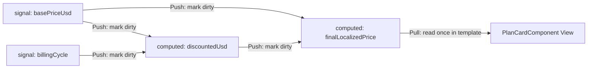
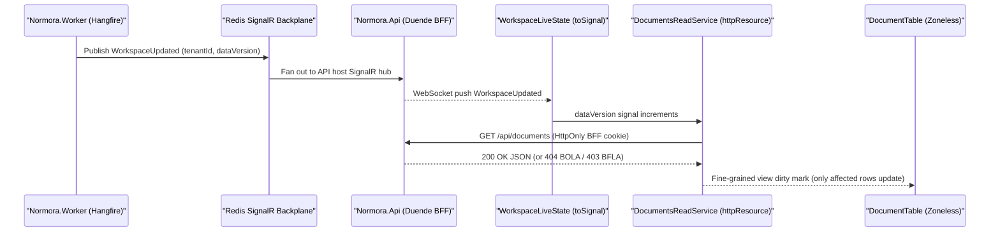

# Appendix 4: Signals & Reactivity Interview Questions

This section covers Angular's fine-grained reactivity model (Angular v16 through Angular 22), focusing on `signal()`, `computed()`, `effect()`, `linkedSignal()`, Signal component APIs (`input()`, `output()`, `model()`, `viewChild()`), async reactivity (`toSignal()`, `toObservable()`, `resource()`, `httpResource()`), zoneless change detection, and enterprise patterns modeled on **Normora**.

---

## Junior Level Questions

### 1. What is an Angular Signal?
**Answer:**
A **Signal** is a reactive wrapper around a value that tracks where it is read and notifies interested **consumers** (such as `computed()` signals, `effect()` callbacks, or component templates) when that value changes.
* Unlike plain class properties that rely on `Zone.js` triggering top-down change detection across the entire component tree, Signals provide **fine-grained reactivity**: Angular knows exactly which template views depend on which signals and updates only those views.
* Every Signal is a **Producer** node in Angular's reactive dependency graph. Reading it by calling it as a function (`mySignal()`) automatically registers the active **Consumer** as a dependent.

**Normora Example:**
In Normora's `DocumentStatusBadgeComponent`, each row's ingestion status (`'Pending' | 'Processing' | 'Ready' | 'Failed'`) is passed as a Signal input. When a background Hangfire job in `Normora.Worker` finishes processing a PDF and pushes a SignalR update, only that specific badge view re-renders instead of dirty-checking the entire workspace table.

### 2. How do you read, update, and encapsulate a `WritableSignal`?
**Answer:**
* **Read:** Invoke the signal as a function: `mySignal()`.
* **Replace (`.set()`):** Assigns a completely new value: `mySignal.set(newValue)`.
* **Derive from previous value (`.update()`):** Computes the next value immutably from the current one: `mySignal.update(prev => ...)`.
* **Encapsulate (`.asReadonly()`):** In services and stores, keep the `WritableSignal` `private` and expose a read-only `Signal<T>` via `.asReadonly()` so components cannot arbitrarily mutate shared state.
* **Equality (`equal`):** Signals compare old and new values using `Object.is` (reference equality) by default. Always return a new object/array reference in `.update()`, or pass a custom `{ equal: (a, b) => ... }` comparator when structural comparison is needed.

**Normora Example:**
```typescript
import { Injectable, signal } from '@angular/core';

export interface WorkspaceDocument {
  id: string;
  title: string;
  status: 'Pending' | 'Processing' | 'Ready' | 'Failed';
}

@Injectable({ providedIn: 'root' })
export class DocumentQueueState {
  // Private writable state: components cannot call .set() directly
  private readonly _documents = signal<WorkspaceDocument[]>([]);
  private readonly _isUploading = signal(false);

  // Public read-only projections
  readonly documents = this._documents.asReadonly();
  readonly isUploading = this._isUploading.asReadonly();

  addDocument(doc: WorkspaceDocument): void {
    // Immutable update creates a new array reference so consumers are notified
    this._documents.update(list => [...list, doc]);
  }

  markReady(documentId: string): void {
    this._documents.update(list =>
      list.map(d => (d.id === documentId ? { ...d, status: 'Ready' } : d))
    );
  }
}
```
*(Note: `mutate()` existed briefly in Angular v16 and was removed in v17 in favor of immutable updates via `update()`.)*

### 3. What is the difference between `signal()` and `computed()`?
**Answer:**
* `signal()` creates a **`WritableSignal<T>`**. You own its state and change it imperatively with `.set()` or `.update()`.
* `computed()` creates a **read-only `Signal<T>`** derived from one or more other signals. You *cannot* call `.set()` or `.update()` on it.
* `computed()` is **lazy** (does not execute until read), **memoized** (caches its result until a dependency changes), and uses **dynamic dependency tracking** (if a branch in an `if` statement is skipped, signals inside that branch are not tracked for that run).

**Normora Example:**
In Normora's A2UI `ExpenseSimulatorCardComponent` (`policy_limit_card`), hotel nights and per-diem rates are reactive signals, while total trip allowance and limit warnings are derived via `computed()`:
```typescript
import { computed, signal } from '@angular/core';

export class ExpenseSimulatorState {
  readonly hotelNights = signal(2);
  readonly nightlyRate = signal(180);
  readonly policyCap = signal(500);

  // Read-only, lazy, and memoized: recalculates only when hotelNights or nightlyRate changes
  readonly totalHotelCost = computed(() => this.hotelNights() * this.nightlyRate());
  readonly exceedsPolicyLimit = computed(() => this.totalHotelCost() > this.policyCap());
}
```

---

## Mid-Level Questions

### 4. What is an `effect()`, and when should you (and should you NOT) use it?
**Answer:**
An `effect()` schedules a reactive side-effect callback inside an **injection context** (such as a constructor or field initializer; otherwise pass `{ injector: this.injector }`). It runs once initially and re-executes asynchronously whenever any Signal read inside its tracked execution path changes.

* **When to use `effect()`:**
  * Synchronizing Signal state with external non-reactive browser APIs (for example, toggling the Tailwind `dark` class on `document.documentElement`, logging OpenTelemetry UI events, or updating a third-party canvas/chart instance).
  * Triggering a workspace table reload when a SignalR `dataVersion` signal increments.
* **When NOT to use `effect()`:**
  * **Never** use `effect()` to synchronize state from one `signal()` into another `signal()`—that creates redundant change-detection cycles or infinite loops. Use `computed()` (read-only derived state) or `linkedSignal()` (resettable derived state).
  * **Never** use `effect()` for imperative user mutations like `POST /api/subscription/cancel` or HITL approvals; use explicit event handlers with `HttpClient`.
  * **Never** persist session or user auth objects to `localStorage` when using a BFF like Normora's Duende BFF (`HttpOnly`, `SameSite=Strict` cookies handle session state securely on the server).

**Normora Example:**
```typescript
import { Component, effect, inject, signal } from '@angular/core';
import { TenantThemeService } from '../../core/services/tenant-theme.service';

@Component({ selector: 'app-workspace-shell', template: `<router-outlet />` })
export class WorkspaceShellComponent {
  private readonly themeService = inject(TenantThemeService);
  readonly isDarkMode = signal(true);

  constructor() {
    // Syncs Tailwind v4 dark: variant root class with tenant preference signal
    effect(() => {
      document.documentElement.classList.toggle('dark', this.isDarkMode());
      this.themeService.applyTenantAccentColor();
    });
  }
}
```

### 5. Why did Angular introduce Signals if RxJS already exists?
**Answer:**
RxJS excels at **asynchronous event streams over time** (SSE token streams, SignalR hubs, debouncing rapid user keystrokes, and cancelling stale HTTP requests via `switchMap`). However, using RxJS for **synchronous UI state** introduces unnecessary complexity:
* Streams can emit errors or complete—neither makes sense for synchronous state like "which department filter is currently selected?"
* Cold Observables (like `HttpClient.get()`) re-execute on every `.subscribe()`, and `BehaviorSubject` chains (`combineLatest` + `map`) require manual subscription management (`| async` or `takeUntilDestroyed()`) to prevent leaks.
* `combineLatest` can produce **glitches** (transient inconsistent emissions) when multiple streams derive from a shared source.
* Signals are **glitch-free**, always hold a current synchronous value, never complete, need no subscriptions in templates, and enable **zoneless** fine-grained DOM updates.

**Normora Rule of Thumb:**
* **RxJS:** Copilot SSE token chunks from `/api/copilotkit`, SignalR `WorkspaceUpdated` events from the Redis backplane, and `debounceTime(300)` + `switchMap` for semantic hybrid search.
* **Signals:** Active department filter, upload queue state, `TenantPlanPricingCatalog` currency calculations, and `@if` / `@for` template bindings.

### 6. Explain the `input()` and `output()` APIs introduced in Angular v17+.
**Answer:**
* **`input()`** replaces `@Input()`. It exposes a **read-only `InputSignal<T>`** (or `input.required<T>()`), allowing components to derive values directly via `computed()` without `ngOnChanges`. It also supports `transform` helpers (`booleanAttribute`, `numberAttribute`) and `alias`.
* **`output()`** replaces `@Output() ... = new EventEmitter()`. It is lighter-weight, does not inherit from RxJS `Subject`, and emits typed events via `.emit(value)`.

**Normora Example:**
In `ChunkPreviewDrawerComponent`, `isOpen` uses `booleanAttribute`, `documentId` is required, and `locateInDocuments` co-browses the user back to the source policy:
```typescript
import { Component, booleanAttribute, computed, input, output } from '@angular/core';

@Component({
  selector: 'app-chunk-preview-drawer',
  template: `
    @if (isOpen()) {
      <aside class="fixed right-0 top-0 h-full w-96 border-l border-slate-200 dark:border-slate-700 bg-white dark:bg-slate-900 p-4 custom-scrollbar overflow-y-auto">
        <p class="text-xs font-medium text-slate-500 dark:text-slate-400">{{ headerLabel() }}</p>
        <button type="button" (click)="locateInDocuments.emit(documentId())"
                class="border-none! text-indigo-600 dark:text-indigo-400 mt-2">
          Locate in Documents
        </button>
      </aside>
    }
  `
})
export class ChunkPreviewDrawerComponent {
  readonly isOpen = input(false, { transform: booleanAttribute });
  readonly documentId = input.required<string>();
  readonly chunkIndex = input(0, { transform: numberAttribute });
  readonly locateInDocuments = output<string>();

  readonly headerLabel = computed(() => `Citation Chunk #${this.chunkIndex() + 1}`);
}
```

### 7. What is `linkedSignal()`, and how does it solve resettable derived state?
**Answer:**
`linkedSignal()` (introduced in Angular v19 and standard in Angular 22) creates a **`WritableSignal` that automatically resets or recomputes when a source signal changes**, while still allowing local imperative `.set()` or `.update()` overrides in between source changes.
* Use `computed()` when state is **strictly derived and read-only**.
* Use `linkedSignal()` when a value depends on a parent/filter signal *and* must also be mutable by the user (e.g., pagination, selected tab, or active item inside a filtered list).
* This eliminates the classic anti-pattern of mutating a signal inside an `effect()` whenever an input or filter changes.

**Normora Example:**
In Normora's document library, users can click to page 3, but whenever they switch departments (`selectedDepartmentId`), `currentPage` must automatically reset to `1`:
```typescript
import { linkedSignal, signal } from '@angular/core';

export class DocumentPaginationState {
  readonly selectedDepartmentId = signal<string>('ALL');

  // Writable by pagination buttons, yet automatically resets to 1 when department changes
  readonly currentPage = linkedSignal({
    source: this.selectedDepartmentId,
    computation: () => 1
  });

  nextPage(): void {
    this.currentPage.update(page => page + 1);
  }
}
```

### 8. How do Signal Queries (`viewChild()`, `contentChild()`) and `afterRenderEffect()` work together?
**Answer:**
* **Signal Queries** (`viewChild()`, `viewChildren()`, `contentChild()`, `contentChildren()`) replace decorator queries (`@ViewChild`, `@ContentChildren`). Instead of returning `undefined` until `ngAfterViewInit`, they return a reactive `Signal<T | undefined>` (or `Signal<T>` with `.required()`).
* **`afterRenderEffect()`** (Angular 19+) is like `effect()`, except it runs **after** Angular finishes flushing DOM updates. Standard `effect()` runs *before* DOM rendering completes, so measuring `scrollHeight` or element bounding boxes inside `effect()` reads stale DOM geometry.

**Normora Example:**
In `CopilotDockComponent`, when `NormoraWorkplaceAgent` appends streaming assistant messages, `viewChild()` + `afterRenderEffect()` scrolls the `.custom-scrollbar` viewport cleanly after the new DOM nodes exist:
```typescript
import { Component, ElementRef, afterRenderEffect, input, viewChild } from '@angular/core';

@Component({
  selector: 'app-copilot-dock',
  template: `
    <div #chatViewport class="h-96 overflow-y-auto custom-scrollbar bg-white dark:bg-slate-900">
      @for (msg of messages(); track msg.id) {
        <p class="p-2 text-slate-900 dark:text-slate-100">{{ msg.text }}</p>
      }
    </div>
  `
})
export class CopilotDockComponent {
  readonly messages = input.required<Array<{ id: string; text: string }>>();
  readonly chatViewport = viewChild<ElementRef<HTMLDivElement>>('chatViewport');

  constructor() {
    afterRenderEffect(() => {
      this.messages(); // Subscribe to message array updates
      const viewport = this.chatViewport()?.nativeElement;
      if (viewport) {
        viewport.scrollTop = viewport.scrollHeight;
      }
    });
  }
}
```

---

## Senior Level Questions

### 9. How does Angular's `computed()` signal handle caching, memoization, and equality short-circuiting?
**Answer:**
`computed()` signals use **version-tracked lazy memoization**:
1. **Push phase:** When an upstream writable signal changes, it increments its internal version counter and marks dependent `computed()` nodes as *possibly dirty*. **The computation function does not run yet.**
2. **Pull phase:** Only when a consumer (template, `effect()`, or another `computed()`) reads the `computed()` signal does Angular check whether any dependency's version number actually changed.
3. **Memoization:** If dependencies did not change, it returns the cached value in $O(1)$ time—even if called 50 times in a template.
4. **Equality short-circuiting:** If a dependency *did* change and `computed()` re-runs, Angular compares the newly computed value to the previous cached value using `Object.is` (or a custom `equal` function). If the result is equal, downstream consumers are **not** notified.

**Normora Example:**
```typescript
import { computed, signal } from '@angular/core';

export class TenantPlanBillingCalculator {
  readonly baseMonthlyUsd = signal(49);
  readonly billingCycle = signal<'Monthly' | 'Annual'>('Annual');
  readonly currencyRate = signal(84.0); // e.g., USD -> INR

  // Memoized & short-circuited: toggling an unrelated UI flag never re-runs this math
  readonly displayTotal = computed(() => {
    const discountFactor = this.billingCycle() === 'Annual' ? 0.8 : 1; // 20% annual discount
    return Math.round(this.baseMonthlyUsd() * discountFactor * this.currencyRate());
  });
}
```

### 10. How do `toSignal()` and `toObservable()` work, and what is the `toObservable()` batching trap?
**Answer:**
Both live in `@angular/core/rxjs-interop`:
* **`toSignal(obs$, options)`:** Subscribes to an Observable inside an injection context, exposes its latest value as a read-only `Signal<T>`, and auto-unsubscribes on destroy.
  * Pass `{ initialValue: ... }` for async streams (`HttpClient`), or `{ requireSync: true }` for synchronous streams (`BehaviorSubject` or `startWith(...)`).
  * **Error trap:** If the source Observable errors without `catchError`, reading the resulting signal rethrows that error in the template or `computed()`.
* **`toObservable(sig)`:** Uses an internal **`effect()`** to watch the Signal and emit changes onto an Observable stream so you can apply operators like `debounceTime` and `switchMap`.
* **The Batching Trap:** Because `toObservable()` relies on an asynchronous `effect()`, multiple synchronous `.set()` calls in the same microtask/execution turn **coalesce into a single emission** containing only the final value. Never rely on `toObservable()` to observe every intermediate synchronous state transition.

**Normora Example (`HybridSearchState`):**
```typescript
import { HttpClient } from '@angular/common/http';
import { Injectable, inject, signal } from '@angular/core';
import { toObservable, toSignal } from '@angular/core/rxjs-interop';
import { catchError, debounceTime, distinctUntilChanged, of, switchMap } from 'rxjs';

export interface SearchHit {
  chunkId: string;
  snippet: string;
}

@Injectable({ providedIn: 'root' })
export class HybridSearchState {
  private readonly http = inject(HttpClient);
  readonly query = signal<string>('');

  private readonly results$ = toObservable(this.query).pipe(
    debounceTime(300),
    distinctUntilChanged(),
    switchMap(term => {
      if (!term.trim()) return of<SearchHit[]>([]);
      // BFF HttpOnly cookie session sent via withCredentials: true
      return this.http
        .get<SearchHit[]>('/api/documents/search', { params: { q: term }, withCredentials: true })
        .pipe(catchError(() => of<SearchHit[]>([])));
    })
  );

  readonly hits = toSignal(this.results$, { initialValue: [] });
}
```

### 11. What is `model()`, how does it differ from `input()`, and when should you NOT use it?
**Answer:**
`model()` creates a **`WritableSignal` two-way binding** (replacing paired `@Input()` + `@Output()`).
* `input()` is strictly read-only inside the child component.
* `model()` allows the child to read and call `.set()` / `.update()`, automatically emitting a `<name>Change` event to synchronize the parent's bound signal (`[(nights)]="hotelNights"`).
* **When NOT to use `model()`:** Avoid threading `model()` down 3+ component layers. Deep two-way bindings obscure where mutations happen and hurt maintainability. Keep `model()` for **leaf UI controls** (steppers, toggles, drawer open state) and use unidirectional `input()` + `output()` for feature containers.

**Normora Example:**
In Normora's A2UI `ExpenseSimulatorCardComponent` (`policy_limit_card`), a leaf stepper component binds two-way with `model()`:
```typescript
import { Component, model } from '@angular/core';

@Component({
  selector: 'app-hotel-nights-stepper',
  template: `
    <div class="flex items-center gap-2 bg-slate-50 dark:bg-slate-800 p-2 rounded-lg">
      <button type="button" (click)="decrement()" class="px-2 py-1 bg-white dark:bg-slate-700 text-slate-900 dark:text-white rounded border-none!">-</button>
      <span class="text-sm font-semibold text-slate-900 dark:text-white">{{ nights() }} nights</span>
      <button type="button" (click)="increment()" class="px-2 py-1 bg-white dark:bg-slate-700 text-slate-900 dark:text-white rounded border-none!">+</button>
    </div>
  `
})
export class HotelNightsStepperComponent {
  readonly nights = model<number>(1);
  increment(): void { this.nights.update(n => n + 1); }
  decrement(): void { this.nights.update(n => Math.max(1, n - 1)); }
}
```

### 12. How do `resource()`, `rxResource()`, and `httpResource()` work, and when should you NOT use them?
**Answer:**
The **Resource APIs** model declarative **asynchronous read (`GET`) operations** driven by Signal parameters:
* **`resource({ params, loader })`:** Promise/`fetch`-based loader. When any signal read in `params()` changes, `resource` aborts the previous in-flight `AbortSignal` and runs `loader({ params, abortSignal })`.
* **`rxResource({ params, stream })`:** Observable-based variant from `@angular/core/rxjs-interop` for `HttpClient` services.
* **`httpResource<T>(() => ...)`:** Declarative `HttpClient`-backed resource from `@angular/common/http` that participates in Angular HTTP interceptors (such as Normora's Duende BFF anti-CSRF header interceptor) and exposes `.value()`, `.isLoading()`, `.error()`, `.status()`, and `.reload()`.
* **When NOT to use Resource APIs:** **Never** use `resource()` or `httpResource()` for **write mutations** (`POST`, `PUT`, `PATCH`, `DELETE`) like uploading a document, executing a HITL approval, or calling `POST /api/subscription/cancel`. Any accidental signal re-evaluation in `params` would fire duplicate mutations. Always use imperative `HttpClient` calls triggered by explicit user events for writes.

**Normora Example:**
```typescript
import { httpResource } from '@angular/common/http';
import { Injectable, signal } from '@angular/core';

export interface DocumentSummary {
  id: string;
  title: string;
  status: 'Pending' | 'Processing' | 'Ready' | 'Failed';
}

@Injectable({ providedIn: 'root' })
export class DocumentsReadService {
  readonly departmentFilter = signal<string>('ALL');
  readonly page = signal<number>(1);

  readonly documentsResource = httpResource<DocumentSummary[]>(() => ({
    url: '/api/documents',
    params: { department: this.departmentFilter(), page: this.page() },
    withCredentials: true
  }));
}
```

### 13. How do `untracked()` and `onCleanup()` prevent bugs in Signals?
**Answer:**
* **`untracked(() => ...)`:** Reads a signal's current value *without* subscribing the enclosing `computed()` or `effect()` to future updates of that signal. This prevents accidental dependency loops or unwanted re-executions when you only need contextual metadata (e.g., logging a `tenantSlug` when a document upload error signal fires).
* **`onCleanup(fn)`:** Registers a teardown callback inside `effect()` (or `resource` loader) that Angular executes right before the next run **and** when the owning component/service is destroyed. Essential for aborting `fetch` calls, clearing `setTimeout`, or detaching third-party listeners.

**Normora Example:**
```typescript
import { effect, inject, signal, untracked } from '@angular/core';
import { TenantContextService } from '../../core/services/tenant-context.service';

export class AuditTelemetryWatcher {
  private readonly tenantContext = inject(TenantContextService);
  readonly activeDocumentId = signal<string | null>(null);

  constructor() {
    effect(onCleanup => {
      const docId = this.activeDocumentId();
      if (!docId) return;

      const controller = new AbortController();
      // Read tenantSlug without re-running this effect if unrelated tenant metadata updates
      const slug = untracked(() => this.tenantContext.tenantSlug());

      fetch(`/api/documents/${docId}/metrics`, {
        credentials: 'include',
        headers: { 'X-Tenant-Slug': slug },
        signal: controller.signal
      }).catch(() => { /* ignore abort */ });

      onCleanup(() => controller.abort());
    });
  }
}
```

---

## Architect Level Questions

### 14. Explain "Fine-Grained Reactivity" and how Signals enable Zoneless Angular 22.
**Answer:**
Historically, Angular relied on `Zone.js` to monkey-patch browser async APIs (`setTimeout`, `addEventListener`, `fetch`). Whenever any async task completed, `Zone.js` notified Angular to run a **top-down check** from the root component down through the tree.
* **Fine-Grained Reactivity** means Angular tracks exact Producer -> Consumer edges. When a Signal changes, it only marks the specific template views (LViews) that actually read that Signal as dirty—leaving sibling and parent subtrees untouched.
* **Zoneless Angular 22:** Because Signal updates, Signal inputs (`input()`), `async` pipe, and event listeners directly notify Angular's scheduler, `Zone.js` can be completely removed using `provideZonelessChangeDetection()` (stabilized in modern Angular; replaces legacy `provideExperimentalZonelessChangeDetection()`). This cuts ~15 KB gzipped from the bundle, improves INP (Interaction to Next Paint), and eliminates noisy change-detection cycles during rapid streaming.

**Normora Example:**
During an active `NormoraWorkplaceAgent` SSE stream, updating the `streamingTokens` signal inside the active assistant bubble only schedules that message view—without scanning the workspace navigation sidebar, tenant branding header, or document metrics panels.

### 15. What is a "Glitch" in reactive programming, and how do Angular Signals prevent it?
**Answer:**
A **glitch** occurs when derived state temporarily evaluates using an inconsistent mix of old and new values (for example, `first` updated while `derivedA` hasn't propagated to `combined`), causing transient wrong renders or wasted downstream work. RxJS `combineLatest` can suffer from diamond-graph glitches when two derived streams emit from the same source.

Angular Signals eliminate glitches via a **two-phase Push-Pull algorithm**:
1. **Push Phase (Notify Dirty):** Calling `.set()` increments the signal's version and pushes a *"dirty / check"* flag down the graph. **Zero `computed()` callbacks execute here.**
2. **Pull Phase (Lazy Topological Evaluation):** When the template or `effect()` pulls a `computed()`, the `computed()` checks its producers' version numbers, pulls fresh values recursively, recalculates **once** after all synchronous writes have settled, and caches the result.



### 16. You are migrating an enterprise NgRx / `BehaviorSubject` store to `@ngrx/signals` (`SignalStore`). How do you handle async HTTP calls safely?
**Answer:**
Signals are strictly synchronous, so putting `HttpClient` calls inside an `effect()` sacrifices race-condition cancellation (`switchMap`), debouncing, and retry semantics.
* In **`@ngrx/signals` (`SignalStore`)**, you bridge async workflows using **`rxMethod<T>`**, which accepts either a static value or a `Signal<T>` and pipes emissions through RxJS operators before committing state atomically via `patchState()`.
* **Architect Choice:** For simple read-only BFF queries in Angular 22, native `httpResource()` / `rxResource()` avoids adding external store boilerplate; choose `@ngrx/signals` `SignalStore` when you need normalized entity collections, composable store features (`withEntities`, `withComputed`, `withMethods`), and shared cross-feature orchestration.

**Normora Example:**
```typescript
import { HttpClient, HttpErrorResponse } from '@angular/common/http';
import { inject } from '@angular/core';
import { patchState, signalStore, withMethods, withState } from '@ngrx/signals';
import { rxMethod } from '@ngrx/signals/rxjs-interop';
import { catchError, EMPTY, pipe, switchMap, tap } from 'rxjs';
import { ApiMessages } from '../../core/constants/api-messages';

interface DocumentsState {
  items: Array<{ id: string; title: string }>;
  loading: boolean;
  error: string | null;
}

export const DocumentsSignalStore = signalStore(
  { providedIn: 'root' },
  withState<DocumentsState>({ items: [], loading: false, error: null }),
  withMethods((store, http = inject(HttpClient)) => ({
    loadByDepartment: rxMethod<string>(
      pipe(
        tap(() => patchState(store, { loading: true, error: null })),
        switchMap(departmentId =>
          http.get<Array<{ id: string; title: string }>>('/api/documents', {
            params: { departmentId },
            withCredentials: true
          }).pipe(
            tap(items => patchState(store, { items, loading: false })),
            catchError((err: HttpErrorResponse) => {
              // Map BOLA (404) & BFLA (403) using centralized ApiMessages constants
              const message =
                err.status === 404 ? ApiMessages.NotFound :
                err.status === 403 ? ApiMessages.Forbidden :
                ApiMessages.DocumentsLoadFailed;
              patchState(store, { loading: false, error: message });
              return EMPTY;
            })
          )
        )
      )
    )
  }))
);
```

### 17. Architect Scenario: Designing Multi-Tenant Real-Time Sync in Normora (SignalR Redis Backplane + Signals + Zoneless)
**Scenario:** In Normora, `Normora.Worker` processes uploaded PDFs via Hangfire outbox jobs and broadcasts `dataVersion` updates across a Redis SignalR backplane to `Normora.Api`. How do you architect the Angular 22 frontend so workspace tables and document status badges update reliably in zoneless mode without polling or leaking tenant data?

**Answer:**
1. **Transport Boundary (RxJS -> `toSignal`):** Keep SignalR connection lifecycle, reconnection backoff, and event deserialization in an RxJS service, then expose `dataVersion` as a read-only Signal via `toSignal(version$.pipe(startWith(0)), { requireSync: true })` with a custom `equal` check on `{ tenantId, version }`.
2. **Tenant Isolation on Switch:** Bind the active `tenantId` in a `TenantContextService` signal. Use `linkedSignal` (or `httpResource` params keyed by `tenantId` + `dataVersion`) so switching workspaces immediately cancels in-flight HTTP calls (`AbortSignal`) and clears stale rows.
3. **Selective Reload (`effect()` or `httpResource`):** Include `dataVersion()` in `httpResource` params or call `.reload()` inside a scoped `effect()` when `dataVersion() > 0`.
4. **Zero-Trust Error Mapping:** Map `404` (BOLA) and `403` (BFLA) responses to `ApiMessages.NotFound` / `ApiMessages.Forbidden` signals—never display raw server exception strings.



### 18. Architect Scenario: Streaming CopilotKit / AG-UI SSE Tokens at 60 Events/Sec Without DOM Jank
**Scenario:** Normora's `NormoraWorkplaceAgent` streams Markdown tokens, `tool_started` / `tool_finished` badges, and interactive A2UI cards (`ApprovalConfirmationCardComponent`, `ExpenseSimulatorCardComponent`) over `/api/copilotkit` SSE. How do you prevent scrolling stutter and full-list DOM re-renders in Angular 22?

**Answer:**
1. **Isolate the Streaming Tail:** Keep finalized conversation turns in an immutable `settledMessages` signal and isolate the active streaming turn in a separate `streamingTurn` signal. Finalized A2UI cards (`ExpenseSimulatorCardComponent`, `HrEscalationCardComponent`) never re-evaluate while tokens stream.
2. **Stable `@for` Tracking:** Always render messages with `@for (msg of settledMessages(); track msg.id)` so DOM nodes for prior messages and interactive cards keep their component instances.
3. **Derived View-Models (`computed()`):** Compute `activeToolChips` (`tool_started` vs `tool_finished`) and `hasPendingApproval` via `computed()` rather than calling template methods.
4. **Post-Render Scroll Pinning:** Use `viewChild()` + `afterRenderEffect()` on the `.custom-scrollbar` container, gated by an `isUserScrolledUp` signal so auto-scroll pauses if the user scrolls up to inspect a citation.

---

## Common Mistakes & Anti-Patterns

> [!CAUTION]
> **Anti-Pattern 1: Mutating Signal Arrays or Objects in Place**
> ```typescript
> // WRONG: Same array reference; Object.is(oldArr, newArr) is true, so UI never updates!
> this.documents().push(uploadedDoc);
> this.documents.set(this.documents());
> ```
> **Why it's wrong:** Signals use `Object.is` reference equality by default. Pushing into the existing array keeps the exact same reference, so Angular notifies zero consumers.
> ```typescript
> // RIGHT: Return a new array reference via .update()
> this.documents.update(list => [...list, uploadedDoc]);
> ```

> [!CAUTION]
> **Anti-Pattern 2: Forgetting Parentheses When Reading a Signal in Templates**
> ```html
> <!-- WRONG: Checks truthiness of the Signal function object (always true!) -->
> @if (isUploading) {
>   <span class="text-slate-900 dark:text-white">Uploading {{ activeDoc.title }}...</span>
> }
> ```
> **Why it's wrong:** A Signal is a function. `@if (isUploading)` is always truthy because the function reference exists, and `activeDoc.title` reads a property off the function instead of its value.
> ```html
> <!-- RIGHT: Invoke signals with () -->
> @if (isUploading()) {
>   <span class="text-slate-900 dark:text-white">Uploading {{ activeDoc()?.title }}...</span>
> }
> ```

> [!CAUTION]
> **Anti-Pattern 3: Synchronizing State Between Signals Inside `effect()`**
> ```typescript
> // WRONG: Imperative signal write inside effect() causes extra cycles and risks loops
> constructor() {
>   effect(() => {
>     this.selectedDepartmentId();
>     this.currentPage.set(1);
>   });
> }
> ```
> **Why it's wrong:** Using `effect()` to mirror or reset another signal triggers extra change-detection passes, leaves `currentPage()` temporarily stale before the asynchronous effect runs, and risks infinite loops when two effects mutate each other's dependencies.
> ```typescript
> // RIGHT: Use computed() for read-only derived state, or linkedSignal() for resettable state
> readonly currentPage = linkedSignal({
>   source: this.selectedDepartmentId,
>   computation: () => 1
> });
> ```

> [!CAUTION]
> **Anti-Pattern 4: Using `httpResource()` or `resource()` for Write Mutations**
> ```typescript
> // WRONG: Any signal read in params re-triggers DELETE /api/documents or POST /api/subscription/cancel!
> readonly cancelResource = httpResource(() => ({
>   url: '/api/subscription/cancel',
>   method: 'POST',
>   body: { tenantId: this.tenantId() }
> }));
> ```
> **Why it's wrong:** Resource APIs are declarative **read** primitives that automatically re-execute whenever their reactive dependencies change. Putting a destructive `POST` or `DELETE` inside a resource risks duplicate billing cancellations or HITL approvals.
> ```typescript
> // RIGHT: Trigger write mutations imperatively from user actions and map errors via ApiMessages
> cancelSubscription(): void {
>   this.http.post<void>('/api/subscription/cancel', {}, { withCredentials: true }).subscribe({
>     error: () => this._error.set(ApiMessages.SubscriptionCancelFailed)
>   });
> }
> ```

> [!CAUTION]
> **Anti-Pattern 5: Calling `effect()` or `toSignal()` Outside an Injection Context (or Leaking Timers)**
> ```typescript
> // WRONG: Throws NG0203 outside constructor/field initializer; timer leaks on destroy
> ngOnInit(): void {
>   effect(() => {
>     const id = this.documentId();
>     setInterval(() => this.pollStatus(id), 5000);
>   });
> }
> ```
> **Why it's wrong:** `effect()` and `toSignal()` require an injection context for automatic cleanup, and raw `setInterval` / `AbortController` instances inside an effect accumulate on every re-run unless cleaned up.
> ```typescript
> // RIGHT: Pass { injector: this.injector } (or define as a class field) and use onCleanup()
> private readonly injector = inject(Injector);
>
> ngOnInit(): void {
>   effect(onCleanup => {
>     const id = this.documentId();
>     const timer = setInterval(() => this.pollStatus(id), 5000);
>     onCleanup(() => clearInterval(timer));
>   }, { injector: this.injector });
> }
> ```

> [!CAUTION]
> **Anti-Pattern 6: Tailwind v4 `!important` Prefix & Missing `dark:` Variants in Computed Classes**
> ```typescript
> // WRONG: v3 prefix syntax (!border-none) breaks in Tailwind v4, and hardcodes light-only colors
> readonly badgeClass = computed(() =>
>   this.status() === 'Failed' ? '!border-none bg-rose-100 text-rose-800' : 'bg-slate-100'
> );
> ```
> **Why it's wrong:** Normora uses **Tailwind CSS v4**, where the `!important` modifier is a **suffix** (`border-none!`), and every component must include `dark:` variants for dark mode.
> ```typescript
> // RIGHT: Suffix ! modifier and explicit dark: variants on every color
> readonly badgeClass = computed(() =>
>   this.status() === 'Failed'
>     ? 'border-none! bg-rose-100 text-rose-800 dark:bg-rose-900/40 dark:text-rose-300'
>     : 'border-none! bg-slate-100 text-slate-700 dark:bg-slate-800 dark:text-slate-300'
> );
> ```
