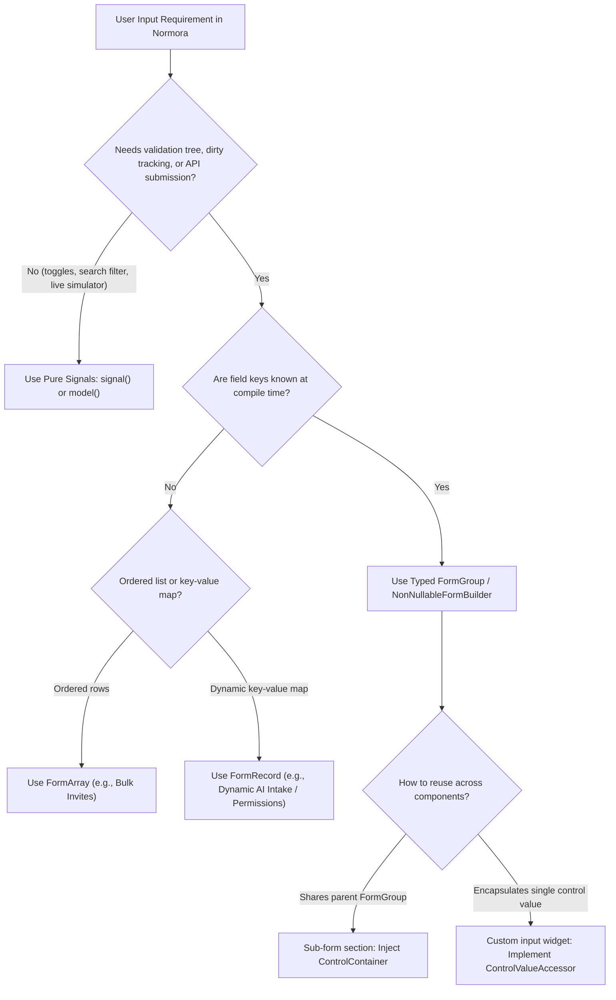
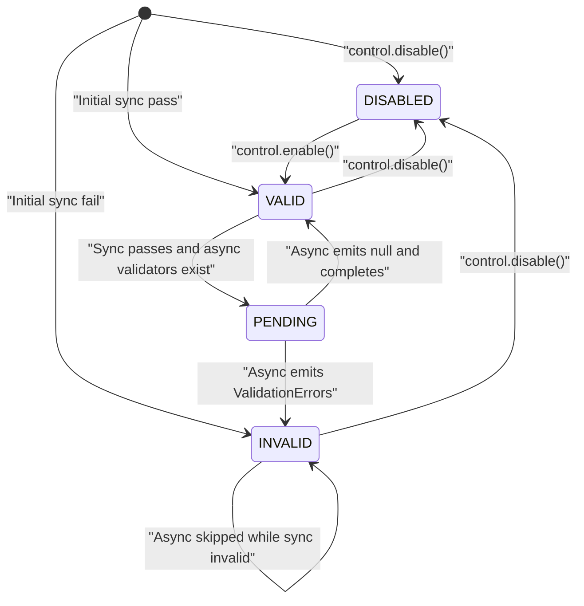
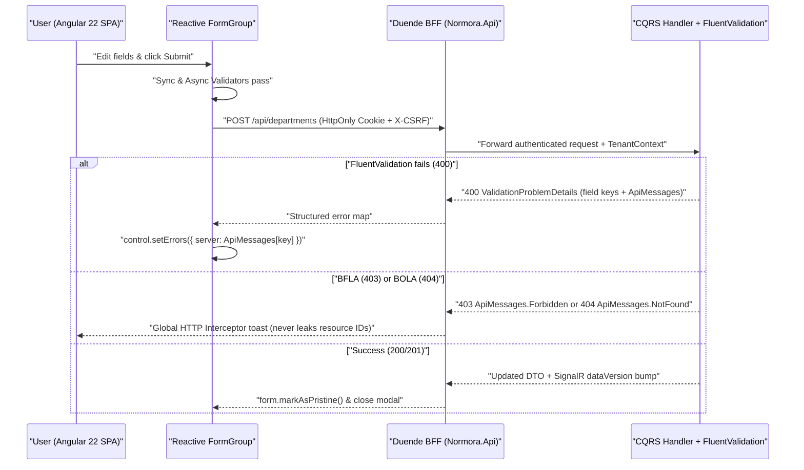

# Appendix 5: Forms & Validation Interview Questions

This section covers data entry and validation architecture in **Angular 22** (Zoneless change detection, Signals, `@if`/`@for`/`@switch`, Typed Reactive Forms, `FormRecord`, `ControlContainer`, `ControlValueAccessor`, and Custom/Async Validation), grounded in **Normora**'s Angular SPA + Duende BFF + .NET 10 FluentValidation stack.



---

## Junior Level Questions

### 1. What is the fundamental difference between Template-Driven Forms, Reactive Forms, and Pure Signals?
**Answer:**
* **Template-Driven Forms (`FormsModule`):** Rely on directives and two-way binding (`[(ngModel)]`) in HTML. Angular creates the underlying `FormControl` instances asynchronously during template compilation, making unit testing without DOM rendering brittle and cross-field validation awkward.
* **Reactive Forms (`ReactiveFormsModule`):** The form model (`FormControl`, `FormGroup`, `FormArray`, `FormRecord`) is explicitly built in TypeScript as a synchronous, strictly typed control tree. Value snapshots are returned as fresh objects, validation is composable, and unit tests run in pure TypeScript. This is the enterprise standard in Normora.
* **Pure Signals (`signal()` / `model()`):** In **Angular 22** with **zoneless change detection** (where Angular updates views directly from signal notifications instead of Zone.js monkey-patching browser events), simple UI inputs that do not require validation error trees, `dirty`/`pristine` tracking, or form reset lifecycles should use plain signals rather than `ReactiveFormsModule`.

**When NOT to use Reactive Forms (Normora examples):**
* **Copilot Persona Switcher (`Conversations`):** Switching between `All-Rounder`, `HR & People Ops`, `Finance & Travel`, and `IT & Security` is a single `signal()` selection, not a validated form.
* **`ExpenseSimulatorCardComponent` (`policy_limit_card`):** Location tier buttons and hotel-night steppers recompute allowance previews via `computed()` without submitting a form.
* **Copilot Thread Search Filter:** Filtering already-loaded conversation threads uses `searchQuery = signal('')` rather than `FormGroup`.
* **When you DO use Reactive Forms:** Normora's **Employee Invitation Modal** (`InviteEmployeeCommand`), **Document Upload Drawer** (`UploadDocumentCommand`), and **Workspace Branding Settings**.

### 2. What are the core building blocks of Reactive Forms?
**Answer:**
All form classes inherit from `AbstractControl` and track value, validation status, and interaction state:
1. **`FormControl<T>`:** Tracks a single input's value and validators (e.g., Normora's `tenantSlug` input or `retentionDays` field).
2. **`FormGroup`:** Tracks a fixed, compile-time-known object of named child controls (e.g., `CreateDepartmentCommand` with `name`, `description`, and `parentDepartmentId`).
3. **`FormArray`:** Tracks an ordered, dynamically sized list of controls or nested groups (e.g., Normora's Bulk Employee Invitation modal adding up to 25 `{ email, role }` rows).
4. **`FormRecord<TControl>`:** A specialized `FormGroup` introduced in Angular v14 where keys are added and removed dynamically at runtime, while every control shares the same value type (e.g., a department visibility matrix mapping dynamic `departmentId` UUIDs to `FormControl<boolean>`).

### 3. How do you disable a Reactive Form control, and why shouldn't you use `[disabled]` in HTML?
**Answer:**
Never bind the HTML `[disabled]` attribute on a Reactive Form element—Angular logs a warning (`NG01202` / changed-value warning) because Reactive Forms owns disabled status as part of the control's state machine (`status === 'DISABLED'`). Disabling via HTML creates a mismatch between the DOM and the TypeScript model, meaning validators still run on a control the user cannot edit.

Always control disabled state in TypeScript:
```typescript
// Normora example: Lock workspace slug after tenant provisioning,
// and disable currency selection if workspace is on the Free tier.
readonly tenantForm = this.fb.group({
  tenantSlug: [{ value: 'acme-corp', disabled: true }],
  currency: ['USD']
});

lockCurrencyForFreeTier(isFreeTier: boolean): void {
  const currencyCtrl = this.tenantForm.controls.currency;
  if (isFreeTier) {
    currencyCtrl.disable({ emitEvent: false });
  } else {
    currencyCtrl.enable({ emitEvent: false });
  }
}
```
Note that disabling a control **excludes its validators** from parent group validity and **excludes its key** from `form.value` (though `form.getRawValue()` still includes it).

### 4. How do `touched`, `dirty`, `pristine`, and `submitted` states improve UX in validation display?
**Answer:**
Showing red error borders the moment a modal opens frustrates users. Angular tracks interaction flags on every `AbstractControl`:
* **`pristine` / `dirty`:** `pristine` is `true` until the user changes the value in the UI (`dirty` becomes `true`). Calling `patchValue()` programmatically does *not* automatically mark a control `dirty`.
* **`untouched` / `touched`:** `touched` becomes `true` when the user focuses and then blurs out of the control (`onTouched`).
* **`submitted` (on `FormGroupDirective`):** Becomes `true` when the user submits the form (or when you call `form.markAllAsTouched()` on an invalid submit attempt).

**Normora Example (Tailwind v4 + Dark Mode):**
```html
@let nameCtrl = departmentForm.controls.name;
@let showNameError = nameCtrl.invalid && (nameCtrl.touched || nameCtrl.dirty || submitted());

<input
  formControlName="name"
  class="w-full rounded-lg border px-3 py-2 bg-white dark:bg-slate-900 text-slate-900 dark:text-slate-100"
  [class]="showNameError ? 'border-red-500! dark:border-red-400!' : 'border-slate-300 dark:border-slate-700'" />
```
*(Notice Tailwind CSS v4 uses the `!` modifier as a **suffix**, e.g., `border-red-500!`, never `!border-red-500`, and includes `dark:` variants for every color).*

---

## Mid-Level Questions

### 5. What is the difference between `form.value` and `form.getRawValue()`?
**Answer:**
This is a critical distinction in Reactive Forms:
* **`form.value`:** Returns an object containing only the values of **enabled** controls (`Partial<...>` when controls can be disabled). If a control is disabled, its key is completely omitted from the returned object.
* **`form.getRawValue()`:** Ignores the disabled state and returns the complete object containing **all** controls in the form group.

**Normora Example:**
In Normora's **Edit Employee Role** modal, the employee's `email` control is disabled so an admin cannot rewrite someone's OIDC identity email, while `role` (`'Admin' | 'Member'`) and `departmentId` remain editable. Submitting `this.editForm.value` omits `email`, failing backend FluentValidation; submitting `this.editForm.getRawValue()` sends the complete DTO.

### 6. What are Typed Forms (introduced in Angular v14), and how do they prevent runtime bugs?
**Answer:**
Prior to Angular v14, `form.value` returned `any`, so the TypeScript compiler could not catch mismatched assignments or misspelled property names. Typed Forms make `FormControl<T>`, `FormGroup<TControls>`, `FormArray<TControl>`, and `FormRecord<TControl>` strictly generic.

```typescript
// Normora Subscription Plan & Currency Form (matching TenantPlanPricingCatalog)
type SupportedCurrency = 'INR' | 'USD' | 'EUR' | 'GBP' | 'CAD' | 'AUD' | 'JPY' | 'SGD';
type BillingCycle = 'Monthly' | 'Annual';

const billingForm = new FormGroup({
  currency: new FormControl<SupportedCurrency>('USD', { nonNullable: true }),
  billingCycle: new FormControl<BillingCycle>('Annual', { nonNullable: true }),
  seatLimit: new FormControl<number>(25, { nonNullable: true })
});

// Compile-time error: Type '"BTC"' is not assignable to type 'SupportedCurrency'
// billingForm.patchValue({ currency: 'BTC' });
```
*(If migrating legacy untyped forms incrementally, Angular exports `UntypedFormGroup` / `UntypedFormControl` as temporary aliases for `any`, which should be avoided in new Normora features).*

### 7. What is `NonNullableFormBuilder`, and when should you keep a control nullable?
**Answer:**
By default, calling `form.reset()` sets controls to `null`, so `new FormControl('')` infers `FormControl<string | null>`. Injecting `NonNullableFormBuilder` (or passing `{ nonNullable: true }`) guarantees the control cannot become `null`—when `.reset()` is called, it reverts to its **initial default value**.

```typescript
private readonly fb = inject(NonNullableFormBuilder);

// Normora CreateDepartmentCommand form
readonly deptForm = this.fb.group({
  name: ['', [Validators.required, Validators.maxLength(80)]], // FormControl<string>
  // Keep genuinely optional foreign keys nullable so empty sends null, not ""
  parentDepartmentId: new FormControl<string | null>(null)
});
```
**When NOT to use `nonNullable: true`:** Keep optional foreign keys or optional dates (like Normora's `parentDepartmentId: string | null` or `expiresAt: Date | null`) nullable so the API receives `null` instead of an empty string `""` that fails `.NET` `Guid?` / `DateTime?` model binding.

### 8. How do you build a dynamic list of inputs with `FormArray` in Angular 22?
**Answer:**
Use a typed `FormArray`, bind `formArrayName` in the template, and iterate with Angular's `@for` control flow—**tracking by the control instance (`track row`) rather than `$index`**.

```typescript
// Normora Bulk Employee Invitation Form (InviteEmployeeCommand)
private readonly fb = inject(NonNullableFormBuilder);

readonly inviteForm = this.fb.group({
  invites: this.fb.array([this.createInviteRow()])
});

createInviteRow() {
  return this.fb.group({
    email: ['', [Validators.required, Validators.email]],
    role: ['Member' as 'Admin' | 'Member', [Validators.required]]
  });
}

addRow(): void {
  if (this.inviteForm.controls.invites.length < 25) {
    this.inviteForm.controls.invites.push(this.createInviteRow());
  }
}

removeRow(index: number): void {
  this.inviteForm.controls.invites.removeAt(index);
}
```
```html
<form [formGroup]="inviteForm" (ngSubmit)="submitInvites()">
  <div formArrayName="invites" class="space-y-3">
    @for (row of inviteForm.controls.invites.controls; track row; let i = $index) {
      <div [formGroupName]="i" class="flex flex-col sm:flex-row gap-2">
        <input
          formControlName="email"
          type="email"
          placeholder="colleague@company.com"
          class="flex-1 rounded-lg border border-slate-300 dark:border-slate-700 bg-white dark:bg-slate-900 text-slate-900 dark:text-slate-100 px-3 py-2" />
        <select
          formControlName="role"
          class="rounded-lg border border-slate-300 dark:border-slate-700 bg-white dark:bg-slate-900 text-slate-900 dark:text-slate-100 px-3 py-2">
          <option value="Member">Member</option>
          <option value="Admin">Admin</option>
        </select>
        <button type="button" (click)="removeRow(i)" class="text-red-600 dark:text-red-400">
          Remove
        </button>
      </div>
    }
  </div>
</form>
```
**Why `track row` matters:** If you use `track $index` and delete row `0`, Angular reuses DOM nodes by index, causing focus, native input state, and child component internal signals from row `1` to collide or desync. Tracking by the `FormGroup` object reference (`track row`) keeps DOM identity pinned to the exact control.

### 9. When should you use `FormRecord` instead of `FormGroup` or `FormArray`?
**Answer:**
Use `FormRecord<TControl>` when keys are **dynamic at runtime** (for example, UUIDs returned from an API) and every entry shares the **same control type**:
* **Use `FormRecord`:** Normora's **User Group Document Access Matrix**, where department UUIDs fetched from `workspace_list_departments` are dynamically registered as `FormControl<boolean>` toggles (`record.addControl(dept.id, new FormControl(false, { nonNullable: true }))`), or Normora's AI `intake_form_card` when field names come from a runtime JSON schema.
* **When NOT to use `FormRecord`:** Whenever keys are known at compile time (like `email`, `role`, `currency`), use `FormGroup` for exact property autocomplete and compile-time checks. Whenever order/indexing matters over key lookup, use `FormArray`.

---

## Senior Level Questions

### 10. Explain how to write a Custom Synchronous Validator cleanly.
**Answer:**
A custom synchronous validator is a `ValidatorFn` that accepts an `AbstractControl` and returns a `ValidationErrors` object (error key -> metadata) if invalid, or `null` if valid.

**Two best practices interviewers look for:**
1. **Do not duplicate `Validators.required`:** If a control value is `null`, `undefined`, or `''`, return `null` so optional fields still pass (unless the validator's explicit job is forbidding whitespace-only required text).
2. **Return structured keys, not hardcoded UI prose:** Keep messages in Normora's centralized `ApiMessages` (`client/src/app/core/constants/api-messages.ts`) rather than baking magic strings into validators.

```typescript
// Normora example: Enforce lowercase kebab-case workspace slug (normora.app/acme-corp)
export function tenantSlugValidator(): ValidatorFn {
  const slugPattern = /^[a-z0-9]+(?:-[a-z0-9]+)*$/;

  return (control: AbstractControl): ValidationErrors | null => {
    const raw = control.value;
    if (typeof raw !== 'string' || raw.length === 0) {
      return null; // Let Validators.required handle empty values
    }

    const trimmed = raw.trim();
    if (trimmed !== raw) {
      return { whitespacePadding: true };
    }

    return slugPattern.test(raw) ? null : { invalidSlug: { value: raw } };
  };
}
```
In the template, map `{ invalidSlug }` to `ApiMessages.InvalidTenantSlug` instead of hardcoding error copy.

### 11. Explain how to write an Asynchronous Validator (e.g., workspace slug availability in Normora).
**Answer:**
An `AsyncValidatorFn` returns `Promise<ValidationErrors | null>` or `Observable<ValidationErrors | null>` and is passed as the **third** argument (or `asyncValidators` option) on `FormControl`.

**Critical rules:**
1. **Sync validators run first:** Angular will **not** invoke async validators while synchronous validators fail, saving unnecessary API calls.
2. **The Observable MUST complete:** If you use an endless stream (like a `Subject` or `timer` without `first()`/`take(1)`), the control stays stuck in `status === 'PENDING'` forever.
3. **Catch HTTP errors gracefully:** Returning `of(null)` on transient network errors prevents breaking the validation pipeline (let submission or toast handling report connectivity issues).

```typescript
// Normora example: Check if workspace slug is available via Duende BFF proxy
export function slugAvailableValidator(tenantApi: TenantApiService): AsyncValidatorFn {
  return (control: AbstractControl): Observable<ValidationErrors | null> => {
    const slug = control.value;
    if (typeof slug !== 'string' || slug.length < 3) {
      return of(null);
    }

    return timer(350).pipe(
      switchMap(() => tenantApi.checkSlugAvailable(slug)),
      map(res => (res.available ? null : { slugTaken: true })),
      catchError(() => of(null)),
      first() // Guarantees completion so control exits PENDING
    );
  };
}

// Usage:
readonly slugControl = new FormControl('', {
  nonNullable: true,
  validators: [Validators.required, Validators.minLength(3), tenantSlugValidator()],
  asyncValidators: [slugAvailableValidator(this.tenantApi)]
});
```

### 12. Why is `updateOn: 'blur'` critical for performance when using Async Validators, and when should you NOT use it?
**Answer:**
By default, `FormControl` uses `updateOn: 'change'`, triggering validation on every keystroke. Typing `"acme-enterprise"` fires 15 validation cycles. While RxJS `timer(350)` + Angular's built-in cancellation of previous pending async validators reduces server load, `{ updateOn: 'blur' }` eliminates intermediate requests altogether until the user leaves the field.



**When NOT to use `updateOn: 'blur'`:**
* Do **not** use `'blur'` on fields with live synchronous feedback (like a password strength indicator, character counter, or live search/filter input) where users expect immediate updates before tabbing out.
* Note that with `updateOn: 'blur'`, clicking a "Submit" button directly while focused inside the input *does* trigger blur first, or you can use `updateOn: 'submit'` if validation should only run on form submission.

### 13. How do you implement Cross-Field Validation without introducing subtle `setErrors()` bugs?
**Answer:**
Cross-field validation requires inspecting sibling controls, so the validator must be attached to the **parent `FormGroup`** (never an individual child `FormControl`).

**Why manually calling `child.setErrors({ mismatch: true })` inside a group validator is a classic bug:**
1. Calling `confirm.setErrors({ mismatch: true })` **overwrites** all existing errors on `confirm` (such as `Validators.required` or `minLength`).
2. When the fields later match and the group validator returns `null`, Angular does **not** automatically remove `{ mismatch: true }` from the child control—meaning `confirm` stays `INVALID` permanently unless you manually merge and strip only that specific key!

**Recommended Clean Pattern (Keep the error on the parent `FormGroup`):**
```typescript
// Normora Document Retention Policy: expiresAt must be after effectiveFrom
export const retentionWindowValidator: ValidatorFn = (group: AbstractControl): ValidationErrors | null => {
  const effectiveFrom = group.get('effectiveFrom')?.value as Date | null;
  const expiresAt = group.get('expiresAt')?.value as Date | null;

  if (!effectiveFrom || !expiresAt) {
    return null;
  }

  return expiresAt > effectiveFrom ? null : { invalidDateRange: true };
};

readonly retentionForm = this.fb.group(
  {
    effectiveFrom: new FormControl<Date | null>(null, [Validators.required]),
    expiresAt: new FormControl<Date | null>(null)
  },
  { validators: retentionWindowValidator }
);
```
In the template, check `@if (retentionForm.hasError('invalidDateRange') && retentionForm.controls.expiresAt.touched)` so sibling control errors remain untouched and auto-clear cleanly. *(If a UI component strictly requires child-level error highlighting, read both `child.errors` and `group.hasError('invalidDateRange')` in a `computed()` signal rather than mutating `child.setErrors()`).*

### 14. How do you bridge Reactive Forms with Angular 22 Signals and Zoneless Change Detection?
**Answer:**
In a **zoneless** Angular 22 app, plain properties and manual subscriptions that forget `ChangeDetectorRef.markForCheck()` can leave the UI stale. Angular v18+ introduced **`AbstractControl.events`**, a unified observable emitting typed `ControlEvent` instances (`ValueChangeEvent`, `StatusChangeEvent`, `TouchedChangeEvent`, `PristineChangeEvent`, `FormResetEvent`, `FormSubmittedEvent`).

Combining `control.events` (or `valueChanges`) with `toSignal()` and `takeUntilDestroyed()` bridges Reactive Forms into the Signal graph cleanly with zero manual `.unsubscribe()` boilerplate:

```typescript
// Normora Document Upload Drawer: Live Signal-driven upload readiness & unsaved-changes guard
@Component({ /* ... */ })
export class DocumentUploadDrawerComponent {
  private readonly fb = inject(NonNullableFormBuilder);

  readonly uploadForm = this.fb.group({
    title: ['', [Validators.required]],
    retentionDays: [365, [Validators.min(30)]]
  });

  // React to value, status, dirty, and touched events as a single Signal
  private readonly formState = toSignal(
    this.uploadForm.events.pipe(
      map(() => ({
        status: this.uploadForm.status,
        dirty: this.uploadForm.dirty,
        titleLength: this.uploadForm.controls.title.value.length
      }))
    ),
    {
      initialValue: {
        status: this.uploadForm.status,
        dirty: this.uploadForm.dirty,
        titleLength: 0
      }
    }
  );

  readonly canSubmit = computed(() => this.formState().status === 'VALID');
  readonly hasUnsavedChanges = computed(() => this.formState().dirty);
}
```
Notice how `canSubmit()` and `hasUnsavedChanges()` automatically notify zoneless templates and `CanDeactivate` route guards without `Zone.js` or `async` pipes.

### 15. When should you use `ControlContainer` vs `ControlValueAccessor` (`CVA`) for reusable form components?
**Answer:**
Both let you break large forms into smaller components, but they solve **opposite** architectural problems:

| Aspect | `ControlContainer` | `ControlValueAccessor` (`CVA`) |
|---|---|---|
| **Purpose** | Split a large `FormGroup` into modular sub-form UI sections | Wrap a single custom input widget (`<app-department-picker>`) as a `FormControl` |
| **Ownership** | Child component **reads** the parent's `FormGroup` directly | Parent treats child as an opaque single value (`formControlName="departmentIds"`) |
| **Boilerplate** | Very low (`viewProviders` + `inject(ControlContainer)`) | Medium (4 interface methods + `NG_VALUE_ACCESSOR` provider) |
| **Normora Example** | `<app-branding-section>` inside Workspace Settings | `<app-brand-color-picker>` or `<app-department-picker>` |

**`ControlContainer` Example (Normora Workspace Settings Sub-Section):**
```typescript
@Component({
  selector: 'app-branding-section',
  standalone: true,
  imports: [ReactiveFormsModule],
  viewProviders: [
    { provide: ControlContainer, useExisting: FormGroupDirective }
  ],
  template: `
    <div formGroupName="branding" class="space-y-4">
      <input formControlName="workspaceDisplayName" />
      <input formControlName="primaryHexColor" />
    </div>
  `
})
export class BrandingSectionComponent {}
```
**When NOT to use either:** If a custom widget does not participate in `ReactiveFormsModule` (e.g., Normora's `ExpenseSimulatorCardComponent` steppers), use Angular's `model()` signal for two-way binding instead of CVA boilerplate.

### 16. How do you map Backend FluentValidation and BFF errors (`400`, `403`, `404`) back onto Angular Reactive Forms?
**Answer:**
Normora routes every browser API request through the **Duende BFF** (`Normora.Api`) using encrypted `HttpOnly`, `SameSite=Strict` cookies and anti-CSRF headers, backed by `.NET 10` CQRS handlers with `FluentValidation` (`{OperationName}CommandValidator.cs`) and `ApiMessages` constants.



**Mapping server field errors without locking the field permanently:**
1. Attach `{ server: errorMessage }` to the matching control via `control.setErrors({ server: msg })` and call `control.markAsTouched()`.
2. Because `setErrors({ server })` clears automatically **only** when the control's validators re-run on value change (or if you subscribe once to `control.valueChanges` with `take(1)` to clear `server` errors), ensure editing the field clears the server error immediately.
3. Never display raw backend exception strings (`exception.Message`); map unknown/global errors to `ApiMessages.GenericError` from `client/src/app/core/constants/api-messages.ts`.

---

## Architect Level Questions

### 17. In a massive enterprise form (e.g., Normora's multi-step Workspace Onboarding Wizard), how do you prevent `valueChanges` stuttering and state corruption?
**Answer:**
When a monolithic 150-field `FormGroup` listens to root `valueChanges`, every single keystroke bubbles from the nested child up to the root, triggering cross-field checks, draft persistence, and unnecessary template evaluations.

**Architectural fixes for Angular 22:**
1. **Never store `FormGroup` instances in an NgRx Store or global mutable store:** `FormGroup` instances are mutable class trees with circular control references—putting them in NgRx violates strict immutability/serializability runtime checks. Instead, store **plain serializable DTO state** in a Signal Store (or service `signal()`), and let each wizard step own a small, isolated `FormGroup` that hydrates on mount and commits on "Next".
2. **Lazy-load off-screen wizard steps with `@defer`:** Only instantiate heavy steps (like Normora's Document Retention & Department Permission Matrix) when the step becomes active.
3. **Debounce and suppress loops:** Pipe draft auto-save streams through `debounceTime(300)` + `distinctUntilChanged()`, and pass `{ emitEvent: false }` whenever calling `patchValue()` from SignalR `dataVersion` sync events or store hydration.
4. **Zoneless + `OnPush`:** Pair `ChangeDetectionStrategy.OnPush` (or zoneless mode) with `toSignal()` so changing one step field only updates the affected DOM nodes.

### 18. How do you architect Schema-Driven Dynamic Forms & Conditional Validation (like Normora's AI `intake_form_card`)?
**Answer:**
In Normora's `Conversations` module, when an agent tool (`workspace_request_form`) needs missing parameters from the user, the backend streams an `intake_form_card` JSON schema. The Angular SPA must dynamically build a `FormGroup` / `FormRecord`, apply conditional validators, and render Tailwind v4 controls safely.

**Key architectural patterns:**
1. **Dynamic Schema Factory Service:** Map each schema field descriptor (`text`, `number`, `date`, `select`) to a typed `FormControl` with corresponding Angular `Validators` (`required`, `min`, `maxLength`, `pattern`).
2. **Safe Conditional Validation (avoiding infinite `valueChanges` loops):** Suppose selecting `expenseCategory === 'Travel'` makes `hotelNights` required. When updating validators dynamically inside a reactive listener:
   ```typescript
   // Inside a constructor/init using takeUntilDestroyed()
   categoryCtrl.valueChanges.pipe(takeUntilDestroyed()).subscribe(category => {
     if (category === 'Travel') {
       nightsCtrl.setValidators([Validators.required, Validators.min(1)]);
     } else {
       nightsCtrl.clearValidators();
     }
     // CRITICAL: emitEvent: false prevents triggering parent valueChanges in an infinite loop!
     nightsCtrl.updateValueAndValidity({ emitEvent: false });
   });
   ```
3. **Declarative Template Rendering with `@switch`:** Render each schema field cleanly using `@for (field of schemaFields(); track field.key)` and `@switch (field.type)`, applying `dark:` variants and `border-red-500!` error styling consistently.

### 19. You are building a reusable custom form component (like Normora's `<app-department-picker>`). How does `ControlValueAccessor` work, and when should you avoid it?
**Answer:**
Implementing `ControlValueAccessor` (`CVA`) and registering `NG_VALUE_ACCESSOR` lets any standalone Angular component act as a native form control with `formControlName`, `[formControl]`, `disabled`, and `touched` tracking.

```typescript
@Component({
  selector: 'app-department-picker',
  standalone: true,
  providers: [
    {
      provide: NG_VALUE_ACCESSOR,
      useExisting: forwardRef(() => DepartmentPickerComponent),
      multi: true
    }
  ],
  template: `<!-- Tailwind v4 + dark: searchable dropdown -->`
})
export class DepartmentPickerComponent implements ControlValueAccessor {
  readonly selectedIds = signal<string[]>([]);
  readonly isDisabled = signal(false);

  private onChange: (value: string[]) => void = () => {};
  private onTouched: () => void = () => {};

  writeValue(ids: string[] | null): void {
    this.selectedIds.set(ids ?? []);
  }
  registerOnChange(fn: (value: string[]) => void): void {
    this.onChange = fn;
  }
  registerOnTouched(fn: () => void): void {
    this.onTouched = fn;
  }
  setDisabledState(disabled: boolean): void {
    this.isDisabled.set(disabled);
  }

  toggleDepartment(id: string): void {
    if (this.isDisabled()) return;
    this.selectedIds.update(curr =>
      curr.includes(id) ? curr.filter(x => x !== id) : [...curr, id]
    );
    this.onChange(this.selectedIds());
    this.onTouched();
  }
}
```
**When NOT to implement `ControlValueAccessor`:**
* **Multi-field form sections:** Use `ControlContainer` instead of wrapping 10 fields inside one giant CVA object.
* **Non-form interactive components:** Use `model<T>()` (Signal two-way binding) when you don't need `Validators`, `touched`, or `FormGroup` integration.

### 20. From a security perspective, what can go wrong if a team relies solely on Angular Reactive Forms validation in Normora?
**Answer:**
Client-side Angular validation (`Validators`, `control.disable()`, hidden inputs) is strictly a **UX convenience**, never a security boundary. Any user can inspect DevTools, re-enable DOM inputs, or `curl` the BFF endpoint directly with tampered JSON.

**Normora's Defense-in-Depth rules:**
1. **Never trust client `tenantId` or `userId` in form payloads:** `TenantResolutionMiddleware` and `currentUser.ExternalUserId` derive tenant and user identity exclusively from the BFF's encrypted session cookie and verified OIDC claims—never from a hidden `FormControl`.
2. **Enforce Domain Invariants on the Server:** Even if the UI hides cancellation controls on the `Free` tier, `CancelSubscriptionCommandHandler` enforces the invariant and rejects tampering with `ApiMessages.CannotCancelFreePlan`.
3. **BOLA & BFLA Enforcement:** If a tampered form submits a `departmentId` or `documentId` belonging to another tenant, the backend throws `BolaException` (`404 Not Found`) or `BflaException` (`403 Forbidden`), preventing resource enumeration.
4. **File Upload Validation (`UploadDocumentCommand`):** Checking `.pdf` extension or `file.size` in an Angular validator improves UX, but the backend must still verify MIME signatures/magic bytes and enforce plan storage quotas before writing to MinIO and inserting the `DocumentProcessingOutboxMessage`.
5. **XSS Protection:** Never pass user-entered form values (like department descriptions or AI prompt text) into `[innerHTML]`; rely on Angular's built-in template escaping.

### 21. How do you unit test Reactive Forms, Custom Validators, and `ControlValueAccessor` components cleanly in Angular 22 (Vitest)?
**Answer:**
Because Reactive Forms live in TypeScript rather than the DOM, 80% of form logic should be tested as **fast pure TypeScript unit tests** without `TestBed`:
* **Form Factories & Validators:** Instantiate the `FormGroup` or call `tenantSlugValidator()(new FormControl('Bad Slug!'))` directly and assert `.valid`, `.errors`, and `.getRawValue()` in microseconds.
* **Async Validators:** Mock `TenantApiService` returning `of({ available: false })`, advance virtual timers (e.g., `vi.useFakeTimers()` in Vitest when testing `timer(350)`), and assert `control.errors` equals `{ slugTaken: true }`.
* **`ControlValueAccessor` & Templates:** Use `TestBed` with a minimal host wrapper component (`<app-department-picker [formControl]="ctrl" />`) to verify that `ctrl.setValue(['dept-1'])` updates the rendered UI (`writeValue`), user clicks call `onChange` and update `ctrl.value`, and `ctrl.disable()` disables UI buttons (`setDisabledState`).

---

## Common Mistakes & Anti-Patterns

> [!CAUTION]
> **1. Calling `child.setErrors()` inside a Cross-Field Group Validator**
> ```typescript
> // WRONG: Overwrites child's own Validators.required and never clears when fixed!
> if (pw.value !== confirm.value) {
>   confirm.setErrors({ mismatch: true });
>   return { mismatch: true };
> }
> ```
> **Why it's wrong:** `setErrors()` wipes out all other validation errors on `confirm` and sticks permanently even after the passwords match.
> **Fix:** Return `{ mismatch: true }` on the parent `FormGroup` only, and display the error in the template using `@if (form.hasError('mismatch') && form.controls.confirmPassword.touched)`.

> [!CAUTION]
> **2. Using HTML `[disabled]` or `[(ngModel)]` alongside `formControlName`**
> ```html
> <!-- WRONG: Fights Reactive Forms state machine -->
> <input formControlName="tenantSlug" [disabled]="isProvisioned()" />
> ```
> **Why it's wrong:** Reactive Forms controls DOM disabled state via the `AbstractControl` (`DISABLED` status). Using `[disabled]` causes Angular warnings and leaves validators active on a frozen input.
> **Fix:** Call `this.form.controls.tenantSlug.disable({ emitEvent: false })` in TypeScript.

> [!CAUTION]
> **3. Submitting `form.value` when controls can be disabled**
> ```typescript
> // WRONG: Silently drops disabled controls (e.g., locked email or currency)
> this.api.updateEmployee(this.editForm.value);
> ```
> **Why it's wrong:** `form.value` omits disabled keys, causing `FluentValidation` 400 errors or accidental null overwrites on the backend.
> **Fix:** Use `this.editForm.getRawValue()` when constructing API payloads.

> [!CAUTION]
> **4. Using `track $index` in `@for` over `FormArray.controls`**
> ```html
> <!-- WRONG: Causes focus & child state corruption when deleting rows -->
> @for (row of invites.controls; track $index; let i = $index) {
>   <div [formGroupName]="i">...</div>
> }
> ```
> **Why it's wrong:** Removing row `0` shifts indices, causing Angular to reuse row `0`'s DOM/signals for row `1`.
> **Fix:** Always track by the control reference: `@for (row of invites.controls; track row; let i = $index)`.

> [!CAUTION]
> **5. Triggering `valueChanges` infinite loops or memory leaks**
> ```typescript
> // WRONG: Infinite loop + unsubscribed leak on component destroy
> this.form.controls.category.valueChanges.subscribe(val => {
>   this.form.controls.nights.updateValueAndValidity(); // Re-emits parent valueChanges!
> });
> ```
> **Why it's wrong:** Calling `updateValueAndValidity()` or `patchValue()` inside a `valueChanges` subscription without `{ emitEvent: false }` can trigger recursive emission loops, and missing `takeUntilDestroyed()` leaks memory.
> **Fix:** Pipe with `takeUntilDestroyed()`, pass `{ emitEvent: false }`, and prefer `toSignal()` + `computed()` in Angular 22.

> [!CAUTION]
> **6. Hardcoding error strings or using Tailwind v3 `!` prefix syntax**
> ```html
> <!-- WRONG: Magic string + Tailwind v3 !prefix + missing dark: variant -->
> <p class="!text-red-500 border !border-red-500">Invalid workspace slug!</p>
> ```
> **Why it's wrong:** Violates Normora's zero-magic-strings rule (`ApiMessages`), breaks Tailwind CSS v4 (which requires `!` as a suffix), and fails dark mode contrast.
> **Fix:** Use `ApiMessages` constants and Tailwind v4 suffix + `dark:` variants:
> ```html
> <p class="text-red-600! dark:text-red-400!">{{ apiMessages.InvalidTenantSlug }}</p>
> ```
