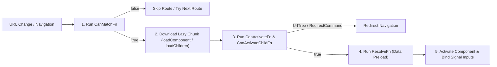
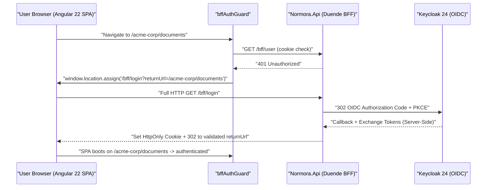

# Appendix 6: Routing & Guards Interview Questions

This section covers the Angular 22 Router (`@angular/router`), focusing on zoneless configuration with `provideRouter`, bundle optimization via Lazy Loading and custom Preloading, modern Functional Route Guards and Resolvers, Signal Input Binding, and enterprise multi-tenant BFF architectures using **Normora** as the reference platform.

---

## Junior Level Questions

### 1. What is the Angular Router and how do you define routes in Angular 22?
**Answer:**
The Angular Router (`@angular/router`) maps browser URLs to component trees so users can navigate between views in a Single Page Application (SPA) without full-page reloads. In standalone Angular 22, routes are configured as a typed `Routes` array and registered in `app.config.ts` with `provideRouter(...)` alongside `provideZonelessChangeDetection()`.

- **When NOT to use the Angular Router:** Never use `router.navigate()` or `routerLink` for server-owned HTTP redirects like Normora's Duende BFF endpoints (`/bff/login`, `/bff/logout`), external payment gateway POSTs (PayU), or binary file downloads from MinIO. Use `<a href="...">` or `window.location.assign(...)` instead.

**Normora Example:**
```typescript
// client/src/app/app.routes.ts
import { Routes } from '@angular/router';

export const routes: Routes = [
  {
    path: 'onboarding',
    loadComponent: () =>
      import('./features/onboarding/onboarding.component').then(m => m.OnboardingComponent),
  },
  {
    path: ':tenantSlug/documents',
    loadComponent: () =>
      import('./features/documents/documents-page.component').then(m => m.DocumentsPageComponent),
  },
  { path: '', redirectTo: '/onboarding', pathMatch: 'full' },
  {
    path: '**',
    loadComponent: () =>
      import('./shared/pages/not-found.component').then(m => m.NotFoundComponent),
  },
];
```

### 2. Why is `pathMatch: 'full'` required on empty path redirects?
**Answer:**
By default, the Angular Router uses `pathMatch: 'prefix'`, checking whether the requested URL *starts with* the route's `path`. Because every URL string starts with `''` (empty string), a redirect route like `{ path: '', redirectTo: '/onboarding' }` without `pathMatch: 'full'` would match `/acme-corp/documents` and `/invitations/accept` and redirect *every* request (or cause an infinite redirect loop). Setting `pathMatch: 'full'` ensures the redirect triggers only when the remaining unmatched URL is completely empty.

**Normora Example:**
Inside Normora's workspace shell (`path: ':tenantSlug'`), `{ path: '', redirectTo: 'chat', pathMatch: 'full' }` redirects `/acme-corp` to `/acme-corp/chat` without hijacking `/acme-corp/documents` or `/acme-corp/admin/billing`.

### 3. How do you pass and read data in the URL (Route Parameters vs. Query Parameters)?
**Answer:**
- **Route (Path) Parameters** identify a specific resource in the path hierarchy using a colon (`:`), such as `:tenantSlug` or `:documentId`.
- **Query Parameters** (`?mode=hybrid&page=2`) represent optional filtering, sorting, or pagination state.

In Angular 22, enabling `withComponentInputBinding()` in `provideRouter(...)` binds path parameters, query parameters, and resolved data directly to component Signal `input()`s—eliminating manual `ActivatedRoute` subscriptions.

**Normora Example:**
```typescript
// Route: { path: ':tenantSlug/documents/:documentId', component: DocumentDetailComponent }
// URL:   /acme-corp/documents/doc-94a1?mode=hybrid
import { Component, input } from '@angular/core';

@Component({
  standalone: true,
  template: `
    <section class="p-6 bg-white dark:bg-slate-900 text-slate-900 dark:text-slate-100">
      <h1 class="text-xl font-semibold">Document {{ documentId() }}</h1>
      <p class="text-sm text-slate-500 dark:text-slate-400">
        Workspace: {{ tenantSlug() }} | Search Mode: {{ mode() ?? 'semantic' }}
      </p>
    </section>
  `,
})
export class DocumentDetailComponent {
  readonly tenantSlug = input.required<string>();
  readonly documentId = input.required<string>();
  readonly mode = input<string>();
}
```

---

## Mid-Level Questions

### 4. What is Lazy Loading, and how do you implement it in modern Standalone Angular?
**Answer:**
Lazy Loading splits your application into separate JavaScript chunks at build time so the browser downloads feature code only when the user navigates to that route. This keeps the initial bundle small and improves Largest Contentful Paint (LCP) and Time to Interactive (TTI).

In standalone Angular (no `NgModule`s), you use:
- **`loadComponent`**: Dynamically imports a single standalone component.
- **`loadChildren`**: Dynamically imports a child `Routes` array for an entire feature area.

**Normora Example:**
Standard employees in Normora rarely visit workspace billing or audit logs, so the entire Admin branch is lazy-loaded via `loadChildren`:
```typescript
// client/src/app/app.routes.ts (inside ':tenantSlug' children)
{
  path: 'admin',
  canMatch: [workspaceAdminMatchGuard],
  loadChildren: () =>
    import('./features/admin/admin.routes').then(m => m.ADMIN_ROUTES),
}
```

### 5. What are Route Guards and Resolvers, and what are the five functional primitives?
**Answer:**
Route Guards and Resolvers are functions registered on a `Route` configuration that control whether navigation can proceed, leave, or preload data:
1. **`CanMatchFn` (`canMatch`)**: Runs *before* the route is matched or its lazy chunk is downloaded. Returns `boolean | UrlTree | RedirectCommand` (or `Observable`/`Promise` thereof).
2. **`CanActivateFn` (`canActivate`)**: Runs after the route matches to allow, deny, or redirect entry to a route.
3. **`CanActivateChildFn` (`canActivateChild`)**: Protects all child routes under a parent layout route without repeating `canActivate` on every child.
4. **`CanDeactivateFn<T>` (`canDeactivate`)**: Runs before leaving a route—commonly used to warn about unsaved edits.
5. **`ResolveFn<T>` (`resolve`)**: Fetches required data before the route activates and attaches it to `ActivatedRouteSnapshot.data` (or binds it directly to a Signal `input()`).

*(Note: `CanLoad` was deprecated and replaced by `CanMatchFn`.)*

**Normora Examples:**
- `canMatch`: `workspaceAdminMatchGuard` prevents non-admins from even downloading the `admin` chunk (which contains PayU billing UI).
- `canActivate`: `bffAuthGuard` verifies the Duende BFF session before entering `/:tenantSlug`.
- `canActivateChild`: `tenantMembershipChildGuard` checks `TenantSessionStore` permissions on every child route (`chat`, `documents`, `admin`).
- `canDeactivate`: `unsavedBrandingGuard` prompts an admin before leaving `/admin/branding` with unsaved logo/theme changes.
- `resolve`: `tenantContextResolver` ensures workspace branding and `TenantId` metadata are hydrated before `WorkspaceShellComponent` renders.

### 6. Explain Functional Route Guards (`CanActivateFn`, `RedirectCommand`) and when to use `UrlTree` vs. external redirects.
**Answer:**
Introduced in Angular v15, functional guards replace verbose `@Injectable()` guard classes with plain TypeScript functions that access DI services via `inject()`. They compose easily (for example, guard factories accepting parameters) and tree-shake cleanly.

For redirects inside the SPA:
- Return a **`UrlTree`** (`router.createUrlTree(['/', tenantSlug, 'forbidden'])`) to redirect declaratively without mutating browser history unpredictably.
- Return a **`RedirectCommand`** (Angular v18+) when you need `NavigationBehaviorOptions` such as `replaceUrl: true` or `skipLocationChange: true` alongside a `UrlTree`.
- For **external/server endpoints** (such as Normora's `/bff/login`), never return a `UrlTree`—trigger `window.location.assign(...)` and return `false` so the Angular Router cancels client-side navigation while the browser performs the full HTTP handshake.

**Normora Example (Parameterized Role Guard Factory):**
```typescript
// client/src/app/core/guards/workspace-role.guard.ts
import { inject } from '@angular/core';
import { CanActivateFn, RedirectCommand, Router } from '@angular/router';
import { TenantSessionStore } from '../stores/tenant-session.store';

export const requireWorkspaceRole = (allowedRoles: readonly string[]): CanActivateFn => {
  return (route) => {
    const session = inject(TenantSessionStore);
    const router = inject(Router);
    const tenantSlug = route.paramMap.get('tenantSlug') ?? '';

    if (session.hasAnyRole(allowedRoles)) {
      return true;
    }

    // Redirect unauthorized users cleanly without polluting Back history
    const fallback = router.createUrlTree(['/', tenantSlug, 'forbidden']);
    return new RedirectCommand(fallback, { replaceUrl: true });
  };
};
```

### 7. When should you use a Route Resolver (`ResolveFn`) versus component-level Signal fetching?
**Answer:**
A **`ResolveFn`** blocks route activation until its `Promise` or `Observable` emits. That prevents layout flash when the shell cannot render meaningfully without the data, **but** if the API call is slow, the user sees a frozen screen unless you render a global progress bar.

**Component-level fetching** (via Signals, `httpResource`, or service calls combined with `@if` skeletons and `@defer`) activates the route immediately so the user gets instant visual feedback.

- **Use `ResolveFn` when:** Child components and title strategies strictly depend on the payload (e.g., Normora's `tenantContextResolver` loading workspace name, theme colors, and role flags before rendering `WorkspaceShellComponent`).
- **Do NOT use `ResolveFn` when:** Loading long lists, secondary panels, or streaming AI responses. In Normora's `/acme-corp/chat/:conversationId` and `/acme-corp/documents`, the page activates immediately with Tailwind skeleton loaders (`bg-slate-200 dark:bg-slate-800 animate-pulse`) while `DocumentsStore` or SignalR/SSE streams load asynchronously.

---

## Senior Level Questions

### 8. What is `withComponentInputBinding()`, and what happens with nested parent route parameters like `/:tenantSlug`?
**Answer:**
Introduced in Angular v16, `withComponentInputBinding()` instructs the Router to automatically bind URL path parameters, query parameters, static route `data`, and resolved `resolve` values directly to Signal `input()`s (or legacy `@Input()`s) on the routed component—eliminating `ActivatedRoute` boilerplate.

**Critical Gotcha (`paramsInheritanceStrategy`):** By default (`'emptyOnly'`), child routes only inherit parameters from parent routes that have an empty path (`path: ''`) or no component. If `:tenantSlug` is declared on a parent layout route (`{ path: ':tenantSlug', component: WorkspaceShellComponent, children: [...] }`), child components like `DocumentDetailComponent` will receive `undefined` for `tenantSlug` unless you configure `withRouterConfig({ paramsInheritanceStrategy: 'always' })`.

**Normora Example:**
```typescript
// app.config.ts
provideRouter(
  routes,
  withComponentInputBinding(),
  withRouterConfig({ paramsInheritanceStrategy: 'always' }),
);

// Route: :tenantSlug/documents/:documentId?highlightChunk=c-19
export class DocumentDetailComponent {
  readonly tenantSlug = input.required<string>();     // Inherited from parent route
  readonly documentId = input.required<string>();     // From child route
  readonly highlightChunk = input<string>();          // From query params
  readonly tenantInfo = input.required<TenantInfo>(); // From parent resolve: { tenantInfo }
}
```

### 9. Explain the danger of hanging navigation in Route Guards that return Observables, and how to handle async BFF session hydration.
**Answer:**
When a Route Guard returns an `Observable<boolean | UrlTree | RedirectCommand>`, the Angular Router subscribes to it and waits for the **first emission** (and/or completion depending on the stream behavior; specifically, if a stream never emits or never completes cleanly, navigation stays pending). Returning an uncompleted `BehaviorSubject` or `ReplaySubject` that hasn't settled—or an infinite stream before an async auth check finishes—can either evaluate stale initial state (`false`) immediately or freeze navigation indefinitely.

**Solution:** Wait until the session state settles, then take exactly one value using `filter(...)` + `take(1)` (or convert to a `Promise` with `firstValueFrom`).

**Normora Example (Waiting for Duende BFF `/bff/user` Hydration on Cold Reload):**
```typescript
// client/src/app/core/guards/bff-auth.guard.ts
import { inject } from '@angular/core';
import { toObservable } from '@angular/core/rxjs-interop';
import { CanActivateFn } from '@angular/router';
import { filter, map, take } from 'rxjs';
import { BffAuthStore } from '../stores/bff-auth.store';

export const bffAuthGuard: CanActivateFn = (_route, state) => {
  const authStore = inject(BffAuthStore);

  // Trigger /bff/user check once if not yet initialized
  authStore.ensureInitialized();

  return toObservable(authStore.status).pipe(
    filter(status => status !== 'loading'),
    take(1),
    map(status => {
      if (status === 'authenticated') return true;
      const returnUrl = encodeURIComponent(state.url);
      window.location.assign(`/bff/login?returnUrl=${returnUrl}`);
      return false;
    }),
  );
};
```

### 10. What is a Preloading Strategy, why is `PreloadAllModules` dangerous in enterprise apps, and how do you build a role-aware strategy?
**Answer:**
A **Preloading Strategy** instructs the Angular Router to download lazy-loaded JavaScript chunks in the background *after* the initial route has rendered and the browser is idle, removing navigation latency when the user clicks a link later.

- **Why NOT to use `PreloadAllModules` blindly:** In enterprise SaaS apps like Normora, `PreloadAllModules` eagerly downloads *every* lazy chunk—including Admin Billing (`PayU`), Audit Logs, and heavy Markdown/PDF viewers—even for a read-only employee on a slow mobile network. Worse, unlike the deprecated `CanLoad`, **`CanMatch` does NOT automatically stop `PreloadAllModules`** from downloading a route's chunk unless you write a custom `PreloadingStrategy`.

**Normora Example (`RoleAwarePreloadingStrategy`):**
```typescript
// client/src/app/core/routing/role-aware-preloading.strategy.ts
import { inject, Injectable } from '@angular/core';
import { PreloadingStrategy, Route } from '@angular/router';
import { EMPTY, Observable, timer } from 'rxjs';
import { switchMap } from 'rxjs/operators';
import { TenantSessionStore } from '../stores/tenant-session.store';

@Injectable({ providedIn: 'root' })
export class RoleAwarePreloadingStrategy implements PreloadingStrategy {
  private readonly session = inject(TenantSessionStore);

  preload(route: Route, load: () => Observable<unknown>): Observable<unknown> {
    const requiredRoles = route.data?.['preloadRoles'] as readonly string[] | undefined;
    if (!route.data?.['preload']) return EMPTY;
    if (requiredRoles && !this.session.hasAnyRole(requiredRoles)) return EMPTY;

    // Delay slightly so initial dashboard/chat hydration finishes first
    return timer(1500).pipe(switchMap(() => load()));
  }
}
```

### 11. How do you handle `ChunkLoadError` after a new deployment, and track navigation state with `Router.events` and `withViewTransitions()`?
**Answer:**
1. **`ChunkLoadError` Recovery (`withNavigationErrorHandler`)**: When Normora deploys a new build while a user already has `index.html` open in a tab, clicking a lazy-loaded route requests an old content-hashed chunk (e.g., `admin-routes.A1B2C3.js`) that no longer exists on the server. Using `withNavigationErrorHandler(...)`, you detect chunk-load failures and trigger a guarded `window.location.reload()` (protected by a `sessionStorage` flag so it never loops infinitely).
2. **Zoneless Navigation Progress (`Router.events`)**: In zoneless Angular 22, derive a Signal from `Router.events` (`NavigationStart` -> `true`; `NavigationEnd | NavigationCancel | NavigationError` -> `false`) to drive a top progress bar.
3. **Smooth Transitions (`withViewTransitions()`)**: Uses the browser's native View Transitions API to animate between routes. Use `onViewTransitionCreated` to skip animations when only query parameters change (like filtering Normora's Documents table), avoiding distracting full-screen flashes.

**Normora Example:**
```typescript
// client/src/app/core/routing/navigation-error.handler.ts
import { NavigationError } from '@angular/router';

export function handleNavigationError(error: NavigationError): void {
  const message = String(error.error?.message ?? error.error ?? '');
  const isChunkFailure =
    message.includes('Failed to fetch dynamically imported module') ||
    message.includes('ChunkLoadError');

  if (isChunkFailure) {
    const reloadKey = `normora_chunk_reload:${error.url}`;
    if (!sessionStorage.getItem(reloadKey)) {
      sessionStorage.setItem(reloadKey, '1');
      window.location.assign(error.url);
    }
  }
}
```

### 12. How does route-level Dependency Injection (`providers` on a `Route`) differ from `providedIn: 'root'`?
**Answer:**
In standalone Angular, attaching a `providers: [...]` array to a `Route` creates a **route-scoped `EnvironmentInjector`** when that route is activated, and automatically destroys it (including running `DestroyRef.onDestroy` hooks and tearing down Signal/RxJS subscriptions) when the user navigates away from that route branch.

- **Use `providedIn: 'root'` when:** State must persist across the entire session (e.g., `BffAuthStore`, `CopilotWorkstationStore`).
- **Use Route-level `providers` when:** Feature state belongs strictly to one route tree and must reset cleanly on exit or workspace switch.

**Normora Example:**
Attaching `providers: [DocumentSearchStore]` to the `:tenantSlug/documents` route ensures search queries, selected department filters, and pagination state are isolated to the Documents feature and automatically garbage-collected when the user navigates to `/acme-corp/chat`.

---

## Architect Level Questions

### 13. How does the Angular Router decide whether to reuse a Component instance, and what are the multi-tenant risks of custom `RouteReuseStrategy`?
**Answer:**
By default, when navigating between URLs that map to the same `Route` config (for example, `/acme-corp/documents/doc-1` to `/acme-corp/documents/doc-2`), the Angular Router **reuses** the existing component instance rather than destroying and recreating it. `constructor` and `ngOnInit` do **not** run again.
- **Modern Angular 22 Pattern:** Use Signal `input()`s (`documentId = input.required<string>()`) paired with `computed()` or `effect()`, which automatically react whenever the parameter changes—no manual `ActivatedRoute.params` subscription needed.
- **Force Re-execution:** Configure `withRouterConfig({ onSameUrlNavigation: 'reload' })` to re-run guards/resolvers on same-URL clicks, or implement a custom `RouteReuseStrategy`.

**Multi-Tenant Architecture Danger in Normora:**
If an architect implements a custom `RouteReuseStrategy` that caches detached `DetachedRouteHandle` component trees (e.g., to preserve scroll/tab state) keyed only by `route.routeConfig.path` (`'documents'`), switching workspaces from `/acme-corp/documents` to `/globex-inc/documents` will **restore Acme Corp's cached DOM and component Signals inside Globex Inc's URL**—causing a severe cross-tenant data leak! Any custom `RouteReuseStrategy` in a multi-tenant SPA **must** include `tenantSlug` in its cache key and clear all detached handles on tenant switch or logout.

### 14. What is the exact Router execution pipeline (`canMatch` vs. `canActivate`), and how does it interact with zero-trust backend BFLA/BOLA?
**Answer:**
The Angular Router executes a strict pipeline before rendering a target component:



- **`canMatch` vs. `canActivate`:** `canActivate` runs *after* the route matches and its lazy JS bundle is downloaded—exposing proprietary UI code and wasting bandwidth for unauthorized users. `canMatch` runs *before* bundle download; returning `false` skips the route completely (and even lets two routes share the same path, e.g., `AdminOverviewComponent` vs. `EmployeeOverviewComponent` on `''`).
- **Zero-Trust Rule (Normora BFLA & BOLA):** Frontend `canMatch` and `canActivate` guards are **UX optimizations, not security boundaries**—an attacker can tamper with client-side JS or call API endpoints directly. In Normora, `Normora.Api` enforces **BFLA** (returning `403 Forbidden` with `ApiMessages.Forbidden` when a non-admin invokes an admin action) and **BOLA** (returning `404 Not Found` via `BolaException` when a user requests a document ID outside their tenant or department group to prevent ID enumeration).

### 15. You are building an Enterprise Shell with multiple `<router-outlet>` tags. When should you use Named Outlets (Auxiliary Routes) vs. Signal-driven layout state?
**Answer:**
**Named Outlets** (`<router-outlet name="drawer" />` configured with `{ path: 'chunk/:chunkId', outlet: 'drawer', ... }`) allow two independent routes to live in the URL simultaneously, e.g., `/acme-corp/documents(drawer:chunk/c-42)`.

- **When to use Named Outlets:** Only when the secondary panel has its own deep-linkable URL lifecycle, browser Back-button history, and can be shared/bookmarked independently alongside the main view (e.g., an inspectable citation drawer over a document workspace).
- **When NOT to use Named Outlets:** For persistent global chrome or interactive overlays like Normora's **`CopilotWorkstation` (`Ctrl+J` / `Cmd+J`)**. Auxiliary routes create awkward parenthesized URLs (`(copilot:thread/123)`), complicate relative `routerLink` navigation, and conflict with multi-outlet `canMatch` guards. Normora keeps a single primary `<router-outlet />` inside `WorkspaceShellComponent` (plus a nested `<router-outlet />` inside `AdminShellComponent`) and drives the Copilot workstation drawer via a root Signal store.

### 16. Scenario (Normora BFF + Keycloak): How do you architect Angular authentication guards and redirect flows behind a Duende BFF without exposing tokens or creating open-redirect vulnerabilities?
**Answer:**
Because Normora's Angular SPA sits behind **Duende BFF (`Normora.Api`)**, the browser never sees Keycloak OIDC access or refresh tokens—authentication relies on encrypted `HttpOnly`, `SameSite=Strict`, `Secure` cookies.



**Key Architect Rules:**
1. **No SPA `/login` component for OIDC:** `bffAuthGuard` queries `/bff/user` once (cached in `BffAuthStore` Signal state), handles `401` by calling `window.location.assign('/bff/login?returnUrl=...')`, and returns `false`.
2. **Prevent Infinite Loops & Open Redirects:** Validate `returnUrl` on both the SPA and Duende BFF—it must start with a single `/` and **never** `//` or `https://external.evil` (preventing Open Redirect attacks).
3. **Differentiate `401` vs `403` vs `404`:** An HTTP `401` means the BFF session expired (re-authenticate via `/bff/login`); a `403` (BFLA) or `404` (BOLA) from a module API means the user *is* authenticated but lacks permissions/resource ownership—never redirect `403`/`404` to `/bff/login` (which causes an infinite login loop); instead route to `/:tenantSlug/forbidden` or `/:tenantSlug/not-found` and display `ApiMessages`.

### 17. Scenario (Normora Multi-Tenant Routing & AI Co-Browsing): How do you design `/:tenantSlug/...` routing with custom `UrlMatcher`s, `TitleStrategy`, and safe agentic navigation (`navigateActuation`)?
**Answer:**
Normora scopes every workspace URL by tenant slug (`/:tenantSlug/chat`, `/:tenantSlug/documents`, `/:tenantSlug/admin/billing`).

1. **Protecting Reserved Paths with Route Ordering / `UrlMatcher`:** Static routes like `onboarding`, `invitations/accept`, `forbidden`, and `404` must appear *before* `:tenantSlug`, or `:tenantSlug` must use a custom `UrlMatcher` that rejects reserved prefixes (`RESERVED_ROOT_PATHS.has(segments[0].path)`) and invalid slug characters (`/^[a-z0-9-]+$/`). Otherwise, `/onboarding` would be treated as a workspace named `"onboarding"`.
2. **Tenant-Aware Browser Titles (`TitleStrategy`):** Provide a custom `NormoraTitleStrategy` extending `TitleStrategy` that reads `TenantSessionStore.workspaceName()` (Signal) alongside the active route's `title` property to produce titles like `"Documents | Acme Corp - Normora"`.
3. **Safe Agentic Co-Browsing (`navigateActuation`):** When Normora's Copilot streams a `navigateActuation` tool call (e.g., clicking **"Locate in Documents"** on an AI citation), the actuation service must:
   - Parse and validate the target path through a strict allowlist of internal workspace routes (never blindly pass LLM output to `window.location.assign` or `router.navigateByUrl` with external protocols).
   - Pin the active `tenantSlug` from `TenantSessionStore` so a prompt-injected tool output can never navigate the user into a different tenant slug.
   - Let normal `canMatch` / `canActivate` guards and backend BOLA checks run on the destination route.

---

## Common Mistakes & Anti-Patterns

> [!CAUTION]
> **Using `router.navigate(['/bff/login'])` for Duende BFF Authentication**
> **Wrong:**
> ```typescript
> if (!authStore.isAuthenticated()) {
>   return router.createUrlTree(['/bff/login']);
> }
> ```
> **Why it's wrong:** `/bff/login` is a server-side endpoint on `Normora.Api` that performs a `302` redirect to Keycloak—not an Angular component route. Sending it through the Angular Router hits the wildcard `**` 404 page instead of starting the OIDC flow.
> **Fix:** Call `window.location.assign('/bff/login?returnUrl=' + encodeURIComponent(safeRelativeUrl))` and return `false` from the guard.

> [!CAUTION]
> **Using `canActivate` Alone on Sensitive Lazy-Loaded Routes (or Skipping Backend BFLA)**
> **Wrong:**
> ```typescript
> { path: 'admin', canActivate: [adminGuard], loadChildren: () => import('./admin.routes') }
> ```
> **Why it's wrong:** `canActivate` runs *after* the browser downloads `admin.routes` JS chunks, leaking admin UI structure and wasting bandwidth for regular employees. Conversely, relying *only* on `canMatch` without backend checks leaves APIs exposed.
> **Fix:** Use `canMatch: [workspaceAdminMatchGuard]` to block chunk downloads on the client, **and** enforce BFLA (`BflaException` -> `403`) / BOLA (`BolaException` -> `404`) on `Normora.Api`.

> [!CAUTION]
> **Forgetting `paramsInheritanceStrategy: 'always'` with `withComponentInputBinding()`**
> **Wrong:**
> ```typescript
> provideRouter(routes, withComponentInputBinding())
> // Child component expects parent :tenantSlug as input.required<string>()
> ```
> **Why it's wrong:** By default (`paramsInheritanceStrategy: 'emptyOnly'`), child components under `{ path: ':tenantSlug', component: WorkspaceShellComponent, children: [...] }` do **not** inherit `:tenantSlug`, causing runtime `NG0950` required-input errors.
> **Fix:** Pair `withComponentInputBinding()` with `withRouterConfig({ paramsInheritanceStrategy: 'always' })`.

> [!CAUTION]
> **Returning an Uncompleted `Observable` or Evaluating Unhydrated Auth State in a Guard**
> **Wrong:**
> ```typescript
> export const authGuard: CanActivateFn = () => inject(AuthService).user$.pipe(map(Boolean));
> ```
> **Why it's wrong:** If `user$` is a `BehaviorSubject(null)` still waiting for `/bff/user` to resolve on cold reload, `map(Boolean)` immediately emits `false` and boots the logged-in user out; if `user$` never emits or completes, navigation hangs indefinitely.
> **Fix:** Filter out the `'loading'` state (`filter(s => s !== 'loading')`) and terminate with `take(1)`.

> [!CAUTION]
> **Using `PreloadAllModules` or Caching Routes Without Tenant Isolation**
> **Wrong:**
> ```typescript
> provideRouter(routes, withPreloading(PreloadAllModules))
> // OR a RouteReuseStrategy caching by route.routeConfig.path alone
> ```
> **Why it's wrong:** `PreloadAllModules` ignores `canMatch` and eagerly fetches admin/billing bundles for unauthorized users. Worse, a `RouteReuseStrategy` keyed only by route path will serve Tenant A's cached component state when the user switches to Tenant B.
> **Fix:** Implement a custom `RoleAwarePreloadingStrategy` checking Signal roles, and key any `RouteReuseStrategy` cache strictly by `${tenantSlug}:${routePath}` (clearing on tenant switch or logout).
