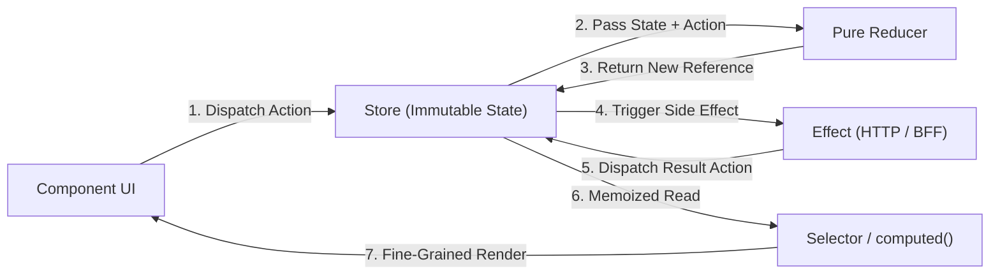
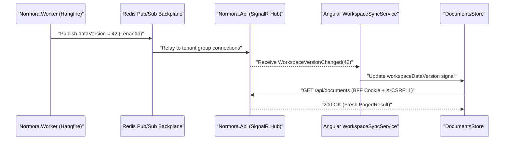
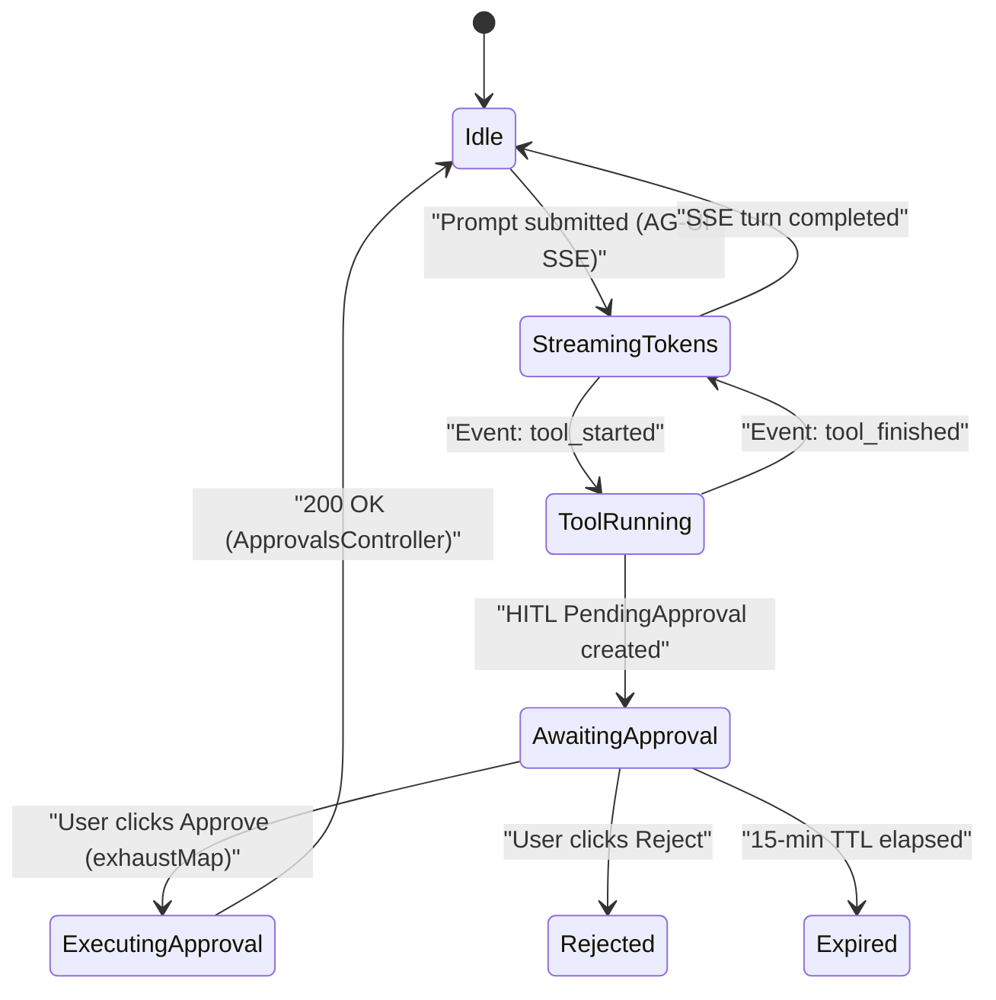

# Appendix 7: State Management Interview Questions

This section focuses on managing application state in modern Angular 22 (zoneless change detection + Signals), contrasting local component signals, `httpResource()`, and Service-based state with traditional NgRx (Redux) and the modern `@ngrx/signals` (`SignalStore`) architecture—illustrated with real-world patterns from **Normora** (an enterprise multi-tenant Angular 22 SPA behind a Duende BFF).

---

## Junior Level Questions

### 1. What is Application State, and how do you classify it?
**Answer:**
**Application state** is any data that an application must remember over time to render the UI correctly—whether for 200 milliseconds while a drawer animates or across an entire authenticated session. In enterprise Angular apps, architects classify state by **lifetime** and **ownership**:
* **Local UI State:** Data restricted to a single component and its direct template (e.g., whether a dropdown or preview drawer is open). Owned by a local `signal()`.
* **URL / Router State:** Navigation parameters and query strings that identify *what* the user is looking at so views are bookmarkable and survive browser refreshes.
* **Server Cache State:** Read-only data fetched from a backend API whose canonical copy lives on the server (e.g., paginated audit logs). Managed with `httpResource()` or store entity caches.
* **Global / Shared Domain State:** Data read and mutated across multiple routes or unrelated components (e.g., active tenant profile, document repository, or an ongoing AI chat session).
* **Ephemeral Real-Time / Streaming State:** High-frequency chunks arriving over **Server-Sent Events (SSE)** or **SignalR** WebSockets before being committed.

**Normora Example:** In Normora, whether `ChunkPreviewDrawerComponent` is open (`isOpen = signal(false)`) is **Local UI State**; the active workspace and thread in `/t/:tenantSlug/chat/:conversationId` are **URL / Router State**; paginated compliance records from `GET /api/audit-logs` are **Server Cache State**; the shared document list is **Shared Domain State** in `DocumentsStore`; and live tokens streaming from `/api/copilotkit` are **Ephemeral Streaming State**.

### 2. How do you share state between two completely unrelated sibling components without a State library?
**Answer:**
You use a shared Angular Service provided at the `root` level (`@Injectable({ providedIn: 'root' })`), making it a **Singleton** (one shared instance across the entire application). The Service holds the state in a private `WritableSignal` (`signal(...)`) and exposes a read-only view via `.asReadonly()` (or a `BehaviorSubject` in legacy RxJS-based services). Both sibling components `inject()` the service: Component A calls an explicit method on the service to update the Signal, and Component B reacts automatically in its template without needing `@Input()`/`@Output()` chains. This avoids **Prop Drilling** (passing data mechanically through intermediate parent/child components that do not use it).

```typescript
import { Injectable, signal } from '@angular/core';

@Injectable({ providedIn: 'root' })
export class CopilotDockService {
  // Private writable signal prevents external components from mutating state directly
  private readonly _isExpanded = signal(false);

  // Public read-only signal exposed to any sibling component
  readonly isExpanded = this._isExpanded.asReadonly();

  toggle(): void {
    this._isExpanded.update((open) => !open);
  }
}
```

**Normora Example:** Normora's Unified Copilot Workstation (`Ctrl+J` / `Cmd+J`) uses a singleton `CopilotDockService` so the top navigation bar button, keyboard shortcut listener, and `"Locate in Documents"` co-browsing trigger can all open or dock the assistant without prop-drilling through layout shells.

### 3. When should state live in the URL (Angular Router) instead of an in-memory Service or Store?
**Answer:**
State belongs in the **URL** (route parameters or query parameters) whenever a user expects **browser refresh**, the **Back/Forward buttons**, or **copy-pasting a link** to another teammate to restore the exact same view. State belongs in an **in-memory Service/Store** only when it is transient, session-bound, or too large/sensitive for a URL (such as an active file upload queue or unsaved form draft).

**Normora Example:** Normora encodes `:tenantSlug` and `:conversationId` in `/t/:tenantSlug/chat/:conversationId`, plus document search filters in query params. If a teammate shares a link to an HR policy thread, the Angular Router preserves the target workspace and thread across the Duende BFF OIDC login redirect—something an in-memory Signal would lose on redirect.

---

## Mid-Level Questions

### 4. What is the Redux Pattern, and what are its core principles?
**Answer:**
**Redux** is an architectural pattern that enforces **Unidirectional Data Flow (UDF)** so state transitions are deterministic, traceable, and testable:
1. **Single Source of Truth (SSOT):** The application's shared state lives in a single, immutable state container (the Store) rather than scattered copies across components.
2. **State is Read-Only:** Components cannot mutate state directly (`store.user.name = 'Bob'` is forbidden). They must emit an explicit **Action** (or call a Store method) describing *what happened*.
3. **Changes are made by Pure Functions (Reducers):** A **Reducer** is a pure function (same inputs always produce the same output, with no HTTP calls or side effects) that accepts `(currentState, action)` and returns a *new* state reference (**Immutability**).



**Normora Example:** When an admin switches currency in Normora's `Tenants` billing screen, the UI does not directly overwrite `plan.currency = 'EUR'`. It triggers an explicit transition that sends `PUT /api/subscription/currency` through the Duende BFF and replaces the `plan` object immutably with the new server-confirmed state.

### 5. What are NgRx Actions and Selectors?
**Answer:**
* **Actions:** Plain event objects describing unique domain events that occurred in the application (not generic setters). Naming uses `[Source] Event`—for example, `[Charger API] Load Chargers` or in Normora `[Documents Page] Upload Queued` and `[Documents SignalR] Ingestion Completed`.
* **Selectors:** Pure, **memoized** (cached) functions that extract or compute derived slices from the state tree. Because they are memoized, they only recalculate when their specific input slices change—returning the cached result in `O(1)` time on unrelated updates.

**Normora Example:** A selector (or `withComputed()` signal) calculating `indexedCount` from `DocumentsStore.items()` only recalculates when the `items` reference changes—never when the user types in the Copilot chat input.

### 6. What is the purpose of NgRx Effects?
**Answer:**
Reducers must remain completely pure and synchronous (no `HttpClient` calls, WebSockets, timers, or `localStorage`). **NgRx Effects** are long-lived RxJS streams that listen for dispatched Actions, execute asynchronous side effects (such as HTTP calls or SignalR subscriptions), and dispatch a *new* result Action (`Success` or `Failure`) back to the Store.

**Normora Example:** Clicking `"Save Answer"` in `Conversations` triggers an effect that sends `POST /api/saved-answers` (carrying the Duende BFF `HttpOnly` cookie and `X-CSRF: 1` header). If the backend returns `403 Forbidden` (`BflaException`) or `404 Not Found` (`BolaException`), the effect catches the error and maps it to `ApiMessages.Forbidden` or `ApiMessages.NotFound` from `client/src/app/core/constants/api-messages.ts`.

### 7. What is Normalized State (`@ngrx/entity` / `withEntities`), and why do dictionaries beat raw arrays at scale?
**Answer:**
**Normalized State** models client collections like a relational database table (`{ ids: string[], entities: Record<string, T> }`) instead of raw arrays (`T[]`) or deeply nested trees. Raw arrays require `O(n)` linear scans to update a single item and create duplicated truth if the same item appears in two lists. A normalized dictionary gives `O(1)` lookup by ID and ensures every view reads from one canonical entity map.

**Normora Example:** In Normora, `Normora.Worker` processes `DocumentProcessingOutboxMessage` jobs and broadcasts ingestion transitions (`Queued` -> `Extracting` -> `Indexed` or `Failed`) over SignalR. Using `withEntities<WorkspaceDocument>()` lets `DocumentEntitiesStore` update a single document in `O(1)` time via `updateEntity({ id, changes })`, updating both the Documents table and Copilot citation badges simultaneously.

---

## Senior Level Questions

### 8. Why is mutating the state directly an anti-pattern in NgRx and Angular Signals, and how does Angular 22 handle it?
**Answer:**
If a developer writes `store.user.name = 'Bob'` or `items().push(newDoc)`, they mutate the existing object or array **in place** without changing its memory reference.
Both `ChangeDetectionStrategy.OnPush` and Angular 22's **zoneless** Signal reactivity rely on **referential equality** (`Object.is(oldVal, newVal)`). When a reference does not change, Angular's Signal graph assumes nothing changed, skips notifying `computed()` derivations and templates, and leaves the UI stale. In classic NgRx development mode, strict immutability runtime checks immediately throw an error on mutation; in `SignalStore`, all state properties are exposed as read-only `DeepSignal`s so consumers cannot assign to them directly.

**Normora Example:** When `Normora.Worker` finishes indexing a policy PDF, `DocumentsStore` never calls `store.items().push(doc)`. Instead, it uses `patchState(store, (state) => ({ items: [...state.items, doc] }))` (or `addEntity(doc)` with `withEntities`) so the new reference immediately triggers fine-grained template updates without `Zone.js`.

### 9. What are the primary drawbacks of traditional NgRx (`@ngrx/store`)?
**Answer:**
* **High Boilerplate:** Adding a single slice of state typically requires maintaining four separate artifacts (`actions.ts`, `reducer.ts`, `selectors.ts`, `effects.ts`) and registering store/effect providers.
* **RxJS-Everywhere Complexity:** Even synchronous UI reads require `store.select(...)` Observables (or wrapping with `selectSignal`), while effects demand fluent mastery of higher-order flattening operators (`switchMap`, `exhaustMap`, `concatMap`), increasing onboarding time for junior engineers.

**Normora Example:** Writing four Redux files just to manage Normora's workspace currency switcher (`PUT /api/subscription/currency`) or department filter adds friction without extra runtime safety compared to a concise `SignalStore`.

### 10. Explain the modern `@ngrx/signals` (`SignalStore`) and how it differs from traditional NgRx.
**Answer:**
**`SignalStore`** is a functional, tree-shakable state management container built directly on Angular Signals:
* **Minimal Boilerplate:** You declare `withState`, `withComputed` (memoized selectors), and `withMethods` (actions and effects) inside a single cohesive definition.
* **Synchronous & Zoneless Native:** State properties become read-only Signals (`DeepSignal<T>`) read directly in templates without `AsyncPipe`, and synchronous updates run via `patchState(store, ...)`.
* **Flexible Scoping:** Provide `{ providedIn: 'root' }` for global state (e.g., `TenantSessionStore`, `SubscriptionStore`) or omit `providedIn` and provide it on a route/component (`providers: [DocumentsStore]`) so state is automatically destroyed on navigation exit.

**Normora Example:** Normora's `DocumentsStore` uses `SignalStore` with `withState`, `withComputed` (`indexedCount`, `hasError`), and `withMethods` (`setDepartmentFilter`, `searchDocuments`)—delivering full immutability and unidirectional data flow in a single file.

### 11. How do you handle asynchronous side effects in a `SignalStore`, and which RxJS flattening operator should you choose?
**Answer:**
Because Signals are synchronous, `@ngrx/signals/rxjs-interop` provides **`rxMethod<T>()`** as the bridge to RxJS pipelines for cancellation, debouncing, and concurrency control.
Two rules are critical inside `rxMethod`:
1. **Always place `tapResponse` (from `@ngrx/operators`) inside the inner HTTP Observable**, never outside `switchMap`/`exhaustMap`. An unhandled HTTP error that escapes to the outer `rxMethod` stream permanently terminates it, breaking all future calls for that session.
2. **Pick the right concurrency operator:**
   * **`switchMap`:** Cancels prior in-flight requests—ideal for **read/search queries** (e.g., hybrid document search typing).
   * **`exhaustMap`:** Ignores new triggers while a request is active—ideal for **mutating button clicks** (e.g., `POST /api/approvals/{id}/approve` or `PUT /api/subscription/currency`) to prevent duplicate submissions.
   * **`concatMap`:** Queues requests sequentially—ideal for **ordered writes** (e.g., saving sequential chat turns).

```typescript
// Inside withMethods((store, api = inject(DocumentsApiService)) => ({ ... }))
searchDocuments: rxMethod<string>(
  pipe(
    debounceTime(250),
    distinctUntilChanged(),
    tap((searchQuery) => patchState(store, { searchQuery, isLoading: true, errorMessage: null })),
    switchMap((query) =>
      api.listDocuments({ query, departmentId: store.selectedDepartmentId() }).pipe(
        tapResponse({
          next: (res) => patchState(store, { items: res.items, isLoading: false }),
          error: (err: HttpErrorResponse) =>
            patchState(store, {
              isLoading: false,
              errorMessage: err.status === 403 ? ApiMessages.Forbidden : ApiMessages.UnexpectedError,
            }),
        })
      )
    )
  )
),
```

### 12. When should you use Angular's `httpResource()` vs. `SignalStore` vs. a Signal Service?
**Answer:**
* **`httpResource()` / `rxResource()`:** Best for **declarative, read-only server cache** queries driven by Signal inputs (automatically aborts stale requests when parameter signals change and exposes `.value()`, `.isLoading()`, and `.error()`). Avoid it when you need optimistic updates, WebSocket/SignalR merging, or multi-step mutations.
* **Service with Signals:** Best for tiny shared UI coordination (like `CopilotDockService`) where entity maps or `rxMethod` concurrency are unnecessary.
* **`SignalStore`:** Best for shared mutable domain state, normalized `withEntities` caches, optimistic rollbacks, and `rxMethod` async workflows.

**Normora Example:** Normora's read-only compliance viewer uses `httpResource(() => \`/api/tenants/audit-logs?page=\${page()}\`)` for automatic abort-on-page-change fetching, whereas `DocumentsStore` and `CopilotChatStore` use `SignalStore` to merge SignalR status patches, SSE token streams, and HITL approvals.

### 13. How do `signalStoreFeature` and `withHooks` keep enterprise stores DRY and leak-free?
**Answer:**
* **`signalStoreFeature(...)`** extracts reusable slices of state, `computed()` signals, and methods into composable building blocks—eliminating copy-pasted `isLoading` / `errorMessage` boilerplate across stores.
* **`withHooks({ onInit(store), onDestroy(store) })`** binds store initialization and teardown directly to Angular's DI lifecycle (ideal for opening and closing SignalR subscriptions automatically when a route-scoped store mounts and unmounts).

```typescript
export function withRequestStatus() {
  return signalStoreFeature(
    withState<{ requestStatus: 'idle' | 'pending' | 'fulfilled' | { error: string } }>({
      requestStatus: 'idle',
    }),
    withComputed(({ requestStatus }) => ({
      isPending: computed(() => requestStatus() === 'pending'),
      errorMessage: computed(() => {
        const s = requestStatus();
        return typeof s === 'object' ? s.error : null;
      }),
    }))
  );
}
```

**Normora Example:** Normora composes `withRequestStatus()` across `DepartmentsStore`, `UserGroupsStore`, and `AuditLogsStore`, and uses `withHooks.onDestroy()` on route-scoped upload stores to abort active listeners on route exit.

### 14. How do you implement Optimistic UI Updates with safe rollback in a `SignalStore`?
**Answer:**
An **Optimistic Update** applies the expected UI change immediately before the HTTP response returns, capturing a snapshot of the previous state first. Inside `tapResponse({ error })`, if the backend rejects the mutation, the store restores the snapshot and surfaces a standardized error message. Always pair optimistic mutations with `exhaustMap` or `concatMap` (never `switchMap`, which cancels the client observer while the server may still commit).

**Normora Example:** When a workspace admin changes currency in `SubscriptionStore`, `updateCurrency` snapshots `previousCurrency = store.currency()`, optimistically sets `currency: nextCurrency` so the `TenantPlanPricingCatalog` prices render immediately, and calls `PUT /api/subscription/currency`. If the BFF returns `403` (`BflaException`) or fails, `tapResponse.error` rolls back `currency: previousCurrency` and displays `ApiMessages.UnexpectedError` (or `ApiMessages.Forbidden`). Similarly, `SavedAnswersStore` rolls back optimistic bookmark toggles on `404` (`BolaException` -> `ApiMessages.NotFound`).

---

## Architect Level Questions

### 15. When should an enterprise application choose a full NgRx Redux Store vs. `@ngrx/signals` vs. a basic Angular Service?
**Answer:**
* **Basic Service with Signals (`.asReadonly()`):** Best for small apps or simple shared UI flags (e.g., `CopilotDockService`). Fails at domain scale because there are no uniform entity helpers, `rxMethod` cancellation patterns, or `signalStoreFeature` composability.
* **`@ngrx/signals` (`SignalStore`):** The recommended default for modern Angular 22 zoneless enterprise apps. It enforces read-only Signal exposure, immutable `patchState` updates, memoized `withComputed` selectors, `withEntities` normalization, and clean `rxMethod` + `tapResponse` async orchestration without Redux file explosion.
* **Traditional NgRx (`@ngrx/store`):** Choose only when an existing large platform already standardizes on Redux DevTools time-travel debugging, cross-slice meta-reducers, or action-event buses where one dispatched action must simultaneously trigger multiple independent feature reducers.

**Normora Example:** Normora standardizes on `SignalStore` for domain features (`DocumentsStore`, `CopilotChatStore`, `SubscriptionStore`), `httpResource()` for read-only audit log views, and local `signal()` for component UI flags (`ChunkPreviewDrawerComponent`).

### 16. Explain the "Facade Pattern" and how it decouples the UI from the State Management library.
**Answer:**
If UI components directly inject `Store<AppState>` and dispatch raw NgRx actions, every component becomes tightly coupled to `@ngrx/store`. Migrating later to `SignalStore` forces edits across dozens of UI components.
A **Facade** is an `@Injectable()` service acting as an anti-corruption layer between the UI and state internals:
* Components inject only the Facade, reading clean Signals (e.g., `facade.canCancelSubscription()`) and calling intention-revealing methods (e.g., `facade.updateCurrency('EUR')`).
* Inside the Facade, it coordinates the underlying store, `httpResource()`, or BFF API service. Switching the internal state implementation later touches only the Facade while leaving templates untouched.

**Normora Example:** A `BillingFacade` in Normora can expose `tier`, `currency`, and `canCancelSubscription` (enforcing the Free-tier invariant that suppresses cancellation UI on Free workspaces) while hiding whether the backing implementation uses classic `@ngrx/store`, `SignalStore`, or `SubscriptionApiService`.

### 17. How do you handle "State Hydration" in Server-Side Rendering (SSR) using `TransferState`, and what is the multi-tenant BFF security caveat?
**Answer:**
In Angular SSR, the server renders the page by fetching API data, populating the store, and returning HTML. Without hydration transfer, when the browser boots the client-side SPA, its store starts empty and fires duplicate HTTP requests—causing a UI flicker.
**`TransferState`** (along with `provideClientHydration()`'s built-in HTTP transfer cache in modern Angular) solves this:
1. On the server (`isPlatformServer`), the app serializes non-sensitive initial data into `TransferState` using `makeStateKey<T>('key')`, embedding it safely into a `<script>` tag inside the SSR HTML.
2. On the browser (`isPlatformBrowser`), the store reads and removes that key from `TransferState` to hydrate immediately without repeating the HTTP call.

**Normora Security Caveat (Multi-Tenant Duende BFF):** Never serialize authenticated, tenant-confidential data (such as HR policy documents or `TenantMemberships`) into SSR `TransferState` if HTML responses can ever be cached by a CDN or shared proxy. In a Duende BFF architecture where sessions live in `HttpOnly`, `SameSite=Strict` cookies, SSR should either render only public shell/branding metadata (`TransferState`) or bypass SSR data hydration for authenticated tenant routes (`RenderMode.Client`).

### 18. Scenario (Normora): How do you prevent cross-tenant state leakage in a multi-tenant Angular SPA behind a Duende BFF?
**Answer:**
In a multi-tenant SaaS, if a user switches workspaces from `/t/acme-corp` to `/t/globex-labs` (or signs out via `/bff/logout`), stale cached arrays in root-provided stores cause **cross-tenant state bleed**. Prevent this with three architectural layers:
1. **Route-Scoped Stores by Default:** Provide feature stores at the route or page component level (`providers: [DocumentsStore]`) whenever state does not need to outlive navigation. Angular automatically destroys the store instance when the user leaves the route.
2. **Deterministic `.reset()` Coordinator for Root Stores:** Root-provided stores (`DocumentEntitiesStore`, `DepartmentsStore`, `SubscriptionStore`, `CopilotChatStore`) must expose an explicit `reset()` method returning to `initialState`. A central `TenantLifecycleCoordinator` resets every root domain store *before* completing navigation to the new `:tenantSlug` or logout.
3. **BFF Token Immunity:** Never store OIDC access tokens, refresh tokens, or tenant claims in JS Signal state or `localStorage`. Rely strictly on `Normora.Api`'s Duende BFF encrypted `HttpOnly`, `SameSite=Strict`, `Secure` cookies and `X-CSRF: 1` anti-CSRF headers.

### 19. Scenario (Normora): How do you synchronize Angular state in real time across background workers and AI streaming without polling?
**Answer:**
Polling endpoints on a `setInterval` wastes bandwidth and lags behind mutations. Normora combines **SignalR `dataVersion` sync** for persisted workspace mutations with **SSE streaming + HITL state machines** for conversational AI:
1. **Worker-to-Client `dataVersion` Sync:** When `Normora.Worker` finishes a Hangfire job (such as `DocumentProcessingOutboxMessage` ingestion) or an AI tool mutates PostgreSQL, `IWorkspaceStateSynchronizer` increments a monotonic `dataVersion` per tenant and publishes it through the **Redis pub/sub backplane** to `Normora.Api`'s SignalR Hub. Angular's `WorkspaceSyncService` updates a `workspaceDataVersion` Signal, prompting active stores to refetch only when their `lastSyncedVersion < workspaceDataVersion`.



2. **Ephemeral SSE & HITL State Machine (`CopilotChatStore`):** For `/api/copilotkit` AG-UI streams, `CopilotChatStore` models streaming tokens, `tool_started`/`tool_finished` badges, and server-enforced Human-In-The-Loop (`PendingApproval` 15-minute TTL for `documents_delete`) as an explicit finite state machine, using `exhaustMap` when the user confirms `POST /api/approvals/{id}/approve`.



### 20. Scenario (Normora): A developer uses `effect()` in a component to filter `store.documents()` into a second signal whenever the list updates. Why is this wrong, and how do you fix it?
**Answer:**
Using `effect()` to derive or copy one Signal into another Signal is a reactive anti-pattern:
* **Extra Change-Detection Cycles & Loop Risk:** Writing to a signal inside `effect()` schedules an additional reactive pass after the effect runs and can trigger infinite loops if two effects read and write each other's signals.
* **Broken Encapsulation:** Derived domain state gets duplicated inside components instead of living once in the Store.

**Fix:**
* Use **`computed()`** inside `withComputed()` for read-only derived slices (e.g., `filteredDocuments`, `indexedCount`).
* Use **`linkedSignal()`** (Angular 19+) when you genuinely need a *writable* local signal (such as a user-editable selected department draft) that automatically resets whenever a source signal (`tenantSlug()`) changes.
* Reserve **`effect()`** strictly for external side effects (DOM/chart sync, analytics, or triggering an `rxMethod` when `workspaceDataVersion()` increments).

---

## Common Mistakes & Anti-Patterns

> [!CAUTION]
> **Anti-Pattern 1: Mutating Store Arrays or Objects In Place**
>
> **Wrong:**
> ```typescript
> this.documentsStore.items().push(uploadedDoc);
> ```
> **Why it's wrong:** Angular Signals use `Object.is` referential equality. Mutating the array in place keeps the same reference, so `computed()` derivations and zoneless `@for` loops never re-render.
>
> **Fix:** Replace references immutably inside a `SignalStore` method via `patchState` (or `addEntity`/`updateEntity` with `withEntities`):
> ```typescript
> addUploadedDocument(doc: DocumentSummaryDto): void {
>   patchState(store, (state) => ({ items: [doc, ...state.items] }));
> }
> ```

> [!CAUTION]
> **Anti-Pattern 2: Omitting `tapResponse` Inside the Inner `rxMethod` Observable**
>
> **Wrong:**
> ```typescript
> loadDepartments: rxMethod<void>(
>   pipe(
>     switchMap(() => api.listDepartments()),
>     tap((departments) => patchState(store, { departments }))
>   )
> )
> ```
> **Why it's wrong:** If `api.listDepartments()` emits a `403 Forbidden` (`BflaException`) or `503` without inner error handling, the error propagates to the outer `rxMethod` stream and kills it permanently—no future refresh clicks will work.
>
> **Fix:** Handle errors inside the inner pipe with `tapResponse` and map status codes to `ApiMessages`:
> ```typescript
> loadDepartments: rxMethod<void>(
>   pipe(
>     tap(() => patchState(store, { isLoading: true, errorMessage: null })),
>     switchMap(() =>
>       api.listDepartments().pipe(
>         tapResponse({
>           next: (departments) => patchState(store, { departments, isLoading: false }),
>           error: (err: HttpErrorResponse) =>
>             patchState(store, {
>               isLoading: false,
>               errorMessage: err.status === 403 ? ApiMessages.Forbidden : ApiMessages.UnexpectedError,
>             }),
>         })
>       )
>     )
>   )
> )
> ```

> [!CAUTION]
> **Anti-Pattern 3: Using `switchMap` for Destructive or Billing Mutations**
>
> **Wrong:**
> ```typescript
> approveDelete: rxMethod<string>(
>   pipe(switchMap((approvalId) => approvalsApi.approve(approvalId)))
> )
> ```
> **Why it's wrong:** Double-clicking `"Confirm Delete"` causes `switchMap` to cancel the client's first HTTP subscription while `Normora.Api` may still execute `documents_delete` in PostgreSQL—desynchronizing UI and database state.
>
> **Fix:** Use `exhaustMap` to ignore rapid repeat clicks while the mutation is in flight:
> ```typescript
> approveDelete: rxMethod<string>(
>   pipe(exhaustMap((approvalId) => approvalsApi.approve(approvalId).pipe(tapResponse({ ... }))))
> )
> ```

> [!CAUTION]
> **Anti-Pattern 4: Leaving Root Stores Un-Reset on Tenant Switch or Storing BFF Tokens in Client State**
>
> **Wrong:**
> ```typescript
> localStorage.setItem('access_token', jwt);
> this.router.navigate(['/t', nextSlug, 'documents']); // Root store still holds prior tenant!
> ```
> **Why it's wrong:** Storing OIDC tokens in `localStorage` or JS Signals breaks Normora's Duende BFF (`HttpOnly`, `SameSite=Strict`) XSS immunity, and navigating without resetting root-scoped stores leaks the previous tenant's documents until the next request resolves.
>
> **Fix:** Keep all auth tokens strictly inside the server-side Duende BFF session, and reset every root domain store (`documentEntitiesStore.reset()`, `copilotChatStore.reset()`, `subscriptionStore.reset()`) before navigating to `nextSlug`.
