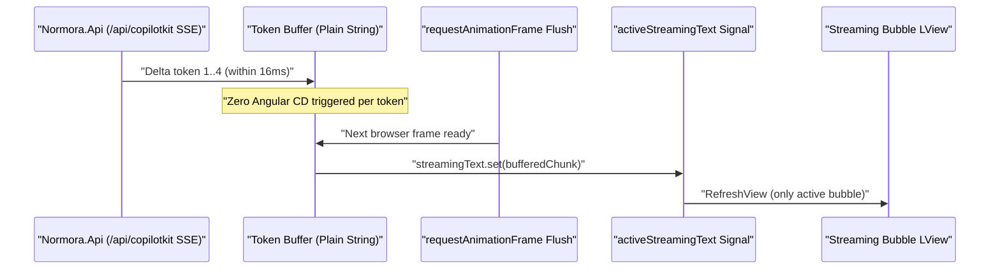

# Appendix 8: Performance & Change Detection

This section covers the hardest engineering challenges in Angular 22: how Angular's **Logical View (`LView`)** synchronization works, migrating from `Zone.js` to **Zoneless** change detection, mastering `OnPush` and Signal-driven **Local Change Detection**, optimizing load-time and runtime **Core Web Vitals** (`LCP`, `INP`, `CLS`) with `@defer` and **Incremental Hydration**, and diagnosing memory leaks—illustrated throughout with scenarios from **Normora** (an enterprise multi-tenant Angular 22 SPA behind a Duende BFF).

---

## Junior Level Questions

### 1. What is `Zone.js`, and how does its role change in modern Zoneless Angular 22?
**Answer:**
`Zone.js` is a library that older Angular applications (v2–v17) used under the hood to **monkey-patch** (wrap and intercept at runtime) asynchronous browser APIs such as `setTimeout`, `setInterval`, `Promise.then()`, `fetch`/`XMLHttpRequest`, WebSockets, and DOM events (`click`, `mousemove`).
Whenever a monkey-patched asynchronous callback finished inside `NgZone`, `Zone.js` notified Angular that *something* might have changed. Because `Zone.js` didn't know *which* component's data mutated, Angular ran a **Top-Down** change detection pass starting from the root component, checking each component's **`LView`** (the internal runtime array holding a component's DOM references and last-evaluated template bindings) to patch the DOM.

In **Angular 22**, `Zone.js` is legacy/optional. With **Zoneless change detection** (`provideZonelessChangeDetection()`), Angular removes `Zone.js` completely (~15 KB gzipped saved + zero monkey-patching overhead). Instead, **Signals**, `input()` updates, `AsyncPipe`, template event listeners, and explicit `ChangeDetectorRef.markForCheck()` calls notify Angular directly *which* views need updating.

**Normora Example:**
In a legacy Zone-based app, attaching a `mousemove` or scroll listener inside Normora's `ChunkPreviewDrawerComponent` would trigger full-tree change detection dozens of times per second unless wrapped in `NgZone.runOutsideAngular()`. In Normora's Zoneless Angular 22 SPA, scroll listeners do not trigger Angular at all unless they update a Signal (for example, `showBackToTop.set(true)`).

### 2. How do you prevent a function in an HTML template from ruining performance?
**Answer:**
**Anti-pattern:** `<p>{{ calculateAnnualDiscount() }}</p>`
If you bind a plain class method directly in an HTML template, Angular cannot know whether the method's output changed, so it executes that function on *every single change detection cycle* for that view—even when unrelated UI state (like opening a tooltip) triggers a check. If the method filters arrays or performs math, the main thread stutters.

**Solution:** Never bind non-trivial regular methods in templates. Instead, use:
1. **A Computed Signal (`computed()`):** `{{ annualTotal() }}`. Calling a Signal in a template is an O(1) cached read *and* registers the template as a reactive consumer. `computed()` only recalculates when its tracked Signal dependencies change.
2. **A Pure Pipe (`pure: true`, the default):** `{{ price() | formatTenantCurrency:currency() }}`. Angular caches the pipe's return value and only re-runs `transform()` when an argument reference changes (**referential equality**).

**Normora Example:**
In Normora's subscription settings UI, tier prices come from `TenantPlanPricingCatalog` across 8 currencies (`INR`, `USD`, `EUR`, etc.) and `Monthly`/`Annual` cycles (with a 20% annual discount). Instead of calling `getDiscountedPrice()` in the template, the component derives `readonly displayPrice = computed(() => this.calculateCatalogPrice(this.selectedTier(), this.selectedCurrency(), this.billingCycle()))` so switching a tooltip or hovering rows never recalculates pricing.

### 3. What is `ChangeDetectionStrategy.OnPush`, and why does it still matter with Signals?
**Answer:**
By default (`ChangeDetectionStrategy.Default`), Angular checks a component and its children on every change detection cycle triggered in the application.
Setting `changeDetection: ChangeDetectionStrategy.OnPush` tells Angular to skip checking the component and its subtree **unless** one of these occurs:
1. An input reference changes (`@Input()` or Signal `input()`). Mutating an object/array in place (e.g. `items.push(x)`) keeps the same reference, so `OnPush` will *not* detect it—you must replace references immutably (`[...items, x]`).
2. A DOM event originates from this component **or any of its descendant components**.
3. An `AsyncPipe` in its template emits a new value.
4. A **Signal** read inside its template updates (in modern Angular, this triggers targeted **Local Change Detection**).
5. `ChangeDetectorRef.markForCheck()` is called explicitly.

**Why it still matters in Angular 22:** Even in a Zoneless + Signals app, if a parent component is re-checked (for example, from a sibling DOM event inside it), `Default` children get checked unnecessarily, whereas `OnPush` guarantees every component only refreshes when its own inputs, events, or Signals change.

**Normora Example:**
```typescript
import { ChangeDetectionStrategy, Component, computed, input } from '@angular/core';

@Component({
  selector: 'normora-document-status-badge',
  changeDetection: ChangeDetectionStrategy.OnPush,
  template: `
    <span [class]="badgeClasses()">
      {{ status() }}
    </span>
  `
})
export class DocumentStatusBadgeComponent {
  readonly status = input.required<'Queued' | 'Extracting' | 'Chunking' | 'Embedding' | 'Ready' | 'Failed'>();

  readonly badgeClasses = computed(() => {
    const base = 'inline-flex items-center rounded-full px-2.5 py-0.5 text-xs font-medium border-none!';
    return this.status() === 'Ready'
      ? `${base} bg-emerald-100 text-emerald-800 dark:bg-emerald-950/60 dark:text-emerald-300`
      : `${base} bg-amber-100 text-amber-800 dark:bg-amber-950/60 dark:text-amber-300`;
  });
}
```
When `Normora.Worker` publishes a SignalR ingestion update for one PDF, only that document row's `DocumentStatusBadgeComponent` updates—the remaining rows are skipped.

---

## Mid-Level Questions

### 4. You are using `OnPush`, and you update a property inside `setTimeout`. Why doesn't the UI update, and how do you fix it?
**Answer:**
The failure happens for slightly different reasons depending on whether the app uses `Zone.js` or is Zoneless:
* **In a Zone-based app:** `Zone.js` intercepts `setTimeout` and triggers a change detection cycle, *but* `OnPush` skips the component because no input reference changed, no DOM event fired inside it, and no bound `AsyncPipe` or Signal updated.
* **In a Zoneless Angular 22 app:** `Zone.js` is not loaded at all, so `setTimeout` never notifies Angular that anything happened.

**Fixes (Angular 22):**
1. **Preferred — Use a Signal:** Updating `this.copied.set(false)` schedules view synchronization automatically in both Zone and Zoneless apps.
2. **Legacy property — Inject `ChangeDetectorRef`:** Call `this.cdr.markForCheck()` so Angular schedules a check for that path. Always clear pending timers via `DestroyRef` to prevent updating a destroyed view.

**Normora Example:**
In `HrEscalationCardComponent` (`hr_escalation_card`), clicking "Copy Inquiry Reference" shows a `"Copied"` badge for 2 seconds:
```typescript
import { ChangeDetectionStrategy, Component, DestroyRef, inject, signal } from '@angular/core';

@Component({
  selector: 'normora-hr-escalation-card',
  changeDetection: ChangeDetectionStrategy.OnPush,
  template: `
    <button
      type="button"
      (click)="copyRef('HR-8F21')"
      class="rounded-md border border-slate-300 bg-white px-3 py-1.5 text-sm text-slate-900 dark:border-slate-700 dark:bg-slate-800 dark:text-slate-100">
      {{ copied() ? 'Copied' : 'Copy Reference' }}
    </button>
  `
})
export class HrEscalationCardComponent {
  private readonly destroyRef = inject(DestroyRef);
  readonly copied = signal(false);

  copyRef(refId: string): void {
    navigator.clipboard?.writeText(refId);
    this.copied.set(true);
    const timerId = window.setTimeout(() => this.copied.set(false), 2000);
    this.destroyRef.onDestroy(() => window.clearTimeout(timerId));
  }
}
```

### 5. What is the `@defer` control block, and how do you prevent layout shift (CLS) and spinner flashes?
**Answer:**
Introduced in Angular v17 and mature in Angular 22, `@defer` declaratively splits standalone components, directives, or pipes used *exclusively* inside the block into lazy JavaScript chunks during AOT compilation.

* **Triggers:** `on idle` (default when browser is idle), `on viewport` (via `IntersectionObserver`), `on interaction`, `on hover`, `on immediate`, `on timer(2s)`, or `when condition()`. You can combine with `prefetch on idle` or `prefetch on hover` so the chunk downloads before the user interacts.
* **Preventing CLS (Cumulative Layout Shift):** Always give `@placeholder (minimum ...)` the same fixed height/dimensions as the deferred widget so content below it does not jump when the chunk loads.
* **Preventing spinner flashes:** Use `@loading (after 100ms; minimum 400ms)` so fast cached loads never flash a 15 ms spinner, and slow loads don't flicker briefly.
* **When NOT to use `@defer`:** Never wrap **above-the-fold LCP (Largest Contentful Paint)** elements—such as the primary page heading, hero image, or initial document table—inside `@defer`, because delaying them degrades LCP. Also ensure the deferred component isn't statically referenced elsewhere in the same file, or esbuild will keep it in the main bundle.

**Normora Example:**
In Normora's Copilot Workstation, heavy generative A2UI components such as `ExpenseSimulatorCardComponent` (`policy_limit_card`) are deferred until rendered in chat:
```html
@defer (on viewport; prefetch on idle) {
  <normora-expense-simulator-card [policy]="policyData()" />
} @placeholder (minimum 200ms) {
  <div class="h-64 w-full rounded-xl border border-slate-200 bg-slate-100 p-4 text-sm text-slate-600 dark:border-slate-700 dark:bg-slate-800 dark:text-slate-300">
    Expense simulator ready...
  </div>
} @loading (after 100ms; minimum 400ms) {
  <div class="h-64 w-full animate-pulse rounded-xl bg-slate-200 dark:bg-slate-700"></div>
} @error {
  <div class="h-64 w-full rounded-xl border border-red-300 bg-red-50 p-4 text-sm text-red-700 dark:border-red-800 dark:bg-red-950/30 dark:text-red-300">
    Could not load simulator card.
  </div>
}
```

### 6. What is the difference between `ChangeDetectorRef.markForCheck()`, `detectChanges()`, and `detach()`?
**Answer:**
* **`markForCheck()`:** Does **not** run change detection synchronously. It marks this component and its ancestor path as dirty (or schedules a check in Zoneless mode) so Angular includes it in the next scheduled render pass. Use it when integrating non-Signal external callbacks (such as a raw WebSocket or third-party SDK callback).
* **`detectChanges()`:** Runs change detection **immediately and synchronously** on the current component and its children, bypassing the normal schedule. Useful in Vitest/TestBed unit tests (`fixture.detectChanges()`) or when mounting a dynamic component outside normal flow. Avoid calling it inside lifecycle hooks like `ngAfterViewInit`, as forcing mid-cycle checks can trigger `NG0100` or hurt frame budgets.
* **`detach()` / `reattach()`:** Completely disconnects a component subtree from automatic change detection so you can drive updates manually (e.g., calling `detectChanges()` only every 100 ms for a high-frequency telemetry gauge).

**Normora Example:**
When Normora's `ChunkPreviewDrawerComponent` opens a third-party PDF/canvas viewer that emits zoom events outside Angular, a lightweight Signal update is preferred; if wrapping legacy third-party state, `markForCheck()` schedules a safe batched update, whereas Vitest component specs use `fixture.detectChanges()` to assert DOM classes synchronously.

### 7. Why does `@for` require a `track` expression, and what goes wrong if you use `track $index` on a live list?
**Answer:**
Unlike legacy `*ngFor` (where `trackBy` was optional and Angular fell back to object-reference identity), Angular's built-in `@for` **enforces** a `track` expression at compile time because un-tracked loops are one of the most common sources of DOM thrashing.

* **How `track` works:** Angular uses the `track` key (such as `track doc.id`) to match each array item to its existing DOM element (`LView`) across updates. If an item moves, Angular moves the existing DOM node instead of destroying and recreating it.
* **Why `track $index` fails on dynamic lists:** `$index` binds DOM identity to *position* rather than *entity identity*. If a new item is prepended at index `0` or an item is deleted in the middle, every subsequent item changes its index. Angular then patches *every* row's DOM bindings, loses local component state (like an expanded accordion or checkbox focus), and replays CSS entry animations on the wrong rows.
* **When `track $index` IS acceptable:** Only for static, immutable lists without unique IDs (such as a fixed 5-step timeline or skeleton placeholder rows).

**Normora Example:**
In Normora's Documents table, `UploadDocumentCommandHandler` commits a new upload and pushes an immediate SignalR row update to the top of the list. Using `@for (doc of documents(); track doc.id)` preserves the open action menu and focus state on existing rows while inserting only the new `doc.id` DOM node; using `track $index` would scramble row hover/selection states as background ingestion progresses.

---

## Senior Level Questions

### 8. What causes `NG0100: ExpressionChangedAfterItHasBeenCheckedError`, and how do you fix it cleanly in Angular 22?
**Answer:**
`NG0100` is a development-mode guard enforcing **Unidirectional Data Flow (UDF)**—meaning data must flow strictly top-down from parent to child during a single check pass.
After Angular finishes evaluating bindings top-down in development mode, it runs a second verification pass (`checkNoChanges`). If any template-bound value changed *between* the first check and the verification pass (for example, a child component synchronously mutates a parent binding or a Signal read by the parent inside `ngAfterViewInit`), Angular throws `NG0100` to warn that the rendered DOM and component state are out of sync.

*(Important correction: simply switching a field to a `signal()` does **not** prevent `NG0100` if you still mutate a parent-read Signal synchronously inside `ngAfterViewInit` during the same check pass!)*

**Clean Fixes (Angular 22):**
1. **Derive state top-down (`input()` + `computed()`):** Keep parent state pure and derive child flags before rendering instead of pushing mutations upward during view lifecycle hooks.
2. **Use `afterRenderEffect()` or `afterNextRender()` for DOM-dependent state:** These run *after* Angular finishes flushing DOM updates, scheduling any follow-up Signal writes cleanly into the next render cycle.
3. **Avoid `setTimeout(() => ..., 0)` unless integrating legacy third-party code:** While deferring to the next macro-task hides the error, it causes an extra render pass and visual flicker.

**Normora Example:**
In `CopilotDockComponent`, measuring `chatViewport.scrollHeight` inside `ngAfterViewInit` to synchronously flip a parent `hasOverflow` flag throws `NG0100`. Moving the DOM measurement into `afterRenderEffect()` reads the flushed DOM geometry safely without violating UDF.

### 9. Explain how the Angular CDK Virtual Scroller improves performance for massive lists, and when should you avoid it?
**Answer:**
Rendering 10,000 rows via `@for` inflates the browser DOM, consumes hundreds of megabytes of RAM, and causes severe **Long Tasks** (> 50 ms frame drops) during layout and scrolling.
`@angular/cdk/scrolling` (`<cdk-virtual-scroll-viewport itemSize="56">`) maintains a small DOM pool covering only the visible viewport plus a small overscan buffer (for example, ~20 DOM nodes). As the user scrolls, it translates the viewport offset and swaps data bindings inside those recycled DOM nodes, keeping memory flat and scrolling at 60 FPS.

**When NOT to use Virtual Scrolling:**
* **Small lists (< 100 items):** Adds unnecessary measurement overhead and fixed-height constraints.
* **Server-side pagination:** If the user only views 25 rows per page, API pagination is simpler and faster.
* **Ctrl+F browser search or SEO-indexed text:** Off-screen rows do not exist in the DOM, so native browser find-in-page cannot locate them; consider CSS `content-visibility: auto` with `contain-intrinsic-size` instead.

**Normora Example:**
Normora's `Tenants` module exposes workspace `AuditLogs` (thousands of compliance events) and `Conversations` search history. Using `<cdk-virtual-scroll-viewport>` with `*cdkVirtualFor="let log of auditLogs(); trackBy: trackById"` keeps scrolling locked at 60 FPS, whereas the 10-row `TenantPlan` comparison table uses plain `@for`.

### 10. How do "Event Coalescing" and Zoneless scheduling prevent redundant change detection cycles?
**Answer:**
In a traditional `Zone.js` app, rapid asynchronous triggers—such as a click on a child badge bubbling up to a parent message container, or two microtasks resolving 1 ms apart—can trigger multiple sequential top-down change detection passes within the same browser frame.
* **Zone-based Event Coalescing (`provideZoneChangeDetection({ eventCoalescing: true })`):** Batches multiple DOM events that bubble within the same animation frame (`requestAnimationFrame`) into a single change detection pass. Adding `runCoalescing: true` also batches multiple `NgZone.run()` invocations.
* **Zoneless Scheduling (`provideZonelessChangeDetection()`):** Zone coalescing flags are unnecessary in Zoneless Angular 22 because Angular's internal `ChangeDetectionSchedulerImpl` automatically coalesces multiple synchronous Signal updates and `markForCheck()` notifications into **one** microtask/frame render pass.

**Normora Example:**
When a user clicks an inline citation chip inside a Normora Copilot message card (which has both a chip handler and a card selection handler) while a SignalR `dataVersion` tick arrives in the same frame, Zoneless coalescing batches all resulting Signal updates into one DOM commit.

### 11. How does Signal-driven Local Change Detection (`RefreshView` vs `HasChildViewsToRefresh`) outperform traditional `OnPush` + `markForCheck()`?
**Answer:**
With traditional `OnPush`, calling `ChangeDetectorRef.markForCheck()` walks *all the way up* to the root component, marking every ancestor `LView` as dirty. When the next cycle runs, Angular must evaluate template bindings on the root, layout shell, sidebar, and every dirty ancestor down to the target component.

With **Signal-driven Local Change Detection** (used when a Signal is read directly in an `OnPush` component's template in modern Angular):
1. Updating the Signal marks **only the consuming component's `LView`** with the `RefreshView` flag.
2. Ancestors up to the root are marked only with `HasChildViewsToRefresh`—NOT `RefreshView`.
3. During synchronization, Angular **skips checking bindings** on all clean ancestors (`HasChildViewsToRefresh` acts as a routing breadcrumb) and refreshes *only* the target leaf component!

*(Note: Reading a Signal inside a `constructor()` or `effect()` does **not** subscribe the template; only Signals invoked during template evaluation register the template's reactive consumer).*

```mermaid
flowchart TD
    subgraph Legacy ["Legacy Zone Top-Down (Default)"]
        Z1["AppComponent (Checked)"] --> Z2["WorkspaceShell (Checked)"]
        Z2 --> Z3["Sidebar (Checked)"]
        Z2 --> Z4["DocumentTable (Checked)"]
        Z4 --> Z5["RowBadge (Checked)"]
    end

    subgraph OnPushMark ["OnPush + markForCheck()"]
        M1["AppComponent (Dirty Path Checked)"] --> M2["WorkspaceShell (Dirty Path Checked)"]
        M2 --> M3["Sidebar (Skipped)"]
        M2 --> M4["DocumentTable (Dirty Path Checked)"]
        M4 --> M5["RowBadge (Checked)"]
    end

    subgraph LocalSig ["Zoneless + Signal Local CD"]
        S1["AppComponent (HasChildViewsToRefresh - Bindings Skipped)"] --> S2["WorkspaceShell (HasChildViewsToRefresh - Bindings Skipped)"]
        S2 --> S3["Sidebar (Untouched)"]
        S2 --> S4["DocumentTable (HasChildViewsToRefresh - Bindings Skipped)"]
        S4 --> S5["RowBadge (RefreshView - Updated)"]
    end
```



**Normora Example:**
When `Normora.Worker` finishes generating pgvector embeddings for a single uploaded policy and emits a SignalR status update, only that specific `DocumentStatusBadgeComponent` receives `RefreshView`. `AppComponent`, the Copilot dock, and the 49 other table rows do zero binding checks.

### 12. Scenario (Normora): `NormoraWorkplaceAgent` streams 60+ SSE tokens per second from `/api/copilotkit` while the user types or scrolls. Why can naive Signal updates degrade INP, and how do you smooth the rendering pipeline?
**Answer:**
**INP (Interaction to Next Paint, target <= 200 ms)** measures the worst-case delay between a user action (keystroke, scroll, click) and the browser painting the next frame.
If every incoming SSE token immediately calls `messages.update(...)`, AND each update triggers a full Markdown + syntax-highlighting re-parse on the main thread for a 1,500-word AI response:
1. You trigger 60+ DOM layout/paint passes per second plus repeated O(N) Markdown AST parses—creating **Long Tasks (> 50 ms)** on the main thread.
2. User keystrokes in the Copilot input box queue behind those Long Tasks, spiking INP past 300 ms and dropping frames.

**Production Architecture in Normora:**
1. **Micro-batch tokens to animation frames (`~16–32 ms`):** Buffer incoming SSE text deltas in a plain JS string/array outside Angular reactivity, and flush to the active message `signal()` once per `requestAnimationFrame` (or RxJS `bufferTime(32)` / `animationFrames()`).
2. **Isolate the streaming bubble:** Store committed historical messages in a separate Signal from the `activeStreamingText = signal('')` so typing or token chunks never re-evaluate older message cards (`@for (msg of history(); track msg.id)`).
3. **Throttle/offload heavy Markdown parsing:** Parse completed blocks incrementally or offload heavy syntax highlighting to a **Web Worker**, and scroll using `afterRenderEffect()` only when the user hasn't manually scrolled up.



---

## Architect Level Questions

### 13. How do you identify and prove a Memory Leak in an Angular Single Page Application?
**Answer:**
Memory leaks in long-lived SPAs are most commonly caused by:
* Long-lived RxJS subscriptions (`Router.events`, SignalStore/service `Subject`s, `interval()`) not torn down via `takeUntilDestroyed()`.
* Imperative browser handles (`ResizeObserver`, `IntersectionObserver`, `window.addEventListener`, `setInterval`) or **detached DOM nodes** referenced inside closures.
* Real-time transport callbacks (**SignalR** `hubConnection.on(...)` or **SSE `fetch`/`EventSource`** readers) not cleaned up via `DestroyRef` or `AbortController`.
* Unbounded in-memory caches (`Map<string, ParsedChunk>`) that grow indefinitely across tenant or conversation switches.

**How to Prove It (Reproducible Heap Snapshot Workflow):**
1. Open **Chrome DevTools -> Memory -> Heap snapshot** in a production build (`ng build` / served without HMR).
2. Force garbage collection (trash-can icon) and capture **Snapshot 1** (baseline).
3. Navigate to the suspected route and back to a neutral route **5 times** (force GC after each exit).
4. Capture **Snapshot 2**, select **"Objects allocated between Snapshot 1 and Snapshot 2"** (or **Comparison** view), and filter by the component's class name (e.g., `CopilotDockComponent` or `Detached`).
5. If 5 instances remain retained when 0 should exist, expand the **Retainers** tree at the bottom—DevTools highlights the exact closure, `SignalR` listener, or RxJS `Subscriber` holding the destroyed component in memory.

**Normora Example:**
In Normora, navigating repeatedly between `/t/:tenantSlug/chat/:conversationId` and `/t/:tenantSlug/documents` leaks memory if the chat view attaches a `SignalR` `WorkspaceUpdated` callback or opens an `/api/copilotkit` SSE stream without cancelling on destroy. Using `DestroyRef.onDestroy(() => { abortController.abort(); hub.off('WorkspaceUpdated', handler); })` guarantees 0 retained component instances.

### 14. What are Non-Destructive Hydration, Event Replay, and Incremental Hydration—and what security trap must Normora avoid with SSR behind a Duende BFF?
**Answer:**
* **Non-Destructive Hydration (`provideClientHydration()`):** In legacy Angular Universal, the browser destroyed all server-rendered HTML and rebuilt the DOM from scratch after JS downloaded, causing a visible flicker and poor **LCP**. Modern Angular matches its `LView` metadata directly onto existing server-rendered DOM nodes and attaches listeners in place.
* **Event Replay (`withEventReplay()`):** If a user clicks a button *after* server HTML paints but *before* the JS bundle finishes hydrating, the browser queues that click and replays it automatically once hydration completes—protecting **INP**.
* **Incremental Hydration (`withIncrementalHydration()`):** Combines SSR with `@defer (hydrate on viewport)` or `@defer (hydrate on interaction)`. The server renders the HTML immediately for fast FCP/LCP, while the browser skips downloading and hydrating that subtree's JS until the trigger fires.

**Normora Security & Multi-Tenancy Trap (Duende BFF):**
Normora uses a **Backend-For-Frontend (`Normora.Api`)** with encrypted `HttpOnly`, `SameSite=Strict`, `Secure` session cookies.
* **Never** cache authenticated SSR HTML or `TransferState` responses in a shared CDN or Redis page cache across requests—doing so could leak Tenant A's document titles or policy chunks into Tenant B's browser (**cross-tenant BOLA exposure**).
* Use SSR/SSG + Incremental Hydration for **public/unauthenticated shells** (landing, login redirect, public docs), and keep authenticated workspace routes either strictly client-rendered behind the BFF or SSR-rendered *per-request* with `Cache-Control: private, no-store` and forward-cookie isolation.

### 15. Explain the architectural steps to migrate an enterprise Angular application to be fully "Zoneless".
**Answer:**
In **Angular 22**, Zoneless change detection is stable (`provideZonelessChangeDetection()`, replacing the earlier `provideExperimentalZonelessChangeDetection()` preview API). Removing `Zone.js` reduces initial bundle size, eliminates monkey-patching overhead, simplifies async stack traces, and enables pure Signal-driven local checks.

**Migration Checklist:**
1. **Enforce `ChangeDetectionStrategy.OnPush` across all components:** Verify via ESLint (`@angular-eslint/prefer-on-push-component-change-detection`) so no component expects full-tree dirty checking.
2. **Audit asynchronous state mutations:** Replace raw property mutations inside `setTimeout`, `setInterval`, `Promise.then`, or third-party callbacks with **Signals** (`signal.set()` / `update()`), or explicitly call `ChangeDetectorRef.markForCheck()`.
3. **Convert template-bound Observables:** Ensure every RxJS stream rendered in a template uses `AsyncPipe` (which calls `markForCheck` internally) or `toSignal()`.
4. **Replace `NgZone` lifecycle assumptions:** Replace `NgZone.onStable` / `onMicrotaskEmpty` with `afterNextRender()`, `afterEveryRender()`, or `afterRenderEffect()`. For SSR and test stabilization during async operations (such as an active upload or SSE handshake), register work with **`PendingTasks`** from `@angular/core`.
5. **Switch provider and strip `zone.js`:** In `app.config.ts` (and test setups), replace `provideZoneChangeDetection(...)` with `provideZonelessChangeDetection()`, remove `zone.js` from `polyfills` in `angular.json`, and uninstall the `zone.js` package once no dependency requires it.

**Normora Example:**
Normora's Angular 22 SPA ships without `zone.js`: Copilot SSE streaming (`streamingText` signal), SignalR `dataVersion` observers (`effect()`), and `ExpenseSimulatorCardComponent` (`model()` + `computed()`) all schedule updates natively via Signals.

### 16. Scenario (Normora): How do you design Core Web Vitals optimization (`LCP`, `INP`, `CLS`), `NgOptimizedImage`, and `angular.json` Performance Budgets for Normora's white-label tenant portal?
**Answer:**
An enterprise architect enforces performance through automated budgets and targeted optimizations rather than guesswork:

1. **Core Web Vitals Targets:**
   * **LCP (Largest Contentful Paint <= 2.5 s):** Never wrap the workspace hero, tenant white-label logo, or primary documents table in `@defer`.
   * **INP (Interaction to Next Paint <= 200 ms):** Keep main-thread tasks under 50 ms via `OnPush` + Signals, micro-batched SSE updates, and virtual scrolling for large logs.
   * **CLS (Cumulative Layout Shift <= 0.1):** Always reserve explicit dimensions (`width`/`height` or Tailwind `h-*` skeletons inside `@placeholder`).
2. **White-Label Tenant Logos with `NgOptimizedImage`:**
   Normora's `Tenants` module serves custom tenant branding via `MinioBrandingStorageService`. Using `NgOptimizedImage` (`ngSrc`) enforces:
   * `priority` attribute on the above-the-fold tenant header/login logo (injects `<link rel="preload">` and sets `fetchpriority="high"`).
   * Explicit `width` and `height` attributes so the browser reserves layout space before the image downloads (**zero CLS**).
   * Automatic `loading="lazy"` for off-screen avatars/thumbnails.
3. **Enforce Build Budgets in `angular.json`:**
   Fail CI builds before heavy un-tree-shakeable libraries (like a full PDF renderer or chart suite) accidentally land in the initial bundle:
   ```json
   {
     "budgets": [
       { "type": "initial", "maximumWarning": "400kB", "maximumError": "550kB" },
       { "type": "anyComponentStyle", "maximumWarning": "6kB", "maximumError": "12kB" }
     ]
   }
   ```

### 17. Scenario (Normora): How do `afterNextRender()` / `afterRenderEffect()` render phases prevent Layout Thrashing, and when should you offload work to a Web Worker in Normora?
**Answer:**
**Layout Thrashing** (forced synchronous reflow) occurs when JavaScript writes to the DOM (changing styles/classes), immediately reads a layout property (`offsetHeight`, `scrollHeight`, `getBoundingClientRect()`), and writes again in a loop—forcing the browser to recalculate page layout multiple times in a single 16.6 ms frame.

**Phased Render Hooks (Angular 22):**
`afterNextRender()` and `afterEveryRender()` (plus Signal-reactive `afterRenderEffect()`) replace imperative DOM code in `ngAfterViewInit`. They:
* Run **only in the browser** (never during SSR, eliminating `window`/`document` crashes).
* Group DOM work into ordered phases (`earlyRead`, `write`, `mixedReadWrite`, `read`) so Angular executes *all* reads across components before *all* writes, eliminating interleaved layout thrashing.

**When to Use a Web Worker:**
Move pure CPU-bound work exceeding ~10–15 ms off the main UI thread into a Web Worker (`new Worker(new URL('./...', import.meta.url))`), while keeping DOM access and small Signal updates on the main thread.
* **Normora Use Case:** Client-side instant search/fuzzy-ranking across 500+ cached Copilot conversation threads or syntax-highlighting large code blocks inside `ChunkPreviewDrawerComponent` runs in a Web Worker, keeping typing INP below 50 ms. (Conversely, never spawn a Web Worker for small 20-row array sorts—structured-clone serialization overhead would cost more than the sort itself.)

### 18. Scenario (Normora): Normora broadcasts `dataVersion` updates via SignalR (`IWorkspaceStateSynchronizer`). How do you architect the Angular client so multi-tab updates stay consistent without triggering redundant HTTP storms or `effect()` loops?
**Answer:**
Normora tracks a monotonic `dataVersion` per tenant via `IWorkspaceStateSynchronizer`. When an admin invites an employee, uploads a document, or changes workspace currency (`UpdateTenantCurrencyCommand`), SignalR pushes the updated version to all open browser tabs.

**Common Failure Mode:** Binding a global `dataVersion` signal inside multiple component `effect()` blocks that each fire HTTP reloads unconditionally—causing an **API storm** across unrelated views and risking infinite loops if a reload itself mutates state.

**Architect-Grade Pattern:**
1. **Scope version signals by domain slice:** Split incoming SignalR events into domain-specific signals (`documentsVersion`, `tenantsVersion`, `billingVersion`) rather than a single global counter so a document upload never forces the Billing table to refetch.
2. **Deduplicate & cancel in-flight requests:** Bridge the scoped version signal to `httpResource()` or `@ngrx/signals` `rxMethod` with `distinctUntilChanged()` + `switchMap()` so rapid bursts (e.g., 10 Hangfire chunks finishing in 500 ms) cancel stale requests and trigger at most one reload.
3. **Never write back to the trigger signal inside `effect()`:** Keep `effect()` strictly for dispatching the read/reload, and clean up SignalR listeners with `DestroyRef`.
4. **Respect Duende BFF session boundaries:** If a reload returns `401 Unauthorized` (expired `HttpOnly` cookie) or `403 Forbidden` (BFLA role revocation mapped to `ApiMessages.Forbidden`), stop automatic retries immediately and route to re-authentication/access-denied state rather than polling in a retry loop.

---

## Common Mistakes & Anti-Patterns

> [!CAUTION]
> **1. Mutating Arrays or Objects In-Place Under `OnPush` or Signals**
> ```typescript
> // WRONG: Same array reference — OnPush and Signal.update() see Object.is(old, new) === true
> this.documents().push(newDoc);
> this.documents.set(this.documents());
> ```
> **Why it's wrong:** Both `OnPush` inputs and Angular Signals rely on **referential equality** (`Object.is`). Mutating in place leaves the reference identical, so Angular skips updating the DOM.
>
> **Fix:** Always return a new reference immutably:
> ```typescript
> this.documents.update(list => [...list, newDoc]);
> ```

> [!CAUTION]
> **2. Deferring Above-the-Fold LCP Elements or Using Unsized `@placeholder` Blocks**
> ```html
> <!-- WRONG: Delays LCP hero table and collapses layout until chunk loads (high CLS) -->
> @defer (on viewport) {
>   <normora-documents-table />
> } @placeholder {
>   <span>Loading...</span>
> }
> ```
> **Why it's wrong:** Wrapping primary above-the-fold content in `@defer` artificially delays **LCP**, while a 1-line text `@placeholder` causes a massive layout jump (**CLS**) when the table renders.
>
> **Fix:** Keep primary LCP content eager; use `@defer` only for secondary/below-the-fold widgets (such as `ExpenseSimulatorCardComponent`), and give `@placeholder` matching fixed dimensions (`h-64`) and Tailwind v4 `dark:` variants.

> [!CAUTION]
> **3. Using `provideExperimentalZonelessChangeDetection()` or Forgetting `DestroyRef` on SignalR/SSE Listeners**
> ```typescript
> // WRONG: Outdated preview API + leaked SignalR handler on route navigation
> provideExperimentalZonelessChangeDetection();
> // Inside component:
> this.hubConnection.on('WorkspaceUpdated', () => this.reload());
> ```
> **Why it's wrong:** `provideExperimentalZonelessChangeDetection()` is deprecated/replaced in Angular 22, and leaving `hubConnection.on(...)` uncleaned retains the destroyed component instance and its `LView` tree in memory on every navigation.
>
> **Fix:** Use stable `provideZonelessChangeDetection()` in `app.config.ts`, and pair every listener/stream with `DestroyRef` or `takeUntilDestroyed()`:
> ```typescript
> const handler = () => this.reload();
> this.hubConnection.on('WorkspaceUpdated', handler);
> this.destroyRef.onDestroy(() => this.hubConnection.off('WorkspaceUpdated', handler));
> ```

> [!CAUTION]
> **4. Reading and Writing Layout Geometry in `ngAfterViewInit` (Layout Thrashing & `NG0100`)**
> ```typescript
> // WRONG: Mutates parent-bound Signal synchronously during check pass & forces reflow
> ngAfterViewInit(): void {
>   const height = this.chatBox.nativeElement.scrollHeight;
>   this.hasOverflow.set(height > 400);
> }
> ```
> **Why it's wrong:** Reading `scrollHeight` during view initialization forces synchronous layout calculation, and writing a parent-bound Signal inside `ngAfterViewInit` violates Unidirectional Data Flow and throws `NG0100` in development mode.
>
> **Fix:** Move DOM measurements and post-flush adjustments into `afterRenderEffect()` or phased `afterNextRender({ earlyRead: ..., write: ... })`.

> [!CAUTION]
> **5. Wrong Tailwind CSS v4 Important Syntax or Missing `dark:` Variants in Skeletons**
> ```html
> <!-- WRONG: v3 prefix syntax !border-none is ignored in Tailwind v4, and skeleton lacks dark: support -->
> <div class="!border-none bg-slate-100 h-64 rounded-xl"></div>
> ```
> **Why it's wrong:** In Tailwind CSS v4, `!important` is a **suffix** (`border-none!`), never a prefix (`!border-none`), and omitting `dark:` variants produces blinding white placeholder flashes in dark mode.
>
> **Fix:** Always use suffix `!` and pair every color utility with `dark:` variants:
> ```html
> <div class="border-none! h-64 rounded-xl bg-slate-100 text-slate-700 dark:bg-slate-800 dark:text-slate-200"></div>
> ```
