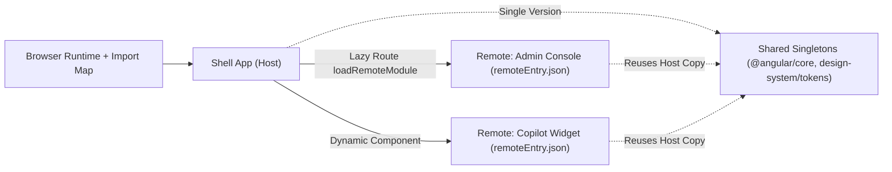
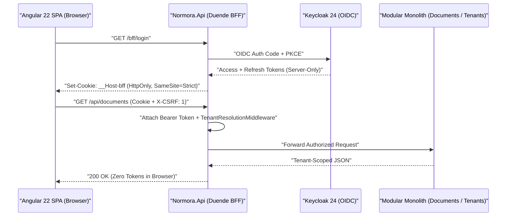
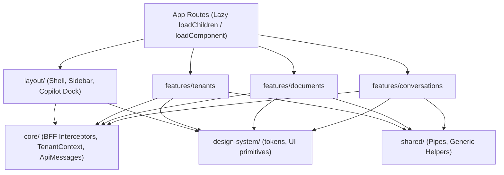
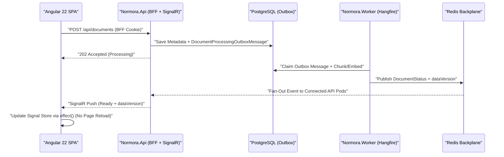

# Appendix 10: Enterprise Architecture Interview Questions

This section focuses on high-level enterprise architecture: scaling Angular 22 for large teams, monorepos and module boundaries, micro-frontends vs. modular SPAs, multi-tenant white-labeling, Duende BFF security, real-time synchronization, and cloud-native deployments. These are questions expected of a Senior, Staff, or Principal UI Architect—illustrated with real architectural patterns from **Normora** (an Angular 22 SPA behind a .NET 10 Modular Monolith + Duende BFF).

---

## Architect Level Questions

### 1. What is the difference between a Polyrepo and a Monorepo architecture?
**Answer:**
* **Polyrepo (Multi-repo):** Every application and shared library lives in its own Git repository and is published independently (e.g., to npm or NuGet).
  * *Drawbacks:* Version skew and integration lag. Updating a shared UI component library to v2.0 requires publishing a package, opening PRs across every consumer repository, bumping `package.json`, and resolving breaking changes asynchronously.
* **Monorepo:** Multiple applications and shared libraries coexist in a single Git repository with a unified dependency graph.
  * *Benefits:* Single source of truth and atomic cross-cutting PRs. If a breaking change is made to a shared design-system component or API contract, CI fails immediately for every affected consumer so everything is updated in one PR.
* **When NOT to use a Monorepo:** When teams have strict legal/compliance code-access isolation requirements across business units, or when publishing an open-source SDK with a completely independent release lifecycle from internal apps.

**Normora Example:** Normora uses a unified repository combining the Angular 22 frontend (`client/src/app/` and `client/src/design-system/`), the .NET 10 Modular Monolith backend (`server/Normora.Api`, `server/Normora.Worker`, `server/Modules/{Tenants,Documents,Conversations}`), `infrastructure/`, and `keycloak-theme/`. When a shared constant like `ApiMessages` or a DTO contract changes, both the backend API and the Angular client (`client/src/app/core/constants/api-messages.ts`) can be verified together in one atomic commit.

---

### 2. Why is Nx considered the industry standard for Angular Monorepos over default Angular CLI workspaces?
**Answer:**
While standard Angular CLI workspaces (`projects/` in `angular.json`) support multiple apps and libraries, they lack enterprise build orchestration and architectural governance. Nx adds:
1. **Computation Caching & Affected Graph:** Nx hashes source inputs and dependencies. Using `nx affected`, CI only builds and tests projects impacted by the current PR, pulling untouched libraries from local or remote cache.
2. **Distributed Task Execution (Nx Cloud):** Splits heavy test suites (Vitest / Playwright) and builds across multiple CI runners in parallel.
3. **Module Boundary Enforcement:** `@nx/enforce-module-boundaries` ESLint rules enforce architectural layering at lint time (e.g., preventing `Documents` feature code from importing internal services from `Conversations`).
* **When NOT to use Nx:** For a single-app repository with one small team (e.g., 2–5 engineers), a standard Angular CLI workspace with strict TypeScript path aliases (`@core/*`, `@design-system/*`, `@features/*`) and ESLint `no-restricted-imports` rules delivers boundary safety without extra tooling overhead.

**Normora Example:** Normora enforces strict vertical boundaries: `client/src/app/features/` slices (`tenants`, `documents`, `conversations`) can depend on `core/`, `shared/`, and `design-system/`, but feature slices never import each other's internal Signal stores—mirroring the backend's `Normora.Architecture.Tests` enforcement where modules communicate solely via `Normora.Shared.Contracts.*`.

---

### 3. What are Micro-Frontends (MFE), and when should you use them—or avoid them?
**Answer:**
Micro-Frontends decompose a large UI into smaller, independently built and independently deployed frontend applications stitched together at runtime in a Host (Shell) container.
* **When to use them:** Only when organizational scale demands **independent deployment lifecycles** across autonomous teams (e.g., 40–100+ UI engineers where Team A must deploy an analytics module on Tuesday without coordinating releases with Team B's core shell).
* **When NOT to use them:** For small-to-medium teams (e.g., 5–20 developers) or tightly coupled product domains. MFEs introduce version mismatches, duplicated framework/CSS payloads, complex cross-MFE routing/auth synchronization, and fragmented end-to-end testing. A well-modularized single Angular SPA with lazy-loaded routes (`loadComponent` / `loadChildren`) in a monorepo is faster, simpler, and far easier to maintain.

**Normora Example:** Normora deliberately pairs a **.NET 10 Modular Monolith** backend with a **single cohesive Angular 22 SPA** (`client/`), rather than splitting `Tenants`, `Documents`, and `Conversations` into 3 separate MFEs. Why? All three domains share one Duende BFF cookie session, one `TenantContextService`, one Tailwind CSS v4 + PrimeNG design system (`client/src/design-system/`), and one unified Copilot workstation (`Ctrl+J`). Splitting them into MFEs would add deployment complexity for zero organizational gain.

---

### 4. Explain how Module Federation and Native Federation enable Micro-Frontends in Angular 22.
**Answer:**
Both approaches let a **Host (Shell)** application dynamically load independently deployed **Remote** applications at runtime over HTTP rather than bundling them together at compile time:
* **Webpack Module Federation (Legacy / Webpack builds):** The Remote exposes a `remoteEntry.js` manifest and shares runtime singletons (like `@angular/core`) through Webpack's runtime container.
* **Native Federation (`@angular-architects/native-federation` — Modern Angular 17–22 esbuild/Vite):** Because modern Angular uses the `@angular/build` esbuild/Vite application builder instead of Webpack, Native Federation relies on **standard browser ES Modules and Import Maps**. The Host fetches a `remoteEntry.json` manifest from each Remote and resolves shared singletons (`@angular/core`, `@angular/common`, `rxjs`) via the browser's Import Map.
* **Why shared singletons matter:** Angular dependency injection, Signal reactivity graphs, and Zone/Zoneless schedulers break—and browser memory balloons—if the Host and Remote load two separate copies of `@angular/core`.



**Normora Example:** If Normora ever extracted its embeddable AI Copilot or an Enterprise Billing Portal for a separate platform team to deploy independently, Native Federation would allow the main Angular 22 Shell to lazy-load `./CopilotWidget` via `remoteEntry.json` while sharing `@angular/core` and `client/src/design-system/tokens` as strict singletons.

---

### 5. In a Multi-Tenant SaaS application, how do you handle White-Labeling (custom branding per tenant) without destroying performance?
**Answer:**
* **Anti-Pattern:** Maintaining separate SCSS builds per tenant (`tenant-a.scss`, `tenant-b.scss`) or compiling multiple Angular apps. Build times scale linearly with tenant count and break CDN/Docker immutability.
* **Modern Angular 22 + Tailwind CSS v4 Architecture:** Ship **one** Angular bundle powered by **CSS Custom Properties** defined in Tailwind v4 `@theme` tokens (`client/src/design-system/tokens`).
  1. When the tenant workspace resolves (`TenantResolutionMiddleware` backed by Redis in Normora), the API returns a sanitized branding DTO (brand colors, logo URL, workspace display name).
  2. Angular applies validated color tokens to `document.documentElement.style.setProperty('--color-brand-primary', ...)` (never injecting raw user-supplied CSS strings, which risks CSS injection).
  3. Tailwind CSS v4 utilities consume those CSS variables while pairing every surface with `dark:` variants (e.g., `bg-white dark:bg-slate-900 text-slate-900 dark:text-slate-100 border-slate-200 dark:border-slate-700`).
* **When NOT to rely solely on CSS variables:** When an enterprise tenant legally requires completely different layout structures or omitted navigation workflows rather than colors/logos—combine CSS tokens with lazy-loaded feature flags or route-level layout components.

**Normora Example:** In Normora, `Tenants` owns white-label branding and persists uploaded logos via the provider-neutral `IBrandingStorageService` interface (implemented by `MinioBrandingStorageService` in `Normora.Infrastructure`). Branding lookups are cached in Redis (30s–5m sliding expiration) so every SPA boot applies the tenant's logo and CSS custom properties instantaneously with zero extra Angular builds.

---

### 6. How do you implement strict Role-Based Access Control (RBAC) in an Angular 22 UI?
**Answer:**
UI RBAC is a **UX optimization** (preventing unauthorized navigation and hiding irrelevant controls), while the backend API remains the sole security enforcement boundary. Implement it in two layers using Signals and functional APIs:
1. **Route-Level Protection (`CanMatchFn`):** Use a functional `canMatch` guard rather than `canActivate` when you want to prevent the browser from even downloading a restricted lazy-loaded feature chunk.
2. **DOM-Level Visibility (`@if` + Signal-driven directives):**
   * For straightforward checks, use Angular 22's `@if` control flow reading a `computed()` Signal on a tenant/auth service:
     ```html
     @if (tenantStore.canManageWorkspace()) {
       <button
         type="button"
         class="rounded-lg bg-slate-900 dark:bg-white text-white dark:text-slate-900 border-none! px-4 py-2">
         Invite Employee
       </button>
     }
     ```
   * For reusable cross-component directives, inject `TemplateRef`, `ViewContainerRef`, and use an `effect()` watching a Signal `input()` (avoiding legacy RxJS `.subscribe()` leaks).

**Normora Example (UI UX + Backend BOLA/BFLA):**
* **UI Tier/Role Gating:** Per Normora's billing invariants, workspaces on the `Free` tier suppress cancellation buttons, danger zones, and renewal countdowns in the Angular UI, while `CancelSubscriptionCommandHandler` enforces `InvalidOperationException(ApiMessages.CannotCancelFreePlan)` on the server.
* **True Backend Enforcement:** Even if a user crafts a raw HTTP request bypassing Angular's `canMatch` guard:
  * Missing role/permission throws `BflaException()` -> mapped globally to `403 Forbidden` with `ApiResponse.Failure(ApiMessages.Forbidden)` (BFLA defense).
  * Accessing another tenant's or unauthorized department's document throws `BolaException()` -> mapped globally to `404 Not Found` with `ApiMessages.NotFound` to prevent resource ID enumeration (BOLA defense).

---

### 7. What is the difference between deploying an Angular app to a static host (S3/Azure Blob) versus a compute host (Docker/Kubernetes)?
**Answer:**
* **Static Host (CDN + Object Storage):** Used for **Client-Side Rendered (CSR)** or **Static Site Generated (SSG / Prerendered)** bundles (`RenderMode.Client` / `RenderMode.Prerender`). The build outputs static HTML, JS, and CSS files served from edge CDNs with near-zero compute cost and trivial horizontal scaling.
* **Compute Host (Docker / Kubernetes / App Service):** Required for dynamic **Server-Side Rendering (SSR)** using `@angular/ssr` (which replaced the legacy Angular Universal package). Because HTML is rendered per request on a Node.js server, you must run container orchestration, configure liveness/readiness probes, manage memory/CPU limits, and handle request-scoped state safely (no global mutable singletons leaking across user requests).
* **Hybrid Rendering (`ServerRoute`):** Modern Angular lets you mix modes in one app—prerendering public marketing/docs pages (`RenderMode.Prerender`) while running authenticated SaaS dashboards in CSR (`RenderMode.Client`) or SSR (`RenderMode.Server`).

**Normora Example:** Normora's authenticated multi-tenant workspace (`/t/:slug/...`) sits behind `Normora.Api` (Duende BFF) and runs as a client-rendered Angular 22 SPA served inside the containerized stack (`localhost:4200` in dev / reverse-proxied behind the BFF in production). Why not SSR the workspace? Workspace documents and chat threads are strictly tenant-private behind `HttpOnly` `SameSite=Strict` cookies and must never risk cross-request state leakage or accidental CDN caching, whereas public landing/pricing pages can be statically prerendered. Meanwhile, the .NET host runs in Docker/Kubernetes with an isolated `--migrate` console host (`MigrationHostExtensions.RunMigrationsAsync`) for clean zero-exit schema migrations before the API pods boot.

---

### 8. How do you handle environment-specific variables (like API URLs) in a "Build Once, Run Anywhere" Docker strategy?
**Answer:**
Angular's `environment.ts` files (`client/src/environments/`) are evaluated at **compile time** and baked into the JavaScript bundle—meaning you cannot promote the exact same Docker image from Staging to Production if environment URLs live there. Instead, use **Runtime Configuration Injection** with Angular 22's `provideAppInitializer` (which replaces the deprecated `APP_INITIALIZER` token):
1. Place a non-secret `config.json` in `client/public/config.json` (the modern Angular CLI static public directory).
2. Load `/config.json` during bootstrap via `provideAppInitializer()` before routes or HTTP calls execute:
   ```typescript
   import { ApplicationConfig, inject, provideAppInitializer, provideZonelessChangeDetection } from '@angular/core';
   import { HttpClient, provideHttpClient } from '@angular/common/http';
   import { firstValueFrom, tap } from 'rxjs';
   import { RuntimeConfigService, RuntimeConfig } from './core/services/runtime-config.service';

   export const appConfig: ApplicationConfig = {
     providers: [
       provideZonelessChangeDetection(),
       provideHttpClient(),
       provideAppInitializer(() => {
         const http = inject(HttpClient);
         const configService = inject(RuntimeConfigService);
         return firstValueFrom(
           http.get<RuntimeConfig>('/config.json').pipe(
             tap((cfg) => configService.setConfig(cfg))
           )
         );
       }),
     ],
   };
   ```
3. In Kubernetes or Docker Compose, mount a **ConfigMap** (or container entrypoint script) over `/usr/share/nginx/html/config.json` at container startup.
* **Critical Security Rule:** **Never** put secrets (OIDC client secrets, API keys, storage credentials) in `config.json`—anything delivered to the browser is public.

**Normora Example:** In Normora, sensitive secrets (`GEMINI_API_KEY`, `RESEND_API_KEY`, Keycloak OIDC client secrets, MinIO keys, PayU salt) stay strictly server-side inside `Normora.Api` and `Normora.Worker` via strongly-typed `IOptions<T>` with `ValidateOnStart()`. The Angular SPA only needs public runtime flags (such as telemetry toggles, SignalR hub path, or support links) in `client/public/config.json`, while API calls use relative same-origin BFF paths (`/api/...`, `/bff/...`).

---

### 9. What is a BFF (Backend-For-Frontend) and why might an Angular Architect require one?
**Answer:**
A **BFF (Backend-For-Frontend)** is a dedicated server-side web host sitting directly between the Angular SPA and backend APIs/identity providers. Architects mandate a BFF for two major reasons:
1. **Browser Token Immunity (Primary Security Reason):** Storing OAuth2/OIDC access or refresh tokens in `localStorage`, `sessionStorage`, or in-memory JS makes them vulnerable to XSS exfiltration. With a BFF, tokens never reach the browser. The BFF executes the OIDC Authorization Code + PKCE exchange on the server, stores tokens in encrypted server-side sessions, and issues an encrypted `HttpOnly`, `SameSite=Strict`, `Secure` session cookie + anti-CSRF header (`X-CSRF: 1`).
2. **Payload Aggregation & Protocol Adaptation:** The BFF can aggregate multiple internal calls into one payload, strip sensitive fields, and host real-time streams (SSE / SignalR) behind the same origin—eliminating CORS complexity.
* **When NOT to use a BFF:** Purely public, unauthenticated read-only portals (marketing sites, public documentation) where there are no user tokens to protect.



**Normora Example:** `Normora.Api` is a **Duende BFF** host with zero business controllers. It manages Keycloak OIDC sessions (`SessionDatabaseMigrator`), maps module routes with `AsBffApiEndpoint()`, enforces anti-CSRF headers, proxies AG-UI streaming (`/api/copilotkit`), and delegates domain execution to decentralized controllers in `server/Modules/{Tenants,Documents,Conversations}/API/`.

---

### 10. You inherit a legacy Angular v12 application (500,000 LOC) that takes 20 seconds to boot. Detail your modernization and optimization strategy.
**Answer:**
1. **Incremental Framework Upgrade (v12 -> v22):** Run `ng update` step-by-step across major versions to reach Angular 22, unlocking:
   * `@angular/build` (esbuild + Vite) replacing legacy Webpack builds.
   * Automated schematics for **Standalone Components** (`ng g @angular/core:standalone`) and **New Control Flow** (`@if`, `@for`, `@switch`).
   * **Zoneless Change Detection** (`provideZonelessChangeDetection()`), removing `zone.js` (~35 KB+ and unnecessary monkey-patched CD ticks).
2. **Break Up Monolithic Modules & Lazy-Load Routes:** Replace eager feature `NgModule` imports with route-level `loadComponent` and `loadChildren` so the initial bundle only ships the shell + active route.
3. **Audit the Bundle with esbuild Metafile Analysis:** Build with `--stats-json` and inspect the esbuild metafile (`esbuild.github.io/analyze`) to hunt down bloated dependencies (e.g., Moment.js, un-tree-shaken icon packs, heavy chart/PDF libraries). Defer non-critical heavy views with `@defer (on viewport)` or `@defer (on interaction)`.
4. **Signals + `OnPush` Everywhere:** Migrate heavy RxJS `BehaviorSubject` + async pipe chains and default change detection to Signals (`signal`, `computed`, `input()`) with `ChangeDetectionStrategy.OnPush` and Zoneless CD to eliminate CPU thrashing.
5. **Optimize FCP / LCP with SSR or Prerendering:** Enable `@angular/ssr` with **Incremental Hydration** (`withIncrementalHydration()` + `@defer (hydrate on interaction)`) for public entry routes while keeping authenticated workspace dashboards fast via lean payloads and `NgOptimizedImage`.

**Normora Example:** On Normora's workspace dashboard and AI chat interface, heavy secondary UI—such as `ChunkPreviewDrawerComponent` (with Markdown rendering), `ExpenseSimulatorCardComponent`, and analytics charts—is lazily deferred (`@defer (on interaction)` / `@defer (on viewport)`) rather than bundled into the initial login/shell payload, keeping Time-to-Interactive fast even on mobile devices.

---

## Scenario-Based & System Design Questions (Normora)

### 11. How do you structure a large Angular 22 frontend to mirror a Modular Monolith backend without creating a "Big Ball of Mud"?
**Answer:**
Mirror the backend's bounded contexts using **strict vertical feature slicing** and **unidirectional dependency rules**:
1. **`core/` (App-Wide Singletons):** Auth/BFF session interceptors, `TenantContextService`, `ApiMessages` constants, runtime config, and telemetry—imported downward, never depending on features.
2. **`design-system/` (`tokens/` + `components/`):** Framework-agnostic visual tokens (Tailwind v4 `@theme` CSS variables) and reusable stateless UI primitives (`input()`, `output()`, `model()`, no business services).
3. **`layout/` & `shared/`:** App shell navigation, responsive drawers, pipes, and shared formatting utilities.
4. **`features/` (Vertical Bounded Slices):** Feature domains (`tenants`, `documents`, `conversations`) loaded via `loadChildren` / `loadComponent`. Feature A **never** imports services, Signal stores, or components directly from Feature B. Cross-feature coordination happens via router navigation, URL query params, or shared state/events in `core/` (or server-side `dataVersion` sync).
* **When NOT to over-slice:** For small internal tools under 5 routes, deep folder hierarchies and strict facade layers create boilerplate without payoff.



**Normora Example:** In `client/src/app/`, `features/` mirrors `server/Modules/` (`Tenants`, `Documents`, `Conversations`). Just as `Normora.Api` bans cross-module `DbContext` injection and enforces `Normora.Shared.Contracts.*` MediatR contracts, `features/conversations` never reaches into `features/documents` internals—co-browsing from a citation badge (`ChunkPreviewDrawerComponent` -> `Locate in Documents`) navigates cleanly via Angular Router URLs and query parameters (`navigateActuation`).

---

### 12. *Scenario:* In Normora, an admin uploads a 200-page PDF policy. Ingestion takes 45 seconds in a background worker (`Normora.Worker`). How do you architect real-time UI updates across horizontally scaled API pods without HTTP polling?
**Answer:**
Combine the **Transactional Outbox Pattern**, a **Redis Pub/Sub SignalR Backplane**, and **Angular Signals**:
1. **Atomic Persistence + Outbox:** `UploadDocumentCommandHandler` commits document metadata, version, and a `DocumentProcessingOutboxMessage` inside a single PostgreSQL transaction, then signals `IDocumentProcessingWakeup`.
2. **Decoupled Worker Processing:** `Normora.Worker` (Hangfire) runs `HangfireDocumentProcessingOutboxDispatcher`, chunks Markdown/tables, calls Gemini `batchEmbedContents`, and emits progress via `IDocumentNotificationService`.
3. **Cross-Process Fan-Out (Redis Backplane):** Because `Normora.Worker` cannot hold browser WebSocket connections, it publishes events to Redis configured via `AddNormoraSignalR`. All `Normora.Api` BFF instances subscribe to Redis and push SignalR updates to the matching tenant/user WebSocket connections.
4. **Signal-Driven Angular 22 UI:** A SignalR service translates incoming events (`dataVersion` increment or document status change) into `signal()` updates, and components react via `computed()` or `effect()`, cleaning up listeners with `DestroyRef` (`takeUntilDestroyed()`).
* **When NOT to use SignalR/WebSockets:** Simple CRUD forms or infrequent settings updates where standard HTTP responses or optimistic UI suffice.



**Normora Example:** Normora's `IWorkspaceStateSynchronizer` broadcasts monotonic `dataVersion` updates over SignalR and SSE streams. In Angular 22, an `effect()` observing the workspace `dataVersion` Signal automatically refreshes employer management tables and document status pills without manual page reloads or wasteful 5-second `setInterval` polling.

---

### 13. *Scenario:* Normora's Unified Copilot (`Ctrl+J`) streams live AI tokens, tool execution chips (`tool_started`, `tool_finished`), interactive A2UI cards (`ExpenseSimulatorCardComponent`), and deletion approvals over SSE (`/api/copilotkit`). How do you prevent main-thread UI jank and cross-tenant AI state leaks?
**Answer:**
1. **Zoneless + Batched Signal Updates (INP Protection):** Calling `zone.js` change detection on every 15ms SSE token freezes typing and scrolling. Running `provideZonelessChangeDetection()` with `ChangeDetectionStrategy.OnPush` ensures only the active message Signal triggers DOM updates; batch rapid SSE deltas per animation frame (`requestAnimationFrame`) so Markdown re-parsing never starves user input.
2. **Deferred Dynamic Component Rendering:** Map A2UI payload discriminators (`policy_limit_card`, `hr_escalation_card`, `intake_form_card`) to standalone components loaded lazily with `@defer` or dynamic `NgComponentOutlet`, keeping heavy interactive widgets out of the main bundle.
3. **Server-Enforced HITL & Tenant Partitioning:** Never trust an Angular confirmation modal alone for destructive AI actions. Normora's backend intercepts `documents_delete`, writes a `PendingApproval` record (15-minute TTL) in PostgreSQL, streams an interactive approval card, and executes only after explicit consent via `ApprovalsController`. Meanwhile, `NormoraAgentIsolationKeyProvider` keys AI threads by `{TenantId}:{ExternalUserId}` on the server, and Angular aborts any open SSE `AbortController` and resets Copilot Signals whenever the active tenant changes.

**Normora Example:** When an employee asks about travel reimbursement, `NormoraWorkplaceAgent` streams `tool_started` / `tool_finished` badges and an `ExpenseSimulatorCardComponent` (`policy_limit_card`) rendered inline in the Copilot dock—while `TenantContextService` guarantees switching from Workspace A to Workspace B clears the thread Signal and aborts active `/api/copilotkit` streams.

---

### 14. How do you govern an enterprise Design System across multiple teams combining PrimeNG, Tailwind CSS v4, and strict Dark Mode?
**Answer:**
Enforce a **token-first Design System layer** (`client/src/design-system/`) paired with **anti-corruption component wrappers**:
1. **CSS-First Tokens (`tokens/`):** Define semantic design tokens (`--color-surface-primary`, `--color-border-subtle`) using Tailwind CSS v4 `@theme`, instead of letting feature teams scatter arbitrary hex codes.
2. **Wrapper Components (`components/`):** Wrap complex third-party widgets (such as PrimeNG tables/dialogs) in thin standalone Angular 22 components using `input()`, `output()`, and `model()`. If you upgrade PrimeNG later, you update the wrapper once rather than refactoring 80 feature templates.
3. **Tailwind v4 Rules & Mandatory `dark:` Variants:** Every surface, text, border, and ring class must pair light and dark tokens, and any `!important` override for third-party specificity uses Tailwind v4's **suffix** syntax (`border-none!`, `shadow-none!`, never `!border-none`).
4. **Centralized UI Copy:** Store shared error and toast strings in a typed constant file (`ApiMessages`) so teams never invent inconsistent hardcoded strings.

**Normora Example:** Normora's `client/src/design-system/` separates `tokens/` from `components/`. A design-system card wrapper applies `bg-white dark:bg-slate-900 text-slate-900 dark:text-slate-100 border border-slate-200 dark:border-slate-700 shadow-none!` and `.custom-scrollbar` for overflow containers, ensuring PrimeNG and custom Copilot A2UI cards look cohesive in both light and dark modes.

---

### 15. In a distributed SPA + BFF + Modular Monolith + Background Worker architecture, how do you implement end-to-end observability without exposing internal errors (CWE-209)?
**Answer:**
Separate **developer/operator telemetry** (distributed traces + structured logs) from **user-facing error envelopes**:
1. **W3C Trace Context Propagation:** An Angular `HttpInterceptorFn` attaches W3C `traceparent` headers (or lets OpenTelemetry Web instrumentation inject them) on same-origin `/api/...` requests. `Normora.Api` correlates the browser route/action with downstream MediatR handlers, PostgreSQL/pgvector queries, Gemini API calls, and Hangfire jobs in `Normora.Worker`.
2. **Sanitized Error Contracts (CWE-209 Defense):** Never forward raw `exception.Message`, stack traces, SQL errors, or internal HTTP codes to the Angular client or transactional emails. Map domain/security errors to fixed codes and generic `ApiMessages` constants.
3. **Global Frontend Error Interceptor:** Intercept non-2xx responses, map structured `ApiResponse` failures to `ApiMessages` constants, and attach only the safe correlation/trace ID in support banners.

**Normora Example:** If `DocumentProcessingJob` fails in `Normora.Worker`, detailed stack traces go strictly to structured OpenTelemetry logs, while workspace admins receive a generic constant from `Normora.Shared.Constants.ApiMessages`. On the HTTP path, `BolaException` -> `404` (`ApiMessages.NotFound`) and `BflaException` -> `403` (`ApiResponse.Failure(ApiMessages.Forbidden)`) are parsed cleanly by Angular's HTTP error interceptor using `client/src/app/core/constants/api-messages.ts`.

---

### 16. *Scenario:* A Normora user belongs to two workspaces (`acme-corp` and `beta-labs`). They switch workspaces while a slow RAG search and document list request are still in flight. How do you prevent cross-tenant UI contamination?
**Answer:**
1. **URL-Driven Tenant Scope:** Encode the tenant slug in the route (`/t/:slug/documents`) so route parameters—not mutable hidden flags—are the single source of truth for the active workspace.
2. **Automatic In-Flight Request Cancellation:** Drive tenant-scoped fetches from the route/tenant Signal using `rxResource` or RxJS `switchMap`. When `:slug` changes from `acme-corp` to `beta-labs`, Angular automatically cancels the previous `HttpClient` observable (triggering browser `AbortController`), making it impossible for a late `acme-corp` response to overwrite `beta-labs` Signals.
3. **Explicit State Purge on Tenant Switch:** Clear cached feature Signal stores, close active drawers (`ChunkPreviewDrawerComponent`), reset Copilot threads, and re-run branding/permission hydration.
4. **Server-Side Isolation Defense-in-Depth:** Every backend query uses `TenantResolutionMiddleware` (Redis-cached slug + RBAC check) and EF Core global query filters bound to `ITenantContext.TenantId` (plus explicit `TenantId` parameters on `Normora.Shared.Contracts.*` MediatR queries).

**Normora Example:** When switching from `/t/acme-corp/chat` to `/t/beta-labs/chat`, `TenantContextService` updates its `activeTenantSlug` Signal, aborts pending `/api/copilotkit` SSE streams and document queries, clears cached Signal tables, and lets `TenantResolutionMiddleware` verify membership in `beta-labs` (returning `404` via `BolaException` if unauthorized).

---

## Common Mistakes & Anti-Patterns

> [!CAUTION]
> **Anti-Pattern 1: Storing OIDC Access Tokens in `localStorage` or Angular Services**
> ```typescript
> // WRONG: Vulnerable to XSS exfiltration by any compromised third-party script
> localStorage.setItem('access_token', tokenResponse.access_token);
> ```
> **Why it's wrong:** Any XSS vulnerability or compromised npm dependency can read `localStorage` or JS memory and steal long-lived tokens.
> **Fix:** Use a **Duende BFF** (`Normora.Api`). Keep Keycloak OIDC tokens strictly on the server and authenticate the Angular 22 SPA via encrypted `HttpOnly`, `SameSite=Strict`, `Secure` cookies plus anti-CSRF headers (`X-CSRF: 1`) on `AsBffApiEndpoint()` routes.

> [!CAUTION]
> **Anti-Pattern 2: Using `environment.ts` Secrets or Deprecated `APP_INITIALIZER` for Container Config**
> ```typescript
> // WRONG: Baked at compile time + legacy APP_INITIALIZER token + secrets in frontend
> export const environment = { apiUrl: 'https://prod.api', geminiKey: 'AIza...' };
> ```
> **Why it's wrong:** Compile-time `environment.ts` breaks "Build Once, Run Anywhere" Docker promotion, `APP_INITIALIZER` is deprecated in modern Angular, and putting API keys in the SPA leaks secrets to every user's DevTools.
> **Fix:** Keep all secrets in `Normora.Api` / `Normora.Worker` via `IOptions<T>` (`ValidateOnStart()`). For non-secret runtime flags, load `client/public/config.json` with `provideAppInitializer()` and override it via Kubernetes ConfigMaps at runtime.

> [!CAUTION]
> **Anti-Pattern 3: Treating UI Guards (`canMatch` / `@if`) as Security or Returning Explicit 404/403 Leaks**
> ```csharp
> // WRONG: Leaks existence of another tenant's resource (BOLA enumeration)
> return NotFound($"Document {id} belongs to Tenant B, not your workspace.");
> ```
> **Why it's wrong:** Attackers bypass Angular UI guards with `curl`. Detailed 404/403 messages let attackers enumerate valid document IDs across tenants.
> **Fix:** Treat Angular `canMatch` and `@if` strictly as UX. Enforce authorization on the backend: throw `BolaException` (mapped globally to `404` with generic `ApiMessages.NotFound`) for unauthorized/missing objects and `BflaException` (mapped to `403` with `ApiResponse.Failure(ApiMessages.Forbidden)`) for missing permissions.

> [!CAUTION]
> **Anti-Pattern 4: Cross-Feature Imports & Unpartitioned Client Caches in Multi-Tenant Apps**
> ```typescript
> // WRONG: Feature coupling + stale cross-tenant data on workspace switch
> import { DocumentsStore } from '../../documents/state/documents.store';
> ```
> **Why it's wrong:** Direct imports between `features/*` slices create a tangled monolith where one domain cannot evolve safely, and unpurged Signal stores leak Tenant A's rows into Tenant B's view after switching workspaces.
> **Fix:** Enforce vertical slice boundaries (`features/*` -> `core/`, `shared/`, `design-system/` only), coordinate across features via Router navigation or `core/` events (`dataVersion`), and reset Signal stores + abort in-flight requests (`rxResource` / `switchMap`) on tenant slug changes.

> [!CAUTION]
> **Anti-Pattern 5: Tailwind CSS v3 `!important` Prefix, Missing `dark:` Variants, and Leaked Streams**
> ```html
> <!-- WRONG: !border-none is invalid in Tailwind v4 and has no dark: variant -->
> <div class="bg-white text-slate-900 !border-none"></div>
> ```
> **Why it's wrong:** In Tailwind CSS v4, `!` as a prefix fails to generate the `!important` rule; omitting `dark:` variants breaks dark-mode readability; and leaving SignalR or SSE listeners unclosed leaks memory and triggers stale updates in zoneless Angular.
> **Fix:** Use Tailwind v4 suffix syntax (`border-none!`), pair every color with `dark:` (`bg-white dark:bg-slate-900 text-slate-900 dark:text-white border-slate-200 dark:border-slate-700`), and tie SignalR/SSE lifecycles to `DestroyRef` / `AbortController`.
