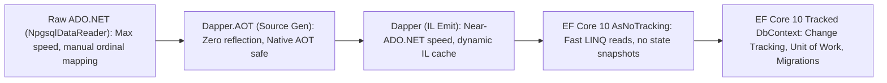
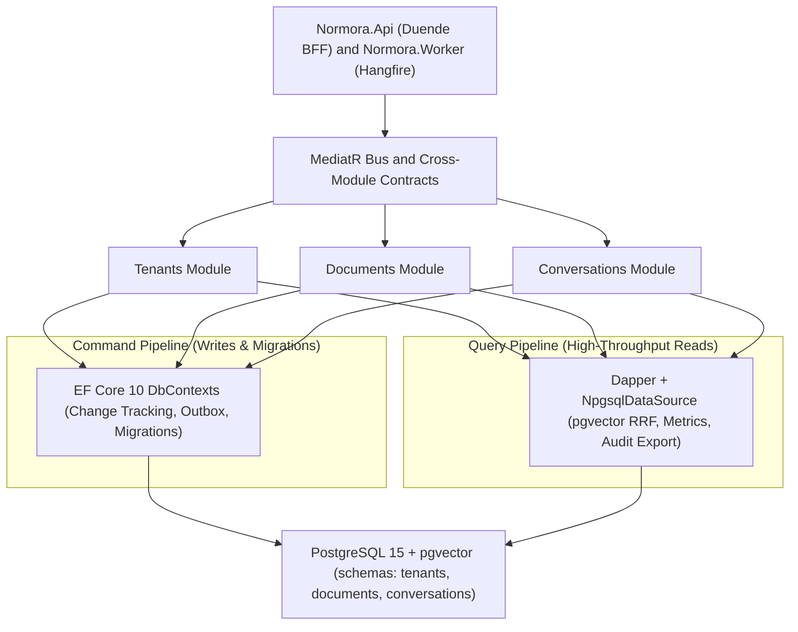
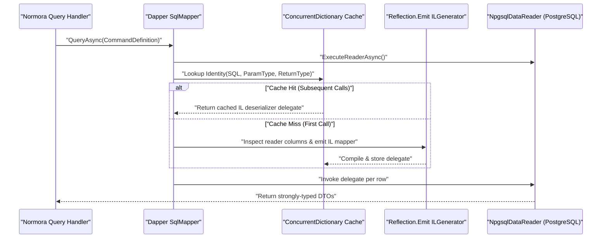

# Chapter 1: The Evolution of Data Access in .NET

## 1. Learning Objectives

By the end of this chapter, you will be able to:
*   Understand the **Object-Relational Impedance Mismatch**, the historical evolution of .NET data access (from raw ADO.NET to EF Core 10, Dapper, and compile-time `Dapper.AOT`), and the precise engineering challenges that led Stack Overflow to build Dapper.
*   Differentiate deeply between Full ORMs (Entity Framework Core 10, NHibernate) and Micro ORMs (Dapper) at the architectural, memory-allocation, and IL (Intermediate Language) levels.
*   Identify real-world, enterprise-scale architectural scenarios where Dapper is the optimal choice—and recognize **when NOT to use Dapper**.
*   Analyze the trade-offs of using a Micro ORM alongside EF Core (polyglot persistence) within a **Clean Architecture / Modular Monolith** and **CQRS (Command Query Responsibility Segregation)** setup using .NET 10 and C# 14 primary constructors.
*   Conceptualize the foundational domains for both the **Multi-Tenant EV Charging Management Platform** case study and **Normora** (our .NET 10 + PostgreSQL + `pgvector` enterprise knowledge and conversational AI platform).

## 2. Introduction

In the domain of enterprise software engineering, data access is rarely just an implementation detail—it is the central pillar around which application performance, scalability, and operational maintainability revolve. For decades, .NET engineers have oscillated between the raw, unbridled performance of **ADO.NET** (ActiveX Data Objects for .NET—the low-level, provider-based database API built into .NET) and the developer-friendly, heavily abstracted world of **Full Object-Relational Mappers (ORMs)** like Entity Framework (EF) and NHibernate.

As applications transition from internal corporate monoliths to globally distributed, multi-tenant **SaaS (Software as a Service)** platforms (where one shared application serves many isolated customer organizations, or *tenants*), a chasm emerges. Abstractions that accelerate development in the early stages—such as **Change Tracking** (keeping snapshots of loaded entities in memory to detect property edits) and **Lazy Loading** (deferring child-table queries until a navigation property is accessed in C#)—often become the very bottlenecks that cripple an application under peak load. This chapter explores the origins of Dapper, a tool built out of absolute engineering necessity to bridge this chasm, offering the performance of raw ADO.NET with a developer experience that rivals modern ORMs.

### The Object-Relational Impedance Mismatch
Before comparing tools, you must understand *why* ORMs exist at all. C# is an object-oriented language built around class hierarchies, references, inheritance, and rich behavior. Relational databases like PostgreSQL and SQL Server are built around set theory, flat normalized tables, foreign keys, and specialized storage types (such as PostgreSQL `jsonb` or `pgvector`'s `vector`).

This structural friction between in-memory object graphs and relational tables is called the **Object-Relational Impedance Mismatch**:
*   **Granularity & Identity:** In C#, two objects are equal by reference or `Equals()`, whereas in SQL, identity is a primary key (`tenant_id`, `id`).
*   **Associations:** In C#, objects hold direct pointers (`Document.Versions` as a `List<DocumentVersion>`). In SQL, tables link via foreign keys (`document_versions.document_id`) and require `JOIN` operations.
*   **Data Types:** Modern platforms like Normora store 768-dimensional embedding vectors in PostgreSQL (`pgvector` `vector(768)`) and unstructured metadata in `jsonb`, which do not map 1:1 to standard CLR primitives without explicit adapters.

Every data access library chooses a point on a spectrum for resolving this mismatch: raw ADO.NET makes *you* bridge it manually; Full ORMs automate the entire bridge at runtime; and **Micro ORMs** like Dapper automate *only* the tabular-row-to-C#-object mapping while leaving SQL authoring in your hands.

### The History of Dapper
Before Dapper's inception in 2011, .NET developers faced a stark, binary choice. Option A was **ADO.NET**: writing imperative, boilerplate-heavy code utilizing `DbConnection`, `DbCommand`, and `DbDataReader` (such as `SqlConnection`/`SqlDataReader` for SQL Server or `NpgsqlConnection`/`NpgsqlDataReader` for PostgreSQL). This approach yielded maximum performance because it minimized heap allocations and abstraction layers. However, it was incredibly verbose, error-prone, and tedious. Mapping a result set to a strongly typed C# object required manually checking for `DBNull`, managing zero-based column ordinals, and writing custom mapping logic for every single entity.

Option B was a **Full ORM** (like NHibernate or early versions of Entity Framework). These frameworks provided massive productivity boosts through **LINQ (Language Integrated Query)** translations into SQL, Change Tracking, and **Unit of Work** patterns (grouping multiple inserts/updates into a single atomic transaction via `SaveChangesAsync()`). However, they carried heavy runtime overhead: memory allocations for change trackers, complex state management graphs, and the notorious **N+1 query problem** (executing 1 query for N parent rows followed by N separate round-trip queries for their children) caused by unoptimized lazy loading. Furthermore, the SQL generated by Full ORMs was often suboptimal for complex enterprise queries involving window functions, **CTEs (Common Table Expressions)**, pivot tables, or specialized PostgreSQL operators.

### Why Stack Overflow Built Dapper
In 2011, Stack Overflow was facing unprecedented scaling challenges. Serving thousands of page views per second, their telemetry indicated that LINQ-to-SQL (their initial ORM choice) was generating overly complex queries and, more importantly, consuming massive amounts of CPU and memory for object mapping and state management. Falling back to writing raw ADO.NET mapping logic was unfeasible given the massive size of their rapidly iterating codebase.

Engineers Marc Gravell and Sam Saffron needed a solution that added near-zero overhead to ADO.NET while completely eliminating the boilerplate of object mapping. They built **Dapper**: a **Micro ORM** (initially a single `SqlMapper.cs` file dropped directly into their project) that used **Reflection** (inspecting C# type metadata at runtime) once per query shape and **IL (Intermediate Language)** generation (emitting low-level .NET bytecode compiled by the **JIT — Just-In-Time compiler**) to create ultra-fast, cached object mappers.

The result? Dapper executed queries and mapped results at speeds nearly identical to hand-tuned ADO.NET, while reducing thousands of lines of boilerplate code to a simple extension method: `connection.QueryAsync<T>(sql, param)`.

### The .NET 10 Data Access Spectrum (Side-by-Side Comparison)
In modern **.NET 10 / C# 14**, the data access ecosystem has evolved further. Full ORMs like EF Core 10 offer `AsNoTracking()`, bulk `ExecuteUpdateAsync()`/`ExecuteDeleteAsync()`, and raw `SqlQuery<T>()` mapping. Meanwhile, classic Dapper remains dominant under JIT runtimes, and **`Dapper.AOT`** (using C# compile-time interceptors and source generators) brings zero-reflection, zero-IL-emit mapping to **Native AOT (Ahead-of-Time)** deployments where runtime code generation is disallowed or startup latency must be sub-millisecond.

To *feel* why Dapper exists, compare how three approaches implement the exact same **Normora** read query in the `Tenants` module—fetching active department summaries for a tenant from PostgreSQL (`tenants.departments` and `tenants.tenant_memberships`):

```csharp
// Shared DTO in Normora.Modules.Tenants.Application.Departments.DTOs
public sealed record DepartmentSummaryDto(Guid Id, string Name, int MemberCount);
```

1. **Raw ADO.NET (`NpgsqlDataSource`) — Maximum Speed, Maximum Boilerplate:**
```csharp
public sealed class GetDepartmentSummariesAdoHandler(NpgsqlDataSource dataSource)
{
    public async Task<IReadOnlyList<DepartmentSummaryDto>> HandleAsync(Guid tenantId, CancellationToken ct)
    {
        const string sql = """
            SELECT d.id, d.name, COUNT(m.id)::int AS member_count
            FROM tenants.departments d
            LEFT JOIN tenants.tenant_memberships m
                ON m.department_id = d.id AND m.tenant_id = d.tenant_id
            WHERE d.tenant_id = @tenantId AND d.is_deleted = FALSE
            GROUP BY d.id, d.name
            ORDER BY d.name;
            """;

        await using var conn = await dataSource.OpenConnectionAsync(ct);
        await using var cmd = new NpgsqlCommand(sql, conn);
        cmd.Parameters.AddWithValue("tenantId", tenantId);

        var results = new List<DepartmentSummaryDto>();
        await using var reader = await cmd.ExecuteReaderAsync(ct);
        int idOrd = reader.GetOrdinal("id");
        int nameOrd = reader.GetOrdinal("name");
        int countOrd = reader.GetOrdinal("member_count");

        while (await reader.ReadAsync(ct))
        {
            results.Add(new DepartmentSummaryDto(
                reader.GetGuid(idOrd),
                reader.GetString(nameOrd),
                reader.GetInt32(countOrd)));
        }
        return results;
    }
}
```

2. **EF Core 10 (`AsNoTracking`) — Productive LINQ, Higher Abstraction Cost:**
```csharp
public sealed class GetDepartmentSummariesEfHandler(TenantsDbContext dbContext)
{
    public async Task<IReadOnlyList<DepartmentSummaryDto>> HandleAsync(Guid tenantId, CancellationToken ct)
    {
        // Note: TenantsDbContext is unscoped, so TenantId must be filtered explicitly
        var raw = await dbContext.Departments
            .AsNoTracking()
            .Where(d => d.TenantId == tenantId && !d.IsDeleted)
            .Select(d => new
            {
                d.Id,
                d.Name,
                MemberCount = d.Memberships.Count(m => m.TenantId == tenantId)
            })
            .OrderBy(d => d.Name)
            .ToListAsync(ct);

        return raw.Select(x => new DepartmentSummaryDto(x.Id, x.Name, x.MemberCount)).ToList();
    }
}
```

3. **Dapper (C# 14 Primary Constructor + `NpgsqlDataSource`) — SQL Control, Zero Boilerplate:**
```csharp
public sealed class GetDepartmentSummariesDapperHandler(NpgsqlDataSource dataSource)
{
    public async Task<IReadOnlyList<DepartmentSummaryDto>> HandleAsync(Guid tenantId, CancellationToken ct)
    {
        const string sql = """
            SELECT d.id AS "Id", d.name AS "Name", COUNT(m.id)::int AS "MemberCount"
            FROM tenants.departments d
            LEFT JOIN tenants.tenant_memberships m
                ON m.department_id = d.id AND m.tenant_id = d.tenant_id
            WHERE d.tenant_id = @TenantId AND d.is_deleted = FALSE
            GROUP BY d.id, d.name
            ORDER BY d.name;
            """;

        await using var conn = await dataSource.OpenConnectionAsync(ct);
        var rows = await conn.QueryAsync<DepartmentSummaryDto>(
            new CommandDefinition(sql, new { TenantId = tenantId }, cancellationToken: ct));
        return rows.AsList();
    }
}
```
Notice how Dapper keeps the exact hand-tuned SQL and ADO.NET speed of Option 1 while eliminating every `GetOrdinal` and `reader.ReadAsync` loop!

### Micro ORM vs Full ORM
Understanding the fundamental architectural distinction between these two paradigms is crucial for any Solution Architect. Dapper is not a "lesser" EF Core; it is a fundamentally different tool designed to solve a different problem.

| Feature | Full ORM (EF Core 10) | Micro ORM (Dapper) |
| :--- | :--- | :--- |
| **SQL Generation** | Translates LINQ expressions into SQL (PostgreSQL / T-SQL) at runtime. | None. You write the exact SQL dialect (e.g., PostgreSQL + `pgvector` or T-SQL). |
| **Change Tracking** | Tracks entity state (Added, Modified, Deleted) in memory. | None. Completely stateless execution. |
| **Object Mapping** | Complex mapping, relationships, value converters, owned types. | Fast, direct mapping via dynamic IL Emit (or compile-time source gen via `Dapper.AOT`). |
| **Lazy Loading** | Supported (though discouraged in modern architectures). | Not supported by design. |
| **Unit of Work** | Built-in via `DbContext.SaveChangesAsync()`. | Manual (via `DbTransaction` such as `NpgsqlTransaction` / `SqlTransaction`). |
| **Schema Migrations** | Built-in (`dotnet ef migrations`, `IDatabaseMigrator`). | None. Pair with EF Core Migrations, Flyway, or DbUp. |
| **Native AOT Support** | Partial / evolving (Compiled Models + Precompiled Queries). | Classic Dapper requires JIT (`Reflection.Emit`); **`Dapper.AOT`** is 100% Native AOT-ready. |
| **Performance** | Good (especially with `AsNoTracking` and compiled queries). | Exceptional (virtually identical to raw ADO.NET). |
| **Primary Use Case** | Transactional writes, complex domain invariant enforcement, migrations. | High-volume reads, complex custom SQL, reporting, vector/hybrid search. |

### Real-World Use Cases
For a Principal Engineer, technology selection is about matching the tool to the architectural context. Dapper excels in:
1. **CQRS Read Models:** In a **Command Query Responsibility Segregation (CQRS)** architecture (separating state-changing *Commands* from read-only *Queries*), the read side requires blazing fast execution and flattened **DTOs (Data Transfer Objects)**. Dapper is the undisputed king of the read model.
2. **High-Volume SaaS Platforms:** Applications serving multi-tenant traffic cannot afford the memory overhead of change trackers on every HTTP request.
3. **Legacy Database Integration:** When working with databases containing hundreds of stored procedures, complex views, or denormalized tables, hand-writing SQL and mapping it with Dapper is far safer than attempting to coerce EF Core into understanding a legacy schema.
4. **Microservices & Background Workers:** Lightweight services and workers that require rapid startup times and minimal memory footprints benefit immensely from Dapper's lack of heavy model bootstrapping (no `OnModelCreating` overhead).

In **Normora**, Dapper directly unlocks five production-grade scenarios that are awkward or slower in a Full ORM:
*   **Example 1 — Hybrid Vector + Full-Text Search (`Documents` module):** `PerformHybridRetrievalQuery` combines `pgvector` HNSW cosine distance (`embedding <=> @QueryVector`) with PostgreSQL full-text search (`ts_rank_cd`) using a multi-CTE **Reciprocal Rank Fusion (RRF)** query—exact SQL that cannot be cleanly expressed in portable LINQ.
*   **Example 2 — Workspace Usage & Storage Metrics (`Documents` & `Tenants` modules):** `documents_get_metrics` aggregates total document counts, failed ingestions, chunk counts, and MinIO byte sizes in a single PostgreSQL `FILTER (WHERE ...)` pass mapped straight into a `DocumentMetricsDto`.
*   **Example 3 — High-Frequency Keyset Audit Log Pagination (`Tenants` module):** `workspace_get_audit_logs` reads thousands of `tenants.audit_logs` records using keyset pagination (`WHERE tenant_id = @TenantId AND created_at < @Cursor`) with zero change-tracker allocations.
*   **Example 4 — Conversational Autocomplete & Popular Suggestions (`Conversations` module):** `suggestions_get_popular` serves low-latency read queries straight to the Angular 22 Copilot workstation (`Ctrl+J`) as immutable C# records.
*   **Example 5 — Hangfire Outbox Worker Polling (`Normora.Worker`):** `HangfireDocumentProcessingOutboxDispatcher` executes PostgreSQL `UPDATE ... FOR UPDATE SKIP LOCKED` claims on `documents.document_processing_outbox_messages` every cycle without instantiating a heavy `DocumentsDbContext`.

### When NOT to Use Dapper
Senior architects are defined as much by knowing when *not* to use a tool as when to use it. **Avoid Dapper** in the following scenarios:
1. **Complex Domain Aggregate Writes & Invariant Enforcement:** In Normora's `UploadDocumentCommandHandler`, saving a `Document`, its `DocumentVersion`, and a `DocumentProcessingOutboxMessage` in a single atomic transaction—or enforcing `TenantPlanPricingCatalog` billing transitions on `TenantPlan`—benefits massively from EF Core's `DbContext`, navigation graphs, `IEntityTypeConfiguration<T>`, and optimistic concurrency tokens (`xmin` / `RowVersion`). Hand-writing 12 synchronized `INSERT`/`UPDATE` SQL statements in Dapper invites subtle state bugs.
2. **Database Schema Evolution & Migrations:** Dapper has zero migration tooling. Normora uses EF Core Migrations executed sequentially by `DatabaseMigrationRunner` (`TenantsDatabaseMigrator`, `DocumentsDatabaseMigrator`, `ConversationsDatabaseMigrator`, `SessionDatabaseMigrator`) via `dotnet Normora.Api.dll --migrate`.
3. **Ultra-Large Bulk Ingestion (100,000+ Rows):** Passing an `IEnumerable<Chunk>` of 250,000 chunks to `connection.ExecuteAsync` does *not* perform a bulk copy—it executes parameterized inserts sequentially across the network. For massive loads, bypass Dapper and use PostgreSQL's binary `COPY` protocol (`NpgsqlConnection.BeginBinaryImportAsync`) or SQL Server's `SqlBulkCopy`.
4. **Strict Native AOT Without Source Generation:** Classic Dapper uses `System.Reflection.Emit` at runtime, which throws under `PublishAot=true`. If deploying trimmed Native AOT containers, you must switch to `Dapper.AOT` or compile-time source generators.
5. **Simple, Low-Traffic Admin CRUD:** For rarely invoked configuration endpoints like `UpdateTenantBrandingCommand` or creating a `Department`, EF Core's developer velocity and automatic multitenant global query filters outweigh Dapper's marginal per-request savings.

## 3. Core Concepts

At a conceptual level, Dapper operates as an intelligent set of extension methods on the ADO.NET **`IDbConnection`** interface (from `System.Data`, implemented by `NpgsqlConnection` for PostgreSQL, `SqlConnection` for SQL Server, and `SqliteConnection` for SQLite). Because it targets `IDbConnection` rather than a vendor-specific client, Dapper works identically across databases. In modern .NET 10 + PostgreSQL applications like **Normora**, you register a thread-safe **`NpgsqlDataSource`** singleton, which manages **Connection Pooling** (reusing open TCP/TLS database sockets instead of re-authenticating on every request) and hands lightweight `NpgsqlConnection` instances to Dapper.

### How it works internally (High Level)
When you instruct Dapper to execute a query, it intercepts the call before it hits the database:
1. It analyzes the SQL string, the shape of the parameter object you passed, and the target C# return type `T`.
2. It generates a unique hash (a `Identity` cache key) for this specific query, connection string/database context, parameter type, and return type combination.
3. It checks a highly optimized internal **`ConcurrentDictionary`** (a thread-safe hash map serving as Dapper's query-plan and deserializer cache).
4. If it is the first time running this query shape (a *cache miss*), Dapper uses `System.Reflection.Emit` to write a custom, highly optimized method in raw **IL (Intermediate Language)** that knows exactly how to read columns from the underlying `IDataReader` / `DbDataReader` (such as `NpgsqlDataReader` or `SqlDataReader`) and hydrate your C# object.
5. It compiles this IL into a delegate, stores it in the cache, and executes it.
6. On all subsequent calls (a *cache hit*), it skips reflection entirely and invokes the cached IL delegate directly, resulting in near-zero mapping overhead.

### Five Real-World Normora Core Concept Examples

1. **Parameterized Single-Record Lookup with BOLA Defense (`Documents` module):**
   In Normora, `QueryFirstOrDefaultAsync<T>` ensures at most one row is materialized without allocating a `List<T>`. Combined with explicit `tenant_id` filtering and `BolaException()` (mapped globally to `404 Not Found`), unauthorized or missing document IDs never leak existence across tenants:
   ```csharp
   // server/Modules/Documents/Application/Documents/Queries/GetDocumentStatus/GetDocumentStatusQueryHandler.cs
   public sealed class GetDocumentStatusQueryHandler(
       NpgsqlDataSource dataSource,
       ITenantContext tenantContext)
   {
       public async Task<DocumentStatusDto> HandleAsync(Guid documentId, CancellationToken ct)
       {
           const string sql = """
               SELECT id AS "Id", title AS "Title", status AS "Status", updated_at AS "UpdatedAt"
               FROM documents.documents
               WHERE id = @DocumentId AND tenant_id = @TenantId AND is_deleted = FALSE
               LIMIT 1;
               """;

           await using var conn = await dataSource.OpenConnectionAsync(ct);
           var dto = await conn.QueryFirstOrDefaultAsync<DocumentStatusDto>(
               new CommandDefinition(sql, new { DocumentId = documentId, tenantContext.TenantId }, cancellationToken: ct));

           return dto ?? throw new BolaException();
       }
   }
   ```

2. **Stateless Mapping of PostgreSQL `snake_case` Columns to C# Records (`Tenants` module):**
   PostgreSQL schemas follow `snake_case` (`logo_url`, `primary_color`, `company_name`), whereas C# properties use `PascalCase` (`LogoUrl`, `PrimaryColor`, `CompanyName`). By default, Dapper does **not** ignore underscores (`DefaultTypeMap.MatchNamesWithUnderscores` defaults to `false`). Enabling `DefaultTypeMap.MatchNamesWithUnderscores = true` once at startup (or aliasing columns) lets Dapper map cleanly into immutable C# records:
   ```csharp
   // Registered once during Normora host startup in DatabaseServiceExtensions:
   Dapper.DefaultTypeMap.MatchNamesWithUnderscores = true;

   // Immutable DTO mapped cleanly from tenants.tenant_brandings
   public sealed record TenantBrandingDto(string CompanyName, string? LogoUrl, string PrimaryColor);

   public sealed class GetTenantBrandingQueryHandler(NpgsqlDataSource dataSource)
   {
       public async Task<TenantBrandingDto> HandleAsync(Guid tenantId, CancellationToken ct)
       {
           const string sql = """
               SELECT company_name, logo_url, primary_color
               FROM tenants.tenant_brandings
               WHERE tenant_id = @TenantId
               LIMIT 1;
               """;

           await using var conn = await dataSource.OpenConnectionAsync(ct);
           return await conn.QueryFirstOrDefaultAsync<TenantBrandingDto>(
               new CommandDefinition(sql, new { TenantId = tenantId }, cancellationToken: ct))
               ?? throw new BolaException();
       }
   }
   ```

3. **Safe List Parameterization Without Cache Pollution (`Documents` module):**
   When filtering documents accessible to a user's assigned department IDs, never build dynamic `IN (...)` strings. Pass the array/list as a parameter so Dapper caches a single IL delegate and PostgreSQL reuses one query execution plan:
   ```csharp
   const string sql = """
       SELECT id AS "Id", title AS "Title", department_id AS "DepartmentId"
       FROM documents.documents
       WHERE tenant_id = @TenantId
         AND department_id = ANY(@DepartmentIds)
         AND is_deleted = FALSE;
       """;

   // Npgsql natively binds Guid[] to PostgreSQL ANY(@DepartmentIds) without expanding SQL text
   var docs = await conn.QueryAsync<DepartmentDocumentDto>(
       new CommandDefinition(sql, new { TenantId = tenantId, DepartmentIds = departmentIds }, cancellationToken: ct));
   ```

4. **Unbuffered Streaming (`buffered: false`) for Large Compliance Exports (`Tenants` module):**
   By default, **Buffered Execution** (`buffered: true`) reads all rows into a `List<T>` in memory before returning. For exporting 250,000 `tenants.audit_logs` rows, **Unbuffered Execution** (`buffered: false`, or `QueryUnbufferedAsync<T>` in modern Dapper) streams one row at a time straight off the `NpgsqlDataReader`, keeping heap memory flat:
   ```csharp
   const string sql = """
       SELECT id, external_user_id, action, created_at
       FROM tenants.audit_logs
       WHERE tenant_id = @TenantId
       ORDER BY created_at DESC;
       """;

   await using var conn = await dataSource.OpenConnectionAsync(ct);
   await foreach (var entry in conn.QueryUnbufferedAsync<AuditLogExportDto>(
       new CommandDefinition(sql, new { TenantId = tenantId }, cancellationToken: ct)))
   {
       await csvWriter.WriteRowAsync(entry, ct);
   }
   ```

5. **Non-Query Commands with `CommandDefinition` & Cooperative Cancellation (`Conversations` module):**
   When expiring stale Human-In-The-Loop (`PendingApproval`) records past their 15-minute TTL, `ExecuteAsync` returns only the affected row count (`int`). Wrapping parameters and `CancellationToken` in **`CommandDefinition`** ensures PostgreSQL cancels an in-flight query if the worker shuts down:
   ```csharp
   public sealed class ExpireStaleApprovalsHandler(NpgsqlDataSource dataSource)
   {
       public async Task<int> ExecuteAsync(DateTime utcNow, CancellationToken ct)
       {
           const string sql = """
               UPDATE conversations.pending_approvals
               SET status = 'Expired', resolved_at = @UtcNow
               WHERE status = 'Pending' AND expires_at <= @UtcNow;
               """;

           await using var conn = await dataSource.OpenConnectionAsync(ct);
           return await conn.ExecuteAsync(
               new CommandDefinition(sql, new { UtcNow = utcNow }, commandTimeout: 10, cancellationToken: ct));
       }
   }
   ```

## 4. Visual Diagrams

### 1. The .NET 10 Data Access Spectrum


### 2. Normora Polyglot Persistence in a Modular Monolith


### 3. Dapper Internal IL Emit & Cache Lifecycle


### 4. EV Charging Platform Reference: EF Core vs Dapper in CQRS
```text
=============================================================================
             ARCHITECTURAL COMPARISON: EF CORE VS DAPPER IN CQRS
=============================================================================

                   [ Web API / Minimal API Endpoints ]
                                   │
                                   ▼
                            [ MediatR Bus ]
                                   │
         ┌─────────────────────────┴─────────────────────────┐
         │                                                   │
  [ COMMAND PIPELINE (Writes) ]                       [ QUERY PIPELINE (Reads) ]
         │                                                   │
  [ Command Handler ]                                 [ Query Handler ]
         │                                                   │
  [ Entity Framework Core ]                           [ Dapper ]
  - Translates LINQ to SQL                            - Takes raw T-SQL
  - Tracks Changes in Memory                          - Emits IL for fast mapping
  - Enforces Domain Invariants                        - Maps directly to flat DTOs
  - Manages Unit of Work                              - Stateless & allocation-free
         │                                                   │
         ▼                                                   ▼
  [ Microsoft.Data.SqlClient ]                        [ Microsoft.Data.SqlClient ]
         │                                                   │
         └─────────────────────────┬─────────────────────────┘
                                   ▼
                             [ SQL Server ]
                             [ Storage Engine ]
```

## 5. Enterprise SaaS Perspective

Why do multi-tenant SaaS platforms gravitate towards Dapper? The answer lies in **Tenant Isolation**, **Memory Density**, and **Mechanical Sympathy**.

*   **Row-Level Security (RLS)** is a database-engine policy that automatically filters rows returned or modified by SQL queries based on the current session's tenant identifier—even if application code forgets a `WHERE` clause.
*   **Memory Density** refers to how many concurrent tenant requests a single server container can handle per gigabyte of RAM before garbage collection (GC) pauses degrade latency.
*   **Mechanical Sympathy** (a term popularized by Martin Thompson) means designing software that works *with* the underlying hardware, OS thread scheduler, GC, and database engine rather than fighting them with heavy abstractions.

In a multi-tenant environment, you might serve hundreds of tenants from a single shared database (using RLS or explicit `tenant_id` predicates) or map tenants to separate databases. When executing a query for Tenant A, you do not want an ORM holding large `DbContext` change-tracking graphs in Gen2 heap memory that slow down Tenant B's requests. Dapper's stateless nature means that as soon as the query executes and maps into compact DTOs or `readonly record struct`s, no framework tracking state lingers in memory.

Furthermore, SaaS applications live and die by their tail latency (p95/p99 response times). A 50ms reduction in API latency across 10,000 requests per minute saves significant compute resources, allowing organizations to scale out with fewer Kubernetes pods or Azure App Service instances. Dapper provides this mechanical sympathy out of the box.

### Five Real-World Normora Enterprise SaaS Examples

1. **Mandatory Explicit `tenant_id` Predicates & Defense-in-Depth (`Tenants` & `Documents` modules):**
   Unlike Normora's domain `DbContext`s (`DocumentsDbContext`, `ConversationsDbContext`) which attach EF Core global query filters dynamically to `_tenantContext.TenantId`, Dapper executes raw SQL directly against PostgreSQL. Therefore, every Normora Dapper query—just like `TenantsDbContext` queries—MUST explicitly include `WHERE tenant_id = @TenantId` (or rely on PostgreSQL RLS via `SELECT set_config('app.tenant_id', @TenantId::text, true)` inside the transaction) and throw `BolaException()` when no row matches.

2. **Preserving Modular Monolith Boundaries via MediatR Contracts (`Conversations` -> `Documents`):**
   Normora strictly forbids injecting `DocumentsDbContext` inside `Conversations`. Instead, `ConversationTurnPreparer` and `SearchCompanyDocumentsTool` dispatch `PerformHybridRetrievalQuery(TenantId, QueryText, DepartmentIds, TopK)` from `Normora.Shared.Contracts.Documents` via MediatR. Internally, `Documents` can swap that handler's read engine from EF Core to Dapper + `pgvector` without `Conversations` ever knowing or touching `documents.*` tables directly.

3. **Memory Density During Concurrent SignalR / SSE Streaming (`Conversations` module):**
   When hundreds of workspace users stream AI responses simultaneously from `NormoraWorkplaceAgent` over Server-Sent Events (SSE), each turn retrieves top-K knowledge chunks first. Using Dapper for chunk retrieval avoids allocating change-tracked entities per turn, preventing Gen2 GC pauses that would otherwise cause visible token stuttering in the Angular 22 Copilot UI.

4. **Shared PostgreSQL Connection Pool Budgeting (`Normora.Api` & `Normora.Worker`):**
   In Normora's Docker/Kubernetes topology, both the Duende BFF HTTP host (`Normora.Api`) and the Hangfire background host (`Normora.Worker`) share PostgreSQL connection limits (`NpgsqlDataSource`). Because Dapper opens a pooled connection only for the exact millisecond of SQL execution (without holding open transactions during external Google Gemini or MinIO HTTP calls), connection pool exhaustion is avoided under bursty ingestion loads.

5. **BFLA Enforcement Before Heavy Reporting Queries (`Tenants` module):**
   Before running an expensive multi-join Dapper query for `workspace_get_audit_logs`, Normora validates the caller's functional permissions (`ExternalUserId` role membership in the tenant) and throws `BflaException()` (403 Forbidden using `Normora.Shared.Constants.ApiMessages`) up front—ensuring unauthorized callers never trigger heavy database scans.

## 6. Real Production Case Studies

Throughout this course, we ground every Dapper concept in **two complementary enterprise platforms**: a high-throughput IoT/telemetry platform (SQL Server) and **Normora**, a modern .NET 10 + PostgreSQL + `pgvector` multi-tenant AI SaaS modular monolith.

### Case Study 1: Multi-Tenant EV Charging Management Platform (SQL Server)
Electric Vehicle charging infrastructure is inherently complex. This platform must manage:
*   **Tenants:** The root charging network operators (e.g., "ChargePoint", "Electrify America").
*   **Organizations:** Sub-operators or site hosts (e.g., a supermarket chain that hosts chargers).
*   **Sites:** The physical locations of the chargers.
*   **Chargers (EVSEs):** The physical hardware.
*   **Charging Sessions:** High-volume transactional data recording power drawn (kWh) over time, telemetry, and metering.
*   **Transactions/Invoices:** Financial data representing the cost of a session.

#### The Challenge
A single EV charger might send a "Heartbeat" or "MeterValue" payload every 15 seconds. If a Tenant operates 10,000 chargers, the backend must process ~40,000 requests per minute just for telemetry. We cannot afford to instantiate an EF Core `DbContext`, track entities, and translate LINQ for these high-throughput endpoints. We need the raw speed of Dapper to quickly execute `UPSERT` statements and rapidly read configuration data from SQL Server.

### Case Study 2: Normora — Enterprise Knowledge & Conversational AI Platform (PostgreSQL + `pgvector`)
**Normora** is a .NET 10 / C# 14 modular monolith (`Tenants`, `Documents`, `Conversations`) paired with an Angular 22 SPA, Keycloak OIDC, Duende BFF, MinIO S3 storage, Google Gemini, Hangfire (`Normora.Worker`), Redis, and OpenTelemetry.

#### Five Concrete Normora Scenarios (Polyglot EF Core + Dapper Split)
1. **Atomic Document Upload & Transactional Outbox (`Documents` Write -> EF Core):**
   `UploadDocumentCommandHandler` commits `Document`, `DocumentVersion`, and `DocumentProcessingOutboxMessage` inside a single EF Core transaction—leveraging EF Core's Change Tracker and `IEntityTypeConfiguration<T>` invariants—while `IDocumentProcessingWakeup` signals Hangfire asynchronously.
2. **Hybrid Semantic + Keyword RAG Search (`Documents` Read -> Dapper + `pgvector`):**
   `PerformHybridRetrievalQueryHandler` runs a raw PostgreSQL CTE combining `pgvector` HNSW cosine distance (`<=>`) and full-text `tsvector` ranking via Reciprocal Rank Fusion (RRF), mapping top chunks directly into immutable `RetrievedChunkDto` records.
3. **Outbox Message Claiming (`Normora.Worker` -> Dapper):**
   `HangfireDocumentProcessingOutboxDispatcher` claims pending outbox batches using PostgreSQL `UPDATE ... FOR UPDATE SKIP LOCKED` via Dapper so multiple worker instances never process the same document twice and overhead per polling tick stays near zero.
4. **Subscription Billing vs. Usage Dashboards (`Tenants` Write -> EF Core, Read -> Dapper):**
   Mutations to `TenantPlan` (enforcing `TenantPlanPricingCatalog` across 8 currencies and blocking Free-tier cancellation via `ApiMessages.CannotCancelFreePlan`) stay in EF Core, while `workspace_get_dashboard_summary` aggregates document counts, user counts, and token usage via a single fast Dapper query.
5. **HITL Approval State vs. Citation Chunk Co-Browsing (`Conversations` & `Documents` -> EF Core + Dapper):**
   Destructive AI tool execution (`documents_delete`) records a 15-minute `PendingApproval` via EF Core, whereas clicking a citation badge in the Angular SPA executes a lightweight parameterized Dapper query for the chunk and parent document breadcrumb—throwing `BolaException()` if the user lacks tenant/department access.

## 7. Common Mistakes & Anti-Patterns

Below are the most frequent Dapper mistakes across skill levels—each showing the broken code, the production failure mode, and the Normora-compliant fix.

### Beginner

> [!CAUTION]
> **Anti-Pattern 1: String Interpolation in SQL Queries (SQL Injection & Plan Cache Bloat)**
>
> **Wrong Code:**
> ```csharp
> // NEVER interpolate variables directly into SQL!
> var sql = $"SELECT id, title FROM documents.documents WHERE tenant_id = '{tenantId}' AND title = '{title}'";
> var docs = await conn.QueryAsync<DocumentDto>(sql);
> ```
>
> **Why It's Wrong:**
> 1. **Critical SQL Injection vulnerability:** An attacker entering `' OR '1'='1` in `title` can exfiltrate or destroy data across tenants.
> 2. **Cache & Plan Bloat:** Every unique interpolated string forces Dapper to emit and permanently cache a new IL delegate in its `ConcurrentDictionary` (causing a slow memory leak) and forces PostgreSQL/SQL Server to compile a fresh query execution plan.
>
> **The Fix:** Always use parameterized queries via anonymous objects or `DynamicParameters`, wrapped in `CommandDefinition`:
> ```csharp
> const string sql = """
>     SELECT id, title
>     FROM documents.documents
>     WHERE tenant_id = @TenantId AND title = @Title AND is_deleted = FALSE;
>     """;
> var docs = await conn.QueryAsync<DocumentDto>(
>     new CommandDefinition(sql, new { TenantId = tenantId, Title = title }, cancellationToken: ct));
> ```

> [!CAUTION]
> **Anti-Pattern 2: Assuming Dapper Generates SQL or Maps `snake_case` Automatically**
>
> **Wrong Code:**
> ```csharp
> // 1. Dapper core does NOT have .Insert(entity) — it does not generate SQL.
> await conn.InsertAsync(new Department { Id = id, Name = name });
>
> // 2. Expecting PostgreSQL snake_case 'logo_url' to map to 'LogoUrl' with default settings:
> var branding = await conn.QueryFirstOrDefaultAsync<TenantBrandingDto>(
>     "SELECT company_name, logo_url FROM tenants.tenant_brandings WHERE tenant_id = @TenantId",
>     new { TenantId = tenantId });
> // Result: branding.CompanyName and branding.LogoUrl are both null!
> ```
>
> **Why It's Wrong:**
> Core Dapper is strictly a SQL-to-object mapper, not a SQL generator (third-party extensions like `Dapper.Contrib` add basic CRUD, which still lacks rich domain invariants). Furthermore, `Dapper.DefaultTypeMap.MatchNamesWithUnderscores` defaults to **`false`**—without enabling it or aliasing columns, `snake_case` PostgreSQL columns silently drop to `null`/`default`.
>
> **The Fix:** Write explicit SQL (or use EF Core for entity writes) and either set `Dapper.DefaultTypeMap.MatchNamesWithUnderscores = true;` once at startup or alias columns explicitly:
> ```csharp
> const string sql = """
>     SELECT company_name AS "CompanyName", logo_url AS "LogoUrl"
>     FROM tenants.tenant_brandings
>     WHERE tenant_id = @TenantId
>     LIMIT 1;
>     """;
> var branding = await conn.QueryFirstOrDefaultAsync<TenantBrandingDto>(
>     new CommandDefinition(sql, new { TenantId = tenantId }, cancellationToken: ct));
> ```

### Intermediate

> [!CAUTION]
> **Anti-Pattern 3: Missing `tenant_id` Filter & Using `Query<T>().FirstOrDefault()`**
>
> **Wrong Code:**
> ```csharp
> // Missing TenantId predicate AND materializing a List<T> just to take the first row!
> var doc = (await conn.QueryAsync<DocumentDto>(
>     "SELECT id, title FROM documents.documents WHERE id = @DocumentId",
>     new { DocumentId = documentId })).FirstOrDefault();
>
> if (doc is null)
>     throw new Exception("Document not found"); // Magic string + leaks info!
> ```
>
> **Why It's Wrong:**
> 1. **Cross-Tenant BOLA Vulnerability:** Dapper has *no* EF Core global query filter. Querying by `id` alone allows Tenant B to read Tenant A's document if they guess or intercept a UUID.
> 2. **Wasted Allocation:** `QueryAsync<T>()` allocates a full `List<T>` before `.FirstOrDefault()` discards everything after index `0`.
> 3. **Magic Strings & Status Leakage:** Throwing `new Exception("...")` violates Normora's `ApiMessages` and `BolaException` rules.
>
> **The Fix:** Filter explicitly by `tenant_id = @TenantId`, use `QueryFirstOrDefaultAsync<T>`, and throw `BolaException()` (mapped globally to `404 Not Found` with `ApiMessages.NotFound`):
> ```csharp
> const string sql = """
>     SELECT id AS "Id", title AS "Title"
>     FROM documents.documents
>     WHERE id = @DocumentId AND tenant_id = @TenantId AND is_deleted = FALSE
>     LIMIT 1;
>     """;
>
> var doc = await conn.QueryFirstOrDefaultAsync<DocumentDto>(
>     new CommandDefinition(sql, new { DocumentId = documentId, tenantContext.TenantId }, cancellationToken: ct));
>
> return doc ?? throw new BolaException();
> ```

> [!CAUTION]
> **Anti-Pattern 4: Unbuffered Double-Iteration & `OutOfMemoryException` on Large Exports**
>
> **Wrong Code:**
> ```csharp
> // Loading 500,000 audit logs into RAM with default buffered: true
> var allLogs = await conn.QueryAsync<AuditLogExportDto>(
>     "SELECT id, action, created_at FROM tenants.audit_logs WHERE tenant_id = @TenantId",
>     new { TenantId = tenantId });
>
> // OR iterating an unbuffered IEnumerable twice:
> var unbuffered = conn.Query<AuditLogExportDto>(sql, new { TenantId = tenantId }, buffered: false);
> var count = unbuffered.Count(); // Consumes the forward-only reader!
> foreach (var row in unbuffered) { /* Throws InvalidOperationException or yields 0 rows! */ }
> ```
>
> **Why It's Wrong:**
> Default buffered queries allocate every row in a `List<T>` on the managed heap, risking `OutOfMemoryException` during large exports. Conversely, `buffered: false` wraps a forward-only `IDataReader` that cannot be rewound or enumerated twice.
>
> **The Fix:** Stream huge exports once using `QueryUnbufferedAsync<T>` (or `buffered: false`), and run a separate `COUNT(*)` query if you need totals:
> ```csharp
> await foreach (var row in conn.QueryUnbufferedAsync<AuditLogExportDto>(
>     new CommandDefinition(sql, new { TenantId = tenantId }, cancellationToken: ct)))
> {
>     await exporter.WriteLineAsync(row, ct);
> }
> ```

### Senior

> [!CAUTION]
> **Anti-Pattern 5: Generic `IRepository<T>` Over-Abstraction & Cross-Module Leakage**
>
> **Wrong Code:**
> ```csharp
> // Building a fake EF Core clone with Reflection on top of Dapper
> public interface IGenericDapperRepository<T>
> {
>     Task<T?> GetByIdAsync(Guid id);
>     Task<IReadOnlyList<T>> FindAsync(Expression<Func<T, bool>> predicate);
> }
>
> // OR injecting DocumentsDbContext / raw SQL against documents.* inside Conversations module!
> public sealed class ConversationTurnPreparer(NpgsqlDataSource dataSource)
> {
>     // Queries documents.document_chunks directly from Conversations!
> }
> ```
>
> **Why It's Wrong:**
> 1. Wrapping Dapper in `IGenericDapperRepository<T>` destroys its core superpower—purpose-built, hand-tuned SQL (such as PostgreSQL `pgvector` HNSW RRF CTEs or `FOR UPDATE SKIP LOCKED`)—and forces fragile runtime reflection.
> 2. Querying `documents.*` tables directly from `Conversations` violates Normora's Modular Monolith encapsulation boundary (`AGENTS.md`).
>
> **The Fix:** Keep Dapper inside feature-specific CQRS Query Handlers (`Application/{Feature}/Queries/{OperationName}/`) or narrow, purpose-built read stores, and cross module boundaries strictly via MediatR contracts in `Normora.Shared.Contracts.*`:
> ```csharp
> // Inside Conversations module: dispatch contract instead of querying documents schema directly
> public sealed class ConversationTurnPreparer(IMediator mediator, ITenantContext tenantContext)
> {
>     public Task<HybridRetrievalResult> RetrieveContextAsync(string query, IReadOnlyList<Guid> deptIds, CancellationToken ct) =>
>         mediator.Send(new PerformHybridRetrievalQuery(tenantContext.TenantId, query, deptIds, TopK: 8), ct);
> }
> ```

### Architect

> [!CAUTION]
> **Anti-Pattern 6: Sync-over-Async `Task.Run`, Bulk-Insert Abuse, and Framework Wars**
>
> **Wrong Code:**
> ```csharp
> // 1. Sync-over-async causes ThreadPool starvation under load
> var items = await Task.Run(() => conn.Query<DocumentDto>(sql, param).ToList());
>
> // 2. Using Dapper ExecuteAsync to insert 150,000 embedded chunks one-by-one
> await conn.ExecuteAsync(
>     "INSERT INTO documents.document_chunks (id, tenant_id, content) VALUES (@Id, @TenantId, @Content)",
>     chunks);
> ```
>
> **Why It's Wrong:**
> 1. `Task.Run` wastes a ThreadPool thread blocking synchronously on network I/O instead of using true async I/O.
> 2. Passing 150,000 objects to `ExecuteAsync` executes 150,000 individual `INSERT` statements sequentially—causing huge latency compared to native bulk protocols.
> 3. Forcing *all* writes and reads onto either EF Core alone or Dapper alone creates unnecessary friction.
>
> **The Fix:** Always use native `*Async` Dapper methods with `CancellationToken`, use `NpgsqlConnection.BeginBinaryImportAsync` (`COPY`) or `SqlBulkCopy` for massive bulk loads, and adopt **Polyglot Persistence**: EF Core 10 for transactional writes/migrations and Dapper for high-throughput reads:
> ```csharp
> // True non-blocking async Dapper read + native PostgreSQL binary COPY for massive chunk ingestion
> await using var writer = await conn.BeginBinaryImportAsync(
>     "COPY documents.document_chunks (id, tenant_id, content) FROM STDIN (FORMAT BINARY)", ct);
> foreach (var chunk in chunks)
> {
>     await writer.StartRowAsync(ct);
>     await writer.WriteAsync(chunk.Id, NpgsqlDbType.Uuid, ct);
>     await writer.WriteAsync(chunk.TenantId, NpgsqlDbType.Uuid, ct);
>     await writer.WriteAsync(chunk.Content, NpgsqlDbType.Text, ct);
> }
> await writer.CompleteAsync(ct);
> ```

## 8. Interview Questions

### Beginner (10)
1.  **What exactly is Dapper?**
    *Answer:* Dapper is an open-source object-relational mapping (ORM) product for the .NET platform. It is classified as a "Micro ORM" because it focuses strictly on mapping database results to C# objects and does not handle SQL generation or change tracking.
2.  **How do you install Dapper into a .NET project?**
    *Answer:* Via the NuGet package manager, typically by running `dotnet add package Dapper` in the CLI.
3.  **What interface does Dapper extend to provide its functionality?**
    *Answer:* It extends the `IDbConnection` interface (from `System.Data`).
4.  **How does Dapper protect against SQL Injection?**
    *Answer:* By enforcing the use of parameterized queries. You pass an anonymous object or `DynamicParameters` to Dapper, which translates them into proper `SqlParameter` objects at the ADO.NET level.
5.  **What is the difference between `Query<T>` and `Execute`?**
    *Answer:* `Query<T>` is used for statements that return tabular data (like SELECT) and maps the result to type `T`. `Execute` is used for commands that do not return data (like INSERT, UPDATE, DELETE) and returns the number of rows affected.
6.  **Can Dapper be used with databases other than SQL Server?**
    *Answer:* Yes. Because it operates on `IDbConnection`, it works with any database that provides an ADO.NET provider, including PostgreSQL (Npgsql), MySQL (MySql.Data), and SQLite (Microsoft.Data.Sqlite).
7.  **Do I need to mark my C# properties with attributes for Dapper to map them?**
    *Answer:* Generally, no. Dapper automatically maps database column names to C# property names ignoring case. You only need custom logic if the names completely differ.
8.  **Does Dapper support asynchronous execution?**
    *Answer:* Yes, Dapper provides `*Async` equivalents for almost all its methods, such as `QueryAsync<T>` and `ExecuteAsync`.
9.  **What happens if a database column is NULL but my C# property is a non-nullable integer (`int`)?**
    *Answer:* Dapper will throw a `DataException` indicating a parsing error. You must use nullable types (e.g., `int?`) in C# to handle database NULLs.
10. **What namespace must be imported to use Dapper methods?**
    *Answer:* `using Dapper;`

### Intermediate (10)
11. **Explain the mechanical difference between a Full ORM like Entity Framework Core and Dapper.**
    *Answer:* A Full ORM abstracts the database entirely, tracking object state (Added, Modified) in memory and dynamically generating SQL from code (LINQ). Dapper executes raw SQL provided by the developer and focuses solely on fast object mapping using emitted IL. Dapper has no concept of an object's state relative to the database.
12. **Why shouldn't you use `string.Format` or string interpolation to build SQL queries in Dapper?**
    *Answer:* It completely bypasses Dapper's parameterization, exposing the application to SQL Injection attacks, and ruins SQL Server's execution plan cache because every query string looks unique to the database engine.
13. **What is an "Unbuffered" query in Dapper and when would you use it?**
    *Answer:* By default, Dapper buffers results, loading the entire `SqlDataReader` into a `List<T>` in memory before returning. By passing `buffered: false`, Dapper yields results one by one directly from the reader. This is crucial when processing massive datasets to prevent `OutOfMemoryException`.
14. **How does Dapper handle mapping multiple tables (JOINs) into a single C# object graph?**
    *Answer:* Dapper provides a `Query<TFirst, TSecond, TReturn>` overload (often called Multi-Mapping) where you provide a mapping function to stitch the objects together based on a `splitOn` parameter (usually the ID of the joined table).
15. **What is `DynamicParameters` and why use it over an anonymous object?**
    *Answer:* `DynamicParameters` allows you to dynamically build a parameter list at runtime (e.g., looping through a list to add parameters) and is required when you need to specify `ParameterDirection.Output` or `ParameterDirection.ReturnValue` for stored procedures.
16. **How does Dapper map `snake_case` database columns to `PascalCase` C# properties?**
    *Answer:* Out of the box, Dapper does **not** ignore underscores (`DefaultTypeMap.MatchNamesWithUnderscores` defaults to `false`). Without configuration, a column named `first_name` will **not** map to `FirstName`. To enable automatic `snake_case` mapping globally, set `Dapper.DefaultTypeMap.MatchNamesWithUnderscores = true;` at startup, or explicitly alias the column in SQL (`SELECT first_name AS "FirstName"`).
17. **Can Dapper map to immutable C# records or classes with private setters?**
    *Answer:* Yes. Dapper can bind to parameterized constructors (including positional C# `record` types and C# 14 primary constructors). If no accessible parameterless constructor exists (or `[ExplicitConstructor]` is applied), Dapper matches column names and order to constructor parameter names case-insensitively.
18. **What is the `CommandDefinition` struct?**
    *Answer:* It's a struct used to pass execution details to Dapper, allowing you to specify the SQL, parameters, command timeout, transaction, command type, and cancellation tokens in a strongly-typed manner.
19. **How do you execute a Stored Procedure using Dapper?**
    *Answer:* You pass the stored procedure name as the SQL string, and set `commandType: CommandType.StoredProcedure` in the method call or via a `CommandDefinition`.
20. **Why might `QueryFirst` be dangerous if you aren't sure a record exists?**
    *Answer:* `QueryFirst` will throw an `InvalidOperationException` if the result set is empty. You should use `QueryFirstOrDefault`, which returns the type's default value (usually `null`) if no rows are found.

### Senior (10)
21. **Under the hood, how does Dapper achieve its performance and avoid the reflection penalty on every query?**
    *Answer:* Dapper uses `System.Reflection.Emit` (specifically `DynamicMethod` and `ILGenerator`) to dynamically write raw IL instructions at runtime. It inspects the `IDataReader` and the target type once, emits highly optimized IL to map them, compiles it to a delegate, and caches it in a `ConcurrentDictionary` keyed by the query hash. Subsequent executions use the cached delegate, bypassing reflection entirely.
22. **Explain the potential memory leak issue if you dynamically generate SQL strings (e.g., appending IN clauses manually) instead of using parameters.**
    *Answer:* Dapper caches its IL delegates in a static `ConcurrentDictionary` based on the SQL string. If you generate dynamic SQL strings where the string is unique every time (e.g., `SELECT * FROM Users WHERE Id IN (1, 2, 3)` vs `(4, 5, 6)`), Dapper will generate and compile a new IL delegate for every query and store it in the cache indefinitely, eventually causing a severe memory leak. You must use Dapper's native list parameterization (e.g., `WHERE Id IN @Ids`, or PostgreSQL `WHERE id = ANY(@Ids)`).
23. **How do you handle complex, nested object hierarchies that require mapping from multiple flat SQL queries without N+1 issues?**
    *Answer:* You can use Dapper's `QueryMultiple` (GridReader) to execute multiple SELECT statements in a single database round-trip. You then read each result set into memory and use C# LINQ (e.g., `GroupBy`, `ToDictionary`) to manually stitch the hierarchical graph together in the application layer, ensuring only one network call is made.
24. **In a CQRS architecture, how do you manage Transactions if a Command requires both Dapper and EF Core?**
    *Answer:* You must share the underlying `DbConnection` and `DbTransaction` (e.g., `NpgsqlTransaction` or `SqlTransaction`). You open a connection, begin a `DbTransaction`, attach the connection and transaction to EF Core via `DbContext.Database.UseTransaction(transaction)`, and pass the exact same `DbTransaction` instance into Dapper's extension methods via `transaction: transaction` or `CommandDefinition`.
25. **What is the `SqlMapper.TypeHandler<T>` and when is it necessary?**
    *Answer:* A custom `TypeHandler` instructs Dapper on how to parse a complex C# type (like a custom Value Object, `JsonNode`, or `SqlHierarchyId`) to and from a database column. You implement `Parse` and `SetValue` methods and register it globally via `SqlMapper.AddTypeHandler`.
26. **Explain how Dapper interacts with the ADO.NET Connection Pool.**
    *Answer:* Dapper itself does not manage connection pooling; it relies entirely on the underlying ADO.NET provider (`NpgsqlDataSource`/`NpgsqlConnection` or `SqlConnection`). If you pass a closed connection to `QueryAsync`, Dapper opens it for that call and closes it immediately afterward (returning it to the pool); if the caller already opened the connection (e.g., for an explicit transaction), Dapper leaves it open.
27. **What happens if you use `IEnumerable<T>` with `buffered: false` (Unbuffered) and try to iterate it twice?**
    *Answer:* You will get an exception or unexpected behavior because the underlying `DbDataReader` (`NpgsqlDataReader`/`SqlDataReader`) is forward-only. Once it has been read and closed, it cannot be iterated again. Unbuffered results must be processed exactly once (or streamed via `QueryUnbufferedAsync<T>`).
28. **How does Dapper handle multiple result sets (MARS) vs GridReader?**
    *Answer:* MARS (Multiple Active Result Sets) is a SQL Server feature that allows multiple pending requests on a single connection. Dapper's `QueryMultiple` (GridReader) does not require MARS; it executes a single batch of SQL containing multiple statements and sequentially advances the reader using `NextResult()`.
29. **Why is using `Task.Run` to wrap synchronous Dapper calls an anti-pattern in ASP.NET Core?**
    *Answer:* It causes "sync-over-async" thread pool starvation. It ties up a thread pool thread just to block and wait for database I/O. Instead, you must use Dapper's native `*Async` methods which utilize non-blocking IO via the underlying `DbCommand.ExecuteDbDataReaderAsync`.
30. **Describe the performance implications of column order in your SQL SELECT statement when using Dapper.**
    *Answer:* Because Dapper generates IL based on the specific columns returned by the reader, if you change the column order (e.g., `SELECT Id, Name` vs `SELECT Name, Id`), Dapper treats this as a different cache miss and generates a new IL delegate. While minor, consistency in column selection helps optimize the cache.

### Staff Engineer (5)
31. **Design a bulk insert strategy for 500,000 records. Is Dapper `Execute` with an array of parameters the right choice?**
    *Answer:* No. Passing an `IEnumerable` to Dapper's `ExecuteAsync` executes an individual parameterized INSERT statement for every item sequentially across the network, resulting in massive latency. For 500,000 records, bypass Dapper and use PostgreSQL's binary `COPY` protocol (`NpgsqlConnection.BeginBinaryImportAsync`) or SQL Server's `SqlBulkCopy` (or Table-Valued Parameters for medium batches).
32. **Explain how you would implement Row-Level Security (RLS) in a Multi-Tenant SaaS application using Dapper without appending `WHERE TenantId = @id` to every query.**
    *Answer:* Use database-native Row-Level Security policies. In PostgreSQL, create an RLS policy referencing `current_setting('app.tenant_id', true)::uuid`, and execute `SELECT set_config('app.tenant_id', @TenantId::text, true);` at the start of the transaction on that `NpgsqlConnection`. In SQL Server, use `EXEC sp_set_session_context 'TenantId', @TenantId;`. The database engine then enforces tenant predicates automatically for every subsequent Dapper query on that connection/transaction.
33. **We are seeing high CPU usage on the database server and the DBA reports "Ad-hoc query plan cache bloat". The application strictly uses Dapper. What is the root cause?**
    *Answer:* The application is likely generating dynamic SQL strings with hardcoded values instead of parameters (e.g., `WHERE Status = 'Active'` vs `WHERE Status = 'Inactive'`). The database treats each distinct string as a brand-new query and compiles a new execution plan, bloating the plan cache (and Dapper's IL cache) and wasting CPU. Audit the codebase to ensure `DynamicParameters` or anonymous objects are used strictly for all variables.
34. **How do you architect a resilient database retry policy (e.g., for transient cloud database errors) around Dapper?**
    *Answer:* Dapper does not have built-in retry logic. Use **.NET Resilience (`Microsoft.Extensions.Resilience` / Polly)** to wrap idempotent Dapper read operations in an exponential-backoff retry pipeline configured for transient `NpgsqlException` (`IsTransient == true`) or specific `SqlException` transient error numbers (such as 40613 or 10928). Never blindly retry non-idempotent writes without a transaction or idempotency key.
35. **Your Dapper queries are suddenly taking 3x longer after a .NET version upgrade, but database execution times are unchanged. How do you profile and identify the bottleneck?**
    *Answer:* The issue is likely in the application layer mapping or network payload. I would use tools like **dotnet-trace** and **PerfView** to analyze the CPU time. I would look specifically for high allocations in `System.Reflection.Emit` or GC pauses. If the Dapper internal cache was somehow being busted repeatedly, we would see high CPU in IL compilation. I would also check if a new `TypeHandler` was introduced that performs synchronous blocking I/O or heavy serialization (e.g., JSON parsing).

### Architect (5)
36. **Architect a CQRS Event-Sourced system. Where does Dapper fit, and how do you handle eventual consistency between the Write model and Read model?**
    *Answer:* In an Event-Sourced system, the Write model appends events to an Event Store (e.g., EventStoreDB or Marten on PostgreSQL). A background worker (e.g., a hosted service or Hangfire job) subscribes to this event stream and uses Dapper to execute ultra-fast `UPSERT` (`INSERT ... ON CONFLICT DO UPDATE`) statements to update Read Model projections. The Read API uses Dapper to query these projections. Eventual consistency is handled by returning an ETag or monotonic version number (like Normora's `dataVersion`) from the Command API, allowing clients to poll or react to SignalR/SSE notifications.
37. **Evaluate the architectural trade-offs of using classic Dapper vs a Source-Generated ORM (`Dapper.AOT` or EF Core 10 Compiled Models) for a new ultra-low-latency microservice.**
    *Answer:* Classic Dapper relies on runtime `Reflection.Emit`, which requires the JIT compiler on first query execution and is incompatible with strict **Native AOT** (`PublishAot=true`). **`Dapper.AOT`** uses C# compile-time interceptors and source generators to emit strongly-typed ADO.NET mapping code at build time—eliminating JIT cold starts, trimming unused metadata, and supporting full Native AOT. Choose `Dapper.AOT` when targeting Native AOT containers or serverless cold-start SLAs, and classic Dapper when maximizing ecosystem compatibility and dynamic flexibility on JIT runtimes.
38. **How would you implement a distributed caching strategy (Redis) on top of Dapper repositories to handle 100,000 reads/second for static tenant configuration?**
    *Answer:* I would implement the Decorator pattern. I would define an interface `ITenantConfigRepository`. The primary implementation (`TenantConfigDapperRepository`) queries the database using Dapper. The decorator (`TenantConfigRedisDecorator`) injects both the Dapper repository and an `IDistributedCache` (or `HybridCache` in .NET 9/10). The decorator first checks Redis. On a cache miss, it calls the Dapper repository, serializes the result via `System.Text.Json`, stores it in Redis with a TTL, and returns it. This keeps caching logic completely separated from Dapper logic.
39. **In a geographically distributed database architecture (e.g., PostgreSQL streaming replicas or Azure SQL Geo-Replication), how do you configure Dapper to leverage read-only replicas safely?**
    *Answer:* At the infrastructure level, maintain two connection pools/data sources: a Read/Write `NpgsqlDataSource` (or `ApplicationIntent=ReadWrite`) and a Read-Only `NpgsqlDataSource` (`Target Session Attributes=prefer-standby` or `ApplicationIntent=ReadOnly`). Provide distinct abstractions (e.g., `IWriteDbConnectionFactory` and `IReadDbConnectionFactory`). CQRS Command handlers inject the Write factory, while eventual-consistency-tolerant Query handlers inject the Read factory.
40. **Justify the decision to migrate a large monolithic EF Core application's reporting endpoints to Dapper to a non-technical stakeholder.**
    *Answer:* "Our current reporting system uses a framework (EF Core) designed for ensuring data integrity when *saving* data, but we are using it to *read* massive amounts of data. It's like using an armored truck to deliver a single pizza—it works, but it's slow, expensive, and consumes excessive resources (memory/CPU). By migrating just the reporting endpoints to Dapper, we swap the armored truck for a high-speed motorcycle. This will significantly reduce report load times from minutes to seconds, improve the user experience, and lower our hosting costs by reducing server memory requirements, all without rewriting the core business logic of the application."

### Normora & Modern .NET 10 Scenarios (Junior / Senior / Architect)
41. **[Junior] Why does Normora use `QueryFirstOrDefaultAsync<T>` followed by `?? throw new BolaException()` instead of `QuerySingleAsync<T>`?**
    *Answer:* `QuerySingleAsync<T>` throws a generic `InvalidOperationException` when a row is missing, which could leak internal diagnostics or trigger a 500 error. Returning `null` from `QueryFirstOrDefaultAsync<T>` lets Normora explicitly throw `BolaException()`, which maps globally to a clean `404 Not Found` (`ApiMessages.NotFound`) without revealing whether the ID exists in another tenant.
42. **[Junior] In Normora, why must every Dapper query against `tenants.*` or `documents.*` still filter by `tenant_id = @TenantId` even though `DocumentsDbContext` has a global query filter?**
    *Answer:* EF Core global query filters apply *only* to queries executed through that `DbContext`. Dapper executes raw SQL directly over `NpgsqlConnection`, completely bypassing EF Core—so omitting `WHERE tenant_id = @TenantId` would cause a severe cross-tenant data leak unless database-level PostgreSQL RLS is also active.
43. **[Senior] In Normora's `Documents` module, why is EF Core kept for `UploadDocumentCommandHandler` while Dapper is ideal for `PerformHybridRetrievalQueryHandler`?**
    *Answer:* `UploadDocumentCommandHandler` writes a multi-entity transactional graph (`Document`, `DocumentVersion`, `DocumentProcessingOutboxMessage`) where EF Core's Change Tracker and `IEntityTypeConfiguration<T>` enforce domain invariants cleanly. Conversely, `PerformHybridRetrievalQueryHandler` is a read-only hot path combining `pgvector` HNSW cosine distance (`<=>`) and PostgreSQL `ts_rank_cd` inside a multi-CTE Reciprocal Rank Fusion query—where raw SQL + Dapper avoids LINQ translation friction and tracking overhead.
44. **[Senior] How does `Normora.Worker`'s `HangfireDocumentProcessingOutboxDispatcher` benefit from Dapper over EF Core when polling for pending outbox rows?**
    *Answer:* Outbox polling runs on a frequent schedule and needs PostgreSQL's `UPDATE ... WHERE id IN (SELECT id ... FOR UPDATE SKIP LOCKED LIMIT @BatchSize) RETURNING *` pattern to lock batches safely across concurrent workers. Dapper executes this single atomic statement with minimal heap allocations and no `DbContext` model-building or change-tracking cost per poll tick.
45. **[Senior] How do you inject `NpgsqlDataSource` cleanly into a Normora CQRS Query Handler using C# 14, and how does it respect cancellation?**
    *Answer:* Inject `NpgsqlDataSource` and `ITenantContext` via a **C# 14 primary constructor** (`public sealed class GetMetricsQueryHandler(NpgsqlDataSource dataSource, ITenantContext tenantContext)`), open the connection with `await dataSource.OpenConnectionAsync(ct)`, and pass a `CommandDefinition` carrying `cancellationToken: ct` so PostgreSQL aborts the query immediately if the client cancels the request.
46. **[Architect] How do Normora's Modular Monolith boundaries work if `Conversations` needs data owned by `Documents` using Dapper?**
    *Answer:* `Conversations` must never query `documents.*` tables directly in SQL or inject `DocumentsDbContext`. Instead, `Conversations` sends a MediatR contract from `Normora.Shared.Contracts.Documents` (such as `PerformHybridRetrievalQuery` containing explicit `Guid TenantId`), and the `Documents` module owns and encapsulates the Dapper SQL implementation internally.
47. **[Architect] Why should Normora NOT replace EF Core Migrations with Dapper, even if most read endpoints move to Dapper?**
    *Answer:* Dapper has zero schema-migration capabilities. Normora relies on EF Core Migrations executed deterministically by `DatabaseMigrationRunner`'s four `IDatabaseMigrator` implementations via the ephemeral `dotnet Normora.Api.dll --migrate` console host; keeping EF Core for schema evolution and transactional writes while using Dapper for reads gives the best of both worlds.
48. **[Architect] Under what deployment constraint would you upgrade Normora's read handlers from classic Dapper to `Dapper.AOT`?**
    *Answer:* If Normora's API or `Normora.Worker` services are compiled with .NET 10 **Native AOT** (`PublishAot=true`) to eliminate JIT warm-up latency or shrink container memory footprints, classic Dapper's runtime `System.Reflection.Emit` would fail. `Dapper.AOT` resolves this by generating all parameter binding and `NpgsqlDataReader` mapping code at compile time via C# interceptors.

## 9. Exercises

### Easy
1.  **Environment Setup (SQL Server & PostgreSQL):** Create a new .NET 10 Console Application. Install `Dapper` and either `Npgsql` (for Normora's PostgreSQL stack) or `Microsoft.Data.SqlClient` (for the EV Charging SQL Server stack).
2.  **Hello World:** Write a Dapper query using `QueryFirstAsync<string>` that executes `SELECT 'Hello Dapper' AS Message` and outputs the result to the console.

### Medium
1.  **Parameterized Query (EV Charging & Normora):**
    *   *EV Charging:* Create a `Tenant` record with `Id` (`Guid`) and `Name` (`string`). Insert and select a tenant by `Id` using parameterized inputs.
    *   *Normora:* Enable `Dapper.DefaultTypeMap.MatchNamesWithUnderscores = true;` and query a PostgreSQL `tenants.departments` table (`id`, `tenant_id`, `name`, `is_deleted`) using a C# 14 primary-constructor handler, ensuring `tenant_id = @TenantId` is always supplied and throwing `BolaException` if null.
2.  **Null Handling:** Add a nullable `DeactivatedAt` (`DateTime?` / `timestamptz`) column and verify your C# `record` DTO handles `NULL` cleanly when the tenant or department is active.

### Hard
1.  **CQRS Simulation (Polyglot Write + Read):** Implement an `ICommand` that uses an EF Core 10 `DbContext` to add a new `Site` (EV Charging) or `Department` (Normora) to a `Tenant` with domain validation. Implement an `IQuery` that uses Dapper + `CommandDefinition` to retrieve all active records for that `TenantId` from the same database.
2.  **Unbuffered Processing:** Insert 100,000 dummy telemetry or audit-log rows into your local database. Write an unbuffered Dapper query (`QueryUnbufferedAsync<T>` or `buffered: false`). Iterate once to compute a running aggregate without buffering all 100,000 objects in memory.

### Enterprise
1.  **Polyglot Vertical Slice (EV Charging & Normora):**
    *   *EV Charging:* Implement "Create Charger" (EF Core enforcing active `Site` invariant) and "Get Charger Details" (Dapper joining `Chargers`, `Sites`, and `Tenants` into `ChargerDetailDto`).
    *   *Normora:* Implement a `Documents` vertical slice where `UploadDocumentCommandHandler` uses EF Core to atomically persist a `Document` and `DocumentProcessingOutboxMessage`, while `GetDocumentMetricsQueryHandler` uses Dapper + `NpgsqlDataSource` to compute per-tenant document, chunk, and storage metrics in a single PostgreSQL `FILTER (WHERE ...)` pass.

## 10. Summary

Dapper was born in the fires of extreme scalability at Stack Overflow. It is not a full Object-Relational Mapper in the traditional sense; it is a high-performance, stateless object mapper for ADO.NET (`IDbConnection`). By leveraging runtime IL Emit (or compile-time source generation via `Dapper.AOT` in .NET 10), Dapper achieves mapping speeds nearly indistinguishable from hand-written `NpgsqlDataReader` or `SqlDataReader` code while completely eliminating the boilerplate.

For the Enterprise Architect building multi-tenant SaaS platforms like **Normora** or the **EV Charging Management Platform**, Dapper represents the ideal tool for the Query (Read) side of a CQRS architecture. Paired with EF Core 10 for transactional writes, aggregate invariant enforcement, and schema migrations (`--migrate`), Dapper delivers absolute control over SQL (including PostgreSQL `pgvector` HNSW hybrid retrieval and `FOR UPDATE SKIP LOCKED`), stateless memory density, and strict tenant isolation. Mastering Dapper means accepting direct ownership of your SQL—and in the next chapter, we will dissect Dapper's internal architecture to understand exactly how `SqlMapper` caches, binds, and materializes results under the hood.
