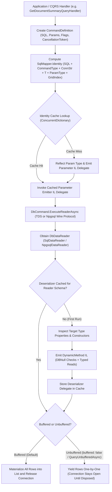
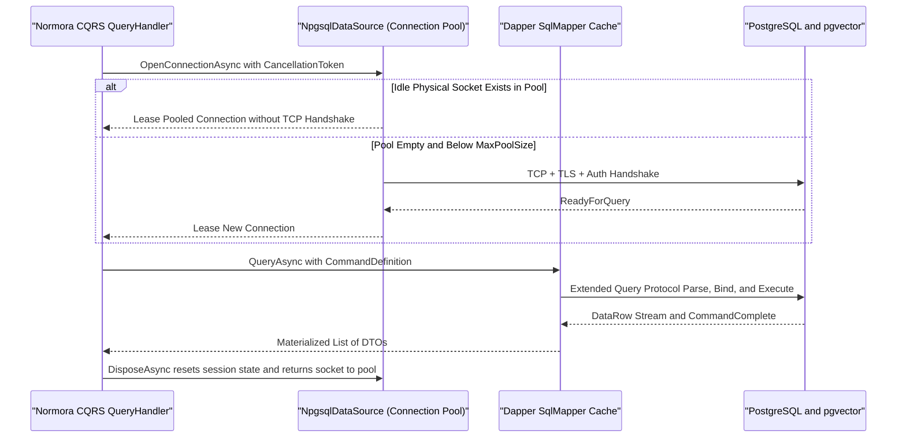
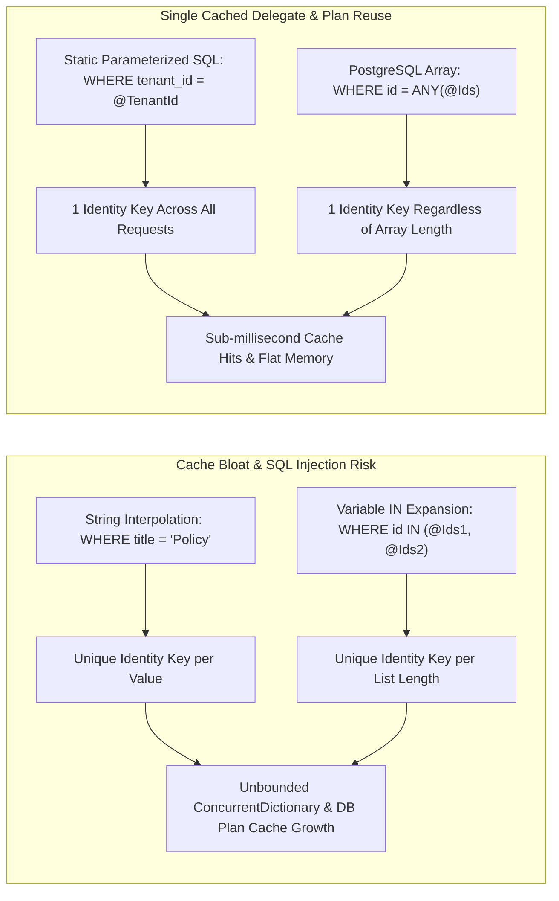

# Chapter 2: Core Concepts and Internal Architecture

## 1. Learning Objectives

By the end of this chapter, you will be able to:
*   Explain the internal architecture of Dapper and how it extends the **ADO.NET** (`IDbConnection`, `DbCommand`, `IDataReader`) foundation across SQL Server and PostgreSQL (`Npgsql`).
*   Understand the role of Reflection, **IL Generation (`DynamicMethod` / `IL.Emit`)**, Parameter Emitters, and `SqlMapper.Identity` Caching in Dapper's ultra-high performance (and why Native AOT requires `Dapper.AOT`).
*   Master Parameter Binding using anonymous objects, `DynamicParameters`, `CommandDefinition` (`CancellationToken`, `CommandFlags`), and PostgreSQL native arrays (`= ANY(@Ids)`) to prevent SQL injection and cache bloat.
*   Evaluate the performance, GC, and network backpressure implications of **Buffered** vs. **Unbuffered** (`buffered: false` and `QueryUnbufferedAsync<T>`) query execution.
*   Design thread-safe database connection management strategies in **.NET 10** (C# 14 primary constructors) using `NpgsqlDataSource` and ADO.NET connection pooling.

## 2. Introduction

To truly master Dapper, one must look beneath the simple `connection.Query<T>()` API and understand the **mechanical sympathy** (designing software to work harmoniously with the underlying hardware and runtime) it has with the .NET Runtime and **ADO.NET** (the foundational .NET data-access layer providing `DbConnection`, `DbCommand`, and `DbDataReader`). Dapper is not magic; it is essentially a highly optimized, intelligent wrapper around `IDataReader` / `DbDataReader` (such as `SqlDataReader` for SQL Server or `NpgsqlDataReader` for PostgreSQL).

When working on enterprise systems like **Normora** (a .NET 10 modular monolith backed by PostgreSQL and `pgvector`), a Solution Architect cannot treat an ORM (Object-Relational Mapper) as a black box. You must understand *why* it is fast, how it allocates memory on the Managed Heap, and how it translates your C# intent into database wire protocol commands—whether **Tabular Data Stream (TDS)** for SQL Server or the **PostgreSQL Extended Query Protocol** (`Parse` / `Bind` / `Execute`) via `Npgsql`. This chapter dissects Dapper's internal engine, explaining how it achieves near-hand-coded ADO.NET speed without the severe runtime reflection penalties that plague naive mapping frameworks.

## 3. Core Concepts: The Anatomy of Dapper

### What is Dapper Internally?
At its core, Dapper is simply a collection of extension methods on the `System.Data.IDbConnection` (and `System.Data.Common.DbConnection` for async/streaming operations) interface. When you reference the `Dapper` NuGet package, you are not inheriting from a base class, registering heavy background services, or configuring a complex `DbContext` with a change-tracker graph. You are simply gaining access to extension methods like `QueryAsync`, `ExecuteAsync`, `QueryMultipleAsync`, and `QueryUnbufferedAsync` on your existing database connections.

The core mapping engine lives inside a single static class: `Dapper.SqlMapper`.

### The Mapping Pipeline
When you execute `await connection.QueryAsync<User>("SELECT id, name FROM users");`, Dapper does not blindly execute the query and use Reflection to populate the object row-by-row. That would be disastrously slow. Instead, it executes a two-sided compilation and caching pipeline (one side for **parameters**, one side for **result columns**):

1. **Hash Generation (`SqlMapper.Identity`):** Dapper creates a lightweight structural key (`Identity`) from six inputs: the exact **SQL string**, the **`CommandType`** (Text vs. StoredProcedure), the **`ConnectionString`**, the **target return `Type`** (`User`), the **parameter `Type`**, and the **`gridIndex`** (used when reading multiple result sets).
2. **Cache Lookup:** It checks an internal static `ConcurrentDictionary<Identity, CacheInfo>` (`_queryCache`) using this `Identity` to see if compiled parameter-binding and row-materialization delegates already exist.
3. **Parameter Emission & ADO.NET Execution:** Dapper creates an `IDbCommand` (`SqlCommand` or `NpgsqlCommand`). If the parameter object's type has not been seen for this query, Dapper emits and caches an IL delegate (`Action<IDbCommand, object>`) that extracts properties from your parameter object and appends `IDbDataParameter` items safely. It then opens the connection (if it was closed), calls `ExecuteReader()` / `ExecuteReaderAsync()`, and obtains an `IDataReader` / `DbDataReader`.
4. **Schema Inspection (Cache Miss):** If no row deserializer matches the returned reader shape, Dapper inspects the target C# type (`User`) via Reflection and matches its properties, fields, or constructor parameters against the column names and types returned by the `IDataReader`.
5. **IL Emit (`DynamicMethod`):** Instead of calling slow runtime Reflection (`PropertyInfo.SetValue`) on every row, Dapper uses `System.Reflection.Emit.DynamicMethod` to generate raw **Intermediate Language (IL)**—the low-level bytecode instructions executed by the .NET **JIT (Just-In-Time)** compiler—tailored specifically to map *this exact* `IDataReader` column layout to *this exact* C# type, including `DBNull` checks and safe type/enum conversions.
6. **Caching & Execution:** The generated IL delegate (`Func<IDataReader, T>`) is compiled once by the JIT, stored in the cache for future reuse, and invoked in a tight loop as the reader advances row by row.

### Reflection vs. IL Emit
**Reflection** in .NET is expensive in hot loops because it requires runtime metadata inspection, security/visibility checks, and boxing of value types on every property assignment (e.g., "Find the property named `Id`, check if it has a setter, box/unbox the `int`, and invoke the setter").

Dapper pays this "Reflection Tax" **exactly once** per unique query-and-schema shape. By dynamically emitting IL, Dapper generates compiled machine code at runtime whose throughput matches a developer hand-writing raw `IDataReader` code:
```csharp
// Conceptually equivalent to what Dapper's emitted IL executes per row:
var user = new User();
if (!reader.IsDBNull(0)) user.Id = reader.GetInt32(0);
if (!reader.IsDBNull(1)) user.Name = reader.GetString(1);
```
Because the compiled delegate is cached in memory and reused for millions of subsequent executions, Dapper achieves micro-ORM speed with zero manual boilerplate.

> [!NOTE]
> **When to Use Dapper vs. When NOT to Use It**
> *   **Use Dapper when:** You need predictable SQL, sub-millisecond mapping overhead, high-throughput reads (`Documents` hybrid search in Normora), complex `pgvector` / window-function / CTE queries, or lightweight background worker batches (`Normora.Worker`).
> *   **Do NOT use standard Dapper when:**
>     1. **You deploy with .NET Native AOT (`PublishAot=true`):** Native AOT strips the JIT compiler and disallows runtime `System.Reflection.Emit.DynamicMethod`. Standard Dapper throws `PlatformNotSupportedException` under Native AOT—use **`Dapper.AOT`** (compile-time C# source generators) instead.
>     2. **You need automatic dirty tracking and complex aggregate graph persistence:** For transactional domain aggregates with nested collections, change tracking, and optimistic concurrency tokens (like Normora's `Tenants` billing/membership mutations), EF Core reduces manual SQL plumbing. Normora pairs EF Core for domain aggregates with Dapper for hot read paths and vector/analytics queries.

### Real-World Examples (Normora & PostgreSQL / .NET 10)

The following five examples illustrate how Dapper's core anatomy operates inside **Normora**:

**Example 1: `SqlMapper` Extension Method on `NpgsqlConnection` (`Documents` Module)**
Normora uses PostgreSQL snake_case column names (`tenant_id`, `file_name`). Enabling `DefaultTypeMap.MatchNamesWithUnderscores = true` once at startup lets Dapper's Reflection/IL pipeline bind snake_case columns directly to PascalCase C# properties.
```csharp
using Dapper;
using Npgsql;

namespace Normora.Modules.Documents.Application.Documents.Queries.GetDocumentSummary;

public sealed record DocumentSummaryDto(Guid Id, Guid TenantId, string FileName, string Status);

public sealed class GetDocumentSummaryQueryHandler(NpgsqlDataSource dataSource)
{
    public async Task<DocumentSummaryDto?> HandleAsync(Guid tenantId, Guid documentId, CancellationToken ct)
    {
        await using var connection = await dataSource.OpenConnectionAsync(ct);

        const string sql = """
            SELECT id, tenant_id, file_name, status
            FROM documents.documents
            WHERE id = @DocumentId AND tenant_id = @TenantId AND is_deleted = FALSE;
            """;

        // Dapper extends DbConnection/IDbConnection via SqlMapper
        return await connection.QuerySingleOrDefaultAsync<DocumentSummaryDto>(
            new CommandDefinition(sql, new { DocumentId = documentId, TenantId = tenantId }, cancellationToken: ct));
    }
}
```

**Example 2: `SqlMapper.Identity` Cache Hit vs. Cache Miss (`Tenants` Module)**
Dapper's `Identity` key includes the exact SQL text and the parameter object's CLR `Type`. Reusing the exact same SQL string and parameter shape guarantees a cache hit on every HTTP request.
```csharp
// Request 1 (Cache Miss -> emits parameter & row IL delegates, stores under Identity hash)
var deptsA = await connection.QueryAsync<DepartmentDto>(
    "SELECT id, name FROM tenants.departments WHERE tenant_id = @TenantId;",
    new { TenantId = tenantA });

// Request 2 (Cache HIT -> identical SQL string + identical anonymous param type + identical return type)
var deptsB = await connection.QueryAsync<DepartmentDto>(
    "SELECT id, name FROM tenants.departments WHERE tenant_id = @TenantId;",
    new { TenantId = tenantB });

// Anti-pattern that causes a Cache MISS: changing whitespace/casing or anonymous property order/names
// e.g. new { tenantId = tenantB } (lowercase 't') has a DIFFERENT CLR anonymous type than { TenantId }!
```

**Example 3: What Dapper's Emitted IL Does for `Conversations` Constructor Mapping**
When Normora maps rows into an immutable C# 14 `record` with a primary constructor, Dapper emits IL that checks `DBNull`, matches column ordinals to constructor parameters, and invokes `newobj` directly—eliminating reflection per row.
```csharp
public sealed record SavedAnswerRow(Guid Id, Guid TenantId, string Question, string? MarkdownAnswer, DateTimeOffset CreatedAt);

// Dapper inspects SavedAnswerRow's constructor once, emits IL equivalent to:
// new SavedAnswerRow(
//     reader.GetGuid(0),
//     reader.GetGuid(1),
//     reader.GetString(2),
//     reader.IsDBNull(3) ? null : reader.GetString(3),
//     reader.GetFieldValue<DateTimeOffset>(4))
var saved = await connection.QueryAsync<SavedAnswerRow>(
    "SELECT id, tenant_id, question, markdown_answer, created_at FROM conversations.saved_answers WHERE tenant_id = @TenantId;",
    new { TenantId = tenantId });
```

**Example 4: `CommandDefinition` for Cancellation & Flags (`Documents` Hybrid Retrieval)**
Because `QueryAsync<T>(sql, param)` does not accept a `CancellationToken` parameter directly, Dapper's `CommandDefinition` struct wraps the SQL, parameters, transaction, timeout, `CommandFlags`, and `CancellationToken` into a single allocation-friendly value type.
```csharp
var command = new CommandDefinition(
    commandText: """
        SELECT id, document_id, content, breadcrumb
        FROM documents.document_chunks
        WHERE tenant_id = @TenantId
        ORDER BY embedding <=> @QueryVector
        LIMIT @TopK;
        """,
    parameters: new { TenantId = tenantId, QueryVector = queryVector, TopK = 10 },
    commandTimeout: 15,
    flags: CommandFlags.Buffered,
    cancellationToken: ct);

var chunks = (await connection.QueryAsync<RetrievedChunkDto>(command)).AsList();
```

**Example 5: Compile-Time Mapping with `Dapper.AOT` (When Runtime IL Emit Is Unavailable)**
If Normora compiles a lightweight CLI utility or serverless webhook with `.NET 10` Native AOT (`<PublishAot>true</PublishAot>`), `[DapperAot]` instructs Roslyn source generators to emit static C# interceptors at compile time instead of runtime `DynamicMethod` IL.
```csharp
using Dapper;

[module: DapperAot] // Activates compile-time C# source generation across the assembly

namespace Normora.MigrationCli;

public sealed class TenantMigrationCheck(NpgsqlDataSource dataSource)
{
    public async Task<int> CountActiveTenantsAsync(CancellationToken ct)
    {
        await using var conn = await dataSource.OpenConnectionAsync(ct);
        // Intercepted at compile time: zero runtime Reflection, zero DynamicMethod IL Emit
        return await conn.ExecuteScalarAsync<int>(
            new CommandDefinition("SELECT COUNT(*) FROM tenants.tenants WHERE is_active = TRUE;", cancellationToken: ct));
    }
}
```

## 4. Visual Diagrams

### Dapper Query & Materialization Pipeline (Mermaid Flowchart)



### Normora Connection Pooling & Wire Protocol Lifecycle (Mermaid Sequence)



### Identity Cache Stability vs. Cache Bloat (Mermaid Flowchart)



### Legacy Pipeline Reference (ASCII Overview)

```text
=============================================================================
                  DAPPER QUERY EXECUTION PIPELINE
=============================================================================

[ Application Layer ]
        │  connection.Query<User>("SELECT * FROM Users WHERE Id = @Id", new { Id = 1 })
        ▼
[ Dapper: SqlMapper Extension ]
        │  1. Create Identity Hash (SQL + Expected Type + Param Type)
        ▼
[ Identity Cache (Static ConcurrentDictionary) ]
        │───▶ CACHE HIT: Retrieve compiled IL Delegate ────┐
        │                                                  │
        │───▶ CACHE MISS:                                  │
        │      1. Call DbCommand.ExecuteReader()           │
        │      2. Map DB Columns to C# Properties          │
        │      3. Emit IL via DynamicMethod                │
        │      4. Compile to Action/Func Delegate          │
        │      5. Store in Cache                           │
        ▼                                                  ▼
[ ADO.NET Execution ]                              [ IL Delegate Execution ]
  DbCommand.ExecuteReader()                          Invoke() on DbDataReader
        │                                                  │
        ▼                                                  ▼
[ Database Engine ] ◀── (TDS / Npgsql Wire) ────▶ [ Object Materialization ]
                                                           │
                                                           ▼
                                              [ Return IEnumerable<User> ]
```

## 5. Internal Implementation Deep Dive

### Parameter Binding
To prevent **SQL Injection** (an attack where untrusted input alters the syntax of a SQL command), you must never concatenate or interpolate user inputs into SQL strings. Dapper abstracts away ADO.NET's `IDataParameterCollection` (`SqlParameterCollection` / `NpgsqlParameterCollection`) and emits out-of-band bound parameters at the wire protocol level—meaning the database treats parameter values strictly as data, never as executable SQL syntax.

**1. Anonymous Objects (Default Choice):**
The most common and fastest approach is passing an anonymous object (or a lightweight typed record/class). Dapper inspects the object's properties once, emits a cached IL parameter-binder delegate, and populates the underlying `DbParameter` objects automatically.
```csharp
// Dapper automatically translates this into @TenantId and @Status DbParameters
var users = await connection.QueryAsync<User>(
    "SELECT * FROM Users WHERE TenantId = @TenantId AND Status = @Status",
    new { TenantId = currentTenantId, Status = "Active" });
```

**2. `DynamicParameters` (Imperative / Stored Procedure Output):**
For conditional parameter lists built at runtime, stored procedure `Output`/`ReturnValue` parameters, or explicit `DbType`/`Size` overrides, Dapper provides `DynamicParameters`.
```csharp
var parameters = new DynamicParameters();
parameters.Add("@TenantId", currentTenantId, DbType.Guid);

if (includeInactive) {
    parameters.Add("@Status", "Inactive", DbType.String, size: 20);
}

// Used for Stored Procedure Output
parameters.Add("@TotalCount", dbType: DbType.Int32, direction: ParameterDirection.Output);

var users = await connection.QueryAsync<User>(sql, parameters);
int count = parameters.Get<int>("@TotalCount");
```

**3. `DbString` & Explicit Sizing (SQL Server Plan Cache Protection):**
In SQL Server, Dapper defaults C# `string` parameters to `NVARCHAR(4000)` (or `NVARCHAR(MAX)` when longer than 4,000 chars). Comparing a `VARCHAR(100)` indexed column against an `NVARCHAR` parameter causes an **implicit conversion**, often forcing SQL Server to perform an index scan instead of an index seek. Wrapping the value in Dapper's `DbString` (`new DbString { Value = slug, IsAnsi = true, Length = 100 }`) binds the exact `VARCHAR(100)` type. (In PostgreSQL/`Npgsql`, `text` and `varchar` share the same binary encoding, so `DbString` is rarely needed.)

**4. List Expansion (`IN @Ids`) vs. PostgreSQL Native Arrays (`= ANY(@Ids)`):**
*   **SQL Server (`WHERE Id IN @Ids`):** Dapper rewrites the SQL at runtime by expanding `@Ids` into `(@Ids1, @Ids2, ..., @IdsN)`. Two critical caveats apply: (a) SQL Server caps RPC calls at **2,100 parameters**, and (b) every distinct list length produces a **different SQL string**, multiplying entries in both Dapper's `Identity` cache and SQL Server's plan cache!
*   **PostgreSQL / Npgsql (`WHERE id = ANY(@Ids)`):** Npgsql natively binds C# arrays (`Guid[]`, `string[]`) as a **single** PostgreSQL array parameter (`uuid[]`, `text[]`). Dapper does **not** rewrite the SQL string, there is no 2,100-item limit, and the `Identity` cache stores **only 1 entry** regardless of array size.

> [!TIP]
> **When NOT to Use `DynamicParameters`**
> Avoid `DynamicParameters` when all parameters are known statically at compile time. `DynamicParameters` allocates an internal `Dictionary<string, ParamInfo>` and bypasses Dapper's zero-allocation anonymous-object/record parameter emitter. Prefer anonymous objects, C# records, or `CommandDefinition`.

#### Real-World Normora Parameter Binding Examples

**Example 1: Anonymous Object with BOLA Guard (`Tenants` Module)**
In `Normora.Modules.Tenants`, membership lookups always bind `TenantId` and `ExternalUserId` (never `KeycloakUserId`) via anonymous objects and enforce BOLA -> 404 via `BolaException`.
```csharp
const string sql = """
    SELECT id, tenant_id, external_user_id, role
    FROM tenants.tenant_memberships
    WHERE tenant_id = @TenantId AND external_user_id = @ExternalUserId;
    """;

var membership = await connection.QuerySingleOrDefaultAsync<TenantMembershipDto>(
    new CommandDefinition(sql, new { TenantId = tenantId, ExternalUserId = externalUserId }, cancellationToken: ct));

if (membership is null)
{
    throw new BolaException(ApiMessages.NotFound);
}
```

**Example 2: PostgreSQL Native Array `= ANY(@ChunkIds)` (`Documents` Module)**
During hybrid retrieval (`PerformHybridRetrievalQuery`), fetching parent metadata or neighboring chunks by ID uses PostgreSQL's `= ANY(@Ids)` so Dapper caches a single SQL hash for arrays of any length.
```csharp
// Pass a concrete Guid[] (or .ToArray()) so Npgsql binds a single uuid[] parameter
Guid[] chunkIds = candidateIds.ToArray();

const string sql = """
    SELECT id, document_id, content, breadcrumb, chunk_index
    FROM documents.document_chunks
    WHERE tenant_id = @TenantId AND id = ANY(@ChunkIds);
    """;

var chunks = await connection.QueryAsync<DocumentChunkDto>(
    new CommandDefinition(sql, new { TenantId = tenantId, ChunkIds = chunkIds }, cancellationToken: ct));
```

**Example 3: `DynamicParameters` for Conditional Audit Filtering (`Tenants` Module)**
When an admin filters `tenants.audit_logs` by optional `ActorExternalUserId` and `Action`, `DynamicParameters` cleanly attaches only the active parameters with explicit `DbType` metadata.
```csharp
var parameters = new DynamicParameters();
parameters.Add("TenantId", query.TenantId, DbType.Guid);
parameters.Add("Take", query.PageSize, DbType.Int32);
parameters.Add("Skip", (query.Page - 1) * query.PageSize, DbType.Int32);

var whereClauses = new List<string> { "tenant_id = @TenantId" };
if (!string.IsNullOrWhiteSpace(query.Action))
{
    whereClauses.Add("action = @Action");
    parameters.Add("Action", query.Action, DbType.String, size: 128);
}

var sql = $"""
    SELECT id, actor_external_user_id, action, created_at
    FROM tenants.audit_logs
    WHERE {string.Join(" AND ", whereClauses)}
    ORDER BY created_at DESC
    LIMIT @Take OFFSET @Skip;
    """;

var logs = await connection.QueryAsync<AuditLogDto>(
    new CommandDefinition(sql, parameters, cancellationToken: ct));
```

**Example 4: `CommandDefinition` with `CancellationToken` & Custom Timeout (`Documents` Module)**
Long-running vector re-indexing or analytics aggregations pass a custom `commandTimeout` and request `CancellationToken` through `CommandDefinition` so aborted HTTP requests cancel in-flight PostgreSQL queries cleanly.
```csharp
var command = new CommandDefinition(
    commandText: """
        SELECT department_id, COUNT(*) AS document_count, COALESCE(SUM(size_bytes), 0) AS total_bytes
        FROM documents.documents
        WHERE tenant_id = @TenantId AND is_deleted = FALSE
        GROUP BY department_id;
        """,
    parameters: new { TenantId = tenantId },
    commandTimeout: 60,
    cancellationToken: ct);

var metrics = await connection.QueryAsync<DepartmentDocumentMetricsDto>(command);
```

**Example 5: Binding Explicit Parameter Types for `PendingApproval` TTL (`Conversations` Module)**
When inserting or checking a 15-minute HITL approval token in `conversations.pending_approvals`, passing typed records or `DynamicParameters` ensures `DateTimeOffset` maps cleanly to PostgreSQL `timestamptz`.
```csharp
const string sql = """
    UPDATE conversations.pending_approvals
    SET status = @ApprovedStatus, resolved_at = @Now
    WHERE id = @ApprovalId
      AND tenant_id = @TenantId
      AND external_user_id = @ExternalUserId
      AND status = @PendingStatus
      AND expires_at > @Now;
    """;

int affected = await connection.ExecuteAsync(new CommandDefinition(
    sql,
    new
    {
        ApprovalId = approvalId,
        TenantId = tenantId,
        ExternalUserId = currentUser.ExternalUserId,
        ApprovedStatus = "Approved",
        PendingStatus = "Pending",
        Now = timeProvider.GetUtcNow()
    },
    cancellationToken: ct));
```

---

### Buffered vs Unbuffered Queries
Understanding how Dapper drains the `DbDataReader` is critical for **Managed Heap** and **Garbage Collector (GC)** performance in enterprise applications.

**Buffered Queries (Default — `CommandFlags.Buffered`):**
By default, Dapper queries are **Buffered**. When you call `await connection.QueryAsync<T>(...)`, Dapper reads *all* rows from the `DbDataReader`, materializes them into `T` objects, stores them inside a `List<T>`, and returns that list (typed as `IEnumerable<T>`).
*   **Pros:** The `DbDataReader` closes immediately and the database connection can be returned to the pool right away. The returned sequence is safe to iterate multiple times or inspect with `.Count` without re-querying.
*   **Cons:** Peak memory scales linearly with the number of rows. Very large lists (>85,000 bytes for the internal backing array) land on the **Large Object Heap (LOH)** or survive into **Gen 2** of the GC, causing expensive stop-the-world GC sweeps.

**Unbuffered Synchronous Queries (`buffered: false`):**
If you pass `buffered: false` to synchronous `connection.Query<T>(sql, buffered: false)`, Dapper uses a C# iterator block (`yield return`). It returns an `IEnumerable<T>` that reads and materializes one row at a time as the caller's `foreach` loop advances.
```csharp
// The DbConnection remains OPEN and busy while you iterate!
var users = connection.Query<User>("SELECT * FROM Users", buffered: false);

foreach (var user in users) 
{
    // Process one user at a time. Memory footprint stays flat in Gen 0.
    ProcessUser(user); 
}
```

**Unbuffered Async Streaming (`QueryUnbufferedAsync<T>` — Dapper 2.1+):**
In modern `.NET 10` applications, synchronous `buffered: false` blocks the calling thread on every row read. Dapper 2.1+ provides `connection.QueryUnbufferedAsync<T>(...)`, which returns `IAsyncEnumerable<T>` so you can stream rows asynchronously with `await foreach` while keeping heap allocations flat in **Gen 0**!

*   **Warning (Connection Pinning & Network Backpressure):** In both sync and async unbuffered modes, the underlying `DbDataReader` and `DbConnection` stay open and pinned for the entire duration of iteration. You cannot execute another command on that connection until iteration completes or the enumerator is disposed (unless MARS—Multiple Active Result Sets—is enabled on SQL Server, which is generally discouraged). Worse, if the consumer processes rows slowly (e.g., streaming straight to a slow HTTP client or external API), the database server's TCP send buffers fill up, triggering **`ASYNC_NETWORK_IO`** waits in SQL Server or socket backpressure in PostgreSQL and exhausting your connection pool.

> [!NOTE]
> **When NOT to Use Unbuffered Queries**
> *   **Never return an unbuffered `IEnumerable<T>` or `IAsyncEnumerable<T>` directly from an ASP.NET Core JSON controller** to a browser client: a slow mobile network will hold your database connection open for seconds or minutes.
> *   **Never use unbuffered mode for typical OLTP queries** (<5,000 rows, e.g., paginated UI lists). Buffering a small `List<T>` and releasing the connection in 2 ms is far safer and faster overall.
> *   **Use unbuffered streaming ONLY** in background workers (`Normora.Worker`), ETL pipelines, or file exports where row counts are huge (100k+ rows) and each row is processed rapidly on a dedicated connection.

#### Real-World Normora Buffering & Streaming Examples

**Example 1: Buffered Paginated List in API Handler (`Tenants` Module)**
For the Angular workspace directory (`ListDepartmentsQueryHandler`), payloads are bounded by pagination (`LIMIT`/`OFFSET`), so default buffering releases the `NpgsqlConnection` immediately before JSON serialization.
```csharp
const string sql = """
    SELECT id, name, description, created_at
    FROM tenants.departments
    WHERE tenant_id = @TenantId
    ORDER BY name
    LIMIT @PageSize OFFSET @Offset;
    """;

var items = (await connection.QueryAsync<DepartmentDto>(
    new CommandDefinition(sql, new { TenantId = query.TenantId, query.PageSize, Offset = (query.Page - 1) * query.PageSize }, cancellationToken: ct)))
    .AsList(); // Safe, zero-copy cast because Dapper's buffered QueryAsync returns a List<T>
```

**Example 2: Single-Row Buffered Lookup with BOLA Defense (`Documents` Module)**
`QuerySingleOrDefaultAsync<T>` buffers at most one row (throwing if >1 row matches) and closes the reader immediately.
```csharp
const string sql = """
    SELECT id, tenant_id, file_name, storage_key
    FROM documents.documents
    WHERE id = @DocumentId AND tenant_id = @TenantId AND is_deleted = FALSE;
    """;

var doc = await connection.QuerySingleOrDefaultAsync<DocumentDownloadDto>(
    new CommandDefinition(sql, new { DocumentId = documentId, TenantId = tenantId }, cancellationToken: ct))
    ?? throw new BolaException(ApiMessages.NotFound);
```

**Example 3: Async Unbuffered Streaming in `Normora.Worker` (`Documents` Re-Embedding Job)**
When a tenant upgrades embedding models in `Normora.Worker`, `QueryUnbufferedAsync<T>` streams 250,000+ `DocumentChunk` rows in batches without allocating a massive Gen 2 `List<T>`.
```csharp
const string sql = """
    SELECT id, document_id, content, breadcrumb
    FROM documents.document_chunks
    WHERE tenant_id = @TenantId
    ORDER BY id;
    """;

var batch = new List<ChunkForEmbeddingDto>(100);
await foreach (var chunk in connection.QueryUnbufferedAsync<ChunkForEmbeddingDto>(
    new CommandDefinition(sql, new { TenantId = tenantId }, cancellationToken: ct)))
{
    batch.Add(chunk);
    if (batch.Count == 100)
    {
        await embeddingService.EmbedBatchAsync(batch, ct); // Dispatched via external Gemini provider
        batch.Clear();
    }
}
```

**Example 4: Synchronous Unbuffered Export in CLI/Batch Archive (`Tenants` Audit Export)**
In a dedicated offline CLI archive tool where async streaming isn't required, `buffered: false` writes CSV lines straight to disk while keeping RAM usage constant.
```csharp
using var writer = new StreamWriter(archiveFilePath);
var rows = connection.Query<AuditLogExportRow>(
    "SELECT id, action, created_at FROM tenants.audit_logs WHERE tenant_id = @TenantId ORDER BY created_at;",
    new { TenantId = tenantId },
    buffered: false);

foreach (var row in rows)
{
    writer.WriteLine($"{row.Id},{row.Action},{row.CreatedAt:O}");
}
```

**Example 5: Buffer Before Slow SSE Token Streaming (`Conversations` Module)**
During Conversational RAG (`NormoraWorkplaceAgent`), Normora buffers the top-$K$ retrieved chunks into memory and disposes the `NpgsqlConnection` *before* opening the slow Server-Sent Events (SSE) stream to Google Gemini and the Angular SPA.
```csharp
IReadOnlyList<RetrievedChunkDto> citations;
await using (var connection = await dataSource.OpenConnectionAsync(ct))
{
    var result = await connection.QueryAsync<RetrievedChunkDto>(
        new CommandDefinition(hybridSql, new { TenantId = tenantId, QueryVector = vector }, cancellationToken: ct));
    citations = result.AsList();
} // Connection is already back in the pool BEFORE slow LLM streaming begins!

await foreach (var token in textGenerationService.StreamAnswerAsync(prompt, citations, ct))
{
    await sseWriter.WriteTokenAsync(token, ct);
}
```

---

### Thread Safety and Connection Management
*   **Dapper (`SqlMapper`) IS Thread-Safe:** All internal caches (`ConcurrentDictionary`) and extension methods in `Dapper.SqlMapper` are completely thread-safe and designed for concurrent access across all HTTP requests and background workers.
*   **`DbConnection`, `DbTransaction`, and `DbDataReader` are NOT Thread-Safe:** An ADO.NET connection represents a single stateful TCP/protocol channel. You must never share a single `SqlConnection` or `NpgsqlConnection` instance across multiple threads or concurrent `Task.WhenAll` operations.

**How ADO.NET Connection Pooling Works:**
Opening a raw TCP + TLS + authentication socket to PostgreSQL or SQL Server takes 5–50 ms. To avoid paying that cost on every request, ADO.NET providers (`Microsoft.Data.SqlClient` and `Npgsql`) maintain an in-process **Connection Pool** keyed by the exact connection string.
1.  Calling `await using var conn = await dataSource.OpenConnectionAsync(ct)` (or `new SqlConnection(connString)` + `OpenAsync`) **leases** an already-authenticated physical socket from the pool in microseconds.
2.  When `Dispose()` / `DisposeAsync()` runs at the end of the `using` block, the physical socket is **not closed**; instead, the provider resets session state (`sp_reset_connection` on SQL Server; `DISCARD ALL` / state reset on Npgsql), rolls back any uncommitted transactions, and returns the clean socket to the pool.

**Modern .NET 10 Best Practice (`NpgsqlDataSource` & Primary Constructors):**
In modern Npgsql (v7/8/9/10+), the recommended pattern is to register `NpgsqlDataSource` as a **Singleton** (which encapsulates the connection string, connection pool, `pgvector` type mapper via `UseVector()`, and OpenTelemetry diagnostics) and inject it via a C# 14 **primary constructor**, opening a short-lived connection per operation.

> [!NOTE]
> **When NOT to Share a Single Connection**
> *   **Never register `IDbConnection` / `NpgsqlConnection` / `SqlConnection` as a Singleton** in DI: concurrent HTTP requests will collide on the same socket, causing `InvalidOperationException` ("A command is already in progress") or silent data corruption.
> *   **Never reuse one `DbConnection` across parallel `Task.WhenAll` queries:** Each parallel task must lease its own connection from the pool. Only reuse a single connection for **sequential** queries or commands inside a shared **transaction**.

#### Real-World Normora Connection Management Examples

**Example 1: Singleton `NpgsqlDataSource` with C# 14 Primary Constructor (`Documents` Module)**
Injecting `NpgsqlDataSource` (not `NpgsqlConnection`) lets each CQRS handler lease a pooled connection cleanly with full `pgvector` support.
```csharp
namespace Normora.Modules.Documents.Application.Documents.Queries.GetDocumentById;

public sealed class GetDocumentByIdQueryHandler(NpgsqlDataSource dataSource)
{
    public async Task<DocumentDetailDto> HandleAsync(Guid tenantId, Guid documentId, CancellationToken ct)
    {
        await using var connection = await dataSource.OpenConnectionAsync(ct);

        const string sql = """
            SELECT id, file_name, mime_type, status, created_at
            FROM documents.documents
            WHERE id = @DocumentId AND tenant_id = @TenantId AND is_deleted = FALSE;
            """;

        return await connection.QuerySingleOrDefaultAsync<DocumentDetailDto>(
            new CommandDefinition(sql, new { DocumentId = documentId, TenantId = tenantId }, cancellationToken: ct))
            ?? throw new BolaException(ApiMessages.NotFound);
    }
}
```

**Example 2: Parallel Dashboard Queries Using Separate Pooled Connections (`Tenants` Module)**
When loading workspace dashboard counters concurrently via `Task.WhenAll`, each task leases its own `NpgsqlConnection` from `NpgsqlDataSource`.
```csharp
public sealed class GetDashboardCountsHandler(NpgsqlDataSource dataSource)
{
    public async Task<(int Members, int Groups)> HandleAsync(Guid tenantId, CancellationToken ct)
    {
        var membersTask = CountAsync("SELECT COUNT(*) FROM tenants.tenant_memberships WHERE tenant_id = @TenantId;", tenantId, ct);
        var groupsTask = CountAsync("SELECT COUNT(*) FROM tenants.user_groups WHERE tenant_id = @TenantId;", tenantId, ct);

        await Task.WhenAll(membersTask, groupsTask);
        return (await membersTask, await groupsTask);
    }

    private async Task<int> CountAsync(string sql, Guid tenantId, CancellationToken ct)
    {
        await using var connection = await dataSource.OpenConnectionAsync(ct);
        return await connection.ExecuteScalarAsync<int>(new CommandDefinition(sql, new { TenantId = tenantId }, cancellationToken: ct));
    }
}
```

**Example 3: Reusing One Connection Sequentially Across a Transactional Outbox (`Documents` Module)**
When `UploadDocumentCommandHandler` commits document metadata, version, and a `DocumentProcessingOutboxMessage` atomically, all `ExecuteAsync` calls **must** share the exact same opened connection and `NpgsqlTransaction`.
```csharp
await using var connection = await dataSource.OpenConnectionAsync(ct);
await using var transaction = await connection.BeginTransactionAsync(ct);

await connection.ExecuteAsync(new CommandDefinition(insertDocSql, docParams, transaction, cancellationToken: ct));
await connection.ExecuteAsync(new CommandDefinition(insertVersionSql, versionParams, transaction, cancellationToken: ct));
await connection.ExecuteAsync(new CommandDefinition(insertOutboxSql, outboxParams, transaction, cancellationToken: ct));

await transaction.CommitAsync(ct);
```

**Example 4: Background Worker Connection Isolation (`Normora.Worker`)**
Hangfire jobs in `Normora.Worker` execute outside any ASP.NET Core HTTP request (`HttpContext` is null). Injecting `NpgsqlDataSource` ensures `DocumentProcessingJob` safely opens and returns connections independently.
```csharp
namespace Normora.Worker.Jobs;

public sealed class HangfireOutboxSweepJob(NpgsqlDataSource dataSource, ILogger<HangfireOutboxSweepJob> logger)
{
    public async Task RunAsync(CancellationToken ct)
    {
        await using var connection = await dataSource.OpenConnectionAsync(ct);
        int pending = await connection.ExecuteScalarAsync<int>(
            new CommandDefinition("SELECT COUNT(*) FROM documents.document_processing_outbox WHERE processed_at IS NULL;", cancellationToken: ct));

        logger.LogInformation("Outbox sweep observed {PendingCount} pending messages", pending);
    }
}
```

**Example 5: Tenant-Scoped `IDbConnectionFactory` Decorator (`Normora.Infrastructure`)**
For module isolation or Row-Level Security (RLS), `Normora.Infrastructure` can wrap `NpgsqlDataSource` in an `ITenantConnectionFactory` that sets PostgreSQL's session context before returning the opened connection.
```csharp
public interface ITenantConnectionFactory
{
    Task<NpgsqlConnection> OpenTenantConnectionAsync(Guid tenantId, CancellationToken ct);
}

public sealed class RlsNpgsqlConnectionFactory(NpgsqlDataSource dataSource) : ITenantConnectionFactory
{
    public async Task<NpgsqlConnection> OpenTenantConnectionAsync(Guid tenantId, CancellationToken ct)
    {
        var connection = await dataSource.OpenConnectionAsync(ct);
        // Sets PostgreSQL session parameter so RLS policies enforce TenantId at the DB tier
        await connection.ExecuteAsync(new CommandDefinition(
            "SELECT set_config('app.current_tenant_id', @TenantId, false);",
            new { TenantId = tenantId.ToString() },
            cancellationToken: ct));
        return connection;
    }
}
```

---

### Global Engine Configuration & Cache Governance
Dapper exposes a small set of global static knobs on `SqlMapper` and `DefaultTypeMap` that govern mapping behavior across the entire process. Understanding these ensures predictable behavior without stepping into full custom type-mapping strategies (covered in Chapter 4).

*   **`DefaultTypeMap.MatchNamesWithUnderscores`:** Set to `true` at application startup so Dapper matches snake_case database columns (`created_at`, `tenant_id`) to PascalCase C# properties (`CreatedAt`, `TenantId`) without requiring manual `AS` column aliases on every query.
*   **`SqlMapper.Settings.CommandTimeout`:** Sets a process-wide default timeout (in seconds) for all Dapper commands that do not specify `commandTimeout` explicitly (overrides the ADO.NET 30-second default).
*   **`CommandFlags.NoCache`:** Instructs Dapper to execute a query *without* storing its `Identity` in the static `_queryCache`. Essential for rare, dynamically generated administrative or diagnostic SQL strings so they never cause cache bloat.
*   **`SqlMapper.PurgeQueryCache()`:** Clears Dapper's static `ConcurrentDictionary` cache immediately. Useful only as an emergency safeguard or in diagnostic memory tests—never needed in well-parameterized steady-state workloads.

> [!NOTE]
> **When NOT to Rely on `SqlMapper.PurgeQueryCache()`**
> Calling `PurgeQueryCache()` on a timer in production hides the root cause of cache bloat (unparameterized dynamic SQL or variable-length `IN @Ids` clauses) and forces Dapper to re-pay the Reflection + IL Emit tax across all active queries, causing periodic latency spikes. Fix the SQL parameterization instead.

#### Real-World Normora Configuration Examples

**Example 1: Enabling Snake-Case Mapping at Host Startup (`Normora.Infrastructure`)**
In `DatabaseServiceExtensions.cs`, enabling `MatchNamesWithUnderscores` once at startup aligns every module's Dapper queries with Normora's PostgreSQL schema naming convention.
```csharp
// Called once during DI setup in Normora.Infrastructure/Extensions/DatabaseServiceExtensions.cs
Dapper.DefaultTypeMap.MatchNamesWithUnderscores = true;
```

**Example 2: Setting a Safe Global Timeout for OLTP Requests (`Normora.Api`)**
Setting `SqlMapper.Settings.CommandTimeout = 15;` prevents runaway queries in the BFF API host from silently waiting the full 30-second ADO.NET default before failing fast.
```csharp
// Normora.Api Program.cs startup configuration
Dapper.SqlMapper.Settings.CommandTimeout = 15;
```

**Example 3: Using `CommandFlags.NoCache` for Ad-Hoc Migration Verification (`Normora.Infrastructure`)**
When `DatabaseMigrationRunner` runs rare one-off startup diagnostic queries, `CommandFlags.NoCache` avoids keeping startup-only SQL cached in memory for the lifetime of the process while still parameterizing `@SchemaName`.
```csharp
var cmd = new CommandDefinition(
    "SELECT COUNT(*) FROM information_schema.tables WHERE table_schema = @SchemaName;",
    new { SchemaName = schemaName },
    flags: CommandFlags.NoCache,
    cancellationToken: ct);
int tableCount = await connection.ExecuteScalarAsync<int>(cmd);
```

**Example 4: Inspecting Cache Health with `SqlMapper.GetCachedSQLCount()` in Diagnostics**
In integration tests or internal health probes (`Normora.Architecture.Tests`), `SqlMapper.GetCachedSQLCount()` lets engineers verify that repeated query executions are hitting the cache rather than growing unboundedly.
```csharp
int before = SqlMapper.GetCachedSQLCount();
await handler.HandleAsync(tenantId, docId, ct);
await handler.HandleAsync(otherTenantId, otherDocId, ct);
int after = SqlMapper.GetCachedSQLCount();
// 'after - before' should be <= 1 once warmed up, proving zero cache bloat!
```

**Example 5: Guarded `PurgeQueryCache()` in Memory-Constrained Test Fixtures (`Normora.Architecture.Tests`)**
Test suites simulating cold-start IL compilation latency can reset Dapper's static cache cleanly between benchmark iterations using `SqlMapper.PurgeQueryCache()`.
```csharp
SqlMapper.PurgeQueryCache();
var sw = Stopwatch.StartNew();
await connection.QueryAsync<DepartmentDto>(sql, new { TenantId = tenantId });
sw.Stop(); // Measures cold Reflection + DynamicMethod IL Emit cost
```

## 6. Real Production Case Studies: EV Charging Platform & Normora

### Case Study A: EV Charging Platform (SQL Server / High-Throughput Writes)

In our Multi-Tenant EV Charging Management Platform, we need to handle incoming "Heartbeat" messages from chargers. This endpoint will be hit thousands of times per minute. We need absolute maximum performance.

Let's look at the connection lifecycle and Dapper execution within our Clean Architecture setup.

```csharp
using Microsoft.Data.SqlClient;
using Dapper;

namespace EVPlatform.Infrastructure.Data
{
    public class ChargerRepository : IChargerRepository
    {
        private readonly string _connectionString;

        // The connection string is injected, NOT the connection itself.
        // We control the connection lifecycle locally to ensure thread safety.
        public ChargerRepository(IConfiguration configuration)
        {
            _connectionString = configuration.GetConnectionString("EVDatabase");
        }

        public async Task UpdateHeartbeatAsync(Guid chargerId, DateTime timestamp, decimal currentKwh)
        {
            // 1. Connection instantiation. 
            // Gets a connection from the ADO.NET pool.
            await using var connection = new SqlConnection(_connectionString);
            
            // 2. Optimized T-SQL using UPSERT (MERGE) logic if needed, or simple UPDATE
            const string sql = @"
                UPDATE Chargers 
                SET LastHeartbeat = @Timestamp, 
                    TotalKwh = @CurrentKwh 
                WHERE Id = @ChargerId";
            
            // 3. Dapper execution with anonymous parameters
            // Because this query does not return data, we use ExecuteAsync.
            await connection.ExecuteAsync(sql, new 
            { 
                ChargerId = chargerId, 
                Timestamp = timestamp, 
                CurrentKwh = currentKwh 
            });

            // 4. Connection is automatically disposed and returned to the pool 
            // at the end of the async method due to 'await using'.
        }
    }
}
```

### Case Study B: Normora (.NET 10 / PostgreSQL + `pgvector` Hybrid Retrieval)

In **Normora**, the `Conversations` module executes cross-module hybrid retrieval against `Documents` (via the `PerformHybridRetrievalQuery` MediatR contract) before streaming an answer over SSE. Look at how every Chapter 2 internal principle applies together in the `Documents` query handler:
*   **C# 14 Primary Constructor + `NpgsqlDataSource`:** Thread-safe singleton pool factory; connection leased and returned immediately.
*   **PostgreSQL `= ANY(@AllowedGroupIds)`:** Zero `SqlMapper.Identity` cache bloat regardless of how many User Groups an employee belongs to.
*   **`CommandDefinition` with `CancellationToken` & Buffered `AsList()`:** Releases the database socket *before* slow LLM token streaming begins, and cancels PostgreSQL execution immediately if the user closes the browser tab.
*   **BOLA Security (`BolaException` + `ApiMessages`):** Enforces explicit `tenant_id` and group ACL filtering without magic strings.

```csharp
using Dapper;
using Npgsql;
using Pgvector;
using Normora.Shared.Constants;
using Normora.Shared.Exceptions;

namespace Normora.Modules.Documents.Application.Retrieval.Queries.PerformHybridRetrieval;

public sealed record HybridChunkResult(
    Guid ChunkId,
    Guid DocumentId,
    string FileName,
    string Breadcrumb,
    string Content,
    double RrfScore);

public sealed class PerformHybridRetrievalQueryHandler(NpgsqlDataSource dataSource)
{
    public async Task<IReadOnlyList<HybridChunkResult>> HandleAsync(
        Guid tenantId,
        Guid[] allowedGroupIds,
        string searchQuery,
        float[] embedding,
        int topK,
        CancellationToken ct)
    {
        if (tenantId == Guid.Empty)
        {
            throw new InvalidOperationException(ApiMessages.TenantContextMissing);
        }

        // Static SQL -> Single Identity hash in Dapper's ConcurrentDictionary cache forever
        const string sql = """
            WITH vector_hits AS (
                SELECT c.id, ROW_NUMBER() OVER (ORDER BY c.embedding <=> @QueryVector) AS rank_pos
                FROM documents.document_chunks c
                INNER JOIN documents.documents d ON d.id = c.document_id
                WHERE d.tenant_id = @TenantId
                  AND d.is_deleted = FALSE
                  AND (d.is_public = TRUE OR d.user_group_id = ANY(@AllowedGroupIds))
                ORDER BY c.embedding <=> @QueryVector
                LIMIT 40
            ),
            keyword_hits AS (
                SELECT c.id, ROW_NUMBER() OVER (ORDER BY ts_rank_cd(c.search_vector, websearch_to_tsquery('english', @SearchQuery)) DESC) AS rank_pos
                FROM documents.document_chunks c
                INNER JOIN documents.documents d ON d.id = c.document_id
                WHERE d.tenant_id = @TenantId
                  AND d.is_deleted = FALSE
                  AND (d.is_public = TRUE OR d.user_group_id = ANY(@AllowedGroupIds))
                  AND c.search_vector @@ websearch_to_tsquery('english', @SearchQuery)
                LIMIT 40
            )
            SELECT c.id AS chunk_id,
                   d.id AS document_id,
                   d.file_name,
                   c.breadcrumb,
                   c.content,
                   (COALESCE(1.0 / (60 + v.rank_pos), 0.0) + COALESCE(1.0 / (60 + k.rank_pos), 0.0)) AS rrf_score
            FROM vector_hits v
            FULL OUTER JOIN keyword_hits k ON v.id = k.id
            INNER JOIN documents.document_chunks c ON c.id = COALESCE(v.id, k.id)
            INNER JOIN documents.documents d ON d.id = c.document_id
            ORDER BY rrf_score DESC
            LIMIT @TopK;
            """;

        // 1. Lease pooled connection locally
        await using var connection = await dataSource.OpenConnectionAsync(ct);

        // 2. Wrap parameters, timeout, buffering, and CancellationToken in CommandDefinition
        var command = new CommandDefinition(
            commandText: sql,
            parameters: new
            {
                TenantId = tenantId,
                AllowedGroupIds = allowedGroupIds,
                SearchQuery = searchQuery,
                QueryVector = new Vector(embedding),
                TopK = topK
            },
            commandTimeout: 10,
            flags: CommandFlags.Buffered,
            cancellationToken: ct);

        // 3. Materialize & release connection back to the pool BEFORE Gemini SSE streaming starts
        return (await connection.QueryAsync<HybridChunkResult>(command)).AsList();
    }
}
```

## 7. Common Mistakes & Anti-Patterns

### 1. Registering `IDbConnection` / `NpgsqlConnection` as a Singleton (Beginner)

> [!CAUTION]
> **Wrong Code:**
> ```csharp
> // Program.cs — NEVER register a DbConnection as Singleton!
> builder.Services.AddSingleton<IDbConnection>(_ =>
>     new NpgsqlConnection(connectionString));
>
> public sealed class GetDepartmentHandler(IDbConnection connection)
> {
>     public Task<IEnumerable<DepartmentDto>> HandleAsync(Guid tenantId) =>
>         connection.QueryAsync<DepartmentDto>(
>             "SELECT id, name FROM tenants.departments WHERE tenant_id = @TenantId;",
>             new { TenantId = tenantId });
> }
> ```
> **Why It's Wrong:** `IDbConnection` (`SqlConnection` / `NpgsqlConnection`) is **not thread-safe**. A Singleton instance shares a single TCP socket across every concurrent HTTP request, causing `NpgsqlOperationInProgressException` / `InvalidOperationException`, corrupted reader frames, and leaked transaction state.
>
> **The Fix:** Register `NpgsqlDataSource` as a Singleton (or inject a connection string / `IDbConnectionFactory`), and open a local `await using` connection per operation so ADO.NET connection pooling manages physical sockets safely:
> ```csharp
> // Program.cs
> builder.Services.AddNpgsqlDataSource(connectionString, dataSourceBuilder => dataSourceBuilder.UseVector());
>
> // Handler (C# 14 Primary Constructor)
> public sealed class GetDepartmentHandler(NpgsqlDataSource dataSource)
> {
>     public async Task<IReadOnlyList<DepartmentDto>> HandleAsync(Guid tenantId, CancellationToken ct)
>     {
>         await using var connection = await dataSource.OpenConnectionAsync(ct);
>         return (await connection.QueryAsync<DepartmentDto>(
>             new CommandDefinition(
>                 "SELECT id, name FROM tenants.departments WHERE tenant_id = @TenantId;",
>                 new { TenantId = tenantId },
>                 cancellationToken: ct))).AsList();
>     }
> }
> ```

### 2. Forgetting `using` / `await using` on Manually Opened Connections (Beginner)

> [!CAUTION]
> **Wrong Code:**
> ```csharp
> public async Task<int> CountDocumentsAsync(Guid tenantId, CancellationToken ct)
> {
>     var connection = await dataSource.OpenConnectionAsync(ct);
>     try
>     {
>         return await connection.ExecuteScalarAsync<int>(
>             "SELECT COUNT(*) FROM documents.documents WHERE tenant_id = @TenantId;",
>             new { TenantId = tenantId });
>     }
>     catch (Exception)
>     {
>         throw; // Connection is NEVER disposed or returned to the pool if an exception occurs!
>     }
> }
> ```
> **Why It's Wrong:** Without `await using` (or a `finally` block calling `DisposeAsync()`), every failed or completed call leaks the leased physical socket until GC finalization—rapidly exhausting `MaxPoolSize` (default 100) and crashing the API with pool timeout exceptions.
>
> **The Fix:** Always scope connections with `await using`:
> ```csharp
> public async Task<int> CountDocumentsAsync(Guid tenantId, CancellationToken ct)
> {
>     await using var connection = await dataSource.OpenConnectionAsync(ct);
>     return await connection.ExecuteScalarAsync<int>(
>         new CommandDefinition(
>             "SELECT COUNT(*) FROM documents.documents WHERE tenant_id = @TenantId;",
>             new { TenantId = tenantId },
>             cancellationToken: ct));
> }
> ```

### 3. Returning Unbuffered Queries Directly from an ASP.NET Core Controller (Intermediate)

> [!CAUTION]
> **Wrong Code:**
> ```csharp
> [HttpGet("audit-logs/stream")]
> public IAsyncEnumerable<AuditLogDto> StreamLogs(Guid tenantId, CancellationToken ct)
> {
>     // Connection stays OPEN while ASP.NET Core serializes JSON over a potentially slow client network!
>     var connection = dataSource.OpenConnection();
>     return connection.QueryUnbufferedAsync<AuditLogDto>(
>         new CommandDefinition(
>             "SELECT id, action, created_at FROM tenants.audit_logs WHERE tenant_id = @TenantId;",
>             new { TenantId = tenantId },
>             cancellationToken: ct));
> }
> ```
> **Why It's Wrong:** Unbuffered queries pin the `DbDataReader` and `DbConnection` open until the consumer finishes iterating. Slow mobile/browser clients fill TCP buffers, induce database socket backpressure (`ASYNC_NETWORK_IO`), starve the connection pool, and leak `connection` if the caller disconnects early without disposing properly.
>
> **The Fix:** Use paginated buffered queries in HTTP APIs, releasing the connection before returning the response. Reserve `QueryUnbufferedAsync<T>` for fast background workers (`Normora.Worker`):
> ```csharp
> [HttpGet("audit-logs")]
> public async Task<ActionResult<IReadOnlyList<AuditLogDto>>> GetLogs(
>     Guid tenantId, int page = 1, int pageSize = 50, CancellationToken ct = default)
> {
>     await using var connection = await dataSource.OpenConnectionAsync(ct);
>     var logs = (await connection.QueryAsync<AuditLogDto>(
>         new CommandDefinition(
>             """
>             SELECT id, action, created_at
>             FROM tenants.audit_logs
>             WHERE tenant_id = @TenantId
>             ORDER BY created_at DESC
>             LIMIT @PageSize OFFSET @Offset;
>             """,
>             new { TenantId = tenantId, PageSize = pageSize, Offset = (page - 1) * pageSize },
>             cancellationToken: ct))).AsList();
>
>     return Ok(logs);
> }
> ```

### 4. Calling Synchronous `Query()` / `Execute()` Inside Async Web Handlers (Intermediate)

> [!CAUTION]
> **Wrong Code:**
> ```csharp
> public Task<IReadOnlyList<UserGroupDto>> HandleAsync(Guid tenantId)
> {
>     using var connection = dataSource.OpenConnection();
>     var groups = connection.Query<UserGroupDto>(
>         "SELECT id, name FROM tenants.user_groups WHERE tenant_id = @TenantId;",
>         new { TenantId = tenantId }).ToList();
>     return Task.FromResult<IReadOnlyList<UserGroupDto>>(groups);
> }
> ```
> **Why It's Wrong:** Synchronous `OpenConnection()` and `Query()` block the calling .NET ThreadPool thread for the entire network round-trip. Under traffic bursts, ThreadPool starvation cascades into 503 timeouts even when PostgreSQL CPU is idle.
>
> **The Fix:** Use `OpenConnectionAsync` + `QueryAsync` + `CommandDefinition` with `CancellationToken` end-to-end so OS I/O completion frees the thread while waiting on the database:
> ```csharp
> public async Task<IReadOnlyList<UserGroupDto>> HandleAsync(Guid tenantId, CancellationToken ct)
> {
>     await using var connection = await dataSource.OpenConnectionAsync(ct);
>     return (await connection.QueryAsync<UserGroupDto>(
>         new CommandDefinition(
>             "SELECT id, name FROM tenants.user_groups WHERE tenant_id = @TenantId;",
>             new { TenantId = tenantId },
>             cancellationToken: ct))).AsList();
> }
> ```

### 5. Concurrent `Task.WhenAll` on a Single Shared `DbConnection` (Senior)

> [!CAUTION]
> **Wrong Code:**
> ```csharp
> await using var connection = await dataSource.OpenConnectionAsync(ct);
>
> // Both tasks attempt to write/read on the SAME NpgsqlConnection concurrently!
> var docsTask = connection.ExecuteScalarAsync<int>(
>     "SELECT COUNT(*) FROM documents.documents WHERE tenant_id = @TenantId;", new { TenantId = tenantId });
> var chunksTask = connection.ExecuteScalarAsync<int>(
>     "SELECT COUNT(*) FROM documents.document_chunks WHERE tenant_id = @TenantId;", new { TenantId = tenantId });
>
> await Task.WhenAll(docsTask, chunksTask);
> ```
> **Why It's Wrong:** A single `DbConnection` only supports one active command at a time over its wire socket. Launching two async Dapper calls concurrently on the same `connection` throws `NpgsqlOperationInProgressException` ("A command is already in progress").
>
> **The Fix:** Either run the commands **sequentially** on one connection (`await` each, or combine into one `QueryMultipleAsync` round-trip), OR lease a **separate** pooled connection per parallel task:
> ```csharp
> // Best: Single network round-trip with QueryMultipleAsync on one connection!
> await using var connection = await dataSource.OpenConnectionAsync(ct);
> const string sql = """
>     SELECT COUNT(*) FROM documents.documents WHERE tenant_id = @TenantId;
>     SELECT COUNT(*) FROM documents.document_chunks WHERE tenant_id = @TenantId;
>     """;
>
> using var grid = await connection.QueryMultipleAsync(
>     new CommandDefinition(sql, new { TenantId = tenantId }, cancellationToken: ct));
>
> int docsCount = await grid.ReadSingleAsync<int>();
> int chunksCount = await grid.ReadSingleAsync<int>();
> ```

### 6. String-Interpolated SQL Causing SQL Injection & `SqlMapper.Identity` Cache Bloat (Senior)

> [!CAUTION]
> **Wrong Code:**
> ```csharp
> // NEVER interpolate user values into SQL strings!
> var sql = $"SELECT id, file_name FROM documents.documents WHERE tenant_id = '{tenantId}' AND file_name = '{search}';";
> var docs = await connection.QueryAsync<DocumentSummaryDto>(sql);
> ```
> **Why It's Wrong:** Two catastrophic failures occur simultaneously:
> 1. **SQL Injection:** Any attacker passing `' OR 1=1 --` in `search` bypasses tenant isolation entirely.
> 2. **Unbounded Cache Bloat:** Dapper hashes the exact SQL string into `SqlMapper.Identity`. Every distinct `search` string generates a brand-new `DynamicMethod` IL delegate in Dapper's static `ConcurrentDictionary` and a brand-new query plan in PostgreSQL/SQL Server until the process runs Out-Of-Memory (OOM).
>
> **The Fix:** Always bind values as `@Parameters` so the SQL string remains 100% static:
> ```csharp
> const string sql = """
>     SELECT id, file_name
>     FROM documents.documents
>     WHERE tenant_id = @TenantId AND file_name = @Search AND is_deleted = FALSE;
>     """;
>
> var docs = await connection.QueryAsync<DocumentSummaryDto>(
>     new CommandDefinition(sql, new { TenantId = tenantId, Search = search }, cancellationToken: ct));
> ```

### 7. Using Dapper `IN @Ids` Instead of PostgreSQL `= ANY(@Ids)` (Architect)

> [!CAUTION]
> **Wrong Code:**
> ```csharp
> // On PostgreSQL, Dapper's IN @Ids list expansion rewrites the SQL for EVERY array length!
> var chunks = await connection.QueryAsync<DocumentChunkDto>(
>     "SELECT id, content FROM documents.document_chunks WHERE tenant_id = @TenantId AND id IN @ChunkIds;",
>     new { TenantId = tenantId, ChunkIds = chunkIds });
> ```
> **Why It's Wrong:** Dapper expands `IN @ChunkIds` into `IN (@ChunkIds1, @ChunkIds2, ..., @ChunkIdsN)`. A 3-element list produces a different SQL string and parameter type than a 4-element or 47-element list—creating hundreds of redundant IL delegates in Dapper's `Identity` cache and hundreds of PostgreSQL prepared plans. On SQL Server, exceeding 2,100 items also crashes the RPC batch.
>
> **The Fix:** On PostgreSQL/Npgsql, pass a typed array (`Guid[]`, `string[]`) with `= ANY(@ChunkIds)` so the SQL string and parameter count (`1`) remain constant forever:
> ```csharp
> Guid[] idsArray = chunkIds.ToArray();
> const string sql = """
>     SELECT id, content
>     FROM documents.document_chunks
>     WHERE tenant_id = @TenantId AND id = ANY(@ChunkIds);
>     """;
>
> var chunks = await connection.QueryAsync<DocumentChunkDto>(
>     new CommandDefinition(sql, new { TenantId = tenantId, ChunkIds = idsArray }, cancellationToken: ct));
> ```

### 8. Missing `TenantId` Filter & Leaking Object Existence Instead of `BolaException` (Architect)

> [!CAUTION]
> **Wrong Code:**
> ```csharp
> // Missing tenant_id predicate AND exposes existence with hardcoded error string!
> var doc = await connection.QuerySingleOrDefaultAsync<DocumentDetailDto>(
>     "SELECT id, tenant_id, file_name FROM documents.documents WHERE id = @DocumentId;",
>     new { DocumentId = documentId });
>
> if (doc is null)
>     throw new Exception($"Document {documentId} does not exist.");
> if (doc.TenantId != currentTenantId)
>     throw new UnauthorizedAccessException("You do not own this document.");
> ```
> **Why It's Wrong:** Returning 403 for another tenant's document vs. 404 for a non-existent ID creates an **ID enumeration oracle** (Broken Object Level Authorization — BOLA). Hardcoded exception strings also violate Normora's centralized `ApiMessages` rule and risk leaking internal identifiers.
>
> **The Fix:** Filter by both `id = @DocumentId AND tenant_id = @TenantId` directly in SQL (reinforced by PostgreSQL RLS where configured) and throw `BolaException(ApiMessages.NotFound)` (mapped to HTTP 404) when null:
> ```csharp
> const string sql = """
>     SELECT id, tenant_id, file_name
>     FROM documents.documents
>     WHERE id = @DocumentId AND tenant_id = @TenantId AND is_deleted = FALSE;
>     """;
>
> var doc = await connection.QuerySingleOrDefaultAsync<DocumentDetailDto>(
>     new CommandDefinition(sql, new { DocumentId = documentId, TenantId = currentTenantId }, cancellationToken: ct))
>     ?? throw new BolaException(ApiMessages.NotFound);
> ```

## 8. Interview Questions

### Beginner (10)
1.  **What namespace contains the Dapper extension methods?**
    *Answer:* `Dapper`.
2.  **Does Dapper open the database connection automatically?**
    *Answer:* Yes, if you call a Dapper method on a closed connection, Dapper will implicitly open it, execute the query, and close it. However, it is a best practice to manage the connection state explicitly if you are doing multiple operations.
3.  **What is the default timeout for a Dapper query?**
    *Answer:* Dapper defaults to the underlying ADO.NET timeout, which is 30 seconds.
4.  **How do you pass parameters to a Dapper query?**
    *Answer:* Usually by passing an anonymous object as the second argument (e.g., `new { Id = 1 }`).
5.  **What does the `Execute` method return?**
    *Answer:* It returns an `int` representing the number of rows affected by the query (useful for INSERT, UPDATE, DELETE).
6.  **Can I map a query result to a primitive type like `int` or `string`?**
    *Answer:* Yes, you can do `connection.Query<int>("SELECT COUNT(*) FROM Users")`.
7.  **What is the purpose of the `using` statement when working with `SqlConnection`?**
    *Answer:* It ensures that `Dispose()` is called on the connection, which safely returns it to the ADO.NET connection pool, even if an exception is thrown.
8.  **Will Dapper throw an error if my SQL query returns more columns than my C# class has properties?**
    *Answer:* No. Dapper will safely ignore any extra columns in the result set that do not have a matching property in the C# class.
9.  **Will Dapper throw an error if my C# class has properties that are not returned by the SQL query?**
    *Answer:* No. Those properties will simply remain at their default values (e.g., `null` or `0`).
10. **What is an anonymous object in C# and why does Dapper use them?**
    *Answer:* An anonymous object is a read-only type generated by the compiler without an explicit class name (`new { Name = "John" }`). Dapper uses them to provide a concise, strongly-typed way to pass parameters without creating temporary classes.

### Intermediate (10)
11. **Explain what happens when you set `buffered: false` in a Dapper `Query`.**
    *Answer:* Dapper skips creating a `List<T>` to hold the results. Instead, it uses `yield return` to stream the objects directly from the `SqlDataReader`. This reduces memory usage but keeps the database connection open while iterating.
12. **How does Dapper avoid the performance penalty of .NET Reflection?**
    *Answer:* It only uses Reflection once per query/type combination. It uses the reflected metadata to emit highly optimized Intermediate Language (IL) via `DynamicMethod`, compiles it into a delegate, caches it, and executes that delegate for all future calls.
13. **What is the `SqlMapper.Identity` struct used for?**
    *Answer:* It represents the unique hash key used in Dapper's internal cache. It is comprised of the SQL string, the connection string, the command type, the type of the parameters, and the expected return type.
14. **Why is it a bad idea to inject an `IDbConnection` as a Singleton in ASP.NET Core?**
    *Answer:* `IDbConnection` implementations (like `SqlConnection`) are not thread-safe. A Singleton would be shared across all concurrent HTTP requests, leading to thread contention, mixed query results, and exceptions regarding the connection state.
15. **How do you handle output parameters from a Stored Procedure in Dapper?**
    *Answer:* You must use `DynamicParameters`. You add the parameter and set `direction: ParameterDirection.Output`. After calling `Execute`, you retrieve the value using `parameters.Get<T>("@ParamName")`.
16. **How does Dapper handle C# `enum` types when mapping from SQL?**
    *Answer:* Dapper automatically maps SQL integers to C# enums based on the underlying integer value. It can also map SQL strings to enums if the string matches the enum name (case-insensitive).
17. **What is connection pooling and how does it relate to Dapper?**
    *Answer:* Connection pooling is a feature of ADO.NET (not Dapper) that keeps physical database connections open in a pool to avoid the high cost of TCP handshakes on every request. Dapper utilizes this automatically when you instantiate and dispose of `SqlConnection` objects.
18. **If I execute `connection.Query("SELECT * FROM Users")` without specifying a generic `<T>`, what does Dapper return?**
    *Answer:* It returns an `IEnumerable<dynamic>`. Each row is represented as a `DapperRow` object (which implements `IDictionary<string, object>`).
19. **How do you pass a list of IDs to an `IN` clause using Dapper?**
    *Answer:* You pass an `IEnumerable` (like a list or array) in your parameter object. Dapper's list expansion feature automatically detects this and transforms the SQL from `WHERE Id IN @Ids` to `WHERE Id IN (@Ids1, @Ids2, @Ids3)` and generates the corresponding parameters.
20. **Can Dapper map private properties or fields?**
    *Answer:* Out of the box, `DefaultTypeMap` prioritizes constructor parameters and writable properties (including `public string Name { get; private set; }` or `init` setters), and its reflection lookup (`BindingFlags.Public | BindingFlags.NonPublic | BindingFlags.Instance`) can even bind non-public properties/fields—though public properties or constructor mapping are idiomatic, and custom rules can be plugged in via `SqlMapper.SetTypeMap`.

### Senior (10)
21. **Explain the potential impact of "Cache Bloat" in Dapper and how to prevent it.**
    *Answer:* Dapper caches IL delegates based on the exact SQL string. If you generate dynamic SQL by appending literals (e.g., `WHERE Name = 'John'` vs `'Jane'`), Dapper creates a new delegate for every distinct string. This causes unbounded memory growth in Dapper's static cache and SQL Server's plan cache. Prevention requires strictly using parameterized inputs (`WHERE Name = @Name`) so the SQL string remains static.
22. **When implementing a Repository pattern with Dapper, how do you handle Unit of Work and Transactions across multiple repositories?**
    *Answer:* You must share the connection and transaction. You can create a `UnitOfWork` class that manages a single `SqlConnection` and `SqlTransaction`. The UoW injects this transaction into the repositories, and the repositories pass the `transaction: _dbTransaction` parameter to all Dapper extension methods.
23. **What is `SqlMapper.PurgeQueryCache()` and when might you need to use it?**
    *Answer:* It clears Dapper's internal `ConcurrentDictionary` cache of IL delegates. You rarely need it in production, but it might be necessary in a long-running application if you are heavily generating dynamic SQL (which is an anti-pattern) and need to manually prevent an OutOfMemory exception.
24. **How does Dapper's Multi-Mapping feature work internally compared to standard mapping?**
    *Answer:* For Multi-Mapping (e.g., `Query<T1, T2, TReturn>`), Dapper emits a slightly more complex IL delegate. It scans the `SqlDataReader` columns left-to-right, looks for the `splitOn` column name (usually "Id"), and splits the row into segments. It then applies the standard IL Emit mapping logic to each segment separately, instantiates the multiple objects, and passes them to the custom `Func<T1, T2, TReturn>` you provided to stitch them together.
25. **If a SQL query takes 5 minutes to execute, how do you prevent the Dapper method from blocking a thread-pool thread in a high-throughput API?**
    *Answer:* You must use the `Async` methods (e.g., `QueryAsync`) which utilize `SqlDataReader.ReadAsync`. This relies on I/O Completion Ports (IOCP) at the OS level, freeing the .NET thread-pool thread while waiting for the network response from SQL Server.
26. **You have an unbuffered query that processes 10 million rows. You need to write the results to a CSV file. What network/DB risks does this pose?**
    *Answer:* Because the unbuffered query keeps the `SqlDataReader` open, it holds a lock on the SQL Server session. If writing to the CSV involves slow disk I/O, the network buffers between SQL Server and the application will fill up. SQL Server might block (ASYNC_NETWORK_IO wait type) waiting for the application to consume the TDS packets, degrading database performance for other queries.
27. **How do you execute multiple completely independent SQL statements in a single network round trip using Dapper?**
    *Answer:* You use `connection.QueryMultiple()`, which returns a `GridReader`. You write a single SQL string with multiple statements separated by semicolons. You then call `Read<T>()` on the `GridReader` sequentially to process each result set.
28. **Explain the behavior of Dapper when encountering a database `DBNull.Value`.**
    *Answer:* Dapper checks for `DBNull` in the emitted IL. If the DB value is null, and the C# property is a nullable type (e.g., `string` or `int?`), it sets it to `null`. If the C# property is a non-nullable value type (e.g., `int`), Dapper will throw a `DataException` during deserialization.
29. **What is the `CommandFlags` enumeration in Dapper?**
    *Answer:* `CommandFlags` allows you to control specific behaviors per query, such as `CommandFlags.Buffered` (to disable buffering manually on the `CommandDefinition`), `CommandFlags.NoCache` (to prevent Dapper from caching the IL delegate for this specific query), and `CommandFlags.Pipelined` (for async pipelining).
30. **How would you map a custom JSON column in SQL Server to a strongly-typed nested C# object using Dapper?**
    *Answer:* You create a custom class implementing `SqlMapper.ITypeHandler`. In the `Parse` method, you take the string value from SQL and use `System.Text.Json.JsonSerializer.Deserialize<T>()`. In the `SetValue` method, you serialize the object to a string. You register this handler globally using `SqlMapper.AddTypeHandler(new MyJsonTypeHandler())` at application startup.

### Staff Engineer (5)
31. **Analyze the garbage collection (GC) profile of an unbuffered Dapper query vs a buffered query.**
    *Answer:* A buffered query allocates a large `List<T>`, backing arrays, and all `T` instances immediately. This often pushes the allocations into Gen 2 of the GC if the list is large, causing expensive Gen 2 sweeps later. An unbuffered query allocates `T` instances one at a time. Once the `foreach` loop processes the instance, it becomes eligible for Gen 0 collection, keeping memory pressure low and GC pauses extremely short.
32. **We are migrating from EF Core to Dapper. EF Core's `AsNoTracking()` queries are allocating 100MB/sec, but Dapper is allocating 80MB/sec. Why isn't Dapper's allocation zero?**
    *Answer:* Dapper still has to allocate strings. Every `string` in C# is a reference type allocated on the heap. If your query returns 10,000 rows with 5 string columns, Dapper must allocate 50,000 string objects. To optimize further, you would need to look at intern pools or refactoring the domain to use smaller value types (structs) where possible, but the string allocation is a .NET fundamental, not a Dapper flaw.
33. **Explain how ADO.NET Connection Pooling determines if a connection is "clean" when returned by Dapper, and what happens if a Transaction was left open?**
    *Answer:* When `Dispose()` is called on a `SqlConnection`, ADO.NET intercepts it. It calls `sp_reset_connection` on the SQL Server to reset session state (temporary tables, SET options). If an explicit `SqlTransaction` was started but neither committed nor rolled back, the `Dispose` process will automatically roll back the pending transaction before returning the connection to the pool to prevent state leakage to the next consumer.
34. **Design a mechanism to intercept and log all slow Dapper queries (execution time > 1 second) across a massive microservices architecture without modifying every repository method.**
    *Answer:* I would implement a custom `DbConnection` wrapper (Decorator pattern) or use a tool like MiniProfiler. The decorator implements `IDbConnection` and wraps the actual `SqlConnection`. It intercepts `CreateCommand()`, returning a custom `DbCommand` wrapper. This wrapper starts a `Stopwatch` in `ExecuteReaderAsync`, executes the underlying command, and if the stopwatch exceeds 1 second, logs the SQL, parameters, and execution plan to Application Insights or OpenTelemetry before returning the reader to Dapper.
35. **Why does Dapper's list expansion feature (`WHERE Id IN @Ids`) cap at 2,000 parameters when executing against SQL Server, and how does PostgreSQL avoid this?**
    *Answer:* SQL Server's TDS protocol and Database Engine enforce a hard limit of **2,100 parameters** per RPC batch; if Dapper expands a 3,000-element list into `@Ids1 ... @Ids3000`, `SqlCommand` throws an exception (requiring Table-Valued Parameters or `SqlBulkCopy`). On **PostgreSQL (`Npgsql`)**, you bypass list expansion altogether by writing `WHERE id = ANY(@Ids)` and passing a `Guid[]` or `string[]`—sending **1** native array parameter with zero `Identity` cache bloat.

### Architect (9)
36. **Architect an idempotent background worker that processes 1 million delayed events using Dapper, guaranteeing exactly-once processing even during server crashes.**
    *Answer:* I would use a Transactional Outbox pattern combined with row-level locking (`WITH (UPDLOCK, READPAST)` on SQL Server, or `FOR UPDATE SKIP LOCKED` on PostgreSQL, as used in Normora's `DocumentProcessingOutboxMessage` dispatcher). Concurrent workers skip locked rows, process the batch, mark them processed within the same transaction, and `COMMIT`. If a worker crashes mid-batch, the transaction rolls back, releasing the locks so another worker can safely pick up the rows.
37. **Your multi-tenant SaaS shares a single database. A junior developer deployed a Dapper query lacking the `WHERE TenantId = @id` clause, exposing data across tenants. Architect a fail-safe mechanism at the Dapper/ADO level to make this impossible.**
    *Answer:* Enforce **Row-Level Security (RLS)** at the database tier so tenant isolation does not rely solely on application SQL discipline. In SQL Server, a connection factory executes `EXEC sp_set_session_context @key=N'TenantId', @value=@CurrentTenantId` when opening the connection. In **PostgreSQL (Normora)**, an `ITenantConnectionFactory` executes `SELECT set_config('app.current_tenant_id', @TenantId, false);` and PostgreSQL `CREATE POLICY` rules filter every table automatically—while still enforcing `WHERE tenant_id = @TenantId` + `BolaException` (HTTP 404) as defense-in-depth.
38. **Evaluate the architectural differences between Dapper and Native AOT (Ahead-of-Time) compilation in .NET 8/9/10. Will Dapper work in Native AOT?**
    *Answer:* Standard Dapper relies heavily on `System.Reflection.Emit` (`DynamicMethod`) to generate IL at runtime. Native AOT removes the JIT compiler and runtime code generation capabilities to produce self-contained executables, so standard Dapper **does not work** in strict Native AOT. To achieve Dapper-like performance in `.NET 10` Native AOT, use **`Dapper.AOT`** (Roslyn source-generated C# interceptors) or EF Core compiled models, which generate all mapping code at compile time.
39. **In a high-throughput API, your telemetry shows thread pool starvation. The profiles point to Dapper's `Query` method. Why does this happen if SQL Server is fast, and how do you resolve it?**
    *Answer:* The synchronous `Query` method blocks the calling .NET thread while waiting for network I/O from the database. In high-throughput scenarios, if the API receives a burst of requests, all thread pool threads block, leading to starvation (`503 Service Unavailable`) even when DB CPU is low, due to network latency. The architectural fix is enforcing async-all-the-way: `OpenConnectionAsync`, `QueryAsync`, and `CommandDefinition` with `CancellationToken`, which leverages OS async I/O (IOCP / `epoll`) and frees the thread while waiting.
40. **How do you manage database schema migrations in a Dapper-centric architecture? Dapper provides no built-in migration tool like EF Core's `Add-Migration`.**
    *Answer:* Dapper is schema-agnostic, so schema management is decoupled from query execution. You either run a dedicated SQL-first migration tool (**DbUp**, **FluentMigrator**, **Flyway**) in CI/CD, or—as in **Normora**'s modular monolith—pair EF Core Migrations for schema governance (`DatabaseMigrationRunner` executing module migrators via `--migrate`) with Dapper for high-throughput read/vector queries.
41. **Why should a .NET 10 + PostgreSQL application inject `NpgsqlDataSource` as a Singleton instead of injecting `NpgsqlConnection` or raw connection strings everywhere?**
    *Answer:* `NpgsqlDataSource` is thread-safe and encapsulates the connection pool, prepared-statement cache, custom type plugins (`UseVector()` for `pgvector`), and OpenTelemetry instrumentation in one place. Injecting it via C# 14 primary constructors lets each CQRS handler call `await using var conn = await dataSource.OpenConnectionAsync(ct)` safely with zero configuration duplication.
42. **In Normora's Conversational RAG pipeline, why must you materialize (`AsList()`) retrieved document chunks and dispose the `NpgsqlConnection` before starting SSE streaming to the client?**
    *Answer:* Streaming LLM tokens over SSE or WebSockets can take several seconds per response. If you used `QueryUnbufferedAsync` directly across the SSE loop, the `NpgsqlConnection` and `NpgsqlDataReader` would stay pinned open for the entire AI generation duration—exhausting the database connection pool under concurrent users. Buffering the small top-$K$ citation set releases the connection in milliseconds.
43. **How do you pass a `CancellationToken` to Dapper's `QueryAsync<T>` or `ExecuteAsync`, and why doesn't `QueryAsync<T>(sql, param, ct)` exist as a standard overload?**
    *Answer:* Dapper keeps its method overload matrix manageable by encapsulating advanced execution metadata—`commandText`, `parameters`, `transaction`, `commandTimeout`, `commandType`, `flags`, and `cancellationToken`—inside the **`CommandDefinition`** struct. Passing `new CommandDefinition(sql, param, cancellationToken: ct)` ensures aborted HTTP requests propagate cancellation down to ADO.NET (`DbCommand.ExecuteReaderAsync(ct)`).
44. **What happens internally if you enable `DefaultTypeMap.MatchNamesWithUnderscores = true` in a PostgreSQL application like Normora?**
    *Answer:* During the one-time Reflection phase (before IL Emit), Dapper's `DefaultTypeMap` normalizes column names such as `created_at` and `external_user_id` by stripping underscores when matching against C# properties/constructor parameters (`CreatedAt`, `ExternalUserId`). Once matched, the emitted IL reads the column ordinals directly with zero ongoing string-manipulation overhead.

## 9. Exercises

### Easy
1.  **Cache Observation:** Write a Dapper query using a parameterized input. Run it in a loop 1,000 times. Use a `Stopwatch` to measure the time taken for the first execution vs the subsequent 999 executions (and log `SqlMapper.GetCachedSQLCount()` before and after). Observe the difference caused by the initial IL Emit and caching.

### Medium
1.  **Dynamic Parameters (SQL Server):** Create a stored procedure in your LocalDB that accepts an input parameter `@SiteId` and returns an output parameter `@TotalChargers`. Use `DynamicParameters` in Dapper to execute the procedure and print the output parameter to the console.
2.  **PostgreSQL Array Binding (`= ANY(@Ids)`):** Using `NpgsqlDataSource` and `DefaultTypeMap.MatchNamesWithUnderscores = true`, write a query against a `documents` table filtering by `tenant_id = @TenantId AND id = ANY(@DocumentIds)`. Execute it with arrays of length 1, 5, and 50 and verify `SqlMapper.GetCachedSQLCount()` increases by only `1`.

### Hard
1.  **Memory Profiling:** Create a table with 500,000 rows. Write a console application that executes a buffered `QueryAsync<T>`. Use Visual Studio's Diagnostic Tools (or `dotnet-counters`) to inspect Gen 0/Gen 2 allocations and peak heap size. Then, switch to `QueryUnbufferedAsync<T>` (`await foreach`) and compare peak heap allocations.

### Enterprise
1.  **Decorator Connection Factory:** Implement an `ITenantConnectionFactory` / `IDbConnectionFactory` for ASP.NET Core DI. Implement a Decorator around it that injects the current HTTP Request tenant context. When a connection is opened, use Dapper to execute `sp_set_session_context` (SQL Server) or `SELECT set_config('app.current_tenant_id', @TenantId, false)` (PostgreSQL) to set the `TenantId` automatically, ensuring all subsequent Dapper queries on that connection are inherently tenant-scoped for Row-Level Security.

## 10. Summary

Dapper achieves its extreme performance by dynamically generating and compiling Intermediate Language (IL) delegates at runtime for both **parameter binding** and **row materialization**, paying the cost of Reflection **exactly once** per `SqlMapper.Identity`. It protects against SQL injection through wire-protocol parameterization, prevents cache bloat via static SQL and PostgreSQL native array parameters (`= ANY(@Ids)`), and optimizes memory through **Buffered** vs. **Unbuffered** (`buffered: false` / `QueryUnbufferedAsync<T>`) execution.

However, "with great power comes great responsibility." Because Dapper operates close to the ADO.NET metal, you must deeply understand connection pooling (`NpgsqlDataSource` / `SqlConnection`), `CommandDefinition` cancellation, GC profiles, and thread safety. In the next chapter, we will perform a comprehensive deep dive into the Dapper API surface, exploring every variation of the `Query` and `Execute` methods.
