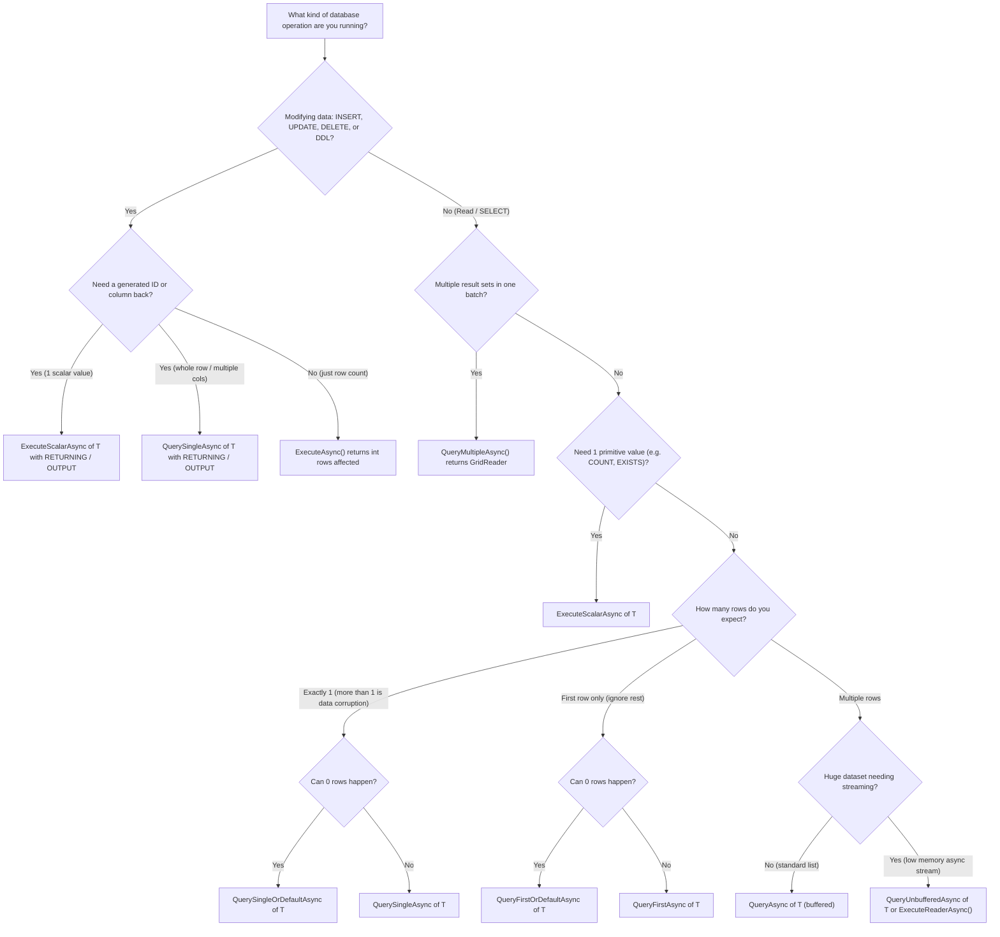
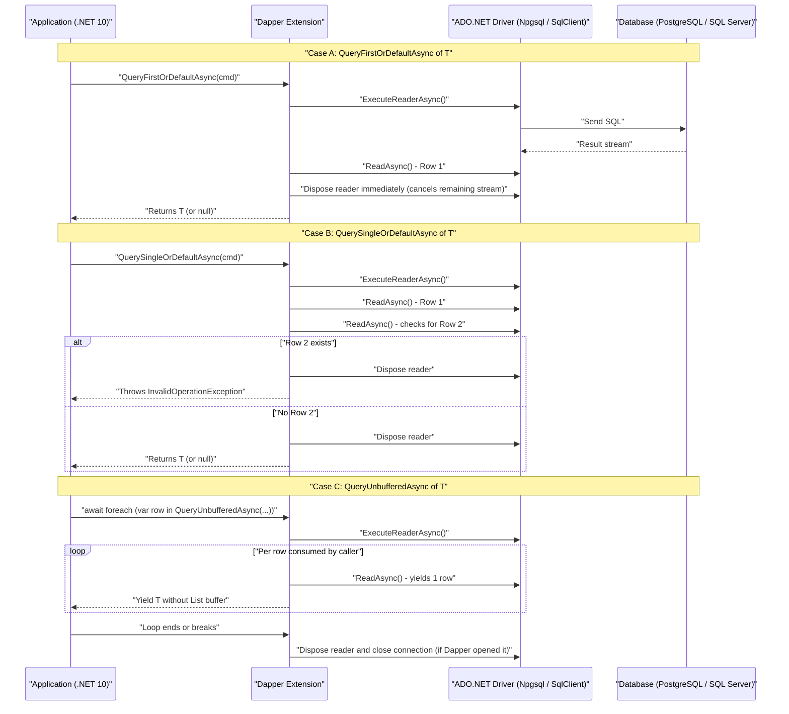

# Chapter 3: The Dapper API Deep Dive

## 1. Learning Objectives

By the end of this chapter, you will be able to:
*   Master the complete surface area of Dapper's `IDbConnection` and `DbConnection` extension methods (including `QueryUnbufferedAsync<T>` in Dapper 2.1+).
*   Decide precisely when to use `Query`, `QueryFirst`, `QuerySingle`, `Execute`, `ExecuteScalar`, `QueryMultiple`, or `ExecuteReader` based on architectural and performance requirements.
*   Understand the performance implications, ADO.NET `DbDataReader` lifecycle, and exception-handling behavior (`NpgsqlException` / `SqlException`) of every API.
*   Utilize `CommandDefinition`, `CommandFlags`, and `DynamicParameters` to achieve enterprise-grade control over timeouts, cancellation tokens, dynamic filters, and output parameters.
*   Implement production-ready data access in **.NET 10 / C# 14** (with primary constructors) for both **SQL Server** (EV Charging Platform) and **PostgreSQL + pgvector via Npgsql** (Normora).

## 2. Introduction

While Dapper's internal engine is complex, its public API surface is elegantly simple. Dapper operates on a design philosophy of "pit of success"—the default methods are highly optimized, but explicit control is always available when you need it.

Before diving into the methods, let's clarify three foundational terms you will encounter throughout this chapter:
*   **ADO.NET (`DbConnection`, `DbCommand`, `DbDataReader`):** .NET's low-level database access layer. Provider libraries like `Npgsql` (for PostgreSQL) and `Microsoft.Data.SqlClient` (for SQL Server) implement these base classes. Dapper is a thin set of extension methods built directly on top of ADO.NET.
*   **IL (Intermediate Language) Emit:** At runtime, Dapper inspects the columns returned by a query and generates lightweight compiled bytecode (IL) to copy column values directly into your C# object's properties or constructor—avoiding slow runtime reflection on every row.
*   **Buffered vs. Unbuffered Execution:** *Buffered* means Dapper reads all rows into an in-memory `List<T>` before returning. *Unbuffered* means Dapper yields rows one by one while keeping the `DbDataReader` and database connection open until enumeration completes.

In enterprise software, using the "wrong" method (such as using `Query().FirstOrDefault()` instead of `QueryFirstOrDefault()`) can lead to subtle memory spikes, connection pool starvation, unnecessary database round-trips, or swallowed exceptions that mask data corruption. This chapter provides a forensic examination of every Dapper API, explaining the parameters, internal behaviors, and explicit rules on when *not* to use them.

## 3. Visual Diagrams

### 3.1. Dapper API Selection Decision Tree



### 3.2. Internal `DbDataReader` Lifecycle by API

Understanding how many `reader.ReadAsync()` calls Dapper performs—and when it closes the reader—explains why choosing the right API protects both memory and data integrity:



## 4. API Deep Dive

### 4.1. The Base Parameters, Parameter Binding, and Provider Differences

Almost all Dapper methods share the following base parameters:
*   `string sql`: The SQL command to execute (T-SQL for SQL Server, PostgreSQL dialect for Npgsql, etc.).
*   `object? param`: (Optional) The parameters to bind. Can be an anonymous object (`new { TenantId = tenantId }`), a `DynamicParameters` instance, a POCO/record, or an `IEnumerable` (for `IN` expansion or multi-execution).
*   `IDbTransaction? transaction`: (Optional) The active transaction. **Mandatory** if the connection already has an open local transaction; omitting it throws `InvalidOperationException`.
*   `int? commandTimeout`: (Optional) Time in seconds to wait before the ADO.NET driver aborts the command and throws a provider `DbException` (`NpgsqlException` in PostgreSQL, `SqlException` in SQL Server). Defaults to ADO.NET's 30 seconds.
*   `CommandType? commandType`: (Optional) Usually `CommandType.Text` (default) or `CommandType.StoredProcedure` (for SQL Server stored procedures or PostgreSQL `CALL` procedures).

#### Parameter Binding: `IN @Ids` Expansion vs. PostgreSQL `= ANY(@Ids)`
When you pass an `IEnumerable<T>` property inside an anonymous object to a `SELECT` query, Dapper supports **List Expansion**:
```sql
SELECT id, title FROM documents.documents WHERE tenant_id = @TenantId AND id IN @DocumentIds
```
Under the hood, Dapper rewrites `IN @DocumentIds` into `IN (@DocumentIds1, @DocumentIds2, ..., @DocumentIdsN)`.

**Why this matters architecturally (and when NOT to use `IN @Ids`):**
*   **Plan Cache Bloat:** A 3-element list generates different SQL text (`(@p1, @p2, @p3)`) than a 4-element list (`(@p1, @p2, @p3, @p4)`), forcing the database to compile and cache separate query plans for every distinct list length.
*   **Parameter Limits:** SQL Server caps RPC parameters at **2,100**; PostgreSQL's wire protocol caps parameters at **65,535**. Passing 3,000 IDs crashes on SQL Server.
*   **Empty List Behavior:** If `@DocumentIds` is empty, Dapper rewrites it to `(SELECT @DocumentIds WHERE 1 = 0)`, which is safe, whereas hand-rolled `IN ()` is a syntax error.
*   **The PostgreSQL Solution (`= ANY(@Ids)`):** In **Normora** (PostgreSQL + Npgsql), pass a typed array (`Guid[]`) directly to `= ANY(@DocumentIds)`. Npgsql sends it as **one single array parameter** (`uuid[]`), guaranteeing one query plan, zero parameter limit headaches, and cleaner SQL.

#### SQL Server vs. PostgreSQL (`Npgsql`) API Nuances
Because Dapper wraps ADO.NET, SQL dialects and provider types still reflect your database engine:
*   **Connection Opening:** In modern .NET 10 + Npgsql, inject `NpgsqlDataSource` (registered as a singleton) and call `await using var conn = await dataSource.OpenConnectionAsync(ct);` rather than manually constructing `new NpgsqlConnection(...)`.
*   **Parameter Prefix:** Both SQL Server and Npgsql accept `@ParamName` (Npgsql also accepts `:ParamName`, though `@` keeps Dapper code uniform).
*   **Returning Generated Values:** SQL Server uses `OUTPUT Inserted.Id`; PostgreSQL uses `RETURNING id`.
*   **Exceptions:** Provider errors surface as `PostgresException` / `NpgsqlException` (PostgreSQL) or `SqlException` (SQL Server), both inheriting from `DbException`.

**When NOT to use:**
*   Do not use `IN @Ids` list expansion on PostgreSQL when a native array `= ANY(@Ids)` works—avoiding plan cache pollution.
*   Do not pass `object param` directly if you need `OUTPUT` parameters, explicit `DbType`/`NpgsqlDbType` sizing, or conditional filter construction—use `DynamicParameters` (Section 4.9).

#### Real-World Examples (Normora — PostgreSQL + .NET 10)

1. **Standard Parameterized Read (`Tenants` Module — Explicit `TenantId` Isolation):**
```csharp
public sealed class GetDepartmentBySlugQueryHandler(NpgsqlDataSource dataSource)
{
    public async Task<DepartmentDto?> HandleAsync(Guid tenantId, string slug, CancellationToken ct)
    {
        const string sql = """
            SELECT id AS Id, name AS Name, slug AS Slug
            FROM tenants.departments
            WHERE tenant_id = @TenantId AND slug = @Slug AND is_deleted = FALSE
            LIMIT 1;
            """;

        await using var conn = await dataSource.OpenConnectionAsync(ct);
        return await conn.QueryFirstOrDefaultAsync<DepartmentDto>(sql, new { TenantId = tenantId, Slug = slug });
    }
}
```

2. **PostgreSQL Native Array Binding with `= ANY(@Ids)` (`Documents` Module — Batch Status Lookup):**
```csharp
public sealed class GetDocumentStatusesQueryHandler(NpgsqlDataSource dataSource)
{
    public async Task<IReadOnlyList<DocumentStatusDto>> HandleAsync(
        Guid tenantId, Guid[] documentIds, CancellationToken ct)
    {
        const string sql = """
            SELECT id AS Id, ingestion_status AS IngestionStatus, updated_at AS UpdatedAt
            FROM documents.documents
            WHERE tenant_id = @TenantId AND id = ANY(@DocumentIds);
            """;

        await using var conn = await dataSource.OpenConnectionAsync(ct);
        var rows = await conn.QueryAsync<DocumentStatusDto>(sql, new { TenantId = tenantId, DocumentIds = documentIds });
        return rows.AsList();
    }
}
```

3. **Transaction Parameter Propagation (`Documents` Module — Atomic Upload + Outbox Insert):**
```csharp
public sealed class UploadOutboxWriter(NpgsqlDataSource dataSource)
{
    public async Task EnqueueAsync(
        NpgsqlConnection conn, NpgsqlTransaction tx, Guid tenantId, Guid documentId, Guid versionId, CancellationToken ct)
    {
        const string sql = """
            INSERT INTO documents.document_processing_outbox_messages
                (id, tenant_id, document_id, document_version_id, status, created_at)
            VALUES
                (@Id, @TenantId, @DocumentId, @VersionId, 'Pending', @CreatedAt);
            """;

        // Passing transaction: tx is mandatory when conn has an active NpgsqlTransaction
        await conn.ExecuteAsync(sql, new
        {
            Id = Guid.CreateVersion7(),
            TenantId = tenantId,
            DocumentId = documentId,
            VersionId = versionId,
            CreatedAt = DateTimeOffset.UtcNow
        }, transaction: tx);
    }
}
```

4. **Custom `commandTimeout` for Heavy Vector Index Maintenance (`Documents` Module — Worker Job):**
```csharp
public sealed class PruneStaleOutboxMessagesJob(NpgsqlDataSource dataSource)
{
    public async Task<int> PurgeAsync(DateTimeOffset cutoffUtc, CancellationToken ct)
    {
        const string sql = """
            DELETE FROM documents.document_processing_outbox_messages
            WHERE status = 'Processed' AND processed_at < @CutoffUtc;
            """;

        await using var conn = await dataSource.OpenConnectionAsync(ct);
        // 120-second timeout for large batch cleanup in Normora.Worker
        return await conn.ExecuteAsync(sql, new { CutoffUtc = cutoffUtc }, commandTimeout: 120);
    }
}
```

5. **Handling `PostgresException` Constraint Violations (`Tenants` Module — Unique Slug Guard):**
```csharp
public sealed class CreateUserGroupRepository(NpgsqlDataSource dataSource)
{
    public async Task<Guid> CreateAsync(Guid tenantId, string name, CancellationToken ct)
    {
        const string sql = """
            INSERT INTO tenants.user_groups (id, tenant_id, name, created_at)
            VALUES (@Id, @TenantId, @Name, @CreatedAt)
            RETURNING id;
            """;

        await using var conn = await dataSource.OpenConnectionAsync(ct);
        try
        {
            return await conn.ExecuteScalarAsync<Guid>(sql, new
            {
                Id = Guid.CreateVersion7(),
                TenantId = tenantId,
                Name = name,
                CreatedAt = DateTimeOffset.UtcNow
            });
        }
        catch (PostgresException ex) when (ex.SqlState == PostgresErrorCodes.UniqueViolation)
        {
            throw new InvalidOperationException(ApiMessages.DuplicateResource, ex);
        }
    }
}
```

### 4.2. `Query`, `QueryAsync`, and `QueryUnbufferedAsync`
**Signatures:**
*   `IEnumerable<T> Query<T>(this IDbConnection cnn, string sql, object? param = null, ..., bool buffered = true)`
*   `Task<IEnumerable<T>> QueryAsync<T>(this IDbConnection cnn, ...)`
*   `IAsyncEnumerable<T> QueryUnbufferedAsync<T>(this DbConnection cnn, string sql, object? param = null, DbTransaction? transaction = null, int? commandTimeout = null, CommandType? commandType = null)` *(Dapper 2.1+)*

**Purpose:** Executes a SQL query and maps the result set to a sequence of strongly-typed objects `T` (or untyped `dynamic` rows if `<T>` is omitted).

**Internal Behavior:**
*   **`QueryAsync<T>` (Buffered):** Calls `ExecuteReaderAsync()`, loops asynchronously through the `DbDataReader`, invokes the emitted IL delegate to materialize each `T`, and stores every row in an internal `List<T>` before returning the completed `Task<IEnumerable<T>>`. Note that even if you pass `CommandFlags.None` inside a `CommandDefinition` to `QueryAsync<T>`, it still buffers into a list before the `Task` resolves.
*   **`Query<T>(..., buffered: false)` (Sync Unbuffered):** Returns a deferred iterator (`yield return`) over the open `IDataReader`. Blocks the thread synchronously on each row and requires the connection to stay open until enumeration finishes.
*   **`QueryUnbufferedAsync<T>` (Async Streaming — `DbConnection` only):** Returns a true `IAsyncEnumerable<T>` consumed via `await foreach`. It reads and yields one row at a time asynchronously without allocating a `List<T>`, and supports cancellation via `.WithCancellation(ct)`.
*   **Untyped (`dynamic`) Queries:** Calling `Query(sql)` without `<T>` returns `IEnumerable<dynamic>` backed by Dapper's internal `DapperRow` type. While useful for quick ad-hoc scripts, `dynamic` disables compile-time type checking, causes boxing overhead, and violates strict typing rules (Normora explicitly forbids `dynamic` and `any` in production code).

**When NOT to use:**
*   Do not use `QueryAsync<T>` if you only expect a single row. It allocates a `List<T>` and reads the entire stream unnecessarily—use `QueryFirstOrDefaultAsync<T>` or `QuerySingleOrDefaultAsync<T>`.
*   Do not use `QueryAsync<T>` for large exports (e.g., 100,000+ audit log rows); use `QueryUnbufferedAsync<T>` to keep memory flat.
*   Do not use `QueryAsync<T>` for `INSERT`/`UPDATE`/`DELETE` without `RETURNING`/`OUTPUT`.
*   Do not use untyped `Query()` (`dynamic`) in production handlers.

#### Real-World Examples (Normora — PostgreSQL + .NET 10)

1. **Paginated Knowledge Document Listing (`Documents` Module):**
```csharp
public sealed class ListWorkspaceDocumentsQueryHandler(NpgsqlDataSource dataSource)
{
    public async Task<IReadOnlyList<DocumentSummaryDto>> HandleAsync(
        Guid tenantId, int pageSize, int offset, CancellationToken ct)
    {
        const string sql = """
            SELECT id AS Id, title AS Title, mime_type AS MimeType, ingestion_status AS IngestionStatus, created_at AS CreatedAt
            FROM documents.documents
            WHERE tenant_id = @TenantId AND is_deleted = FALSE
            ORDER BY created_at DESC
            LIMIT @PageSize OFFSET @Offset;
            """;

        await using var conn = await dataSource.OpenConnectionAsync(ct);
        var items = await conn.QueryAsync<DocumentSummaryDto>(sql, new
        {
            TenantId = tenantId,
            PageSize = pageSize,
            Offset = offset
        });
        return items.AsList();
    }
}
```

2. **Departmental RBAC Membership Lookup (`Tenants` Module — Using `ExternalUserId`):**
```csharp
public sealed class GetUserDepartmentIdsQueryHandler(NpgsqlDataSource dataSource)
{
    public async Task<IReadOnlyList<Guid>> HandleAsync(
        Guid tenantId, string externalUserId, CancellationToken ct)
    {
        const string sql = """
            SELECT dm.department_id
            FROM tenants.department_memberships dm
            INNER JOIN tenants.tenant_memberships tm ON tm.id = dm.tenant_membership_id
            WHERE tm.tenant_id = @TenantId
              AND tm.external_user_id = @ExternalUserId
              AND tm.is_active = TRUE;
            """;

        await using var conn = await dataSource.OpenConnectionAsync(ct);
        var ids = await conn.QueryAsync<Guid>(sql, new { TenantId = tenantId, ExternalUserId = externalUserId });
        return ids.AsList();
    }
}
```

3. **Streaming Large Audit Log Exports Without Memory Spikes (`Tenants` Module — `QueryUnbufferedAsync<T>`):**
```csharp
public sealed class StreamTenantAuditLogsQueryHandler(NpgsqlDataSource dataSource)
{
    public async IAsyncEnumerable<AuditLogExportRow> StreamAsync(
        Guid tenantId, DateTimeOffset fromUtc, [EnumeratorCancellation] CancellationToken ct)
    {
        const string sql = """
            SELECT id AS Id, actor_external_user_id AS ActorExternalUserId, action AS Action, created_at AS CreatedAt
            FROM tenants.audit_logs
            WHERE tenant_id = @TenantId AND created_at >= @FromUtc
            ORDER BY created_at ASC;
            """;

        // Connection stays open in this async iterator until caller finishes or cancels
        await using var conn = await dataSource.OpenConnectionAsync(ct);
        await foreach (var row in conn.QueryUnbufferedAsync<AuditLogExportRow>(
            sql, new { TenantId = tenantId, FromUtc = fromUtc }).WithCancellation(ct))
        {
            yield return row;
        }
    }
}
```

4. **Loading Recent Conversation Messages for Context Window (`Conversations` Module):**
```csharp
public sealed class GetRecentTurnHistoryQueryHandler(NpgsqlDataSource dataSource)
{
    public async Task<IReadOnlyList<ConversationMessageDto>> HandleAsync(
        Guid tenantId, Guid conversationId, int limit, CancellationToken ct)
    {
        const string sql = """
            SELECT id AS Id, role AS Role, content AS Content, created_at AS CreatedAt
            FROM conversations.messages
            WHERE tenant_id = @TenantId AND conversation_id = @ConversationId
            ORDER BY created_at DESC
            LIMIT @Limit;
            """;

        await using var conn = await dataSource.OpenConnectionAsync(ct);
        var messages = await conn.QueryAsync<ConversationMessageDto>(sql, new
        {
            TenantId = tenantId,
            ConversationId = conversationId,
            Limit = limit
        });
        return messages.AsList();
    }
}
```

5. **Claiming Pending Outbox Work Items in Background Worker (`Documents` Module — `FOR UPDATE SKIP LOCKED`):**
```csharp
public sealed class ClaimOutboxBatchRepository(NpgsqlDataSource dataSource)
{
    public async Task<IReadOnlyList<PendingOutboxItem>> ClaimBatchAsync(
        int batchSize, NpgsqlConnection conn, NpgsqlTransaction tx, CancellationToken ct)
    {
        const string sql = """
            SELECT id AS Id, tenant_id AS TenantId, document_id AS DocumentId, document_version_id AS DocumentVersionId
            FROM documents.document_processing_outbox_messages
            WHERE status = 'Pending'
            ORDER BY created_at ASC
            LIMIT @BatchSize
            FOR UPDATE SKIP LOCKED;
            """;

        var batch = await conn.QueryAsync<PendingOutboxItem>(
            new CommandDefinition(sql, new { BatchSize = batchSize }, transaction: tx, cancellationToken: ct));
        return batch.AsList();
    }
}
```

### 4.3. The "First" Family
**APIs:** `QueryFirst<T>`, `QueryFirstOrDefault<T>` (and `*Async` variants)
**Purpose:** Returns the first row of a result set when multiple matching rows may exist and you genuinely only want the top row (for example, "most recent login" or "latest active document version").

**Internal Behavior:**
Dapper executes the query, reads the *very first row* from the `DbDataReader`, maps it, and immediately calls `Dispose()` on the reader, discarding any subsequent rows that the database might have buffered on the wire.
*   `QueryFirst`: Throws `InvalidOperationException` ("Sequence contains no elements") if the result set is empty.
*   `QueryFirstOrDefault`: Returns `default(T)` (`null` for reference types / nullable value types) if the result set is empty.

> [!TIP]
> Always pair `QueryFirst` / `QueryFirstOrDefault` with `LIMIT 1` (PostgreSQL) or `TOP (1)` (SQL Server) and an explicit `ORDER BY`. Closing the reader stops Dapper from reading more rows, *not* the database from computing or sorting 100,000 rows beforehand unless the query planner sees `LIMIT 1`.

**When NOT to use:**
*   **Crucial Rule:** Do not use this as a lazy way to ignore duplicates. If your database schema dictates that `Email` or `Slug` should be unique, but you have corrupt data with two identical values, `QueryFirstOrDefault` will silently hide this corruption. Use `QuerySingleOrDefault` instead.
*   Do not use without `ORDER BY` when multiple rows can match—otherwise the returned "first" row is non-deterministic.

#### Real-World Examples (Normora — PostgreSQL + .NET 10)

1. **Fetching the Latest Uploaded Document Version (`Documents` Module):**
```csharp
public sealed class GetLatestDocumentVersionQueryHandler(NpgsqlDataSource dataSource)
{
    public async Task<DocumentVersionDto?> HandleAsync(Guid tenantId, Guid documentId, CancellationToken ct)
    {
        const string sql = """
            SELECT id AS Id, version_number AS VersionNumber, storage_key AS StorageKey, created_at AS CreatedAt
            FROM documents.document_versions
            WHERE tenant_id = @TenantId AND document_id = @DocumentId
            ORDER BY version_number DESC
            LIMIT 1;
            """;

        await using var conn = await dataSource.OpenConnectionAsync(ct);
        return await conn.QueryFirstOrDefaultAsync<DocumentVersionDto>(sql, new { TenantId = tenantId, DocumentId = documentId });
    }
}
```

2. **Getting the Most Recent User Turn in a Conversation (`Conversations` Module):**
```csharp
public sealed class GetLastUserPromptQueryHandler(NpgsqlDataSource dataSource)
{
    public async Task<string?> HandleAsync(Guid tenantId, Guid conversationId, CancellationToken ct)
    {
        const string sql = """
            SELECT content
            FROM conversations.messages
            WHERE tenant_id = @TenantId AND conversation_id = @ConversationId AND role = 'user'
            ORDER BY created_at DESC
            LIMIT 1;
            """;

        await using var conn = await dataSource.OpenConnectionAsync(ct);
        return await conn.QueryFirstOrDefaultAsync<string>(sql, new { TenantId = tenantId, ConversationId = conversationId });
    }
}
```

3. **Reading Mandatory Default Tenant Branding Fallback (`Tenants` Module — `QueryFirstAsync`):**
```csharp
public sealed class GetActiveSubscriptionPlanQueryHandler(NpgsqlDataSource dataSource)
{
    public async Task<TenantPlanDto> HandleAsync(Guid tenantId, CancellationToken ct)
    {
        const string sql = """
            SELECT id AS Id, tier AS Tier, currency AS Currency, billing_cycle AS BillingCycle, renews_at AS RenewsAt
            FROM tenants.tenant_plans
            WHERE tenant_id = @TenantId
            ORDER BY created_at DESC
            LIMIT 1;
            """;

        await using var conn = await dataSource.OpenConnectionAsync(ct);
        // Every provisioned tenant must have at least one plan row; QueryFirstAsync throws if missing
        return await conn.QueryFirstAsync<TenantPlanDto>(sql, new { TenantId = tenantId });
    }
}
```

4. **Checking Most Recent Failed Ingestion Event for Diagnostics (`Documents` Module):**
```csharp
public sealed class GetLatestIngestionFailureQueryHandler(NpgsqlDataSource dataSource)
{
    public async Task<OutboxFailureInfo?> HandleAsync(Guid tenantId, Guid documentId, CancellationToken ct)
    {
        const string sql = """
            SELECT id AS Id, retry_count AS RetryCount, last_attempted_at AS LastAttemptedAt
            FROM documents.document_processing_outbox_messages
            WHERE tenant_id = @TenantId AND document_id = @DocumentId AND status = 'Failed'
            ORDER BY last_attempted_at DESC
            LIMIT 1;
            """;

        await using var conn = await dataSource.OpenConnectionAsync(ct);
        return await conn.QueryFirstOrDefaultAsync<OutboxFailureInfo>(sql, new { TenantId = tenantId, DocumentId = documentId });
    }
}
```

5. **Resolving the Next Expiring Pending HITL Approval (`Conversations` Module):**
```csharp
public sealed class GetNextPendingApprovalQueryHandler(NpgsqlDataSource dataSource)
{
    public async Task<PendingApprovalDto?> HandleAsync(
        Guid tenantId, Guid conversationId, string externalUserId, CancellationToken ct)
    {
        const string sql = """
            SELECT id AS Id, tool_name AS ToolName, expires_at AS ExpiresAt
            FROM conversations.pending_approvals
            WHERE tenant_id = @TenantId
              AND conversation_id = @ConversationId
              AND requested_by_external_user_id = @ExternalUserId
              AND status = 'Pending'
              AND expires_at > NOW()
            ORDER BY expires_at ASC
            LIMIT 1;
            """;

        await using var conn = await dataSource.OpenConnectionAsync(ct);
        return await conn.QueryFirstOrDefaultAsync<PendingApprovalDto>(sql, new
        {
            TenantId = tenantId,
            ConversationId = conversationId,
            ExternalUserId = externalUserId
        });
    }
}
```

### 4.4. The "Single" Family
**APIs:** `QuerySingle<T>`, `QuerySingleOrDefault<T>` (and `*Async` variants)
**Purpose:** Returns exactly one row while **enforcing uniqueness** as a runtime assertion. Ideal for primary key lookups, unique slug resolution, and BOLA (Broken Object Level Authorization) ownership checks.

**Internal Behavior:**
Dapper reads the first row from the `DbDataReader`, then intentionally calls `reader.ReadAsync()` a *second* time to verify no duplicate row exists.
*   If a second row exists, it immediately disposes the reader and throws `InvalidOperationException` ("Sequence contains more than one element") without scanning the rest of the table.
*   `QuerySingle<T>`: Throws if **0 rows** OR **> 1 row**.
*   `QuerySingleOrDefault<T>`: Returns `default(T)` if **0 rows**. Throws if **> 1 row**.

**When NOT to use:**
*   Do not use if the SQL query naturally matches multiple rows (e.g., `SELECT * FROM documents.documents WHERE tenant_id = @TenantId`) and you just want one of them—use `QueryFirstOrDefaultAsync` with `ORDER BY` + `LIMIT 1`.
*   Do not confuse `QuerySingle` with a replacement for a database `UNIQUE` index—keep the `UNIQUE` constraint in PostgreSQL and use `QuerySingleOrDefaultAsync` as defense-in-depth.

#### Real-World Examples (Normora — PostgreSQL + .NET 10)

1. **BOLA-Safe Document Fetch by ID (`Documents` Module — Maps Missing/Unauthorized to 404):**
```csharp
public sealed class GetDocumentByIdQueryHandler(NpgsqlDataSource dataSource, ITenantContext tenantContext)
{
    public async Task<DocumentDetailDto> HandleAsync(Guid documentId, CancellationToken ct)
    {
        const string sql = """
            SELECT id AS Id, title AS Title, mime_type AS MimeType, department_id AS DepartmentId
            FROM documents.documents
            WHERE id = @DocumentId AND tenant_id = @TenantId AND is_deleted = FALSE;
            """;

        await using var conn = await dataSource.OpenConnectionAsync(ct);
        var doc = await conn.QuerySingleOrDefaultAsync<DocumentDetailDto>(
            sql, new { DocumentId = documentId, TenantId = tenantContext.TenantId });

        // Missing ID or cross-tenant ID both throw BolaException (404 Not Found), preventing ID enumeration
        return doc ?? throw new BolaException();
    }
}
```

2. **Tenant Resolution Middleware Lookup by Slug (`Tenants` Module):**
```csharp
public sealed class ResolveTenantBySlugRepository(NpgsqlDataSource dataSource)
{
    public async Task<TenantResolutionDto?> GetBySlugAsync(string slug, CancellationToken ct)
    {
        const string sql = """
            SELECT id AS Id, slug AS Slug, name AS Name, is_active AS IsActive
            FROM tenants.tenants
            WHERE slug = @Slug;
            """;

        await using var conn = await dataSource.OpenConnectionAsync(ct);
        // Slug must be globally unique; > 1 row is a critical data integrity bug
        return await conn.QuerySingleOrDefaultAsync<TenantResolutionDto>(sql, new { Slug = slug });
    }
}
```

3. **Validating Mandatory Tenant Membership for BFLA Role Check (`Tenants` Module — `QuerySingleOrDefaultAsync`):**
```csharp
public sealed class GetTenantMembershipRoleQueryHandler(NpgsqlDataSource dataSource)
{
    public async Task<TenantMembershipRoleDto> HandleAsync(
        Guid tenantId, string externalUserId, CancellationToken ct)
    {
        const string sql = """
            SELECT id AS MembershipId, role AS Role, is_active AS IsActive
            FROM tenants.tenant_memberships
            WHERE tenant_id = @TenantId AND external_user_id = @ExternalUserId;
            """;

        await using var conn = await dataSource.OpenConnectionAsync(ct);
        var membership = await conn.QuerySingleOrDefaultAsync<TenantMembershipRoleDto>(
            sql, new { TenantId = tenantId, ExternalUserId = externalUserId });

        return membership is { IsActive: true } ? membership : throw new BflaException();
    }
}
```

4. **Loading a Specific HITL `PendingApproval` Record for Execution (`Conversations` Module):**
```csharp
public sealed class GetPendingApprovalByIdQueryHandler(NpgsqlDataSource dataSource)
{
    public async Task<PendingApprovalDetail> HandleAsync(
        Guid tenantId, Guid approvalId, string externalUserId, CancellationToken ct)
    {
        const string sql = """
            SELECT id AS Id, tool_name AS ToolName, arguments_json AS ArgumentsJson, status AS Status, expires_at AS ExpiresAt
            FROM conversations.pending_approvals
            WHERE id = @ApprovalId
              AND tenant_id = @TenantId
              AND requested_by_external_user_id = @ExternalUserId;
            """;

        await using var conn = await dataSource.OpenConnectionAsync(ct);
        var approval = await conn.QuerySingleOrDefaultAsync<PendingApprovalDetail>(sql, new
        {
            ApprovalId = approvalId,
            TenantId = tenantId,
            ExternalUserId = externalUserId
        });

        return approval ?? throw new BolaException();
    }
}
```

5. **Reading Guaranteed Chunk Breadcrumb & Content by Primary Key (`Documents` Module — `QuerySingleAsync`):**
```csharp
public sealed class GetDocumentChunkPreviewQueryHandler(NpgsqlDataSource dataSource)
{
    public async Task<ChunkPreviewDto> HandleAsync(Guid tenantId, Guid chunkId, CancellationToken ct)
    {
        const string sql = """
            SELECT id AS Id, document_id AS DocumentId, section_breadcrumb AS SectionBreadcrumb, content AS Content
            FROM documents.document_chunks
            WHERE id = @ChunkId AND tenant_id = @TenantId;
            """;

        await using var conn = await dataSource.OpenConnectionAsync(ct);
        // Throws InvalidOperationException if chunk is missing or duplicated
        return await conn.QuerySingleAsync<ChunkPreviewDto>(sql, new { ChunkId = chunkId, TenantId = tenantId });
    }
}
```

### 4.5. Execute and ExecuteAsync
**APIs:** `int Execute(...)` / `Task<int> ExecuteAsync(...)`
**Purpose:** Executes a non-query SQL command that modifies data (DML: `INSERT`, `UPDATE`, `DELETE`) or schema (DDL: `CREATE`, `ALTER`).
**Returns:** An `int` representing the number of rows affected as reported by the database (`@@ROWCOUNT` in SQL Server, command tag row count in PostgreSQL). Returns `-1` for DDL statements or when `SET NOCOUNT ON` is active in SQL Server.

**Internal Behavior:**
Dapper bypasses `ExecuteReader` and calls `DbCommand.ExecuteNonQuery()` / `ExecuteNonQueryAsync()`.

#### The `IEnumerable` Multi-Execution Trap
If you pass a collection (such as `List<ChunkInsertRow>`) to `ExecuteAsync(sql, list)`, Dapper loops over the collection and calls `ExecuteNonQueryAsync()` **once per item** on the same prepared command.
*   For 5 items, that is 5 network round-trips.
*   For 5,000 document chunks, that is **5,000 sequential database round-trips**—crippling ingestion throughput.

**When NOT to use:**
*   Do not use if you need data back (e.g., `INSERT ... RETURNING id` or `OUTPUT Inserted.Id`). `ExecuteAsync` discards result sets and returns only the row count. Use `ExecuteScalarAsync<T>` or `QuerySingleAsync<T>`.
*   Do not pass a large `IEnumerable` to `ExecuteAsync` for bulk inserts. In PostgreSQL (`Npgsql`), use `UNNEST(@Col1, @Col2)` inside a single `ExecuteAsync`, or drop down to `NpgsqlBinaryImporter` (`COPY FROM STDIN`). In SQL Server, use `SqlBulkCopy` or Table-Valued Parameters (TVPs).

#### Real-World Examples (Normora — PostgreSQL + .NET 10)

1. **Updating Workspace Currency Preference (`Tenants` Module — Optimistic Row-Count Check):**
```csharp
public sealed class UpdateTenantCurrencyCommandHandler(NpgsqlDataSource dataSource)
{
    public async Task HandleAsync(Guid tenantId, string currency, CancellationToken ct)
    {
        const string sql = """
            UPDATE tenants.tenant_plans
            SET currency = @Currency, updated_at = @UpdatedAt
            WHERE tenant_id = @TenantId;
            """;

        await using var conn = await dataSource.OpenConnectionAsync(ct);
        var affected = await conn.ExecuteAsync(sql, new
        {
            TenantId = tenantId,
            Currency = currency.ToUpperInvariant(),
            UpdatedAt = DateTimeOffset.UtcNow
        });

        if (affected == 0)
            throw new BolaException();
    }
}
```

2. **Soft-Deleting a Document with BOLA Verification (`Documents` Module):**
```csharp
public sealed class SoftDeleteDocumentCommandHandler(NpgsqlDataSource dataSource, ITenantContext tenantContext)
{
    public async Task HandleAsync(Guid documentId, CancellationToken ct)
    {
        const string sql = """
            UPDATE documents.documents
            SET is_deleted = TRUE, deleted_at = @DeletedAt
            WHERE id = @DocumentId AND tenant_id = @TenantId AND is_deleted = FALSE;
            """;

        await using var conn = await dataSource.OpenConnectionAsync(ct);
        var rows = await conn.ExecuteAsync(sql, new
        {
            DocumentId = documentId,
            TenantId = tenantContext.TenantId,
            DeletedAt = DateTimeOffset.UtcNow
        });

        if (rows == 0)
            throw new BolaException();
    }
}
```

3. **Marking Outbox Message Processed (`Documents` Module — `Normora.Worker`):**
```csharp
public sealed class MarkOutboxProcessedRepository(NpgsqlDataSource dataSource)
{
    public async Task MarkProcessedAsync(Guid outboxMessageId, CancellationToken ct)
    {
        const string sql = """
            UPDATE documents.document_processing_outbox_messages
            SET status = 'Processed', processed_at = @ProcessedAt
            WHERE id = @Id;
            """;

        await using var conn = await dataSource.OpenConnectionAsync(ct);
        await conn.ExecuteAsync(sql, new { Id = outboxMessageId, ProcessedAt = DateTimeOffset.UtcNow });
    }
}
```

4. **Expiring Stale HITL Approvals in One Set-Based Statement (`Conversations` Module):**
```csharp
public sealed class ExpireStaleApprovalsJob(NpgsqlDataSource dataSource)
{
    public async Task<int> ExpireAsync(CancellationToken ct)
    {
        const string sql = """
            UPDATE conversations.pending_approvals
            SET status = 'Expired'
            WHERE status = 'Pending' AND expires_at <= @NowUtc;
            """;

        await using var conn = await dataSource.OpenConnectionAsync(ct);
        return await conn.ExecuteAsync(sql, new { NowUtc = DateTimeOffset.UtcNow });
    }
}
```

5. **Single-Roundtrip Bulk Chunk Insertion Using PostgreSQL `UNNEST` (`Documents` Module — Avoiding `IEnumerable` Loop):**
```csharp
public sealed class BulkInsertChunksRepository(NpgsqlDataSource dataSource)
{
    public async Task<int> InsertChunksAsync(
        Guid tenantId, Guid documentId, int[] indices, string[] contents, CancellationToken ct)
    {
        const string sql = """
            INSERT INTO documents.document_chunks (id, tenant_id, document_id, chunk_index, content)
            SELECT gen_random_uuid(), @TenantId, @DocumentId, idx, txt
            FROM UNNEST(@Indices, @Contents) AS t(idx, txt);
            """;

        await using var conn = await dataSource.OpenConnectionAsync(ct);
        return await conn.ExecuteAsync(sql, new
        {
            TenantId = tenantId,
            DocumentId = documentId,
            Indices = indices,
            Contents = contents
        });
    }
}
```

### 4.6. ExecuteScalar and ExecuteScalarAsync
**APIs:** `T? ExecuteScalar<T>(...)` / `Task<T?> ExecuteScalarAsync<T>(...)`
**Purpose:** Executes a query and returns the single value from the first column of the first row in the result set.

**Internal Behavior:**
Calls `DbCommand.ExecuteScalar()` / `ExecuteScalarAsync()`. Any additional columns or rows are ignored at the ADO.NET driver level. Dapper converts `DBNull.Value` to `default(T)` (warning: if `T` is non-nullable `int` and the SQL returns `NULL`—such as `SUM(size)` on an empty set—you get `0` or an `InvalidCastException` depending on driver/Dapper version, so prefer `ExecuteScalarAsync<long?>` or SQL `COALESCE(..., 0)`).

**When NOT to use:**
*   Do not use for mapping whole objects or returning multiple columns (`RETURNING id, created_at`). Use `QuerySingleAsync<T>` instead.
*   Do not use for `INSERT` without `RETURNING` / `OUTPUT`—it will return `default(T)`.

#### Real-World Examples (Normora — PostgreSQL + .NET 10)

1. **Counting Active Documents for Free Tier Quota Check (`Documents` Module):**
```csharp
public sealed class CountTenantDocumentsQueryHandler(NpgsqlDataSource dataSource)
{
    public async Task<int> HandleAsync(Guid tenantId, CancellationToken ct)
    {
        const string sql = """
            SELECT COUNT(*)::int
            FROM documents.documents
            WHERE tenant_id = @TenantId AND is_deleted = FALSE;
            """;

        await using var conn = await dataSource.OpenConnectionAsync(ct);
        return await conn.ExecuteScalarAsync<int>(sql, new { TenantId = tenantId });
    }
}
```

2. **Inserting a Saved Answer and Returning Its Generated ID (`Conversations` Module — PostgreSQL `RETURNING`):**
```csharp
public sealed class SaveAnswerCommandHandler(NpgsqlDataSource dataSource)
{
    public async Task<Guid> HandleAsync(
        Guid tenantId, string externalUserId, Guid messageId, string title, CancellationToken ct)
    {
        const string sql = """
            INSERT INTO conversations.saved_answers (id, tenant_id, external_user_id, message_id, title, created_at)
            VALUES (gen_random_uuid(), @TenantId, @ExternalUserId, @MessageId, @Title, @CreatedAt)
            RETURNING id;
            """;

        await using var conn = await dataSource.OpenConnectionAsync(ct);
        return await conn.ExecuteScalarAsync<Guid>(sql, new
        {
            TenantId = tenantId,
            ExternalUserId = externalUserId,
            MessageId = messageId,
            Title = title,
            CreatedAt = DateTimeOffset.UtcNow
        });
    }
}
```

3. **Atomically Incrementing Monotonic `dataVersion` for Reactive UI Sync (`Tenants` Module):**
```csharp
public sealed class WorkspaceStateVersionRepository(NpgsqlDataSource dataSource)
{
    public async Task<long> IncrementDataVersionAsync(Guid tenantId, CancellationToken ct)
    {
        const string sql = """
            UPDATE tenants.tenants
            SET data_version = data_version + 1
            WHERE id = @TenantId
            RETURNING data_version;
            """;

        await using var conn = await dataSource.OpenConnectionAsync(ct);
        return await conn.ExecuteScalarAsync<long>(sql, new { TenantId = tenantId });
    }
}
```

4. **Total Storage Bytes Used with `COALESCE` Guard (`Documents` Module):**
```csharp
public sealed class GetTenantStorageUsageQueryHandler(NpgsqlDataSource dataSource)
{
    public async Task<long> HandleAsync(Guid tenantId, CancellationToken ct)
    {
        const string sql = """
            SELECT COALESCE(SUM(file_size_bytes), 0)::bigint
            FROM documents.document_versions
            WHERE tenant_id = @TenantId;
            """;

        await using var conn = await dataSource.OpenConnectionAsync(ct);
        return await conn.ExecuteScalarAsync<long>(sql, new { TenantId = tenantId });
    }
}
```

5. **Fast Existence Check for Department Access (`Tenants` Module — `EXISTS`):**
```csharp
public sealed class HasDepartmentAccessQueryHandler(NpgsqlDataSource dataSource)
{
    public async Task<bool> HandleAsync(Guid tenantId, Guid departmentId, string externalUserId, CancellationToken ct)
    {
        const string sql = """
            SELECT EXISTS (
                SELECT 1
                FROM tenants.department_memberships dm
                INNER JOIN tenants.tenant_memberships tm ON tm.id = dm.tenant_membership_id
                WHERE tm.tenant_id = @TenantId
                  AND tm.external_user_id = @ExternalUserId
                  AND dm.department_id = @DepartmentId
                  AND tm.is_active = TRUE
            );
            """;

        await using var conn = await dataSource.OpenConnectionAsync(ct);
        return await conn.ExecuteScalarAsync<bool>(sql, new
        {
            TenantId = tenantId,
            DepartmentId = departmentId,
            ExternalUserId = externalUserId
        });
    }
}
```

### 4.7. QueryMultiple (GridReader)
**APIs:** `SqlMapper.GridReader QueryMultiple(...)` / `Task<SqlMapper.GridReader> QueryMultipleAsync(...)`
**Purpose:** Executes multiple SQL statements in a single network round-trip and reads each resulting table sequentially.

**Internal Behavior:**
Sends the entire semicolon-separated SQL batch to PostgreSQL or SQL Server in one trip (no MARS required). The database executes the statements in order and streams back multiple result sets on a single `DbDataReader`.
*   Always wrap `GridReader` in `await using var grid = await conn.QueryMultipleAsync(...)`—`GridReader` owns the open `DbDataReader` until disposed.
*   Read sets strictly in SQL order using `ReadAsync<T>()`, `ReadFirstOrDefaultAsync<T>()`, or `ReadSingleOrDefaultAsync<T>()`.
*   Inspect `grid.IsConsumed` to verify all result sets have been drained before disposal.
*   If read consistency across sets is required (e.g., reading totals and line items from the exact same point in time), wrap `QueryMultipleAsync` in a `RepeatableRead` (PostgreSQL) or `Snapshot` (SQL Server) transaction.

**When NOT to use:**
*   Do not use if the second query depends on application-layer processing of the first query.
*   Do not forget `await using` on `GridReader`; leaving it undisposed leaks the underlying reader and blocks the connection.

#### Real-World Examples (Normora — PostgreSQL + .NET 10)

1. **Workspace Dashboard Summary (`Tenants` Module — Counts + Plan in 1 Round-Trip):**
```csharp
public sealed class GetWorkspaceDashboardSummaryQueryHandler(NpgsqlDataSource dataSource)
{
    public async Task<WorkspaceDashboardDto> HandleAsync(Guid tenantId, CancellationToken ct)
    {
        const string sql = """
            SELECT tier AS Tier, currency AS Currency, billing_cycle AS BillingCycle
            FROM tenants.tenant_plans
            WHERE tenant_id = @TenantId
            LIMIT 1;

            SELECT COUNT(*)::int FROM tenants.tenant_memberships WHERE tenant_id = @TenantId AND is_active = TRUE;
            SELECT COUNT(*)::int FROM tenants.departments WHERE tenant_id = @TenantId AND is_deleted = FALSE;
            """;

        await using var conn = await dataSource.OpenConnectionAsync(ct);
        await using var grid = await conn.QueryMultipleAsync(
            new CommandDefinition(sql, new { TenantId = tenantId }, cancellationToken: ct));

        var plan = await grid.ReadFirstOrDefaultAsync<PlanSummaryDto>();
        var activeMembers = await grid.ReadSingleAsync<int>();
        var departments = await grid.ReadSingleAsync<int>();

        return new WorkspaceDashboardDto(plan, activeMembers, departments);
    }
}
```

2. **Document Detail + All Versions (`Documents` Module):**
```csharp
public sealed class GetDocumentWithVersionsQueryHandler(NpgsqlDataSource dataSource)
{
    public async Task<DocumentWithVersionsDto> HandleAsync(Guid tenantId, Guid documentId, CancellationToken ct)
    {
        const string sql = """
            SELECT id AS Id, title AS Title, ingestion_status AS IngestionStatus
            FROM documents.documents
            WHERE id = @DocumentId AND tenant_id = @TenantId AND is_deleted = FALSE;

            SELECT id AS Id, version_number AS VersionNumber, file_size_bytes AS FileSizeBytes, created_at AS CreatedAt
            FROM documents.document_versions
            WHERE document_id = @DocumentId AND tenant_id = @TenantId
            ORDER BY version_number DESC;
            """;

        await using var conn = await dataSource.OpenConnectionAsync(ct);
        await using var grid = await conn.QueryMultipleAsync(
            new CommandDefinition(sql, new { TenantId = tenantId, DocumentId = documentId }, cancellationToken: ct));

        var doc = await grid.ReadSingleOrDefaultAsync<DocumentHeaderDto>() ?? throw new BolaException();
        var versions = (await grid.ReadAsync<DocumentVersionItemDto>()).AsList();

        return new DocumentWithVersionsDto(doc, versions);
    }
}
```

3. **Conversation Thread + Citations (`Conversations` Module):**
```csharp
public sealed class GetConversationThreadQueryHandler(NpgsqlDataSource dataSource)
{
    public async Task<ConversationThreadDto> HandleAsync(
        Guid tenantId, Guid conversationId, string externalUserId, CancellationToken ct)
    {
        const string sql = """
            SELECT id AS Id, title AS Title, persona AS Persona
            FROM conversations.conversations
            WHERE id = @ConversationId AND tenant_id = @TenantId AND external_user_id = @ExternalUserId;

            SELECT id AS Id, role AS Role, content AS Content, created_at AS CreatedAt
            FROM conversations.messages
            WHERE conversation_id = @ConversationId AND tenant_id = @TenantId
            ORDER BY created_at ASC;

            SELECT message_id AS MessageId, document_id AS DocumentId, chunk_id AS ChunkId
            FROM conversations.citations
            WHERE conversation_id = @ConversationId AND tenant_id = @TenantId;
            """;

        await using var conn = await dataSource.OpenConnectionAsync(ct);
        await using var grid = await conn.QueryMultipleAsync(sql, new
        {
            TenantId = tenantId,
            ConversationId = conversationId,
            ExternalUserId = externalUserId
        });

        var header = await grid.ReadSingleOrDefaultAsync<ConversationHeaderDto>() ?? throw new BolaException();
        var messages = (await grid.ReadAsync<MessageItemDto>()).AsList();
        var citations = (await grid.ReadAsync<CitationItemDto>()).AsList();

        return new ConversationThreadDto(header, messages, citations);
    }
}
```

4. **Paginated Audit Logs + Total Count (`Tenants` Module — Consistent Snapshot Read):**
```csharp
public sealed class GetPagedAuditLogsQueryHandler(NpgsqlDataSource dataSource)
{
    public async Task<PagedAuditLogsDto> HandleAsync(Guid tenantId, int pageSize, int offset, CancellationToken ct)
    {
        const string sql = """
            SELECT COUNT(*)::int FROM tenants.audit_logs WHERE tenant_id = @TenantId;

            SELECT id AS Id, action AS Action, actor_external_user_id AS ActorExternalUserId, created_at AS CreatedAt
            FROM tenants.audit_logs
            WHERE tenant_id = @TenantId
            ORDER BY created_at DESC
            LIMIT @PageSize OFFSET @Offset;
            """;

        await using var conn = await dataSource.OpenConnectionAsync(ct);
        await using var tx = await conn.BeginTransactionAsync(IsolationLevel.RepeatableRead, ct);
        await using var grid = await conn.QueryMultipleAsync(
            new CommandDefinition(sql, new { TenantId = tenantId, PageSize = pageSize, Offset = offset }, transaction: tx, cancellationToken: ct));

        var total = await grid.ReadSingleAsync<int>();
        var items = (await grid.ReadAsync<AuditLogDto>()).AsList();
        await tx.CommitAsync(ct);

        return new PagedAuditLogsDto(total, items);
    }
}
```

5. **Ingestion Pipeline Metrics Breakdown (`Documents` Module — Status Counts + Recent Failures):**
```csharp
public sealed class GetDocumentMetricsQueryHandler(NpgsqlDataSource dataSource)
{
    public async Task<DocumentMetricsDto> HandleAsync(Guid tenantId, CancellationToken ct)
    {
        const string sql = """
            SELECT ingestion_status AS Status, COUNT(*)::int AS Count
            FROM documents.documents
            WHERE tenant_id = @TenantId AND is_deleted = FALSE
            GROUP BY ingestion_status;

            SELECT id AS Id, title AS Title, updated_at AS UpdatedAt
            FROM documents.documents
            WHERE tenant_id = @TenantId AND ingestion_status = 'Failed' AND is_deleted = FALSE
            ORDER BY updated_at DESC
            LIMIT 5;
            """;

        await using var conn = await dataSource.OpenConnectionAsync(ct);
        await using var grid = await conn.QueryMultipleAsync(sql, new { TenantId = tenantId });

        var statusCounts = (await grid.ReadAsync<StatusCountDto>()).AsList();
        var recentFailures = (await grid.ReadAsync<FailedDocDto>()).AsList();

        return new DocumentMetricsDto(statusCounts, recentFailures);
    }
}
```

### 4.8. `CommandDefinition` Struct and `CommandFlags`
When you call `connection.QueryAsync(sql, param)`, Dapper creates a `CommandDefinition` struct internally with default flags (`CommandFlags.Buffered`) and `CancellationToken.None`. For enterprise APIs, construct `CommandDefinition` explicitly:

```csharp
var command = new CommandDefinition(
    commandText: "SELECT id, title FROM documents.documents WHERE id = @Id AND tenant_id = @TenantId",
    parameters: new { Id = documentId, TenantId = tenantId },
    transaction: currentTransaction,
    commandTimeout: 15, // Tight bulkhead timeout in seconds
    commandType: CommandType.Text,
    flags: CommandFlags.Buffered,
    cancellationToken: cancellationToken // Critical for ASP.NET Core & SignalR!
);

var doc = await connection.QuerySingleOrDefaultAsync<DocumentDto>(command);
```

#### Understanding `CommandFlags`
`CommandFlags` is a `[Flags]` enum controlling Dapper's internal execution behavior:
*   **`CommandFlags.Buffered` (1 — Default for `Query` / `QueryAsync`):** Reads all rows into an internal `List<T>` before returning. Safe for releasing connections quickly.
*   **`CommandFlags.None` (0):** Clears `Buffered`. For synchronous `Query<T>`, it enables deferred streaming (`yield return`). **Note:** In `QueryAsync<T>`, passing `CommandFlags.None` still materializes internally before the `Task` completes—use `QueryUnbufferedAsync<T>` for true async streaming.
*   **`CommandFlags.NoCache` (4):** Tells Dapper **not** to store the SQL-to-IL-deserializer mapping in its internal `ConcurrentDictionary` cache. Use this for ad-hoc or dynamically assembled SQL whose exact string varies per request, preventing unbounded memory growth.
*   **`CommandFlags.Pipelined` (2):** Hints that multiple async commands may be pipelined without waiting for each previous reply. **Do NOT use with SQL Server** (the TDS protocol does not support true multiplexing on one connection and can deadlock or throw state errors). Reserved for specialized drivers supporting pipelining.

**Why `CancellationToken` is critical:** Passing `CancellationToken` into `CommandDefinition` is the *only* way standard Dapper methods (`QueryAsync`, `QuerySingleOrDefaultAsync`, `ExecuteAsync`, `ExecuteScalarAsync`, `QueryMultipleAsync`) receive cancellation. When an HTTP client disconnects or a user cancels a SignalR chat turn, ASP.NET Core triggers `HttpContext.RequestAborted`. Dapper forwards this to ADO.NET, which sends a cancellation packet (`NpgsqlCommand.Cancel()` -> PostgreSQL query cancel request, or TDS `ATTN` in SQL Server) to abort the database query immediately.

**When NOT to use:**
*   Do not use `CommandFlags.NoCache` on hot, static queries—skipping the cache forces Dapper to inspect metadata and emit/lookup mappers repeatedly.
*   Do not set `commandTimeout: 0` (infinite timeout) in web request paths; a single blocked lock will exhaust the connection pool.

#### Real-World Examples (Normora — PostgreSQL + .NET 10)

1. **Cancellable Hybrid Vector + Full-Text Search (`Documents` Module — Tight 5s SLA):**
```csharp
public sealed class HybridRetrievalQueryRepository(NpgsqlDataSource dataSource)
{
    public async Task<IReadOnlyList<RetrievedChunkDto>> SearchAsync(
        Guid tenantId, string queryText, float[] queryEmbedding, int topK, CancellationToken ct)
    {
        const string sql = """
            SELECT id AS ChunkId, document_id AS DocumentId, section_breadcrumb AS Breadcrumb, content AS Content
            FROM documents.document_chunks
            WHERE tenant_id = @TenantId
            ORDER BY embedding <=> @QueryVector
            LIMIT @TopK;
            """;

        var cmd = new CommandDefinition(
            commandText: sql,
            parameters: new { TenantId = tenantId, QueryVector = queryEmbedding, TopK = topK },
            commandTimeout: 5,
            flags: CommandFlags.Buffered,
            cancellationToken: ct);

        await using var conn = await dataSource.OpenConnectionAsync(ct);
        var chunks = await conn.QueryAsync<RetrievedChunkDto>(cmd);
        return chunks.AsList();
    }
}
```

2. **Ad-Hoc Dynamic Reporting Query with `CommandFlags.NoCache` (`Tenants` Module):**
```csharp
public sealed class RunAdHocMetricExportRepository(NpgsqlDataSource dataSource)
{
    public async Task<IReadOnlyList<MetricBucketDto>> ExecuteDynamicRollupAsync(
        Guid tenantId, string validatedBucketSql, CancellationToken ct)
    {
        var cmd = new CommandDefinition(
            commandText: validatedBucketSql,
            parameters: new { TenantId = tenantId },
            commandTimeout: 30,
            flags: CommandFlags.NoCache, // Prevent Dapper's internal cache from retaining one-off SQL shapes
            cancellationToken: ct);

        await using var conn = await dataSource.OpenConnectionAsync(ct);
        var rows = await conn.QueryAsync<MetricBucketDto>(cmd);
        return rows.AsList();
    }
}
```

3. **Cancellable Transactional Approval Execution (`Conversations` Module — HITL Confirmation):**
```csharp
public sealed class ApproveToolExecutionRepository(NpgsqlDataSource dataSource)
{
    public async Task<bool> TryClaimApprovalAsync(
        Guid tenantId, Guid approvalId, NpgsqlConnection conn, NpgsqlTransaction tx, CancellationToken ct)
    {
        const string sql = """
            UPDATE conversations.pending_approvals
            SET status = 'Approved', resolved_at = @ResolvedAt
            WHERE id = @ApprovalId AND tenant_id = @TenantId AND status = 'Pending' AND expires_at > @ResolvedAt;
            """;

        var cmd = new CommandDefinition(
            commandText: sql,
            parameters: new { ApprovalId = approvalId, TenantId = tenantId, ResolvedAt = DateTimeOffset.UtcNow },
            transaction: tx,
            commandTimeout: 10,
            cancellationToken: ct);

        return await conn.ExecuteAsync(cmd) == 1;
    }
}
```

4. **Long-Running Background Embedding Purge with Worker Shutdown Token (`Documents` Module — `Normora.Worker`):**
```csharp
public sealed class OrphanChunkCleanupRepository(NpgsqlDataSource dataSource)
{
    public async Task<int> DeleteOrphanChunksAsync(int batchLimit, CancellationToken stoppingToken)
    {
        const string sql = """
            DELETE FROM documents.document_chunks
            WHERE id IN (
                SELECT c.id
                FROM documents.document_chunks c
                LEFT JOIN documents.documents d ON d.id = c.document_id
                WHERE d.id IS NULL OR d.is_deleted = TRUE
                LIMIT @BatchLimit
            );
            """;

        var cmd = new CommandDefinition(
            commandText: sql,
            parameters: new { BatchLimit = batchLimit },
            commandTimeout: 180,
            cancellationToken: stoppingToken);

        await using var conn = await dataSource.OpenConnectionAsync(stoppingToken);
        return await conn.ExecuteAsync(cmd);
    }
}
```

5. **Fail-Fast BFF Tenant Middleware Lookup (`Tenants` Module — 2s Timeout Bulkhead):**
```csharp
public sealed class FastTenantLookupRepository(NpgsqlDataSource dataSource)
{
    public async Task<TenantContextDto?> LookupAsync(string slug, CancellationToken ct)
    {
        const string sql = """
            SELECT id AS TenantId, slug AS Slug, is_active AS IsActive
            FROM tenants.tenants
            WHERE slug = @Slug;
            """;

        var cmd = new CommandDefinition(
            commandText: sql,
            parameters: new { Slug = slug },
            commandTimeout: 2, // Middleware runs on every request; fail fast rather than exhausting the pool
            cancellationToken: ct);

        await using var conn = await dataSource.OpenConnectionAsync(ct);
        return await conn.QuerySingleOrDefaultAsync<TenantContextDto>(cmd);
    }
}
```

### 4.9. `DynamicParameters`
**Class:** `Dapper.DynamicParameters`
**Purpose:** A mutable parameter bag used when anonymous objects (`new { ... }`) are insufficient—specifically for `Output` / `InputOutput` / `ReturnValue` parameters, explicit `DbType` / `size` / `precision` / `scale` declarations, or conditionally building dynamic filter parameters.

**Internal Behavior:**
`DynamicParameters` implements `SqlMapper.IDynamicParameters`. Before execution, Dapper iterates through its registered parameter entries, creates provider-specific `IDbDataParameter` instances (`NpgsqlParameter` or `SqlParameter`), applies `DbType`, `ParameterDirection`, and `Size`, and attaches them to the `DbCommand`. After execution completes, Dapper copies output values back into `DynamicParameters`, which you read via `parameters.Get<T>("ParamName")`.
*   You can compose an anonymous object *and* extra dynamic parameters using `parameters.AddDynamicParams(new { TenantId = tenantId })`.
*   In SQL Server, setting explicit `DbType.AnsiString` and `size` (for `VARCHAR(50)` columns) prevents implicit `NVARCHAR(4000)` plan mismatches and index scans.
*   In PostgreSQL, explicit `DbType` or `NpgsqlDbType` (via `ICustomQueryParameter`) prevents timestamp kind mismatches (`timestamptz` requires UTC `DateTime` / `DateTimeOffset`).

**When NOT to use:**
*   Do not use `DynamicParameters` for simple static queries where an anonymous object `new { TenantId = tenantId, Id = id }` works—anonymous objects are cleaner, allocate less, and are immediately readable.
*   Do not omit `size` on `ParameterDirection.Output` string parameters in SQL Server; ADO.NET defaults output string size to 0 or 1, truncating returned strings.

#### Real-World Examples (Normora — PostgreSQL + .NET 10)

1. **Conditional Multi-Filter Audit Log Search (`Tenants` Module):**
```csharp
public sealed class SearchAuditLogsQueryHandler(NpgsqlDataSource dataSource)
{
    public async Task<IReadOnlyList<AuditLogDto>> HandleAsync(
        Guid tenantId, string? actionFilter, DateTimeOffset? fromUtc, CancellationToken ct)
    {
        var sql = new StringBuilder("""
            SELECT id AS Id, action AS Action, actor_external_user_id AS ActorExternalUserId, created_at AS CreatedAt
            FROM tenants.audit_logs
            WHERE tenant_id = @TenantId
            """);

        var parameters = new DynamicParameters(new { TenantId = tenantId });

        if (!string.IsNullOrWhiteSpace(actionFilter))
        {
            sql.Append(" AND action = @Action");
            parameters.Add("Action", actionFilter, DbType.String, size: 128);
        }

        if (fromUtc.HasValue)
        {
            sql.Append(" AND created_at >= @FromUtc");
            parameters.Add("FromUtc", fromUtc.Value, DbType.DateTimeOffset);
        }

        sql.Append(" ORDER BY created_at DESC LIMIT 100;");

        await using var conn = await dataSource.OpenConnectionAsync(ct);
        var rows = await conn.QueryAsync<AuditLogDto>(
            new CommandDefinition(sql.ToString(), parameters, cancellationToken: ct));
        return rows.AsList();
    }
}
```

2. **Capturing PostgreSQL Stored Procedure `INOUT` Output Parameters (`Tenants` Module — Quota Reservation):**
```csharp
public sealed class ReserveStorageQuotaRepository(NpgsqlDataSource dataSource)
{
    public async Task<(bool Allowed, long RemainingBytes)> TryReserveAsync(
        Guid tenantId, long requestedBytes, CancellationToken ct)
    {
        var parameters = new DynamicParameters();
        parameters.Add("p_tenant_id", tenantId, DbType.Guid, ParameterDirection.Input);
        parameters.Add("p_requested_bytes", requestedBytes, DbType.Int64, ParameterDirection.Input);
        parameters.Add("p_allowed", dbType: DbType.Boolean, direction: ParameterDirection.InputOutput, value: false);
        parameters.Add("p_remaining_bytes", dbType: DbType.Int64, direction: ParameterDirection.InputOutput, value: 0L);

        await using var conn = await dataSource.OpenConnectionAsync(ct);
        await conn.ExecuteAsync(new CommandDefinition(
            commandText: "tenants.sp_try_reserve_storage_quota",
            parameters: parameters,
            commandType: CommandType.StoredProcedure,
            cancellationToken: ct));

        return (parameters.Get<bool>("p_allowed"), parameters.Get<long>("p_remaining_bytes"));
    }
}
```

3. **Explicit `DbType` & `Size` for High-Throughput Outbox Claiming (`Documents` Module):**
```csharp
public sealed class UpdateDocumentIngestionStatusRepository(NpgsqlDataSource dataSource)
{
    public async Task SetStatusAsync(Guid tenantId, Guid documentId, string status, CancellationToken ct)
    {
        var parameters = new DynamicParameters();
        parameters.Add("TenantId", tenantId, DbType.Guid);
        parameters.Add("DocumentId", documentId, DbType.Guid);
        parameters.Add("Status", status, DbType.String, size: 32);
        parameters.Add("UpdatedAt", DateTimeOffset.UtcNow, DbType.DateTimeOffset);

        const string sql = """
            UPDATE documents.documents
            SET ingestion_status = @Status, updated_at = @UpdatedAt
            WHERE id = @DocumentId AND tenant_id = @TenantId;
            """;

        await using var conn = await dataSource.OpenConnectionAsync(ct);
        await conn.ExecuteAsync(new CommandDefinition(sql, parameters, cancellationToken: ct));
    }
}
```

4. **Composing Shared Tenant Context with Operation-Specific Filters via `AddDynamicParams` (`Conversations` Module):**
```csharp
public sealed class SearchSavedAnswersQueryHandler(NpgsqlDataSource dataSource)
{
    public async Task<IReadOnlyList<SavedAnswerDto>> HandleAsync(
        Guid tenantId, string externalUserId, string? keyword, CancellationToken ct)
    {
        var parameters = new DynamicParameters();
        parameters.AddDynamicParams(new { TenantId = tenantId, ExternalUserId = externalUserId });

        var sql = """
            SELECT id AS Id, title AS Title, created_at AS CreatedAt
            FROM conversations.saved_answers
            WHERE tenant_id = @TenantId AND external_user_id = @ExternalUserId
            """;

        if (!string.IsNullOrWhiteSpace(keyword))
        {
            sql += " AND title ILIKE @Pattern";
            parameters.Add("Pattern", $"%{keyword.Trim()}%", DbType.String, size: 256);
        }

        sql += " ORDER BY created_at DESC LIMIT 50;";

        await using var conn = await dataSource.OpenConnectionAsync(ct);
        var rows = await conn.QueryAsync<SavedAnswerDto>(
            new CommandDefinition(sql, parameters, cancellationToken: ct));
        return rows.AsList();
    }
}
```

5. **Enforcing Fixed `Decimal` Precision/Scale for Multi-Currency Billing Invoices (`Tenants` Module):**
```csharp
public sealed class RecordSubscriptionInvoiceRepository(NpgsqlDataSource dataSource)
{
    public async Task<Guid> InsertInvoiceAsync(
        Guid tenantId, string currency, decimal amount, string billingCycle, CancellationToken ct)
    {
        var parameters = new DynamicParameters();
        parameters.Add("Id", Guid.CreateVersion7(), DbType.Guid);
        parameters.Add("TenantId", tenantId, DbType.Guid);
        parameters.Add("Currency", currency.ToUpperInvariant(), DbType.String, size: 3);
        parameters.Add("Amount", amount, DbType.Decimal, precision: 18, scale: 2);
        parameters.Add("BillingCycle", billingCycle, DbType.String, size: 16);

        const string sql = """
            INSERT INTO tenants.subscription_invoices (id, tenant_id, currency, amount, billing_cycle)
            VALUES (@Id, @TenantId, @Currency, @Amount, @BillingCycle)
            RETURNING id;
            """;

        await using var conn = await dataSource.OpenConnectionAsync(ct);
        return await conn.ExecuteScalarAsync<Guid>(
            new CommandDefinition(sql, parameters, cancellationToken: ct));
    }
}
```

### 4.10. `ExecuteReader` / `ExecuteReaderAsync` and `GetRowParser<T>()`
**APIs:** `IDataReader ExecuteReader(...)` / `Task<DbDataReader> ExecuteReaderAsync(...)`, paired with `reader.GetRowParser<T>()`
**Purpose:** Gives you direct, low-level access to the underlying ADO.NET `DbDataReader` while still benefiting from Dapper's parameterization, `CommandDefinition`, and IL-emitted row parsers.

**Internal Behavior:**
Dapper binds parameters and opens a `DbDataReader`, handing control directly to your loop. Calling `reader.GetRowParser<T>()` compiles (and caches) a delegate `Func<IDataReader, T>` for the current result shape—letting you inspect a discriminator column first and dynamically choose *which* concrete type `T` to materialize per row, or stream huge `text`/`bytea` columns with `CommandBehavior.SequentialAccess`.

**When NOT to use:**
*   Do not use `ExecuteReaderAsync` for normal homogeneous queries—`QueryAsync<T>` or `QueryUnbufferedAsync<T>` is far cleaner and less error-prone.
*   Do not forget `await using var reader = await conn.ExecuteReaderAsync(...)`—failing to dispose the reader locks the connection.

#### Real-World Examples (Normora — PostgreSQL + .NET 10)

1. **Polymorphic Conversation Event Log Deserialization (`Conversations` Module — `GetRowParser<T>`):**
```csharp
public sealed class ReadPolymorphicTimelineQueryHandler(NpgsqlDataSource dataSource)
{
    public async Task<IReadOnlyList<TimelineEvent>> HandleAsync(
        Guid tenantId, Guid conversationId, CancellationToken ct)
    {
        const string sql = """
            SELECT event_type, id, payload_json, tool_name, created_at
            FROM conversations.timeline_events
            WHERE tenant_id = @TenantId AND conversation_id = @ConversationId
            ORDER BY created_at ASC;
            """;

        await using var conn = await dataSource.OpenConnectionAsync(ct);
        await using var reader = await conn.ExecuteReaderAsync(
            new CommandDefinition(sql, new { TenantId = tenantId, ConversationId = conversationId }, cancellationToken: ct));

        var messageParser = reader.GetRowParser<TimelineEvent.MessageEvent>();
        var toolParser = reader.GetRowParser<TimelineEvent.ToolExecutionEvent>();
        var typeOrdinal = reader.GetOrdinal("event_type");

        var events = new List<TimelineEvent>();
        while (await reader.ReadAsync(ct))
        {
            var eventType = reader.GetString(typeOrdinal);
            events.Add(eventType == "tool" ? toolParser(reader) : messageParser(reader));
        }

        return events;
    }
}
```

2. **Streaming Large Extracted Document Text Without Buffering Whole Strings (`Documents` Module — `CommandBehavior.SequentialAccess`):**
```csharp
public sealed class StreamDocumentTextToResponseRepository(NpgsqlDataSource dataSource)
{
    public async Task CopyExtractedTextAsync(Guid tenantId, Guid documentId, TextWriter destination, CancellationToken ct)
    {
        const string sql = """
            SELECT extracted_markdown
            FROM documents.document_versions
            WHERE tenant_id = @TenantId AND document_id = @DocumentId
            ORDER BY version_number DESC
            LIMIT 1;
            """;

        await using var conn = await dataSource.OpenConnectionAsync(ct);
        await using var reader = await conn.ExecuteReaderAsync(
            new CommandDefinition(sql, new { TenantId = tenantId, DocumentId = documentId }, cancellationToken: ct),
            CommandBehavior.SequentialAccess);

        if (await reader.ReadAsync(ct) && !await reader.IsDBNullAsync(0, ct))
        {
            using var textReader = reader.GetTextReader(0);
            char[] buffer = new char[8192];
            int read;
            while ((read = await textReader.ReadAsync(buffer, ct)) > 0)
            {
                await destination.WriteAsync(buffer.AsMemory(0, read), ct);
            }
        }
    }
}
```

3. **Zero-Allocation Schema Inspection for Dynamic MCP Export (`Documents` Module):**
```csharp
public sealed class ExportDynamicTableMetricsRepository(NpgsqlDataSource dataSource)
{
    public async Task<IReadOnlyList<string[]>> ReadTabularAsync(Guid tenantId, CancellationToken ct)
    {
        const string sql = """
            SELECT title, ingestion_status, chunk_count
            FROM documents.documents
            WHERE tenant_id = @TenantId AND is_deleted = FALSE
            ORDER BY created_at DESC
            LIMIT 500;
            """;

        await using var conn = await dataSource.OpenConnectionAsync(ct);
        await using var reader = await conn.ExecuteReaderAsync(
            new CommandDefinition(sql, new { TenantId = tenantId }, cancellationToken: ct));

        var rows = new List<string[]>();
        while (await reader.ReadAsync(ct))
        {
            var values = new string[reader.FieldCount];
            for (int i = 0; i < reader.FieldCount; i++)
                values[i] = reader.IsDBNull(i) ? string.Empty : Convert.ToString(reader.GetValue(i)) ?? string.Empty;
            rows.Add(values);
        }

        return rows;
    }
}
```

4. **Streaming Audit Rows Directly to `System.Threading.Channels.ChannelWriter<T>` (`Tenants` Module):**
```csharp
public sealed class AuditLogChannelProducer(NpgsqlDataSource dataSource)
{
    public async Task ProduceAsync(
        Guid tenantId, ChannelWriter<AuditLogExportRow> writer, CancellationToken ct)
    {
        const string sql = """
            SELECT id AS Id, actor_external_user_id AS ActorExternalUserId, action AS Action, created_at AS CreatedAt
            FROM tenants.audit_logs
            WHERE tenant_id = @TenantId
            ORDER BY created_at ASC;
            """;

        await using var conn = await dataSource.OpenConnectionAsync(ct);
        await using var reader = await conn.ExecuteReaderAsync(
            new CommandDefinition(sql, new { TenantId = tenantId }, cancellationToken: ct));

        var parser = reader.GetRowParser<AuditLogExportRow>();
        while (await reader.ReadAsync(ct))
        {
            await writer.WriteAsync(parser(reader), ct);
        }
    }
}
```

5. **Handling Multi-Type Cross-Module Health Probes (`Normora.Infrastructure`):**
```csharp
public sealed class ReadDatabaseHealthStatsRepository(NpgsqlDataSource dataSource)
{
    public async Task<(long ActiveConnections, string ServerVersion)> GetStatsAsync(CancellationToken ct)
    {
        const string sql = "SELECT COUNT(*)::bigint, version() FROM pg_stat_activity WHERE datname = current_database();";

        await using var conn = await dataSource.OpenConnectionAsync(ct);
        await using var reader = await conn.ExecuteReaderAsync(
            new CommandDefinition(sql, cancellationToken: ct));

        if (await reader.ReadAsync(ct))
            return (reader.GetInt64(0), reader.GetString(1));

        return (0, "unknown");
    }
}
```

## 5. Complete Examples: EV Charging Platform & Normora

### Simple: Reading a Single Entity
```csharp
public async Task<SiteDto?> GetSiteAsync(Guid siteId)
{
    const string sql = @"
        SELECT Id, TenantId, Name, Address, Status 
        FROM Sites 
        WHERE Id = @SiteId";

    // QuerySingleOrDefaultAsync ensures we don't have duplicate Site IDs
    return await _connection.QuerySingleOrDefaultAsync<SiteDto>(
        sql, 
        new { SiteId = siteId });
}
```

### Intermediate: Generating an ID and Returning It
```csharp
public async Task<Guid> CreateTenantAsync(string name, string region)
{
    const string sql = @"
        INSERT INTO Tenants (Id, Name, Region, CreatedAt)
        OUTPUT Inserted.Id -- SQL Server specific output clause
        VALUES (NEWID(), @Name, @Region, GETUTCDATE());";

    // We use ExecuteScalar because we want the first column of the first row (the new ID)
    return await _connection.ExecuteScalarAsync<Guid>(
        sql, 
        new { Name = name, Region = region });
}
```

### EV Charging Platform: Enterprise Production: Cancellable, Transacted, Timeout-Controlled Command
In the EV Platform, generating a monthly invoice for a Tenant requires aggregating millions of charging sessions. This query might take 45 seconds. We must use `CommandDefinition`.

```csharp
public async Task<int> GenerateMonthlyInvoicesAsync(
    Guid tenantId, 
    int month, 
    int year, 
    CancellationToken ct)
{
    const string sql = "sp_GenerateMonthlyInvoices"; // Stored Procedure

    var command = new CommandDefinition(
        commandText: sql,
        parameters: new { TenantId = tenantId, Month = month, Year = year },
        transaction: _activeSqlTransaction, // Participate in an existing UoW
        commandTimeout: 180, // 3 minutes timeout for heavy aggregation
        commandType: CommandType.StoredProcedure,
        cancellationToken: ct // Kill the SP if the API request is aborted
    );

    // Returns the number of invoices generated
    return await _connection.ExecuteAsync(command); 
}
```

### Normora (PostgreSQL + .NET 10): Simple: BOLA-Safe Single Entity Read
In Normora's `Documents` module, fetching a document by ID must enforce tenant ownership and throw `BolaException` (mapped globally to `404 Not Found`) if the document does not exist or belongs to another tenant.

```csharp
public sealed class GetDocumentDetailQueryHandler(
    NpgsqlDataSource dataSource,
    ITenantContext tenantContext)
{
    public async Task<DocumentDetailDto> HandleAsync(Guid documentId, CancellationToken ct)
    {
        const string sql = """
            SELECT id AS Id, title AS Title, mime_type AS MimeType, ingestion_status AS IngestionStatus
            FROM documents.documents
            WHERE id = @DocumentId AND tenant_id = @TenantId AND is_deleted = FALSE;
            """;

        await using var conn = await dataSource.OpenConnectionAsync(ct);
        var doc = await conn.QuerySingleOrDefaultAsync<DocumentDetailDto>(
            new CommandDefinition(
                sql,
                new { DocumentId = documentId, TenantId = tenantContext.TenantId },
                commandTimeout: 10,
                cancellationToken: ct));

        return doc ?? throw new BolaException();
    }
}
```

### Normora (PostgreSQL + .NET 10): Intermediate: Atomic Upload Metadata + Outbox Insert
In Normora, `UploadDocumentCommandHandler` commits document metadata, document version, and a `DocumentProcessingOutboxMessage` in the exact same PostgreSQL transaction using `ExecuteScalarAsync<Guid>` (`RETURNING id`) and `ExecuteAsync`.

```csharp
public sealed class UploadDocumentPersistence(NpgsqlDataSource dataSource)
{
    public async Task<(Guid DocumentId, Guid VersionId)> PersistUploadWithOutboxAsync(
        Guid tenantId,
        string title,
        string storageKey,
        long fileSizeBytes,
        string externalUserId,
        CancellationToken ct)
    {
        await using var conn = await dataSource.OpenConnectionAsync(ct);
        await using var tx = await conn.BeginTransactionAsync(ct);

        const string insertDocSql = """
            INSERT INTO documents.documents (id, tenant_id, title, ingestion_status, uploaded_by_external_user_id, created_at)
            VALUES (@Id, @TenantId, @Title, 'Pending', @ExternalUserId, @NowUtc)
            RETURNING id;
            """;

        var nowUtc = DateTimeOffset.UtcNow;
        var docId = await conn.ExecuteScalarAsync<Guid>(new CommandDefinition(
            insertDocSql,
            new { Id = Guid.CreateVersion7(), TenantId = tenantId, Title = title, ExternalUserId = externalUserId, NowUtc = nowUtc },
            transaction: tx,
            cancellationToken: ct));

        const string insertVersionSql = """
            INSERT INTO documents.document_versions (id, tenant_id, document_id, version_number, storage_key, file_size_bytes, created_at)
            VALUES (@Id, @TenantId, @DocumentId, 1, @StorageKey, @FileSizeBytes, @NowUtc)
            RETURNING id;
            """;

        var versionId = await conn.ExecuteScalarAsync<Guid>(new CommandDefinition(
            insertVersionSql,
            new { Id = Guid.CreateVersion7(), TenantId = tenantId, DocumentId = docId, StorageKey = storageKey, FileSizeBytes = fileSizeBytes, NowUtc = nowUtc },
            transaction: tx,
            cancellationToken: ct));

        const string insertOutboxSql = """
            INSERT INTO documents.document_processing_outbox_messages (id, tenant_id, document_id, document_version_id, status, created_at)
            VALUES (@Id, @TenantId, @DocumentId, @VersionId, 'Pending', @NowUtc);
            """;

        await conn.ExecuteAsync(new CommandDefinition(
            insertOutboxSql,
            new { Id = Guid.CreateVersion7(), TenantId = tenantId, DocumentId = docId, VersionId = versionId, NowUtc = nowUtc },
            transaction: tx,
            cancellationToken: ct));

        await tx.CommitAsync(ct);
        return (docId, versionId);
    }
}
```

### Normora (PostgreSQL + .NET 10): Enterprise Production: Cancellable Hybrid Search + Multiple Result Sets
In Normora's `Conversations` module, preparing a turn checks workspace access and retrieves top-K pgvector chunks and conversation history under strict timeout and cancellation control (`CommandDefinition`).

```csharp
public sealed class PrepareConversationTurnRepository(NpgsqlDataSource dataSource)
{
    public async Task<PreparedTurnContextDto> LoadTurnContextAsync(
        Guid tenantId,
        Guid conversationId,
        string externalUserId,
        float[] queryEmbedding,
        int topK,
        CancellationToken ct)
    {
        const string sql = """
            SELECT id AS ConversationId, title AS Title, persona AS Persona
            FROM conversations.conversations
            WHERE id = @ConversationId AND tenant_id = @TenantId AND external_user_id = @ExternalUserId;

            SELECT id AS MessageId, role AS Role, content AS Content
            FROM conversations.messages
            WHERE conversation_id = @ConversationId AND tenant_id = @TenantId
            ORDER BY created_at DESC
            LIMIT 10;

            SELECT id AS ChunkId, document_id AS DocumentId, section_breadcrumb AS Breadcrumb, content AS Content
            FROM documents.document_chunks
            WHERE tenant_id = @TenantId
            ORDER BY embedding <=> @QueryEmbedding
            LIMIT @TopK;
            """;

        var cmd = new CommandDefinition(
            commandText: sql,
            parameters: new
            {
                TenantId = tenantId,
                ConversationId = conversationId,
                ExternalUserId = externalUserId,
                QueryEmbedding = queryEmbedding,
                TopK = topK
            },
            commandTimeout: 8, // Strict SLA so SignalR streaming stays responsive
            flags: CommandFlags.Buffered,
            cancellationToken: ct);

        await using var conn = await dataSource.OpenConnectionAsync(ct);
        await using var grid = await conn.QueryMultipleAsync(cmd);

        var conversation = await grid.ReadSingleOrDefaultAsync<ConversationHeaderDto>()
            ?? throw new BolaException();
        var recentMessages = (await grid.ReadAsync<TurnMessageDto>()).AsList();
        var candidateChunks = (await grid.ReadAsync<RetrievedChunkDto>()).AsList();

        return new PreparedTurnContextDto(conversation, recentMessages, candidateChunks);
    }
}
```

## 6. Common Mistakes & Anti-Patterns

### Beginner

> [!CAUTION]
> **Anti-Pattern 1: Calling LINQ `.FirstOrDefault()` After `QueryAsync<T>()`**
>
> **Wrong Code:**
> ```csharp
> var docs = await conn.QueryAsync<DocumentDto>(
>     "SELECT id, title FROM documents.documents WHERE tenant_id = @TenantId",
>     new { TenantId = tenantId });
> return docs.FirstOrDefault();
> ```
>
> **Why It's Wrong:** Dapper executes the full query, streams **all** matching rows across the network, allocates a `List<DocumentDto>` in memory, and only then does LINQ throw away everything after the first element.
>
> **The Fix:** Add `ORDER BY` + `LIMIT 1` (or `TOP 1` in SQL Server) and use Dapper's native `QueryFirstOrDefaultAsync<T>()` so both the database and Dapper stop after row 1.
> ```csharp
> return await conn.QueryFirstOrDefaultAsync<DocumentDto>(
>     "SELECT id, title FROM documents.documents WHERE tenant_id = @TenantId ORDER BY created_at DESC LIMIT 1",
>     new { TenantId = tenantId });
> ```

> [!CAUTION]
> **Anti-Pattern 2: Using Untyped `dynamic` Queries in Production Handlers**
>
> **Wrong Code:**
> ```csharp
> var user = await conn.QueryFirstOrDefaultAsync(
>     "SELECT id, role FROM tenants.tenant_memberships WHERE tenant_id = @TenantId AND external_user_id = @ExtId",
>     new { TenantId = tenantId, ExtId = externalUserId });
> string role = user?.role; // Runtime binder failure if column alias changes!
> ```
>
> **Why It's Wrong:** Untyped queries allocate `DapperRow` dictionaries, invoke the C# DLR (Dynamic Language Runtime) binder, silently fail only at runtime on column renames, and violate Normora's strict typing rule (no `dynamic` / `any`).
>
> **The Fix:** Always project into a strongly-typed `record` or DTO (`QuerySingleOrDefaultAsync<TenantMembershipRoleDto>`).

### Intermediate

> [!CAUTION]
> **Anti-Pattern 3: Masking Duplicate Data Corruption with `QueryFirstOrDefaultAsync`**
>
> **Wrong Code:**
> ```csharp
> // Slug MUST be unique across tenants!
> var tenant = await conn.QueryFirstOrDefaultAsync<TenantDto>(
>     "SELECT id, slug FROM tenants.tenants WHERE slug = @Slug",
>     new { Slug = slug });
> ```
>
> **Why It's Wrong:** `QueryFirstOrDefaultAsync` silently drops row 2 and beyond. If a missing unique constraint accidentally created two tenants with the same slug, your application would nondeterministically pick one and hide severe data corruption.
>
> **The Fix:** Use `QuerySingleOrDefaultAsync<TenantDto>` whenever querying by Primary Key or Unique Key. Dapper checks for a second row and immediately throws `InvalidOperationException` if duplicates exist.

> [!CAUTION]
> **Anti-Pattern 4: Omitting `transaction` on a Connection with an Active Transaction**
>
> **Wrong Code:**
> ```csharp
> await using var tx = await conn.BeginTransactionAsync(ct);
> await conn.ExecuteAsync(insertDocumentSql, docParams); // Missing transaction: tx!
> await tx.CommitAsync(ct);
> ```
>
> **Why It's Wrong:** ADO.NET forbids executing commands on a connection that has an active local transaction unless the command explicitly enlists in that transaction, throwing `InvalidOperationException` at runtime.
>
> **The Fix:** Always pass `transaction: tx` directly or inside `new CommandDefinition(..., transaction: tx, cancellationToken: ct)`.

### Senior

> [!CAUTION]
> **Anti-Pattern 5: Heavy Queries Without `CommandDefinition` + `CancellationToken` (Orphaned DB Work)**
>
> **Wrong Code:**
> ```csharp
> // Client closes browser tab or SignalR disconnects, but PostgreSQL/SQL Server keeps grinding for 60s!
> var results = await conn.QueryAsync<AuditLogDto>(heavyReportSql, new { TenantId = tenantId });
> ```
>
> **Why It's Wrong:** Standard Dapper overloads without `CommandDefinition` pass `CancellationToken.None`. If a user refreshes a heavy page 10 times, you end up with 10 orphaned queries hammering your database CPU and holding locks.
>
> **The Fix:** Wrap every web/worker query in `CommandDefinition` with `cancellationToken: ct` (from `HttpContext.RequestAborted` or handler `CancellationToken`) and a tight `commandTimeout`.
> ```csharp
> var cmd = new CommandDefinition(heavyReportSql, new { TenantId = tenantId }, commandTimeout: 15, cancellationToken: ct);
> var results = await conn.QueryAsync<AuditLogDto>(cmd);
> ```

> [!CAUTION]
> **Anti-Pattern 6: Returning Unbuffered `Query(..., buffered: false)` or Forgetting `await using` on `GridReader`**
>
> **Wrong Code:**
> ```csharp
> public IEnumerable<AuditLogDto> GetLogs(Guid tenantId)
> {
>     using var conn = dataSource.OpenConnection();
>     return conn.Query<AuditLogDto>("SELECT ... WHERE tenant_id = @TenantId", new { TenantId = tenantId }, buffered: false);
> } // conn is disposed BEFORE caller loops over the IEnumerable!
> ```
>
> **Why It's Wrong:** Deferred `buffered: false` does not execute the reader loop until the caller `foreach`es the result. By then, the `using var conn` block has already closed and disposed the connection, causing an `ObjectDisposedException` or `InvalidOperationException`.
>
> **The Fix:** For async streaming, consume `QueryUnbufferedAsync<T>` inside an `async IAsyncEnumerable<T>` method (where `await using var conn` stays alive until iteration completes) or return a materialized `AsList()` from `QueryAsync<T>`.

> [!CAUTION]
> **Anti-Pattern 7: Interpolating Dynamic `ORDER BY` Strings or Using `IN @Ids` for Large PostgreSQL Lists**
>
> **Wrong Code:**
> ```csharp
> // 1) SQL Injection if sortColumn comes from ?sort=...
> // 2) IN @Ids expands to (@Ids1, @Ids2, ..., @Ids5000), bloating Postgres/SQL Server plan caches
> var sql = $"SELECT id, title FROM documents.documents WHERE tenant_id = @TenantId AND id IN @Ids ORDER BY {sortColumn}";
> var docs = await conn.QueryAsync<DocumentDto>(sql, new { TenantId = tenantId, Ids = documentIds });
> ```
>
> **Why It's Wrong:** Parameterizing `ORDER BY @Col` sorts by a constant literal string, while direct string interpolation enables SQL injection. Meanwhile, `IN @Ids` rewrites the SQL text for every distinct list length and can hit the 2,100-parameter limit (SQL Server) or bloat PostgreSQL prepared statement caches.
>
> **The Fix:** Whitelist `sortColumn` via a C# `switch` expression mapping to exact column identifiers, and on PostgreSQL use `id = ANY(@Ids)` with a single `Guid[]` parameter.
> ```csharp
> var orderClause = sortColumn switch
> {
>     "title" => "title ASC",
>     _ => "created_at DESC"
> };
> var sql = $"SELECT id, title FROM documents.documents WHERE tenant_id = @TenantId AND id = ANY(@Ids) ORDER BY {orderClause}";
> var docs = await conn.QueryAsync<DocumentDto>(sql, new { TenantId = tenantId, Ids = documentIds.ToArray() });
> ```

### Architect

> [!CAUTION]
> **Anti-Pattern 8: Using `ExecuteAsync(sql, list)` for High-Volume Bulk Inserts**
>
> **Wrong Code:**
> ```csharp
> // 10,000 document chunks = 10,000 sequential network round-trips!
> await conn.ExecuteAsync(
>     "INSERT INTO documents.document_chunks (id, tenant_id, document_id, content) VALUES (@Id, @TenantId, @DocId, @Content)",
>     chunkList);
> ```
>
> **Why It's Wrong:** Passing an `IEnumerable<T>` to `ExecuteAsync` does **not** perform a bulk insert; Dapper loops in C# and executes one `INSERT` command per element. At 0.5 ms per round-trip, 10,000 chunks wastes 5 full seconds of pure network chatter and stalls background worker concurrency.
>
> **The Fix:** Use a single set-based `UNNEST(...)` command in PostgreSQL (or `NpgsqlBinaryImporter` for `COPY` binary streaming), or `SqlBulkCopy` / Table-Valued Parameters in SQL Server.

> [!CAUTION]
> **Anti-Pattern 9: Missing `TenantId` Predicate or Returning Specific Existence Errors (BOLA Vulnerability)**
>
> **Wrong Code:**
> ```csharp
> // Queries by primary key alone without tenant_id, and exposes whether the resource exists in another tenant!
> var doc = await conn.QuerySingleOrDefaultAsync<DocumentDto>(
>     "SELECT id, tenant_id, title FROM documents.documents WHERE id = @DocumentId",
>     new { DocumentId = documentId });
> if (doc is null) return NotFound("Document ID not found");
> if (doc.TenantId != tenantContext.TenantId) return Forbid(); // Leaks cross-tenant existence!
> ```
>
> **Why It's Wrong:** Returning `403 Forbidden` when a resource belongs to another tenant lets attackers enumerate valid `DocumentId`s across tenants (BOLA). Furthermore, omitting `AND tenant_id = @TenantId` in the SQL `WHERE` clause drops database-level tenant isolation if application checks are bypassed.
>
> **The Fix:** Always filter by `AND tenant_id = @TenantId` directly in the SQL query and throw `BolaException()` (mapped to generic `404 Not Found` using `ApiMessages.NotFound`) when no row returns.

## 7. Interview Questions

### Beginner (10)
1.  **What happens if you use `QuerySingle` and the database returns no rows?**
    *Answer:* Dapper throws an `InvalidOperationException` stating the sequence contains no elements.
2.  **If I want to insert a record and don't care about the result, which API should I use?**
    *Answer:* `Execute` or `ExecuteAsync`.
3.  **What is the difference between `QueryFirstOrDefault` and `QuerySingleOrDefault`?**
    *Answer:* `QueryFirstOrDefault` returns the first row and ignores any subsequent rows. `QuerySingleOrDefault` returns the first row, but throws an exception if a second row exists in the result set.
4.  **How do you specify that a command is a Stored Procedure instead of raw SQL?**
    *Answer:* By passing `commandType: CommandType.StoredProcedure` to the Dapper method call or via a `CommandDefinition`.
5.  **What does `ExecuteScalar` return?**
    *Answer:* It returns the value of the first column of the first row of the result set, ignoring everything else.
6.  **Can I use Dapper's `Execute` method to run a `CREATE TABLE` script?**
    *Answer:* Yes. `Execute` works for any Data Definition Language (DDL) or Data Manipulation Language (DML) statement.
7.  **If I want to map a `SELECT COUNT(*)` query, which method is most efficient?**
    *Answer:* `ExecuteScalarAsync<int>()`.
8.  **What happens if a SQL string is syntactically invalid?**
    *Answer:* Dapper passes it directly to the database engine, which returns a syntax error. Dapper surfaces this as the ADO.NET provider's exception—`PostgresException` (subclass of `NpgsqlException`) in PostgreSQL or `SqlException` in SQL Server.
9.  **Why should you prefer the `*Async` methods (like `QueryAsync`) in a web application?**
    *Answer:* They utilize non-blocking I/O. While waiting for the database to respond, the .NET thread is returned to the thread pool to serve other HTTP requests, vastly improving application scalability.
10. **How do you pass a timeout to a simple `Query` call without using `CommandDefinition`?**
    *Answer:* Most Dapper methods have an optional `commandTimeout` parameter (e.g., `connection.Query(sql, param, commandTimeout: 60)`).

### Intermediate (10)
11. **Explain the mechanical difference between `connection.Query(sql).FirstOrDefault()` and `connection.QueryFirstOrDefault(sql)`.**
    *Answer:* The first uses LINQ on the returned `IEnumerable`. Dapper fetches all rows, allocates a `List<T>`, populates it, and then LINQ takes the first. The second uses Dapper natively. Dapper reads exactly one row from the `SqlDataReader`, maps it, and immediately closes the reader, avoiding mass allocations.
12. **In a transaction, if I call `connection.Execute(sql)` but forget to pass the `transaction` parameter, what happens?**
    *Answer:* ADO.NET will throw an `InvalidOperationException` stating that "Execute requires the command to have a transaction when the connection assigned to the command is in a pending local transaction."
13. **What is `SqlMapper.GridReader` and which method returns it?**
    *Answer:* It is returned by `QueryMultiple` (or `QueryMultipleAsync`). It is an object that allows you to sequentially read multiple result sets from a single batched database query.
14. **How do you cancel a long-running Dapper query?**
    *Answer:* You must create a `CommandDefinition` struct, pass your `CancellationToken` into it, and pass the `CommandDefinition` to the Dapper execution method.
15. **If I have a query that returns 5 columns, but I use `ExecuteScalar`, what happens to the other 4 columns?**
    *Answer:* The underlying `SqlCommand.ExecuteScalar` method only reads the very first value. The rest of the columns (and any subsequent rows) are completely ignored at the driver level, making it highly efficient.
16. **Why does Dapper's `Execute` return an integer, and what does it represent?**
    *Answer:* It represents the number of rows affected by an INSERT, UPDATE, or DELETE statement, as reported by SQL Server's `@@ROWCOUNT`.
17. **Can I use `QueryMultiple` to execute a SELECT, an UPDATE, and another SELECT in one round trip?**
    *Answer:* Yes. You can batch them in one SQL string (separated by `;`). The GridReader will skip over the UPDATE (since it produces no result set) and read the two SELECT result sets when you call `.Read<T>()`.
18. **If `QuerySingle` encounters multiple rows, it throws an exception. Does it read the entire table before throwing?**
    *Answer:* No. It reads the first row, then calls `reader.Read()` a second time. If the second read returns true, it immediately throws the exception without reading the rest of the rows.
19. **What is the `CommandFlags.NoCache` flag used for?**
    *Answer:* It instructs Dapper *not* to store the generated IL mapping delegate in its internal `ConcurrentDictionary`. This is useful for dynamically generated queries that will truly only ever be run once, preventing cache bloat.
20. **Is the `CancellationToken` supported on the synchronous Dapper methods?**
    *Answer:* Yes, you can pass a `CancellationToken` to a synchronous `CommandDefinition`. If canceled, ADO.NET will attempt to send a cancellation signal to SQL Server, though asynchronous methods are heavily preferred for cancellation scenarios.

### Senior (10)
21. **How does Dapper handle MARS (Multiple Active Result Sets) differently from `QueryMultiple`?**
    *Answer:* MARS allows multiple separate `SqlDataReader` instances to be interleaved on a single connection. Dapper does not require MARS for `QueryMultiple`. `QueryMultiple` sends a single batched command and processes a single, sequential `SqlDataReader` that moves to the next result set via `NextResult()`. MARS is generally discouraged due to complex locking overhead in SQL Server.
22. **You are implementing a Repository that returns a Domain Entity which requires a complex constructor. How do you instruct Dapper's `Query` method to use this specific constructor?**
    *Answer:* Dapper automatically supports constructor mapping. If the SQL query returns columns that exactly match the names of the constructor parameters (case-insensitive), Dapper will emit IL to invoke that specific parameterized constructor. If multiple constructors exist, it tries to match the most parameters.
23. **Why is it dangerous to use `Query` with `buffered: false` inside a `using` block for the `IDbConnection`?**
    *Answer:* If you return the `IEnumerable` out of the method, the `using` block will close and dispose the `SqlConnection` before the caller actually iterates over the `IEnumerable`. When the caller tries to `foreach` the result, it will throw an exception because the underlying `SqlDataReader` and Connection are closed.
24. **In high-concurrency systems, what is the impact of not setting `CommandTimeout` on a potentially bad Dapper query?**
    *Answer:* A bad query (e.g., missing an index) might take hours. The default timeout is 30 seconds. If connection pool max pool size is 100, and 100 concurrent requests hit this bad query, the entire application will exhaust the connection pool. Setting strict, shorter timeouts via `CommandDefinition` acts as a bulkhead pattern, failing the request fast and preserving connections for healthy operations.
25. **Explain the execution plan implications if you use `connection.Execute("INSERT...", listOfUsers)` with a list of 100 objects.**
    *Answer:* Dapper will generate the same parameterized SQL statement and execute it 100 separate times in a loop over the same connection. While the SQL execution plan is cached and reused (because it's parameterized), the network latency of 100 separate RPC calls to SQL server is enormous.
26. **How do you map a database column named `has_active_subscription` to a C# property named `IsPremium` using Dapper?**
    *Answer:* Dapper maps by name. You must alias the column in your SQL query: `SELECT has_active_subscription AS IsPremium FROM Users`. (Alternatively, you could use a custom `ColumnAttribute` mapper if using an extension like Dapper.FluentMap, but raw SQL aliasing is the standard Dapper way).
27. **What happens at the ADO.NET level when Dapper executes `QueryFirstOrDefault`?**
    *Answer:* Dapper calls `SqlCommand.ExecuteReader()`. It calls `reader.Read()`. It maps the single row. It then calls `reader.Dispose()`. Closing the reader sends a signal to SQL Server that the rest of the TDS stream is no longer needed. SQL Server stops processing the query, but might still incur a minor overhead depending on the execution plan (e.g., if it had to sort the entire table before streaming).
28. **We have an API endpoint that executes `QueryAsync` returning 50,000 rows. Memory usage spikes to 2GB per request. How do you refactor this using Dapper and ASP.NET Core `IAsyncEnumerable`?**
    *Answer:* Standard `QueryAsync<T>` always materializes rows into a `List<T>` before its `Task` completes, and synchronous `Query<T>(buffered: false)` blocks the request thread. In Dapper 2.1+, `DbConnection.QueryUnbufferedAsync<T>` natively returns `IAsyncEnumerable<T>` and supports `.WithCancellation(ct)` so ASP.NET Core can stream JSON rows directly as `await foreach` iterates while keeping the connection open in the iterator scope. For custom polymorphic or `SequentialAccess` streaming, use `ExecuteReaderAsync` with `reader.GetRowParser<T>()` (optionally feeding a `Channel<T>`).
29. **How would you use Dapper to securely execute dynamic sorting (ORDER BY) requested by a client API (e.g., `?sort=Price&dir=desc`)?**
    *Answer:* You **cannot** use Dapper parameters (like `@SortColumn`) for `ORDER BY` columns in SQL Server (it will sort by the literal string value, not the column name). You must use a whitelist pattern in C#. Validate the `sort` string against an explicit list of allowed column names, and dynamically concatenate the verified string into the SQL query before passing it to Dapper.
30. **What is `ExecuteReader` and when would you use it instead of `Query`?**
    *Answer:* `ExecuteReader` returns the raw `IDataReader`. You use it when Dapper's IL Emit mapping is insufficient, such as when the result set schema is entirely dynamic and unknown at compile time, or when you need to manually process hierarchical data that changes shape per row.

### Staff Engineer (5)
31. **Analyze the performance difference between using `OUTPUT Inserted.Id` with `ExecuteScalar` versus using a Stored Procedure with an `OUTPUT` parameter for identity generation.**
    *Answer:* `OUTPUT Inserted.Id` via `ExecuteScalar` returns the result as a standard TDS result set containing one row and one column. A Stored Procedure `OUTPUT` parameter returns the value in the RPC return packet. The RPC return packet is slightly more efficient on the network wire as it avoids result-set metadata overhead. However, the difference is measured in nanoseconds; `OUTPUT Inserted` is vastly preferred for code readability and avoiding stored procedure sprawl.
32. **In a Microservices architecture, a Dapper `QueryMultiple` command executes 3 queries. The 2nd query fails with a SqlException. What is the state of the 1st query's data, and how do you handle it?**
    *Answer:* `QueryMultiple` (by default) does not wrap the batch in a transaction. The 1st query executed successfully. The 2nd failed, terminating the batch. To ensure atomicity of the reads (e.g., ensuring you read an Invoice and its LineItems at the exact same point in time), you must wrap the `QueryMultiple` call in a `SqlTransaction` using an isolation level like `Snapshot` or `Serializable`, depending on the consistency requirements.
33. **Explain how Dapper's `CommandFlags.Pipelined` works and its integration with SQL Server.**
    *Answer:* `CommandFlags.Pipelined` is an advanced flag used in highly specific scenarios where you are sending multiple commands asynchronously and want to multiplex them. However, standard SQL Server (via TDS) does not support true command pipelining on a single connection (unlike Redis). If used improperly with SQL Server, it can lead to deadlocks or connection state exceptions. It is generally reserved for custom ADO.NET providers that explicitly support it.
34. **You are tasked with writing a Dapper `TypeHandler` to serialize an entity to JSON for storage in a `NVARCHAR(MAX)` column. What are the severe performance pitfalls of this approach within a `Query<T>`?**
    *Answer:* Dapper's IL mapper is blazing fast (nanoseconds). If your `TypeHandler.Parse` method invokes `System.Text.Json.Deserialize()`, you introduce a massive performance bottleneck. JSON deserialization is orders of magnitude slower than Dapper's native mapping. If the query returns 10,000 rows, the JSON deserializer is invoked 10,000 times, causing massive CPU spikes and GC pressure, completely negating Dapper's performance benefits.
35. **Your Dapper application frequently hits `SqlException (0x80131904): Timeout expired`. The DBAs prove the query takes 50ms in SSMS. Explain the architectural reasons this happens.**
    *Answer:* This is a classic "Connection Pool Starvation" issue. The query takes 50ms, but the application cannot get a connection from the pool to execute it. This happens because connections are being leaked (missing `using` blocks), threads are blocked on synchronous Dapper calls (`Query` instead of `QueryAsync`), or an unbuffered query (`buffered: false`) is being streamed slowly over the network, holding the connection open for minutes.

### Architect (5)
36. **Architect a mechanism to inject Tenant Context (for Row Level Security) into every Dapper query seamlessly across a monolith with 500 repository methods, without altering the repository method signatures.**
    *Answer:* I would create a custom `IDbConnectionFactory`. In ASP.NET Core, this factory injects the `IHttpContextAccessor`. When `CreateConnectionAsync()` is called, the factory instantiates the `SqlConnection`, opens it, extracts the `TenantId` from the HTTP Context (via JWT claims), and uses Dapper to execute `EXEC sp_set_session_context 'TenantId', @Id`. It then returns this prepared connection to the Repository. The repository methods remain untouched, but every Dapper query executed on that connection is now sandboxed by SQL Server RLS.
37. **Evaluate the use of Dapper `Execute` for a CQRS Event Store where you must guarantee absolute ordering of 10,000 events inserted per second.**
    *Answer:* Dapper is merely a transport mechanism. Absolute ordering requires sequence generation (e.g., `SEQUENCE` object in SQL Server) and strict transactional boundaries. For 10k inserts/sec, individual Dapper `Execute` calls will fail due to network chatter. We must architect a bulk insert strategy (e.g., TVP via Dapper) where a batch of events is passed to a stored procedure. The SP uses `sp_getapplock` to serialize access, applies the Sequence numbers, and does a set-based `INSERT`. Dapper's role is strictly marshaling the TVP to the database.
38. **How do you design a Dapper Data Access Layer that supports both SQL Server and PostgreSQL, given their SQL dialect and driver differences?**
    *Answer:* While Npgsql actually accepts `@Param` (just like SQL Server) in addition to `:Param`, SQL dialects differ significantly (`RETURNING` vs `OUTPUT Inserted`, `= ANY(@Ids)` vs TVPs, `LIMIT` vs `TOP`). As an Architect, I would not try to write "lowest common denominator" SQL or build a custom SQL AST translator. I would define module-scoped repository interfaces (e.g., `IDocumentReadStore`) with dedicated `SqlServer*` and `Postgres*` implementations, each using dialect-native optimizations selected via DI configuration.
39. **In a high-availability architecture, your Primary SQL Server fails over to a Secondary replica. How does Dapper handle the connection termination mid-query?**
    *Answer:* Dapper does not handle it; ADO.NET and the application must. When the failover occurs, the open connection is forcefully terminated. Dapper will throw a `SqlException` (e.g., transport-level error). The architecture must include an execution strategy (like Polly) wrapped around the Dapper calls. Polly catches the specific transient exception, applies exponential backoff, and attempts the Dapper call again. By the time it retries, the ADO.NET connection pool will have established a new connection to the promoted Secondary replica.
40. **Justify when you would deliberately choose to use `Query` (buffered) over `Query` (unbuffered: false) for a result set of 50,000 rows.**
    *Answer:* I would choose buffered when the processing of those 50,000 rows involves complex, slow CPU logic or calling external APIs for each row. If I use unbuffered, I hold a lock on the SQL Server connection and consume a session for the entire duration of that slow processing. By buffering, I accept a 50MB memory spike in the application server to instantly free up the SQL Server connection, ensuring database resources are available for other concurrent API requests. Memory in the App Server is generally cheaper and scales horizontally easier than SQL Server connections.

### Normora & PostgreSQL Production Scenarios (8 — Junior, Senior & Architect)
41. **[Junior] In Normora, when fetching a document by `DocumentId` and `TenantId`, why should you use `QuerySingleOrDefaultAsync<T>` instead of `QueryFirstOrDefaultAsync<T>`, and what happens if `null` is returned?**
    *Answer:* `QuerySingleOrDefaultAsync<T>` guarantees at most one row exists and throws `InvalidOperationException` if duplicate primary keys ever appear. If it returns `null` (meaning either the ID does not exist or belongs to another tenant), the handler throws `BolaException()`—mapped globally to `404 Not Found` with `ApiMessages.NotFound` to prevent cross-tenant ID enumeration.
42. **[Junior] How do you return a newly generated `UUID` from a PostgreSQL `INSERT` in Dapper, and why doesn't `ExecuteAsync` work?**
    *Answer:* `ExecuteAsync` calls `ExecuteNonQueryAsync()` and returns only the affected row count (`int`). Instead, append `RETURNING id` to the PostgreSQL `INSERT` statement and call `ExecuteScalarAsync<Guid>(...)` (or `QuerySingleAsync<Guid>`).
43. **[Senior] Why is `WHERE id = ANY(@DocumentIds)` preferred over `WHERE id IN @DocumentIds` in Normora's PostgreSQL queries?**
    *Answer:* Dapper's `IN @DocumentIds` rewrites the SQL text into `(@DocumentIds1, @DocumentIds2, ...)` per list size, bloating PostgreSQL's prepared statement / query plan cache and risking wire-protocol parameter limits. Passing a `Guid[]` to `= ANY(@DocumentIds)` sends one single `uuid[]` parameter, producing one stable SQL string and one cached plan regardless of array length.
44. **[Senior] In Normora's `UploadDocumentCommandHandler`, an upload inserts into `documents.documents`, `documents.document_versions`, and `documents.document_processing_outbox_messages`. What happens if you open a `NpgsqlTransaction` and omit `transaction: tx` on the third `ExecuteAsync`?**
    *Answer:* ADO.NET (`Npgsql`) throws `InvalidOperationException` because a command executed on a connection with an active local transaction must explicitly specify that `Transaction`. Always pass `transaction: tx` via `CommandDefinition` (alongside `cancellationToken: ct`).
45. **[Senior] How does `QueryUnbufferedAsync<T>` behave with `CancellationToken`, and what happens if you dispose the `NpgsqlConnection` before returning the `IAsyncEnumerable<T>`?**
    *Answer:* `QueryUnbufferedAsync<T>` (an extension on `DbConnection`) does not take a `CancellationToken` parameter directly; you pass it via `.WithCancellation(ct)` on the returned `IAsyncEnumerable<T>`. If you return the stream directly after a `using var conn` block exits, iterating it throws because the connection is closed. You must wrap `await using var conn = await dataSource.OpenConnectionAsync(ct);` inside an `async IAsyncEnumerable<T>` iterator method that `yield return`s each row.
46. **[Senior] When building an ad-hoc SQL string for dynamic tenant metric rollups, how do you prevent unbounded memory growth in Dapper's internal caches?**
    *Answer:* Pass `flags: CommandFlags.NoCache` inside `CommandDefinition`. This instructs Dapper not to cache the SQL-string-to-IL-deserializer entry in its internal `ConcurrentDictionary` for one-off dynamic query shapes.
47. **[Architect] Normora streams conversational RAG responses over SignalR / SSE. Why is passing `HttpContext.RequestAborted` into `CommandDefinition` essential for the `PerformHybridRetrievalQuery` pgvector search?**
    *Answer:* Without `CommandDefinition(cancellationToken: ct)`, disconnecting clients leave expensive HNSW vector similarity + RRF full-text queries running on PostgreSQL until completion or timeout. With `CommandDefinition`, ASP.NET Core cancellation triggers `NpgsqlCommand.Cancel()`, sending a PostgreSQL cancel packet that aborts query execution and releases database CPU and connection pool slots immediately.
48. **[Architect] In `Normora.Worker`, `DocumentChunker` produces 3,000 chunks for a large policy PDF. Compare `ExecuteAsync(sql, chunks)` vs. PostgreSQL `UNNEST` / `NpgsqlBinaryImporter` (`COPY`), and explain which you mandate.**
    *Answer:* Passing a 3,000-item `List` to `ExecuteAsync` fires 3,000 sequential `INSERT` round-trips over TCP, stalling worker throughput. I would mandate either a single set-based `INSERT ... SELECT ... FROM UNNEST(@Indices, @Contents, @Embeddings)` via `ExecuteAsync` for moderate batches (100–5,000 rows) or `NpgsqlBinaryImporter` (`BEGIN COPY ... FROM STDIN (FORMAT BINARY)`) for ultra-high-volume ingestion, keeping Dapper for transactional outbox claiming and state updates.

## 8. Exercises

### Easy
1.  **Top 1 Selection (EV Platform):** Create a `Users` table. Write a Dapper query using `QueryFirstOrDefault` to find a user by their Email Address. Ensure your code handles the scenario where the email does not exist gracefully.
2.  **Normora `ExecuteScalarAsync` Quota Check (PostgreSQL):** Write a `CountTenantDocumentsQueryHandler` using a C# 14 primary constructor and `NpgsqlDataSource` that executes `SELECT COUNT(*)::int FROM documents.documents WHERE tenant_id = @TenantId AND is_deleted = FALSE;` via `ExecuteScalarAsync<int>`.

### Medium
1.  **Multiple Result Sets (EV Platform):** Create two tables: `Organizations` and `Sites`. Write a single Dapper method that accepts an `OrganizationId`. Use `QueryMultiple` to execute a batch SQL statement that returns the Organization details and a list of all its Sites. Map both and return a combined DTO.
2.  **Normora BOLA-Safe `QuerySingleOrDefaultAsync` + `= ANY`:** Implement a handler in the `Documents` module that fetches a document header (`QuerySingleOrDefaultAsync<DocumentDetailDto>`, throwing `BolaException` if `null`) and then loads statuses for a `Guid[]` batch using PostgreSQL `id = ANY(@DocumentIds)`.

### Hard
1.  **Timeout Exception Handling:** Write a Dapper query that purposefully takes a long time (e.g., `SELECT pg_sleep(10);` in PostgreSQL or `WAITFOR DELAY '00:00:10'` in SQL Server). Use `CommandDefinition` to set `commandTimeout: 2`. Catch the resulting `NpgsqlException` / `SqlException` and verify it is a timeout error.
2.  **Streaming Audit Logs with `QueryUnbufferedAsync<T>`:** Write an `async IAsyncEnumerable<AuditLogExportRow>` method for Normora's `Tenants` module that streams 50,000 rows from `tenants.audit_logs` using `QueryUnbufferedAsync<AuditLogExportRow>(...).WithCancellation(ct)` without allocating a `List<T>`.

### Enterprise
1.  **Cancellable API Endpoint:** Create an ASP.NET Core Minimal API endpoint that generates a large report (or triggers a Normora hybrid retrieval query). Inject a `CancellationToken` into the endpoint, pass it all the way down to a Dapper `CommandDefinition`, and cancel the HTTP request mid-flight. Verify in PostgreSQL (`pg_stat_activity` / logs) or SQL Server Extended Events that the query was aborted.

## 9. Summary

The Dapper API provides surgical tools for data access across both SQL Server and PostgreSQL (`Npgsql`):
*   **Row-Count Contracts:** `QueryAsync<T>` and `QueryUnbufferedAsync<T>` (`IAsyncEnumerable<T>`) handle multi-row reads and low-memory streaming, while `QuerySingle` and `QueryFirst` force developers to state explicit uniqueness assumptions (critical for BOLA checks and data integrity).
*   **Writes, Scalars, and Batches:** `ExecuteAsync` and `ExecuteScalarAsync<T>` (paired with `RETURNING` or `OUTPUT Inserted`) handle mutations and single-value aggregates, while `QueryMultipleAsync` (`GridReader`) collapses multi-query round-trips into one batch.
*   **Low-Level & Dynamic Control:** `DynamicParameters` unlocks output parameters, explicit `DbType`/sizing, and conditional predicates, while `ExecuteReaderAsync` + `GetRowParser<T>()` gives direct `DbDataReader` control for polymorphic or `SequentialAccess` streams.

For the Enterprise Architect, mastering `CommandDefinition` and `CommandFlags` is non-negotiable. Passing `CancellationToken` and strict bulkhead `commandTimeout` values prevents connection pool starvation and orphaned database CPU load in high-concurrency .NET 10 applications like Normora.

In the next chapter, we will explore the most complex aspect of Dapper: Object Mapping Strategies, including how to handle One-to-Many relationships and complex object graphs without succumbing to the N+1 query problem.
