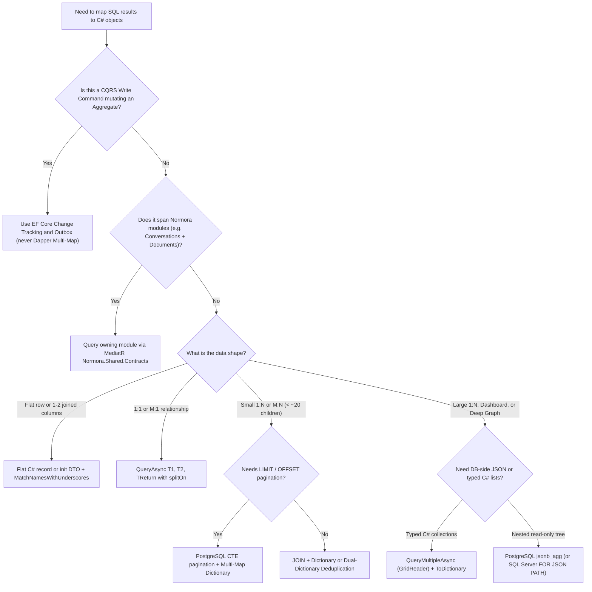
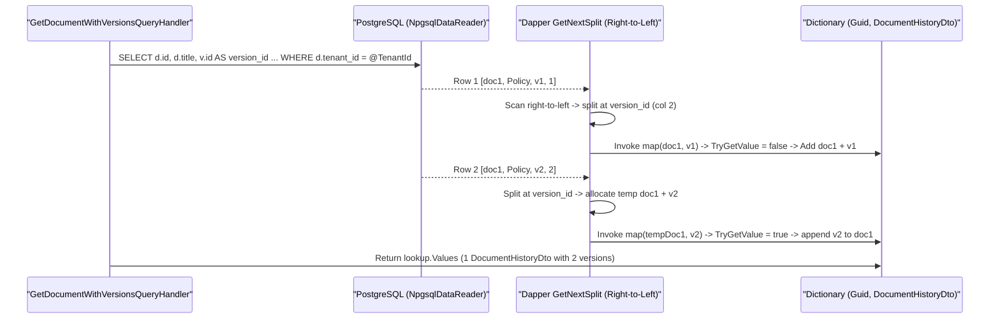
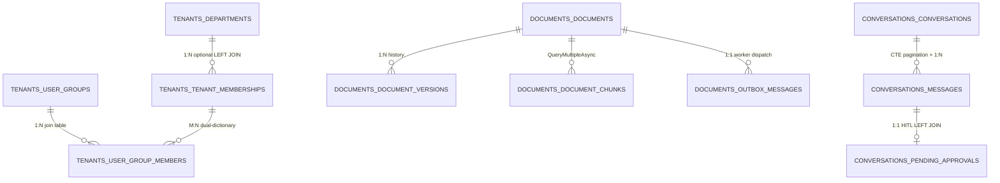
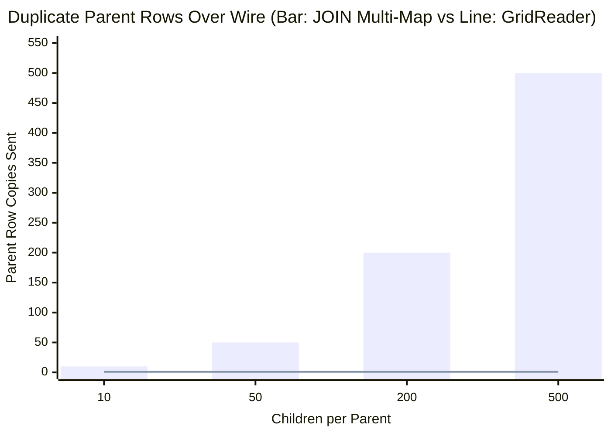

# Chapter 4: Object Mapping Strategies

## 1. Learning Objectives

By the end of this chapter, you will be able to:
*   Understand the limitations of flat **DTO** (Data Transfer Object) mapping and why hierarchical object graphs require explicit mapping strategies.
*   Configure column-to-property translation for PostgreSQL `snake_case` schemas using `DefaultTypeMap.MatchNamesWithUnderscores` and `SqlMapper.ITypeMap`, and handle C# 14 `record` / primary-constructor caveats.
*   Master Dapper's Multi-Mapping API (`Query<TFirst, TSecond, TReturn>`) to resolve One-to-One, One-to-Many, and Many-to-Many relationships.
*   Effectively utilize the `splitOn` parameter (understanding its right-to-left scanning engine) and internal dictionary state to eliminate the **N+1 query** problem.
*   Compare Multi-Mapping (`JOIN` + Dictionary), `QueryMultipleAsync` (`GridReader`), CTE-based pagination, and database-native JSON aggregation (`jsonb_agg` in PostgreSQL / `FOR JSON PATH` in SQL Server).
*   Implement custom `SqlMapper.TypeHandler<T>` classes to seamlessly map advanced PostgreSQL/Npgsql types (`jsonb`, `pgvector` embeddings, strongly-typed IDs, and enums) and SQL Server types (`JSON`, `Geography`) to domain-specific C# objects.
*   Enforce multi-tenant security (**BOLA**/**BFLA** and module encapsulation) in Dapper read queries where EF Core global query filters do not exist.

## 2. Introduction

Relational databases store data in flat, two-dimensional tables. Object-oriented languages represent data as complex, nested, hierarchical graphs. The friction between these two paradigms is famously known as the **Object-Relational Impedance Mismatch** — the structural gap between relational rows/foreign keys and in-memory object references/collections.

Full **ORMs** (Object-Relational Mappers) like Entity Framework Core attempt to hide this mismatch. They allow developers to traverse navigation properties (e.g., `Site.Chargers.First()` or `Document.Versions.OrderByDescending(...)`), and the ORM translates those traversals into SQL on the fly. While productive for complex state mutations, lazy or careless navigation traversal frequently causes performance bottlenecks, most notably the **N+1 query problem** — executing 1 query to load $N$ parent rows followed by $N$ extra round-trip queries to fetch each parent's children.

Dapper takes the opposite approach. It does not hide the database; it forces you to embrace it. In a **.NET 10 / C# 14 CQRS** (Command Query Responsibility Segregation) architecture like **Normora** — an enterprise multi-tenant knowledge management and conversational-AI platform backed by **PostgreSQL + pgvector (Npgsql)** — EF Core handles transactional *Command* aggregates (such as `UploadDocumentCommandHandler` writing to `DocumentsDbContext` and the outbox), while Dapper shines on the *Query* (read) side. When you need to retrieve a parent entity and its children, Dapper lets you choose between a single optimized SQL `JOIN` stitched in memory via **Multi-Mapping**, multiple flat result sets via **`GridReader` (`QueryMultipleAsync`)**, or database-native JSON aggregation (`jsonb_agg`). This chapter explores how to master all of these mapping strategies from first principles to enterprise architect level.

## 3. Core Concepts

### 3.1 Mapping Strategy Decision Matrix (What, Why, How, When NOT to Use)

Before writing a single `QueryAsync` call, a senior architect selects the simplest mapping strategy that fits the data shape, cardinality, and network budget. Every extra layer of mapping introduces either CPU allocation, network duplication, or maintenance complexity.

| Strategy | Best For | Pros | Cons / When NOT to Use |
| :--- | :--- | :--- | :--- |
| **Flat DTO / `record` Projection** | Single table, or 1–2 extra columns from a `JOIN` | Fastest possible mapping; zero deduplication; works with C# `record` primary constructors | **Do NOT use** for parent-with-children lists (causes duplicated parent fields or requires manual grouping) |
| **Multi-Mapping (`Query<T1, T2, TReturn>`)** | 1:1, M:1, and *small* 1:N or M:N graphs (e.g., 1 parent with 2–20 children) | Single SQL query; explicit type separation; clean `LEFT JOIN` handling | **Do NOT use** for >3 joined tables, large child fan-out (Cartesian bloat), or Write-side aggregates |
| **`GridReader` (`QueryMultipleAsync`)** | Multiple independent widgets (dashboards) or large 1:N / 1:N:M hierarchies | 1 network round-trip; zero parent-column duplication over the wire; minimal GC churn | **Do NOT use** for tiny 1:1 lookups where a flat DTO or simple `JOIN` is simpler and faster |
| **DB-Native JSON (`jsonb_agg` / `FOR JSON PATH`)** | Deep read-only hierarchical payloads (e.g., document + versions + tags) | 1 round-trip; zero `splitOn` fragility; zero duplicate parent rows | **Do NOT use** when you need row-by-row unbuffered streaming (`buffered: false`) or per-row custom `TypeHandler` logic |
| **`dynamic` (`DapperRow`)** | Quick ad-hoc scripts, prototyping, or unknown dynamic columns | No DTO class needed | **Do NOT use** in production CQRS handlers (no compile-time safety; violates Normora's strict typing rule) |

---

### 3.2 Column-to-Property Mapping, `snake_case`, `ITypeMap`, & C# 14 Records

**What it is:** Dapper maps columns from an `IDataReader` (such as `NpgsqlDataReader` for PostgreSQL or `SqlDataReader` for SQL Server) to C# properties or constructor parameters by generating lightweight **IL emit** (Intermediate Language instructions compiled at runtime) deserializers and caching them per query signature.

**Why it matters in PostgreSQL & .NET 10:** PostgreSQL schemas conventionally use `snake_case` (`tenant_id`, `external_user_id`, `created_at`), whereas C# uses `PascalCase` (`TenantId`, `ExternalUserId`, `CreatedAt`). Without configuring Dapper's name matching or column aliases, `tenant_id` silently fails to populate `TenantId`, leaving it as `Guid.Empty` — a subtle bug that can break multi-tenant isolation or authorization checks.

**How it works:**
1. **Global underscore matching:** `DefaultTypeMap.MatchNamesWithUnderscores = true;` (registered once at startup) tells Dapper's default `ITypeMap` to treat `tenant_id` as matching `TenantId`.
2. **Custom `ITypeMap` (`SqlMapper.SetTypeMap`):** Lets you override column-to-property resolution per DTO type (e.g., reading `[Column("...")]` attributes or handling legacy database column names).
3. **C# 14 `record` & Primary Constructor Materialization:** For *single-type* queries (`QueryAsync<DocumentSummaryDto>`), Dapper matches constructor parameters by name and type (case-insensitively, or with underscores when `MatchNamesWithUnderscores = true`). However, if a `record` uses a parameterized primary constructor AND has `init`-only properties, **multi-mapping** or partial column projections can fail if the constructor signature doesn't match every selected column — adding a fallback parameterless constructor (`public MyRecord() : this(...) { }`) or using a class/record with `init` properties keeps both Dapper and immutability happy.

**When NOT to use `MatchNamesWithUnderscores` or custom `ITypeMap`:**
*   Do not call `SqlMapper.SetTypeMap` dynamically per HTTP request; it mutates global static state.
*   Do not rely on `MatchNamesWithUnderscores` alone to mask mismatched property names; if an alias is clearer (`AS active_version_number`), write the explicit alias in SQL.

#### Real-World Normora Examples (Flat Projection, `snake_case`, & Records)

1. **Global `snake_case` Registration at Startup (`Normora.Infrastructure`):**
   ```csharp
   // Called once in DatabaseServiceExtensions.cs during startup
   Dapper.DefaultTypeMap.MatchNamesWithUnderscores = true;
   ```
   Every PostgreSQL column (`tenant_id`, `external_user_id`, `is_active`, `created_at`) now maps cleanly to `PascalCase` C# properties without tedious `AS` aliases on every column.

2. **Positional `record` Projection with BOLA 404 Defense (`Documents` Module):**
   ```csharp
   // Application/Documents/DTOs/DocumentSummaryDto.cs
   public sealed record DocumentSummaryDto(
       Guid Id,
       Guid TenantId,
       string Title,
       string Status,
       DateTimeOffset CreatedAt);

   // Application/Documents/Queries/GetDocumentSummary/GetDocumentSummaryQueryHandler.cs
   public sealed class GetDocumentSummaryQueryHandler(
       IDbConnectionFactory connectionFactory,
       ITenantContext tenantContext)
       : IRequestHandler<GetDocumentSummaryQuery, DocumentSummaryDto>
   {
       public async Task<DocumentSummaryDto> Handle(
           GetDocumentSummaryQuery request,
           CancellationToken cancellationToken)
       {
           const string sql = """
               SELECT id, tenant_id, title, status, created_at
               FROM documents.documents
               WHERE id = @DocumentId
                 AND tenant_id = @TenantId
                 AND is_deleted = FALSE
               """;

           await using var connection = await connectionFactory.CreateOpenConnectionAsync(cancellationToken);
           var dto = await connection.QuerySingleOrDefaultAsync<DocumentSummaryDto>(
               new CommandDefinition(
                   sql,
                   new { request.DocumentId, TenantId = tenantContext.TenantId },
                   cancellationToken: cancellationToken));

           // BOLA defense: missing OR cross-tenant document both throw 404 (no enumeration)
           return dto ?? throw new BolaException();
       }
   }
   ```

3. **Flattened `JOIN` DTO Avoiding Multi-Map Overhead (`Tenants` Module):**
   When you only need one scalar column (`department_name`) from a joined table, a flat DTO avoids `splitOn` and extra object allocations entirely:
   ```csharp
   public sealed record TenantMemberRowDto(
       Guid MembershipId,
       string ExternalUserId,
       string Role,
       string? DepartmentName);

   const string sql = """
       SELECT
           m.id AS membership_id,
           m.external_user_id,
           m.role,
           d.name AS department_name
       FROM tenants.tenant_memberships m
       LEFT JOIN tenants.departments d
           ON m.department_id = d.id AND d.tenant_id = @TenantId
       WHERE m.tenant_id = @TenantId
       ORDER BY m.created_at DESC
       LIMIT @PageSize OFFSET @Offset
       """;
   ```

4. **Per-Type `CustomPropertyTypeMap` for `[Column]` Attribute Mapping (`Tenants` Audit Logs):**
   When an audit DTO uses domain-friendly C# property names that differ from PostgreSQL column names, register a `CustomPropertyTypeMap` once at startup:
   ```csharp
   public sealed class AuditLogEntryDto
   {
       public Guid Id { get; init; }

       [Column("actor_external_user_id")]
       public string ActorExternalId { get; init; } = string.Empty;

       [Column("action_type")]
       public string Action { get; init; } = string.Empty;

       public DateTimeOffset OccurredAt { get; init; }
   }

   // Registered once in TenantsModuleExtensions / startup:
   SqlMapper.SetTypeMap(
       typeof(AuditLogEntryDto),
       new CustomPropertyTypeMap(
           typeof(AuditLogEntryDto),
           (type, columnName) => type.GetProperties().FirstOrDefault(prop =>
               prop.GetCustomAttributes(false)
                   .OfType<ColumnAttribute>()
                   .Any(attr => string.Equals(attr.Name, columnName, StringComparison.OrdinalIgnoreCase))
               || string.Equals(prop.Name, columnName.Replace("_", string.Empty), StringComparison.OrdinalIgnoreCase))!));
   ```

5. **`init`-Only DTO with Explicit `ApiMessages` Guard (`Tenants` Subscription Plan):**
   ```csharp
   public sealed class TenantPlanSnapshotDto
   {
       public Guid TenantId { get; init; }
       public string Tier { get; init; } = string.Empty;
       public string Currency { get; init; } = string.Empty;
       public string BillingCycle { get; init; } = string.Empty;
       public DateTimeOffset? RenewsAt { get; init; }
   }

   // Inside GetTenantPlanQueryHandler:
   if (tenantContext.TenantId == Guid.Empty)
       throw new InvalidOperationException(ApiMessages.TenantContextMissing);

   const string sql = """
       SELECT tenant_id, tier, currency, billing_cycle, renews_at
       FROM tenants.tenant_plans
       WHERE tenant_id = @TenantId
       """;
   ```

---

### 3.3 Multi-Mapping (`Query<T1, T2, ..., TReturn>`) & Right-to-Left `splitOn`

**What it is:** Multi-mapping maps a single flat row from `IDataReader` into multiple distinct C# objects (up to 7 input types: `TFirst` through `TSeventh`) and passes them into a C# mapping delegate `Func<T1, T2, ..., TReturn>` so you can wire references together.

**Why it exists:** Relational `JOIN`s flatten parent and child columns into one wide row. Multi-mapping lets you reuse clean, separate DTO types (`DocumentDto`, `DocumentVersionDto`) without inventing bloated combined DTOs for every query.

**How `splitOn` works (Critical Internals):**
*   Dapper's internal `GetNextSplit` method scans columns **from right to left** (starting at the rightmost column down to column index `1`, never index `0`).
*   Why right-to-left? If both tables share a primary key column named `id` (`SELECT d.id, d.title, v.id, v.version_number ...`), scanning from right to left matches `v.id` first for the second type (`TSecond`), leaving `d.id` and `d.title` for `TFirst`.
*   **Default value:** `splitOn: "Id"` (case-insensitive). If your second object starts at a different column name or alias (e.g., `version_id` or `ChargerId`), you **must** specify `splitOn: "version_id"`.
*   **Multiple splits:** For 3+ objects (`Query<T1, T2, T3, TReturn>`), pass a comma-separated list ordered left-to-right matching the SQL `SELECT` list (e.g., `splitOn: "version_id,uploader_id"`), which Dapper resolves right-to-left per segment.
*   **`LEFT JOIN` null semantics:** If every column in a right-hand segment is `NULL` (or the split key itself is `NULL` / `Guid.Empty`), Dapper either passes `null` for a reference type or an empty/default instance — always guard against `null` or `Guid.Empty` in your mapping delegate!

**When NOT to use Multi-Mapping:**
*   When you only need 1–2 scalar properties from the joined table (use a flat DTO instead).
*   When joining more than 3 tables or returning large 1:N collections (use `QueryMultipleAsync` or `jsonb_agg`).
*   When a `record` lacks a parameterless constructor and SQL aliases don't match every constructor parameter identically.

#### Real-World Examples: EV Charging Platform & Normora (1:1 & M:1 Multi-Mapping)

1. **EV Charging Case Study (1:1): `Charger` + `ChargerModel`** — See [Section 6, Scenario 1](#scenario-1-one-to-one-mapping) (`ChargerDto` stitched with `ChargerModelDto` via `splitOn: "Id"`).
2. **Normora `Documents` (1:1 Active Version): `Document` + `DocumentVersion`:**
   ```csharp
   const string sql = """
       SELECT
           d.id, d.title, d.status,
           v.id AS version_id, v.version_number, v.byte_size, v.storage_key
       FROM documents.documents d
       INNER JOIN documents.document_versions v
           ON d.active_version_id = v.id AND v.tenant_id = @TenantId
       WHERE d.id = @DocumentId AND d.tenant_id = @TenantId AND d.is_deleted = FALSE
       """;

   var items = await connection.QueryAsync<DocumentDto, DocumentVersionDto, DocumentDto>(
       sql,
       (doc, version) =>
       {
           doc.ActiveVersion = version;
           return doc;
       },
       new { request.DocumentId, TenantId = tenantContext.TenantId },
       splitOn: "version_id");

   var document = items.SingleOrDefault() ?? throw new BolaException();
   ```
3. **Normora `Tenants` (M:1 Optional `LEFT JOIN`): `TenantMembership` + `Department`:**
   ```csharp
   const string sql = """
       SELECT
           m.id, m.external_user_id, m.role,
           d.id AS department_id, d.name, d.slug
       FROM tenants.tenant_memberships m
       LEFT JOIN tenants.departments d
           ON m.department_id = d.id AND d.tenant_id = @TenantId
       WHERE m.tenant_id = @TenantId
       """;

   var members = await connection.QueryAsync<TenantMemberDto, DepartmentSummaryDto?, TenantMemberDto>(
       sql,
       (member, department) =>
       {
           // Guard against LEFT JOIN nulls before attaching
           if (department is not null && department.DepartmentId != Guid.Empty)
               member.Department = department;
           return member;
       },
       new { TenantId = tenantContext.TenantId },
       splitOn: "department_id");
   ```
4. **Normora `Conversations` (1:1 Optional HITL Gate): `ConversationMessage` + `PendingApproval`:**
   ```csharp
   const string sql = """
       SELECT
           msg.id, msg.role, msg.content, msg.created_at,
           pa.id AS approval_id, pa.tool_name, pa.status, pa.expires_at
       FROM conversations.messages msg
       LEFT JOIN conversations.pending_approvals pa
           ON msg.id = pa.message_id AND pa.tenant_id = @TenantId
       WHERE msg.conversation_id = @ConversationId
         AND msg.tenant_id = @TenantId
       ORDER BY msg.created_at ASC
       """;

   var messages = await connection.QueryAsync<ConversationMessageDto, PendingApprovalDto?, ConversationMessageDto>(
       sql,
       (message, approval) =>
       {
           if (approval is not null && approval.ApprovalId != Guid.Empty)
               message.PendingApproval = approval;
           return message;
       },
       new { request.ConversationId, TenantId = tenantContext.TenantId },
       splitOn: "approval_id");
   ```
5. **Normora `Documents` Worker (1:1 Outbox Dispatch): `DocumentProcessingOutboxMessage` + `Document`:**
   ```csharp
   const string sql = """
       SELECT
           o.id, o.document_version_id, o.attempt_count, o.created_at,
           d.id AS document_id, d.tenant_id, d.title
       FROM documents.document_processing_outbox_messages o
       INNER JOIN documents.documents d ON o.document_id = d.id
       WHERE o.processed_at IS NULL AND o.tenant_id = @TenantId
       ORDER BY o.created_at ASC
       LIMIT @BatchSize
       """;

   var workItems = await connection.QueryAsync<OutboxItemDto, DocumentRefDto, OutboxItemDto>(
       sql,
       (outbox, doc) => { outbox.Document = doc; return outbox; },
       new { request.TenantId, BatchSize = 25 },
       splitOn: "document_id");
   ```
6. **Normora `Tenants` (M:1 Audit Trail): `AuditLog` + `ActorMembership`:**
   ```csharp
   const string sql = """
       SELECT
           a.id, a.action_type, a.occurred_at,
           m.id AS actor_membership_id, m.external_user_id, m.role
       FROM tenants.audit_logs a
       LEFT JOIN tenants.tenant_memberships m
           ON a.actor_membership_id = m.id AND m.tenant_id = @TenantId
       WHERE a.tenant_id = @TenantId
       ORDER BY a.occurred_at DESC
       LIMIT @PageSize OFFSET @Offset
       """;

   var logs = await connection.QueryAsync<AuditLogSummaryDto, ActorSummaryDto?, AuditLogSummaryDto>(
       sql,
       (log, actor) =>
       {
           if (actor is not null && actor.ActorMembershipId != Guid.Empty)
               log.Actor = actor;
           return log;
       },
       new { TenantId = tenantContext.TenantId, request.PageSize, Offset = offset },
       splitOn: "actor_membership_id");
   ```

---

### 3.4 Application-Level Deduplication (One-to-Many & Many-to-Many)

**What it is:** When you `JOIN` a parent row to $N$ child rows, SQL returns $N$ rows with the parent columns repeated on every row. Dapper does **not** deduplicate parents automatically; your mapping delegate uses a `Dictionary<TKey, TParent>` (for 1:N) or two dictionaries (for M:N) to retain one parent instance and append unique children to its collection.

**Why it matters:** Without dictionary deduplication, calling `result.ToList()` returns $N$ duplicate parent DTOs, each holding only 1 child!

**How it works:**
*   **One-to-Many (1:N):** Maintain `Dictionary<Guid, TParent>`. On each row, `TryGetValue`; if unseen, initialize `parent.Children = []` and insert into the dictionary. Always check child `!= null && child.Id != Guid.Empty` (for `LEFT JOIN`). Return `dict.Values` — **never** the raw `QueryAsync` result!
*   **Many-to-Many (M:N):** Maintain **two** dictionaries (`Dictionary<Guid, TLeft>` and `Dictionary<Guid, TRight>`), or deduplicate `TLeft` and check uniqueness before adding `TRight`.
*   **Self-Referencing Trees (Adjacency List):** For hierarchical tables like `tenants.departments` (`id`, `parent_department_id`), fetch flat rows once, index them in `Dictionary<Guid, DepartmentNodeDto>`, then attach each node to its parent in a single $O(n)$ loop.

**When NOT to use Dictionary Deduplication:**
*   Do not use `JOIN` + Dictionary when a parent has hundreds of heavy children (e.g., 1 `Document` with 400 `DocumentChunk` rows containing large text/embeddings) — use `QueryMultipleAsync`.
*   Do not combine `JOIN` + Dictionary directly with `LIMIT`/`OFFSET` pagination (row limit truncates children, not parents — use a CTE first!).

#### Real-World Examples: EV Charging Platform & Normora (1:N, M:N, & Trees)

1. **EV Charging Case Study (1:N): `Site` + `Chargers`** — See [Section 6, Scenario 2](#scenario-2-one-to-many-mapping-the-dictionary-deduplication-pattern).
2. **Normora `Documents` (1:N): `Document` + `DocumentVersion` History:**
   ```csharp
   const string sql = """
       SELECT
           d.id, d.title, d.status,
           v.id AS version_id, v.version_number, v.byte_size, v.created_at
       FROM documents.documents d
       LEFT JOIN documents.document_versions v
           ON d.id = v.document_id AND v.tenant_id = @TenantId
       WHERE d.id = @DocumentId AND d.tenant_id = @TenantId AND d.is_deleted = FALSE
       ORDER BY v.version_number DESC
       """;

   var lookup = new Dictionary<Guid, DocumentHistoryDto>();
   await connection.QueryAsync<DocumentHistoryDto, DocumentVersionItemDto?, DocumentHistoryDto>(
       sql,
       (doc, version) =>
       {
           if (!lookup.TryGetValue(doc.Id, out var existing))
           {
               existing = doc;
               existing.Versions = [];
               lookup.Add(existing.Id, existing);
           }

           if (version is not null && version.VersionId != Guid.Empty)
               existing.Versions.Add(version);

           return existing;
       },
       new { request.DocumentId, TenantId = tenantContext.TenantId },
       splitOn: "version_id");

   return lookup.Values.SingleOrDefault() ?? throw new BolaException();
   ```
3. **Normora `Conversations` (1:N): `Conversation` + `ConversationMessage` Thread:**
   ```csharp
   var convDict = new Dictionary<Guid, ConversationThreadDto>();
   const string sql = """
       SELECT
           c.id, c.title, c.persona_key,
           m.id AS message_id, m.role, m.content, m.created_at
       FROM conversations.conversations c
       LEFT JOIN conversations.messages m
           ON c.id = m.conversation_id AND m.tenant_id = @TenantId
       WHERE c.id = @ConversationId
         AND c.tenant_id = @TenantId
         AND c.external_user_id = @ExternalUserId
       ORDER BY m.created_at ASC
       """;

   await connection.QueryAsync<ConversationThreadDto, ConversationMessageDto?, ConversationThreadDto>(
       sql,
       (conv, msg) =>
       {
           if (!convDict.TryGetValue(conv.Id, out var existing))
           {
               existing = conv;
               existing.Messages = [];
               convDict.Add(existing.Id, existing);
           }

           if (msg is not null && msg.MessageId != Guid.Empty)
               existing.Messages.Add(msg);

           return existing;
       },
       new { request.ConversationId, TenantId = tenantContext.TenantId, currentUser.ExternalUserId },
       splitOn: "message_id");

   return convDict.Values.SingleOrDefault() ?? throw new BolaException();
   ```
4. **Normora `Tenants` (M:N Dual-Dictionary): `UserGroup` <-> `TenantMembership`:**
   ```csharp
   const string sql = """
       SELECT
           g.id, g.name, g.description,
           m.id AS membership_id, m.external_user_id, m.role
       FROM tenants.user_groups g
       LEFT JOIN tenants.user_group_members ugm ON g.id = ugm.user_group_id
       LEFT JOIN tenants.tenant_memberships m
           ON ugm.membership_id = m.id AND m.tenant_id = @TenantId
       WHERE g.tenant_id = @TenantId
       ORDER BY g.name, m.external_user_id
       """;

   var groupDict = new Dictionary<Guid, UserGroupWithMembersDto>();
   var memberDict = new Dictionary<Guid, TenantMemberSummaryDto>();

   await connection.QueryAsync<UserGroupWithMembersDto, TenantMemberSummaryDto?, UserGroupWithMembersDto>(
       sql,
       (group, member) =>
       {
           if (!groupDict.TryGetValue(group.Id, out var existingGroup))
           {
               existingGroup = group;
               existingGroup.Members = [];
               groupDict.Add(existingGroup.Id, existingGroup);
           }

           if (member is not null && member.MembershipId != Guid.Empty)
           {
               // Reuse the same Member DTO instance across multiple groups
               if (!memberDict.TryGetValue(member.MembershipId, out var existingMember))
               {
                   existingMember = member;
                   memberDict.Add(existingMember.MembershipId, existingMember);
               }

               existingGroup.Members.Add(existingMember);
           }

           return existingGroup;
       },
       new { TenantId = tenantContext.TenantId },
       splitOn: "membership_id");

   return groupDict.Values;
   ```
5. **Normora `Documents` (M:N ACL Projection): `Document` <-> `UserGroup` Access Grants:**
   ```csharp
   const string sql = """
       SELECT
           d.id, d.title, d.status,
           a.user_group_id AS group_id, a.access_level
       FROM documents.documents d
       LEFT JOIN documents.document_group_access a
           ON d.id = a.document_id AND a.tenant_id = @TenantId
       WHERE d.tenant_id = @TenantId AND d.is_deleted = FALSE
       """;

   var docs = new Dictionary<Guid, DocumentAclDto>();
   await connection.QueryAsync<DocumentAclDto, DocumentGroupGrantDto?, DocumentAclDto>(
       sql,
       (doc, grant) =>
       {
           if (!docs.TryGetValue(doc.Id, out var existing))
           {
               existing = doc;
               existing.AllowedGroups = [];
               docs.Add(existing.Id, existing);
           }

           if (grant is not null && grant.GroupId != Guid.Empty)
               existing.AllowedGroups.Add(grant);

           return existing;
       },
       new { TenantId = tenantContext.TenantId },
       splitOn: "group_id");

   return docs.Values;
   ```
6. **Normora `Tenants` (Self-Referencing Tree): `Department` Parent-Child Hierarchy:**
   ```csharp
   const string sql = """
       SELECT id, parent_department_id, name, slug
       FROM tenants.departments
       WHERE tenant_id = @TenantId
       ORDER BY name
       """;

   var flatNodes = (await connection.QueryAsync<DepartmentTreeNodeDto>(sql, new { TenantId = tenantContext.TenantId })).AsList();
   var byId = flatNodes.ToDictionary(d => d.Id);
   var roots = new List<DepartmentTreeNodeDto>();

   foreach (var node in flatNodes)
   {
       if (node.ParentDepartmentId is Guid parentId && byId.TryGetValue(parentId, out var parent))
           parent.Children.Add(node);
       else
           roots.Add(node);
   }
   ```

---

### 3.5 Multi-Result Mapping (`GridReader`), CTE Pagination, & PostgreSQL `jsonb_agg`

**What they are:** Three complementary techniques that eliminate **Cartesian product bloat** (the exponential multiplication of repeated parent columns when joining 1:N or 1:N:M tables) and **broken `LIMIT`/`OFFSET` pagination** on joined queries:
1. **`QueryMultipleAsync` (`SqlMapper.GridReader`):** Executes multiple semicolon-separated `SELECT` statements in **one** network round-trip, then reads each flat result set sequentially (`await multi.ReadAsync<T>()`) and stitches them in C# with `ToDictionary` / `GroupBy`.
2. **CTE Pagination + `JOIN`:** A **CTE** (Common Table Expression, `WITH paged AS (...)`) applies `ORDER BY ... LIMIT @PageSize OFFSET @Offset` exclusively to the parent table first, then joins child rows only for that page of parent IDs.
3. **PostgreSQL `jsonb_agg` / `jsonb_build_object`:** Offloads child aggregation directly to PostgreSQL's C engine, returning one row per parent with a nested JSON array column that `System.Text.Json` deserializes cleanly. (In SQL Server, the equivalent syntax is `FOR JSON PATH`.)

**When NOT to use them:**
*   Do not use `QueryMultipleAsync` for a simple 1:1 lookup — a single `JOIN` is cleaner.
*   Do not use `jsonb_agg` without `COALESCE(..., '[]'::jsonb)` on `LEFT JOIN`s (otherwise `jsonb_agg` returns `[null]` when there are 0 children — use `FILTER (WHERE child.id IS NOT NULL)`!).

#### Real-World Examples: EV Charging Platform & Normora

1. **EV Charging Case Study (`QueryMultipleAsync`): `GetSitesGridReaderAsync`** — See [Section 7, Approach B](#7-performance-implications).
2. **Normora `Tenants` (`QueryMultipleAsync` Multi-Widget Dashboard): `GetTenantDashboardSnapshotQueryHandler`:**
   ```csharp
   const string sql = """
       SELECT id, name, slug FROM tenants.tenants WHERE id = @TenantId;
       SELECT id, name, slug FROM tenants.departments WHERE tenant_id = @TenantId ORDER BY name;
       SELECT tier, currency, billing_cycle FROM tenants.tenant_plans WHERE tenant_id = @TenantId;
       """;

   await using var multi = await connection.QueryMultipleAsync(
       new CommandDefinition(sql, new { TenantId = tenantContext.TenantId }, cancellationToken: cancellationToken));

   var tenant = await multi.ReadSingleOrDefaultAsync<TenantHeaderDto>() ?? throw new BolaException();
   var departments = (await multi.ReadAsync<DepartmentSummaryDto>()).AsList();
   var plan = await multi.ReadSingleOrDefaultAsync<TenantPlanSummaryDto>();

   return new TenantDashboardSnapshotDto(tenant, departments, plan);
   ```
3. **Normora `Documents` (`QueryMultipleAsync` + PostgreSQL `= ANY(@DocumentIds)`): `GetDocumentsWithChunksBatchQueryHandler`:**
   Notice PostgreSQL uses `WHERE document_id = ANY(@DocumentIds)` for array parameters (`Guid[]`) instead of SQL Server's `IN @Ids` expansion:
   ```csharp
   const string sql = """
       SELECT id, title, status, created_at
       FROM documents.documents
       WHERE tenant_id = @TenantId AND is_deleted = FALSE
       ORDER BY created_at DESC
       LIMIT @PageSize OFFSET @Offset;

       SELECT c.id, c.document_id, c.chunk_index, c.section_breadcrumb, c.content
       FROM documents.document_chunks c
       WHERE c.tenant_id = @TenantId
         AND c.document_id IN (
             SELECT id FROM documents.documents
             WHERE tenant_id = @TenantId AND is_deleted = FALSE
             ORDER BY created_at DESC
             LIMIT @PageSize OFFSET @Offset
         )
       ORDER BY c.document_id, c.chunk_index;
       """;

   await using var multi = await connection.QueryMultipleAsync(sql, new { TenantId = tenantContext.TenantId, request.PageSize, Offset = offset });
   var docs = (await multi.ReadAsync<DocumentHeaderDto>()).AsList();
   var chunks = (await multi.ReadAsync<DocumentChunkPreviewDto>()).AsList();
   var chunksByDoc = chunks.GroupBy(c => c.DocumentId).ToDictionary(g => g.Key, g => g.ToList());
   ```
4. **Normora `Conversations` (CTE Pagination + Multi-Mapping):**
   Without the CTE, `LIMIT 10` on a `JOIN messages` query would return only 10 *messages* (perhaps 1–2 conversations) instead of 10 conversations:
   ```csharp
   const string sql = """
       WITH paged_conversations AS (
           SELECT id, title, persona_key, updated_at
           FROM conversations.conversations
           WHERE tenant_id = @TenantId
             AND external_user_id = @ExternalUserId
           ORDER BY updated_at DESC
           LIMIT @PageSize OFFSET @Offset
       )
       SELECT
           p.id, p.title, p.persona_key, p.updated_at,
           m.id AS message_id, m.role, m.content
       FROM paged_conversations p
       LEFT JOIN conversations.messages m
           ON p.id = m.conversation_id AND m.tenant_id = @TenantId
       ORDER BY p.updated_at DESC, m.created_at ASC
       """;
   ```
5. **Normora `Documents` (PostgreSQL `jsonb_agg` + `FILTER`):**
   ```csharp
   const string sql = """
       SELECT
           d.id,
           d.title,
           COALESCE(
               jsonb_agg(
                   jsonb_build_object(
                       'versionId', v.id,
                       'versionNumber', v.version_number,
                       'byteSize', v.byte_size
                   ) ORDER BY v.version_number DESC
               ) FILTER (WHERE v.id IS NOT NULL),
               '[]'::jsonb
           )::text AS versions_json
       FROM documents.documents d
       LEFT JOIN documents.document_versions v
           ON d.id = v.document_id AND v.tenant_id = @TenantId
       WHERE d.id = @DocumentId AND d.tenant_id = @TenantId
       GROUP BY d.id, d.title
       """;

   var row = await connection.QuerySingleOrDefaultAsync<DocumentJsonRow>(sql, new { request.DocumentId, TenantId = tenantContext.TenantId })
       ?? throw new BolaException();

   var versions = JsonSerializer.Deserialize<IReadOnlyList<DocumentVersionItemDto>>(row.VersionsJson, JsonOptions) ?? [];
   ```
6. **Normora `Conversations` (`QueryMultipleAsync` + `= ANY(@AnswerIds)`): `GetSavedAnswersWithCitationsQueryHandler`:**
   ```csharp
   const string sql = """
       SELECT id, question, answer_markdown, created_at
       FROM conversations.saved_answers
       WHERE tenant_id = @TenantId
       ORDER BY created_at DESC
       LIMIT @PageSize OFFSET @Offset;

       SELECT c.id, c.saved_answer_id, c.document_id, c.document_title, c.chunk_index
       FROM conversations.saved_answer_citations c
       WHERE c.tenant_id = @TenantId
         AND c.saved_answer_id IN (
             SELECT id FROM conversations.saved_answers
             WHERE tenant_id = @TenantId
             ORDER BY created_at DESC
             LIMIT @PageSize OFFSET @Offset
         );
       """;

   await using var multi = await connection.QueryMultipleAsync(sql, new { TenantId = tenantContext.TenantId, request.PageSize, Offset = offset });
   var answers = (await multi.ReadAsync<SavedAnswerDto>()).AsList();
   var citations = (await multi.ReadAsync<SavedAnswerCitationDto>()).AsList();
   var citationsByAnswer = citations.GroupBy(c => c.SavedAnswerId).ToDictionary(g => g.Key, g => g.ToList());
   ```

---

### 3.6 Custom Type Handlers (`SqlMapper.TypeHandler<T>`) & PostgreSQL/pgvector Types

**What it is:** `SqlMapper.TypeHandler<T>` (implementing `SqlMapper.ITypeHandler`) bridges database column values and rich C# domain types (value objects, strongly-typed IDs, `jsonb` payloads, or `pgvector` vectors) both when binding parameters (`SetValue`) and reading columns (`Parse`).

**Why it matters:** Without type handlers, you must manually serialize/deserialize `jsonb` strings or unwrap `Guid`s from strongly-typed IDs in every single repository method.

**How it works & PostgreSQL/Npgsql Nuances:**
*   Inherit from `SqlMapper.TypeHandler<T>` rather than implementing `ITypeHandler` directly (gives you compile-time generics).
*   Register once at startup via `SqlMapper.AddTypeHandler(new MyHandler())`.
*   **PostgreSQL `jsonb` trap:** Setting `parameter.DbType = DbType.String` sends `text` to PostgreSQL, which throws `42804: column is of type jsonb but expression is of type text` on `INSERT`/`UPDATE`. When targeting Npgsql, check `if (parameter is NpgsqlParameter npgsqlParam) npgsqlParam.NpgsqlDbType = NpgsqlDbType.Jsonb;`.

**When NOT to use a `TypeHandler<T>`:**
*   Never perform network calls, database queries, encryption/decryption, or heavy CPU parsing inside `Parse()` — it runs **synchronously** inside the `IDataReader` row loop and can cause thread-pool starvation.
*   Never call `SqlMapper.AddTypeHandler(...)` inside scoped services or per-request handlers.

#### Real-World Examples: EV Charging Platform & Normora

1. **EV Charging Case Study (`JsonTypeHandler<TelemetryConfig>`):** See [Section 6, Scenario 3](#scenario-3-custom-type-handler-for-json).
2. **Normora Strongly-Typed ID (`TenantIdTypeHandler`):**
   ```csharp
   public readonly record struct TenantId(Guid Value);

   public sealed class TenantIdTypeHandler : SqlMapper.TypeHandler<TenantId>
   {
       public override void SetValue(IDbDataParameter parameter, TenantId value)
       {
           parameter.Value = value.Value;
           parameter.DbType = DbType.Guid;
       }

       public override TenantId Parse(object value) =>
           value is Guid guid ? new TenantId(guid) : new TenantId(Guid.Parse(value.ToString()!));
   }
   ```
3. **Normora PostgreSQL `jsonb` Handler (`NpgsqlJsonbTypeHandler<T>` for `AuditLogMetadata` / `TenantBrandingConfig`):**
   ```csharp
   public sealed class NpgsqlJsonbTypeHandler<T>(JsonSerializerOptions? options = null) : SqlMapper.TypeHandler<T>
       where T : class
   {
       public override void SetValue(IDbDataParameter parameter, T? value)
       {
           parameter.Value = value is null ? DBNull.Value : JsonSerializer.Serialize(value, options);
           if (parameter is NpgsqlParameter npgsqlParam)
               npgsqlParam.NpgsqlDbType = NpgsqlDbType.Jsonb;
           else
               parameter.DbType = DbType.String;
       }

       public override T? Parse(object value) =>
           value is null or DBNull ? null : JsonSerializer.Deserialize<T>(value.ToString()!, options);
   }
   ```
4. **Normora `pgvector` Embedding Handler (`PgvectorTypeHandler` for `documents.document_chunks.embedding`):**
   When querying `vector(768)` columns from `Pgvector.Npgsql`, either register `UseVector()` on `NpgsqlDataSourceBuilder` + map `Pgvector.Vector`, or convert cleanly to `float[]`:
   ```csharp
   public sealed class PgvectorArrayTypeHandler : SqlMapper.TypeHandler<float[]>
   {
       public override void SetValue(IDbDataParameter parameter, float[]? value)
       {
           parameter.Value = value is null ? DBNull.Value : new Pgvector.Vector(value);
       }

       public override float[]? Parse(object value) => value switch
       {
           null or DBNull => null,
           Pgvector.Vector vec => vec.ToArray(),
           float[] arr => arr,
           _ => throw new InvalidCastException(ApiMessages.UnexpectedDatabaseType)
       };
   }
   ```
5. **Normora Domain Enum Handler (`DocumentStatusTypeHandler`):**
   Maps PostgreSQL lowercase text (`"pending"`, `"processing"`, `"ready"`, `"failed"`) cleanly to a C# enum without spreading `.ToLowerInvariant()` across SQL queries:
   ```csharp
   public sealed class DocumentStatusTypeHandler : SqlMapper.TypeHandler<DocumentProcessingStatus>
   {
       public override void SetValue(IDbDataParameter parameter, DocumentProcessingStatus value)
       {
           parameter.Value = value.ToString().ToLowerInvariant();
           parameter.DbType = DbType.String;
       }

       public override DocumentProcessingStatus Parse(object value) =>
           Enum.TryParse<DocumentProcessingStatus>(value?.ToString(), ignoreCase: true, out var status)
               ? status
               : throw new InvalidOperationException(ApiMessages.InvalidDocumentStatus);
   }
   ```
6. **Normora HITL Tool Arguments (`JsonbReadOnlyDictionaryHandler` for `conversations.pending_approvals.tool_arguments`):**
   ```csharp
   public sealed class JsonbReadOnlyDictionaryHandler : SqlMapper.TypeHandler<IReadOnlyDictionary<string, JsonElement>>
   {
       public override void SetValue(IDbDataParameter parameter, IReadOnlyDictionary<string, JsonElement>? value)
       {
           parameter.Value = value is null ? DBNull.Value : JsonSerializer.Serialize(value);
           if (parameter is NpgsqlParameter npgsqlParam)
               npgsqlParam.NpgsqlDbType = NpgsqlDbType.Jsonb;
       }

       public override IReadOnlyDictionary<string, JsonElement>? Parse(object value) =>
           value is null or DBNull
               ? new Dictionary<string, JsonElement>()
               : JsonSerializer.Deserialize<Dictionary<string, JsonElement>>(value.ToString()!) ?? [];
   }
   ```

---

### 3.7 Weakly-Typed (`dynamic`) Mapping & When NOT to Use Object Mapping

**What `dynamic` mapping is:** Calling `await connection.QueryAsync(sql)` without a generic type `<T>` returns `IEnumerable<dynamic>` backed by Dapper's internal `DapperRow` (`IDictionary<string, object>`).

**When NOT to use `dynamic` or Dapper Object Mapping:**
*   **Never use `dynamic` in Normora production code:** Normora's coding rules strictly prohibit `dynamic` and TypeScript `any` because typos in column names fail silently at runtime instead of failing at compile time or in architecture tests.
*   **Never use Dapper Multi-Mapping for CQRS Write Commands:** Reconstructing a rich domain aggregate (e.g., `UploadDocumentCommandHandler` inserting `Document`, `DocumentVersion`, and `DocumentProcessingOutboxMessage` atomically) via manual dictionary stitching reinvents EF Core's Change Tracker. Use EF Core on the Write side.
*   **Never break Modular Monolith Boundaries with Cross-Schema SQL `JOIN`s:** In Normora, `Conversations` must **never** join `conversations.messages` directly to `documents.document_chunks` or `tenants.tenant_memberships` in raw Dapper SQL. Cross-module data always flows through MediatR contracts in `Normora.Shared.Contracts.*` (such as `PerformHybridRetrievalQuery`).

## 4. Visual Diagrams

### 4.1 Mapping Strategy Decision Flowchart



### 4.2 Right-to-Left `splitOn` & Dictionary Deduplication Flow

```text
=============================================================================
             DAPPER MULTI-MAPPING INTERNAL EXECUTION (One-To-Many)
=============================================================================

[ SQL Result Set (INNER JOIN Sites & Chargers) ]
Row 1: [SiteId:1] [Name:"HQ"] |splitOn| [ChargerId:10] [Model:"Fast"]
Row 2: [SiteId:1] [Name:"HQ"] |splitOn| [ChargerId:11] [Model:"Slow"]

[ Dapper Multi-Mapping Parser (GetNextSplit scans RIGHT-TO-LEFT) ]
        │
        ├── Reads Row 1
        │    ├── Scans backward from end -> finds 'ChargerId' (splitOn)
        │    ├── Maps columns 0..1 to `Site` object (Id:1, Name:HQ)
        │    └── Maps columns 2..3 to `Charger` object (Id:10, Model:Fast)
        │         └── Invokes Mapping Delegate: Func<Site, Charger, Site>
        │
        └── Reads Row 2
             ├── Maps columns 0..1 to NEW `Site` object (Id:1, Name:HQ)
             ├── Splits at 'ChargerId' (splitOn)
             └── Maps columns 2..3 to `Charger` object (Id:11, Model:Slow)
                  └── Invokes Mapping Delegate: Func<Site, Charger, Site>

[ Application Delegate (Using a Dictionary for Deduplication) ]
        │
        ├── Invocation 1:
        │    Is Site Id(1) in Dictionary? NO.
        │    Add Site(1) to Dictionary.
        │    Add Charger(10) to Site(1).Chargers.
        │    Return Site(1).
        │
        └── Invocation 2:
             Is Site Id(1) in Dictionary? YES. (Discard the duplicate Site obj)
             Get existing Site(1) from Dictionary.
             Add Charger(11) to existing Site(1).Chargers.
             Return existing Site(1).
```



### 4.3 Normora Module-Scoped Read Graphs (No Cross-Module Joins)



## 5. API Deep Dive

### `Query<TFirst, TSecond, TReturn>` and `QueryAsync<...>`
**Signature:**
```csharp
public static IEnumerable<TReturn> Query<TFirst, TSecond, TReturn>(
    this IDbConnection cnn, 
    string sql, 
    Func<TFirst, TSecond, TReturn> map, 
    object param = null, 
    IDbTransaction transaction = null, 
    bool buffered = true, 
    string splitOn = "Id", 
    int? commandTimeout = null, 
    CommandType? commandType = null)
```

In async ASP.NET Core / .NET 10 CQRS handlers, prefer `QueryAsync` with `CommandDefinition` so `CancellationToken` cancels long-running PostgreSQL queries immediately when an HTTP request aborts:
```csharp
var rows = await connection.QueryAsync<DocumentDto, DocumentVersionDto, DocumentDto>(
    new CommandDefinition(sql, parameters, cancellationToken: cancellationToken),
    map: (doc, version) => { doc.ActiveVersion = version; return doc; },
    splitOn: "version_id");
```

**How it works:**
1. Dapper executes the `sql`.
2. `GetNextSplit` scans columns **right-to-left** down to index `1` (never index `0`) for each comma-separated token in `splitOn` (default `"Id"`, case-insensitive).
3. For each row, Dapper instantiates `TFirst` and `TSecond` using cached IL-emitted deserializers.
4. It calls your `map` function synchronously, passing in the instantiated objects (`null` or default when a `LEFT JOIN` yields all `NULL`s for the right segment).
5. Your `map` function links them together (and updates a `Dictionary` for 1:N/M:N) and returns `TReturn`.
6. Dapper supports up to 7 input types (`TFirst` through `TSeventh`).

### `DefaultTypeMap.MatchNamesWithUnderscores` & `SqlMapper.ITypeMap`
*   **`DefaultTypeMap.MatchNamesWithUnderscores = true`:** Global static toggle enabling automatic translation from PostgreSQL `snake_case` (`tenant_id`, `external_user_id`) to C# `PascalCase` (`TenantId`, `ExternalUserId`).
*   **`SqlMapper.SetTypeMap(typeof(TDto), ITypeMap)`:** Replaces the mapping strategy for a specific type (for example, `CustomPropertyTypeMap` reading `[Column("...")]` attributes). Call once at application startup.

### `QueryMultipleAsync` & `SqlMapper.GridReader`
```csharp
await using var multi = await connection.QueryMultipleAsync(
    new CommandDefinition(sql, new { TenantId = tenantContext.TenantId }, cancellationToken: cancellationToken));

var firstSet = (await multi.ReadAsync<TParent>()).AsList();
var secondSet = (await multi.ReadAsync<TChild>()).AsList();
```
*   **`IAsyncDisposable`:** Always dispose `GridReader` with `await using` in async methods to avoid blocking threads during reader/command cleanup.
*   **Strict Ordering:** You must call `ReadAsync<T>()` in the exact sequence of the `SELECT` statements in your SQL batch.

### Custom Type Handlers (`SqlMapper.ITypeHandler` & `SqlMapper.TypeHandler<T>`)
Sometimes, a database column doesn't map cleanly to a primitive C# type. For example, a PostgreSQL `jsonb` / `vector(768)` column, a SQL Server `NVARCHAR(MAX)` containing a JSON payload, or a `uuid` / `UNIQUEIDENTIFIER` that you want to map to a strongly-typed domain ID struct (e.g., `TenantId`).

You implement `ITypeHandler` (typically by inheriting the generic `SqlMapper.TypeHandler<T>` base class):
```csharp
public interface ITypeHandler
{
    void SetValue(IDbDataParameter parameter, object value);
    object Parse(Type destinationType, object value);
}
```
You then register it globally exactly once at application startup:
`SqlMapper.AddTypeHandler(new MyCustomHandler());`

> [!NOTE]
> **PostgreSQL / Npgsql Parameter Tip:** When writing to a PostgreSQL `jsonb` column inside `SetValue`, setting `parameter.DbType = DbType.String` causes PostgreSQL to reject the parameter as `text` (`42804`). Cast `parameter` to `NpgsqlParameter` and set `npgsqlParam.NpgsqlDbType = NpgsqlDbType.Jsonb`, or cast in SQL (`@Metadata::jsonb`).

## 6. Complete Examples: EV Charging Platform & Normora

### Scenario 1: One-to-One Mapping (EV Charging Platform)
A `Charger` has exactly one `ChargerModel` (manufacturer specs).

```csharp
public async Task<IEnumerable<ChargerDto>> GetChargersWithModelsAsync(Guid siteId)
{
    const string sql = @"
        SELECT 
            c.Id, c.SerialNumber, c.Status,
            -- Split happens here (right-to-left scan matches second Id)
            m.Id, m.Manufacturer, m.MaxKw
        FROM Chargers c
        INNER JOIN ChargerModels m ON c.ModelId = m.Id
        WHERE c.SiteId = @SiteId";

    // map: (charger, model) => { ... }
    var result = await _connection.QueryAsync<ChargerDto, ChargerModelDto, ChargerDto>(
        sql,
        (charger, model) => 
        {
            // Stitch the graph
            charger.Model = model;
            return charger;
        },
        new { SiteId = siteId },
        splitOn: "Id" // Tells Dapper to split when it hits the rightmost 'Id' column
    );

    return result;
}
```

### Scenario 2: One-to-Many Mapping — The Dictionary Deduplication Pattern (EV Charging Platform)
A `Site` has many `Chargers`. We must execute a `JOIN` and deduplicate the `Site` objects.

```csharp
public async Task<IEnumerable<SiteDto>> GetSitesWithChargersAsync(Guid tenantId)
{
    const string sql = @"
        SELECT 
            s.Id, s.Name, s.Address,
            -- Split happens here (ChargerId matches ChargerDto.ChargerId)
            c.Id AS ChargerId, c.SerialNumber, c.Status
        FROM Sites s
        LEFT JOIN Chargers c ON s.Id = c.SiteId
        WHERE s.TenantId = @TenantId";

    // We use a dictionary to track which Sites we've already seen
    var siteDictionary = new Dictionary<Guid, SiteDto>();

    var result = await _connection.QueryAsync<SiteDto, ChargerDto, SiteDto>(
        sql,
        (site, charger) =>
        {
            // 1. Try to get the existing site from the dictionary
            if (!siteDictionary.TryGetValue(site.Id, out var existingSite))
            {
                // 2. If it's new, add it to the dictionary and initialize the list
                existingSite = site;
                existingSite.Chargers = new List<ChargerDto>();
                siteDictionary.Add(existingSite.Id, existingSite);
            }

            // 3. Add the child object to the parent's collection (handling LEFT JOIN nulls)
            if (charger != null && charger.ChargerId != Guid.Empty)
            {
                existingSite.Chargers.Add(charger);
            }

            // 4. Return the tracking reference
            return existingSite;
        },
        new { TenantId = tenantId },
        splitOn: "ChargerId" // Must match the column alias in the SQL (and ChargerDto property)
    );

    // Dapper's 'result' variable actually contains a list of duplicate Site references.
    // The dictionary contains the true, deduplicated list.
    return siteDictionary.Values;
}
```

### Scenario 3: Custom Type Handler for JSON (EV Charging Platform)
Our EV Chargers send a raw JSON payload of telemetry data. We store this in a `NVARCHAR(MAX)` column named `RawTelemetry`, but we want it strongly typed as `TelemetryConfig` in C#.

**1. Create the Handler:**
```csharp
using System.Text.Json;
using System.Data;
using Dapper;

public class JsonTypeHandler<T> : SqlMapper.TypeHandler<T>
{
    public override void SetValue(IDbDataParameter parameter, T? value)
    {
        parameter.Value = value is null 
            ? DBNull.Value 
            : JsonSerializer.Serialize(value);
        parameter.DbType = DbType.String;
    }

    public override T? Parse(object value)
    {
        if (value is null || value is DBNull) return default;
        var json = value.ToString();
        return string.IsNullOrWhiteSpace(json) ? default : JsonSerializer.Deserialize<T>(json);
    }
}
```

**2. Register at Startup (Program.cs):**
```csharp
SqlMapper.AddTypeHandler(new JsonTypeHandler<TelemetryConfig>());
```

**3. Use in Repository (Completely transparent):**
```csharp
// Dapper automatically invokes the TypeHandler during mapping
var session = await _connection.QuerySingleAsync<ChargingSession>(
    "SELECT Id, RawTelemetry FROM Sessions WHERE Id = @Id", 
    new { Id = 1 });

// session.RawTelemetry is already a fully populated TelemetryConfig object!
Console.WriteLine(session.RawTelemetry.BatteryTemperature);
```

### Scenario 4: End-to-End Normora CQRS Query Handler (`Documents` Module — Primary Constructor, PostgreSQL, & BOLA Defense)
In Normora, each CQRS operation lives in its own folder under `server/Modules/Documents/Application/Documents/Queries/GetDocumentWithVersions/`. Notice how Dapper queries `documents.*` exclusively (respecting module encapsulation), explicitly filters `tenant_id = @TenantId` (because EF Core global query filters do not apply to raw Dapper), uses C# 14 primary constructors, and throws `BolaException` (mapped to `404 Not Found`) rather than exposing details:

```csharp
namespace Normora.Modules.Documents.Application.Documents.Queries.GetDocumentWithVersions;

public sealed record GetDocumentWithVersionsQuery(Guid DocumentId) : IRequest<DocumentWithVersionsDto>;

public sealed class DocumentWithVersionsDto
{
    public Guid Id { get; init; }
    public string Title { get; init; } = string.Empty;
    public DocumentProcessingStatus Status { get; init; }
    public List<DocumentVersionItemDto> Versions { get; set; } = [];
}

public sealed record DocumentVersionItemDto(
    Guid VersionId,
    int VersionNumber,
    long ByteSize,
    DateTimeOffset CreatedAt)
{
    // Parameterless constructor fallback ensures safe Dapper Multi-Mapping materialization
    public DocumentVersionItemDto() : this(Guid.Empty, 0, 0, default) { }
}

public sealed class GetDocumentWithVersionsQueryHandler(
    IDbConnectionFactory connectionFactory,
    ITenantContext tenantContext)
    : IRequestHandler<GetDocumentWithVersionsQuery, DocumentWithVersionsDto>
{
    public async Task<DocumentWithVersionsDto> Handle(
        GetDocumentWithVersionsQuery request,
        CancellationToken cancellationToken)
    {
        if (tenantContext.TenantId == Guid.Empty)
            throw new InvalidOperationException(ApiMessages.TenantContextMissing);

        const string sql = """
            SELECT
                d.id,
                d.title,
                d.status,
                v.id AS version_id,
                v.version_number,
                v.byte_size,
                v.created_at
            FROM documents.documents d
            LEFT JOIN documents.document_versions v
                ON d.id = v.document_id
               AND v.tenant_id = @TenantId
            WHERE d.id = @DocumentId
              AND d.tenant_id = @TenantId
              AND d.is_deleted = FALSE
            ORDER BY v.version_number DESC
            """;

        var lookup = new Dictionary<Guid, DocumentWithVersionsDto>();

        await using var connection = await connectionFactory.CreateOpenConnectionAsync(cancellationToken);
        await connection.QueryAsync<DocumentWithVersionsDto, DocumentVersionItemDto?, DocumentWithVersionsDto>(
            new CommandDefinition(
                sql,
                new { request.DocumentId, TenantId = tenantContext.TenantId },
                cancellationToken: cancellationToken),
            (doc, version) =>
            {
                if (!lookup.TryGetValue(doc.Id, out var existing))
                {
                    existing = doc;
                    lookup.Add(existing.Id, existing);
                }

                if (version is not null && version.VersionId != Guid.Empty)
                    existing.Versions.Add(version);

                return existing;
            },
            splitOn: "version_id");

        return lookup.Values.SingleOrDefault() ?? throw new BolaException();
    }
}
```

### Scenario 5: Normora PostgreSQL `jsonb` White-Label Branding & Startup TypeHandler Registration
Normora's `Tenants` module stores white-label branding configuration in a PostgreSQL `jsonb` column. Using `NpgsqlParameter.NpgsqlDbType = NpgsqlDbType.Jsonb` guarantees both reads and writes work natively without PostgreSQL `42804` type-mismatch errors:

```csharp
// Registered once in DatabaseServiceExtensions.cs
Dapper.DefaultTypeMap.MatchNamesWithUnderscores = true;
SqlMapper.AddTypeHandler(new NpgsqlJsonbTypeHandler<TenantBrandingConfig>());
SqlMapper.AddTypeHandler(new DocumentStatusTypeHandler());

// Query handler in Modules/Tenants/Application/Branding/Queries/GetTenantBranding/
public sealed class GetTenantBrandingQueryHandler(
    IDbConnectionFactory connectionFactory,
    ITenantContext tenantContext)
    : IRequestHandler<GetTenantBrandingQuery, TenantBrandingConfig>
{
    public async Task<TenantBrandingConfig> Handle(
        GetTenantBrandingQuery request,
        CancellationToken cancellationToken)
    {
        const string sql = """
            SELECT branding_config
            FROM tenants.tenants
            WHERE id = @TenantId
            """;

        await using var connection = await connectionFactory.CreateOpenConnectionAsync(cancellationToken);
        var branding = await connection.QuerySingleOrDefaultAsync<TenantBrandingConfig>(
            new CommandDefinition(sql, new { TenantId = tenantContext.TenantId }, cancellationToken: cancellationToken));

        return branding ?? throw new BolaException();
    }
}
```

## 7. Performance Implications

When dealing with large One-to-Many relationships, the architectural choice between joining vs multiple queries is critical.

**Approach A: Single JOIN + Dictionary Deduplication**
*   **Pros:** Only one network round-trip to the database.
*   **Cons:** Network bandwidth waste (Cartesian payload bloat). If a Site (or `Document`) has 50 columns and 100 Chargers (or 100 `DocumentChunk`s), the 50 parent columns are duplicated and transmitted over the network 100 times. Dapper instantiates 100 duplicate parent C# objects before the dictionary deduplicates and garbage collects 99 of them.

**Approach B: `GridReader` (`QueryMultipleAsync`)**
*   **Pros:** Only one network round-trip. Zero data duplication over the wire. Zero duplicate parent object instantiation in C#.
*   **Cons:** Requires manual LINQ stitching in memory.

**Approach C: PostgreSQL `jsonb_agg` / SQL Server `FOR JSON PATH`**
*   **Pros:** One network round-trip, zero duplicate parent rows, and zero `splitOn` configuration.
*   **Cons:** Serializes/deserializes JSON synchronously unless streamed; skips Dapper per-column `TypeHandler<T>` pipelines for nested JSON objects.

### Wire-Payload Comparison (1 Parent with 20-Column Metadata vs $N$ Children)



**GridReader Alternative to Dictionary Pattern (EV Charging Platform):**
```csharp
public async Task<IEnumerable<SiteDto>> GetSitesGridReaderAsync(Guid tenantId)
{
    const string sql = @"
        SELECT * FROM Sites WHERE TenantId = @TenantId;
        SELECT c.* FROM Chargers c 
        INNER JOIN Sites s ON c.SiteId = s.Id 
        WHERE s.TenantId = @TenantId;";

    await using var multi = await _connection.QueryMultipleAsync(sql, new { TenantId = tenantId });
    
    var sites = (await multi.ReadAsync<SiteDto>()).ToList();
    var chargers = (await multi.ReadAsync<ChargerDto>()).ToList();

    // Stitching in application memory (Fast and allocation efficient)
    var chargersBySite = chargers.GroupBy(c => c.SiteId).ToDictionary(g => g.Key, g => g.ToList());

    foreach (var site in sites)
    {
        if (chargersBySite.TryGetValue(site.Id, out var siteChargers))
        {
            site.Chargers = siteChargers;
        }
    }

    return sites;
}
```

**GridReader with PostgreSQL `= ANY(@Ids)` (Normora `Documents`):**
When stitching a paged list of `Document`s to hundreds of `DocumentChunk`s, run a CTE or `= ANY(@DocumentIds)` inside `QueryMultipleAsync`:
```csharp
const string sql = """
    SELECT id, title, status, created_at
    FROM documents.documents
    WHERE tenant_id = @TenantId AND is_deleted = FALSE
    ORDER BY created_at DESC
    LIMIT @PageSize OFFSET @Offset;

    SELECT id, document_id, chunk_index, section_breadcrumb
    FROM documents.document_chunks
    WHERE tenant_id = @TenantId
      AND document_id = ANY(@DocumentIds)
    ORDER BY document_id, chunk_index;
    """;
```
*Architect's Rule:* Use the Dictionary pattern for small relationships (e.g., an Order with 5 LineItems, or a `Document` with 3 `DocumentVersion`s). Use `GridReader` (`QueryMultipleAsync`) or `jsonb_agg` for large relationships (e.g., a Site with 500 Chargers, or paged `Document`s with hundreds of `DocumentChunk`s) to avoid massive network payload bloat and Gen 0 GC churn.

## 8. Common Mistakes & Anti-Patterns

### Beginner

#### 1. Missing or Mismatched `splitOn` Column Name

> [!CAUTION]
> **Wrong Code:**
> ```csharp
> // SQL aliases c.Id as ChargerId (or v.id AS version_id), but splitOn is omitted (defaults to "Id")
> var docs = await connection.QueryAsync<DocumentDto, DocumentVersionDto, DocumentDto>(
>     "SELECT d.id, d.title, v.id AS version_id, v.version_number FROM documents.documents d JOIN documents.document_versions v ON d.active_version_id = v.id",
>     (doc, ver) => { doc.ActiveVersion = ver; return doc; });
> ```
> **Why it's wrong:** Dapper's `GetNextSplit` scans right-to-left down to column index `1` looking for `"Id"`. Because `d.id` is at index `0` and the second key is named `version_id` (not `Id`), Dapper cannot find a split point and throws `ArgumentException` (`"When using the multi-mapping APIs ensure you set the splitOn param if you have keys other than Id"`).
> **The Fix:** Always pass the exact column name/alias where the next object starts: `splitOn: "version_id"` (or `splitOn: "ChargerId"`).

#### 2. Returning the Raw `QueryAsync` Result Instead of `dictionary.Values`

> [!CAUTION]
> **Wrong Code:**
> ```csharp
> var dict = new Dictionary<Guid, DocumentHistoryDto>();
> var result = await connection.QueryAsync<DocumentHistoryDto, DocumentVersionItemDto, DocumentHistoryDto>(
>     sql,
>     (doc, ver) => { /* updates dict */ return existing; },
>     splitOn: "version_id");
> return result; // BUG: returns 5 copies of the same DocumentHistoryDto if it has 5 versions!
> ```
> **Why it's wrong:** Dapper invokes the mapping delegate once per SQL row and returns an `IEnumerable<TReturn>` with the exact same length as the SQL result set.
> **The Fix:** Ignore the `IEnumerable` returned by `QueryAsync` and return `dict.Values` (or `dict.Values.SingleOrDefault() ?? throw new BolaException()` for a single-entity query).

### Intermediate

#### 3. Forgetting `LEFT JOIN` Null Guards & PostgreSQL `snake_case` Translation

> [!CAUTION]
> **Wrong Code:**
> ```csharp
> // Suppose MatchNamesWithUnderscores was NOT enabled AND LEFT JOIN yields NULL department columns:
> var members = await connection.QueryAsync<TenantMemberDto, DepartmentSummaryDto, TenantMemberDto>(
>     "SELECT m.id, m.external_user_id, d.id AS department_id, d.name FROM tenants.tenant_memberships m LEFT JOIN tenants.departments d ON m.department_id = d.id",
>     (m, d) => { m.Department = d; return m; }, // BUG: attaches empty/null DepartmentDto when d.id IS NULL!
>     splitOn: "department_id");
> ```
> **Why it's wrong:** First, without `DefaultTypeMap.MatchNamesWithUnderscores = true`, `external_user_id` silently leaves `ExternalUserId` empty. Second, on a `LEFT JOIN`, when a member has no department, Dapper may pass `null` or a default-initialized `DepartmentSummaryDto` with `DepartmentId == Guid.Empty`.
> **The Fix:** Register `DefaultTypeMap.MatchNamesWithUnderscores = true;` once at startup, declare the right-hand type nullable (`DepartmentSummaryDto?`), and guard with `if (d is not null && d.DepartmentId != Guid.Empty)`.

#### 4. Blocking I/O, Crypto, or `DbType.String` for `jsonb` Inside `TypeHandler<T>`

> [!CAUTION]
> **Wrong Code:**
> ```csharp
> public override void SetValue(IDbDataParameter parameter, TenantBrandingConfig? value)
> {
>     parameter.Value = JsonSerializer.Serialize(value);
>     parameter.DbType = DbType.String; // BUG on PostgreSQL jsonb columns!
> }
> ```
> **Why it's wrong:** On PostgreSQL + Npgsql, sending `DbType.String` into a `jsonb` column throws `42804: column "branding_config" is of type jsonb but expression is of type text`. Similarly, doing heavy CPU work (like AES decryption) or sync-over-async HTTP calls inside `Parse()` blocks the thread servicing `NpgsqlDataReader`.
> **The Fix:** Set `((NpgsqlParameter)parameter).NpgsqlDbType = NpgsqlDbType.Jsonb;` in `SetValue`, and keep `Parse()` strictly lightweight and synchronous (or map to `string` and deserialize asynchronously outside Dapper).

### Senior

#### 5. Broken `LIMIT / OFFSET` Pagination on a `JOIN` & Registering `TypeHandler` Per Request

> [!CAUTION]
> **Wrong Code:**
> ```csharp
> // Anti-pattern 1: Paginating AFTER a 1:N JOIN
> const string sql = """
>     SELECT c.id, c.title, m.id AS message_id, m.content
>     FROM conversations.conversations c
>     LEFT JOIN conversations.messages m ON c.id = m.conversation_id
>     WHERE c.tenant_id = @TenantId
>     ORDER BY c.updated_at DESC
>     LIMIT 10 OFFSET 0
>     """;
>
> // Anti-pattern 2: Inside a Scoped handler
> SqlMapper.AddTypeHandler(new NpgsqlJsonbTypeHandler<TenantBrandingConfig>());
> ```
> **Why it's wrong:** `LIMIT 10` limits *joined SQL rows*, not conversations — if conversation 1 has 10 messages, page 1 returns only 1 conversation! Meanwhile, calling `SqlMapper.AddTypeHandler` per request mutates static global dictionaries under concurrency and leaks/throws.
> **The Fix:** Paginate the parent table inside a **CTE** (`WITH paged AS (... LIMIT @PageSize OFFSET @Offset)`) before joining children, and register all `TypeHandler`s once in `Program.cs` / `DatabaseServiceExtensions.cs`.

### Architect

#### 6. Omitting `tenant_id` in Dapper SQL (Cross-Tenant BOLA) & Breaking Module Encapsulation

> [!CAUTION]
> **Wrong Code:**
> ```csharp
> // Inside Conversations module — violates BOTH tenant isolation and module encapsulation!
> const string sql = """
>     SELECT d.id, d.title, c.content
>     FROM documents.documents d
>     JOIN documents.document_chunks c ON d.id = c.document_id
>     WHERE d.id = @DocumentId
>     """;
> var doc = await connection.QueryAsync<DocumentDto, ChunkDto, DocumentDto>(sql, ...);
> // Also: throws new KeyNotFoundException($"Document {id} not found");
> ```
> **Why it's wrong:** Three architectural failures at once: (1) Raw Dapper queries bypass EF Core's global `TenantId` query filter, allowing an attacker to read another tenant's document by guessing `DocumentId` (**BOLA**); (2) Returning `Document {id} not found` leaks existence (**BOLA enumeration**); (3) The `Conversations` module directly queries `documents.*` tables instead of calling `PerformHybridRetrievalQuery` in `Normora.Shared.Contracts.Documents`.
> **The Fix:** Always enforce `tenant_id = @TenantId` on *every* table in Dapper SQL, map missing/unauthorized single-entity lookups to `throw new BolaException()` (`404` with `ApiMessages.NotFound`), use EF Core for CQRS Write Aggregates, and cross module boundaries strictly via MediatR contracts.

## 9. Interview Questions

### Beginner (10)
1.  **What is the purpose of the `splitOn` parameter in Dapper?**
    *Answer:* It tells Dapper which column name marks the boundary between the first object and the second object when mapping a single row to multiple C# classes.
2.  **What is the default value of the `splitOn` parameter?**
    *Answer:* `"Id"`.
3.  **If I join three tables, how many generic arguments must I pass to `Query`?**
    *Answer:* Four. Three for the input types mapped from the columns, and a fourth representing the final return type (e.g., `Query<TFirst, TSecond, TThird, TReturn>`).
4.  **Does Dapper automatically remove duplicate parent objects when mapping a One-to-Many relationship?**
    *Answer:* No. The mapping delegate will be invoked for every row returned by the SQL query. You must manually deduplicate using a tracking mechanism like a Dictionary.
5.  **What interface must a class implement to tell Dapper how to parse a custom database column?**
    *Answer:* `SqlMapper.ITypeHandler`.
6.  **Can Dapper map multiple result sets from a single query execution?**
    *Answer:* Yes, using the `QueryMultiple` method which returns a `GridReader`.
7.  **If I use a `LEFT JOIN` and the right side is null, what does Dapper pass into my mapping delegate?**
    *Answer:* Dapper passes a `null` reference for that object (if it's a reference type) or a default value (if a struct) into the mapping delegate.
8.  **Where should you configure and add Custom Type Handlers?**
    *Answer:* Globally, exactly once, during application startup (e.g., in `Program.cs`).
9.  **What happens if the `splitOn` column name does not exist in the SQL result set?**
    *Answer:* Dapper throws an `ArgumentException` stating "When using the multi-mapping APIs ensure you set the splitOn param if you have keys other than Id".
10. **Can I use `splitOn` with multiple columns?**
    *Answer:* Yes. If mapping three objects, you provide a comma-separated list of split points (e.g., `splitOn: "SiteId,ChargerId"`).

### Intermediate (10)
11. **Explain the Cartesian product problem when using Dapper multi-mapping for One-to-Many relationships.**
    *Answer:* A SQL JOIN duplicates the parent columns for every child row. If a Site row is 1KB and has 1,000 chargers, SQL Server transmits the same 1KB Site data 1,000 times over the network (1MB of wasted bandwidth). Dapper will also temporarily allocate 1,000 duplicate `Site` objects in memory before your dictionary deduplicates them.
12. **How do you solve the Cartesian product problem in Dapper for large collections?**
    *Answer:* By abandoning `JOINs` and using `QueryMultiple` (GridReader). You execute two separate flat queries (`SELECT * FROM Sites; SELECT * FROM Chargers;`) and manually link the collections in C# memory using LINQ `GroupBy` or Dictionaries.
13. **Write the C# signature of the mapping delegate required to join a `User` and their `Role` into a `UserDto`.**
    *Answer:* `Func<User, Role, UserDto>`
14. **How do you map a database `VARCHAR(10)` column storing "Active" or "Inactive" directly to a C# boolean?**
    *Answer:* Create a custom `TypeHandler<bool>`. In `Parse`, return `value.ToString() == "Active"`. In `SetValue`, set the parameter to `"Active"` or `"Inactive"`.
15. **If I map three objects using `Query<A, B, C, A>`, and my SQL is `SELECT A.*, B.*, C.*`, what should the `splitOn` value be?**
    *Answer:* It should be a comma-separated string containing the first column name of table B, and the first column name of table C (e.g., `splitOn: "Id,Id"` assuming both have an `Id` column).
16. **Why is it dangerous to return the direct result of a Dapper One-to-Many multi-map query?**
    *Answer:* Because the direct result is an `IEnumerable` containing duplicate parent object references (one for each row in the SQL result). You must return the `.Values` collection of your deduplication dictionary instead.
17. **Can I use Dapper multi-mapping to populate a nested Dictionary inside my object?**
    *Answer:* Yes. Inside the mapping delegate, instead of adding to a `List<T>`, you can use the child object's properties to `Add(key, value)` into the parent's Dictionary property.
18. **What is the maximum number of types Dapper's multi-mapping generic methods support?**
    *Answer:* Up to 7 input types.
19. **How does Dapper handle mapping SQL `JSON` columns in modern SQL Server?**
    *Answer:* SQL Server returns JSON as standard strings (`NVARCHAR`). Dapper will map it to a C# `string`. To map it directly to a POCO, you must write a `TypeHandler` that wraps `System.Text.Json`.
20. **Is the mapping delegate passed to Dapper compiled into the IL emit?**
    *Answer:* No. Dapper emits IL to instantiate the individual objects (e.g., the Site and the Charger) efficiently. It then invokes your provided C# `Func` delegate synchronously, passing those instantiated objects to it.

### Senior (10)
21. **Analyze the GC (Garbage Collection) pressure difference between Dictionary deduplication mapping and GridReader mapping for 100,000 rows.**
    *Answer:* Dictionary mapping (via JOIN) instantiates 100,000 parent objects, deduplicates them, and leaves 99,000 orphaned parent objects eligible for Gen 0 collection, causing rapid GC churn. GridReader executes two flat queries, instantiating exactly the required number of parents and children with zero duplicate allocations, resulting in significantly lower GC pressure.
22. **When implementing a `TypeHandler` for SQL Server's `hierarchyid` type, why must you reference `Microsoft.SqlServer.Types`?**
    *Answer:* Because `hierarchyid` is a CLR User-Defined Type (UDT) inside SQL Server. It is returned as a binary stream. To parse it correctly in C# without manually decoding the complex binary format, you need the official SQL Server types library to convert it back to a readable string or object.
23. **You are using Dapper to query a legacy database where the primary key column names change per table (e.g., `CustId`, `OrdId`). How do you handle multi-mapping?**
    *Answer:* You must explicitly define the `splitOn` parameter with a comma-separated list of the exact column aliases used in the query. For example: `splitOn: "OrdId,LineId"`.
24. **In a high-throughput API, your custom JSON `TypeHandler` is causing thread pool starvation. Profiling shows high CPU in `JsonSerializer.Deserialize`. How do you fix this without changing the DB schema?**
    *Answer:* JSON deserialization is synchronous within Dapper's mapping pipeline. To fix this, change Dapper to map the column to a `string` (or a `Lazy<T>`), and perform the `JsonSerializer.DeserializeAsync` *outside* of Dapper, closer to the API layer, allowing the thread pool to scale asynchronously.
25. **Explain how Dapper determines which properties to map when columns have identical names across joined tables (e.g., `CreatedAt`).**
    *Answer:* Dapper's `GetNextSplit` scans column names **right-to-left** (down to index `1`, never `0`) to locate each `splitOn` boundary. Columns to the left of the split populate `TFirst`, and columns starting at the split populate `TSecond`. Therefore, the order of columns in your SQL `SELECT` clause dictates which object receives which `CreatedAt` value.
26. **What is the `SqlMapper.AddTypeMap` method and how does it differ from a `TypeHandler`?**
    *Answer:* `TypeHandler` converts a specific database value to a specific C# property type. `AddTypeMap` (or `SqlMapper.SetTypeMap`) allows you to override Dapper's entire strategy for mapping an object, such as implementing custom rules to map `snake_case` columns to `PascalCase` properties, or mapping `[Column]` attributes explicitly.
27. **Why is it an anti-pattern to execute Dapper `QueryFirst` inside a `foreach` loop to retrieve children for a list of parents?**
    *Answer:* This is the classic "N+1 query" problem. It executes 1 query for the parents, and N queries for the children. This causes N network round-trips, crippling performance. It should be replaced with a single SQL JOIN + Multi-Mapping, or a batched `QueryMultiple`.
28. **How would you map a Many-to-Many relationship (e.g., `Users`, `Roles`, and a `UserRoles` join table) using Dapper?**
    *Answer:* You execute a query joining all three tables. In your C# code, you need two dictionaries for deduplication: one for `Users` and one for `Roles`. In the mapping delegate, you ensure the User exists in the User dictionary, ensure the Role exists in the Role dictionary, and then add the Role reference to the User's `Roles` collection.
29. **You receive an exception: `Multi-mapping APIs cannot be used with types that do not have a default constructor.` (or `A parameterless default constructor or one matching signature is required`). Why?**
    *Answer:* While modern Dapper supports parameterized primary constructors when column names and types match the constructor signature cleanly, Multi-Mapping often requires a parameterless constructor fallback (especially with C# `record`s or `LEFT JOIN` segments). Adding `public MyRecord() : this(default, ...) { }` resolves it cleanly.
30. **How do you pass a strongly-typed `List<int>` to a Stored Procedure as a Table-Valued Parameter (TVP) in Dapper — and how does this differ in PostgreSQL?**
    *Answer:* In SQL Server, you cannot pass a `List<int>` directly to a TVP; you convert it to a `DataTable` matching the User-Defined Table Type and call `AsTableValuedParameter(typeName)`. In PostgreSQL + Npgsql, you don't need TVPs for `IN` filtering — you pass an array (`ids.ToArray()`) and write `WHERE id = ANY(@Ids)`.

### Staff Engineer (5)
31. **Architect a high-performance Read Model projector for a CQRS system that denormalizes an Order with 100 LineItems into a MongoDB document using Dapper as the source.**
    *Answer:* To avoid Cartesian product bloat in SQL and memory churn in C#, I would use Dapper's `QueryMultiple`. I would query the `Orders` table, and then query the `LineItems` table using `WHERE OrderId IN @OrderIds` (or `WHERE order_id = ANY(@OrderIds)` in PostgreSQL). In C#, I would use a `Dictionary<OrderId, List<LineItem>>` to stitch them in memory, serialize the complete Order graph to JSON, and push it to MongoDB. This maximizes set-based retrieval and minimizes network payload.
32. **A developer wrote a `TypeHandler` for AES-256 encryption. It decrypts PII data during mapping. What are the security, performance, and architectural flaws here?**
    *Answer:* **Performance:** Decryption is CPU intensive. Doing it synchronously inside Dapper's materialization loop will block the thread pool and increase query latency exponentially. **Architecture:** Data access layers should be ignorant of business-level crypto. **Security:** The keys must be injected globally into a static `TypeHandler`, which is a severe security risk. Decryption should happen asynchronously at the Application/Domain layer, not during ORM mapping.
33. **Explain how poorly designed dynamic SQL generators can cause cache misses in Dapper's internal `Identity` / deserializer cache.**
    *Answer:* Dapper caches IL-emitted deserializers keyed by SQL string, connection string, command type, parameter layout, and target types (`Identity`). If a dynamic SQL generator varies column aliases, whitespace/SQL text, or parameter shapes per request, Dapper misses the cache and repeatedly runs `Reflection.Emit`, causing CPU spikes and memory growth.
34. **How would you implement pagination (OFFSET/FETCH or LIMIT/OFFSET) on a One-to-Many query using JOINs without corrupting the page size?**
    *Answer:* You cannot simply append `OFFSET 0 FETCH NEXT 10 ROWS ONLY` (SQL Server) or `LIMIT 10 OFFSET 0` (PostgreSQL) to a `JOIN` query. Because of row duplication, this limits the *total rows*, not the *parent rows*. You might get 1 Site with 9 Chargers, instead of 10 Sites. You must use a CTE (Common Table Expression). The CTE performs the pagination on the Parent table (`Sites` or `conversations.conversations`) first. The outer query then `JOINs` the children exclusively to the paginated parent IDs within the CTE.
35. **Evaluate the use of SQL Server `FOR JSON PATH` (or PostgreSQL `jsonb_agg`) combined with Dapper instead of Dapper Multi-Mapping.**
    *Answer:* This is a highly efficient pattern for read-only trees. Instead of using Dapper Multi-Mapping or `GridReader`, you instruct SQL Server (`FOR JSON PATH`) or PostgreSQL (`jsonb_agg(jsonb_build_object(...)) FILTER (WHERE ...)` with `COALESCE`) to construct the JSON graph natively inside the database engine. Dapper reads the JSON string, and `System.Text.Json` deserializes it into the full object graph, eliminating `splitOn` fragility and duplicate parent rows.

### Architect (5)
36. **In an Event-Driven Microservices architecture, Domain Events contain flat IDs, but the UI needs enriched hierarchical data. Contrast using Dapper Multi-Mapping on the fly versus an asynchronous Read Model projection.**
    *Answer:* Multi-mapping on the fly means the API executes complex JOINs in real-time. This is acceptable for low-to-medium scale, but couples the UI to the normalized schema and risks database locking under load. An asynchronous projection (e.g., listening to events and updating a flattened `jsonb` document in PostgreSQL or a NoSQL store) is architecturally superior for high scale. The API then uses Dapper to simply `QuerySingle<string>` the pre-computed document, eliminating JOINs and mapping overhead entirely at read-time.
37. **Your multi-tenant platform uses a single SQL database. A requirement emerges to support custom fields (EAV pattern) per tenant on the `Charger` entity. Architect a Dapper read strategy that maps these custom fields efficiently.**
    *Answer:* The Entity-Attribute-Value (EAV) pattern via JOINs is notoriously slow. Instead, I would architect a `CustomData` JSON column (`jsonb` in PostgreSQL, `NVARCHAR(MAX)` in SQL Server) on the `Chargers` table. I would implement a Dapper `TypeHandler` mapping this JSON to an `IDictionary<string, object>` (or `IReadOnlyDictionary<string, JsonElement>`). Dapper reads the row, the handler parses the JSON to a dictionary, and the Application Layer serves tenant-specific custom fields without complex multi-table EAV JOINs.
38. **Justify the strict architectural rule: "CQRS Command Handlers must never use Dapper Multi-Mapping."**
    *Answer:* Command Handlers are responsible for enforcing business invariants and changing state. To do this, they require a cohesive Domain Aggregate. Reconstructing a complex aggregate using manual Dapper Multi-Mapping and Dictionaries is reinventing Change Tracking and Unit of Work. It leads to fragile, boilerplate-heavy code. Command Handlers should use an ORM like EF Core to hydrate the aggregate, mutate it, and save it. Dapper Multi-Mapping is strictly a tool for projecting flat data into DTOs for the Query Handlers.
39. **Design a resilience strategy for a Dapper GridReader `QueryMultiple` execution that hits a transient database connection drop between reading the first and second result set.**
    *Answer:* Once `QueryMultiple` starts executing, the network stream is active. If the connection drops between `.ReadAsync()` calls, the entire batch is compromised. You cannot retry just the second read. The resilience strategy must wrap the *entire* `QueryMultipleAsync` invocation (including connection opening) inside a Polly `ResiliencePipeline` / `AsyncRetryPolicy` for idempotent read queries, re-executing the full batch upon detecting a transient `NpgsqlException` (`IsTransient`) or `SqlException`.
40. **How do you enforce schema/DTO synchronization in a Dapper-heavy architecture? Full ORMs provide migrations; how do you prevent developers from renaming a DTO property and breaking Dapper mapping in production?**
    *Answer:* This is a CI/CD architectural challenge. We must implement Integration Testing. We spin up a Testcontainers PostgreSQL (or SQL Server) instance in the pipeline, execute EF Core / schema migrations against it, and run integration tests for every Dapper CQRS query handler. Those tests assert that DTO properties are populated (not left at `default`/`Guid.Empty`) against seeded fixtures, catching column-to-property drift before deployment.

### Normora & PostgreSQL Architect Check (Junior, Senior & Architect — 8 Questions)

1. **[Junior]** In Normora's PostgreSQL schema, `documents.documents` uses `snake_case` columns (`tenant_id`, `created_at`), while `DocumentSummaryDto` uses `PascalCase` (`TenantId`, `CreatedAt`). What happens if you omit `DefaultTypeMap.MatchNamesWithUnderscores = true` and don't alias the columns?
   *Answer:* Dapper performs exact-name (case-insensitive) matching without stripping underscores, so `tenant_id` will not match `TenantId`, silently leaving `TenantId` as `Guid.Empty` and `CreatedAt` as `default`.
2. **[Junior]** Why does Normora's `GetDocumentWithVersionsQueryHandler` pass `splitOn: "version_id"` instead of relying on Dapper's default `splitOn`?
   *Answer:* Dapper's default `splitOn` is `"Id"`. Because the query aliases the joined primary key as `v.id AS version_id`, omitting `splitOn` causes Dapper to throw an `ArgumentException` when scanning right-to-left.
3. **[Junior]** In a `LEFT JOIN` between `tenants.tenant_memberships` and `tenants.departments`, why must the mapping delegate check `if (department is not null && department.DepartmentId != Guid.Empty)`?
   *Answer:* When a member has no assigned department, PostgreSQL returns `NULL` for all `departments` columns. Guarding against both `null` and `Guid.Empty` prevents attaching a blank dummy `DepartmentSummaryDto` to the member.
4. **[Senior]** Why does `NpgsqlJsonbTypeHandler<TenantBrandingConfig>` cast `IDbDataParameter` to `NpgsqlParameter` and set `NpgsqlDbType = NpgsqlDbType.Jsonb` instead of using `parameter.DbType = DbType.String`?
   *Answer:* PostgreSQL is strictly typed and rejects sending a `text` parameter (`DbType.String`) into a `jsonb` column with SQLSTATE `42804`. Setting `NpgsqlDbType.Jsonb` ensures Npgsql binds the parameter natively as `jsonb`.
5. **[Senior]** How do you paginate `conversations.conversations` (10 conversations per page) along with their messages in Dapper without `LIMIT 10` truncating the messages of the first conversation?
   *Answer:* Paginate the parent table inside a **CTE** (`WITH paged_conversations AS (... LIMIT @PageSize OFFSET @Offset)`), then `LEFT JOIN conversations.messages` to the CTE and deduplicate in C# with a `Dictionary<Guid, ConversationThreadDto>`.
6. **[Senior]** In `Normora.Modules.Documents`, `DocumentChunk.Embedding` is stored in PostgreSQL as `vector(768)`. Should you deserialize embeddings via a synchronous Dapper `TypeHandler` on every list query?
   *Answer:* No. Only project `embedding` when strictly required (e.g., diagnostics or re-indexing); for UI list/preview endpoints, omit the `vector` column completely and let pgvector perform similarity ranking inside PostgreSQL using its HNSW index.
7. **[Architect]** A developer proposes optimizing Normora's `ConversationTurnPreparer` by writing a single Dapper Multi-Mapping `JOIN` across `conversations.messages`, `documents.document_chunks`, and `tenants.tenant_memberships`. Why must an architect reject this PR?
   *Answer:* It violates Normora's **100% Modular Monolith DbContext/Schema Encapsulation** rule (`AGENTS.md`). Modules must never directly query another module's tables in SQL; `Conversations` must call `PerformHybridRetrievalQuery` via MediatR (`Normora.Shared.Contracts.Documents`). It also risks bypassing module-level ACL and BOLA enforcement.
8. **[Architect]** In Normora's CQRS Read queries using Dapper, EF Core's global `TenantId` query filter does not execute. How do you enforce zero-trust BOLA isolation across `QueryAsync` and `QueryMultipleAsync`?
   *Answer:* Validate `tenantContext.TenantId != Guid.Empty` (throwing `InvalidOperationException(ApiMessages.TenantContextMissing)`), include `AND tenant_id = @TenantId` on **every** table in every `SELECT` and `JOIN` inside the batch, and throw `new BolaException()` (`404` with `ApiMessages.NotFound`) whenever a single-entity lookup returns `null` so cross-tenant IDs cannot be enumerated.

## 10. Exercises

### Easy
1.  **Multi-Mapping Setup (EV Charging):** Create a `Tenants` table and a `Sites` table with a foreign key to `TenantId`. Write a Dapper query that joins them. Use the `Query<Tenant, Site, Tenant>` method to map the result, placing a breakpoint in the mapping delegate to observe how Dapper splits the row right-to-left.
2.  **Normora `snake_case` Projection:** Enable `DefaultTypeMap.MatchNamesWithUnderscores = true` and implement a flat `record` query against `tenants.tenant_memberships` filtering by `tenant_id = @TenantId` and throwing `BolaException` if missing.

### Medium
1.  **Dictionary Deduplication (EV Charging):** Expand the previous exercise. Insert 1 Tenant and 5 Sites. Use the Dictionary pattern inside the mapping delegate to deduplicate the Tenant object and populate a `List<Site>` on the Tenant. Return the correctly mapped, single Tenant object.
2.  **Normora M:N Dual-Dictionary:** Query `tenants.user_groups` joined with `tenants.user_group_members` and `tenants.tenant_memberships` (all filtered by `tenant_id = @TenantId`) and deduplicate both `UserGroupWithMembersDto` and `TenantMemberSummaryDto` using two dictionaries.

### Hard
1.  **Type Handlers (EV Charging):** Create a C# struct `UserId(Guid Value)`. Create a `Users` table in SQL Server with an `Id UNIQUEIDENTIFIER` column. Write a `SqlMapper.TypeHandler<UserId>` that seamlessly parses the SQL Guid into your strongly-typed `UserId` struct during a Dapper `Query`.
2.  **Normora PostgreSQL `jsonb` & `pgvector` TypeHandler:** Implement `NpgsqlJsonbTypeHandler<AuditLogMetadata>` (using `NpgsqlDbType.Jsonb`) and test both inserting and reading a `tenants.audit_logs` row against PostgreSQL.

### Enterprise
1.  **GridReader vs `FOR JSON PATH` / `jsonb_agg`:** Implement two CQRS Query Handlers to retrieve a massive `Tenant` -> `Sites` -> `Chargers` hierarchy (or Normora's `Document` -> `DocumentVersion` -> `DocumentChunk` hierarchy in PostgreSQL). 
    *   Handler A uses `QueryMultipleAsync` (`GridReader`), executing flat `SELECT`s (with `= ANY(@Ids)` in PostgreSQL) and stitching the collections together using C# LINQ `ToDictionary`.
    *   Handler B executes a single query using PostgreSQL `jsonb_agg(jsonb_build_object(...))` (or SQL Server `FOR JSON PATH`) and uses `System.Text.Json` to deserialize the resulting JSON string.
    *   Benchmark both endpoints using BenchmarkDotNet to compare CPU allocation and network round-trip time.

## 11. Summary

Dapper does not protect you from the complexities of relational database architectures; it empowers you to leverage them fully. By mastering `DefaultTypeMap.MatchNamesWithUnderscores`, Multi-Mapping with right-to-left `splitOn`, `GridReader` (`QueryMultipleAsync`), CTE pagination, PostgreSQL `jsonb_agg`, and Custom `TypeHandler<T>` pipelines, you transition from simply querying flat rows to architecting high-performance CQRS Read models capable of projecting complex object hierarchies.

The critical lesson of this chapter is understanding the network, memory, and security implications of your mapping choices. While Multi-Mapping with `JOIN`s is convenient for small 1:1 and 1:N relationships, `GridReader` and native JSON aggregation provide superior scalability for deep, data-heavy graphs — and in multi-tenant modular monoliths like **Normora**, every Dapper read query must still uphold explicit `tenant_id` filtering, `BolaException` 404 semantics, and strict module boundaries. In the next chapter, we will explore Advanced Queries, tackling Stored Procedures, Bulk Operations, and Transaction management.
