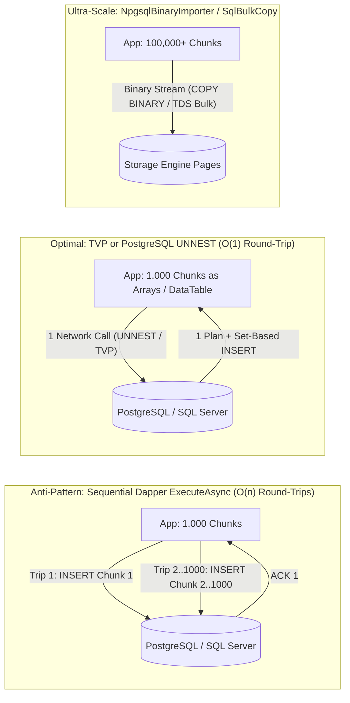
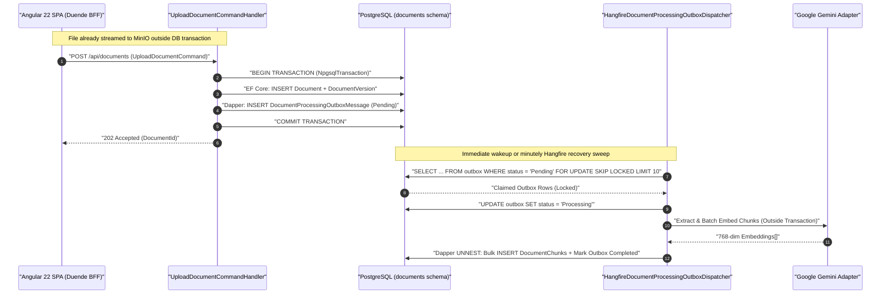
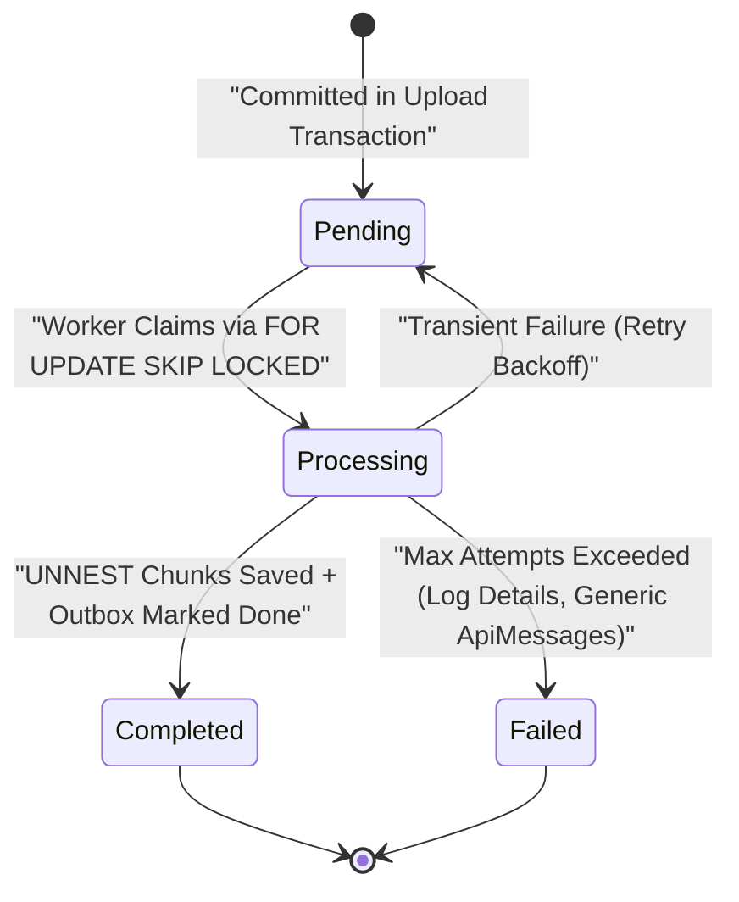
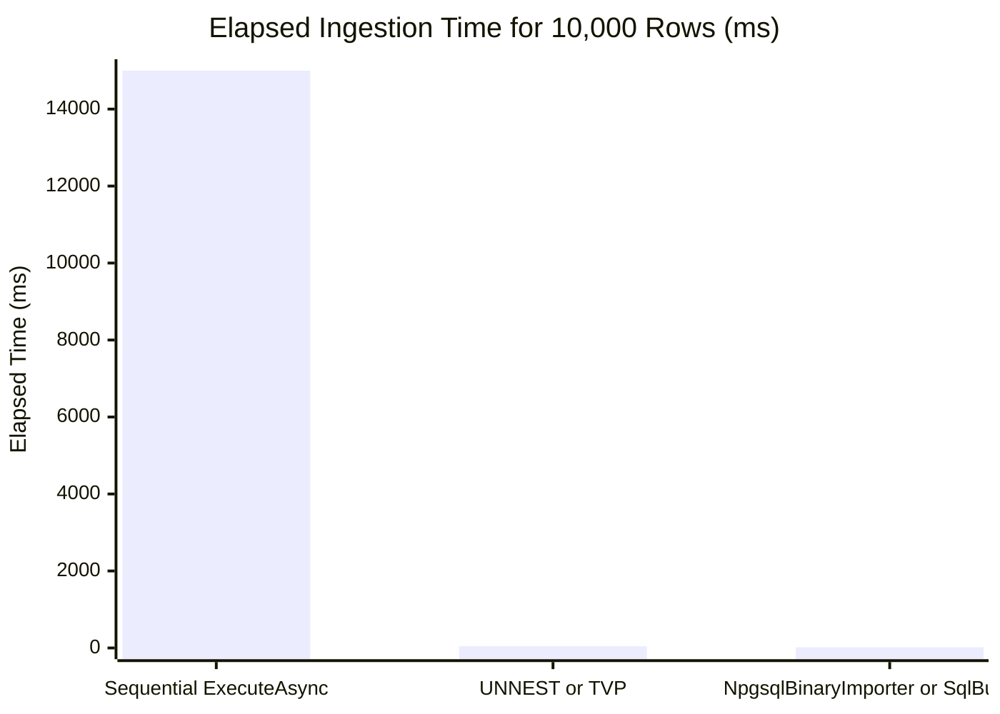

# Chapter 5: Advanced Queries, Bulk Operations, and Transactions

## 1. Learning Objectives

By the end of this chapter, you will be able to:
*   Execute complex Stored Procedures and PostgreSQL Functions/Procedures, capturing Output Parameters, `RETURNING` projections, and Return Values using `DynamicParameters` and `DbString`.
*   Architect ultra-high-performance bulk data ingestion using Table-Valued Parameters (TVPs) and `SqlBulkCopy` in SQL Server, as well as PostgreSQL `UNNEST` array binding and `NpgsqlBinaryImporter` (`COPY BINARY`), bypassing Dapper's sequential execution limits.
*   Implement highly concurrent `UPSERT` operations (`MERGE WITH (HOLDLOCK)` in SQL Server and `INSERT ... ON CONFLICT ... DO UPDATE` in PostgreSQL) to handle massive ingestion workloads without race conditions.
*   Write advanced analytical and search queries using Common Table Expressions (CTEs), Recursive CTEs, Window Functions, Keyset (Seek) Pagination, `Dapper.SqlBuilder`, hybrid `pgvector` Reciprocal Rank Fusion (RRF), and unbuffered streaming (`QueryUnbufferedAsync`).
*   Master database concurrency by explicitly managing `DbTransaction` (`SqlTransaction` / `NpgsqlTransaction`), Savepoints, Isolation Levels (including PostgreSQL MVCC), `TransactionScope`, and shared EF Core + Dapper transactions within a Clean Architecture / Modular Monolith setup.
*   Implement the Transactional Outbox pattern with pessimistic row locking (`FOR UPDATE SKIP LOCKED` / `UPDLOCK, READPAST`) and design resilient Polly v8 retry pipelines for SQL Server deadlocks (`1205`) and PostgreSQL deadlocks/serialization failures (`40P01` / `40001`).

## 2. Introduction

Simple `SELECT` and `INSERT` statements are sufficient for building a minimum viable product. However, as a SaaS platform scales to handle thousands of concurrent users or IoT devices, simple CRUD operations become the primary bottleneck.

When your platform must ingest 50,000 telemetry readings per second, attempting to execute 50,000 separate `INSERT` statements via Dapper will instantly exhaust your connection pool and cripple your database CPU. Similarly, when a financial transaction requires updating an Invoice, deducting a Wallet Balance, and writing an Audit Log, executing these outside of an explicitly controlled transactional boundary guarantees eventual data corruption.

The exact same realities govern **Normora**, our **.NET 10 / C# 14** enterprise multi-tenant knowledge management and conversational-AI platform running on **PostgreSQL + pgvector (Npgsql)**:
*   When a tenant uploads a 300-page PDF policy, `Normora.Worker` chunks it into hundreds of `DocumentChunk` rows with 768-dimensional `pgvector` embeddings. Inserting them one-by-one wastes hundreds of network round-trips; batching them via PostgreSQL `UNNEST` or `NpgsqlBinaryImporter` completes the job in milliseconds.
*   When `UploadDocumentCommandHandler` commits a `Document` and a `DocumentProcessingOutboxMessage` atomically, multiple Hangfire worker threads must claim pending outbox rows concurrently using `FOR UPDATE SKIP LOCKED` without double-processing the same document.
*   When `Conversations` executes hybrid retrieval across `documents.document_chunks`, Dapper runs CTEs combining `pgvector` cosine distance (`<=>`) and PostgreSQL full-text search (`ts_rank_cd`) via Reciprocal Rank Fusion (RRF), all strictly isolated by `TenantId`.

This chapter transitions from basic data mapping into true enterprise data engineering across both **SQL Server** and **PostgreSQL (Npgsql)**. We will explore bulk operations, advanced query composition, set-based upserts, and how to rigorously enforce **ACID** (Atomicity, Consistency, Isolation, Durability) properties using ADO.NET transactions and EF Core transaction sharing.

## 3. Core Concepts

> [!NOTE]
> Every concept in this section is taught through four lenses: **What** it is, **Why** it exists, **How** it works under the hood, and **When NOT to use it**. New architectural terms are defined on first appearance.

### 3.1 Stored Procedures, PostgreSQL Functions & Parameterized Execution

*   **What:** A **Stored Procedure** is a precompiled named routine stored inside the database engine. In SQL Server, routines use `CommandType.StoredProcedure` with `@Param` inputs, `OUTPUT` parameters, and an integer `RETURN` status code. In PostgreSQL, `CREATE FUNCTION` returns result sets or `OUT` columns via `SELECT * FROM schema.fn_name(@p1)`, while `CREATE PROCEDURE` (PostgreSQL 11+) is invoked via `CALL schema.sp_name(@p1)` (`CommandType.Text`).
*   **Why:** Procedures encapsulate multi-step database operations close to the data, reduce network payload size for complex multi-statement batches, and enforce strict DB-level permission boundaries when direct table access is restricted.
*   **How:**
    *   In SQL Server, the **Plan Cache** stores compiled **execution plans** (the physical strategy of index seeks, joins, and sorts chosen by the optimizer). Both stored procedures and parameterized inline SQL share the plan cache. However, **Parameter Sniffing** occurs when the engine compiles a plan optimized for the *first* set of parameter values it sees—which can cause catastrophic slowdowns if later calls pass wildly skewed values (e.g., a tiny tenant vs. an enterprise tenant with 5M chunks).
    *   In Dapper, `DynamicParameters` binds `Input`, `Output`, `InputOutput`, and `ReturnValue` parameters, while `DbString` controls exact string types (`IsAnsi`, `IsFixedLength`, `Length`) so the database doesn't perform implicit type conversions that disable index seeks.
*   **When NOT to Use Stored Procedures:**
    *   Do **not** put business logic, authorization rules (like Normora's BOLA/BFLA checks), or CQRS orchestration inside stored procedures just "for performance" or "security"—parameterized inline SQL in Dapper is equally safe against SQL injection and uses the exact same plan cache.
    *   Avoid stored procedure sprawl in modular monoliths like Normora: putting domain logic in SQL splits version control, breaks C# refactoring/unit testing, and creates rigid deployment coupling between `Normora.Api` and `Normora.Worker`.

### 3.2 Bulk Data Ingestion: TVPs, `SqlBulkCopy`, PostgreSQL `UNNEST` & `COPY BINARY`

*   **What:** Techniques for transferring hundreds to millions of rows from .NET to the database in a single or minimal set of network operations instead of row-by-row `INSERT` loops.
    *   **Table-Valued Parameter (TVP)** (SQL Server): Passes a structured table variable (`User-Defined Table Type` / **UDTT**) as a single parameter over **TDS** (Tabular Data Stream, SQL Server's binary wire protocol) in a single **RPC** (Remote Procedure Call).
    *   **`SqlBulkCopy`** (SQL Server): Streams rows directly into data pages via minimal logging, bypassing standard T-SQL statement parsing.
    *   **`UNNEST` Array Binding** (PostgreSQL / Npgsql): Passes parallel C# arrays (`Guid[]`, `string[]`, `int[]`) as parameters to `INSERT INTO ... SELECT * FROM UNNEST(@ids, @contents, ...)`, expanding them into relational rows in one round-trip without creating custom database types.
    *   **`NpgsqlBinaryImporter` (`COPY ... FROM STDIN (FORMAT BINARY)`)** (PostgreSQL): Streams raw binary tuples directly into PostgreSQL's storage engine—the PostgreSQL counterpart to `SqlBulkCopy`.
*   **Why:** Calling `connection.ExecuteAsync(sql, listOf1000Items)` in Dapper still executes 1,000 sequential network round-trips under the hood. Bulk strategies collapse network latency from $O(n)$ round-trips to $O(1)$, cutting ingestion time from seconds to milliseconds.
*   **How:**
    *   In SQL Server, `dataTable.AsTableValuedParameter("dbo.udt_Type")` wraps a `DataTable` in `SqlMapper.ICustomQueryParameter`. For lower memory pressure (avoiding `DataTable` boxing and Gen 2 GC spikes), stream `IEnumerable<SqlDataRecord>` or `IDataReader` instead.
    *   In PostgreSQL, Npgsql natively serializes C# arrays (`Guid[]`, `string[]`, `Vector[]` with `pgvector.Npgsql`) as PostgreSQL array parameters (`uuid[]`, `text[]`, `vector[]`), which `UNNEST(...)` zips row-by-row in a single SQL statement.
*   **When NOT to Use Bulk Operations:**
    *   For **small batches (< ~50 rows)**, `UNNEST` / `DataTable` setup overhead isn't worth it; a short multi-row `VALUES` or Dapper `ExecuteAsync` is simpler.
    *   When each row requires **per-entity EF Core domain events, complex C# invariant validation, or fine-grained partial failure reporting**.
    *   Note that `NpgsqlBinaryImporter` (`COPY BINARY`) **bypasses triggers/returning clauses** on raw streams and cannot run `ON CONFLICT` directly—if you need an upsert, load into a `TEMP` table via `COPY` and then run `INSERT INTO target SELECT ... ON CONFLICT DO UPDATE`, or use `UNNEST`.

### 3.3 Atomic Upserts (`MERGE` vs PostgreSQL `ON CONFLICT`) & `RETURNING` / `OUTPUT`

*   **What:** An **UPSERT** ("Update if exists, Insert if not") atomically inserts a new row or updates an existing one based on a unique key. **SQL Server** uses `MERGE`, whereas **PostgreSQL** uses `INSERT INTO ... ON CONFLICT (...) DO UPDATE SET ...` (or `DO NOTHING`). Pairing this with `RETURNING` (PostgreSQL) or `OUTPUT INSERTED.*` (SQL Server) returns the final inserted/updated columns in the same statement.
*   **Why:** A naive C# "check with `SELECT`, then `INSERT` or `UPDATE`" pattern suffers from a classic **TOCTOU** (Time-of-Check to Time-of-Use) race condition: two concurrent requests both see "not found" and both try to `INSERT`, crashing with a primary/unique key violation.
*   **How:**
    *   **SQL Server `MERGE`:** Evaluates a `USING` source against a `target` table. **Critical caveat:** `MERGE` is *not* inherently race-proof under default `ReadCommitted`; you must add the `WITH (HOLDLOCK)` table hint on the target so the key-range lock prevents concurrent `INSERT` collisions.
    *   **PostgreSQL `ON CONFLICT`:** Relies on a declared `PRIMARY KEY`, `UNIQUE` constraint, or unique partial index (e.g., `ON CONFLICT (tenant_id, external_user_id) DO UPDATE SET ...`). PostgreSQL handles the row/index conflict atomically inside the storage engine without requiring `HOLDLOCK`.
*   **When NOT to Use Upserts:**
    *   Do **not** use `UPSERT` when `INSERT` and `UPDATE` have **different authorization rules (BFLA)** or **different audit requirements** (e.g., creating a `TenantMembership` requires `Admin` role and sends an invitation email, whereas updating a user's `LastSeenAt` does not).
    *   Do **not** use `MERGE` across 50,000+ rows in one statement without chunking—SQL Server may escalate thousands of row locks into a full-table lock (**Lock Escalation**), blocking all other tenants.

### 3.4 Advanced Query Patterns: CTEs, Window Functions, Keyset Pagination, `SqlBuilder` & Unbuffered Streaming

*   **What:**
    *   **CTE (Common Table Expression):** A temporary named result set (`WITH cte_name AS (...)`) scoped to a single SQL statement. A **Recursive CTE** (`WITH RECURSIVE` in PostgreSQL) references itself to traverse trees/hierarchies (such as nested `Department` folders).
    *   **Window Functions:** Compute rankings, running totals, or row offsets across a window of rows (`ROW_NUMBER() OVER (PARTITION BY ... ORDER BY ...)`) without collapsing rows like `GROUP BY` does.
    *   **Keyset (Seek) Pagination:** Uses an indexed cursor (`WHERE (created_at, id) < (@CursorCreatedAt, @CursorId) ORDER BY created_at DESC, id DESC LIMIT @PageSize`) instead of `OFFSET @Skip`.
    *   **`Dapper.SqlBuilder`:** A lightweight builder from `Dapper.SqlBuilder` that safely assembles dynamic `WHERE`, `JOIN`, and `ORDER BY` clauses using `/**where**/` template placeholders.
    *   **Unbuffered Streaming:** Setting `buffered: false` in `QueryAsync` or calling `QueryUnbufferedAsync<T>` reads rows lazily one-by-one from the `DbDataReader` as `IAsyncEnumerable<T>` instead of loading the entire result set into a `List<T>` in memory.
*   **Why:**
    *   Normora's **Hybrid Search** must fuse vector cosine similarity (`pgvector` `<=>` via an **HNSW** — Hierarchical Navigable Small World — index) with PostgreSQL full-text search (`ts_rank_cd`) using **Reciprocal Rank Fusion (RRF)** in a single database round-trip via CTEs and `ROW_NUMBER()`.
    *   `OFFSET 100000` forces the database to scan and discard 100,000 rows ($O(N)$), crippling deep pagination on `AuditLog` or `ConversationMessage` tables. Keyset pagination jumps directly via the B-Tree index in $O(\log N)$.
    *   Loading 200,000 audit rows with `buffered: true` allocates huge arrays on the **.NET Large Object Heap (LOH)**, triggering GC pauses.
*   **When NOT to Use These:**
    *   Avoid **Keyset Pagination** when the UI explicitly requires jumping to arbitrary page numbers ("Jump to Page 47"); use bounded `OFFSET` or search filters there.
    *   Avoid **Unbuffered Streaming** (`buffered: false`) if you need to return a simple paged DTO of 20 items, or if you plan to execute *another* query on the same connection before finishing enumeration (MARS is off by default in SQL Server and unsupported in Npgsql—an open unbuffered reader occupies the connection until disposed!).
    *   Never replace `SqlBuilder` or strict column whitelists with raw string interpolation of user-supplied `sortColumn` names (SQL injection risk!).

### 3.5 Transaction Management, Isolation Levels, Savepoints & Shared EF Core + Dapper Transactions

*   **What:** A **Database Transaction** groups multiple reads/writes into one atomic unit of work satisfying **ACID** (Atomicity, Consistency, Isolation, Durability).
    *   **Explicit `DbTransaction` (`NpgsqlTransaction` / `SqlTransaction`):** Bound to one open connection; Dapper commands must explicitly receive `transaction: tx`.
    *   **Savepoints:** Named rollback checkpoints *inside* an active transaction (`await tx.SaveAsync("before_step")` and `await tx.RollbackAsync("before_step")`) that undo part of a transaction without aborting the entire unit of work.
    *   **`TransactionScope`:** An ambient .NET transaction manager (`System.Transactions`) that auto-enlists connections opened inside it. Must pass `TransactionScopeAsyncFlowOption.Enabled` in async code.
    *   **Shared EF Core + Dapper Transaction:** Starting a transaction on an EF Core `DbContext` (`await dbContext.Database.BeginTransactionAsync(ct)`), then passing `dbContext.Database.GetDbConnection()` and `tx.GetDbTransaction()` to Dapper so EF Core aggregate mutations and Dapper bulk/raw queries commit or roll back together.
*   **Why:**
    *   Normora's `UploadDocumentCommandHandler` uses EF Core for domain aggregates and Dapper/Npgsql for bulk operations or outbox inserts; sharing the same `NpgsqlTransaction` guarantees atomicity without two connections deadlocking each other.
    *   **Isolation Levels** balance consistency against concurrency—and **PostgreSQL MVCC** (Multi-Version Concurrency Control) behaves very differently from SQL Server's default locking model:
        *   **`ReadCommitted`:** Default in both engines. In SQL Server (without **RCSI** — Read Committed Snapshot Isolation), readers acquire shared locks and block writers. In PostgreSQL (and SQL Server with RCSI/Snapshot), readers *never* block writers and writers *never* block readers because readers see the latest committed row snapshot.
        *   **`RepeatableRead`:** In SQL Server, holds shared locks until commit (still allows **phantom reads**). In PostgreSQL, `RepeatableRead` implements full **Snapshot Isolation** (no dirty reads, no non-repeatable reads, no phantom reads), though concurrent updates to the same row raise serialization error `40001`.
        *   **`Serializable`:** Highest strictness. SQL Server uses range locks (heavy blocking). PostgreSQL uses **SSI** (Serializable Snapshot Isolation), tracking predicate locks (`SIReadLock`) and aborting conflicting transactions with `40001` instead of blocking readers.
        *   **`ReadUncommitted`:** Allows dirty reads in SQL Server; in PostgreSQL it silently upgrades to `ReadCommitted` (dirty reads do not exist in PostgreSQL).
*   **When NOT to Use Heavy Transactions or `TransactionScope`:**
    *   **NEVER** hold a database transaction open across external network calls (Google Gemini API, MinIO S3 upload, PayU HTTP callbacks, SMTP/Resend email). Network latency holds locks/snapshots open for seconds, exhausting the connection pool.
    *   **Do NOT use `TransactionScope` across multiple PostgreSQL databases or Linux containers** expecting distributed two-phase commit (MSDTC is Windows/SQL-Server-centric and not supported for distributed coordination across PostgreSQL cloud nodes; use the **Transactional Outbox** or **Saga** pattern instead).

### 3.6 Concurrency Patterns: Pessimistic Locking (`SKIP LOCKED`), Optimistic Concurrency, Transactional Outbox & Deadlock Retries

*   **What:**
    *   **Pessimistic Locking (`FOR UPDATE SKIP LOCKED` / `WITH (UPDLOCK, READPAST)`):** Locks selected rows exclusively while *skipping* rows already locked by other workers, preventing worker contention on queue/outbox tables.
    *   **Optimistic Concurrency:** Assumes conflicts are rare; checks a version token (`WHERE id = @Id AND xmin = @ExpectedXmin` in PostgreSQL, or `rowversion` / `Version` column) at `UPDATE` time and throws/conflicts if `affectedRows == 0`.
    *   **Transactional Outbox Pattern:** Persists business state changes *and* an outbox event/job record (`DocumentProcessingOutboxMessage`) inside the **same local database transaction**. A background dispatcher (`HangfireDocumentProcessingOutboxDispatcher`) then claims and processes outbox rows asynchronously with automatic recovery.
    *   **Resilient Retry Pipelines (Polly v8):** Automatically re-executes idempotent transactions when the database aborts one due to a **Deadlock** (SQL Server `1205`, PostgreSQL `40P01`) or **Serialization Failure** (PostgreSQL `40001`).
*   **Why:** Without `SKIP LOCKED`, two concurrent Hangfire workers polling `documents.document_processing_outbox_messages` read the same pending row and trigger duplicate Gemini OCR + embedding jobs. Without `Outbox`, saving a `Document` and then crashing before enqueueing the Hangfire job leaves an orphaned document stuck in `"Pending"` forever.
*   **When NOT to Use Pessimistic Locking / Retries:**
    *   Do **not** use `SELECT ... FOR UPDATE` for interactive user edits across HTTP requests (use optimistic concurrency tokens instead).
    *   Do **not** retry non-idempotent transactions blindly—if a transaction isn't idempotent (or uses an `IdempotencyKey`), retrying after a connection drop post-commit will duplicate records or charges.

## 4. Visual Diagrams

### 4.1 Bulk Ingestion Architecture: Sequential vs. TVP / `UNNEST` vs. `COPY BINARY`



### 4.2 Normora CQRS Shared EF Core + Dapper Transaction & Transactional Outbox



### 4.3 Outbox Message Lifecycle (`DocumentProcessingOutboxMessage`)



### 4.4 Scaling Latency (10,000 Rows): Sequential vs. `UNNEST` / TVP vs. Binary `COPY`



*Legacy ASCII Reference (EV Charging CQRS Explicit Transaction Boundary):*
```text
[ HTTP Request: StartChargingSessionCommand ]
        │
[ MediatR Command Handler ]
        │
        ├── 1. connection.OpenAsync()
        ├── 2. transaction = connection.BeginTransaction(IsolationLevel.ReadCommitted)
        │
        ├── 3. _sessionRepo.CreateAsync(session, transaction)   [DAPPER]
        ├── 4. _chargerRepo.UpdateStatusAsync(id, transaction)  [DAPPER]
        ├── 5. _auditRepo.LogEventAsync(event, transaction)     [DAPPER]
        │
        ├── 6. transaction.CommitAsync()
        │
[ HTTP 200 OK ]
```

## 5. API Deep Dive

### DynamicParameters for Stored Procedures
To execute a stored procedure that uses `OUTPUT` parameters or returns a status code, an anonymous object is insufficient. You must construct a `DynamicParameters` object.

```csharp
var parameters = new DynamicParameters();
// Input
parameters.Add("@TenantId", tenantId, DbType.Guid);
// Output
parameters.Add("@TotalCost", dbType: DbType.Decimal, direction: ParameterDirection.Output, precision: 18, scale: 2);
// Return Value (e.g. RETURN 0 for success, -1 for error)
parameters.Add("@ReturnValue", dbType: DbType.Int32, direction: ParameterDirection.ReturnValue);

await connection.ExecuteAsync("sp_CalculateInvoice", parameters, commandType: CommandType.StoredProcedure);

decimal cost = parameters.Get<decimal>("@TotalCost");
int status = parameters.Get<int>("@ReturnValue");
```

> [!TIP]
> **PostgreSQL Stored Procedures vs. Functions in Dapper:** In PostgreSQL, `CREATE PROCEDURE` uses `CALL schema.sp_name(@p1)` with `CommandType.Text` (not `CommandType.StoredProcedure`, which Npgsql translates as `SELECT * FROM ...` for functions). For PostgreSQL functions returning rows or `OUT` columns, call `QuerySingleAsync<T>("SELECT * FROM tenants.fn_calculate_usage(@TenantId)", new { TenantId = tenantId })`.

### DbString for Exact String Parameter Binding
By default, Dapper binds C# `string` parameters as `NVARCHAR(4000)` (Unicode) in SQL Server. If your SQL Server column is `VARCHAR(64)` (ANSI), SQL Server must implicitly convert the column to `NVARCHAR` on every row, **disabling index seeks** and causing full-table scans. Use `DbString` to match exact column types:

```csharp
var parameters = new
{
    Slug = new DbString { Value = tenantSlug, IsAnsi = true, IsFixedLength = false, Length = 64 }
};
```
*(In PostgreSQL/Npgsql, `text` and `varchar` share UTF-8 encoding, so `DbString` is mainly critical when optimizing SQL Server schemas, though specifying explicit lengths helps keep parameters predictable.)*

### ICustomQueryParameter for TVPs & Custom Types
To pass a TVP, Dapper provides an extension method on `DataTable` called `AsTableValuedParameter(typeName)`. Internally, this wraps the `DataTable` in a class implementing `SqlMapper.ICustomQueryParameter`, which instructs Dapper to bind the parameter as `SqlDbType.Structured`.

For zero-`DataTable`-allocation streaming in SQL Server, implement `SqlMapper.ICustomQueryParameter` over `IEnumerable<SqlDataRecord>` (or pass an `ObjectReader` from `FastMember`). For PostgreSQL, Npgsql handles typed C# arrays (`Guid[]`, `string[]`, `Vector[]`) directly with `UNNEST(...)`—no `DataTable` or `ICustomQueryParameter` wrapper required.

### CommandDefinition, Cancellation & Unbuffered Streaming
Always pass `CommandDefinition` in production .NET 10 services so you can propagate `CancellationToken`, set per-query timeouts, and stream large exports without buffering everything into a `List<T>`:

```csharp
var command = new CommandDefinition(
    commandText: "SELECT id, action, created_at FROM tenants.audit_logs WHERE tenant_id = @TenantId ORDER BY created_at DESC",
    parameters: new { TenantId = tenantId },
    transaction: tx,
    commandTimeout: 30,
    flags: CommandFlags.NoCache, // or CommandFlags.None for unbuffered
    cancellationToken: ct);

await foreach (var entry in connection.QueryUnbufferedAsync<AuditLogExportRow>(command))
{
    yield return entry;
}
```

### Dapper.SqlBuilder for Safe Dynamic Queries
When filtering by optional parameters (department, status, date range), never concatenate SQL strings directly from user input. `Dapper.SqlBuilder` (from the `Dapper.SqlBuilder` NuGet package) constructs parameterized `/**where**/` and `/**orderby**/` clauses cleanly:

```csharp
var builder = new SqlBuilder();
var template = builder.AddTemplate(
    "SELECT id, title, status FROM documents.documents /**where**/ /**orderby**/ LIMIT @Limit");

builder.Where("tenant_id = @TenantId", new { TenantId = tenantId });
if (departmentId.HasValue)
    builder.Where("department_id = @DepartmentId", new { DepartmentId = departmentId.Value });
```

### Sharing Transactions Between EF Core and Dapper
In Normora's modular monolith, a handler often writes aggregates with EF Core and executes bulk/outbox SQL with Dapper inside the **same** atomic transaction:

```csharp
await using var efTransaction = await dbContext.Database.BeginTransactionAsync(IsolationLevel.ReadCommitted, ct);
var dbConnection = dbContext.Database.GetDbConnection();
var dbTransaction = efTransaction.GetDbTransaction();

await dbContext.SaveChangesAsync(ct);
await dbConnection.ExecuteAsync(new CommandDefinition(outboxSql, outboxParam, transaction: dbTransaction, cancellationToken: ct));

await efTransaction.CommitAsync(ct);
```

### Polly v8 ResiliencePipeline for Deadlocks & Serialization Failures
In .NET 10, replace legacy Polly v7 `AsyncRetryPolicy` with **Polly v8** `ResiliencePipeline`. Handle SQL Server Error `1205` (Deadlock) or PostgreSQL `SqlState` `40P01` (`DeadlockDetected`) and `40001` (`SerializationFailure`):

```csharp
var retryPipeline = new ResiliencePipelineBuilder()
    .AddRetry(new RetryStrategyOptions
    {
        MaxRetryAttempts = 3,
        Delay = TimeSpan.FromMilliseconds(50),
        BackoffType = DelayBackoffType.Exponential,
        UseJitter = true,
        ShouldHandle = new PredicateBuilder().Handle<PostgresException>(ex =>
            ex.SqlState is PostgresErrorCodes.DeadlockDetected or PostgresErrorCodes.SerializationFailure)
    })
    .Build();
```

## 6. Complete Examples: EV Charging Platform & Normora

### Part A: EV Charging Platform Case Study (SQL Server)

#### EV Scenario 1: Bulk Ingestion of Telemetry via TVP
Our platform receives a batched array of 5,000 meter readings from a charger.

**1. SQL Server Schema Setup:**
```sql
CREATE TYPE dbo.udt_MeterReadings AS TABLE (
    ChargerId UNIQUEIDENTIFIER,
    Timestamp DATETIME2,
    EnergyKwh DECIMAL(18,4)
);

CREATE PROCEDURE dbo.sp_InsertMeterReadings
    @Readings dbo.udt_MeterReadings READONLY
AS
BEGIN
    INSERT INTO MeterReadings (ChargerId, Timestamp, EnergyKwh)
    SELECT ChargerId, Timestamp, EnergyKwh FROM @Readings;
END
```

**2. C# Implementation:**
```csharp
public async Task InsertReadingsBulkAsync(IEnumerable<MeterReadingDto> readings)
{
    // 1. Manually construct the DataTable to match the SQL UDT EXACTLY
    var dataTable = new DataTable();
    dataTable.Columns.Add("ChargerId", typeof(Guid));
    dataTable.Columns.Add("Timestamp", typeof(DateTime));
    dataTable.Columns.Add("EnergyKwh", typeof(decimal));

    foreach (var reading in readings)
    {
        dataTable.Rows.Add(reading.ChargerId, reading.Timestamp, reading.EnergyKwh);
    }

    // 2. Pass to Dapper using AsTableValuedParameter
    var parameters = new DynamicParameters();
    parameters.Add("@Readings", dataTable.AsTableValuedParameter("dbo.udt_MeterReadings"));

    // 3. Execute in a single network trip
    await _connection.ExecuteAsync(
        "dbo.sp_InsertMeterReadings", 
        parameters, 
        commandType: CommandType.StoredProcedure);
}
```

#### EV Scenario 2: High-Performance UPSERT (MERGE)
When a charger connects, we want to insert it if it's new, or update its IP address if it exists.

```csharp
public async Task UpsertChargerAsync(Guid chargerId, string ipAddress, Guid siteId)
{
    const string sql = @"
        MERGE INTO Chargers WITH (HOLDLOCK) AS target
        USING (SELECT @Id AS Id, @IpAddress AS IpAddress, @SiteId AS SiteId) AS source
        ON target.Id = source.Id
        WHEN MATCHED THEN
            UPDATE SET IpAddress = source.IpAddress, LastSeen = GETUTCDATE()
        WHEN NOT MATCHED THEN
            INSERT (Id, SiteId, IpAddress, LastSeen)
            VALUES (source.Id, source.SiteId, source.IpAddress, GETUTCDATE());";

    // HOLDLOCK is critical in MERGE to prevent concurrency race conditions
    await _connection.ExecuteAsync(sql, new 
    { 
        Id = chargerId, 
        IpAddress = ipAddress, 
        SiteId = siteId 
    });
}
```

#### EV Scenario 3: Explicit Transaction Management in CQRS
A Command Handler must orchestrate multiple repository calls atomically.

```csharp
public async Task<bool> Handle(StopSessionCommand request, CancellationToken ct)
{
    await using var connection = new SqlConnection(_connectionString);
    await connection.OpenAsync(ct);

    // 1. Begin explicit transaction
    await using var transaction = (SqlTransaction)await connection.BeginTransactionAsync(IsolationLevel.ReadCommitted, ct);

    try
    {
        // 2. Pass transaction to Repositories (repositories execute on transaction.Connection!)
        await _sessionRepo.StopSessionAsync(request.SessionId, transaction);
        await _billingRepo.CreateInvoiceAsync(request.SessionId, transaction);

        // 3. Commit if both succeed
        await transaction.CommitAsync(ct);
        return true;
    }
    catch (Exception)
    {
        // 4. Rollback on failure
        await transaction.RollbackAsync(ct);
        throw;
    }
}
```
*Note: In the Repository implementation, you MUST execute against the **same** connection that owns the transaction and pass `transaction:` to Dapper:*
`await transaction.Connection!.ExecuteAsync(sql, param, transaction: transaction);`

---

### Part B: Normora Case Study (.NET 10 / C# 14 Primary Constructors, PostgreSQL + pgvector + Npgsql)

Every Normora example below enforces Normora's architectural rules: C# 14 **primary constructors**, explicit `TenantId` isolation, `ExternalUserId` (never vendor-specific names), `Normora.Shared.Constants.ApiMessages` (no magic strings), `BolaException` (404) / `BflaException` (403), and zero third-party vendor SDKs inside business modules.

#### Concept 1: Stored Procedures, PostgreSQL Functions & `DynamicParameters` (5 Normora Examples)

1. **Workspace Storage & Document Quota Summary Function (`Documents` Module):**
   Calls a PostgreSQL function returning multiple `OUT` parameters in a single round-trip via `DynamicParameters`.
   ```csharp
   public sealed class DocumentQuotaReader(NpgsqlDataSource dataSource)
   {
       public async Task<(long TotalBytes, int DocumentCount, int ChunkCount)> GetWorkspaceUsageAsync(
           Guid tenantId, CancellationToken ct)
       {
           await using var conn = await dataSource.OpenConnectionAsync(ct);
           var p = new DynamicParameters();
           p.Add("p_tenant_id", tenantId, DbType.Guid);
           p.Add("total_bytes", dbType: DbType.Int64, direction: ParameterDirection.Output);
           p.Add("doc_count", dbType: DbType.Int32, direction: ParameterDirection.Output);
           p.Add("chunk_count", dbType: DbType.Int32, direction: ParameterDirection.Output);

           await conn.ExecuteAsync(new CommandDefinition(
               "SELECT * FROM documents.fn_get_workspace_usage(@p_tenant_id)",
               p, commandType: CommandType.Text, cancellationToken: ct));

           return (p.Get<long>("total_bytes"), p.Get<int>("doc_count"), p.Get<int>("chunk_count"));
       }
   }
   ```

2. **Billing Seat & Plan Usage Reconciliation Procedure (`Tenants` Module):**
   Executes a PostgreSQL `PROCEDURE` via `CALL` with `InputOutput` parameters for billing ledger snapshots.
   ```csharp
   public sealed class TenantBillingProcedureService(NpgsqlDataSource dataSource)
   {
       public async Task<int> ReconcileActiveSeatsAsync(Guid tenantId, CancellationToken ct)
       {
           await using var conn = await dataSource.OpenConnectionAsync(ct);
           var p = new DynamicParameters();
           p.Add("p_tenant_id", tenantId, DbType.Guid);
           p.Add("p_active_seats", value: 0, dbType: DbType.Int32, direction: ParameterDirection.InputOutput);

           await conn.ExecuteAsync(new CommandDefinition(
               "CALL tenants.sp_reconcile_active_seats(@p_tenant_id, @p_active_seats)",
               p, commandType: CommandType.Text, cancellationToken: ct));

           return p.Get<int>("p_active_seats");
       }
   }
   ```

3. **Exact-Length `DbString` Lookup for `TenantSlug` & `ExternalUserId` (`Tenants` Module):**
   Resolves workspace context during authentication without implicit-conversion scans (and throws `BolaException` with `ApiMessages.NotFound` when absent).
   ```csharp
   public sealed class TenantSlugLookupRepository(NpgsqlDataSource dataSource)
   {
       public async Task<TenantResolutionDto> ResolveBySlugAsync(
           string tenantSlug, string externalUserId, CancellationToken ct)
       {
           await using var conn = await dataSource.OpenConnectionAsync(ct);
           var result = await conn.QuerySingleOrDefaultAsync<TenantResolutionDto>(new CommandDefinition(
               """
               SELECT t.id AS TenantId, m.role AS Role
               FROM tenants.tenants t
               INNER JOIN tenants.tenant_memberships m ON m.tenant_id = t.id
               WHERE t.slug = @Slug AND m.external_user_id = @ExternalUserId AND t.is_active = TRUE
               """,
               new
               {
                   Slug = new DbString { Value = tenantSlug, IsAnsi = false, Length = 100 },
                   ExternalUserId = new DbString { Value = externalUserId, IsAnsi = false, Length = 128 }
               },
               cancellationToken: ct));

           return result ?? throw new BolaException(ApiMessages.NotFound);
       }
   }
   ```

4. **Expired `PendingApproval` Sweep Function (`Conversations` Module):**
   Sweeps expired 15-minute HITL approvals (such as timed-out `documents_delete` confirmations) and captures the purged row count.
   ```csharp
   public sealed class PendingApprovalCleanupRepository(NpgsqlDataSource dataSource)
   {
       public async Task<int> ExpireStaleApprovalsAsync(DateTime utcNow, CancellationToken ct)
       {
           await using var conn = await dataSource.OpenConnectionAsync(ct);
           return await conn.QuerySingleAsync<int>(new CommandDefinition(
               "SELECT conversations.fn_expire_pending_approvals(@UtcNow)",
               new { UtcNow = utcNow },
               cancellationToken: ct));
       }
   }
   ```

5. **Tenant Audit Log Retention Purge Function (`Tenants` Module):**
   Enforces plan-based retention (`Free`, `Pro`, `Enterprise`) in a background Hangfire job and returns deleted counts without exposing raw DB errors (`CWE-209`).
   ```csharp
   public sealed class AuditLogRetentionRepository(NpgsqlDataSource dataSource)
   {
       public async Task<int> PurgeExpiredLogsAsync(Guid tenantId, DateTime cutoffUtc, CancellationToken ct)
       {
           await using var conn = await dataSource.OpenConnectionAsync(ct);
           var p = new DynamicParameters();
           p.Add("p_tenant_id", tenantId, DbType.Guid);
           p.Add("p_cutoff_utc", cutoffUtc, DbType.DateTime2);

           return await conn.ExecuteScalarAsync<int>(new CommandDefinition(
               "SELECT tenants.fn_purge_audit_logs(@p_tenant_id, @p_cutoff_utc)",
               p, cancellationToken: ct));
       }
   }
   ```

#### Concept 2: Bulk Operations — `UNNEST`, `NpgsqlBinaryImporter`, TVPs & `SqlDataRecord` (5 Normora Examples)

1. **Batch-Inserting `DocumentChunk` Rows & `pgvector` Embeddings via PostgreSQL `UNNEST` (`Documents` Module):**
   After `GeminiEmbeddingService` returns up to 100 embeddings via `batchEmbedContents`, `Normora.Worker` inserts all chunks in a single $O(1)$ round-trip.
   ```csharp
   public sealed class DocumentChunkBulkRepository(NpgsqlDataSource dataSource)
   {
       public async Task BulkInsertChunksAsync(
           Guid tenantId, Guid documentVersionId, IReadOnlyList<ChunkEmbeddingItem> chunks, CancellationToken ct)
       {
           if (chunks.Count == 0) return;

           await using var conn = await dataSource.OpenConnectionAsync(ct);
           const string sql = """
               INSERT INTO documents.document_chunks
                   (id, tenant_id, document_version_id, chunk_index, breadcrumb, content, embedding)
               SELECT * FROM UNNEST(
                   @Ids, @TenantIds, @VersionIds, @ChunkIndexes, @Breadcrumbs, @Contents, @Embeddings
               );
               """;

           await conn.ExecuteAsync(new CommandDefinition(sql, new
           {
               Ids = chunks.Select(c => c.Id).ToArray(),
               TenantIds = Enumerable.Repeat(tenantId, chunks.Count).ToArray(),
               VersionIds = Enumerable.Repeat(documentVersionId, chunks.Count).ToArray(),
               ChunkIndexes = chunks.Select(c => c.ChunkIndex).ToArray(),
               Breadcrumbs = chunks.Select(c => c.Breadcrumb).ToArray(),
               Contents = chunks.Select(c => c.Content).ToArray(),
               Embeddings = chunks.Select(c => new Pgvector.Vector(c.Embedding)).ToArray()
           }, cancellationToken: ct));
       }
   }
   ```

2. **Ultra-Scale Knowledge Base Re-Embedding Stream via `NpgsqlBinaryImporter` (`Documents` Module):**
   When migrating a workspace to a new embedding model (50,000+ chunks), `NpgsqlBinaryImporter` streams binary tuples directly into a staging table before swapping.
   ```csharp
   public sealed class DocumentChunkCopyImporter(NpgsqlDataSource dataSource)
   {
       public async Task<ulong> BinaryCopyChunksAsync(
           Guid tenantId, IReadOnlyList<ChunkEmbeddingItem> chunks, CancellationToken ct)
       {
           await using var conn = await dataSource.OpenConnectionAsync(ct);
           await using var writer = await conn.BeginBinaryImportAsync(
               "COPY documents.document_chunks_staging (id, tenant_id, chunk_index, content, embedding) FROM STDIN (FORMAT BINARY)",
               ct);

           foreach (var chunk in chunks)
           {
               await writer.StartRowAsync(ct);
               await writer.WriteAsync(chunk.Id, NpgsqlTypes.NpgsqlDbType.Uuid, ct);
               await writer.WriteAsync(tenantId, NpgsqlTypes.NpgsqlDbType.Uuid, ct);
               await writer.WriteAsync(chunk.ChunkIndex, NpgsqlTypes.NpgsqlDbType.Integer, ct);
               await writer.WriteAsync(chunk.Content, NpgsqlTypes.NpgsqlDbType.Text, ct);
               await writer.WriteAsync(new Pgvector.Vector(chunk.Embedding), ct);
           }

           return await writer.CompleteAsync(ct);
       }
   }
   ```

3. **Bulk-Assigning Employees to a `UserGroup` via `UNNEST` with Conflict Safety (`Tenants` Module):**
   Adds 200 department members to a knowledge-access `UserGroup` atomically in one SQL statement.
   ```csharp
   public sealed class UserGroupBulkMembershipRepository(NpgsqlDataSource dataSource)
   {
       public async Task<int> AddMembersBulkAsync(
           Guid tenantId, Guid userGroupId, IReadOnlyList<Guid> membershipIds, CancellationToken ct)
       {
           if (membershipIds.Count == 0) return 0;

           await using var conn = await dataSource.OpenConnectionAsync(ct);
           const string sql = """
               INSERT INTO tenants.user_group_members (tenant_id, user_group_id, membership_id, assigned_at_utc)
               SELECT @TenantId, @UserGroupId, m_id, NOW() AT TIME ZONE 'UTC'
               FROM UNNEST(@MembershipIds) AS m_id
               ON CONFLICT (tenant_id, user_group_id, membership_id) DO NOTHING;
               """;

           return await conn.ExecuteAsync(new CommandDefinition(sql, new
           {
               TenantId = tenantId,
               UserGroupId = userGroupId,
               MembershipIds = membershipIds.ToArray()
           }, cancellationToken: ct));
       }
   }
   ```

4. **Batch Recording `Citation` Provenance Rows on Turn Completion (`Conversations` Module):**
   Records every retrieved chunk citation alongside a completed assistant message in a single `UNNEST` insert.
   ```csharp
   public sealed class CitationBulkRepository(NpgsqlDataSource dataSource)
   {
       public async Task InsertCitationsAsync(
           Guid tenantId, Guid messageId, IReadOnlyList<CitationRecord> citations, CancellationToken ct)
       {
           if (citations.Count == 0) return;

           await using var conn = await dataSource.OpenConnectionAsync(ct);
           const string sql = """
               INSERT INTO conversations.citations (id, tenant_id, message_id, document_id, chunk_id, rrf_score)
               SELECT * FROM UNNEST(@Ids, @TenantIds, @MessageIds, @DocumentIds, @ChunkIds, @Scores);
               """;

           await conn.ExecuteAsync(new CommandDefinition(sql, new
           {
               Ids = citations.Select(_ => Guid.NewGuid()).ToArray(),
               TenantIds = Enumerable.Repeat(tenantId, citations.Count).ToArray(),
               MessageIds = Enumerable.Repeat(messageId, citations.Count).ToArray(),
               DocumentIds = citations.Select(c => c.DocumentId).ToArray(),
               ChunkIds = citations.Select(c => c.ChunkId).ToArray(),
               Scores = citations.Select(c => c.RrfScore).ToArray()
           }, cancellationToken: ct));
       }
   }
   ```

5. **Zero-`DataTable`-Allocation Streaming TVP (`ICustomQueryParameter` + `SqlDataRecord`) for Enterprise Audit Sync:**
   When exporting/syncing Normora audit analytics to an external SQL Server warehouse, `SqlDataRecord` streams rows without allocating a `DataTable`.
   ```csharp
   public sealed class AuditWarehouseTvpParameter(IEnumerable<AuditEventRow> rows) : SqlMapper.ICustomQueryParameter
   {
       private static readonly SqlMetaData[] Schema =
       [
           new("TenantId", SqlDbType.UniqueIdentifier),
           new("ExternalUserId", SqlDbType.NVarChar, 128),
           new("Action", SqlDbType.NVarChar, 64),
           new("OccurredAtUtc", SqlDbType.DateTime2)
       ];

       public void AddParameter(IDbCommand command, string name)
       {
           var sqlParam = ((SqlCommand)command).Parameters.Add(name, SqlDbType.Structured);
           sqlParam.TypeName = "dbo.udt_NormoraAuditEvents";
           sqlParam.Value = StreamRecords();
       }

       private IEnumerable<SqlDataRecord> StreamRecords()
       {
           var record = new SqlDataRecord(Schema);
           foreach (var row in rows)
           {
               record.SetGuid(0, row.TenantId);
               record.SetString(1, row.ExternalUserId);
               record.SetString(2, row.Action);
               record.SetDateTime(3, row.OccurredAtUtc);
               yield return record;
           }
       }
   }
   ```

#### Concept 3: Atomic Upserts (`ON CONFLICT` / `MERGE`) & `RETURNING` (5 Normora Examples)

1. **Idempotent `TenantMembership` Sync on Keycloak OIDC Sign-In (`Tenants` Module):**
   Upserts membership by `(tenant_id, external_user_id)` and uses `RETURNING` to retrieve the `id` and `role` in one round-trip.
   ```csharp
   public sealed class MembershipSyncRepository(NpgsqlDataSource dataSource)
   {
       public async Task<SyncedMembershipDto> UpsertMembershipAsync(
           Guid tenantId, string externalUserId, string displayName, string defaultRole, CancellationToken ct)
       {
           await using var conn = await dataSource.OpenConnectionAsync(ct);
           const string sql = """
               INSERT INTO tenants.tenant_memberships (id, tenant_id, external_user_id, display_name, role, last_seen_utc)
               VALUES (@Id, @TenantId, @ExternalUserId, @DisplayName, @Role, NOW() AT TIME ZONE 'UTC')
               ON CONFLICT (tenant_id, external_user_id)
               DO UPDATE SET
                   display_name = EXCLUDED.display_name,
                   last_seen_utc = EXCLUDED.last_seen_utc
               RETURNING id AS MembershipId, role AS Role;
               """;

           return await conn.QuerySingleAsync<SyncedMembershipDto>(new CommandDefinition(sql, new
           {
               Id = Guid.NewGuid(),
               TenantId = tenantId,
               ExternalUserId = externalUserId,
               DisplayName = displayName,
               Role = defaultRole
           }, cancellationToken: ct));
       }
   }
   ```

2. **Deduplicated `DocumentVersion` Content-Hash Upsert (`Documents` Module):**
   Prevents duplicate ingestion work if the exact same file SHA-256 hash is uploaded concurrently for the same document.
   ```csharp
   public sealed class DocumentVersionUpsertRepository(NpgsqlDataSource dataSource)
   {
       public async Task<Guid?> TryRegisterVersionAsync(
           Guid tenantId, Guid documentId, string sha256Hash, long sizeBytes, CancellationToken ct)
       {
           await using var conn = await dataSource.OpenConnectionAsync(ct);
           const string sql = """
               INSERT INTO documents.document_versions (id, tenant_id, document_id, content_hash, size_bytes, created_at_utc)
               VALUES (@Id, @TenantId, @DocumentId, @Hash, @SizeBytes, NOW() AT TIME ZONE 'UTC')
               ON CONFLICT (tenant_id, document_id, content_hash) DO NOTHING
               RETURNING id;
               """;

           return await conn.QuerySingleOrDefaultAsync<Guid?>(new CommandDefinition(sql, new
           {
               Id = Guid.NewGuid(),
               TenantId = tenantId,
               DocumentId = documentId,
               Hash = sha256Hash,
               SizeBytes = sizeBytes
           }, cancellationToken: ct));
       }
   }
   ```

3. **Atomic `TenantPlan` Currency & Billing Cycle Upsert (`Tenants` Module):**
   Persists workspace currency selection (`UpdateTenantCurrencyCommand`) atomically, validating against allowed plan invariants.
   ```csharp
   public sealed class TenantPlanUpsertRepository(NpgsqlDataSource dataSource)
   {
       public async Task<TenantPlanStateDto> UpsertPlanCurrencyAsync(
           Guid tenantId, string tier, string currency, string billingCycle, CancellationToken ct)
       {
           await using var conn = await dataSource.OpenConnectionAsync(ct);
           const string sql = """
               INSERT INTO tenants.tenant_plans (tenant_id, tier, currency, billing_cycle, updated_at_utc)
               VALUES (@TenantId, @Tier, @Currency, @BillingCycle, NOW() AT TIME ZONE 'UTC')
               ON CONFLICT (tenant_id)
               DO UPDATE SET
                   currency = EXCLUDED.currency,
                   billing_cycle = EXCLUDED.billing_cycle,
                   updated_at_utc = EXCLUDED.updated_at_utc
               RETURNING tenant_id AS TenantId, tier AS Tier, currency AS Currency, billing_cycle AS BillingCycle;
               """;

           return await conn.QuerySingleAsync<TenantPlanStateDto>(new CommandDefinition(sql, new
           {
               TenantId = tenantId,
               Tier = tier,
               Currency = currency,
               BillingCycle = billingCycle
           }, cancellationToken: ct));
       }
   }
   ```

4. **Popular Prompt Counter Upsert (`Conversations` Module — `suggestions_get_popular`):**
   Increments hit counts atomically across concurrent chat sessions without race conditions.
   ```csharp
   public sealed class SuggestedPromptMetricsRepository(NpgsqlDataSource dataSource)
   {
       public async Task RecordPromptUsageAsync(
           Guid tenantId, string personaKey, string normalizedPrompt, CancellationToken ct)
       {
           await using var conn = await dataSource.OpenConnectionAsync(ct);
           const string sql = """
               INSERT INTO conversations.suggested_prompts (id, tenant_id, persona_key, prompt_text, hit_count, last_used_utc)
               VALUES (@Id, @TenantId, @PersonaKey, @PromptText, 1, NOW() AT TIME ZONE 'UTC')
               ON CONFLICT (tenant_id, persona_key, prompt_text)
               DO UPDATE SET
                   hit_count = conversations.suggested_prompts.hit_count + 1,
                   last_used_utc = EXCLUDED.last_used_utc;
               """;

           await conn.ExecuteAsync(new CommandDefinition(sql, new
           {
               Id = Guid.NewGuid(),
               TenantId = tenantId,
               PersonaKey = personaKey,
               PromptText = normalizedPrompt
           }, cancellationToken: ct));
       }
   }
   ```

5. **Idempotent `SavedAnswer` Bookmark Upsert (`Conversations` Module — `saved_answers_save`):**
   Lets a user bookmark/update notes on a RAG answer without creating duplicate bookmarks.
   ```csharp
   public sealed class SavedAnswerRepository(NpgsqlDataSource dataSource)
   {
       public async Task<Guid> SaveAnswerAsync(
           Guid tenantId, string externalUserId, Guid messageId, string title, CancellationToken ct)
       {
           await using var conn = await dataSource.OpenConnectionAsync(ct);
           const string sql = """
               INSERT INTO conversations.saved_answers (id, tenant_id, external_user_id, message_id, title, saved_at_utc)
               VALUES (@Id, @TenantId, @ExternalUserId, @MessageId, @Title, NOW() AT TIME ZONE 'UTC')
               ON CONFLICT (tenant_id, external_user_id, message_id)
               DO UPDATE SET title = EXCLUDED.title, saved_at_utc = EXCLUDED.saved_at_utc
               RETURNING id;
               """;

           return await conn.QuerySingleAsync<Guid>(new CommandDefinition(sql, new
           {
               Id = Guid.NewGuid(),
               TenantId = tenantId,
               ExternalUserId = externalUserId,
               MessageId = messageId,
               Title = title
           }, cancellationToken: ct));
       }
   }
   ```

#### Concept 4: Advanced Queries — CTEs, Window Functions, Keyset Pagination, `SqlBuilder` & Unbuffered Streaming (5 Normora Examples)

1. **Hybrid RAG Search Combining `pgvector` HNSW + Full-Text Search via CTEs & Reciprocal Rank Fusion (`Documents` Module):**
   Executes semantic vector similarity and lexical keyword search in one query, fusing ranks with RRF (`1.0 / (60 + rank)`), strictly scoped to `TenantId` and permitted `DepartmentId`s.
   ```csharp
   public sealed class HybridRetrievalDapperRepository(NpgsqlDataSource dataSource)
   {
       public async Task<IReadOnlyList<HybridChunkMatchDto>> SearchHybridAsync(
           Guid tenantId, Guid[] allowedDepartmentIds, float[] queryEmbedding, string queryText, int topK, CancellationToken ct)
       {
           await using var conn = await dataSource.OpenConnectionAsync(ct);
           const string sql = """
               WITH vector_hits AS (
                   SELECT c.id AS chunk_id,
                          ROW_NUMBER() OVER (ORDER BY c.embedding <=> @Embedding) AS vec_rank
                   FROM documents.document_chunks c
                   INNER JOIN documents.documents d ON d.id = c.document_id
                   WHERE c.tenant_id = @TenantId
                     AND d.is_deleted = FALSE
                     AND (d.department_id IS NULL OR d.department_id = ANY(@AllowedDepartmentIds))
                   ORDER BY c.embedding <=> @Embedding
                   LIMIT 40
               ),
               keyword_hits AS (
                   SELECT c.id AS chunk_id,
                          ROW_NUMBER() OVER (
                              ORDER BY ts_rank_cd(to_tsvector('english', c.content), plainto_tsquery('english', @QueryText)) DESC
                          ) AS kw_rank
                   FROM documents.document_chunks c
                   INNER JOIN documents.documents d ON d.id = c.document_id
                   WHERE c.tenant_id = @TenantId
                     AND d.is_deleted = FALSE
                     AND (d.department_id IS NULL OR d.department_id = ANY(@AllowedDepartmentIds))
                     AND to_tsvector('english', c.content) @@ plainto_tsquery('english', @QueryText)
                   LIMIT 40
               ),
               fused AS (
                   SELECT COALESCE(v.chunk_id, k.chunk_id) AS chunk_id,
                          COALESCE(1.0 / (60 + v.vec_rank), 0.0) + COALESCE(1.0 / (60 + k.kw_rank), 0.0) AS rrf_score
                   FROM vector_hits v
                   FULL OUTER JOIN keyword_hits k ON k.chunk_id = v.chunk_id
               )
               SELECT f.chunk_id AS ChunkId, d.id AS DocumentId, d.title AS DocumentTitle,
                      c.breadcrumb AS Breadcrumb, c.content AS Content, f.rrf_score AS RrfScore
               FROM fused f
               INNER JOIN documents.document_chunks c ON c.id = f.chunk_id
               INNER JOIN documents.documents d ON d.id = c.document_id
               ORDER BY f.rrf_score DESC
               LIMIT @TopK;
               """;

           var rows = await conn.QueryAsync<HybridChunkMatchDto>(new CommandDefinition(sql, new
           {
               TenantId = tenantId,
               AllowedDepartmentIds = allowedDepartmentIds,
               Embedding = new Pgvector.Vector(queryEmbedding),
               QueryText = queryText,
               TopK = topK
           }, cancellationToken: ct));

           return rows.AsList();
       }
   }
   ```

2. **Recursive CTE for Hierarchical `Department` Tree Traversal (`Tenants` Module):**
   Resolves all descendant sub-departments for RBAC access checks in a single round-trip.
   ```csharp
   public sealed class DepartmentHierarchyRepository(NpgsqlDataSource dataSource)
   {
       public async Task<IReadOnlyList<Guid>> GetDescendantDepartmentIdsAsync(
           Guid tenantId, Guid rootDepartmentId, CancellationToken ct)
       {
           await using var conn = await dataSource.OpenConnectionAsync(ct);
           const string sql = """
               WITH RECURSIVE dept_tree AS (
                   SELECT id, parent_department_id
                   FROM tenants.departments
                   WHERE tenant_id = @TenantId AND id = @RootId
                   UNION ALL
                   SELECT d.id, d.parent_department_id
                   FROM tenants.departments d
                   INNER JOIN dept_tree dt ON d.parent_department_id = dt.id
                   WHERE d.tenant_id = @TenantId
               )
               SELECT id FROM dept_tree;
               """;

           var ids = (await conn.QueryAsync<Guid>(new CommandDefinition(
               sql, new { TenantId = tenantId, RootId = rootDepartmentId }, cancellationToken: ct))).AsList();

           if (ids.Count == 0)
               throw new BolaException(ApiMessages.NotFound);

           return ids;
       }
   }
   ```

3. **Keyset (Seek) Pagination for `AuditLog` Timeline (`Tenants` Module):**
   Replaces slow `OFFSET` queries with $O(\log N)$ tuple cursor comparisons `(created_at_utc, id) < (@CursorUtc, @CursorId)`.
   ```csharp
   public sealed class AuditLogPageRepository(NpgsqlDataSource dataSource)
   {
       public async Task<IReadOnlyList<AuditLogItemDto>> GetAuditLogsPageAsync(
           Guid tenantId, DateTime? cursorUtc, Guid? cursorId, int pageSize, CancellationToken ct)
       {
           await using var conn = await dataSource.OpenConnectionAsync(ct);
           const string sql = """
               SELECT id AS Id, external_user_id AS ExternalUserId, action AS Action, created_at_utc AS CreatedAtUtc
               FROM tenants.audit_logs
               WHERE tenant_id = @TenantId
                 AND (@CursorUtc IS NULL OR (created_at_utc, id) < (@CursorUtc, @CursorId))
               ORDER BY created_at_utc DESC, id DESC
               LIMIT @PageSize;
               """;

           var rows = await conn.QueryAsync<AuditLogItemDto>(new CommandDefinition(sql, new
           {
               TenantId = tenantId,
               CursorUtc = cursorUtc,
               CursorId = cursorId,
               PageSize = pageSize
           }, cancellationToken: ct));

           return rows.AsList();
       }
   }
   ```

4. **Dynamic Document Catalog Filtering with `Dapper.SqlBuilder` + BOLA/BFLA Safety (`Documents` Module):**
   Composes optional filters cleanly without string concatenation vulnerabilities.
   ```csharp
   public sealed class DocumentCatalogFilterRepository(NpgsqlDataSource dataSource)
   {
       public async Task<IReadOnlyList<DocumentSummaryDto>> FilterDocumentsAsync(
           Guid tenantId, Guid? departmentId, string? status, string? searchTerm, int limit, CancellationToken ct)
       {
           var builder = new SqlBuilder();
           var template = builder.AddTemplate("""
               SELECT id AS Id, title AS Title, status AS Status, updated_at_utc AS UpdatedAtUtc
               FROM documents.documents
               /**where**/
               ORDER BY updated_at_utc DESC
               LIMIT @Limit
               """, new { Limit = Math.Clamp(limit, 1, 100) });

           builder.Where("tenant_id = @TenantId AND is_deleted = FALSE", new { TenantId = tenantId });
           if (departmentId.HasValue)
               builder.Where("department_id = @DepartmentId", new { DepartmentId = departmentId.Value });
           if (!string.IsNullOrWhiteSpace(status))
               builder.Where("status = @Status", new { Status = status });
           if (!string.IsNullOrWhiteSpace(searchTerm))
               builder.Where("title ILIKE @Pattern", new { Pattern = $"%{searchTerm}%" });

           await using var conn = await dataSource.OpenConnectionAsync(ct);
           return (await conn.QueryAsync<DocumentSummaryDto>(new CommandDefinition(
               template.RawSql, template.Parameters, cancellationToken: ct))).AsList();
       }
   }
   ```

5. **Unbuffered Streaming Export of `AuditLog` Rows via `QueryUnbufferedAsync` (`Tenants` Module):**
   Streams large compliance exports directly to HTTP/CSV without buffering 100,000+ objects on the Large Object Heap.
   ```csharp
   public sealed class AuditLogExportRepository(NpgsqlDataSource dataSource)
   {
       public async IAsyncEnumerable<AuditLogItemDto> StreamAuditExportAsync(
           Guid tenantId, DateTime fromUtc, [System.Runtime.CompilerServices.EnumeratorCancellation] CancellationToken ct)
       {
           await using var conn = await dataSource.OpenConnectionAsync(ct);
           var cmd = new CommandDefinition(
               """
               SELECT id AS Id, external_user_id AS ExternalUserId, action AS Action, created_at_utc AS CreatedAtUtc
               FROM tenants.audit_logs
               WHERE tenant_id = @TenantId AND created_at_utc >= @FromUtc
               ORDER BY created_at_utc ASC, id ASC
               """,
               new { TenantId = tenantId, FromUtc = fromUtc },
               commandTimeout: 120,
               cancellationToken: ct);

           await foreach (var row in conn.QueryUnbufferedAsync<AuditLogItemDto>(cmd))
           {
               yield return row;
           }
       }
   }
   ```

#### Concept 5: Transactions, Locking, Outbox & Resilience (5 Normora Examples)

1. **Sharing EF Core `DocumentsDbContext` Transaction with Dapper for `DocumentProcessingOutboxMessage` (`Documents` Module):**
   Commits document metadata (`EF Core`) and outbox dispatch row (`Dapper`) atomically in `UploadDocumentCommandHandler`.
   ```csharp
   public sealed class DocumentUploadOutboxUnitOfWork(DocumentsDbContext dbContext)
   {
       public async Task CommitUploadWithOutboxAsync(
           Document document, DocumentProcessingOutboxMessage outboxMessage, CancellationToken ct)
       {
           await using var tx = await dbContext.Database.BeginTransactionAsync(IsolationLevel.ReadCommitted, ct);
           try
           {
               dbContext.Documents.Add(document);
               await dbContext.SaveChangesAsync(ct);

               const string outboxSql = """
                   INSERT INTO documents.document_processing_outbox_messages
                       (id, tenant_id, document_id, document_version_id, status, attempts, created_at_utc)
                   VALUES (@Id, @TenantId, @DocumentId, @VersionId, 'Pending', 0, NOW() AT TIME ZONE 'UTC');
                   """;

               await dbContext.Database.GetDbConnection().ExecuteAsync(new CommandDefinition(
                   outboxSql,
                   new
                   {
                       outboxMessage.Id,
                       outboxMessage.TenantId,
                       outboxMessage.DocumentId,
                       VersionId = outboxMessage.DocumentVersionId
                   },
                   transaction: tx.GetDbTransaction(),
                   cancellationToken: ct));

               await tx.CommitAsync(ct);
           }
           catch
           {
               await tx.RollbackAsync(ct);
               throw;
           }
       }
   }
   ```

2. **Claiming Outbox Rows Across Concurrent Hangfire Workers with `FOR UPDATE SKIP LOCKED` (`Normora.Worker`):**
   Guarantees that concurrent `HangfireDocumentProcessingOutboxDispatcher` jobs never double-claim the same `DocumentProcessingOutboxMessage`.
   ```csharp
   public sealed class OutboxClaimRepository(NpgsqlDataSource dataSource)
   {
       public async Task<IReadOnlyList<OutboxWorkItemDto>> ClaimPendingBatchAsync(int batchSize, CancellationToken ct)
       {
           await using var conn = await dataSource.OpenConnectionAsync(ct);
           await using var tx = await conn.BeginTransactionAsync(IsolationLevel.ReadCommitted, ct);

           const string sql = """
               WITH claimed AS (
                   SELECT id
                   FROM documents.document_processing_outbox_messages
                   WHERE status = 'Pending' AND attempts < 5
                   ORDER BY created_at_utc ASC
                   FOR UPDATE SKIP LOCKED
                   LIMIT @BatchSize
               )
               UPDATE documents.document_processing_outbox_messages m
               SET status = 'Processing',
                   attempts = m.attempts + 1,
                   locked_at_utc = NOW() AT TIME ZONE 'UTC'
               FROM claimed
               WHERE m.id = claimed.id
               RETURNING m.id AS Id, m.tenant_id AS TenantId, m.document_id AS DocumentId, m.document_version_id AS DocumentVersionId;
               """;

           var items = (await conn.QueryAsync<OutboxWorkItemDto>(new CommandDefinition(
               sql, new { BatchSize = batchSize }, transaction: tx, cancellationToken: ct))).AsList();

           await tx.CommitAsync(ct);
           return items;
       }
   }
   ```

3. **HITL `documents_delete` Approval Verification + Savepoint Recovery (`Conversations` / `Documents`):**
   Uses a `RepeatableRead` transaction with a PostgreSQL **Savepoint** so optional telemetry logging never aborts an approved soft-delete.
   ```csharp
   public sealed class ApprovedDocumentDeletionExecutor(NpgsqlDataSource dataSource)
   {
       public async Task ExecuteApprovedDeleteAsync(
           Guid tenantId, Guid approvalId, string externalUserId, CancellationToken ct)
       {
           await using var conn = await dataSource.OpenConnectionAsync(ct);
           await using var tx = await conn.BeginTransactionAsync(IsolationLevel.RepeatableRead, ct);

           var deletedDocId = await conn.QuerySingleOrDefaultAsync<Guid?>(new CommandDefinition(
               """
               UPDATE conversations.pending_approvals
               SET status = 'Executed', executed_at_utc = NOW() AT TIME ZONE 'UTC'
               WHERE id = @ApprovalId AND tenant_id = @TenantId AND requested_by_external_user_id = @ExternalUserId
                 AND status = 'Pending' AND expires_at_utc > NOW() AT TIME ZONE 'UTC'
               RETURNING target_resource_id;
               """,
               new { ApprovalId = approvalId, TenantId = tenantId, ExternalUserId = externalUserId },
               transaction: tx, cancellationToken: ct));

           if (deletedDocId is null)
               throw new BolaException(ApiMessages.NotFound);

           await conn.ExecuteAsync(new CommandDefinition(
               "UPDATE documents.documents SET is_deleted = TRUE WHERE id = @DocId AND tenant_id = @TenantId",
               new { DocId = deletedDocId.Value, TenantId = tenantId },
               transaction: tx, cancellationToken: ct));

           await tx.SaveAsync("before_metric_increment", ct);
           try
           {
               await conn.ExecuteAsync(new CommandDefinition(
                   "UPDATE documents.document_metrics SET deleted_count = deleted_count + 1 WHERE tenant_id = @TenantId",
                   new { TenantId = tenantId }, transaction: tx, cancellationToken: ct));
           }
           catch (PostgresException)
           {
               await tx.RollbackAsync("before_metric_increment", ct);
           }

           await tx.CommitAsync(ct);
       }
   }
   ```

4. **Optimistic Concurrency on `TenantPlan` Using PostgreSQL `xmin` (`Tenants` Module):**
   Prevents two concurrent admin tabs from overwriting each other's plan cancellation/reactivation state.
   ```csharp
   public sealed class TenantPlanOptimisticRepository(NpgsqlDataSource dataSource)
   {
       public async Task CancelPaidPlanAsync(Guid tenantId, uint expectedXmin, CancellationToken ct)
       {
           await using var conn = await dataSource.OpenConnectionAsync(ct);
           const string sql = """
               UPDATE tenants.tenant_plans
               SET cancel_at_period_end = TRUE, updated_at_utc = NOW() AT TIME ZONE 'UTC'
               WHERE tenant_id = @TenantId AND tier <> 'Free' AND xmin = @ExpectedXmin;
               """;

           int affected = await conn.ExecuteAsync(new CommandDefinition(
               sql, new { TenantId = tenantId, ExpectedXmin = expectedXmin }, cancellationToken: ct));

           if (affected == 0)
               throw new InvalidOperationException(ApiMessages.CannotCancelFreePlan);
       }
   }
   ```

5. **Polly v8 `ResiliencePipeline` Wrapping an Idempotent PostgreSQL Transaction (`Tenants` Module):**
   Automatically retries PostgreSQL deadlocks (`40P01`) and serialization failures (`40001`) with exponential backoff + jitter.
   ```csharp
   public sealed class ResilientSeatAllocationService(NpgsqlDataSource dataSource, ILogger<ResilientSeatAllocationService> logger)
   {
       private static readonly ResiliencePipeline DbRetryPipeline = new ResiliencePipelineBuilder()
           .AddRetry(new RetryStrategyOptions
           {
               MaxRetryAttempts = 3,
               Delay = TimeSpan.FromMilliseconds(40),
               BackoffType = DelayBackoffType.Exponential,
               UseJitter = true,
               ShouldHandle = new PredicateBuilder().Handle<PostgresException>(ex =>
                   ex.SqlState is PostgresErrorCodes.DeadlockDetected or PostgresErrorCodes.SerializationFailure)
           })
           .Build();

       public async Task AcceptInvitationAtomicallyAsync(Guid tenantId, Guid invitationId, string externalUserId, CancellationToken ct)
       {
           await DbRetryPipeline.ExecuteAsync(async token =>
           {
               await using var conn = await dataSource.OpenConnectionAsync(token);
               await using var tx = await conn.BeginTransactionAsync(IsolationLevel.Serializable, token);

               var updated = await conn.ExecuteAsync(new CommandDefinition(
                   """
                   UPDATE tenants.invitations SET status = 'Accepted'
                   WHERE id = @InvitationId AND tenant_id = @TenantId AND status = 'Pending'
                   """,
                   new { InvitationId = invitationId, TenantId = tenantId }, transaction: tx, cancellationToken: token));

               if (updated == 0)
                   throw new BolaException(ApiMessages.NotFound);

               await conn.ExecuteAsync(new CommandDefinition(
                   """
                   INSERT INTO tenants.tenant_memberships (id, tenant_id, external_user_id, role)
                   VALUES (@Id, @TenantId, @ExternalUserId, 'Member')
                   ON CONFLICT (tenant_id, external_user_id) DO NOTHING;
                   """,
                   new { Id = Guid.NewGuid(), TenantId = tenantId, ExternalUserId = externalUserId },
                   transaction: tx, cancellationToken: token));

               await tx.CommitAsync(token);
           }, ct);

           logger.LogInformation("Accepted invitation {InvitationId} for tenant {TenantId}", invitationId, tenantId);
       }
   }
   ```

## 7. Performance Implications

### TVP / `UNNEST` / `COPY BINARY` vs. Sequential Execution
If you pass an `IEnumerable<T>` to `connection.ExecuteAsync(sql, list)`, Dapper generates a parameterized SQL string and executes it inside a `foreach` loop—creating $O(n)$ sequential network round-trips.
*   **10,000 rows via Sequential Execute:** ~10,000 network round-trips. Execution time: ~15 seconds.
*   **10,000 rows via SQL Server TVP or PostgreSQL `UNNEST`:** 1 network round-trip. Execution time: ~15–45 milliseconds.
*   **100,000+ rows via `SqlBulkCopy` or `NpgsqlBinaryImporter` (`COPY BINARY`):** Bypasses SQL parsing entirely and streams binary tuples directly to storage pages (~18 ms per 10,000 rows).
*   **Memory Tip:** For SQL Server TVPs, streaming `IEnumerable<SqlDataRecord>` via `ICustomQueryParameter` avoids `DataTable` row boxing and Gen 2 GC pressure. In PostgreSQL, `UNNEST` with typed arrays (`Guid[]`, `string[]`, `Vector[]`) avoids `DataTable` completely.
*   **Architect's Rule:** Never use Dapper's native list execution for more than ~50 rows. Use TVPs (`SqlDataRecord` / `DataTable`) in SQL Server or `UNNEST` / `NpgsqlBinaryImporter` in PostgreSQL.

### Transaction Isolation Levels: SQL Server vs. PostgreSQL MVCC
Choosing the correct isolation level directly controls lock contention and throughput:
*   **`ReadCommitted` (Default):**
    *   *SQL Server (default locking mode):* Readers acquire shared locks and block writers; writers block readers.
    *   *SQL Server (with RCSI enabled) & PostgreSQL MVCC:* Readers never block writers and writers never block readers, because readers see the latest committed row snapshot.
*   **`RepeatableRead` / `Snapshot`:**
    *   *SQL Server `Snapshot`:* Ideal for SaaS. Readers do not block writers; relies on `tempdb` row versioning.
    *   *PostgreSQL `RepeatableRead`:* Already implements **Snapshot Isolation** using MVCC tuple visibility (`xmin`/`xmax`)—no dirty reads, non-repeatable reads, or phantom reads, though concurrent updates to the same row abort with `40001` (`SerializationFailure`).
*   **`Serializable`:**
    *   *SQL Server:* Uses key-range locks, causing severe concurrency bottlenecks; reserve strictly for critical financial invariants.
    *   *PostgreSQL:* Uses **Serializable Snapshot Isolation (SSI)**—never blocks readers, instead tracking predicate locks and aborting conflicting transactions with `40001` (requiring a Polly retry loop).
*   **`ReadUncommitted`:** Allows dirty reads in SQL Server; in PostgreSQL it behaves identically to `ReadCommitted`.

### Keyset Pagination & Unbuffered Streaming
*   **Keyset vs. `OFFSET`:** `OFFSET 100000 LIMIT 50` forces PostgreSQL or SQL Server to scan and discard 100,000 index entries ($O(N)$). Keyset pagination (`WHERE (created_at_utc, id) < (@CursorUtc, @CursorId)`) seeks directly to the cursor in $O(\log N)$.
*   **`QueryUnbufferedAsync`:** Default `QueryAsync` buffers every row into a `List<T>` in RAM. Streaming large compliance exports with `QueryUnbufferedAsync` keeps heap allocation constant $O(1)$ per row and prevents Large Object Heap (LOH) spikes.

## 8. Common Mistakes & Anti-Patterns

### Beginner

> [!CAUTION]
> **Anti-Pattern 1: Calling a Stored Procedure Without `CommandType.StoredProcedure` (or Mixing PostgreSQL `CALL` vs `SELECT`)**
>
> **Wrong Code:**
> ```csharp
> // ❌ WRONG (SQL Server): Dapper defaults to CommandType.Text
> await connection.ExecuteAsync("dbo.sp_CalculateInvoice", parameters);
> ```
> **Why It's Wrong:** Without `commandType: CommandType.StoredProcedure`, SQL Server attempts to parse `"dbo.sp_CalculateInvoice"` as raw T-SQL text (or misses `OUTPUT` parameter binding). Conversely, in PostgreSQL, passing `CommandType.StoredProcedure` for a `CREATE PROCEDURE` fails because Npgsql translates `StoredProcedure` to `SELECT * FROM ...`, whereas PostgreSQL procedures require `CALL schema.sp_name(...)` with `CommandType.Text`.
>
> **The Fix:**
> ```csharp
> // ✅ CORRECT (SQL Server)
> await connection.ExecuteAsync("dbo.sp_CalculateInvoice", parameters, commandType: CommandType.StoredProcedure);
>
> // ✅ CORRECT (PostgreSQL Procedure)
> await connection.ExecuteAsync("CALL tenants.sp_reconcile_active_seats(@p_tenant_id, @p_active_seats)", parameters);
> ```

> [!CAUTION]
> **Anti-Pattern 2: Swallowing Exceptions Without Rolling Back or Disposing Transactions**
>
> **Wrong Code:**
> ```csharp
> // ❌ WRONG: If CreateInvoiceAsync throws, transaction is never rolled back before return/reuse
> var tx = await connection.BeginTransactionAsync(ct);
> try
> {
>     await _sessionRepo.StopSessionAsync(sessionId, tx);
>     await _billingRepo.CreateInvoiceAsync(sessionId, tx);
>     await tx.CommitAsync(ct);
> }
> catch (Exception ex)
> {
>     _logger.LogError(ex, "Billing failed");
>     return false; // Pending uncommitted transaction left open until GC!
> }
> ```
> **Why It's Wrong:** Leaving a transaction uncommitted holds database row/table locks open and can corrupt pooled connections if the transaction isn't explicitly disposed or rolled back.
>
> **The Fix:**
> ```csharp
> // ✅ CORRECT: Always use `await using` and explicit RollbackAsync on catch
> await using var tx = await connection.BeginTransactionAsync(IsolationLevel.ReadCommitted, ct);
> try
> {
>     await _sessionRepo.StopSessionAsync(sessionId, tx);
>     await _billingRepo.CreateInvoiceAsync(sessionId, tx);
>     await tx.CommitAsync(ct);
>     return true;
> }
> catch (Exception ex)
> {
>     await tx.RollbackAsync(ct);
>     _logger.LogError(ex, "Billing transaction rolled back for session {SessionId}", sessionId);
>     throw;
> }
> ```

### Intermediate

> [!CAUTION]
> **Anti-Pattern 3: Passing a Transaction to a Different Connection Instance (or Forgetting `transaction:`)**
>
> **Wrong Code:**
> ```csharp
> // ❌ WRONG: Repository opens its own connection from pool, ignoring tx.Connection!
> await using var repoConn = await dataSource.OpenConnectionAsync(ct);
> await repoConn.ExecuteAsync(sql, param, transaction: tx);
> ```
> **Why It's Wrong:** An ADO.NET `DbTransaction` (`SqlTransaction` or `NpgsqlTransaction`) is irrevocably bound to the single `DbConnection` that created it. Passing it to a command on another connection throws `InvalidOperationException`; omitting `transaction: tx` executes the command *outside* the transaction in auto-commit mode, breaking atomicity.
>
> **The Fix:**
> ```csharp
> // ✅ CORRECT: Execute directly on tx.Connection (or share EF Core's GetDbConnection() + GetDbTransaction())
> await tx.Connection!.ExecuteAsync(new CommandDefinition(sql, param, transaction: tx, cancellationToken: ct));
> ```

> [!CAUTION]
> **Anti-Pattern 4: Using `TransactionScope` With `async/await` Without `TransactionScopeAsyncFlowOption.Enabled`**
>
> **Wrong Code:**
> ```csharp
> // ❌ WRONG: Ambient transaction vanishes across await thread-pool switches
> using var scope = new TransactionScope();
> await conn.ExecuteAsync(sql1, param1);
> await conn.ExecuteAsync(sql2, param2);
> scope.Complete();
> ```
> **Why It's Wrong:** `TransactionScope` uses `ThreadLocal` storage by default. When an `await` resumes on a different thread-pool thread, the ambient transaction is lost—queries silently run auto-committed or throw `TransactionAbortedException`.
>
> **The Fix:**
> ```csharp
> // ✅ CORRECT: Always enable AsyncFlowOption (or prefer explicit DbTransaction)
> using var scope = new TransactionScope(
>     TransactionScopeOption.Required,
>     new TransactionOptions { IsolationLevel = IsolationLevel.ReadCommitted },
>     TransactionScopeAsyncFlowOption.Enabled);
> ```

> [!CAUTION]
> **Anti-Pattern 5: Sequential `ExecuteAsync` Over Large Collections (> 50 Rows)**
>
> **Wrong Code:**
> ```csharp
> // ❌ WRONG: Triggers 500 sequential network round-trips for Normora DocumentChunks
> await conn.ExecuteAsync(
>     "INSERT INTO documents.document_chunks (id, tenant_id, content) VALUES (@Id, @TenantId, @Content)",
>     chunks);
> ```
> **Why It's Wrong:** Dapper iterates `chunks` and sends 500 individual parameterized commands one after another ($O(n)$ latency), saturating connection pools and CPU.
>
> **The Fix:**
> ```csharp
> // ✅ CORRECT: Use PostgreSQL UNNEST (or SQL Server TVP / NpgsqlBinaryImporter) for O(1) round-trips
> await conn.ExecuteAsync("""
>     INSERT INTO documents.document_chunks (id, tenant_id, content)
>     SELECT * FROM UNNEST(@Ids, @TenantIds, @Contents);
>     """,
>     new
>     {
>         Ids = chunks.Select(c => c.Id).ToArray(),
>         TenantIds = chunks.Select(c => c.TenantId).ToArray(),
>         Contents = chunks.Select(c => c.Content).ToArray()
>     });
> ```

### Senior

> [!CAUTION]
> **Anti-Pattern 6: Concurrent `MERGE` Without `HOLDLOCK` or `DataTable` TVP Column Order Mismatch**
>
> **Wrong Code:**
> ```csharp
> // ❌ WRONG (SQL Server): Missing WITH (HOLDLOCK) + mismatched DataTable column order
> const string sql = "MERGE INTO Chargers AS target USING ...";
> var dt = new DataTable();
> dt.Columns.Add("EnergyKwh", typeof(decimal)); // UDT expects ChargerId first!
> dt.Columns.Add("ChargerId", typeof(Guid));
> ```
> **Why It's Wrong:** Under concurrency, `MERGE` without `HOLDLOCK` evaluates `NOT MATCHED` on two threads simultaneously and throws Primary Key violations. Meanwhile, ADO.NET maps TVP `DataTable` columns **positionally**, not by name—swapped columns cause silent data corruption or cast failures.
>
> **The Fix:**
> ```csharp
> // ✅ CORRECT: Always add WITH (HOLDLOCK) in SQL Server MERGE (or use PostgreSQL ON CONFLICT),
> // and match DataTable/SqlDataRecord column order 1:1 with the SQL UDTT
> const string sql = "MERGE INTO Chargers WITH (HOLDLOCK) AS target USING ...";
> ```

> [!CAUTION]
> **Anti-Pattern 7: Outbox Worker Polling Without `FOR UPDATE SKIP LOCKED` (or Missing `TenantId` / CWE-209 Leak)**
>
> **Wrong Code:**
> ```csharp
> // ❌ WRONG: Two Hangfire workers select and process the exact same outbox row!
> var pending = await conn.QueryAsync<OutboxItem>(
>     "SELECT id, document_id FROM documents.document_processing_outbox_messages WHERE status = 'Pending' LIMIT 10");
> ```
> **Why It's Wrong:** Standard `SELECT` places no row locks in PostgreSQL. Two concurrent `Normora.Worker` instances will read the exact same `Pending` rows and call Gemini OCR/embeddings twice. Also, forgetting `WHERE tenant_id = @TenantId` in tenant queries causes cross-tenant data leaks, and emailing raw `ex.Message` violates `CWE-209`.
>
> **The Fix:**
> ```csharp
> // ✅ CORRECT: Claim atomically with FOR UPDATE SKIP LOCKED (or WITH (UPDLOCK, READPAST) in SQL Server),
> // always scope user queries by TenantId, and map user-facing failures to ApiMessages constants
> const string claimSql = """
>     WITH claimed AS (
>         SELECT id FROM documents.document_processing_outbox_messages
>         WHERE status = 'Pending'
>         ORDER BY created_at_utc ASC
>         FOR UPDATE SKIP LOCKED
>         LIMIT @BatchSize
>     )
>     UPDATE documents.document_processing_outbox_messages m
>     SET status = 'Processing' FROM claimed WHERE m.id = claimed.id
>     RETURNING m.*;
>     """;
> ```

### Architect

> [!CAUTION]
> **Anti-Pattern 8: Holding a Database Transaction Open Across External HTTP / AI / Storage Calls**
>
> **Wrong Code:**
> ```csharp
> // ❌ WRONG: Holds PostgreSQL/SQL Server locks open while calling MinIO & Google Gemini API!
> await using var tx = await conn.BeginTransactionAsync(ct);
> await conn.ExecuteAsync(insertDocSql, docParam, transaction: tx);
> await _storageService.UploadAsync(stream, ct);        // Slow S3 network I/O!
> var embeddings = await _embeddingService.EmbedAsync(chunks, ct); // 2-5s AI API call!
> await tx.CommitAsync(ct);
> ```
> **Why It's Wrong:** External HTTP/AI calls take seconds and can time out. Holding a DB transaction open across them pins connection pool slots, blocks concurrent writers, causes MVCC bloat/lock escalation, and triggers cascading 503 outages.
>
> **The Fix:**
> ```csharp
> // ✅ CORRECT: Upload binary to MinIO BEFORE opening the transaction, commit metadata + Outbox row
> // in milliseconds, and let Normora.Worker call Gemini asynchronously outside any long transaction
> await _storageService.UploadAsync(stream, ct);
> await CommitUploadWithOutboxAsync(document, outboxMessage, ct);
> ```

> [!CAUTION]
> **Anti-Pattern 9: Missing Retry Policy for Deadlocks (`1205` / `40P01`) & Serialization Failures (`40001`)**
>
> **Wrong Code:**
> ```csharp
> // ❌ WRONG: Treating Serializable/concurrent transactions as one-shot calls with no retry
> await using var tx = await conn.BeginTransactionAsync(IsolationLevel.Serializable, ct);
> await ExecuteSeatAllocationAsync(conn, tx, ct);
> await tx.CommitAsync(ct); // Crashes user request with 500 on transient 40001 / 40P01 / 1205!
> ```
> **Why It's Wrong:** Deadlocks (`1205` in SQL Server, `40P01` in PostgreSQL) and SSI serialization conflicts (`40001`) are normal engine concurrency mechanisms, not bugs. Dapper never retries automatically.
>
> **The Fix:**
> ```csharp
> // ✅ CORRECT: Wrap the entire idempotent transaction block in a Polly v8 ResiliencePipeline
> // with exponential backoff + jitter targeting 40P01 / 40001 (or SQL Server 1205)
> await dbRetryPipeline.ExecuteAsync(async token => await RunIdempotentTxAsync(token), ct);
> ```

## 9. Interview Questions

### Beginner (10)
1.  **How do you tell Dapper to execute a Stored Procedure?**
    *Answer:* Pass the stored procedure name as the SQL string, and set the `commandType` parameter to `CommandType.StoredProcedure`. (Note: in PostgreSQL, `CREATE PROCEDURE` uses `CALL proc_name(...)` with `CommandType.Text`.)
2.  **What class do you use to capture an Output parameter from a Stored Procedure?**
    *Answer:* `DynamicParameters`. You add a parameter and set its direction to `ParameterDirection.Output`.
3.  **If you start a `SqlTransaction`, what must you add to your Dapper `Query` calls?**
    *Answer:* You must explicitly pass the transaction object to the `transaction:` parameter of the Dapper method—and execute against the exact connection that created that transaction.
4.  **What does ACID stand for?**
    *Answer:* Atomicity, Consistency, Isolation, Durability.
5.  **What happens if you don't commit a transaction before closing the connection?**
    *Answer:* The transaction is automatically rolled back by ADO.NET / the database engine to maintain consistency.
6.  **Can I pass a `List<string>` directly as a SQL Server Table-Valued Parameter (TVP)?**
    *Answer:* No. You must project it into a `DataTable` or use a custom `ICustomQueryParameter` wrapper (such as `SqlDataRecord` streaming) to pass it as `SqlDbType.Structured`. (By contrast, PostgreSQL/Npgsql *does* allow passing `string[]` directly into `UNNEST(@Items)`.)
7.  **What is the purpose of the `MERGE` statement in SQL?**
    *Answer:* It performs an "UPSERT" operation—inserting a row if it doesn't exist, or updating it if it does, all in a single SQL command. (In PostgreSQL, `INSERT ... ON CONFLICT ... DO UPDATE` is the idiomatic equivalent.)
8.  **Will Dapper automatically retry a query if it fails?**
    *Answer:* No. Dapper is a thin wrapper. It immediately bubbles up the `SqlException` or `PostgresException`. You must implement retry logic yourself (e.g., Polly v8 `ResiliencePipeline`).
9.  **What does `SqlMapper.ICustomQueryParameter` do?**
    *Answer:* It is an interface that allows you to define exactly how a complex C# object should be bound to an ADO.NET `IDbDataParameter` (e.g., binding a `DataTable` or `SqlDataRecord` stream as a TVP).
10. **How do you retrieve the "Return Value" (e.g., `RETURN 0`) of a stored procedure using Dapper?**
    *Answer:* Add a parameter using `DynamicParameters` and set `direction: ParameterDirection.ReturnValue`.

### Intermediate (10)
11. **Explain the performance difference between calling Dapper's `Execute` with a `List<T>` of 1,000 items versus using a TVP or `UNNEST`.**
    *Answer:* `Execute` with a list executes 1,000 distinct `INSERT` statements sequentially over the network (high latency). A SQL Server TVP or PostgreSQL `UNNEST` marshals all 1,000 items in a single network call and 1 execution plan, resulting in massive performance gains.
12. **What is `TransactionScope` and how does it differ from `SqlTransaction`?**
    *Answer:* `SqlTransaction` is specific to a single database connection. `TransactionScope` is an ambient transaction manager provided by .NET. It can automatically enlist multiple connections, and in Windows/SQL Server environments it can elevate to a Distributed Transaction via MSDTC (which is not supported in Linux/PostgreSQL cloud deployments).
13. **Why must you use `TransactionScopeAsyncFlowOption.Enabled` with `TransactionScope`?**
    *Answer:* Because `async/await` causes execution to resume across different thread-pool threads. Without this option, the ambient transaction context is lost when the thread switches, causing subsequent queries to execute outside the transaction.
14. **When executing a stored procedure, does Dapper automatically map the result set to a C# object like a standard `Query`?**
    *Answer:* Yes. `connection.Query<T>("sp_Name", commandType: CommandType.StoredProcedure)` works the same as querying a view or table; it maps the output columns to `T`.
15. **What is a SQL Server Deadlock (Error 1205)?**
    *Answer:* A deadlock occurs when Process A holds a lock on Resource 1 and waits for Resource 2, while Process B holds a lock on Resource 2 and waits for Resource 1. The engine detects this circular dependency and forcibly kills one process (the victim) to resolve the block (Error `1205` in SQL Server; `SqlState` `40P01` in PostgreSQL).
16. **How should an application handle a Deadlock exception thrown by Dapper?**
    *Answer:* Catch `SqlException` (`Number == 1205`) or `PostgresException` (`SqlState == "40P01"` / `"40001"`), apply exponential backoff with random jitter via a Polly v8 `ResiliencePipeline`, and retry the entire idempotent transaction block from the beginning.
17. **Why is the column order of a `DataTable` critical when passing it as a TVP?**
    *Answer:* ADO.NET passes TVP data to SQL Server strictly by positional index, not by column name. If the C# `DataTable` column order does not perfectly match the SQL Server `TYPE` column order, data will be inserted into the wrong columns or cause casting errors.
18. **Can you execute multiple TVPs in a single Dapper command?**
    *Answer:* Yes, a stored procedure can accept multiple `READONLY` table parameters, and you can pass multiple `DataTable` objects mapped via `AsTableValuedParameter` in your `DynamicParameters`.
19. **What is the `Snapshot` isolation level?**
    *Answer:* In SQL Server, it uses row versioning in `tempdb` so readers get a point-in-time snapshot and never block writers (and vice versa). In PostgreSQL, MVCC provides this snapshot behavior naturally at `RepeatableRead` (and non-blocking reads even at `ReadCommitted`).
20. **Why should you keep transactions as short as possible?**
    *Answer:* To minimize the duration of database locks and MVCC snapshot lifetimes. Long transactions block concurrent writers, cause lock escalation or vacuum bloat, exhaust connection pools, and degrade system throughput.

### Senior (10)
21. **Analyze the architectural flaw of performing an HTTP call to a 3rd party API *inside* a `DbTransaction` block.**
    *Answer:* Network calls are slow and unpredictable. If an HTTP call (like Gemini AI or PayU) takes 5 seconds, the database transaction holds locks and connection pool slots open for 5 seconds. Under concurrency, this causes cascading timeouts and deadlocks. Transactions must wrap only immediate database I/O; external calls happen before the transaction or asynchronously via a Transactional Outbox / Saga.
22. **You need to UPSERT 50,000 rows. A single `MERGE` statement using a TVP is causing massive lock escalation and blocking the entire table. How do you re-architect this using Dapper?**
    *Answer:* Lock escalation occurs when SQL Server replaces thousands of row locks with a single table lock to save memory. Batch the 50,000 rows into chunks of ~2,000 and execute the TVP `MERGE` (with `HOLDLOCK`) in a loop chunk by chunk, allowing other concurrent processes to access the table between batches.
23. **Explain how to use Dapper to implement the "Transactional Outbox" pattern.**
    *Answer:* In a single local transaction, save your domain records and `INSERT` an outbox row (`DocumentProcessingOutboxMessage`) atomically, then `Commit`. A background worker polls/claims pending outbox rows using `FOR UPDATE SKIP LOCKED` (PostgreSQL) or `WITH (UPDLOCK, READPAST)` (SQL Server), performs the external work/message publish, and marks the row completed.
24. **How does Dapper handle parameter sniffing issues in Stored Procedures, and how do you resolve them?**
    *Answer:* Parameter sniffing is a database optimizer behavior, not a Dapper issue. The engine compiles a plan based on the first parameter values passed. If those are atypical (e.g., a skewed tenant), subsequent calls reuse a suboptimal plan. In T-SQL, mitigate with `OPTION (RECOMPILE)`, `OPTIMIZE FOR UNKNOWN`, or local variable masking; in PostgreSQL, verify `plan_cache_mode` or parameter selectivity.
25. **When using `TransactionScope` or `DbTransaction`, what happens if the connection drops right after the DB commits, before the ACK reaches the C# app?**
    *Answer:* The database committed durably, but .NET receives a connection exception and triggers retries. Therefore, retried Dapper commands must be **strictly idempotent** (using `IdempotencyKey` records, `ON CONFLICT DO NOTHING`, or unique constraints) so retries do not duplicate data or charges.
26. **You have a complex Domain Aggregate root in C# with several nested collections. You must save it atomically. Justify using EF Core over Dapper for this specific Command Handler.**
    *Answer:* Saving a complex object graph manually with Dapper requires error-prone diffing and ordered `INSERT/UPDATE/DELETE` statements. EF Core's Change Tracker automatically detects graph modifications and persists them in one Unit of Work. Use EF Core for rich aggregate writes and Dapper for flat/bulk operations and high-performance reads—sharing the same `DbTransaction` when both are needed together.
27. **What is `SqlBulkCopy` (and PostgreSQL `NpgsqlBinaryImporter`), and when should you use it instead of a Dapper TVP or `UNNEST`?**
    *Answer:* `SqlBulkCopy` and `NpgsqlBinaryImporter` (`COPY BINARY`) bypass standard SQL statement parsing and stream raw binary data directly to storage pages. Use TVPs/`UNNEST` for < ~10,000 rows or when you need inline `ON CONFLICT` / `MERGE` / `RETURNING` logic. Use `SqlBulkCopy`/`NpgsqlBinaryImporter` when ingesting tens of thousands to millions of rows as fast as possible into a single table or staging table.
28. **Explain the impact of `CommandType.Text` vs `CommandType.StoredProcedure` on SQL Server's Plan Cache.**
    *Answer:* Both utilize the plan cache. Parameterized inline SQL creates a plan keyed to the normalized SQL text; Stored Procedures create a plan keyed to the procedure's object ID, making DBA monitoring in Query Store easier. However, parameterized inline SQL keeps query and mapping code co-located in Git.
29. **How do you pass a C# `Enum` to a Stored Procedure integer parameter using Dapper?**
    *Answer:* Dapper automatically casts C# enums to their underlying integer values when mapping to database parameters unless overridden by an explicit `DynamicParameters` type declaration.
30. **In a Multi-Tenant database, how can you ensure a Dapper transaction cannot accidentally modify another tenant's data?**
    *Answer:* Combine explicit `WHERE tenant_id = @TenantId` filters in every Dapper query (with `BolaException` on missing/mismatched records) with database-level Row-Level Security (RLS) fed by a transaction-scoped session setting (`SET LOCAL app.tenant_id = ...` in PostgreSQL or `EXEC sp_set_session_context` in SQL Server).

### Staff Engineer (5)
31. **Architect a resilient Distributed Transaction spanning a relational database (via Dapper) and a message broker without using MSDTC.**
    *Answer:* MSDTC does not work across cloud containers or PostgreSQL. Use the **Transactional Outbox** pattern (save entity + `OutboxMessage` in one local `DbTransaction`, claim with `FOR UPDATE SKIP LOCKED` / `UPDLOCK, READPAST`, publish with at-least-once delivery + idempotent consumers) or the **Saga Pattern** with compensating actions.
32. **A production system using Dapper TVPs for bulk updates is experiencing severe `PAGELATCH_EX` wait types on SQL Server. What is the root cause and how do you fix it?**
    *Answer:* `PAGELATCH_EX` indicates "Last Page Insert Contention" when concurrent threads insert sequentially increasing keys (`IDENTITY` or `DATETIME2`) into the same physical B-Tree leaf page. Change the clustered key to `NEWSEQUENTIALID()` or a composite key leading with `TenantId` / hash bucket to spread inserts across pages.
33. **Evaluate the performance differences between mapping a 50-column TVP using a manual `DataTable` vs using streaming `SqlDataRecord` via `SqlMapper.ICustomQueryParameter`.**
    *Answer:* Manual `DataTable` population allocates row objects and boxes every value into an `object[]`, causing heavy heap and Gen 2 GC pressure. Implementing `SqlMapper.ICustomQueryParameter` to yield a reused `SqlDataRecord` streams rows directly over TDS with near-zero allocations.
34. **Your CQRS application executes a Dapper query, and the DBA kills the session mid-execution. Trace the sequence of exceptions and connection pool behaviors.**
    *Answer:* The server closes the socket; ADO.NET throws `SqlException` / `NpgsqlException`; Dapper bubbles it up; `await using` disposes the connection; ADO.NET detects the broken physical socket and evicts the connection from the pool instead of returning it; the global exception handler logs details and returns a safe 500 envelope.
35. **Design a strict Dependency Injection architecture for managing `DbTransaction` boundaries across multiple repositories without leaking driver namespaces into the Domain Layer.**
    *Answer:* Define `IUnitOfWork` in the Domain/Application abstraction layer (`BeginAsync`, `CommitAsync`, `RollbackAsync`). Implement `DapperUnitOfWork` in Infrastructure holding `IDbConnection` and `IDbTransaction` (or wrapping `DbContext.Database`). Repositories consume an `IDbSession` interface so Domain remains 100% free of `Microsoft.Data.SqlClient` or `Npgsql`.

### Architect (5)
36. **Architect a zero-downtime database migration strategy for renaming a heavily used column queried by dozens of Dapper endpoints.**
    *Answer:* Use the **Expand and Contract** pattern: (1) Add new nullable column; (2) Dual-write to old + new columns in Dapper commands; (3) Backfill historical rows in batches; (4) Switch Dapper `SELECT`s to read the new column; (5) Remove writes to the old column; (6) Drop the old column.
37. **A junior architect suggests replacing all Dapper `Query` calls with Stored Procedures "for security and performance." Defend retaining inline parameterized SQL via Dapper.**
    *Answer:* Parameterized inline SQL via Dapper is 100% immune to SQL injection and shares the exact same plan cache mechanisms. Keeping SQL inline in CQRS handlers preserves cohesion, Git history, and unit/integration testability, avoiding split deployments and stored procedure sprawl. Reserve procedures for specialized DB-side batching or strict DBA-enforced boundaries.
38. **Evaluate the resilience of Dapper in a serverless environment connecting to a pausing cloud database. What patterns are mandatory?**
    *Answer:* Wrap all Dapper operations in a Polly v8 `ResiliencePipeline` to absorb cold-start/auto-resume timeouts and transient socket drops; tune connection pool limits or use a connection multiplexer (PgBouncer / RDS Proxy / Azure SQL Proxy); and set explicit `CommandDefinition` timeouts and `CancellationToken`s.
39. **Design a CQRS pipeline that enforces Idempotency for financial transactions executed via Dapper.**
    *Answer:* Require a client-generated `IdempotencyKey` (GUID). Inside a `DbTransaction`, execute `INSERT INTO idempotency_records (key, status) VALUES (@Key, 'Started') ON CONFLICT DO NOTHING RETURNING key` (or catch PK violation in SQL Server). If it already exists, return the cached outcome / `409 Conflict`; otherwise execute the financial mutation, update status to `'Completed'`, and commit.
40. **How do you architect automated integration testing for complex Dapper TVPs, `UNNEST` queries, and Stored Procedures without creating flaky tests?**
    *Answer:* Spin up a real ephemeral PostgreSQL (with `pgvector`) or SQL Server container via **Testcontainers**, execute migrations once per fixture, and isolate each test using either the **Transaction Rollback Pattern** (pass an uncommitted `DbTransaction` and roll back on `Dispose`) or fast database state reset (`Respawn`) for commit-verifying tests.

### Normora & PostgreSQL Architect Scenarios (8)
41. **(Junior) In Normora, why does `BulkInsertChunksAsync` use PostgreSQL `UNNEST` with arrays instead of a `foreach` loop calling `ExecuteAsync`?**
    *Answer:* Passing a `List<T>` to `ExecuteAsync` still runs one network round-trip per row ($O(n)$). Binding typed arrays (`Guid[]`, `string[]`, `Pgvector.Vector[]`) into `SELECT * FROM UNNEST(...)` inserts hundreds of `DocumentChunk` rows in a single round-trip ($O(1)$) without needing SQL Server `DataTable`s or custom UDTTs.
42. **(Junior) How do you execute a `SELECT ... FOR UPDATE SKIP LOCKED` query safely with Dapper in `HangfireDocumentProcessingOutboxDispatcher`?**
    *Answer:* Wrap the `SELECT ... FOR UPDATE SKIP LOCKED` and the subsequent `UPDATE ... SET status = 'Processing'` inside a single explicit `NpgsqlTransaction` (or combine them into one atomic CTE `WITH claimed AS (... FOR UPDATE SKIP LOCKED) UPDATE ... RETURNING ...`), because row locks acquired by `FOR UPDATE` are released as soon as a statement auto-commits if there is no active transaction.
43. **(Senior) Normora's `UploadDocumentCommandHandler` uses EF Core for `Document` aggregates and Dapper for `DocumentProcessingOutboxMessage`. How do you make both atomic without MSDTC?**
    *Answer:* Start the transaction via EF Core (`await using var tx = await dbContext.Database.BeginTransactionAsync(ct)`), call `SaveChangesAsync(ct)`, then pass `dbContext.Database.GetDbConnection()` and `tx.GetDbTransaction()` to Dapper's `ExecuteAsync(..., transaction: dbTx)` before calling `await tx.CommitAsync(ct)`.
44. **(Senior) Why does Normora's `AuditLog` API use Keyset Pagination `(created_at_utc, id) < (@CursorUtc, @CursorId)` instead of `OFFSET @Skip`?**
    *Answer:* `OFFSET` degrades linearly ($O(N)$) as pages grow deeper because PostgreSQL must scan and discard all skipped rows, and live inserts cause duplicate/skipped rows between pages. Keyset pagination uses the composite `(tenant_id, created_at_utc DESC, id DESC)` index in $O(\log N)$ time with stable cursor results.
45. **(Senior) Explain how PostgreSQL `RepeatableRead` differs from SQL Server `RepeatableRead` when running Dapper queries.**
    *Answer:* In SQL Server, `RepeatableRead` holds shared locks and still permits phantom reads. In PostgreSQL, `RepeatableRead` implements full **Snapshot Isolation** via MVCC—readers never block writers, phantom reads cannot occur, and concurrent updates to the same row raise `PostgresException` with `SqlState == "40001"`, which must be handled via idempotent Polly v8 retries.
46. **(Senior) Why must `UploadDocumentCommandHandler` stream the file to MinIO *before* opening the PostgreSQL transaction?**
    *Answer:* MinIO object uploads involve slow network I/O. Opening a PostgreSQL transaction before uploading holds connection pool slots and transaction snapshots open across network latency, risking pool exhaustion and MVCC bloat. Uploading to MinIO first (and cleaning up orphaned blobs asynchronously if DB commit fails) keeps the DB transaction sub-millisecond.
47. **(Architect) In Normora's Hybrid RAG query (`SearchHybridAsync`), why is the `tenant_id = @TenantId` and `department_id` predicate pushed *inside* both the `vector_hits` and `keyword_hits` CTEs rather than applied at the final `SELECT`?**
    *Answer:* Pushing security and tenant predicates inside both CTEs prevents cross-tenant chunks from ever entering the `LIMIT 40` candidate windows (avoiding both BOLA leaks and empty post-filter results for smaller tenants) and lets PostgreSQL leverage partial/composite indexes and HNSW pre-filtering effectively.
48. **(Architect) A Normora worker experiences `40P01` (deadlock) and `40001` (serialization failure) spikes during concurrent `TenantMembership` + `Invitation` acceptance. Design the end-to-end fix.**
    *Answer:* Wrap the `Serializable` transaction in a Polly v8 `ResiliencePipeline` targeting `PostgresErrorCodes.DeadlockDetected` (`40P01`) and `SerializationFailure` (`40001`) with exponential backoff + jitter; enforce consistent lock acquisition ordering across handlers (`invitations` before `tenant_memberships`); make the membership insert idempotent via `ON CONFLICT (tenant_id, external_user_id) DO NOTHING`; and log structured failures without leaking raw `ex.Message` (`CWE-209`).

## 10. Exercises

### Easy
1.  **Stored Procedure Execution:** Create a Stored Procedure in your SQL Server container/LocalDB (or a PostgreSQL function `fn_insert_person`) that accepts `@FirstName` and `@LastName`, and returns the `Id` of a newly inserted record. Call it using Dapper (`CommandType.StoredProcedure` for SQL Server, or `SELECT * FROM ...` for PostgreSQL).

### Medium
1.  **Output Parameters:** Modify the previous Stored Procedure to include an `OUTPUT` parameter `@FullName`. Use `DynamicParameters` in Dapper to execute the procedure, capture the output parameter, and print it to the console.

### Hard
1.  **Transaction Rollback:** Create a C# method that starts a `DbTransaction` (`SqlTransaction` or `NpgsqlTransaction`). Inside the transaction, use Dapper to execute a valid `INSERT` statement, followed by an intentionally invalid SQL statement (e.g., inserting a string into an `INT` column). Catch the exception, execute `RollbackAsync()`, and verify in the database that the first valid `INSERT` was successfully reverted.

### Enterprise
1.  **TVP Bulk Ingestion (SQL Server):** Architect the ultimate bulk ingestion pipeline.
    *   Create a SQL User-Defined Table Type matching a `ChargingSession` (Id, ChargerId, StartTime, EndTime, Kwh).
    *   Create a stored procedure that accepts this type.
    *   Write a C# program that generates 10,000 random `ChargingSession` objects.
    *   Use `SqlDataRecord` (via `SqlMapper.ICustomQueryParameter`) or `FastMember`'s `ObjectReader` to avoid `DataTable` memory allocation.
    *   Pass the streaming parameter to Dapper as a TVP. Benchmark the execution time.
2.  **Normora PostgreSQL `UNNEST` + `SKIP LOCKED` Outbox Pipeline:**
    *   Create a `documents.document_processing_outbox_messages` table and a `documents.document_chunks` table in PostgreSQL (with `pgvector`).
    *   Insert a document and outbox row inside one `NpgsqlTransaction`, then claim the pending row from two parallel `Task.Run` workers using `FOR UPDATE SKIP LOCKED` to prove zero duplicate claims.
    *   Batch-insert 1,000 synthetic chunks using `UNNEST` and measure elapsed milliseconds compared to a 1,000-iteration sequential `ExecuteAsync` loop.

## 11. Summary

Dapper is a data access tool, but operating it at an enterprise level requires a deep understanding of database engine mechanics across both **SQL Server** and **PostgreSQL (Npgsql)**. By utilizing **Table-Valued Parameters / `SqlBulkCopy`** in SQL Server or **`UNNEST` / `NpgsqlBinaryImporter`** in PostgreSQL, you shatter the network latency bottlenecks associated with sequential looping. By combining **CTEs, Window Functions, Keyset Pagination, `Dapper.SqlBuilder`, and `QueryUnbufferedAsync`**, you keep complex queries fast and memory-safe. And by rigorously applying explicit **`DbTransaction` boundaries, shared EF Core + Dapper transactions, `FOR UPDATE SKIP LOCKED` outbox claiming, and Polly v8 deadlock/serialization retries**, you guarantee strict ACID integrity and multi-tenant isolation in high-concurrency CQRS platforms like **Normora**.

The most capable Solution Architects do not treat Dapper as an abstraction; they use it as a high-speed conduit to execute carefully crafted, set-based SQL operations. In the final chapters of this book, we will explore how to integrate these Dapper concepts into a pristine ASP.NET Core Clean Architecture, complete with Dependency Injection, Unit Testing, and robust observability.
