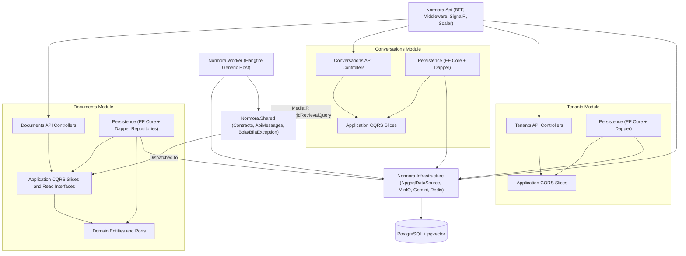
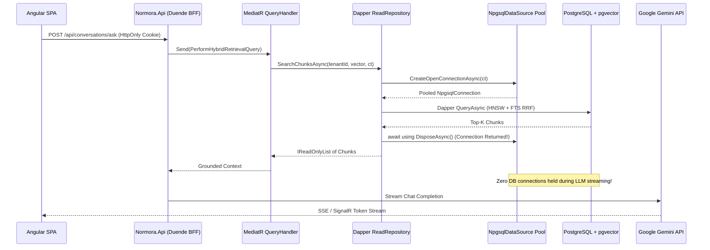
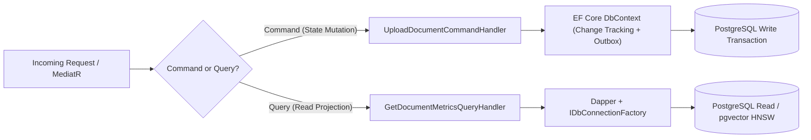

# Chapter 6: ASP.NET Core Integration and Clean Architecture

## 1. Learning Objectives

By the end of this chapter, you will be able to:
*   Integrate Dapper securely and efficiently into the ASP.NET Core (.NET 10) Dependency Injection (DI) container using C# 14 primary constructors.
*   Manage `DbConnection` and `NpgsqlDataSource` (or `SqlConnection`) lifecycles properly to avoid connection pool starvation and thread contention.
*   Architect an enterprise Modular Monolith using Clean Architecture and CQRS folder-per-operation slices, ensuring that Dapper and driver packages (`Npgsql`, `Microsoft.Data.SqlClient`) strictly reside within Persistence/Infrastructure boundaries.
*   Implement the `IDbConnectionFactory` pattern (including `ValueTask<DbConnection>` async opening) to abstract away ADO.NET from the Application and Domain layers.
*   Combine EF Core (for transactional Commands and Outbox writes) with Dapper (for high-throughput Queries) in a Polyglot Persistence architecture.
*   Configure Dapper globally within the ASP.NET Core `Program.cs` pipeline and module composition roots (`Add{Module}Module`) for custom type handlers and mappings.
*   Translate database driver exceptions into domain/application exceptions and enforce BOLA (`404`) / BFLA (`403`) security boundaries with centralized `ApiMessages` constants.

## 2. Introduction

Dapper is exceptionally fast, but it is architecturally unopinionated. Unlike Entity Framework Core, which provides a strongly opinionated `DbContext` that integrates natively into ASP.NET Core's DI container via `AddDbContext<T>`, Dapper provides absolutely nothing out of the box for architectural scaffolding.

If you simply drop `using Dapper;` into your ASP.NET Core Controllers or Minimal APIs and start instantiating `SqlConnection` or `NpgsqlConnection` objects, you will rapidly create a monolithic, tightly coupled, and untestable application. Raw SQL strings will leak into your business logic, database connection strings will be hardcoded across endpoints, and cross-module boundaries will collapse.

To build production-scale SaaS applications, we must impose strict boundaries. This chapter explores how to combine Dapper with Clean Architecture, Modular Monolith boundaries, and CQRS on **.NET 10 / C# 14**. Throughout this chapter, alongside our classic EV Charging Platform case study (SQL Server), we will ground every pattern in **Normora**—a real-world .NET 10 multi-tenant knowledge management and conversational AI platform built on PostgreSQL + `pgvector` (`Npgsql`), MediatR, FluentValidation, Duende BFF, and Hangfire.

## 3. Core Concepts

### Dependency Inversion Principle (DIP)
The foundation of Clean Architecture is the Dependency Inversion Principle. High-level modules (Business Logic) should not depend on low-level modules (Data Access/Dapper). Both should depend on abstractions (Interfaces). Your Application layer must never reference the `Dapper`, `Npgsql`, or `Microsoft.Data.SqlClient` NuGet packages.

In a **Modular Monolith** like Normora, DIP operates at two levels:
1. **Within each module** (`Tenants`, `Documents`, `Conversations`): The `Application` slice defines read-repository or query-service interfaces (ports), while the module's `Persistence` / `Infrastructure` layer implements them using Dapper and `Npgsql` (adapters).
2. **Across modules and external providers**: Modules never inject another module's `DbContext` or internal Dapper repositories. Cross-module calls traverse MediatR contracts in `Normora.Shared.Contracts.{ModuleName}`, and third-party vendor SDKs (MinIO, Google Gemini) sit behind domain ports implemented in `Normora.Infrastructure/Providers/`.

### Connection Management in DI & Modern `NpgsqlDataSource`
In ASP.NET Core, services can be registered as Transient, Scoped, or Singleton.
*   A `SqlConnection` or `NpgsqlConnection` must **never** be registered as a Singleton, as ADO.NET connections are not thread-safe.
*   Registering a connection as Scoped is common, but can lead to issues if multiple independent database calls within a single HTTP request accidentally share a connection state or a transaction, or if the connection stays checked out while the endpoint calls an external HTTP API.
*   **The Best Practice:** Inject a Factory (e.g., `IDbConnectionFactory`)—or on PostgreSQL, a Singleton `NpgsqlDataSource` wrapped by `IDbConnectionFactory`—and instantiate/open the `DbConnection` directly inside the Repository method using an `await using` block. This leverages ADO.NET / Npgsql connection pooling perfectly.

> [!NOTE]
> **`DbConnection` vs. `IDbConnection` in Async ASP.NET Core Code:**
> The legacy `IDbConnection` interface defines synchronous `Open()` and `Dispose()` methods only. If you pass an unopened `IDbConnection` to Dapper's `QueryAsync`, Dapper may open the connection synchronously on the calling Thread Pool thread unless `DbConnection` is used. Returning `DbConnection` (which inherits `IAsyncDisposable` and provides `OpenAsync(CancellationToken)`) from your factory enables true end-to-end async I/O with `await using var conn = await _connectionFactory.CreateOpenConnectionAsync(ct);`.

On modern .NET with PostgreSQL, **`NpgsqlDataSource`** (created via `NpgsqlDataSourceBuilder`) is the canonical root object:
*   **What it is:** A thread-safe, Singleton connection pool and type-mapping registry (where `UseVector()` for `pgvector` and `EnableDynamicJson()` are configured once at startup).
*   **Why use it:** Calling `dataSource.OpenConnectionAsync(ct)` pulls an already-authenticated physical socket from the pool asynchronously, prepares frequently executed statements transparently, and returns the connection on `DisposeAsync()`.
*   **When NOT to use a fresh `NpgsqlDataSource` connection:** When your Dapper read query must observe uncommitted writes inside an active EF Core `IDbContextTransaction` (read-your-own-writes in the same Unit of Work). In that narrow case, borrow `DbContext.Database.GetDbConnection()` and `GetDbTransaction()` instead of opening a second connection that cannot see uncommitted data.

### ASP.NET Core DI Lifetimes for Dapper Components

| Component | Recommended Lifetime | Why |
|---|---|---|
| `NpgsqlDataSource` / `IDbConnectionFactory` | **Singleton** | Thread-safe pool manager holding immutable connection configuration and pgvector/JSON type mappers. Creating it per request would destroy connection pooling. |
| Dapper Read Repositories (e.g., `HybridRetrievalReadRepository`) | **Scoped** (or Transient) | Stateless wrappers around `IDbConnectionFactory`. Scoped matches MediatR handlers and EF Core `DbContext` lifetimes, avoiding captive-dependency errors if they ever depend on scoped telemetry or `ITenantContext`. |
| `ITenantContext` / `ICurrentUser` | **Scoped** | Bound to a single HTTP request (populated by `TenantResolutionMiddleware` / Duende BFF claims). Must never be injected into a Singleton factory! |
| `SqlMapper.AddTypeHandler(...)` / `DefaultTypeMap` | **Startup Only** (static) | Mutates Dapper's process-wide static dictionaries. Must execute once during host startup before serving requests. |

### Modular Monolith Boundaries & CQRS Folder-per-Operation
In a classic single-project API, Clean Architecture splits the whole app into four horizontal projects (`API`, `Application`, `Domain`, `Infrastructure`). At SaaS scale, a single `Infrastructure` project often turns into a dumping ground.

Normora solves this with a **Modular Monolith** under `server/Modules/`:
*   **Active Modules (`Tenants`, `Documents`, `Conversations`):** Each module owns its own `API/` controllers, `Application/` CQRS folder-per-operation slices (`Commands/{Op}/`, `Queries/{Op}/`, `DTOs/`), `Domain/` entities/ports, and `Persistence/` (`DbContext` + Dapper repositories).
*   **Module Composition Roots:** Each module exposes `{ModuleName}ModuleExtensions.cs` (`services.AddTenantsModule(...)`, `AddDocumentsModule(...)`, `AddConversationsModule(...)`) so internal Dapper repositories remain `internal sealed` and invisible to other modules.
*   **Host & Worker Separation:** `Normora.Api` contains **zero business controllers**—it hosts Duende BFF, `TenantResolutionMiddleware`, SignalR hubs, Scalar/OpenAPI, and root DI wiring. `Normora.Worker` is a separate generic host running Hangfire background jobs; it references `Normora.Infrastructure` and `Normora.Shared.Contracts.*`, never `Normora.Api`.

### Polyglot Persistence: EF Core (Commands) + Dapper (Queries)
In CQRS (**Command Query Responsibility Segregation**), state-mutating operations (**Commands**) and data-reading operations (**Queries**) have fundamentally different requirements:
*   **Write Path (EF Core):** Commands need Change Tracking, domain invariant validation, aggregate encapsulation, optimistic concurrency, and atomic **Transactional Outbox** writes (e.g., `UploadDocumentCommandHandler` inserting `Document`, `DocumentVersion`, and `DocumentProcessingOutboxMessage` in one transaction).
*   **Read Path (Dapper):** Queries need zero tracking overhead, flat UI-optimized DTOs, complex PostgreSQL joins, window functions, keyset pagination, `pgvector` HNSW cosine distance (`<=>`), and `GroupBy` aggregations without EF Core LINQ translation errors.
*   **When NOT to use Polyglot Persistence:** If your application is a small CRUD back-office tool with 10 tables and low traffic, maintaining both EF Core entity mappings and raw Dapper SQL queries adds unnecessary surface area. Stick to EF Core (`AsNoTracking()`) until profiling proves ORM hydration or LINQ translation is a bottleneck.

### When to Use (and When NOT to Use) Clean Architecture + Dapper

| Scenario | Use Clean Architecture + Dapper? | Architectural Rationale |
|---|---|---|
| Multi-tenant SaaS / Modular Monolith (like Normora) | **Yes** | Enforces strict module boundaries, isolates SQL from business rules, and lets you tune critical queries (`pgvector` + FTS RRF) without leaking `Npgsql`. |
| High-throughput Read APIs with non-DB downstream I/O | **Yes** | `IDbConnectionFactory` + `await using` releases pooled connections immediately before calling external APIs (Gemini, MinIO, Stripe/PayU). |
| Throwaway prototype or simple 5-table CRUD app | **No** | Vertical layers, MediatR, and repository interfaces introduce boilerplate without architectural payoff; Minimal APIs + EF Core are faster to ship. |
| Generic `IRepository<T>` with `Expression<Func<T, bool>>` | **No** | Dapper has no LINQ-to-SQL engine. Forcing generic expression repositories over Dapper re-invents a broken ORM; define explicit operation-specific read methods instead. |

### Real-World Normora Concept Examples

1. **Dependency Inversion in `Documents` Hybrid RAG (`PerformHybridRetrievalQuery`)**:
   `Conversations` (`ConversationTurnPreparer` and `SearchCompanyDocumentsTool`) never injects `DocumentsDbContext` or `HybridRetrievalReadRepository`. Instead, it sends `PerformHybridRetrievalQuery(Guid TenantId, ...)` via MediatR (`Normora.Shared.Contracts.Documents`). Inside `Documents`, the `PerformHybridRetrievalQueryHandler` depends only on `IHybridRetrievalReadRepository` (an interface with zero `Dapper` or `Npgsql` dependencies), while `Persistence/Repositories/HybridRetrievalReadRepository.cs` executes the raw PostgreSQL `pgvector` + full-text RRF SQL via Dapper.
2. **Scoped `ITenantContext` vs. Singleton `NpgsqlDataSource` in `Tenants`**:
   In `Tenants`, `TenantResolutionMiddleware` populates a **Scoped** `ITenantContext` per HTTP request. The Singleton `NpgsqlConnectionFactory` (wrapping `NpgsqlDataSource`) does *not* inject `ITenantContext` (which would cause a captive-dependency exception in DI). Instead, `GetWorkspaceDashboardQueryHandler` reads `tenantContext.TenantId` and passes `Guid TenantId` explicitly as a parameter into `ITenantDashboardReadRepository.GetSummaryAsync(tenantId, ct)`.
3. **Avoiding EF Core `GroupBy` Translation Traps in `Tenants` Analytics**:
   EF Core requires careful anonymous-type pre-projection for `GroupBy().Select(...)` queries to avoid runtime `InvalidOperationException` translation failures. For multi-table workspace aggregations (documents per department, active members by role, monthly token usage), Normora's read repository uses Dapper to run a single PostgreSQL `GROUP BY` / `FILTER (WHERE ...)` query mapped directly to `WorkspaceDashboardDto` records via C# constructor mapping.
4. **Immediate Connection Release Before External I/O (`Conversations` + `Documents`)**:
   When a user asks a question in `Conversations`, `SendMessageCommandHandler` queries conversation history and retrieves matching document chunks via Dapper, closes the PostgreSQL connection immediately when the `await using` block exits, and *only then* streams tokens from **Google Gemini** (`ITextGenerationService`) over SignalR/SSE. Holding a `Scoped` `DbConnection` open across a 4-second LLM stream would exhaust PostgreSQL's connection pool under concurrent chat load.
5. **Independent Background Worker Connection Lifecycle (`Normora.Worker`)**:
   `Normora.Worker` runs Hangfire ingestion jobs completely outside `Normora.Api` and has no `HttpContext`. Its `HangfireDocumentProcessingOutboxDispatcher` uses the same `IDbConnectionFactory` (`NpgsqlDataSource`) from `Normora.Infrastructure` to claim `DocumentProcessingOutboxMessage` rows via `FOR UPDATE SKIP LOCKED`, disposes the connection, downloads the PDF from **MinIO** (`IDocumentStorageService`), extracts text, calls Gemini `batchEmbedContents` (`ITextEmbeddingService`), and opens a brief fresh connection to store chunks and embeddings.

## 4. Visual Diagrams

### Clean Architecture Dependency Flow (Classic 4-Layer View)

```text
=============================================================================
             CLEAN ARCHITECTURE + DAPPER IN ASP.NET CORE
=============================================================================

                   [ 1. Presentation Layer (Web API) ]
                   - Controllers / Minimal APIs
                   - Program.cs (DI Container Setup)
                           │
                           ▼ (Depends On)
                           
               [ 2. Application Layer (Use Cases) ]
               - MediatR Handlers
               - DTOs & Validation
               - Interfaces (IChargerRepository)
               - *NO DAPPER REFERENCES HERE*
                           │
                           ▼ (Depends On)
                           
                 [ 3. Domain Layer (Core) ]
                 - Entities & Value Objects
                 - Business Rules & Invariants
                 - *NO DATA ACCESS OR INFRA REFERENCES HERE*

─────────────────────────────────────────────────────────────────────────────
                             ▲ (Implements)
                             │
            [ 4. Infrastructure Layer (Data Access) ]
            - References Dapper & Microsoft.Data.SqlClient
            - ChargerRepository : IChargerRepository
            - Dapper TypeHandlers
            - Raw T-SQL Strings
```

### Normora Modular Monolith & Clean Architecture Boundaries



### HTTP Request & Connection Pool Lifecycle (Releasing DB Connections Before External I/O)



### Polyglot Persistence CQRS Split in Normora



## 5. API Deep Dive

### Global Dapper Configuration in ASP.NET Core
In ASP.NET Core, global configurations should happen as early as possible in the application lifecycle, typically in `Program.cs` (before `builder.Build()` or before serving traffic). Dapper relies on static configuration for Type Handlers and Custom Mappers.

```csharp
// Program.cs (Classic SQL Server Setup)
var builder = WebApplication.CreateBuilder(args);

// Configure Dapper Globally (BEFORE building the app)
DefaultTypeMap.MatchNamesWithUnderscores = true; // snake_case to PascalCase
SqlMapper.AddTypeHandler(new JsonTypeHandler<TelemetryConfig>());
// Note: SQL Server (Microsoft.Data.SqlClient) and PostgreSQL (Npgsql) support Guid natively;
// only register a custom GuidTypeHandler when storing UUIDs as TEXT/CHAR(36) (e.g., SQLite).

// Register the Connection Factory
builder.Services.AddSingleton<ISqlConnectionFactory, SqlConnectionFactory>(
    _ => new SqlConnectionFactory(builder.Configuration.GetConnectionString("Default")!));

// Register Repositories
builder.Services.AddScoped<IChargerRepository, ChargerRepository>();
```

> [!TIP]
> **Ephemeral Migration Hosts (`--migrate`) and Static State:**
> If your executable supports a dedicated migration command (like Normora's `dotnet Normora.Api.dll --migrate` via `MigrationHostExtensions.RunMigrationsAsync`), keep the migration host lean: skip Kestrel, SignalR hubs, and OpenTelemetry diagnostic listeners, and only configure Dapper type handlers if migrations themselves execute Dapper queries.

### The `ISqlConnectionFactory` Pattern (Classic) and Modern Async `IDbConnectionFactory`
Instead of injecting an open `IDbConnection`, we inject a factory. This completely hides ADO.NET instantiation from the rest of the application while guaranteeing that connections are fresh from the pool.

```csharp
public interface ISqlConnectionFactory
{
    IDbConnection CreateConnection();
}

public class SqlConnectionFactory : ISqlConnectionFactory
{
    private readonly string _connectionString;
    public SqlConnectionFactory(string connectionString) => _connectionString = connectionString;
    
    public IDbConnection CreateConnection()
    {
        return new SqlConnection(_connectionString);
    }
}
```

In **.NET 10 / C# 14 with PostgreSQL (`Npgsql`)**, we upgrade this pattern in three important ways:
1. Return `DbConnection` (not `IDbConnection`) via `ValueTask<DbConnection> CreateOpenConnectionAsync(CancellationToken ct)` so connection opening and `await using` disposal are 100% asynchronous.
2. Back the factory with a Singleton **`NpgsqlDataSource`** configured with `.UseVector()` (for `pgvector`) and `.EnableDynamicJson()` rather than calling `new NpgsqlConnection(connectionString)` manually.
3. Use **C# 14 primary constructors** to eliminate boilerplate fields and constructor assignments.

### C# 14 Primary Constructors in ASP.NET Core & Dapper
Normora mandates C# 14 primary constructors for DI across handlers, repositories, and controllers:

```csharp
// Clean, concise, zero boilerplate
public sealed class DocumentMetricsController(IMediator mediator) : ControllerBase
{
    [HttpGet("metrics")]
    public async Task<IActionResult> GetMetrics(CancellationToken ct)
        => Ok(await mediator.Send(new GetDocumentMetricsQuery(), ct));
}
```

> [!WARNING]
> **Primary Constructor Capture Nuance:**
> Primary constructor parameters are mutable inside the class unless you explicitly assign them to `private readonly` fields or avoid reassigning them. Never mutate an injected `IDbConnectionFactory` or `ITenantContext` parameter, and if you capture a parameter in a closure/lambda inside a long-lived service, ensure its lifetime matches the enclosing class (never capture a Scoped service inside a Singleton).

### Exception Translation, FluentValidation, and BOLA / BFLA Enforcement
In Clean Architecture, database driver exceptions (`PostgresException`, `SqlException`) must **never** escape the Persistence/Infrastructure boundary into Application handlers or Controllers:
*   **Infrastructure:** Catch `PostgresException` (e.g., `SqlState == PostgresErrorCodes.UniqueViolation` / `"23505"`), log technical details to structured telemetry, and throw an application-safe exception using `Normora.Shared.Constants.ApiMessages`.
*   **Application (MediatR + FluentValidation):** Validate input shapes via a `ValidationBehavior<TRequest, TResponse>` *before* opening a database connection. Enforce object ownership (**BOLA** -> `BolaException`, mapped globally to `404 Not Found` to prevent resource ID enumeration) and role/permission gates (**BFLA** -> `BflaException`, mapped globally to `403 Forbidden` with `ApiMessages.Forbidden`).
*   **Never leak raw exceptions (CWE-209):** Both HTTP handlers and background workers (`Normora.Worker`) must surface generic `ApiMessages` constants to clients and logs—never `ex.Message` from PostgreSQL.

### Sharing an Active EF Core Transaction with Dapper
Sometimes a CQRS **Command** (using EF Core for writes) needs to perform a high-speed Dapper read or bulk check *inside* the same database transaction so it sees uncommitted changes:
*   **How:** Borrow `DbContext.Database.GetDbConnection()` and `DbContext.Database.CurrentTransaction?.GetDbTransaction()`, and pass `transaction: dbTransaction` into `CommandDefinition`. **Do not** wrap the borrowed `DbConnection` in `using` or `await using`—EF Core's `DbContext` owns its disposal!
*   **When NOT to do it:** For pure **Queries** (`IRequest<TResult>`), never go through `DbContext`. Open an independent connection from `IDbConnectionFactory` (`NpgsqlDataSource`) so you avoid `DbContext` overhead and keep read queries cleanly decoupled.

### Real-World Normora API Deep-Dive Examples (5 Implementations)

#### Example 1: `NpgsqlConnectionFactory` with `NpgsqlDataSource` (`Normora.Infrastructure`)
```csharp
// Normora.Shared/Interfaces/IDbConnectionFactory.cs (Provider-neutral: zero Npgsql/Dapper references)
namespace Normora.Shared.Interfaces;

using System.Data.Common;

public interface IDbConnectionFactory
{
    ValueTask<DbConnection> CreateOpenConnectionAsync(CancellationToken ct = default);
}

// Normora.Infrastructure/Persistence/NpgsqlConnectionFactory.cs
namespace Normora.Infrastructure.Persistence;

using System.Data.Common;
using Normora.Shared.Interfaces;
using Npgsql;

public sealed class NpgsqlConnectionFactory(NpgsqlDataSource dataSource) : IDbConnectionFactory
{
    public async ValueTask<DbConnection> CreateOpenConnectionAsync(CancellationToken ct = default)
        => await dataSource.OpenConnectionAsync(ct);
}
```

#### Example 2: `DatabaseServiceExtensions` + Module Composition Root (`Normora.Infrastructure` & `Modules/Documents`)
```csharp
// Normora.Infrastructure/Extensions/DatabaseServiceExtensions.cs
public static IServiceCollection AddNormoraDatabase(
    this IServiceCollection services,
    IConfiguration configuration)
{
    DefaultTypeMap.MatchNamesWithUnderscores = true;

    var connectionString = configuration.GetConnectionString("DefaultConnection")
        ?? throw new InvalidOperationException(ApiMessages.DatabaseConnectionMissing);

    var dataSourceBuilder = new NpgsqlDataSourceBuilder(connectionString);
    dataSourceBuilder.UseVector(); // pgvector support for Documents HNSW queries
    var dataSource = dataSourceBuilder.Build();

    services.AddSingleton(dataSource);
    services.AddSingleton<IDbConnectionFactory, NpgsqlConnectionFactory>();
    return services;
}

// server/Modules/Documents/DocumentsModuleExtensions.cs
public static IServiceCollection AddDocumentsModule(
    this IServiceCollection services,
    IConfiguration configuration)
{
    services.AddDbContext<DocumentsDbContext>(/* PostgreSQL write path */);
    services.AddScoped<IHybridRetrievalReadRepository, HybridRetrievalReadRepository>();
    services.AddScoped<IDocumentMetricsReadRepository, DocumentMetricsReadRepository>();
    return services;
}
```

#### Example 3: FluentValidation + BFLA Check Before Dapper Query (`Modules/Tenants`)
```csharp
// server/Modules/Tenants/Application/AuditLogs/Queries/GetAuditLogs/GetAuditLogsQueryValidator.cs
using FluentValidation;

public sealed class GetAuditLogsQueryValidator : AbstractValidator<GetAuditLogsQuery>
{
    public GetAuditLogsQueryValidator()
    {
        RuleFor(x => x.TenantId).NotEmpty();
        RuleFor(x => x.PageSize).InclusiveBetween(1, 100);
    }
}

// server/Modules/Tenants/Application/AuditLogs/Queries/GetAuditLogs/GetAuditLogsQueryHandler.cs
public sealed class GetAuditLogsQueryHandler(
    IAuditLogReadRepository auditLogReadRepository,
    ICurrentUser currentUser) : IRequestHandler<GetAuditLogsQuery, PagedAuditLogsDto>
{
    public async Task<PagedAuditLogsDto> Handle(GetAuditLogsQuery request, CancellationToken ct)
    {
        if (!currentUser.IsWorkspaceAdmin(request.TenantId))
            throw new BflaException(ApiMessages.Forbidden); // Global middleware -> 403 Forbidden

        return await auditLogReadRepository.GetPagedAsync(
            request.TenantId, request.CursorCreatedAt, request.PageSize, ct);
    }
}
```

#### Example 4: `PostgresException` Translation in a Dapper Repository (`Modules/Documents`)
```csharp
// server/Modules/Documents/Persistence/Repositories/DocumentTagReadWriteRepository.cs
public sealed class DocumentTagRepository(IDbConnectionFactory connectionFactory) : IDocumentTagRepository
{
    public async Task AddTagAsync(Guid tenantId, Guid documentId, string tagName, CancellationToken ct)
    {
        const string sql = """
            INSERT INTO documents.document_tags (id, tenant_id, document_id, name)
            VALUES (@Id, @TenantId, @DocumentId, @Name);
            """;

        await using var connection = await connectionFactory.CreateOpenConnectionAsync(ct);

        try
        {
            var command = new CommandDefinition(
                sql,
                new { Id = Guid.NewGuid(), TenantId = tenantId, DocumentId = documentId, Name = tagName },
                cancellationToken: ct);

            await connection.ExecuteAsync(command);
        }
        catch (PostgresException ex) when (ex.SqlState == PostgresErrorCodes.UniqueViolation)
        {
            // Never leak PostgresException or raw SQL constraint names up to Application/API
            throw new ConflictException(ApiMessages.DocumentTagAlreadyExists);
        }
    }
}
```

#### Example 5: Hangfire Worker Outbox Claiming Without `Normora.Api` (`Normora.Worker` + `Documents`)
```csharp
// server/Modules/Documents/Persistence/Repositories/OutboxClaimRepository.cs
public sealed class OutboxClaimRepository(IDbConnectionFactory connectionFactory) : IOutboxClaimRepository
{
    public async Task<IReadOnlyList<PendingOutboxItem>> ClaimBatchAsync(int batchSize, CancellationToken ct)
    {
        const string sql = """
            WITH next_batch AS (
                SELECT id
                FROM documents.document_processing_outbox_messages
                WHERE processed_at IS NULL
                  AND (locked_until IS NULL OR locked_until < NOW())
                ORDER BY created_at
                FOR UPDATE SKIP LOCKED
                LIMIT @BatchSize
            )
            UPDATE documents.document_processing_outbox_messages m
            SET locked_until = NOW() + INTERVAL '5 minutes'
            FROM next_batch
            WHERE m.id = next_batch.id
            RETURNING m.id, m.tenant_id, m.document_id, m.document_version_id;
            """;

        await using var connection = await connectionFactory.CreateOpenConnectionAsync(ct);
        var command = new CommandDefinition(sql, new { BatchSize = batchSize }, cancellationToken: ct);
        var rows = await connection.QueryAsync<PendingOutboxItem>(command);
        return rows.AsList();
    }
}
```

## 6. Complete Examples: EV Charging Platform & Normora

### Case Study A: EV Charging Platform (SQL Server Vertical Slice)

Let's implement a complete Vertical Slice of Clean Architecture for retrieving a Site and its Chargers.

> [!NOTE]
> **Architectural Refinement for Strict CQRS:**
> In the classic 4-project layout below, `SiteDto` and `ISiteRepository` are placed in `EVPlatform.Domain` for brevity. In larger CQRS systems (like Normora), **Read DTOs** (`SiteDto`) and **Read Repository interfaces** (`ISiteReadRepository`) live in the **Application** layer (`Application/{Feature}/DTOs/`), keeping the **Domain** layer strictly reserved for Write-side Aggregate Entities, Value Objects, and Domain Services. Also prefer `await using var connection = await _connectionFactory.CreateOpenConnectionAsync(ct);` over synchronous `IDbConnection` opening in production ASP.NET Core apps.

#### Step 1: The Domain Layer (Core)
The Domain layer defines the shape of the data and the interface required to fetch it. It does not know about SQL or Dapper.

```csharp
// Project: EVPlatform.Domain

public class SiteDto
{
    public Guid Id { get; set; }
    public string Name { get; set; } = string.Empty;
    public List<ChargerDto> Chargers { get; set; } = new();
}

public class ChargerDto
{
    public Guid Id { get; set; }
    public string Status { get; set; } = string.Empty;
}

public interface ISiteRepository
{
    Task<SiteDto?> GetSiteWithChargersAsync(Guid siteId, CancellationToken ct);
}
```

#### Step 2: The Application Layer (Use Cases)
The Application layer orchestrates the business logic via CQRS (using MediatR). It relies entirely on the interface.

```csharp
// Project: EVPlatform.Application

using MediatR;
using EVPlatform.Domain;

public record GetSiteQuery(Guid SiteId) : IRequest<SiteDto>;

public class GetSiteQueryHandler : IRequestHandler<GetSiteQuery, SiteDto>
{
    private readonly ISiteRepository _siteRepository;

    public GetSiteQueryHandler(ISiteRepository siteRepository)
    {
        _siteRepository = siteRepository;
    }

    public async Task<SiteDto> Handle(GetSiteQuery request, CancellationToken ct)
    {
        var site = await _siteRepository.GetSiteWithChargersAsync(request.SiteId, ct);
        
        if (site == null)
            throw new NotFoundException($"Site {request.SiteId} not found.");
            
        return site;
    }
}
```

#### Step 3: The Infrastructure Layer (Dapper Implementation)
This is the ONLY project in the solution that references Dapper. It implements the interface defined in the Domain.

```csharp
// Project: EVPlatform.Infrastructure

using Dapper;
using Microsoft.Data.SqlClient;
using EVPlatform.Domain;

public class SiteRepository : ISiteRepository
{
    private readonly ISqlConnectionFactory _connectionFactory;

    public SiteRepository(ISqlConnectionFactory connectionFactory)
    {
        _connectionFactory = connectionFactory;
    }

    public async Task<SiteDto?> GetSiteWithChargersAsync(Guid siteId, CancellationToken ct)
    {
        // 1. Get connection from Factory
        using var connection = _connectionFactory.CreateConnection();
        
        // 2. Define raw T-SQL
        const string sql = @"
            SELECT s.Id, s.Name, c.Id, c.Status
            FROM Sites s
            LEFT JOIN Chargers c ON s.Id = c.SiteId
            WHERE s.Id = @SiteId";

        // 3. Create CommandDefinition for cancellation support
        var command = new CommandDefinition(sql, new { SiteId = siteId }, cancellationToken: ct);

        // 4. Execute Multi-Mapping via Dapper
        SiteDto? targetSite = null;

        await connection.QueryAsync<SiteDto, ChargerDto, SiteDto>(
            command,
            (site, charger) =>
            {
                if (targetSite == null) targetSite = site;
                if (charger != null && charger.Id != Guid.Empty)
                {
                    targetSite.Chargers.Add(charger);
                }
                return targetSite;
            },
            splitOn: "Id"
        );

        return targetSite;
    }
}
```

---

### Case Study B: Normora (.NET 10 / C# 14 / PostgreSQL + pgvector) — 5 Real-World Vertical Slices

In Normora, every feature obeys CQRS folder-per-operation (`Application/{Feature}/Queries/{OperationName}/`), uses C# 14 primary constructors, places controllers inside the owning module's `API/` folder (`Normora.Api` has zero business controllers), enforces BOLA (`404`) and BFLA (`403`) via `ApiMessages`, and uses `NpgsqlDataSource` + Dapper for high-performance reads.

#### Normora Example 1: Cross-Module Hybrid Semantic + Full-Text Retrieval (`Documents` & `Conversations`)
`Conversations` queries knowledge chunks inside `Documents` through a provider-neutral MediatR contract in `Normora.Shared.Contracts.Documents` that always takes an explicit `Guid TenantId` (for defense-in-depth across HTTP and background worker contexts).

```csharp
// 1. Shared Cross-Module Contract: server/Normora.Shared/Contracts/Documents/PerformHybridRetrievalQuery.cs
namespace Normora.Shared.Contracts.Documents;

using MediatR;

public sealed record PerformHybridRetrievalQuery(
    Guid TenantId,
    string ExternalUserId,
    string QueryText,
    float[] QueryEmbedding,
    int TopK = 8) : IRequest<IReadOnlyList<RetrievedChunkDto>>;

public sealed record RetrievedChunkDto(
    Guid ChunkId,
    Guid DocumentId,
    string DocumentTitle,
    string SectionBreadcrumb,
    string Content,
    double RrfScore);
```

```csharp
// 2. Application Read Port: server/Modules/Documents/Application/Search/Queries/PerformHybridRetrieval/IHybridRetrievalReadRepository.cs
namespace Normora.Modules.Documents.Application.Search.Queries.PerformHybridRetrieval;

using Normora.Shared.Contracts.Documents;

public interface IHybridRetrievalReadRepository
{
    Task<IReadOnlyList<RetrievedChunkDto>> SearchAsync(
        Guid tenantId,
        string externalUserId,
        string queryText,
        float[] queryEmbedding,
        int topK,
        CancellationToken ct);
}

// 3. CQRS Query Handler (Separate file, C# 14 primary constructor, zero Dapper/Npgsql refs):
//    server/Modules/Documents/Application/Search/Queries/PerformHybridRetrieval/PerformHybridRetrievalQueryHandler.cs
public sealed class PerformHybridRetrievalQueryHandler(
    IHybridRetrievalReadRepository readRepository)
    : IRequestHandler<PerformHybridRetrievalQuery, IReadOnlyList<RetrievedChunkDto>>
{
    public async Task<IReadOnlyList<RetrievedChunkDto>> Handle(
        PerformHybridRetrievalQuery request,
        CancellationToken ct)
    {
        if (request.TenantId == Guid.Empty)
            throw new InvalidOperationException(ApiMessages.TenantContextMissing);

        return await readRepository.SearchAsync(
            request.TenantId,
            request.ExternalUserId,
            request.QueryText,
            request.QueryEmbedding,
            request.TopK,
            ct);
    }
}
```

```csharp
// 4. Persistence Dapper + pgvector Implementation:
//    server/Modules/Documents/Persistence/Repositories/HybridRetrievalReadRepository.cs
using Dapper;
using Normora.Modules.Documents.Application.Search.Queries.PerformHybridRetrieval;
using Normora.Shared.Contracts.Documents;
using Normora.Shared.Interfaces;
using Pgvector;

internal sealed class HybridRetrievalReadRepository(
    IDbConnectionFactory connectionFactory) : IHybridRetrievalReadRepository
{
    public async Task<IReadOnlyList<RetrievedChunkDto>> SearchAsync(
        Guid tenantId,
        string externalUserId,
        string queryText,
        float[] queryEmbedding,
        int topK,
        CancellationToken ct)
    {
        const string sql = """
            WITH accessible_docs AS (
                SELECT d.id, d.title
                FROM documents.documents d
                WHERE d.tenant_id = @TenantId
                  AND d.is_deleted = FALSE
                  AND (
                      d.visibility = 'Workspace'
                      OR EXISTS (
                          SELECT 1
                          FROM tenants.user_group_members ugm
                          JOIN documents.document_group_access dga ON dga.user_group_id = ugm.user_group_id
                          WHERE dga.document_id = d.id
                            AND ugm.tenant_id = @TenantId
                            AND ugm.external_user_id = @ExternalUserId
                      )
                  )
            ),
            vector_ranks AS (
                SELECT c.id,
                       ROW_NUMBER() OVER (ORDER BY c.embedding <=> @Embedding) AS rank_pos
                FROM documents.document_chunks c
                JOIN accessible_docs ad ON ad.id = c.document_id
                ORDER BY c.embedding <=> @Embedding
                LIMIT 40
            ),
            fts_ranks AS (
                SELECT c.id,
                       ROW_NUMBER() OVER (ORDER BY ts_rank_cd(c.search_vector, websearch_to_tsquery('english', @QueryText)) DESC) AS rank_pos
                FROM documents.document_chunks c
                JOIN accessible_docs ad ON ad.id = c.document_id
                WHERE c.search_vector @@ websearch_to_tsquery('english', @QueryText)
                LIMIT 40
            )
            SELECT c.id AS chunk_id,
                   c.document_id,
                   ad.title AS document_title,
                   c.section_breadcrumb,
                   c.content,
                   (COALESCE(1.0 / (60 + vr.rank_pos), 0.0) + COALESCE(1.0 / (60 + fr.rank_pos), 0.0))::double precision AS rrf_score
            FROM documents.document_chunks c
            JOIN accessible_docs ad ON ad.id = c.document_id
            LEFT JOIN vector_ranks vr ON vr.id = c.id
            LEFT JOIN fts_ranks fr ON fr.id = c.id
            WHERE vr.id IS NOT NULL OR fr.id IS NOT NULL
            ORDER BY rrf_score DESC
            LIMIT @TopK;
            """;

        await using var connection = await connectionFactory.CreateOpenConnectionAsync(ct);

        var command = new CommandDefinition(
            sql,
            new
            {
                TenantId = tenantId,
                ExternalUserId = externalUserId,
                QueryText = queryText,
                Embedding = new Vector(queryEmbedding),
                TopK = topK
            },
            cancellationToken: ct);

        var results = await connection.QueryAsync<RetrievedChunkDto>(command);
        return results.AsList();
    }
}
```

#### Normora Example 2: Multi-Result Dashboard Aggregation Avoiding EF Core `GroupBy` Traps (`Tenants`)
`TenantsDbContext` has no ambient `TenantId` global query filter (because it serves directory/resolution bootstrapping). Every Dapper query against `tenants.*` tables must explicitly filter `tenant_id = @TenantId`. Here, `QueryMultipleAsync` fetches KPI totals and per-department counts in one database round-trip.

```csharp
// server/Modules/Tenants/Application/Dashboard/DTOs/DashboardDtos.cs
public sealed record WorkspaceDashboardDto(
    int TotalMembers,
    int ActiveDepartments,
    int ActiveUserGroups,
    IReadOnlyList<DepartmentCountDto> MembersByDepartment);

public sealed record DepartmentCountDto(Guid DepartmentId, string DepartmentName, int MemberCount);

// server/Modules/Tenants/Application/Dashboard/Queries/GetWorkspaceDashboard/GetWorkspaceDashboardQuery.cs
public sealed record GetWorkspaceDashboardQuery(Guid TenantId) : IRequest<WorkspaceDashboardDto>;

// server/Modules/Tenants/Application/Dashboard/Queries/GetWorkspaceDashboard/GetWorkspaceDashboardQueryHandler.cs
public sealed class GetWorkspaceDashboardQueryHandler(
    ITenantDashboardReadRepository dashboardReadRepository,
    ITenantContext tenantContext,
    ICurrentUser currentUser)
    : IRequestHandler<GetWorkspaceDashboardQuery, WorkspaceDashboardDto>
{
    public async Task<WorkspaceDashboardDto> Handle(GetWorkspaceDashboardQuery request, CancellationToken ct)
    {
        if (request.TenantId != tenantContext.TenantId)
            throw new BolaException(ApiMessages.NotFound); // Prevents cross-tenant ID probing (404)

        if (!currentUser.HasWorkspaceAccess(request.TenantId))
            throw new BflaException(ApiMessages.Forbidden); // Lacks role/permission (403)

        return await dashboardReadRepository.GetSummaryAsync(request.TenantId, ct);
    }
}

// server/Modules/Tenants/Persistence/Repositories/TenantDashboardReadRepository.cs
internal sealed class TenantDashboardReadRepository(
    IDbConnectionFactory connectionFactory) : ITenantDashboardReadRepository
{
    public async Task<WorkspaceDashboardDto> GetSummaryAsync(Guid tenantId, CancellationToken ct)
    {
        const string sql = """
            SELECT
                (SELECT COUNT(*) FROM tenants.tenant_memberships WHERE tenant_id = @TenantId AND is_active = TRUE) AS total_members,
                (SELECT COUNT(*) FROM tenants.departments WHERE tenant_id = @TenantId) AS active_departments,
                (SELECT COUNT(*) FROM tenants.user_groups WHERE tenant_id = @TenantId) AS active_user_groups;

            SELECT d.id AS department_id,
                   d.name AS department_name,
                   COUNT(tm.id)::int AS member_count
            FROM tenants.departments d
            LEFT JOIN tenants.tenant_memberships tm
                ON tm.department_id = d.id AND tm.tenant_id = @TenantId AND tm.is_active = TRUE
            WHERE d.tenant_id = @TenantId
            GROUP BY d.id, d.name
            ORDER BY member_count DESC, d.name ASC;
            """;

        await using var connection = await connectionFactory.CreateOpenConnectionAsync(ct);
        var command = new CommandDefinition(sql, new { TenantId = tenantId }, cancellationToken: ct);

        await using var grid = await connection.QueryMultipleAsync(command);
        var counts = await grid.ReadSingleAsync<(int TotalMembers, int ActiveDepartments, int ActiveUserGroups)>();
        var departments = (await grid.ReadAsync<DepartmentCountDto>()).AsList();

        return new WorkspaceDashboardDto(
            counts.TotalMembers,
            counts.ActiveDepartments,
            counts.ActiveUserGroups,
            departments);
    }
}

// server/Modules/Tenants/API/DashboardController.cs (Resides inside Modules/Tenants/API, NEVER Normora.Api)
[ApiController]
[Route("api/workspace/dashboard")]
public sealed class DashboardController(IMediator mediator, ITenantContext tenantContext) : ControllerBase
{
    [HttpGet]
    public async Task<ActionResult<WorkspaceDashboardDto>> GetSummary(CancellationToken ct)
        => Ok(await mediator.Send(new GetWorkspaceDashboardQuery(tenantContext.TenantId), ct));
}
```

#### Normora Example 3: BOLA-Safe Conversation Retrieval by `ExternalUserId` (`Conversations`)
When a user requests a single conversation thread with its messages, the Dapper query filters by **both** `tenant_id` and `external_user_id`. Returning `null` triggers `BolaException(ApiMessages.NotFound)` (404), ensuring an attacker cannot distinguish between a non-existent conversation ID and one owned by another colleague or tenant.

```csharp
// server/Modules/Conversations/Application/Threads/Queries/GetConversationDetail/GetConversationDetailQueryHandler.cs
public sealed class GetConversationDetailQueryHandler(
    IConversationReadRepository readRepository,
    ITenantContext tenantContext,
    ICurrentUser currentUser)
    : IRequestHandler<GetConversationDetailQuery, ConversationDetailDto>
{
    public async Task<ConversationDetailDto> Handle(GetConversationDetailQuery request, CancellationToken ct)
    {
        var detail = await readRepository.GetByIdAsync(
            tenantContext.TenantId,
            currentUser.ExternalUserId,
            request.ConversationId,
            ct);

        if (detail is null)
            throw new BolaException(ApiMessages.NotFound);

        return detail;
    }
}

// server/Modules/Conversations/Persistence/Repositories/ConversationReadRepository.cs
internal sealed class ConversationReadRepository(
    IDbConnectionFactory connectionFactory) : IConversationReadRepository
{
    public async Task<ConversationDetailDto?> GetByIdAsync(
        Guid tenantId,
        string externalUserId,
        Guid conversationId,
        CancellationToken ct)
    {
        const string sql = """
            SELECT c.id, c.title, c.persona, c.created_at,
                   m.id AS message_id, m.role, m.content, m.created_at AS sent_at
            FROM conversations.conversations c
            LEFT JOIN conversations.messages m ON m.conversation_id = c.id
            WHERE c.id = @ConversationId
              AND c.tenant_id = @TenantId
              AND c.external_user_id = @ExternalUserId
            ORDER BY m.created_at ASC;
            """;

        await using var connection = await connectionFactory.CreateOpenConnectionAsync(ct);
        var command = new CommandDefinition(
            sql,
            new { ConversationId = conversationId, TenantId = tenantId, ExternalUserId = externalUserId },
            cancellationToken: ct);

        ConversationDetailDto? header = null;
        var messages = new List<ConversationMessageDto>();

        await connection.QueryAsync<ConversationHeaderRow, ConversationMessageDto?, ConversationHeaderRow>(
            command,
            (conv, msg) =>
            {
                header ??= new ConversationDetailDto(conv.Id, conv.Title, conv.Persona, conv.CreatedAt, messages);
                if (msg is not null && msg.MessageId != Guid.Empty)
                    messages.Add(msg);
                return conv;
            },
            splitOn: "message_id");

        return header;
    }
}
```

#### Normora Example 4: Polyglot Document Status Polling & Transactional Outbox Boundary (`Documents` + `Normora.Worker`)
While `UploadDocumentCommandHandler` uses EF Core (`DocumentsDbContext`) to atomically persist `Document`, `DocumentVersion`, and `DocumentProcessingOutboxMessage` in one transaction, the UI polling endpoint (`GET /api/documents/{id}/status`) and Hangfire's `OutboxClaimRepository` use Dapper for zero-overhead status reads—and the worker closes its DB connection *before* calling MinIO or Gemini.

```csharp
// server/Modules/Documents/Application/Documents/Queries/GetDocumentStatus/GetDocumentStatusQueryHandler.cs
public sealed class GetDocumentStatusQueryHandler(
    IDocumentStatusReadRepository statusReadRepository,
    ITenantContext tenantContext)
    : IRequestHandler<GetDocumentStatusQuery, DocumentStatusDto>
{
    public async Task<DocumentStatusDto> Handle(GetDocumentStatusQuery request, CancellationToken ct)
    {
        var status = await statusReadRepository.GetStatusAsync(tenantContext.TenantId, request.DocumentId, ct);
        return status ?? throw new BolaException(ApiMessages.NotFound);
    }
}

// server/Modules/Documents/Persistence/Repositories/DocumentStatusReadRepository.cs
internal sealed class DocumentStatusReadRepository(
    IDbConnectionFactory connectionFactory) : IDocumentStatusReadRepository
{
    public async Task<DocumentStatusDto?> GetStatusAsync(Guid tenantId, Guid documentId, CancellationToken ct)
    {
        const string sql = """
            SELECT d.id AS document_id,
                   d.title,
                   dv.processing_status,
                   dv.chunk_count,
                   dv.updated_at
            FROM documents.documents d
            JOIN documents.document_versions dv ON dv.id = d.current_version_id
            WHERE d.id = @DocumentId
              AND d.tenant_id = @TenantId
              AND d.is_deleted = FALSE;
            """;

        await using var connection = await connectionFactory.CreateOpenConnectionAsync(ct);
        var command = new CommandDefinition(sql, new { DocumentId = documentId, TenantId = tenantId }, cancellationToken: ct);
        return await connection.QuerySingleOrDefaultAsync<DocumentStatusDto>(command);
    }
}
```

#### Normora Example 5: Keyset-Paginated Audit Logs & Decentralized Controller (`Tenants`)
Audit logs grow unboundedly in enterprise SaaS. Using `OFFSET` pagination degrades linearly on deep pages; Dapper makes PostgreSQL **keyset (cursor) pagination** effortless, wrapped cleanly inside `Modules/Tenants/API/AuditLogsController.cs` with `ApiResponse` envelopes.

```csharp
// server/Modules/Tenants/Persistence/Repositories/AuditLogReadRepository.cs
internal sealed class AuditLogReadRepository(
    IDbConnectionFactory connectionFactory) : IAuditLogReadRepository
{
    public async Task<PagedAuditLogsDto> GetPagedAsync(
        Guid tenantId,
        DateTimeOffset? cursorCreatedAt,
        int pageSize,
        CancellationToken ct)
    {
        const string sql = """
            SELECT id, action, actor_external_user_id, target_resource, created_at
            FROM tenants.audit_logs
            WHERE tenant_id = @TenantId
              AND (@CursorCreatedAt IS NULL OR created_at < @CursorCreatedAt)
            ORDER BY created_at DESC
            LIMIT @FetchLimit;
            """;

        await using var connection = await connectionFactory.CreateOpenConnectionAsync(ct);
        var command = new CommandDefinition(
            sql,
            new { TenantId = tenantId, CursorCreatedAt = cursorCreatedAt, FetchLimit = pageSize + 1 },
            cancellationToken: ct);

        var rows = (await connection.QueryAsync<AuditLogEntryDto>(command)).AsList();
        var hasMore = rows.Count > pageSize;
        if (hasMore) rows.RemoveAt(rows.Count - 1);

        var nextCursor = hasMore ? rows[^1].CreatedAt : (DateTimeOffset?)null;
        return new PagedAuditLogsDto(rows, nextCursor, hasMore);
    }
}

// server/Modules/Tenants/API/AuditLogsController.cs
[ApiController]
[Route("api/workspace/audit-logs")]
public sealed class AuditLogsController(IMediator mediator, ITenantContext tenantContext) : ControllerBase
{
    [HttpGet]
    public async Task<ActionResult<PagedAuditLogsDto>> List(
        [FromQuery] DateTimeOffset? cursor,
        [FromQuery] int pageSize = 25,
        CancellationToken ct = default)
        => Ok(await mediator.Send(new GetAuditLogsQuery(tenantContext.TenantId, cursor, pageSize), ct));
}
```

## 7. Performance Implications

### ASP.NET Core Thread Pool vs Database Connection Pool
In ASP.NET Core, incoming HTTP requests are served by Thread Pool threads. Database connections are managed by the ADO.NET / `Npgsql` Connection Pool (default max pool size is 100 in both `Microsoft.Data.SqlClient` and `Npgsql`).

If you register your `SqlConnection` or `NpgsqlConnection` as a `Scoped` service and implicitly open it via Dapper, the connection remains checked out of the pool until the HTTP request completes and the DI container disposes of the scoped services. If your API does network I/O *after* the Dapper call (for example, streaming a response from **Google Gemini**, uploading a file to **MinIO**, or calling **PayU**), you are needlessly holding a database connection open. Under moderate concurrency (e.g., 100 simultaneous RAG chats taking 3 seconds each), the pool hits 100/100 and incoming requests fail with `TimeoutException`.

By using `IDbConnectionFactory` (backed by a Singleton `NpgsqlDataSource`) and an explicit `await using var connection = await connectionFactory.CreateOpenConnectionAsync(ct)` inside the Repository method, the connection is asynchronously opened when needed and returned to the pool the microsecond the Dapper query finishes—vastly improving scalability.

### Async Connection Opening, Buffering, and Cache Stability
*   **Never block on connection acquisition:** Always call `await dataSource.OpenConnectionAsync(ct)` rather than passing an unopened `IDbConnection` to Dapper or calling `connection.Open()`. Under pool contention, synchronous `Open()` blocks a Thread Pool thread and accelerates Thread Pool starvation.
*   **Buffered (`AsList()`) vs. Unbuffered (`QueryUnbufferedAsync`):** Default `QueryAsync<T>` buffers rows into a `List<T>` before the `await using` block closes the connection. Only use `QueryUnbufferedAsync<T>` (`IAsyncEnumerable<T>`) for massive streaming exports (e.g., 100,000-row audit CSVs) where the streaming endpoint itself controls the connection lifetime cleanly.
*   **Static Query Cache Safety:** Dapper caches IL mapping delegates in a static `ConcurrentDictionary` keyed by the SQL text and parameter layout. Always parameterize dynamic values (`@TenantId`, `@TopK`) rather than concatenating strings—dynamic SQL generation leaks memory unboundedly in long-lived ASP.NET Core hosts and defeats `NpgsqlDataSource`'s automatic prepared-statement cache.

## 8. Common Mistakes & Anti-Patterns

### Beginner

> [!CAUTION]
> **Hardcoding Connection Strings Inside Repositories**
>
> **Wrong Code:**
> ```csharp
> public sealed class DocumentStatusReadRepository : IDocumentStatusReadRepository
> {
>     public async Task<DocumentStatusDto?> GetStatusAsync(Guid tenantId, Guid docId, CancellationToken ct)
>     {
>         await using var conn = new NpgsqlConnection("Host=localhost;Database=normora;Username=postgres;Password=secret");
>         await conn.OpenAsync(ct);
>         return await conn.QuerySingleOrDefaultAsync<DocumentStatusDto>("...", new { tenantId, docId });
>     }
> }
> ```
>
> **Why It's Wrong:** It embeds secrets in source code, bypasses `NpgsqlDataSource` pooling/type-mapping configuration (`UseVector()`), and makes switching between Development, Staging, Production, and Testcontainers impossible without recompiling.
>
> **The Fix:** Inject `IDbConnectionFactory` (backed by a Singleton `NpgsqlDataSource` configured from `IConfiguration` / environment variables) via a C# 14 primary constructor:
> ```csharp
> internal sealed class DocumentStatusReadRepository(IDbConnectionFactory connectionFactory)
>     : IDocumentStatusReadRepository
> {
>     public async Task<DocumentStatusDto?> GetStatusAsync(Guid tenantId, Guid docId, CancellationToken ct)
>     {
>         await using var conn = await connectionFactory.CreateOpenConnectionAsync(ct);
>         return await conn.QuerySingleOrDefaultAsync<DocumentStatusDto>(
>             new CommandDefinition("...", new { TenantId = tenantId, DocumentId = docId }, cancellationToken: ct));
>     }
> }
> ```

> [!CAUTION]
> **Returning Unbuffered `IEnumerable<T>` After Closing the Connection**
>
> **Wrong Code:**
> ```csharp
> internal sealed class AuditLogReadRepository(IDbConnectionFactory connectionFactory)
> {
>     public async Task<IEnumerable<AuditLogEntryDto>> GetLogsAsync(Guid tenantId, CancellationToken ct)
>     {
>         await using var conn = await connectionFactory.CreateOpenConnectionAsync(ct);
>         // buffered: false keeps a lazy reader tied to `conn`!
>         return await conn.QueryAsync<AuditLogEntryDto>(
>             new CommandDefinition("SELECT id, action FROM tenants.audit_logs WHERE tenant_id = @TenantId",
>                 new { TenantId = tenantId }, flags: CommandFlags.None, cancellationToken: ct));
>     }
> }
> ```
>
> **Why It's Wrong:** When `buffered: false` (`CommandFlags.None` without `Buffered`) is used, Dapper returns a lazily evaluated sequence backed by an open `DbDataReader`. The moment `GetLogsAsync` returns, `await using` disposes the connection—so when ASP.NET Core's JSON serializer iterates the sequence, it throws `ObjectDisposedException` or `InvalidOperationException`.
>
> **The Fix:** Materialize inside the repository (`AsList()`) and expose `IReadOnlyList<T>` in the interface so callers cannot assume deferred execution:
> ```csharp
> var rows = await conn.QueryAsync<AuditLogEntryDto>(
>     new CommandDefinition(sql, new { TenantId = tenantId }, cancellationToken: ct));
> return rows.AsList();
> ```

### Intermediate

> [!CAUTION]
> **Writing Raw SQL Inside MediatR Handlers (Leaking Infrastructure into Application)**
>
> **Wrong Code:**
> ```csharp
> // Inside server/Modules/Documents/Application/Search/Queries/...
> using Dapper;
> using Npgsql;
>
> public sealed class PerformHybridRetrievalQueryHandler(NpgsqlDataSource dataSource)
>     : IRequestHandler<PerformHybridRetrievalQuery, IReadOnlyList<RetrievedChunkDto>>
> {
>     public async Task<IReadOnlyList<RetrievedChunkDto>> Handle(PerformHybridRetrievalQuery request, CancellationToken ct)
>     {
>         await using var conn = await dataSource.OpenConnectionAsync(ct);
>         return (await conn.QueryAsync<RetrievedChunkDto>("SELECT ... FROM documents.document_chunks ...")).AsList();
>     }
> }
> ```
>
> **Why It's Wrong:** It couples your Application layer directly to `Dapper`, `Npgsql`, and PostgreSQL SQL dialects, violating Dependency Inversion and preventing unit testing of business/authorization logic without a real database.
>
> **The Fix:** Define a provider-neutral read port (`IHybridRetrievalReadRepository`) in the Application operation folder and keep `Dapper` + `Npgsql` strictly inside `Persistence/Repositories/`.

> [!CAUTION]
> **Catching Driver Exceptions (`SqlException` / `PostgresException`) in the Application Layer**
>
> **Wrong Code:**
> ```csharp
> // Application Layer Handler
> try { await tagRepository.AddTagAsync(tenantId, docId, tag, ct); }
> catch (PostgresException ex) when (ex.SqlState == "23505")
> {
>     throw new ConflictException($"Tag {tag} exists: {ex.Message}");
> }
> ```
>
> **Why It's Wrong:** Referencing `PostgresException` or `SqlException` forces `Npgsql` or `Microsoft.Data.SqlClient` into your Application project, and interpolating `ex.Message` violates CWE-209 and Normora's `ApiMessages` rule.
>
> **The Fix:** Catch `PostgresException` inside the Persistence/Infrastructure repository and throw a neutral application exception using `ApiMessages` constants:
> ```csharp
> catch (PostgresException ex) when (ex.SqlState == PostgresErrorCodes.UniqueViolation)
> {
>     throw new ConflictException(ApiMessages.DocumentTagAlreadyExists);
> }
> ```

> [!CAUTION]
> **Leaking Resource Existence or Returning Empty `Forbid()` Instead of BOLA (`404`) / BFLA (`403`)**
>
> **Wrong Code:**
> ```csharp
> [HttpGet("{conversationId:guid}")]
> public async Task<IActionResult> GetConversation(Guid conversationId, CancellationToken ct)
> {
>     var item = await mediator.Send(new GetConversationDetailQuery(conversationId), ct);
>     if (item is null) return NotFound($"Conversation {conversationId} does not exist or belongs to another user.");
>     if (!User.IsInRole("Admin")) return Forbid();
>     return Ok(item);
> }
> ```
>
> **Why It's Wrong:** Distinct error messages let attackers enumerate valid `Guid` IDs across tenants (BOLA), hardcoded strings bypass `ApiMessages`, and empty `Forbid()` breaks structured frontend JSON error interceptors.
>
> **The Fix:** Throw `BolaException(ApiMessages.NotFound)` (mapped globally to `404`) when a resource is missing or owned by another user/tenant, and `BflaException(ApiMessages.Forbidden)` (mapped globally to `403` JSON `ApiResponse.Failure(ApiMessages.Forbidden)`) when permissions are missing.

### Senior

> [!CAUTION]
> **Registering `IDbConnection` in DI Instead of `IDbConnectionFactory`**
>
> **Wrong Code:**
> ```csharp
> builder.Services.AddTransient<IDbConnection>(_ => new NpgsqlConnection(connStr));
> // or
> builder.Services.AddScoped<IDbConnection>(_ => new NpgsqlConnection(connStr));
> ```
>
> **Why It's Wrong:** When `IDbConnection` is registered as `Scoped`, the connection stays checked out for the entire HTTP request—including while waiting on slow downstream HTTP calls (Gemini LLM streaming or MinIO uploads)—starving the pool. Even as `Transient`, the DI container owns the instance for the lifetime of the consuming repository, risking unintended state sharing across consecutive calls or captive-dependency bugs if resolved from a Singleton.
>
> **The Fix:** Register `NpgsqlDataSource` and `IDbConnectionFactory` as **Singleton**, and open/dispose `DbConnection` explicitly per database operation with `await using`.

> [!CAUTION]
> **Calling `SqlMapper.AddTypeHandler` Inside a Repository Constructor**
>
> **Wrong Code:**
> ```csharp
> internal sealed class RetrievalRepository : IHybridRetrievalReadRepository
> {
>     public RetrievalRepository(IDbConnectionFactory factory)
>     {
>         SqlMapper.AddTypeHandler(new PgVectorTypeHandler()); // Mutates global static state per request!
>     }
> }
> ```
>
> **Why It's Wrong:** `SqlMapper.AddTypeHandler` modifies global static dictionaries with locks inside Dapper. Running it on every scoped/transient repository instantiation causes severe lock contention under load and clears/rebuilds internal type caches.
>
> **The Fix:** Configure `DefaultTypeMap.MatchNamesWithUnderscores`, `NpgsqlDataSourceBuilder.UseVector()`, and `SqlMapper.AddTypeHandler(...)` **once** during startup in `Program.cs` or `DatabaseServiceExtensions.AddNormoraDatabase(...)`.

> [!CAUTION]
> **Holding a `DbConnection` Open Across External I/O (Gemini / MinIO) or Using Synchronous `Open()`**
>
> **Wrong Code:**
> ```csharp
> await using var conn = await connectionFactory.CreateOpenConnectionAsync(ct);
> var chunks = (await conn.QueryAsync<RetrievedChunkDto>(sql, param)).AsList();
> // Connection is STILL OPEN while waiting 4 seconds for Google Gemini!
> await textGenerationService.StreamAnswerAsync(chunks, ct);
> ```
>
> **Why It's Wrong:** Under 100 concurrent chat users, 100 connections sit idle waiting on Gemini HTTP responses, exhausting PostgreSQL's default 100-connection pool and triggering `TimeoutException`s across the entire platform.
>
> **The Fix:** Scope `await using var conn` tightly inside the repository method so the connection returns to the pool *before* calling `ITextGenerationService` or `IDocumentStorageService`.

### Architect

> [!CAUTION]
> **Breaking Modular Monolith Boundaries by Injecting Another Module's `DbContext` or Dapper Repository**
>
> **Wrong Code:**
> ```csharp
> // Inside server/Modules/Conversations/Application/...
> public sealed class ConversationTurnPreparer(
>     DocumentsDbContext documentsDb, // FORBIDDEN cross-module persistence coupling!
>     IHybridRetrievalReadRepository retrievalRepo) // FORBIDDEN internal module dependency!
> ```
>
> **Why It's Wrong:** Direct cross-module persistence references destroy bounded-context isolation, turn a Modular Monolith into a distributed big ball of mud, and fail `Normora.Architecture.Tests` boundary checks. Moreover, omitting `Guid TenantId` from cross-module contracts breaks background workers (`Normora.Worker`) that lack an `HttpContext`.
>
> **The Fix:** Communicate across modules strictly via MediatR contracts in `Normora.Shared.Contracts.{ModuleName}` (such as `PerformHybridRetrievalQuery(Guid TenantId, ...)`).

> [!CAUTION]
> **Coupling Public API Contracts Directly to Dapper Result Models or Forcing a Generic `IRepository<T>`**
>
> **Wrong Code:**
> ```csharp
> // Anti-pattern 1: Generic repository over Dapper
> public interface IRepository<T> { Task<IReadOnlyList<T>> FindAsync(Expression<Func<T, bool>> predicate); }
>
> // Anti-pattern 2: Exposing raw database-shaped entity directly from Controller
> [HttpGet]
> public Task<DocumentChunkEntity> GetChunk(Guid id) => ...; // Leaks schema columns & vector arrays!
> ```
>
> **Why It's Wrong:** Dapper has no LINQ-to-SQL expression compiler—implementing `Expression<Func<T, bool>>` rebuilds a buggy mini-ORM. Meanwhile, returning database-shaped entities directly from API endpoints leaks internal columns (`embedding`, `search_vector`, `tenant_id`) and breaks external clients whenever a column is renamed.
>
> **The Fix:** Use purpose-built read repositories returning Application DTOs (`RetrievedChunkDto`), and map/envelope them cleanly at the Presentation boundary (`ApiResponse` / ViewModel).

## 9. Interview Questions

### Beginner (10)
1.  **What is Dependency Injection in ASP.NET Core?**
    *Answer:* It is a design pattern used to achieve Inversion of Control between classes and their dependencies. ASP.NET Core provides a built-in container to register and resolve these dependencies automatically.
2.  **Which architectural layer should contain the Dapper NuGet package?**
    *Answer:* The Infrastructure (or module Persistence) layer.
3.  **Should your Domain Layer (Entities) know about SQL Server, PostgreSQL, or Dapper?**
    *Answer:* No. The Domain Layer should be completely ignorant of how data is persisted or retrieved.
4.  **How do you read a connection string in `Program.cs`?**
    *Answer:* `builder.Configuration.GetConnectionString("DefaultConnection")`.
5.  **Why should you avoid returning `IEnumerable<T>` from a repository if the connection is closed inside the repository?**
    *Answer:* While Dapper's default `Query` / `QueryAsync` buffers by default (`buffered: true`), returning `IEnumerable<T>` hides whether execution is deferred. If a method switches to `buffered: false` or `QueryUnbufferedAsync`, iterating the sequence after the repository's `using`/`await using` block disposes the connection will throw an exception. Returning `IReadOnlyList<T>` (via `.AsList()`) makes materialization explicit and safe.
6.  **What is a Transient service in ASP.NET Core?**
    *Answer:* A service created anew every single time it is requested from the DI container.
7.  **What is a Scoped service?**
    *Answer:* A service created once per client request (e.g., once per HTTP request or manual DI scope).
8.  **What is a Singleton service?**
    *Answer:* A service created once the first time it is requested, and that single instance is used for the entire lifetime of the application.
9.  **Why is registering `SqlConnection` or `NpgsqlConnection` as a Singleton dangerous?**
    *Answer:* Database connections are not thread-safe. Concurrent HTTP requests trying to execute commands on a single shared connection will cause exceptions and data corruption.
10. **Where is the correct place to call `SqlMapper.AddTypeHandler` in ASP.NET Core?**
    *Answer:* In `Program.cs` (or startup extension methods like `AddNormoraDatabase`), during application initialization, before any requests are served.

### Intermediate (10)
11. **Explain the Dependency Inversion Principle (DIP).**
    *Answer:* High-level modules should not depend on low-level modules; both should depend on abstractions. Details should depend on abstractions, not vice-versa. In practice, the Application layer defines an Interface, and the Infrastructure/Persistence layer implements it.
12. **Why is an `IDbConnectionFactory` preferred over injecting an `IDbConnection` directly?**
    *Answer:* It delays the creation and opening of the connection until it is strictly needed, preventing connections from being held open unnecessarily during non-database operations within the same HTTP request.
13. **How does Dapper interact with the ADO.NET Connection Pool?**
    *Answer:* Dapper does not manage the pool. It relies on the underlying driver (`Microsoft.Data.SqlClient` or `Npgsql`). When Dapper or a `using` / `await using` block disposes the connection, it is returned to the pool, not physically destroyed.
14. **In Clean Architecture, where do you place the raw SQL strings?**
    *Answer:* Inside the Repository or Query Object classes within the Infrastructure / Persistence Layer.
15. **If a Dapper query fails due to a Unique Constraint violation, how should the Repository handle it?**
    *Answer:* The Repository should catch the driver exception (`SqlException` error 2601/2627 or `PostgresException` `SqlState == "23505"`), and throw a custom, infrastructure-agnostic exception (like `DuplicateEntityException` or `ConflictException` using `ApiMessages`) defined in the Application/Shared layer.
16. **What is the purpose of the `CancellationToken` in an ASP.NET Core request?**
    *Answer:* It signals if the client has aborted the request (e.g., closed the browser). Passing this token down to `CreateOpenConnectionAsync(ct)` and Dapper's `CommandDefinition` allows the database driver to cancel the command, saving server resources.
17. **Can you use EF Core and Dapper in the same ASP.NET Core application?**
    *Answer:* Absolutely. It is a highly recommended pattern (Polyglot Persistence). EF Core is used for Commands (Writes) to leverage Change Tracking, invariants, and Transactional Outbox writes, while Dapper is used for Queries (Reads) for maximum performance and SQL expressiveness.
18. **Why might injecting `IConfiguration` directly into a Repository to get the connection string be considered an anti-pattern?**
    *Answer:* It violates the Single Responsibility Principle. The Repository should only care about data access, not configuration management. It makes unit testing harder. Injecting a connection factory or `IOptions<DatabaseSettings>` is superior.
19. **How do you handle environment-specific database configurations (e.g., Dev vs Prod) with Dapper?**
    *Answer:* By managing the connection strings via ASP.NET Core's `appsettings.Development.json` vs `appsettings.Production.json`, or via Environment Variables in containers/cloud providers. Dapper simply consumes whatever connection string or `NpgsqlDataSource` is provided by the DI container.
20. **What is MediatR, and how does it complement Dapper?**
    *Answer:* MediatR is an implementation of the Mediator pattern used to achieve CQRS. It decouples the HTTP Controllers from the business logic. MediatR Query Handlers can inject Dapper read repositories to fetch optimized DTOs, keeping the architecture clean and modular.

### Senior (10)
21. **Analyze the architectural flaw of returning Domain Entities directly from Dapper Read/Query operations.**
    *Answer:* Domain Entities encapsulate behavior and invariants (e.g., private setters, validation logic). Dapper bypasses this by hydrating properties directly from the database. Furthermore, Read models often require joined, flattened data that doesn't match the Entity graph. Dapper should map to flat Read-Specific DTOs, leaving Domain Entities exclusively for the Write/Command stack where they can protect their own invariants.
22. **Design a Resiliency Strategy for Dapper inside an ASP.NET Core microservice connecting to a cloud database.**
    *Answer:* Integrate **Polly** (or `Microsoft.Extensions.Resilience`). Create a resilience pipeline that handles transient `SqlException` / `NpgsqlException` (`IsTransient`) and `TimeoutException`. Wrap execution in an `ExecuteWithRetryAsync` helper inside the factory or a Decorator over read repositories, applying exponential backoff with jitter for idempotent read queries.
23. **How do you unit test an Application Layer service that relies on a Dapper repository?**
    *Answer:* Because the Application Layer relies on the Repository *Interface* (e.g., `IHybridRetrievalReadRepository`), use a mocking library like Moq or NSubstitute to return predefined DTOs. This tests the Application Layer's validation, BOLA/BFLA checks, and business logic in complete isolation from Dapper and the database.
24. **How do you write Integration Tests for a Dapper Repository itself?**
    *Answer:* You cannot meaningfully unit test SQL by mocking Dapper. You must use a real database via **Testcontainers** (`PostgreSqlBuilder` or `MsSqlBuilder`). The test spins up an ephemeral container, runs migrations, instantiates the Dapper Repository pointing to the container's connection string, executes the query, and asserts results against the real schema.
25. **Explain the architectural impact of changing `DefaultTypeMap.MatchNamesWithUnderscores = true` in a massive monolith.**
    *Answer:* This changes Dapper's global mapping behavior. If the monolith has hundreds of queries relying on exact mapping or custom `AS` aliases, flipping this flag globally might accidentally map columns that were previously ignored, or break existing custom TypeMaps. Global configuration changes in Dapper must be backed by thorough integration test coverage.
26. **You have a high-traffic API. A developer registers `IDbConnection` as `Scoped` and injects it into 5 different services used during a single HTTP request. What is the performance risk?**
    *Answer:* The connection is opened on the first use and held open for the entire duration of the HTTP request. If the request performs long-running non-DB operations (e.g., uploading a file to MinIO/Blob Storage or calling Gemini), the database connection is held hostage. Under heavy load, this quickly exhausts the connection pool (default size 100), causing subsequent API requests to timeout waiting for a connection.
27. **Architect a mechanism to automatically apply Row-Level Security (RLS) Tenant Context to every Dapper query in a Clean Architecture.**
    *Answer:* Implement a custom `ITenantConnectionFactory`. In SQL Server, when `CreateOpenConnectionAsync()` opens a connection, it executes `EXEC sp_set_session_context 'TenantId', @TenantId`; in PostgreSQL, it executes `SELECT set_config('app.tenant_id', @TenantId::text, false)` (or `true` inside a transaction). Repositories use this factory and execute standard Dapper queries, inherently protected by database-level RLS.
28. **In CQRS, why should the Query stack completely bypass the Domain Layer?**
    *Answer:* The Domain Layer is designed to enforce business rules during state changes (Writes). Querying data (Reads) does not change state. Forcing Queries through Domain Entities adds ORM hydration and mapping overhead. Bypassing the Domain and using Dapper to map SQL directly to UI-optimized DTOs maximizes performance and cleanly separates read projections from write invariants.
29. **How do you manage Database Migrations (schema changes) when using Dapper in ASP.NET Core?**
    *Answer:* Dapper is schema-agnostic. You pair it with a migration engine—either **EF Core Migrations** (common in Polyglot Persistence setups like Normora's 4-migrator `--migrate` console host) or SQL-first tools like **DbUp** / **FluentMigrator** executed in a dedicated CI/CD or ephemeral migration step before deploying the API.
30. **What is the `SqlMapper.TypeMapProvider` and how can it be used architecturally?**
    *Answer:* It allows you to override how Dapper discovers properties and fields on a type. Architecturally, you can use it to enforce strict mapping conventions, such as mapping properties decorated with a custom `[DataColumn]` attribute or stripping organization-wide column prefixes.

### Staff Engineer (5)
31. **Architect a globally distributed Read-Heavy API using Dapper, Read Replicas, and ASP.NET Core. How do you route Dapper queries to the closest read replica?**
    *Answer:* Route users to the nearest region via DNS/Traffic Manager. Configure two separate factories in DI: `IReadConnectionFactory` pointing to the regional read replica (e.g., `ApplicationIntent=ReadOnly` in Azure SQL or a regional PostgreSQL standby replica) and `IWriteConnectionFactory` pointing to the primary. Dapper read repositories inject `IReadConnectionFactory` without knowing about replication topology.
32. **A monolith has 500 Dapper Repositories. You must implement Distributed Tracing (OpenTelemetry) to trace exactly which SQL query is causing latency. How do you instrument Dapper globally without modifying 500 classes?**
    *Answer:* Dapper executes through standard ADO.NET drivers. Configuring OpenTelemetry driver instrumentation in `Program.cs` (`.AddSqlClientInstrumentation(...)` or `.AddNpgsql()`) automatically captures every Dapper command's SQL text, duration, and errors as distributed trace spans without changing any repository.
33. **Evaluate the memory implications of Dapper's static Identity Cache in an Enterprise Multi-Tenant application where thousands of unique dynamic SQL strings are generated per second.**
    *Answer:* Dapper caches IL delegates in a static `ConcurrentDictionary` keyed by the exact SQL string. If the application dynamically concatenates values (e.g., `WHERE tenant_id = '...'`) instead of using parameters, every query generates a unique cache key. The static dictionary grows unboundedly, causing an `OutOfMemoryException`. Strict parameterization stabilizes the cache keys.
34. **Design a high-performance feature flag system that dictates whether a CQRS Query Handler uses an old EF Core read path or a new Dapper read path, changeable at runtime without restarting the application.**
    *Answer:* Use the Strategy Pattern with `IFeatureManager` (or `IOptionsSnapshot`). Define `IOrderQueryStrategy` implemented by `EfCoreOrderQuery` and `DapperOrderQuery`. The MediatR handler evaluates `await featureManager.IsEnabledAsync("UseDapperReadPath")` and delegates to the active strategy, enabling safe canary rollouts and instant rollbacks.
35. **Explain the thread starvation risk of executing synchronous Dapper `Query()` inside an ASP.NET Core synchronous Controller action under high load.**
    *Answer:* Synchronous `Query()` blocks the executing Thread Pool thread during database network I/O. Under burst traffic, all worker threads block simultaneously and the Thread Pool injects new threads slowly (~1–2 per second), causing request queuing, high tail latency, and HTTP 503 failures. Always use `async`/`await` with `OpenAsync(ct)` and `QueryAsync` end-to-end.

### Architect (5)
36. **Architect a polyglot persistence strategy for a complex SaaS application. Where does EF Core fit, where does Dapper fit, and how do you prevent the engineering team from fragmenting into warring camps?**
    *Answer:* Anchor the split to **CQRS**: **Commands (Writes)** use EF Core for Change Tracking, aggregate invariants, and Transactional Outbox atomicity; **Queries (Reads)** use Dapper to map complex joins, aggregations, and vector/FTS searches straight into DTOs. Enforce the rule via an ADR and automated architecture tests (e.g., NetArchTest / ArchUnitNET) that fail CI if a Query Handler references `DbContext` or a Command Handler injects raw `IDbConnectionFactory` improperly.
37. **Your enterprise requires that every SQL query executed must be logged with the ID of the user who initiated the HTTP request. How do you architect this requirement securely with Dapper?**
    *Answer:* Wrap the connection in a custom `DbConnection` / `DbCommand` decorator returned by a scoped/context-aware connection factory, or inject an `NpgsqlCommand` interceptor / diagnostic listener that reads `ICurrentUser.ExternalUserId` and attaches it to structured telemetry (and/or a SQL comment prefix like `/* user:... */`) while keeping Dapper repositories unaware.
38. **Evaluate the decision to use Dapper vs a Source-Generated ORM (like EF Core Compiled Models or `Dapper.AOT`) for a microservice deployed with Native AOT compilation enabled.**
    *Answer:* Classic Dapper relies on `System.Reflection.Emit` to generate IL at runtime, which is incompatible with Native AOT trimming/no-JIT constraints. For Native AOT microservices, adopt `Dapper.AOT` (source-generated interceptors at compile time) or EF Core Compiled Models so zero runtime IL emission is required.
39. **In a domain-driven design (DDD) system, how do you handle the mapping of Value Objects (e.g., `Money` which contains `Amount` and `Currency`) stored in separate columns using Dapper?**
    *Answer:* For single-column primitives, register a `SqlMapper.TypeHandler<T>`. For multi-column Value Objects, use Dapper's constructor mapping or multi-mapping with explicit aliases (`SELECT amount AS value, currency FROM ...`) mapping into an immutable C# record or constructor `public Money(decimal value, string currency)`.
40. **Justify the architectural cost of maintaining raw SQL strings across 500 Dapper Repositories versus using EF Core's LINQ-to-SQL generation.**
    *Answer:* The trade-off is losing compile-time schema/LINQ verification in exchange for full control over execution plans, specialized PostgreSQL/SQL Server features (`pgvector`, `FOR UPDATE SKIP LOCKED`, RRF), and minimal allocations. For simple low-traffic apps, EF Core wins on velocity. For high-throughput SaaS platforms, Testcontainers CI integration tests neutralize the schema-drift risk while capturing the latency and compute savings.

### Normora & .NET 10 / PostgreSQL Architectural Scenarios (8)
41. **(Junior) In Normora, how do C# 14 primary constructors simplify Dapper repositories and MediatR handlers, and what subtle pitfall should you watch out for?**
    *Answer:* Primary constructors (`public sealed class GetDocumentStatusQueryHandler(IDocumentStatusReadRepository repo, ITenantContext tenantContext)`) eliminate explicit private fields and boilerplate constructor bodies. The main pitfall is that primary constructor parameters are mutable inside the class and not automatically `readonly`; additionally, never capture a Scoped parameter inside a Singleton lambda.
42. **(Junior) Why does Normora register `NpgsqlDataSource` and `IDbConnectionFactory` as Singleton while registering Dapper read repositories as Scoped?**
    *Answer:* `NpgsqlDataSource` is thread-safe and manages the physical connection pool, prepared statements, and `pgvector` type mappings—creating it per request would destroy pooling. Read repositories are lightweight wrappers; registering them as Scoped aligns with MediatR handlers and avoids captive-dependency exceptions if a repository ever consumes scoped telemetry.
43. **(Junior) Why must `Normora.Shared` and each module's `Application` layer never reference `Dapper` or `Npgsql`?**
    *Answer:* Keeping `Dapper` and `Npgsql` out of `Normora.Shared` and `Application` enforces Dependency Inversion. Handlers depend only on provider-neutral interfaces (like `IHybridRetrievalReadRepository`) and `IDbConnectionFactory`, allowing unit tests to mock repositories cleanly and keeping PostgreSQL-specific `PostgresException` handling isolated in Persistence/Infrastructure.
44. **(Senior) Explain how Normora uses Polyglot Persistence in `Documents`: why EF Core for `UploadDocumentCommandHandler` and Dapper for `PerformHybridRetrievalQueryHandler`?**
    *Answer:* `UploadDocumentCommandHandler` mutates state and requires atomic **Transactional Outbox** insertion (`Document`, `DocumentVersion`, and `DocumentProcessingOutboxMessage` in one transaction), which EF Core's Change Tracker and `SaveChangesAsync` handle cleanly. `PerformHybridRetrievalQueryHandler` is a read-heavy query combining `pgvector` HNSW cosine distance (`<=>`) and PostgreSQL `ts_rank_cd` with Reciprocal Rank Fusion (RRF)—which EF Core LINQ cannot express cleanly without overhead, whereas Dapper executes it in a single tuned SQL CTE.
45. **(Senior) In `Normora.Worker`, `HangfireDocumentProcessingOutboxDispatcher` uses Dapper (`FOR UPDATE SKIP LOCKED`), MinIO (`IDocumentStorageService`), and Gemini (`ITextEmbeddingService`). How should connection lifetimes be structured?**
    *Answer:* Open a `DbConnection` via `IDbConnectionFactory.CreateOpenConnectionAsync(ct)` *only* to claim the outbox batch (`await using`), dispose it immediately, run the slow MinIO download and Gemini `batchEmbedContents` HTTP calls with **zero** database connections checked out, and then open a brief second connection to persist the resulting chunks and mark the outbox row processed.
46. **(Senior) Why do Normora's cross-module MediatR contracts (like `PerformHybridRetrievalQuery` in `Normora.Shared.Contracts.Documents`) explicitly include `Guid TenantId` instead of relying solely on `ITenantContext`?**
    *Answer:* Cross-module queries may be invoked either from an HTTP BFF request (where `TenantResolutionMiddleware` populates `ITenantContext`) or from a background Hangfire job in `Normora.Worker` (where no `HttpContext` exists). Passing `Guid TenantId` explicitly ensures defense-in-depth multi-tenant isolation in both execution contexts.
47. **(Architect) How do `BolaException`, `BflaException`, and `ApiMessages` work across Normora's Dapper query slices and background workers to prevent security leaks?**
    *Answer:* Dapper queries always filter by `tenant_id` (and `external_user_id` where user-scoped). If a record is missing or belongs to another tenant/user, the Query Handler throws `BolaException(ApiMessages.NotFound)` (mapped globally to `404` so attackers cannot probe IDs). If the user lacks the required role, it throws `BflaException(ApiMessages.Forbidden)` (mapped to `403` JSON). Neither API responses nor worker failure notifications ever expose `PostgresException.Message` (preventing CWE-209 leaks).
48. **(Architect) When would a Normora CQRS Command borrow `DbContext.Database.GetDbConnection()` for a Dapper query instead of calling `IDbConnectionFactory.CreateOpenConnectionAsync()`, and how do you enforce module boundaries across the solution?**
    *Answer:* Borrow `DbContext`'s connection and `GetDbTransaction()` *only* when a Command must read uncommitted changes inside its own active EF Core transaction (without disposing the borrowed connection). To prevent boundary erosion across teams, `Normora.Architecture.Tests` runs automated rules verifying that modules never reference another module's `DbContext`, `Application` never references `Dapper`/`Npgsql`, and `Normora.Worker` never references `Normora.Api`.

## 10. Exercises

### Easy
1.  **Factory Setup:** In an ASP.NET Core Web API, create an `ISqlConnectionFactory` (or `IDbConnectionFactory` backed by `NpgsqlDataSource`) interface and implementation. Register it as a Singleton in `Program.cs`.

### Medium
1.  **Clean Repository:** Create an `IUserRepository` interface in an Application/Domain layer. Create a `UserRepository` in an Infrastructure/Persistence layer using a C# 14 primary constructor. Inject `IDbConnectionFactory` into the repository and implement a `GetUserByIdAsync` method using Dapper and `await using` for the connection. Call this from a Controller.

### Hard
1.  **CQRS Implementation:** Install `MediatR` and `FluentValidation`. Following Normora's folder-per-operation layout, create a `GetActiveMembersQuery`, `GetActiveMembersQueryValidator`, and `GetActiveMembersQueryHandler`. Inject `ITenantMembersReadRepository` into the handler, enforce `BolaException(ApiMessages.NotFound)` / `BflaException(ApiMessages.Forbidden)`, and ensure the controller inside the module's `API/` folder only depends on `IMediator`.

### Enterprise
1.  **Polly Resiliency:** Install the `Polly` NuGet package. Create a Decorator around your `IDbConnectionFactory` (or an execution helper) that wraps read-only Dapper queries in an `AsyncRetryPolicy` / `ResiliencePipeline`. Catch transient `SqlException` or `NpgsqlException` (`IsTransient`) and retry up to 3 times with exponential backoff.
2.  **Modular Monolith Polyglot Slice (Normora Style):** Implement an `UploadDocumentCommand` (EF Core write + Outbox row) paired with a Dapper `GetDocumentStatusQuery` (`NpgsqlDataSource` read) in separate `Commands/` and `Queries/` folders, verifying with an architecture test that the `Application` project has zero references to `Dapper` or `Npgsql`.

## 11. Summary

Dapper is a surgical instrument. Without a guiding architecture, it will slice through your application boundaries, leaving a tangled mess of hardcoded SQL strings, leaked driver exceptions, and exhausted connection pools.

By strictly adhering to Clean Architecture, Modular Monolith encapsulation, and C# 14 primary constructors—and by managing connection lifecycles via Singleton `NpgsqlDataSource` / `IDbConnectionFactory` with `await using`—you can harness Dapper's extreme performance safely. EF Core handles transactional Commands and Outbox writes, while Dapper powers high-throughput Queries (`pgvector`, keyset pagination, multi-result dashboards) behind strict `BolaException` (`404`), `BflaException` (`403`), and `ApiMessages` boundaries.

In the next chapter, we will explore the Enterprise SaaS Perspective, tackling Multi-Tenancy, Row-Level Security, and Audit Logging using Dapper.
