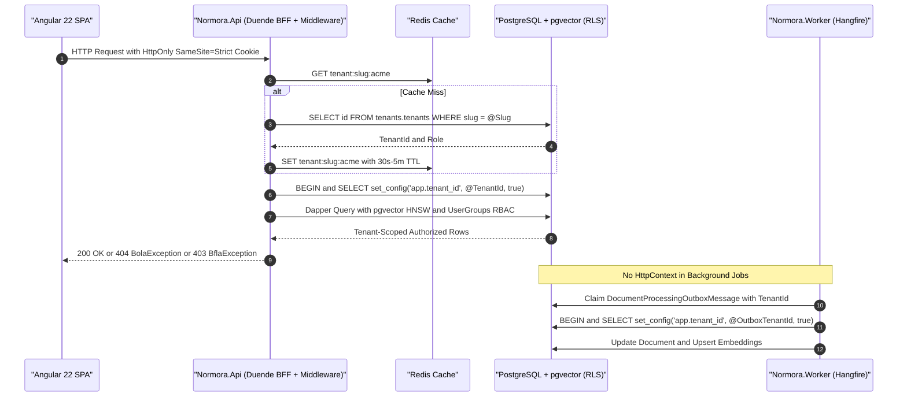
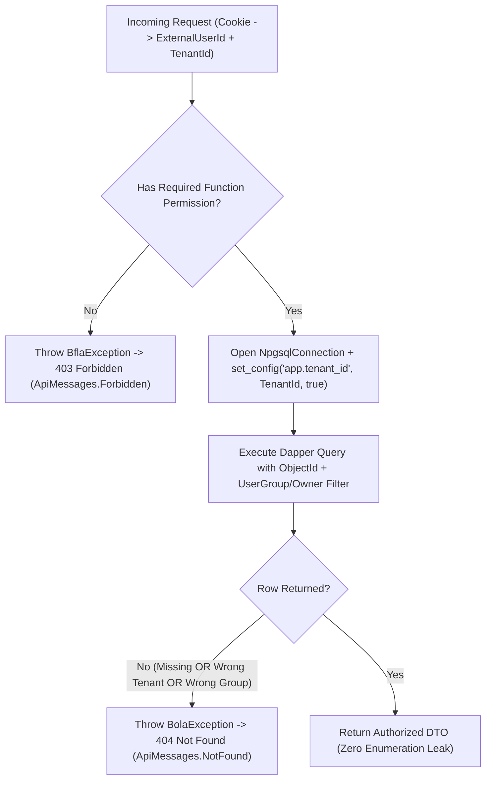
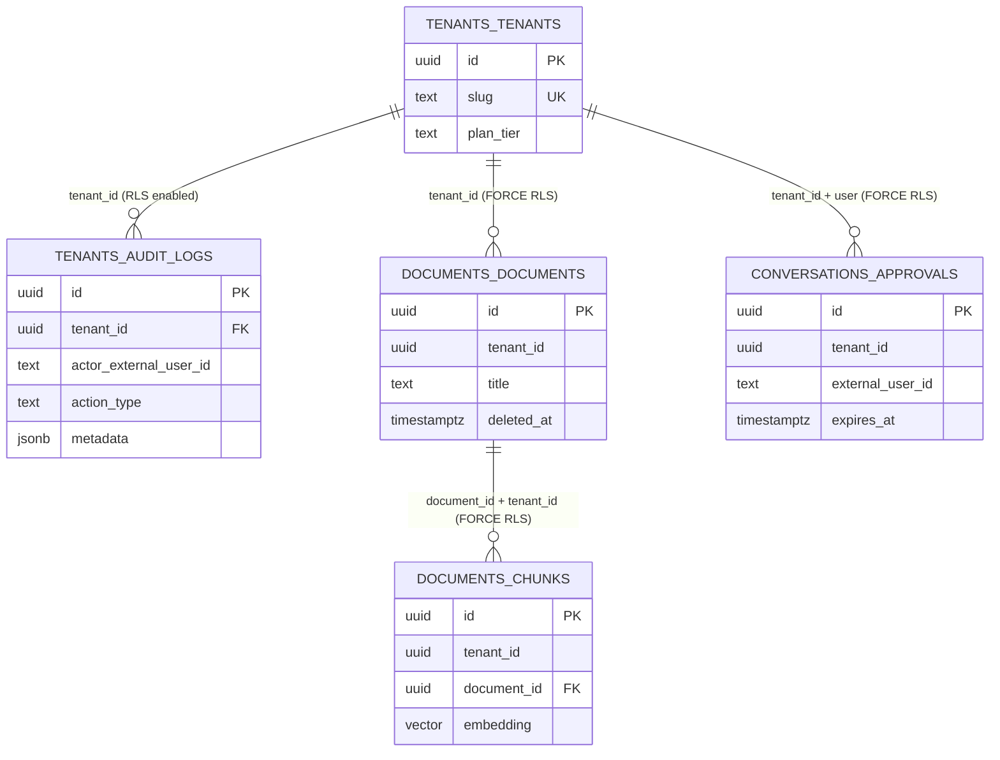

# Chapter 7: Enterprise SaaS: Multi-Tenancy and Security

## 1. Learning Objectives

By the end of this chapter, you will be able to:
*   Evaluate and implement different Multi-Tenancy architectures (Database-per-Tenant, Schema-per-Tenant, and Shared Database / Shared Schema) using Dapper with .NET 10 and C# 14 primary constructors.
*   Secure an enterprise SaaS application from cross-tenant data leakage by utilizing **Row-Level Security (RLS)** in both **SQL Server** (`sp_set_session_context`) and **PostgreSQL / Npgsql** (`set_config`, `ENABLE` / `FORCE ROW LEVEL SECURITY`) integrated with ASP.NET Core DI and background workers.
*   Prevent **BOLA (Broken Object Level Authorization)** and **BFLA (Broken Function Level Authorization)** at the data-access boundary without leaking existence or internal error details (`CWE-209`).
*   Design a resilient, atomic Audit Logging and Soft-Delete mechanism using SQL Server `OUTPUT` and PostgreSQL `WITH ... RETURNING` CTEs natively through Dapper.
*   Implement high-performance Role-Based Access Control (RBAC), departmental/group entitlements, and Feature Flag / Plan resolution directly within database reads (including `pgvector` HNSW hybrid search).
*   Understand and mitigate advanced SQL Injection vectors (dynamic `ORDER BY` whitelisting, `LIKE`/`ILIKE` wildcards, second-order SQL injection) that bypass naive parameterization.

## 2. Introduction

Building an internal corporate application is fundamentally different from building a B2B Software-as-a-Service (SaaS) platform. In a SaaS platform, a single application instance (and often a single database) serves multiple, completely isolated organizations (**Tenants**).

The most catastrophic failure a SaaS platform can suffer is a cross-tenant data leak—for example, Tenant A viewing Tenant B's invoices in an EV charging network, or Tenant A's conversational AI retrieving Tenant B's confidential HR policies from a `pgvector` index in **Normora**. When using a Micro ORM like Dapper, where you write raw SQL (T-SQL or PostgreSQL SQL) strings, the risk of a developer forgetting to add a `WHERE tenant_id = @TenantId` clause to a single query—or forgetting an authorization check on a background job—is exceptionally high.

This chapter focuses on **defensive data architecture** (defense-in-depth). We will explore how to push security constraints down to the database engine level, ensuring that even if application-level Dapper queries are written poorly, the database itself blocks unauthorized access. Throughout the chapter, we pair our **EV Charging Platform** (SQL Server) case study with **Normora**—a .NET 10 / C# 14 enterprise multi-tenant knowledge management and conversational-AI modular monolith backed by **PostgreSQL + pgvector (Npgsql)**, **Keycloak OIDC**, **Duende BFF**, **MinIO**, and **Hangfire**.

## 3. Core Concepts

### Multi-Tenancy Models (and When NOT to Use Each)

A **Tenant** is a logically or physically isolated customer organization (such as a fleet operator in the EV Charging Platform or an employer workspace in Normora). Choosing a tenancy model determines your isolation guarantee, operational cost, and connection-pooling strategy:

1. **Database-per-Tenant (Silo Model):** Every tenant gets its own database instance or logical database.
   * **How Dapper handles it:** An `IDbConnectionFactory` resolves a tenant-specific connection string per request (usually from a distributed cache like Redis).
   * **When to use:** Strict regulatory isolation (healthcare, defense, sovereign data residency), noisy-neighbor isolation, or per-tenant point-in-time restore SLAs.
   * **When NOT to use:** High-volume self-serve SaaS with thousands of small/free-tier workspaces—connection pools fragment across databases (1,000 DBs × 20 pooled connections = 20,000 open sockets), schema migrations require orchestrated multi-DB pipelines, and cross-tenant analytics become expensive.
2. **Schema-per-Tenant (Bridge Model):** Tenants share a single database server/database, but each tenant owns a dedicated schema (e.g., `tenant_acme.documents`, `tenant_globex.documents`).
   * **How Dapper handles it:** PostgreSQL sets `SET search_path TO tenant_acme, public;` per session/transaction, or SQL queries qualify schema names via a strict whitelist.
   * **When NOT to use:** Beyond ~500–2,000 tenants, database catalog metadata (`pg_class`, `pg_attribute`) bloats, query plan caches thrash, and migrations still multiply by tenant count. *(Note: Normora uses PostgreSQL schemas by **bounded context**—`tenants`, `documents`, `conversations`—not per tenant!)*
3. **Shared Database, Shared Schema (Pool Model):** All tenants share the same tables, partitioned logically by a `TenantId` (`tenant_id UUID NOT NULL`) column.
   * **How Dapper handles it:** Lowest infrastructure cost and single-schema migrations, paired with **Row-Level Security (RLS)** and composite indexes `(tenant_id, ...)` so isolation does not depend solely on developer memory.
   * **When NOT to use:** When a single whale tenant requires physically dedicated compute/storage, hardware encryption keys per tenant, or independent major database version upgrades.

#### Normora Real-World Examples: Multi-Tenancy Boundaries
1. **Shared Schema with Bounded-Context Separation:** Normora runs PostgreSQL 15+ with one shared database split into three module schemas: `tenants` (`TenantsDbContext`), `documents` (`DocumentsDbContext` with `pgvector`), and `conversations` (`ConversationsDbContext`), isolating tenant rows via `tenant_id`.
2. **Unscoped Root Directory (`tenants` schema):** Workspace slug resolution in `TenantResolutionMiddleware` queries the `tenants.tenants` table *before* a `TenantId` is known, demonstrating why root directory tables cannot use ambient `TenantId` filtering.
3. **Explicit Tenant Propagation Across Modules:** When `Conversations` calls `Documents` via MediatR (`PerformHybridRetrievalQuery`), the contract explicitly requires `Guid TenantId` so both HTTP requests and `Normora.Worker` background jobs stay isolated.
4. **Storage & Cache Isolation Beyond SQL:** Multi-tenancy in Normora does not stop at PostgreSQL—MinIO object keys (`{tenantId}/documents/{docId}/...`), Redis cache keys (`tenant:{tenantId}:slug:{slug}`), and CopilotKit AG-UI agent threads (`{TenantId}:{ExternalUserId}`) all mirror the SQL `TenantId` boundary.
5. **Plan-Based Tiering (`TenantPlanPricingCatalog`):** Free, Pro, and Enterprise workspaces share the same PostgreSQL tables while `TenantPlan` rows govern quotas (document limits, currencies like `INR`/`USD`/`EUR`) without provisioning separate databases per signup.

### Row-Level Security (RLS)

**Row-Level Security (RLS)** is a database engine feature that enforces row-level access predicates transparently on every `SELECT`, `INSERT`, `UPDATE`, and `DELETE`. Even if a developer forgets `WHERE tenant_id = @TenantId` in a Dapper query, the database engine automatically injects the predicate (and blocks writes for another tenant).

* **SQL Server RLS:** Uses an inline table-valued predicate function (`WITH SCHEMABINDING`) bound to a `CREATE SECURITY POLICY` with `ADD FILTER PREDICATE` (for reads/updates/deletes) and `ADD BLOCK PREDICATE` (for writes).
* **PostgreSQL RLS:** Enabled directly on each table via `ALTER TABLE ... ENABLE ROW LEVEL SECURITY;` and enforced via `CREATE POLICY ... USING (...) WITH CHECK (...)`.
  * `USING (...)` filters existing rows visible to `SELECT`, `UPDATE`, and `DELETE`.
  * `WITH CHECK (...)` validates new/modified rows during `INSERT` and `UPDATE`, preventing a compromised query from inserting a row with someone else's `tenant_id`.
  * **Critical PostgreSQL Gotcha (`FORCE ROW LEVEL SECURITY`):** By default in PostgreSQL, **table owners** and roles with `BYPASSRLS` (including superusers) silently **bypass RLS**! In production, your Dapper runtime role must have `NOBYPASSRLS` (and not own the tables), and you should also run `ALTER TABLE ... FORCE ROW LEVEL SECURITY;` as defense-in-depth.

#### When NOT to Use RLS
* **Superuser / Migration Connections:** Schema migrations (`dotnet Normora.Api.dll --migrate` running `DatabaseMigrationRunner`) must use a privileged non-runtime role; runtime Dapper connections must use a least-privilege `NOBYPASSRLS` DML role.
* **Directory / Bootstrap Tables:** Tables that resolve a tenant slug or OIDC invitation before a tenant context exists (such as Normora's `tenants.tenants` root lookup or `TenantInvitations` by token) should not have a mandatory `app.tenant_id` RLS block that prevents initial login.
* **Subquery-Heavy Predicates on Vector/Hot Tables:** Putting multi-table `JOIN`s or correlated `EXISTS` subqueries inside an RLS policy causes nested-loop scans and can defeat `pgvector` HNSW index scans. Keep RLS predicates strictly to `tenant_id = current_setting('app.tenant_id', true)::uuid`, and enforce finer RBAC (like `UserGroups` or departments) in explicit parameterized Dapper queries.

#### Normora Real-World Examples: Row-Level Security
1. **`documents.documents` Read & Write Isolation:** An RLS `USING` + `WITH CHECK` policy on `documents.documents` guarantees a `Documents` Dapper query can never read or overwrite another workspace's metadata, even if a handler omits `WHERE tenant_id = @TenantId`.
2. **`documents.document_chunks` Vector Leakage Prevention:** Semantic search using `pgvector` (`embedding <=> @QueryVector`) automatically inherits the `tenant_id` RLS filter, preventing cross-tenant prompt injection or RAG leakage.
3. **`conversations.conversations` & `messages`:** Protects multi-turn RAG history, saved answers, and `pending_approvals` (HITL tokens) from IDOR across workspaces.
4. **`tenants.audit_logs` & `tenants.departments`:** While `TenantsDbContext` has no EF Core ambient filter because it also manages root tenant records, PostgreSQL RLS on tenant-owned child tables (`audit_logs`, `departments`, `user_groups`) adds database-level protection when a tenant context is set.
5. **Migration Host Isolation (`--migrate`):** `Normora.Api.dll --migrate` runs its four sequential migrators (`TenantsDatabaseMigrator`, `DocumentsDatabaseMigrator`, `ConversationsDatabaseMigrator`, `SessionDatabaseMigrator`) using a separate migration credential so DDL never shares the runtime `NOBYPASSRLS` Dapper connection pool.

### Session Context & Connection Pool Hygiene

Modern .NET apps never open a brand-new physical TCP socket per query; ADO.NET (`SqlConnection`, `NpgsqlDataSource`) pools connections across HTTP requests from different tenants. To make RLS work safely on pooled connections, the application sets session-scoped metadata right after acquiring a connection and before running Dapper queries:

* **SQL Server (`sp_set_session_context`):** Sets a key-value pair on the session. Always pass `@read_only = 1` so a downstream stored procedure or injected batch cannot overwrite `TenantId` mid-session. When the `SqlConnection` is disposed back to the pool, ADO.NET invokes `sp_reset_connection` on next reuse, wiping `SESSION_CONTEXT`.
* **PostgreSQL (`set_config` & `current_setting`):**
  * `SELECT set_config('app.tenant_id', @TenantId::text, true);` — Notice the third argument **`is_local = true`**. This binds the setting strictly to the **current database transaction** (`BEGIN ... COMMIT/ROLLBACK`), automatically resetting it when the transaction finishes. It works seamlessly with both `Npgsql` pooling and **PgBouncer in transaction-pooling mode**.
  * If you pass `is_local = false` (session-level), the value persists on the physical backend until `DISCARD ALL` or `RESET app.tenant_id` runs—meaning a connection returned to an external pooler without reset could leak Tenant A's context to Tenant B!
  * Always use `NULLIF(current_setting('app.tenant_id', true), '')::uuid` (`missing_ok = true`) in RLS policies so unset sessions evaluate safely to `NULL` (returning zero rows) instead of throwing `unrecognized configuration parameter "app.tenant_id"`.

#### Normora Real-World Examples: Session Context Propagation
1. **HTTP API Request Pipeline:** `TenantResolutionMiddleware` validates the Duende BFF cookie session, extracts `ExternalUserId` and workspace slug (cached in Redis), populates scoped `ITenantContext`, and `NpgsqlTenantConnectionFactory` runs `set_config('app.tenant_id', ..., true)` inside the unit-of-work transaction.
2. **Background Ingestion Worker (`Normora.Worker`):** Hangfire jobs (`HangfireDocumentProcessingOutboxDispatcher`) have no `HttpContext`. The worker reads `TenantId` from the claimed `DocumentProcessingOutboxMessage` row and passes it explicitly to the connection factory before touching `documents` or `document_chunks`.
3. **Cross-Module MediatR RAG Calls:** `ConversationTurnPreparer` invokes `PerformHybridRetrievalQuery(TenantId, ...)` in `Normora.Shared.Contracts.Documents`, passing `TenantId` explicitly rather than relying on ambient HTTP state.
4. **CopilotKit / AG-UI Session Partitioning:** `NormoraAgentIsolationKeyProvider` partitions AI thread state by `{TenantId}:{ExternalUserId}`, matching the SQL session context (`app.tenant_id` + `app.user_id`) so agent memory never crosses tenant boundaries.
5. **Unauthenticated Health Checks & BFF Callbacks:** Endpoints like `/health` or `/signin-oidc` never acquire a tenant-scoped connection; attempting to call the tenant-scoped factory without a resolved `TenantId` throws `InvalidOperationException(ApiMessages.TenantContextMissing)` before opening a database connection.

### BOLA vs. BFLA at the Data-Access Boundary

Even with `TenantId` RLS enabled, two tenants' *own users* inside the same workspace can still attack each other or escalate privileges. OWASP API Security Top 10 defines two critical authorization failures that Dapper queries must enforce directly:

* **BOLA (Broken Object Level Authorization — API1:2023):** A user in Tenant A requests an object ID (e.g., `/api/documents/{docId}` or `/api/conversations/{convId}`) that either belongs to Tenant B *or* belongs to a restricted Department / User Group within Tenant A that the user cannot access.
  * **Normora Rule:** Throw `BolaException()`, which maps globally to **`404 Not Found`** with `ApiMessages.NotFound`. **Never** return `403 Forbidden` for an unauthorized object ID, because returning `403` for Tenant B's UUID and `404` for a random UUID lets an attacker enumerate valid resource IDs!
* **BFLA (Broken Function Level Authorization — API5:2023):** An authenticated user tries to execute an action or endpoint their role does not permit (e.g., a standard Member calling `DELETE /api/documents/{id}` or `POST /api/tenants/departments`, which requires `Admin` or `Owner`).
  * **Normora Rule:** Throw `BflaException()`, which maps globally to **`403 Forbidden`** with `ApiMessages.Forbidden` inside a structured `ApiResponse` envelope (never empty `Forbid()`).
* **Error Sanitization (`CWE-209`):** Neither Dapper error handlers nor background workers (`DocumentProcessingJob`) or transactional emails may ever expose raw `NpgsqlException.Message`, SQL constraint names, or stack traces to end users—log them to OpenTelemetry/structured logs and surface `ApiMessages.*` constants only.

#### Normora Real-World Examples: BOLA & BFLA in Dapper
1. **Document Download & Chunk Preview (`Documents`):** Dapper checks both `tenant_id` (via RLS) *and* whether the document is public to the workspace or shared with one of the caller's `UserGroups`; if 0 rows match, the handler throws `BolaException()` (`404` + `ApiMessages.NotFound`).
2. **Document Deletion (`documents_delete` / `DeleteDocumentCommand`):** First, role check verifies workspace `Admin`/`Owner` or uploader permission (throws `BflaException()` -> `403` if unauthorized); then the Dapper `UPDATE ... WHERE id = @DocumentId AND deleted_at IS NULL RETURNING id` throws `BolaException()` (`404`) if missing.
3. **Conversation History & Saved Answers (`Conversations`):** Queries filter by `user_id = @CurrentUserId` (derived from validated `ExternalUserId`, never from a query parameter). Accessing another teammate's private conversation returns `404` via `BolaException()`.
4. **HITL Tool Approval (`ApprovalsController` / `PendingApproval`):** Approving a pending `documents_delete` tool call executes an atomic `UPDATE conversations.pending_approvals SET status = 'Approved' WHERE id = @ApprovalId AND user_id = @UserId AND expires_at > NOW() RETURNING ...`—preventing another user in the same tenant from hijacking an approval card.
5. **Department & Subscription Management (`Tenants`):** Viewing or modifying `AuditLogs`, `TenantPlan` currency (`UpdateTenantCurrencyCommand`), or `Departments` checks the caller's cached `TenantRole` first (`BflaException()` -> `403`), and then queries scoped strictly by `WHERE tenant_id = @TenantId`.

### SQL Injection Beyond Basic Parameterization

Dapper's `@Param` syntax turns values into ADO.NET `DbParameter` objects, which prevents classic `' OR 1=1 --` value injection. However, **structural SQL elements cannot be parameterized** in SQL Server or PostgreSQL:

* **Dynamic `ORDER BY`, Columns, and Table Names:** `@SortColumn` cannot be bound as a SQL parameter. Interpolating user query strings (`?sortBy=created_at desc`) directly into SQL causes immediate SQL injection. **Fix:** Map input keys through a `FrozenDictionary<string, string>` (or `switch` expression) of hardcoded, allowed SQL fragments.
* **PostgreSQL Array Filtering (`ANY(@Ids)` vs `string.Join`):** Never build `IN ({string.Join(",", ids)})` with string interpolation. In PostgreSQL + Npgsql, pass a typed array (`Guid[]` or `string[]`) directly to `= ANY(@GroupIds)`; in SQL Server, use Dapper's `IN @Ids` list expansion or Table-Valued Parameters (TVPs).
* **`LIKE` / `ILIKE` Wildcard Injection:** Parameterizing `WHERE title ILIKE @Search` stops SQL syntax injection, but if a user enters `%` or `_`, PostgreSQL treats them as wildcards, potentially causing full-table scans (ReDoS/DoS at the DB level). Escape `\`, `%`, and `_` in C# and specify `ESCAPE '\'`.
* **Second-Order SQL Injection:** Malicious text safely stored via a parameterized `INSERT` is later read back from the database and concatenated into a dynamic SQL statement (e.g., a reporting or export job) because the developer assumed "data from our own DB is safe."

#### Normora Real-World Examples: Advanced SQL Injection Defense
1. **Audit Log Sorting (`GetAuditLogsQuery`):** Translates `sortBy` (`"timestamp"`, `"action"`, `"actor"`) through a `FrozenDictionary<string, string>` mapping to literal column expressions (`"created_at"`, `"action_type"`, `"actor_email"`)—rejecting unknown keys with validation errors.
2. **Department & User Group Filtering in Hybrid RAG:** `PerformHybridRetrievalQuery` passes the caller's authorized group IDs as `Guid[] groupIds` using `AND (d.visibility = 'Workspace' OR dg.user_group_id = ANY(@GroupIds))`—zero string concatenation.
3. **Document Title Search (`ILIKE` Escaping):** Search terms in `Documents` escape `\`, `%`, and `_` before wrapping in `%...%` with `WHERE d.title ILIKE @Pattern ESCAPE '\'`, preventing wildcard CPU spikes on large workspaces.
4. **Dynamic Reporting / CSV Export (`AuditLogs`):** Export queries never read column names from saved user filter JSON without validating every field name against an allowlist, blocking second-order SQL injection.
5. **MCP Tool Input Sanitization (`McpController`):** External AI agents invoking `documents_search` or `workspace_list_employees` via JSON-RPC 2.0 pass untrusted tool arguments; FluentValidation + parameterized Dapper queries ensure prompt-injected SQL payloads cannot escape parameter boundaries.

### Audit Logging, Soft Deletes, and Data Erasure (GDPR)

Enterprise SaaS platforms must prove *who changed what and when*, allow safe recovery from accidental deletions, and still honor legal hard-deletion ("Right to be Forgotten") requests:

* **Atomic Audit Logging (`OUTPUT` vs `WITH ... RETURNING`):** Writing an audit row in a separate C# call after an `UPDATE` risks partial failure if the process crashes between statements. SQL Server solves this in one round-trip with `OUTPUT deleted.*, inserted.* INTO AuditLogs`; PostgreSQL solves it with a data-modifying CTE: `WITH updated AS (UPDATE ... RETURNING ...) INSERT INTO tenants.audit_logs (...) SELECT ... FROM updated;`.
* **Soft Deletes in Dapper:** Unlike EF Core (which can apply a global `.HasQueryFilter(e => !e.IsDeleted)`), Dapper runs raw SQL—every `SELECT` must explicitly include `WHERE deleted_at IS NULL` (or `IsDeleted = 0`), unless backed by a database view or RLS policy. Also use **partial unique indexes** in PostgreSQL (`CREATE UNIQUE INDEX ux_departments_tenant_name ON tenants.departments (tenant_id, name) WHERE deleted_at IS NULL;`) so recreating a soft-deleted department name succeeds.
* **GDPR Erasure vs. Audit Integrity:** Soft deletes are **not** GDPR compliant because PII (`email`, `full_name`) remains on disk. True erasure overwrites PII with irreversible placeholders (or removes rows across PostgreSQL, MinIO, and vector indexes via an outbox/saga) while keeping anonymized audit events (`actor_id` + opaque token) intact.

#### Normora Real-World Examples: Audit, Soft Delete & Erasure
1. **Atomic Role & Membership Audit (`Tenants`):** Updating a workspace member's `Role` uses a PostgreSQL CTE (`WITH prev AS (...), upd AS (UPDATE ... RETURNING ...) INSERT INTO tenants.audit_logs ...`) so the mutation and audit event commit atomically.
2. **Soft-Deleted Documents & Outbox Purge (`Documents`):** `DeleteDocumentCommandHandler` sets `deleted_at = NOW()` and inserts a `DocumentProcessingOutboxMessage` (`Action = Purge`) in the same transaction; `Normora.Worker` asynchronously purges `document_chunks` (pgvector) and the raw blob from MinIO.
3. **Partial Unique Index on Departments (`tenants.departments`):** Soft-deleting an `"Engineering"` department allows an admin to create a new `"Engineering"` department immediately because uniqueness is scoped to `WHERE deleted_at IS NULL`.
4. **GDPR User Anonymization (`Tenants`):** Offboarding/erasure replaces PII (`first_name = 'ANON'`, `email = gen_random_uuid()::text || '@anonymized.local'`, `external_user_id = NULL`) while preserving historical `audit_logs` referential structure.
5. **Immutable Outbox Traceability:** `DocumentProcessingOutboxMessage` records transition timestamps (`created_at`, `processed_at`, `attempt_count`) and never stores raw exception stack traces in user-visible status columns (`CWE-209`).

## 4. Visual Diagrams

### EV Charging Platform: SQL Server RLS Request Pipeline

```text
=============================================================================
             MULTI-TENANT REQUEST PIPELINE (RLS & DAPPER)
=============================================================================

[ HTTP Request ] (Authorization: Bearer <JWT>)
        │
[ ASP.NET Core Middleware ]
        ├── Extracts TenantId (e.g., 'Tenant-789') from JWT Claims
        └── Stores in scoped ITenantContext
        │
[ MediatR Query Handler ]
        │
[ ITenantedConnectionFactory.CreateConnectionAsync() ]
        │
        ├── 1. ADO.NET gets open connection from Pool
        ├── 2. DAPPER: Execute("EXEC sp_set_session_context 'TenantId', @id, @read_only=1")
        └── 3. Returns prepared SqlConnection
        │
[ ChargerRepository.GetSitesAsync() ]
        │
        ├── DAPPER: Query("SELECT * FROM Sites")   <-- Notice no WHERE clause!
        │
[ SQL SERVER ENGINE ]
        ├── Intercepts query via Row-Level Security Policy
        ├── Reads Session Context ('Tenant-789')
        ├── Invisibly rewrites to: SELECT * FROM Sites WHERE TenantId = 'Tenant-789'
        └── Returns filtered Tabular Data Stream
```

### Normora: End-to-End Multi-Tenant HTTP & Background Worker Isolation



### Normora: BOLA (404) vs. BFLA (403) Authorization Flow



### Normora: PostgreSQL Multi-Schema & RLS Isolation Boundaries



## 5. API Deep Dive

### Implementing the SQL Server RLS Connection Factory (EV Charging Platform)

We must ensure that *every* connection handed to a repository has its session context set—and that we **never leak an open connection** if claim validation or `sp_set_session_context` fails. Notice how we validate the `TenantId` *before* opening the `SqlConnection`, pass `@read_only = 1` so downstream batches cannot mutate `TenantId`, and dispose the connection if setting session context throws:

```csharp
using System.Data.Common;
using Dapper;
using Microsoft.Data.SqlClient;

public sealed class TenantedConnectionFactory(
    string connectionString,
    IHttpContextAccessor httpContextAccessor) : ISqlConnectionFactory
{
    public async Task<DbConnection> CreateConnectionAsync(CancellationToken ct = default)
    {
        // Validate BEFORE opening a pooled connection so invalid requests never leak sockets
        var tenantIdClaim = httpContextAccessor.HttpContext?.User.FindFirst("TenantId")?.Value;
        if (!Guid.TryParse(tenantIdClaim, out var tenantId))
        {
            throw new UnauthorizedAccessException("Tenant context is missing.");
        }

        var connection = new SqlConnection(connectionString);
        try
        {
            await connection.OpenAsync(ct);

            // @read_only = 1 prevents T-SQL batches or nested procs from overwriting TenantId
            await connection.ExecuteAsync(
                new CommandDefinition(
                    "EXEC sp_set_session_context @key = N'TenantId', @value = @TenantId, @read_only = 1;",
                    new { TenantId = tenantId },
                    cancellationToken: ct));

            return connection;
        }
        catch
        {
            await connection.DisposeAsync();
            throw;
        }
    }
}
```

### Database RLS Setup (T-SQL for SQL Server)

For the Dapper code above to work securely, the Database Architect configures SQL Server using `TRY_CAST` (preventing runtime conversion exceptions on malformed values) and explicit `FILTER` + `BLOCK` predicates:

```sql
-- 1. Create a predicate function
CREATE FUNCTION Security.fn_TenantAccessPredicate(@TenantId UNIQUEIDENTIFIER)
    RETURNS TABLE
    WITH SCHEMABINDING
AS
    RETURN SELECT 1 AS fn_accessResult
    WHERE
        @TenantId = TRY_CAST(SESSION_CONTEXT(N'TenantId') AS UNIQUEIDENTIFIER)
        OR TRY_CAST(SESSION_CONTEXT(N'IsSystemAdmin') AS INT) = 1;
GO

-- 2. Apply it to the Sites table (blocks cross-tenant reads AND writes)
CREATE SECURITY POLICY Security.TenantPolicy_Sites
    ADD FILTER PREDICATE Security.fn_TenantAccessPredicate(TenantId) ON dbo.Sites,
    ADD BLOCK PREDICATE Security.fn_TenantAccessPredicate(TenantId) ON dbo.Sites AFTER INSERT,
    ADD BLOCK PREDICATE Security.fn_TenantAccessPredicate(TenantId) ON dbo.Sites BEFORE UPDATE,
    ADD BLOCK PREDICATE Security.fn_TenantAccessPredicate(TenantId) ON dbo.Sites BEFORE DELETE
    WITH (STATE = ON);
GO
```

### Normora Deep Dive: PostgreSQL, Npgsql & C# 14 Primary Constructors

Normora runs on **.NET 10 / C# 14** with **PostgreSQL + pgvector (`Npgsql`)**, **Duende BFF**, **MediatR**, and **`Normora.Shared.Constants.ApiMessages`**. Below are five production-grade building blocks showing how Normora enforces multi-tenancy and security with Dapper.

#### Normora Example 1: Transaction-Scoped `NpgsqlTenantConnectionFactory` (C# 14)

In PostgreSQL, `NpgsqlDataSource` is registered as a singleton and manages the connection pool and prepared statements. To stay safe under both `Npgsql` pooling and PgBouncer transaction pooling, we open a transaction and call `set_config('app.tenant_id', ..., true)` (`is_local = true`):

```csharp
using System.Data;
using Dapper;
using Normora.Shared.Constants;
using Normora.Shared.Interfaces;
using Npgsql;

namespace Normora.Infrastructure.Persistence;

public sealed class NpgsqlTenantConnectionFactory(
    NpgsqlDataSource dataSource,
    ITenantContext tenantContext) : ITenantDbSessionFactory
{
    public async Task<(NpgsqlConnection Connection, NpgsqlTransaction Transaction)> OpenScopedSessionAsync(
        CancellationToken ct = default)
    {
        if (tenantContext.TenantId is not { } tenantId || tenantId == Guid.Empty)
        {
            // Never use magic strings — always reference ApiMessages
            throw new InvalidOperationException(ApiMessages.TenantContextMissing);
        }

        var connection = await dataSource.OpenConnectionAsync(ct);
        try
        {
            var transaction = await connection.BeginTransactionAsync(IsolationLevel.ReadCommitted, ct);
            try
            {
                // is_local = true binds app.tenant_id and app.external_user_id strictly to this transaction
                const string sql = """
                    SELECT
                        set_config('app.tenant_id', @TenantId, true),
                        set_config('app.external_user_id', @ExternalUserId, true);
                    """;

                await connection.ExecuteAsync(
                    new CommandDefinition(
                        sql,
                        new
                        {
                            TenantId = tenantId.ToString(),
                            ExternalUserId = tenantContext.ExternalUserId ?? string.Empty
                        },
                        transaction: transaction,
                        cancellationToken: ct));

                return (connection, transaction);
            }
            catch
            {
                await transaction.DisposeAsync();
                throw;
            }
        }
        catch
        {
            await connection.DisposeAsync();
            throw;
        }
    }
}
```

#### Normora Example 2: PostgreSQL `FORCE ROW LEVEL SECURITY` Setup (`documents` Schema)

Notice the use of a dedicated non-superuser `NOBYPASSRLS` application role (`normora_app`) plus `FORCE ROW LEVEL SECURITY` so even table owners cannot accidentally bypass tenant isolation:

```sql
-- Dedicated least-privilege runtime role (separate from migration owner role)
CREATE ROLE normora_app NOINHERIT LOGIN PASSWORD '...' NOBYPASSRLS;
GRANT USAGE ON SCHEMA documents TO normora_app;
GRANT SELECT, INSERT, UPDATE, DELETE ON ALL TABLES IN SCHEMA documents TO normora_app;

-- Enable AND force RLS on documents and vector chunks
ALTER TABLE documents.documents ENABLE ROW LEVEL SECURITY;
ALTER TABLE documents.documents FORCE ROW LEVEL SECURITY;

ALTER TABLE documents.document_chunks ENABLE ROW LEVEL SECURITY;
ALTER TABLE documents.document_chunks FORCE ROW LEVEL SECURITY;

-- Filter existing rows (USING) AND validate inserted/updated rows (WITH CHECK)
CREATE POLICY p_documents_tenant_isolation ON documents.documents
    FOR ALL
    TO normora_app
    USING (tenant_id = NULLIF(current_setting('app.tenant_id', true), '')::uuid)
    WITH CHECK (tenant_id = NULLIF(current_setting('app.tenant_id', true), '')::uuid);

CREATE POLICY p_document_chunks_tenant_isolation ON documents.document_chunks
    FOR ALL
    TO normora_app
    USING (tenant_id = NULLIF(current_setting('app.tenant_id', true), '')::uuid)
    WITH CHECK (tenant_id = NULLIF(current_setting('app.tenant_id', true), '')::uuid);
```

#### Normora Example 3: Tenant-Isolated `pgvector` HNSW Hybrid Search + `UserGroups` RBAC

Inside `Modules/Documents`, `PerformHybridRetrievalQuery` combines `pgvector` cosine distance (`<=>`) with PostgreSQL full-text search (`ts_rank_cd`) using Reciprocal Rank Fusion (RRF), while enforcing RLS (`tenant_id`), soft-delete (`deleted_at IS NULL`), and departmental `UserGroups` authorization in SQL:

```csharp
public sealed record HybridChunkMatch(
    Guid ChunkId,
    Guid DocumentId,
    string DocumentTitle,
    string Breadcrumb,
    string Content,
    double RrfScore);

public sealed class DocumentHybridSearchRepository(ITenantDbSessionFactory sessionFactory)
{
    public async Task<IReadOnlyList<HybridChunkMatch>> SearchAsync(
        float[] queryEmbedding,
        string lexicalQuery,
        Guid[] callerGroupIds,
        int topK,
        CancellationToken ct = default)
    {
        await using var session = await sessionFactory.OpenScopedSessionAsync(ct);

        const string sql = """
            WITH authorized_docs AS (
                SELECT d.id, d.title
                FROM documents.documents d
                WHERE d.deleted_at IS NULL
                  AND d.status = 'Ready'
                  AND (
                      d.visibility = 'Workspace'
                      OR EXISTS (
                          SELECT 1
                          FROM documents.document_group_access dga
                          WHERE dga.document_id = d.id
                            AND dga.user_group_id = ANY(@CallerGroupIds)
                      )
                  )
            ),
            vector_hits AS (
                SELECT
                    c.id AS chunk_id,
                    c.document_id,
                    ROW_NUMBER() OVER (ORDER BY c.embedding <=> @QueryVector::vector) AS vec_rank
                FROM documents.document_chunks c
                INNER JOIN authorized_docs ad ON ad.id = c.document_id
                ORDER BY c.embedding <=> @QueryVector::vector
                LIMIT 40
            ),
            text_hits AS (
                SELECT
                    c.id AS chunk_id,
                    c.document_id,
                    ROW_NUMBER() OVER (
                        ORDER BY ts_rank_cd(c.search_vector, websearch_to_tsquery('english', @LexicalQuery)) DESC
                    ) AS fts_rank
                FROM documents.document_chunks c
                INNER JOIN authorized_docs ad ON ad.id = c.document_id
                WHERE c.search_vector @@ websearch_to_tsquery('english', @LexicalQuery)
                LIMIT 40
            )
            SELECT
                c.id AS ChunkId,
                c.document_id AS DocumentId,
                ad.title AS DocumentTitle,
                c.section_breadcrumb AS Breadcrumb,
                c.content AS Content,
                (COALESCE(1.0 / (60 + vh.vec_rank), 0.0) + COALESCE(1.0 / (60 + th.fts_rank), 0.0)) AS RrfScore
            FROM documents.document_chunks c
            INNER JOIN authorized_docs ad ON ad.id = c.document_id
            LEFT JOIN vector_hits vh ON vh.chunk_id = c.id
            LEFT JOIN text_hits th ON th.chunk_id = c.id
            WHERE vh.chunk_id IS NOT NULL OR th.chunk_id IS NOT NULL
            ORDER BY RrfScore DESC
            LIMIT @TopK;
            """;

        // Format float[] as pgvector literal "[0.12, -0.04, ...]" or use Pgvector.Vector type handler
        var vectorLiteral = $"[{string.Join(',', queryEmbedding)}]";
        var rows = await session.Connection.QueryAsync<HybridChunkMatch>(
            new CommandDefinition(
                sql,
                new
                {
                    QueryVector = vectorLiteral,
                    LexicalQuery = lexicalQuery,
                    CallerGroupIds = callerGroupIds,
                    TopK = topK
                },
                transaction: session.Transaction,
                cancellationToken: ct));

        await session.Transaction.CommitAsync(ct);
        return rows.AsList();
    }
}
```

#### Normora Example 4: BOLA (`404`) & BFLA (`403`) Enforcement in CQRS Handlers

In Normora's `Documents` module, `DeleteDocumentCommandHandler` checks function-level permission (`BflaException` -> `403`) *first*, and then lets the Dapper `UPDATE ... RETURNING` query check object existence + group/owner access (`BolaException` -> `404` so an attacker cannot tell whether a UUID belongs to another tenant or doesn't exist):

```csharp
public sealed class DeleteDocumentCommandHandler(
    ITenantDbSessionFactory sessionFactory,
    ICurrentUserContext currentUser)
{
    public async Task HandleAsync(Guid documentId, CancellationToken ct = default)
    {
        // 1. BFLA Check -> 403 Forbidden (ApiMessages.Forbidden)
        if (!currentUser.HasPermission(WorkspacePermissions.DocumentsDelete))
        {
            throw new BflaException();
        }

        await using var session = await sessionFactory.OpenScopedSessionAsync(ct);

        // 2. BOLA + Soft Delete + Transactional Outbox in ONE atomic transaction
        const string softDeleteSql = """
            UPDATE documents.documents d
            SET deleted_at = NOW(),
                deleted_by_external_user_id = @ExternalUserId
            WHERE d.id = @DocumentId
              AND d.deleted_at IS NULL
              AND (
                  @IsWorkspaceAdmin = TRUE
                  OR d.uploaded_by_external_user_id = @ExternalUserId
                  OR EXISTS (
                      SELECT 1
                      FROM documents.document_group_access dga
                      WHERE dga.document_id = d.id
                        AND dga.user_group_id = ANY(@CallerGroupIds)
                  )
              )
            RETURNING d.id;
            """;

        var deletedId = await session.Connection.ExecuteScalarAsync<Guid?>(
            new CommandDefinition(
                softDeleteSql,
                new
                {
                    DocumentId = documentId,
                    ExternalUserId = currentUser.ExternalUserId,
                    IsWorkspaceAdmin = currentUser.IsWorkspaceAdmin,
                    CallerGroupIds = currentUser.UserGroupIds
                },
                transaction: session.Transaction,
                cancellationToken: ct));

        if (deletedId is null)
        {
            // BOLA Check -> 404 Not Found (ApiMessages.NotFound) — prevents ID enumeration
            throw new BolaException();
        }

        const string outboxSql = """
            INSERT INTO documents.document_processing_outbox_messages (id, tenant_id, document_id, action_type, created_at)
            VALUES (@OutboxId, current_setting('app.tenant_id', true)::uuid, @DocumentId, 'PurgeStorageAndVectors', NOW());
            """;

        await session.Connection.ExecuteAsync(
            new CommandDefinition(
                outboxSql,
                new { OutboxId = Guid.NewGuid(), DocumentId = documentId },
                transaction: session.Transaction,
                cancellationToken: ct));

        await session.Transaction.CommitAsync(ct);
    }
}
```

#### Normora Example 5: Background Worker (`Normora.Worker`) Explicit `TenantId` Session

Hangfire jobs in `Normora.Worker` have **no `HttpContext`**. Cross-module contracts and outbox tables carry `Guid TenantId` explicitly so the worker sets PostgreSQL `app.tenant_id` explicitly before running any Dapper queries, and catches failures without leaking internal messages (`CWE-209`):

```csharp
public sealed class WorkerTenantSessionFactory(NpgsqlDataSource dataSource)
{
    public async Task<(NpgsqlConnection Connection, NpgsqlTransaction Transaction)> OpenForTenantAsync(
        Guid tenantId,
        CancellationToken ct = default)
    {
        if (tenantId == Guid.Empty)
        {
            throw new InvalidOperationException(ApiMessages.TenantContextMissing);
        }

        var connection = await dataSource.OpenConnectionAsync(ct);
        try
        {
            var transaction = await connection.BeginTransactionAsync(ct);
            try
            {
                await connection.ExecuteAsync(
                    new CommandDefinition(
                        "SELECT set_config('app.tenant_id', @TenantId, true);",
                        new { TenantId = tenantId.ToString() },
                        transaction: transaction,
                        cancellationToken: ct));

                return (connection, transaction);
            }
            catch
            {
                await transaction.DisposeAsync();
                throw;
            }
        }
        catch
        {
            await connection.DisposeAsync();
            throw;
        }
    }
}
```

## 6. Complete Examples: EV Charging Platform & Normora

### EV Charging Platform (SQL Server)

#### Scenario 1: Feature Flags via Dapper
In an Enterprise SaaS, features are often toggled on/off per tenant.

```csharp
public async Task<bool> IsFeatureEnabledAsync(string featureCode)
{
    // The TenantId is implicitly handled by RLS.
    // We just query if a record exists for the feature.
    const string sql = @"
        SELECT 1 
        FROM TenantFeatureFlags 
        WHERE FeatureCode = @FeatureCode AND IsEnabled = 1";

    var result = await _connection.QuerySingleOrDefaultAsync<int?>(
        sql, 
        new { FeatureCode = featureCode });

    return result.HasValue;
}
```

#### Scenario 2: Audit Logging with Dapper & OUTPUT Clause
When a Charger's configuration is modified, we must record the exact change. Instead of doing a `SELECT`, `UPDATE`, and `INSERT` (3 round trips), we use the SQL `OUTPUT` clause in a single Dapper command.

```csharp
public async Task UpdateChargerConfigAsync(Guid chargerId, decimal newMaxKw, string modifiedBy)
{
    const string sql = @"
        UPDATE Chargers
        SET MaxKw = @NewMaxKw
        OUTPUT 
            deleted.Id AS EntityId, 
            'Charger' AS EntityType,
            deleted.MaxKw AS OldValue, 
            inserted.MaxKw AS NewValue,
            @ModifiedBy AS ModifiedBy,
            GETUTCDATE() AS Timestamp
        INTO AuditLogs (EntityId, EntityType, OldValue, NewValue, ModifiedBy, Timestamp)
        WHERE Id = @ChargerId;";

    await _connection.ExecuteAsync(sql, new 
    { 
        ChargerId = chargerId, 
        NewMaxKw = newMaxKw, 
        ModifiedBy = modifiedBy 
    });
}
```

#### Scenario 3: Soft Deletes
In SaaS, data is rarely hard-deleted (`DELETE FROM`). Instead, an `IsDeleted` flag is set.

```csharp
public async Task SoftDeleteSiteAsync(Guid siteId)
{
    // Dapper command for soft delete
    const string sql = @"
        UPDATE Sites 
        SET IsDeleted = 1, DeletedAt = GETUTCDATE() 
        WHERE Id = @SiteId";

    await _connection.ExecuteAsync(sql, new { SiteId = siteId });
}

// In your Repository Read methods, you MUST remember the filter:
public async Task<IEnumerable<SiteDto>> GetActiveSitesAsync()
{
    // RLS handles TenantId, but Application handles IsDeleted
    return await _connection.QueryAsync<SiteDto>("SELECT * FROM Sites WHERE IsDeleted = 0");
}
```

### Normora (PostgreSQL + pgvector + .NET 10)

#### Normora Scenario 1: Subscription Plan & Currency Entitlement Check (`Tenants`)
Before allowing a workspace to upload another document or invite more members, `Tenants` checks the workspace's persisted `TenantPlan` (governed by `TenantPlanPricingCatalog` across `Free`, `Pro`, `Enterprise` and currencies like `INR`/`USD`/`EUR`) in a single parameterized query:

```csharp
public sealed record PlanQuotaSnapshot(string Tier, string Currency, int MaxDocuments, int ActiveDocuments);

public sealed class TenantQuotaRepository(ITenantDbSessionFactory sessionFactory)
{
    public async Task<bool> CanUploadDocumentAsync(Guid tenantId, CancellationToken ct = default)
    {
        await using var session = await sessionFactory.OpenScopedSessionAsync(ct);

        const string sql = """
            SELECT
                tp.tier AS Tier,
                tp.currency AS Currency,
                tp.max_documents AS MaxDocuments,
                (
                    SELECT COUNT(*)::int
                    FROM documents.documents d
                    WHERE d.tenant_id = @TenantId
                      AND d.deleted_at IS NULL
                ) AS ActiveDocuments
            FROM tenants.tenant_plans tp
            WHERE tp.tenant_id = @TenantId;
            """;

        var snapshot = await session.Connection.QuerySingleOrDefaultAsync<PlanQuotaSnapshot>(
            new CommandDefinition(sql, new { TenantId = tenantId }, transaction: session.Transaction, cancellationToken: ct))
            ?? throw new BolaException();

        await session.Transaction.CommitAsync(ct);
        return snapshot.ActiveDocuments < snapshot.MaxDocuments;
    }
}
```

#### Normora Scenario 2: Atomic Audit Logging with PostgreSQL `WITH ... RETURNING` CTE (`Tenants`)
When a workspace administrator changes a member's role in `Tenants`, PostgreSQL does not have T-SQL's `OUTPUT INTO`. Instead, we capture the previous value and updated value in a single data-modifying CTE so the mutation and `tenants.audit_logs` insert are 100% atomic:

```csharp
public sealed class MembershipAuditRepository(ITenantDbSessionFactory sessionFactory)
{
    public async Task UpdateMemberRoleAsync(
        Guid tenantId,
        Guid membershipId,
        string newRole,
        string actorExternalUserId,
        CancellationToken ct = default)
    {
        await using var session = await sessionFactory.OpenScopedSessionAsync(ct);

        const string sql = """
            WITH previous_state AS (
                SELECT id, role
                FROM tenants.tenant_memberships
                WHERE id = @MembershipId
                  AND tenant_id = @TenantId
                  AND deleted_at IS NULL
                FOR UPDATE
            ),
            updated_state AS (
                UPDATE tenants.tenant_memberships m
                SET role = @NewRole,
                    updated_at = NOW()
                FROM previous_state ps
                WHERE m.id = ps.id
                RETURNING m.id AS entity_id, ps.role AS old_role, m.role AS new_role
            )
            INSERT INTO tenants.audit_logs (
                id, tenant_id, entity_id, entity_type, action_type,
                actor_external_user_id, old_value, new_value, created_at
            )
            SELECT
                @AuditId, @TenantId, u.entity_id, 'TenantMembership', 'RoleUpdated',
                @ActorExternalUserId, u.old_role, u.new_role, NOW()
            FROM updated_state u
            RETURNING entity_id;
            """;

        var updatedEntityId = await session.Connection.ExecuteScalarAsync<Guid?>(
            new CommandDefinition(
                sql,
                new
                {
                    AuditId = Guid.NewGuid(),
                    TenantId = tenantId,
                    MembershipId = membershipId,
                    NewRole = newRole,
                    ActorExternalUserId = actorExternalUserId
                },
                transaction: session.Transaction,
                cancellationToken: ct));

        if (updatedEntityId is null)
        {
            throw new BolaException();
        }

        await session.Transaction.CommitAsync(ct);
    }
}
```

#### Normora Scenario 3: Soft Deletes with Partial Unique Indexes (`Tenants` Departments)
In PostgreSQL, a standard `UNIQUE (tenant_id, name)` constraint blocks creating a new `"Finance"` department after the old one is soft-deleted. Pairing `deleted_at IS NULL` in Dapper reads with a PostgreSQL partial unique index solves this cleanly:

```sql
CREATE UNIQUE INDEX ux_departments_active_tenant_name
    ON tenants.departments (tenant_id, LOWER(name))
    WHERE deleted_at IS NULL;
```

```csharp
public async Task<IReadOnlyList<DepartmentDto>> GetActiveDepartmentsAsync(
    Guid tenantId,
    CancellationToken ct = default)
{
    await using var session = await sessionFactory.OpenScopedSessionAsync(ct);

    const string sql = """
        SELECT id AS Id, name AS Name, created_at AS CreatedAt
        FROM tenants.departments
        WHERE tenant_id = @TenantId
          AND deleted_at IS NULL
        ORDER BY name ASC;
        """;

    var rows = await session.Connection.QueryAsync<DepartmentDto>(
        new CommandDefinition(sql, new { TenantId = tenantId }, transaction: session.Transaction, cancellationToken: ct));

    await session.Transaction.CommitAsync(ct);
    return rows.AsList();
}
```

#### Normora Scenario 4: Dynamic Sorting & `ILIKE` Wildcard Escaping (`AuditLogs`)
When workspace admins filter and sort `AuditLogs` from the Angular SPA, `sortBy` and `sortDir` are mapped via `FrozenDictionary` whitelists, and search terms escape `\`, `%`, and `_`:

```csharp
public sealed class AuditLogQueryRepository(ITenantDbSessionFactory sessionFactory)
{
    private static readonly FrozenDictionary<string, string> AllowedSortColumns =
        new Dictionary<string, string>(StringComparer.OrdinalIgnoreCase)
        {
            ["createdAt"] = "created_at",
            ["actionType"] = "action_type",
            ["entityType"] = "entity_type",
            ["actor"] = "actor_external_user_id"
        }.ToFrozenDictionary(StringComparer.OrdinalIgnoreCase);

    public async Task<IReadOnlyList<AuditLogDto>> SearchAsync(
        Guid tenantId,
        string? searchTerm,
        string sortBy,
        bool descending,
        int limit,
        int offset,
        CancellationToken ct = default)
    {
        if (!AllowedSortColumns.TryGetValue(sortBy, out var safeColumn))
        {
            throw new ArgumentException(ApiMessages.InvalidSortField, nameof(sortBy));
        }

        var direction = descending ? "DESC" : "ASC";
        string? escapedPattern = null;
        if (!string.IsNullOrWhiteSpace(searchTerm))
        {
            var escaped = searchTerm
                .Replace(@"\", @"\\", StringComparison.Ordinal)
                .Replace("%", @"\%", StringComparison.Ordinal)
                .Replace("_", @"\_", StringComparison.Ordinal);
            escapedPattern = $"%{escaped}%";
        }

        await using var session = await sessionFactory.OpenScopedSessionAsync(ct);

        // safeColumn and direction come strictly from hardcoded whitelists—never user strings
        var sql = $"""
            SELECT id AS Id, action_type AS ActionType, entity_type AS EntityType,
                   actor_external_user_id AS ActorExternalUserId, created_at AS CreatedAt
            FROM tenants.audit_logs
            WHERE tenant_id = @TenantId
              AND (@Pattern IS NULL OR action_type ILIKE @Pattern ESCAPE '\' OR entity_type ILIKE @Pattern ESCAPE '\')
            ORDER BY {safeColumn} {direction}
            LIMIT @Limit OFFSET @Offset;
            """;

        var rows = await session.Connection.QueryAsync<AuditLogDto>(
            new CommandDefinition(
                sql,
                new { TenantId = tenantId, Pattern = escapedPattern, Limit = Math.Clamp(limit, 1, 100), Offset = Math.Max(0, offset) },
                transaction: session.Transaction,
                cancellationToken: ct));

        await session.Transaction.CommitAsync(ct);
        return rows.AsList();
    }
}
```

#### Normora Scenario 5: Server-Enforced HITL `PendingApproval` Validation (`Conversations`)
Destructive AI agent tools like `documents_delete` create a `PendingApproval` with a 15-minute TTL. Confirming an approval verifies ownership (`external_user_id`), tenant RLS, and non-expiration atomically in PostgreSQL:

```csharp
public sealed class ApprovalRepository(
    ITenantDbSessionFactory sessionFactory,
    ICurrentUserContext currentUser)
{
    public async Task<PendingApprovalRecord> ClaimApprovalAsync(Guid approvalId, CancellationToken ct = default)
    {
        await using var session = await sessionFactory.OpenScopedSessionAsync(ct);

        const string sql = """
            UPDATE conversations.pending_approvals
            SET status = 'Executed',
                decided_at = NOW()
            WHERE id = @ApprovalId
              AND external_user_id = @ExternalUserId
              AND status = 'Pending'
              AND expires_at > NOW()
            RETURNING id AS Id, tool_name AS ToolName, payload_json AS PayloadJson;
            """;

        var approval = await session.Connection.QuerySingleOrDefaultAsync<PendingApprovalRecord>(
            new CommandDefinition(
                sql,
                new { ApprovalId = approvalId, ExternalUserId = currentUser.ExternalUserId },
                transaction: session.Transaction,
                cancellationToken: ct))
            ?? throw new BolaException();

        await session.Transaction.CommitAsync(ct);
        return approval;
    }
}
```

#### Normora Scenario 6: Tenant-Prefixed Redis Cache + `dataVersion` Invalidations (`Tenants`)
`TenantResolutionMiddleware` and branding lookups sit in front of Dapper reads using short-TTL Redis keys prefixed with `tenant:{tenantId}` (and `slug:{slug}`), paired with `IWorkspaceStateSynchronizer` (`dataVersion`) so role revocations take effect quickly without hammering PostgreSQL on every request:

```csharp
public sealed class CachedTenantBrandingService(
    IDistributedCache cache,
    NpgsqlDataSource dataSource)
{
    public async Task<TenantBrandingDto?> GetBrandingAsync(Guid tenantId, CancellationToken ct = default)
    {
        // Deterministic tenant prefix guarantees zero cross-tenant cache bleed
        var cacheKey = $"tenant:{tenantId:D}:branding:v1";
        var cachedJson = await cache.GetStringAsync(cacheKey, ct);
        if (cachedJson is not null)
        {
            return JsonSerializer.Deserialize<TenantBrandingDto>(cachedJson);
        }

        await using var connection = await dataSource.OpenConnectionAsync(ct);
        const string sql = """
            SELECT logo_url AS LogoUrl, primary_color AS PrimaryColor, workspace_name AS WorkspaceName
            FROM tenants.tenant_brandings
            WHERE tenant_id = @TenantId;
            """;

        var branding = await connection.QuerySingleOrDefaultAsync<TenantBrandingDto>(
            new CommandDefinition(sql, new { TenantId = tenantId }, cancellationToken: ct));

        if (branding is not null)
        {
            await cache.SetStringAsync(
                cacheKey,
                JsonSerializer.Serialize(branding),
                new DistributedCacheEntryOptions { AbsoluteExpirationRelativeToNow = TimeSpan.FromMinutes(2) },
                ct);
        }

        return branding;
    }
}
```

## 7. Performance Implications

### Row-Level Security Overhead
RLS is not free. Both SQL Server and PostgreSQL evaluate the predicate for every row accessed:
*   **Poorly Designed RLS:** If the predicate function does a `SELECT` or `JOIN` against another table (e.g., checking permissions in a separate `UserRoles` or `UserGroups` table), it causes massive performance degradation (Nested Loops) and prevents clean index seeks.
*   **Optimal RLS:** The predicate should exclusively evaluate `SESSION_CONTEXT` (SQL Server) or `current_setting('app.tenant_id', true)::uuid` (PostgreSQL) against an indexed `tenant_id` column physically on the table. This adds negligible overhead (nanoseconds per row) and turns into an index seek.

### PostgreSQL `pgvector` HNSW + RLS Filtering
In **Normora**, `documents.document_chunks` uses a `pgvector` **HNSW** index for fast approximate nearest-neighbor vector search (`embedding <=> @QueryVector`). Combining HNSW with an RLS `tenant_id` filter introduces a subtle **post-filtering recall problem**:
*   If Tenant A owns 1% of the chunks in the shared table and HNSW searches `ef_search = 40` global neighbors *before* applying the RLS `tenant_id` filter, most of those 40 candidates may belong to Tenant B and get discarded—leaving Tenant A with 0–2 results!
*   **Architect-Level Solutions:**
    1. Use `pgvector` 0.8+ **iterative index scans** (`SET LOCAL hnsw.iterative_scan = 'strict_order';`) so the HNSW graph continues traversing until `LIMIT` post-RLS rows are satisfied.
    2. Index `(tenant_id, document_id)` and keep `ef_search` tuned appropriately for multi-tenant selectivity.
    3. For massive enterprise whale tenants (millions of chunks each), graduate to **PostgreSQL native list partitioning** (`PARTITION BY LIST (tenant_id)` or hash partitioning) with per-partition HNSW indexes so each scan touches only that tenant's graph.

### Connection Reset & Pooler Compatibility
*   **SQL Server:** When a `SqlConnection` is returned to the ADO.NET pool, `sp_reset_connection` runs automatically on next reuse, clearing `SESSION_CONTEXT`.
*   **PostgreSQL (`Npgsql` & PgBouncer):** `Npgsql` executes `DISCARD ALL` when resetting pooled connections if state changed, which adds an extra network round-trip. By using transaction-scoped `set_config('app.tenant_id', @TenantId, true)` (`is_local = true`), the context automatically expires when the transaction commits or rolls back—avoiding `DISCARD ALL` churn and working cleanly with PgBouncer transaction pooling.

### Normora Real-World Performance Examples
1. **Composite Index `(tenant_id, deleted_at, status)` on `documents.documents`:** Ensures the RLS `tenant_id` predicate plus active-document filter resolves via an Index Only Scan instead of scanning deleted/other-tenant rows.
2. **Short-TTL Redis Caching for `TenantResolutionMiddleware`:** Caching `tenant:slug:{slug}` and RBAC role memberships for 30s–5m avoids 2–3 PostgreSQL queries on every SignalR/API call while keeping role revocation windows tight.
3. **Single-Query `ANY(@CallerGroupIds)` RBAC Check:** Pushing `UserGroups` membership into PostgreSQL with a GIN/B-tree index on `document_group_access(user_group_id, document_id)` eliminates fetching unauthorized chunks across the wire to C# memory.
4. **Pagination + `LIMIT` Enforcement on `AuditLogs` & `Conversations`:** Clamping `LIMIT` (`Math.Clamp(limit, 1, 100)`) protects shared worker memory from a single tenant triggering an unbounded `QueryAsync` OOM DoS.
5. **`NpgsqlDataSource` Prepared Statement Caching:** Using a singleton `NpgsqlDataSource` allows identical parameterized Dapper queries (`$1`, `$2`) to reuse PostgreSQL server-side prepared plans across requests from all tenants.

## 8. Common Mistakes & Anti-Patterns

### Beginner

> [!CAUTION]
> **Anti-Pattern 1: String-Interpolating JWT / OIDC Claims or Using Magic Error Strings**
>
> **Wrong Code:**
> ```csharp
> // NEVER interpolate even "trusted" JWT/OIDC claims or hardcode error strings
> var userId = currentUser.ExternalUserId;
> var sql = $"SELECT * FROM conversations.conversations WHERE external_user_id = '{userId}'";
> var rows = await connection.QueryAsync<ConversationDto>(sql)
>     ?? throw new Exception("Conversation not found for this user!");
> ```
>
> **Why It's Wrong:**
> Even if a claim originates from an IdP (Keycloak/Entra), treating any non-literal string as safe SQL normalizes string concatenation—if a claim format changes or comes from an unverified header/proxy, SQL injection becomes trivial. Furthermore, throwing `Exception("...")` with hardcoded strings violates `ApiMessages` centralization and risks leaking internal details (`CWE-209`).
>
> **The Fix:**
> Always parameterize every value with Dapper and raise typed domain exceptions using `ApiMessages` constants:
> ```csharp
> const string sql = """
>     SELECT id AS Id, title AS Title, updated_at AS UpdatedAt
>     FROM conversations.conversations
>     WHERE external_user_id = @ExternalUserId
>       AND deleted_at IS NULL;
>     """;
> var rows = await connection.QueryAsync<ConversationDto>(
>     new CommandDefinition(sql, new { ExternalUserId = currentUser.ExternalUserId }, transaction: tx, cancellationToken: ct));
> ```

> [!CAUTION]
> **Anti-Pattern 2: Forgetting Soft-Delete Filters in Dapper Queries or Leaking Open Connections**
>
> **Wrong Code:**
> ```csharp
> // 1. Connection opened BEFORE validating tenant context (leaks socket when claim is missing!)
> var conn = await dataSource.OpenConnectionAsync(ct);
> if (tenantContext.TenantId is null) throw new UnauthorizedAccessException("Missing tenant");
>
> // 2. Unlike EF Core global filters, Dapper does NOT automatically filter soft-deleted rows!
> var docs = await conn.QueryAsync<DocumentDto>("SELECT id, title FROM documents.documents;");
> ```
>
> **Why It's Wrong:**
> Opening a pooled connection before validating `TenantId` leaks an open socket if validation throws. Meanwhile, omitting `WHERE deleted_at IS NULL` (`WHERE IsDeleted = 0` in SQL Server) resurrects deleted documents into active RAG retrieval and UI lists because Dapper has no EF Core global query filter.
>
> **The Fix:**
> Validate `TenantId` *before* opening `NpgsqlConnection`, wrap `set_config` in `try/catch` with `DisposeAsync()`, and always include `deleted_at IS NULL` (or enforce it in an RLS policy/view):
> ```csharp
> if (tenantContext.TenantId is not { } tenantId)
>     throw new InvalidOperationException(ApiMessages.TenantContextMissing);
>
> const string sql = """
>     SELECT id AS Id, title AS Title
>     FROM documents.documents
>     WHERE deleted_at IS NULL;
>     """;
> ```

### Intermediate

> [!CAUTION]
> **Anti-Pattern 3: Setting Session Context on a Connection That Gets Disposed Before the Query (or Using Session-Level `is_local = false`)**
>
> **Wrong Code:**
> ```csharp
> // Connection A sets context and immediately returns to the pool
> await using (var conn = await dataSource.OpenConnectionAsync(ct))
> {
>     await conn.ExecuteAsync("SELECT set_config('app.tenant_id', @Id, false);", new { Id = tenantId.ToString() });
> }
>
> // Connection B might be a completely different pooled socket (or leak Tenant A's context to Tenant B!)
> await using var queryConn = await dataSource.OpenConnectionAsync(ct);
> var docs = await queryConn.QueryAsync<DocumentDto>("SELECT id, title FROM documents.documents;");
> ```
>
> **Why It's Wrong:**
> Session context belongs strictly to the physical connection (or transaction). Disposing `conn` returns it to the pool, so `queryConn` may get a different socket with no `app.tenant_id` set—while `is_local = false` leaves `app.tenant_id` attached to the backend if an external pooler (like PgBouncer) does not reset session state.
>
> **The Fix:**
> Open the connection, begin a transaction, execute `set_config('app.tenant_id', @TenantId, true)` (`is_local = true`), run your Dapper queries, and commit/dispose within the **same** session lifecycle (as shown in `NpgsqlTenantConnectionFactory`).

> [!CAUTION]
> **Anti-Pattern 4: Returning `403` for Cross-Tenant Objects (BOLA Enumeration) or Exposing `exception.Message` (`CWE-209`)**
>
> **Wrong Code:**
> ```csharp
> var doc = await conn.QuerySingleOrDefaultAsync<DocumentRow>(
>     "SELECT id, tenant_id AS TenantId FROM documents.documents WHERE id = @Id;", new { Id = docId });
>
> if (doc is null) return NotFound($"Document {docId} does not exist.");
> if (doc.TenantId != currentTenantId) return Forbid(); // Leaks that docId EXISTS in another tenant!
> ```
>
> **Why It's Wrong:**
> Returning `403 Forbidden` when a document belongs to another tenant and `404` when it does not exist lets an attacker enumerate valid UUIDs across workspaces (BOLA). Likewise, returning raw `NotFound($"Document {docId}...")`, empty `Forbid()`, or raw `exception.Message` in worker failure emails violates `CWE-209` and breaks structured frontend interceptors.
>
> **The Fix:**
> Filter by tenant/group access directly in SQL and map missing *or* unauthorized object lookups to `BolaException()` (`404 Not Found` with `ApiMessages.NotFound`), reserving `BflaException()` (`403 Forbidden` with `ApiMessages.Forbidden`) strictly for role/function-level permission failures.

### Senior

> [!CAUTION]
> **Anti-Pattern 5: Unvalidated Dynamic `ORDER BY` / Table Names (2nd-Order SQL Injection) & Plaintext Secrets**
>
> **Wrong Code:**
> ```csharp
> // Vulnerable to SQL injection via sortBy AND allows second-order injection if read from saved DB views
> var sql = $"SELECT * FROM {tableName} ORDER BY {sortBy} {sortDir};";
> return await conn.QueryAsync<AuditLogDto>(sql);
> ```
>
> **Why It's Wrong:**
> Dapper parameters cannot parameterize identifiers (`tableName`, `sortBy`, `ASC`/`DESC`). Even if `tableName` or `sortBy` was previously saved to the database via parameterized `INSERT`, concatenating it later creates a **second-order SQL injection** vulnerability. Similarly, never store raw API keys or passwords in SQL tables queried by Dapper—hash passwords with Argon2/BCrypt and store integration secrets in a secret manager/KMS.
>
> **The Fix:**
> Resolve dynamic columns and sort directions strictly through a hardcoded `FrozenDictionary<string, string>` allowlist (see Normora Scenario 4) and reject unknown keys before building SQL.

> [!CAUTION]
> **Anti-Pattern 6: Omitting `FORCE ROW LEVEL SECURITY` in PostgreSQL or Putting Heavy `JOIN`s Inside RLS Predicates**
>
> **Wrong Code:**
> ```sql
> -- 1. Missing FORCE ROW LEVEL SECURITY: if app connects as table owner, RLS is silently bypassed!
> ALTER TABLE documents.document_chunks ENABLE ROW LEVEL SECURITY;
>
> -- 2. Slow nested-loop subquery inside RLS predicate ruins pgvector HNSW scans!
> CREATE POLICY p_slow_rbac ON documents.document_chunks
>     USING (
>         tenant_id = current_setting('app.tenant_id', true)::uuid
>         AND EXISTS (SELECT 1 FROM tenants.user_group_members ugm WHERE ugm.external_user_id = current_setting('app.external_user_id', true))
>     );
> ```
>
> **Why It's Wrong:**
> In PostgreSQL, table owners and `BYPASSRLS` roles skip RLS unless `FORCE ROW LEVEL SECURITY` is set and the runtime role has `NOBYPASSRLS`. Second, embedding multi-table `EXISTS` / `JOIN` queries inside an RLS policy forces PostgreSQL to re-evaluate joins per candidate row, crippling `pgvector` HNSW index performance.
>
> **The Fix:**
> Connect with a dedicated `NOBYPASSRLS` role, apply `FORCE ROW LEVEL SECURITY`, keep the RLS predicate strictly to `tenant_id = NULLIF(current_setting('app.tenant_id', true), '')::uuid`, and enforce `UserGroups` RBAC once per query in an explicit CTE (`authorized_docs`).

### Architect

> [!CAUTION]
> **Anti-Pattern 7: Non-Atomic Background Audit Inserts & Relying on `IHttpContextAccessor` in `Normora.Worker`**
>
> **Wrong Code:**
> ```csharp
> // 1. Non-atomic audit: if process crashes after UPDATE, audit log is lost forever
> await conn.ExecuteAsync("UPDATE tenants.tenant_memberships SET role = @Role WHERE id = @Id;", new { Role = role, Id = id });
> _ = Task.Run(() => auditRepo.InsertAsync(id, role));
>
> // 2. In Hangfire worker: HttpContext is NULL, so TenantId silently resolves to null!
> var tenantId = _httpContextAccessor.HttpContext?.User.FindFirst("TenantId")?.Value;
> ```
>
> **Why It's Wrong:**
> Fire-and-forget audit inserts corrupt compliance trails on process crashes or transient DB failures. Meanwhile, Hangfire jobs in `Normora.Worker` run outside ASP.NET Core's HTTP pipeline—reading `IHttpContextAccessor` yields `null`, risking empty results or cross-tenant leaks if fallback logic fails open.
>
> **The Fix:**
> Bind audit writes atomically in SQL (`OUTPUT ... INTO` in SQL Server or `WITH ... RETURNING` CTE in PostgreSQL) inside the same transaction, and require explicit `Guid TenantId` on every outbox row and MediatR cross-module contract (`PerformHybridRetrievalQuery`).

> [!CAUTION]
> **Anti-Pattern 8: Unprefixed Shared Redis Keys & Unbounded `QueryAsync` Without Pagination**
>
> **Wrong Code:**
> ```csharp
> // 1. Cache collision across tenants! Tenant B receives Tenant A's branding or RBAC roles!
> var branding = await cache.GetStringAsync($"branding:{slug}");
>
> // 2. Unbounded buffered Dapper query lets one large tenant OOM the shared API host
> var allLogs = await conn.QueryAsync<AuditLogDto>("SELECT * FROM tenants.audit_logs WHERE tenant_id = @TenantId;", new { TenantId = tenantId });
> ```
>
> **Why It's Wrong:**
> A shared Redis instance without deterministic `tenant:{tenantId}:...` key prefixes causes immediate cross-tenant data leakage even when PostgreSQL RLS is airtight. Likewise, an unpaginated `QueryAsync` (which buffers all rows into a `List<T>` by default) allows a tenant with millions of audit logs or chunks to exhaust API host memory and take down every other tenant (Noisy-Neighbor DoS).
>
> **The Fix:**
> Deterministically prefix all cache keys (`$"tenant:{tenantId:D}:..."`), clamp `LIMIT` / `OFFSET` (or keyset pagination) on every list query, and front `NpgsqlDataSource` / `ISqlConnectionFactory` with per-tenant rate limiting and bulkheads.

## 9. Interview Questions

### Beginner (10)
1.  **What is a Multi-Tenant application?**
    *Answer:* A single instance of an application serving multiple distinct organizations (tenants), ensuring their data is completely isolated from one another.
2.  **What is SQL Injection?**
    *Answer:* A cyberattack where malicious SQL statements are inserted into entry fields for execution, typically bypassing authentication or exfiltrating data.
3.  **How does Dapper prevent SQL Injection?**
    *Answer:* By requiring developers to use parameterized queries (e.g., passing an anonymous object). Dapper translates these into safe `DbParameter` (`SqlParameter` / `NpgsqlParameter`) objects at the ADO.NET level.
4.  **What is a "Soft Delete"?**
    *Answer:* Marking a record as deleted (e.g., `IsDeleted = 1` or `deleted_at = NOW()`) rather than physically removing it from the database table (`DELETE FROM`).
5.  **What is Role-Based Access Control (RBAC)?**
    *Answer:* A security paradigm where system access is determined by the Role assigned to a user (e.g., "Admin", "Viewer"), rather than explicitly assigning permissions to individual users.
6.  **Why should you never hardcode a SQL connection string in a Repository?**
    *Answer:* Because connection strings contain secrets (passwords) and change based on the environment (Dev vs. Prod). They should be injected via configuration.
7.  **What does `sp_reset_connection` do?**
    *Answer:* It is called automatically by ADO.NET (`SqlClient`) when a connection is returned to the pool. It clears temporary tables, SET options, and the `SESSION_CONTEXT`. (In PostgreSQL, `Npgsql` uses `DISCARD ALL` when needed, or transaction-scoped `set_config(..., true)` clears automatically on commit/rollback.)
8.  **What is an Audit Log?**
    *Answer:* An immutable record detailing who changed what data, when the change occurred, and the old/new values.
9.  **If a user inputs `; DROP TABLE Users;--` into a search field, and you use Dapper parameters, what happens?**
    *Answer:* Dapper safely sends it as a string parameter. The database searches for a record where the column literally matches the string `"; DROP TABLE Users;--"`. No table is dropped.
10. **Can you use Dapper to execute Data Definition Language (DDL) like `CREATE TABLE`?**
    *Answer:* Yes, you can use `ExecuteAsync` to run DDL, though schema changes should be handled by dedicated migration tools/hosts using separate privileged credentials.

### Intermediate (10)
11. **Explain what Row-Level Security (RLS) is in SQL Server and PostgreSQL.**
    *Answer:* RLS allows database administrators to control access to rows in a database table based on the characteristics of the user executing a query (e.g., `SESSION_CONTEXT` in SQL Server or `current_setting('app.tenant_id', true)` in PostgreSQL), applying predicates invisibly at the engine level.
12. **How do you pass a Tenant ID to SQL Server's `SESSION_CONTEXT` using Dapper?**
    *Answer:* `await connection.ExecuteAsync("EXEC sp_set_session_context @key=N'TenantId', @value=@Id, @read_only=1;", new { Id = tenantId });` (passing `@read_only=1` so downstream batches cannot overwrite it).
13. **Why is using RLS more secure than relying on `WHERE TenantId = @id` in all your Dapper queries?**
    *Answer:* RLS is enforced at the database engine level. If a new developer forgets the `WHERE` clause in a single Dapper repository method, RLS will still block the query, preventing a catastrophic data leak.
14. **What is the `OUTPUT` clause in T-SQL (and its PostgreSQL equivalent), and how is it useful for Audit Logging with Dapper?**
    *Answer:* The `OUTPUT` clause returns `deleted`/`inserted` values from an `INSERT`, `UPDATE`, or `DELETE`, allowing atomic audit logging in a single statement. In PostgreSQL, the equivalent pattern is a data-modifying CTE using `WITH updated AS (UPDATE ... RETURNING ...) INSERT INTO audit_logs ...`.
15. **How would you implement a "White-Label" feature flag (changing the UI branding per tenant) using Dapper?**
    *Answer:* Create a `TenantConfigs` / `tenant_brandings` table, query it by `TenantId` (wrapped in a tenant-prefixed Redis cache with short TTL), and return the branding DTO from a dedicated endpoint rather than bloating JWT tokens.
16. **Why is it dangerous to dynamically concatenate a column name for an `ORDER BY` clause, even if using Dapper?**
    *Answer:* Dapper parameters cannot be used for structural SQL components like table names, column names, or `ASC/DESC` keywords. Concatenating untrusted user input directly into an `ORDER BY` string creates a SQL Injection vulnerability.
17. **How do you safely implement dynamic sorting in Dapper?**
    *Answer:* Validate the user input against a hardcoded C# `FrozenDictionary` or `switch` whitelist of allowed column names, and only interpolate the trusted mapped identifier.
18. **If you have a multi-tenant application with a database-per-tenant architecture, how does the DI container resolve the correct `IDbConnection`?**
    *Answer:* The connection factory injects a scoped tenant context (populated by middleware from the request's auth/host), looks up the tenant's connection string from a cache or configuration store, and opens a connection with that string.
19. **What is Principle of Least Privilege regarding Dapper's database connection?**
    *Answer:* The runtime database role used by Dapper should only have `SELECT`, `INSERT`, `UPDATE`, `DELETE` (and `NOBYPASSRLS` in PostgreSQL), never `db_owner`, `sysadmin`, or table-owner/superuser privileges.
20. **Explain how to perform an RBAC check in a Dapper `Query` instead of in C#.**
    *Answer:* By pushing the check into SQL with an `EXISTS` (or `ANY(@GroupIds)` in PostgreSQL) predicate: `SELECT ... FROM documents d WHERE d.id = @DocId AND EXISTS (SELECT 1 FROM document_group_access dga WHERE dga.document_id = d.id AND dga.user_group_id = ANY(@CallerGroupIds))`.

### Senior (10)
21. **Analyze the performance implications of an RLS Predicate Function that performs a `JOIN` to a `UserRoles` table.**
    *Answer:* It is highly detrimental. The engine must evaluate that `JOIN` for rows scanned by the outer query, causing nested-loop bottlenecks and degrading `pgvector` HNSW index scans. RLS predicates should strictly compare `SESSION_CONTEXT` / `current_setting` against a physical, indexed `tenant_id` column.
22. **Design an architecture for managing long-running background tasks (e.g., generating end-of-year tax reports or ingesting documents) where there is no HTTP Context to provide the `TenantId`.**
    *Answer:* Background workers (like Hangfire in `Normora.Worker`) process outbox or queue messages whose payloads explicitly include `Guid TenantId`. The worker's connection factory reads `TenantId` from the job payload and sets the database session context before executing any Dapper queries.
23. **You must implement data anonymization for a "Right to be Forgotten" (GDPR) request. How do you structure this Dapper command safely?**
    *Answer:* Soft-deletion is insufficient for GDPR because PII remains on disk. Overwrite PII explicitly in a dedicated command—for example in SQL Server: `UPDATE Users SET FirstName = 'ANON', LastName = 'ANON', Email = CAST(NEWID() AS NVARCHAR(36)) + '@anonymized.local', IsAnonymized = 1 WHERE Id = @UserId;` (or `gen_random_uuid()::text || '@anonymized.local'` in PostgreSQL). Never reuse a generic `UPDATE` DTO that might accidentally re-write old PII.
24. **How do you prevent a malicious developer with access to the production codebase from bypassing RLS by executing `sp_set_session_context` or `set_config` with another Tenant's ID?**
    *Answer:* Software architecture alone cannot stop compromised code execution; instead, use defense-in-depth: separate runtime DML credentials from migration credentials, use Managed Identities / secret vaults, enforce PR code reviews, and monitor anomalous `set_config` / `SESSION_CONTEXT` shifts in database audit logs.
25. **Explain a 2nd-Order SQL Injection vulnerability in a Dapper context.**
    *Answer:* First order: a user submits malicious SQL text that Dapper safely parameterizes and stores as a literal string. Second order: a background job later reads that stored string, assumes DB data is trusted, and concatenates it into a dynamic SQL string (e.g., table/column name), executing the payload.
26. **How would you architect a Dapper-based read model for an application that requires highly complex, hierarchical Data Entitlements (e.g., User -> Region -> Branch -> Department -> specific rows)?**
    *Answer:* Doing deep recursive JOINs at runtime is too slow. Materialize flattened entitlements asynchronously whenever permissions change into an indexed `UserAccessMatrix` table (or cached group-ID array), so Dapper queries do a single fast `INNER JOIN` or `= ANY(@GroupIds)` filter.
27. **What is the architectural danger of using Dapper to implement a custom authentication system (password hashing/salting) instead of using ASP.NET Core Identity or a third-party IdP (Keycloak, Auth0, Entra)?**
    *Answer:* Rolling custom auth introduces severe vulnerabilities in salt generation, key-stretching (Argon2/PBKDF2), timing side-channels, and token signing. Delegate authentication to a hardened IdP (like Keycloak via Duende BFF in Normora), and query business data via Dapper using the validated `ExternalUserId` claim.
28. **In a database-per-tenant architecture, how do you handle running Dapper database migrations (schema updates) across 5,000 separate databases without causing massive downtime?**
    *Answer:* Avoid a synchronous startup `foreach` loop. Run an asynchronous, ring-based migration pipeline (Canary -> Early Adopters -> Main -> Laggards) with bounded parallel fan-out, idempotent migration scripts, and automated health checks between rings.
29. **How do you ensure Dapper connections are encrypted in transit?**
    *Answer:* Configure TLS in the connection string (`Encrypt=True;TrustServerCertificate=False` for `SqlClient`, or `SSL Mode=VerifyFull` for `Npgsql`), which Dapper inherits transparently from the underlying ADO.NET driver.
30. **What is Data Masking, and how does it interact with Dapper?**
    *Answer:* Dynamic Data Masking obfuscates sensitive columns (such as `XXXX-XXXX-XXXX-1234`) at query time for non-privileged database roles. Dapper maps the masked string returned by the database transparently into the C# DTO property.

### Staff Engineer (5)
31. **Architect a completely immutable, tamper-evident Audit Log for a financial SaaS using Dapper and database features.**
    *Answer:* Combine SQL Server Temporal Tables (or append-only PostgreSQL ledger tables with revoked `UPDATE`/`DELETE` grants for the runtime role) with an atomic `OUTPUT` / `WITH ... RETURNING` audit insert so every mutation leaves an unalterable history row.
32. **A penetration test reveals that while Dapper prevents SQL Injection, attackers are performing API Enumeration attacks by guessing sequential integer IDs. How do you re-architect the data layer to fix this?**
    *Answer:* Expose non-guessable UUIDs (`UUID` / `UNIQUEIDENTIFIER`) publicly and keep sequential keys internal-only—AND pair this with **BOLA (`404 Not Found`)** responses so even probing a valid UUID belonging to another tenant returns the exact same `404` as a nonexistent UUID.
33. **Explain the memory and CPU security implications (Denial of Service) of executing `QueryAsync` with `buffered: true` on an unbounded tenant data table.**
    *Answer:* Pulling millions of rows into a buffered `List<T>` exhausts shared host RAM, triggers severe GC pauses, and crashes the API process for every tenant. Enforce strict server-side pagination (`LIMIT`/`OFFSET` or keyset pagination) and `buffered: false` streaming where appropriate.
34. **Design a mechanism to enforce Tenant Isolation in a shared caching layer (Redis) that sits in front of Dapper Read models.**
    *Answer:* Deterministically prefix every cache key with the validated `TenantId` (`$"tenant:{tenantId:D}:..."`), encapsulate key generation inside a dedicated `ITenantCacheService`, and never accept a raw cache key from callers.
35. **Your SaaS platform is targeted by a massive DDoS attack. The database connection pool is instantly exhausted, bringing down the DB. Architect a throttling mechanism in front of Dapper.**
    *Answer:* Combine ASP.NET Core per-tenant rate limiting middleware with a Bulkhead (`SemaphoreSlim` / Polly concurrency limiter) wrapping the connection factory so excess concurrent requests fail fast with `429 Too Many Requests` before saturating the database pool.

### Architect (5)
36. **Architect a compliance-driven data deletion pipeline (GDPR) for a multi-tenant platform spanning a relational DB (via Dapper), object storage (MinIO/Blob), and vector/search indexes.**
    *Answer:* Use a durable **Transactional Outbox / Saga**: commit the soft-delete + outbox deletion record in a single database transaction, then let an idempotent background worker (`Normora.Worker`) delete objects from MinIO and chunks from `pgvector` with exponential retries until all stores confirm completion.
37. **Evaluate the security and performance trade-offs of using Always Encrypted with Secure Enclaves in SQL Server, and its impact on Dapper queries.**
    *Answer:* Always Encrypted keeps plaintext keys outside the DB engine (protecting even against DBAs), and `Microsoft.Data.SqlClient` encrypts/decrypts Dapper parameters transparently—but it adds client-side crypto latency and disables rich server-side indexing/searching (`LIKE`, range queries) unless Secure Enclaves are configured.
38. **A multi-tenant architecture uses a Shared Database. Tenant A runs an extremely complex reporting query via Dapper that consumes 100% of the database CPU, causing timeouts for Tenant B. Architect a solution.**
    *Answer:* Mitigate the "Noisy Neighbor" problem with query timeouts (`CommandDefinition(commandTimeout: ...)`), pagination, read replicas for heavy reporting, and engine-level throttling (SQL Server Resource Governor or PostgreSQL per-role `statement_timeout` / connection limits / tier-based isolation).
39. **Defend the architectural decision to strictly separate the "Read/Write User" connection string from the "Migration User" connection string in a CI/CD pipeline.**
    *Answer:* Principle of Least Privilege: if the runtime API suffers an RCE or SQL injection, a DML-only (`NOBYPASSRLS`) credential cannot drop tables, alter RLS policies, or escalate database privileges; DDL runs solely in an isolated migration host (`Normora.Api.dll --migrate`) or CI runner.
40. **Design a mechanism to cryptographically prove to a regulator that an Audit Log row inserted via Dapper has not been tampered with by a rogue DBA modifying the database directly.**
    *Answer:* Maintain an append-only hash chain (computing `SHA-256(previous_hash || row_payload)` or anchoring periodic Merkle roots to external immutable storage) and verify the chain periodically with a compliance job.

### Normora & PostgreSQL SaaS Security Questions (8 Questions — Junior to Architect)
41. **[Junior] In PostgreSQL, what is the difference between `set_config('app.tenant_id', @id, false)` and `set_config('app.tenant_id', @id, true)`?**
    *Answer:* Passing `false` sets `app.tenant_id` for the entire physical connection session, risking cross-tenant leakage if a pooler reuses the connection without resetting state. Passing `true` (`is_local = true`) scopes the setting strictly to the current transaction, automatically clearing it on `COMMIT` or `ROLLBACK`.
42. **[Junior] Why does Normora map `BolaException` to `404 Not Found` (`ApiMessages.NotFound`) instead of `403 Forbidden`, while mapping `BflaException` to `403 Forbidden`?**
    *Answer:* Returning `403` for an object belonging to another tenant or restricted group tells an attacker that the UUID exists (enabling ID enumeration). Returning `404` hides existence completely (BOLA defense), while `403` is reserved strictly for missing role/endpoint permissions (BFLA).
43. **[Senior] You enabled RLS (`ALTER TABLE documents.documents ENABLE ROW LEVEL SECURITY;`) in PostgreSQL, yet integration tests still return rows from all tenants. What are the two most likely causes?**
    *Answer:* (1) The connection is running as the **table owner** or a role with `BYPASSRLS`/superuser without `ALTER TABLE ... FORCE ROW LEVEL SECURITY;` enabled, or (2) `set_config('app.tenant_id', ..., true)` was executed outside a transaction, so it cleared immediately before the `SELECT` ran.
44. **[Senior] How does Normora handle multi-tenancy inside `TenantsDbContext` / `Tenants` queries differently from `Documents` and `Conversations`, and why?**
    *Answer:* `Tenants` is the unscoped multi-tenancy root responsible for resolving workspace slugs (`TenantResolutionMiddleware`) and cross-workspace memberships before a `TenantId` is known, so its root tables cannot enforce an ambient `app.tenant_id` filter. Workspace-scoped queries against `Tenants` (`Departments`, `UserGroups`, `AuditLogs`) must explicitly filter `WHERE tenant_id = @TenantId`.
45. **[Senior] Explain how `Normora.Worker` safely enforces PostgreSQL RLS when processing `DocumentProcessingOutboxMessage` jobs with no `HttpContext`.**
    *Answer:* Every outbox message and cross-module MediatR contract (`PerformHybridRetrievalQuery`) explicitly carries `Guid TenantId`. The worker validates `TenantId != Guid.Empty`, opens a transaction via `NpgsqlDataSource`, sets `set_config('app.tenant_id', @TenantId, true)`, and catches failures using `ApiMessages` without leaking `exception.Message` (`CWE-209`).
46. **[Architect] How does PostgreSQL RLS interact with `pgvector` HNSW indexes in Normora's `documents.document_chunks`, and how do you prevent empty search results for small tenants?**
    *Answer:* Standard HNSW traverses the global graph and applies the RLS `tenant_id` filter afterward (post-filtering). If a small tenant represents 1% of rows, the top `ef_search` global neighbors may all belong to larger tenants and get filtered out. Mitigate this with `pgvector` 0.8+ `hnsw.iterative_scan = 'strict_order'`, higher `ef_search`, or PostgreSQL list/hash partitioning by `tenant_id` for large whale tenants.
47. **[Architect] Why does Normora pair `TenantResolutionMiddleware` Redis caching (`tenant:{id}:...`) with short TTLs (30s–5m) and SignalR `dataVersion` sync instead of caching permissions inside the Keycloak OIDC JWT?**
    *Answer:* Putting workspace roles/groups inside a long-lived JWT delays revocation until token expiry and bloats cookies. Keeping tokens inside the Duende BFF (`HttpOnly`, `SameSite=Strict`) and caching DB-backed roles in tenant-prefixed Redis with short TTLs (30s–5m) preserves fast Dapper-free authorization checks while propagating revocations within seconds/minutes.
48. **[Architect] Walk through how you would enforce atomic soft-delete + MinIO/pgvector cleanup + BOLA/BFLA protection when an admin invokes `documents_delete` via Normora's AI agent.**
    *Answer:* First verify BFLA permission (`BflaException` -> `403`); then intercept execution to create a `PendingApproval` (15-min TTL) in `conversations.pending_approvals`. Upon explicit user confirmation (`ClaimApprovalAsync` scoped by `app.tenant_id` + `external_user_id`), run an atomic PostgreSQL transaction that soft-deletes `documents.documents` (`WHERE id = @Id AND deleted_at IS NULL RETURNING id`, throwing `BolaException` `404` if 0 rows) and inserts a `DocumentProcessingOutboxMessage`, which `Normora.Worker` later uses to purge `document_chunks` and the MinIO object.

## 10. Exercises

### Easy
1.  **Session Context Basics (SQL Server):** In a console app, open a connection. Execute `EXEC sp_set_session_context 'MyKey', '123', @read_only = 1;`. Then, write a Dapper query: `SELECT CAST(SESSION_CONTEXT(N'MyKey') AS VARCHAR)`. Print the result to prove the context was set and retrieved within the session.

### Medium
1.  **OUTPUT Clause Audit (SQL Server):** Create a `Products` table and a `ProductsAudit` table. Write a single C# method that executes a Dapper `UPDATE` command to change a product's price. Use the SQL `OUTPUT` clause within the command to insert the Old Price and New Price directly into the Audit table.
2.  **PostgreSQL `WITH ... RETURNING` Audit CTE (Normora Style):** Using `NpgsqlDataSource` and a C# 14 primary constructor repository, update a `tenants.departments` name and insert the old/new name into `tenants.audit_logs` in a single atomic Dapper command using a PostgreSQL CTE.

### Hard
1.  **Simulating RLS:** Create a `Tenants` table and a `Users` table (with a `TenantId`). Configure SQL Server Row Level Security based on `SESSION_CONTEXT(N'TenantId')` (or PostgreSQL `FORCE ROW LEVEL SECURITY` with `set_config('app.tenant_id', ..., true)`). Write a Dapper Repository that only executes `SELECT * FROM Users` (or `SELECT * FROM documents.documents`). Prove that changing the session context before the query automatically filters the rows returned, without altering the Dapper `SELECT` string.

### Enterprise
1.  **The Tenanted Connection Factory:** In an ASP.NET Core (.NET 10) API, implement either `TenantedConnectionFactory` (SQL Server) or `NpgsqlTenantConnectionFactory` (PostgreSQL) demonstrated in this chapter. Inject the factory into a CQRS query handler, enforce `BolaException` (`404`) and `BflaException` (`403`) with `ApiMessages`, and verify under concurrent requests for two different tenants that zero cross-tenant leakage or connection-pool bleed occurs.

## 11. Summary

In an enterprise SaaS environment, trusting the application layer alone to enforce data isolation is a critical vulnerability waiting to be exploited. By combining the speed of Dapper with engine-level **Row-Level Security (RLS)**—whether via SQL Server's `sp_set_session_context` (`@read_only = 1`) or PostgreSQL's transaction-scoped `set_config('app.tenant_id', ..., true)` + `FORCE ROW LEVEL SECURITY`—you create a defensive architecture that protects against human error and malicious injection.

Pairing database-level tenant isolation with strict **BOLA (`404`) vs. BFLA (`403`)** boundaries, centralized `ApiMessages` (`CWE-209` compliance), explicit `TenantId` propagation in background workers (`Normora.Worker`), and atomic audit trails (`OUTPUT` / `WITH ... RETURNING`) satisfies rigorous enterprise security and compliance requirements without sacrificing Micro ORM performance.

In the next chapter, we will focus on Production Readiness, exploring how to thoroughly test Dapper repositories (including PostgreSQL RLS and `pgvector` queries) using Dockerized **Testcontainers**.
