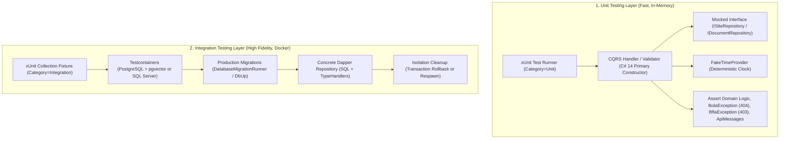
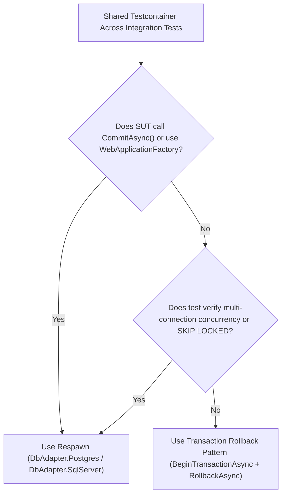
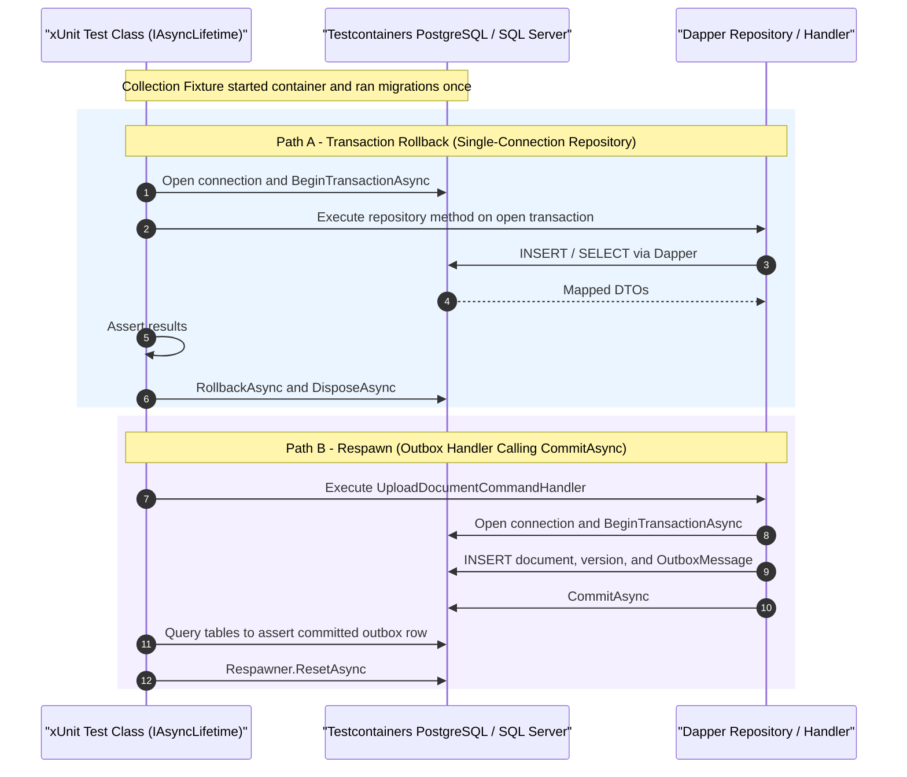

# Chapter 8: Testing, Mocking, and Testcontainers

## 1. Learning Objectives

By the end of this chapter, you will be able to:
*   Understand why attempting to mock Dapper extension methods is an architectural anti-pattern ("test damage").
*   Design a dual-layer testing strategy in **.NET 10 / C# 14** that strictly separates **Application Layer Unit Testing** (with primary constructors, `ApiMessages`, `BolaException`/`BflaException`, and `FakeTimeProvider`) from **Infrastructure Layer Integration Testing**.
*   Utilize **Testcontainers** (`Testcontainers.MsSql` and `Testcontainers.PostgreSql` with `pgvector`) to spin up ephemeral, production-equivalent database engines inside your test suite.
*   Choose and implement the right test isolation strategy: the **Transaction Rollback Pattern** for single-transaction repositories vs. **Respawn** for code that commits its own transactions (such as Transactional Outbox handlers) or spans HTTP requests via `WebApplicationFactory`.
*   Test schema migrations, custom `TypeHandler`s (including `Pgvector.Dapper` `VectorTypeHandler` and JSONB), and time-dependent SQL queries deterministically.
*   Evaluate the dangers of using In-Memory databases (like SQLite or EF Core InMemory) for testing SQL Server or PostgreSQL Dapper repositories.

## 2. Introduction

Testing data access code is historically one of the most frustrating aspects of enterprise software development. For years, the .NET community debated the merits of mocking the database versus testing against a real database.

Entity Framework Core attempted to solve this by providing an InMemory provider. However, this often led to a false sense of security; a LINQ query that worked perfectly against EF's InMemory provider would frequently crash in production because SQL Server or PostgreSQL could not translate a specific expression or function.

With Dapper, the problem is even more acute. Dapper is not an abstraction over your database—it is a direct conduit to it. Because Dapper executes raw SQL strings written in engine-specific dialects (such as SQL Server's **T-SQL** or PostgreSQL's **SQL + `pgvector`** extensions), testing a SQL Server or PostgreSQL query against a SQLite in-memory database is fundamentally invalid. Furthermore, because Dapper consists of static extension methods on `IDbConnection`, it cannot be mocked directly using standard libraries like Moq or NSubstitute.

This chapter defines the modern enterprise standard for testing Dapper applications: **Mock the Repository abstractions to unit-test business logic in milliseconds, and use Dockerized Testcontainers to integration-test Dapper queries, mappings, and migrations against the exact database engine you run in production.**

## 3. Core Concepts

### 3.1 The Impossibility of Mocking Dapper ("Test Damage")

**What it is:** `connection.QueryAsync<T>()` and `connection.ExecuteAsync()` are **static extension methods** defined on Dapper's static `SqlMapper` class, extending `IDbConnection`. **Mocking frameworks** (such as Moq, NSubstitute, or FakeItEasy) work by dynamically generating proxy classes at runtime that implement an interface or override `virtual` methods on a non-sealed class. Because C# extension methods are compiled into static method calls, no standard mocking library can intercept `connection.QueryAsync<T>()`.

**Why wrapping Dapper is an anti-pattern:** Some teams respond by inventing a wrapper interface such as `IDapperWrapper` or `IDbExecutor` with methods mirroring `QueryAsync<T>` and `ExecuteAsync` so they can mock Dapper in unit tests. This is a classic form of **test damage**—degrading your production architecture solely to satisfy a testing tool:
1. **Massive boilerplate:** You end up maintaining dozens of overloads for multi-mapping, `DynamicParameters`, `CommandDefinition`, and `QueryMultiple`.
2. **Testing a lie:** Mocking `IDapperWrapper.QueryAsync<T>` verifies only that your mock returns what you told it to return. It never validates SQL syntax, PostgreSQL `$1` vs. `@Param` binding, column-to-property mapping, `TypeHandler`s, or foreign-key constraints.

**How to solve it:** Encapsulate Dapper inside concrete Infrastructure repositories (`ChargerRepository`, `DapperDocumentRepository`) that implement domain/application port interfaces (`IChargerRepository`, `IDocumentRepository`). Unit tests mock the port interface; integration tests run the concrete repository against Testcontainers.

**When NOT to use a Dapper wrapper:** Never introduce an `IDapperWrapper` solely for unit-test mocking. The only legitimate reason to wrap `IDbConnection` execution is for cross-cutting runtime telemetry or transient-fault retry policies (covered in Chapter 9)—and even then, you test it with real integration tests, not mocked SQL strings.

#### Real-World Normora Examples (Encapsulating Dapper Behind Ports)
1. **`IDocumentRepository` (`Documents` module):** `GetDocumentByIdQueryHandler` depends on `IDocumentRepository`. The concrete `DapperDocumentRepository` executes PostgreSQL SQL against `documents.documents`; unit tests mock `IDocumentRepository`, never `IDbConnection`.
2. **`IHybridRetrievalRepository` (`Documents` module):** Hybrid search combines `pgvector` HNSW cosine distance (`<=>`) and PostgreSQL `tsvector` ranking using Reciprocal Rank Fusion (RRF). No mock of `IDbConnection` can validate that SQL; it lives behind `IHybridRetrievalRepository` and is tested against a real `pgvector` container.
3. **`ITenantMembershipRepository` (`Tenants` module):** `TenantsDbContext` / Dapper queries for `TenantMemberships` require explicit `tenant_id` and `external_user_id` predicates. Mocking the repository lets handler tests verify RBAC decisions cleanly, while integration tests prove the SQL predicate actually filters rows.
4. **`IPendingApprovalRepository` (`Conversations` module):** Server-enforced Human-In-The-Loop (HITL) approvals store 15-minute TTL records in `conversations.pending_approvals`. Putting Dapper behind `IPendingApprovalRepository` prevents `ApproveToolExecutionCommandHandler` from coupling to Npgsql SQL.
5. **`IAuditLogRepository` (`Tenants` module):** Audit entries serialize structured metadata into PostgreSQL `JSONB` columns. Keeping Dapper inside `DapperAuditLogRepository` isolates JSONB parameter serialization from business handlers.

---

### 3.2 Unit Testing the Application Layer (Mocking the Abstraction)

**What it is:** In Clean Architecture and Normora's **CQRS folder-per-operation** layout (as discussed in Chapter 6), the Application Layer orchestrates validation, authorization, and business rules through repository interfaces and cross-module MediatR contracts. A **Unit Test** executes a handler or validator completely in memory with mocked dependencies.

**Why it matters:** Unit tests run in milliseconds with zero Docker or network overhead. They allow developers to verify every business branch—including security failures, edge-case pricing calculations, and validation rules—before ever touching a database.

**How to implement it in .NET 10 / C# 14:**
*   Declare dependencies via **C# 14 primary constructors** (e.g., `public sealed class GetDocumentByIdQueryHandler(IDocumentRepository documentRepository)`).
*   Mock the repository interface with `NSubstitute` or `Moq`.
*   Assert domain exceptions, security exceptions (**BOLA** -> `BolaException` mapped globally to HTTP `404 Not Found` to prevent resource enumeration; **BFLA** -> `BflaException` mapped globally to HTTP `403 Forbidden`), and centralized message constants from `Normora.Shared.Constants.ApiMessages` (never hardcoded magic strings).

**When NOT to use Unit Tests:** Never rely on unit tests to verify SQL correctness, PostgreSQL vs. SQL Server syntax, `TypeHandler` registration, constraint violations (`UNIQUE`, `FOREIGN KEY`), or N+1 query elimination. Unit tests prove *application logic*, not *database behavior*.

#### Real-World Normora Examples (Application Unit Tests)
1. **BOLA Protection in `GetDocumentByIdQueryHandler`:** Mock `IDocumentRepository.GetAuthorizedAsync(documentId, tenantId, externalUserId)` to return `null` (document belongs to another tenant or restricted `UserGroup`). Assert the handler throws `BolaException` (404), preventing attackers from probing document GUIDs.
2. **BFLA Enforcement in `UploadDocumentCommandHandler`:** Mock `ITenantPermissionChecker` to return `false` for `Permissions.DocumentsUpload`. Assert `BflaException` (403) is thrown and verify `IDocumentRepository.InsertWithOutboxAsync` is called `Times.Never()`.
3. **Free-Tier Invariant in `CancelSubscriptionCommandHandler`:** Mock `ITenantSubscriptionRepository` to return a `Free` tier `TenantPlan`. Assert the handler throws `InvalidOperationException` whose message equals `ApiMessages.CannotCancelFreePlan` (no magic strings).
4. **HITL Expiry in `ApproveToolExecutionCommandHandler`:** Mock `IPendingApprovalRepository` to return an expired `PendingApproval` (older than 15 minutes relative to `FakeTimeProvider`) and assert execution is rejected without invoking `ExecuteMcpToolCommand`.
5. **Input Validation in `UploadDocumentCommandValidator`:** Instantiate the `FluentValidation` validator directly with zero mocks and assert failures when `TenantId == Guid.Empty`, file size exceeds workspace quota, or MIME type is unsupported.

---

### 3.3 Integration Testing with Testcontainers (PostgreSQL + pgvector & SQL Server)

**What it is:** **Testcontainers** is an open-source .NET library that programmatically manages lightweight, throwaway **Docker containers** during test execution. Instead of pointing tests at a shared dev database or a fake in-memory substitute, Testcontainers boots a genuine database instance (`mcr.microsoft.com/mssql/server:2022-latest` for SQL Server, or `pgvector/pgvector:pg16` for Normora's PostgreSQL + `pgvector`), assigns a random free host port, provides the dynamic connection string, and destroys the container when the test run completes.

**Why SQLite / InMemory testing fails:**
*   **Dialect mismatch:** SQL Server uses `GETUTCDATE()`, `ISNULL()`, `DATETIME2`, and `MERGE`. PostgreSQL uses `NOW()`, `COALESCE()`, `TIMESTAMPTZ`, `ILIKE`, `JSONB` operators (`@>`, `->>`), `tsvector`/`plainto_tsquery`, and `pgvector` cosine distance (`<=>`). SQLite understands almost none of these.
*   **Type and constraint fidelity:** SQLite stores dates as text and disables foreign keys by default. A broken Dapper query or missing `NOT NULL` column can pass SQLite tests and crash production immediately.

**How to wire it in xUnit:**
1. Implement `IAsyncLifetime` on a fixture class (`SqlServerFixture` or `NormoraPostgresFixture`).
2. Inside `InitializeAsync()`, call `await DbContainer.StartAsync()`, retrieve `DbContainer.GetConnectionString()`, and run your **exact production migration pipeline** (such as `DbUp` or Normora's `DatabaseMigrationRunner` executing `TenantsDatabaseMigrator`, `DocumentsDatabaseMigrator`, `ConversationsDatabaseMigrator`, and `SessionDatabaseMigrator`).
3. Share the fixture across test classes using an xUnit `[CollectionDefinition]` (`ICollectionFixture<T>`) so Docker starts the database **once** per test suite instead of once per test.

**When NOT to use Testcontainers:** Avoid Testcontainers for pure domain logic (`TenantPlanPricingCatalog`, `DocumentChunker` Markdown splitting), `FluentValidation` rules, or unit tests where sub-second execution is required and no SQL is executed. Also note that CI runners must have a Docker daemon available.

#### Real-World Normora Examples (Testcontainers Integration Tests)
1. **Hybrid Search (`pgvector` HNSW + Full-Text RRF):** Spin up `pgvector/pgvector:pg16`, seed embedded chunks in `documents.document_chunks`, and execute `DapperHybridRetrievalRepository.SearchAsync` to verify cosine similarity (`<=>`), `tsvector` keyword matching, and Reciprocal Rank Fusion ordering.
2. **Transactional Outbox Atomicity (`Documents`):** Execute `UploadDocumentCommandHandler` against real PostgreSQL and assert that `documents.documents`, `documents.document_versions`, and `documents.document_processing_outbox_messages` are committed together in one transaction.
3. **Explicit Tenant Scoping (`Tenants`):** Seed two workspaces (`TenantA`, `TenantB`) in `tenants.tenant_memberships`, `tenants.departments`, and `tenants.user_groups`. Query `TenantA` and assert zero rows from `TenantB` leak into the result set.
4. **Cross-Module Retrieval Contract (`PerformHybridRetrievalQuery`):** Test `PerformHybridRetrievalQueryHandler` end-to-end with an explicit `Guid TenantId` against PostgreSQL to ensure background workers (with no `HttpContext`) get the exact same tenant isolation as HTTP requests.
5. **Four-Migrator Sequential Pipeline (`Normora.Infrastructure`):** Boot an empty `pgvector/pgvector:pg16` container and execute all four migrators (`TenantsDatabaseMigrator`, `DocumentsDatabaseMigrator`, `ConversationsDatabaseMigrator`, `SessionDatabaseMigrator`) sequentially to verify schema creation, HNSW indexes, and idempotency on re-run.

---

### 3.4 Test Isolation Strategies: Transaction Rollback vs. Respawn vs. Truncation

**What it is:** Because spinning up a Docker container takes 3–10 seconds, all integration tests in a suite share one running database container. **Test isolation** guarantees that rows inserted or modified by `TestA` are never visible to `TestB`.

**Why naive cleanup fails:** Running `DELETE FROM` manually across tables breaks on foreign-key constraints, leaves `IDENTITY` / PostgreSQL `SERIAL` sequences incremented (making ID assertions flaky), and slows down suites as table count grows.

**How the two enterprise strategies work:**
1. **Transaction Rollback Pattern:** In xUnit's `InitializeAsync()`, open a connection (`SqlConnection` or `NpgsqlConnection`), call `BeginTransactionAsync()`, and pass a test `IDbConnectionFactory` (returning that open connection/transaction) to the repository. After the test asserts, `DisposeAsync()` calls `RollbackAsync()`. The database discards the uncommitted changes in memory in under 1 millisecond.
2. **Respawn (`Respawn` NuGet package):** Created by Jimmy Bogard, Respawn inspects your database's foreign-key dependency graph at startup and generates an optimized `DELETE`/`TRUNCATE` reset script (via `DbAdapter.Postgres` or `DbAdapter.SqlServer`). You call `await respawner.ResetAsync(connection)` between tests. It preserves schema, migrations history tables (`TablesToIgnore`), and can reset identity/sequence seeds.

**When NOT to use Transaction Rollback (Use Respawn instead):**
*   **Code that commits its own transaction:** If the System Under Test calls `transaction.CommitAsync()` (like a Unit of Work or Outbox handler), rolling back in `DisposeAsync()` fails or leaves committed rows behind.
*   **`WebApplicationFactory<Program>` API tests:** HTTP requests create independent DI scopes that lease their own pooled connections from `NpgsqlDataSource`, invisible to the test fixture's uncommitted transaction.
*   **Concurrency & lock testing:** Testing PostgreSQL `FOR UPDATE SKIP LOCKED` across two competing worker connections requires committed rows and separate connections.

#### Real-World Normora Examples (Rollback vs. Respawn)
1. **Transaction Rollback — `DapperDocumentReadRepository`:** Pure read/query repository receives the test's active `NpgsqlTransaction`; test inserts fixture documents, queries them, and rolls back instantaneously.
2. **Transaction Rollback — `DapperDepartmentRepository.CreateAsync`:** Single-command repository executes `INSERT INTO tenants.departments` using the injected connection/transaction without committing; `DisposeAsync()` rolls back in <1ms.
3. **Respawn — `UploadDocumentCommandHandler` (Transactional Outbox):** The handler explicitly begins and commits its own `NpgsqlTransaction` spanning document metadata and `DocumentProcessingOutboxMessage`. Test uses `Respawn` (`SchemasToInclude = ["documents"]`) to wipe committed rows after the test.
4. **Respawn — `OutboxDispatcherConcurrencyTests`:** Two background worker tasks concurrently execute `SELECT ... FOR UPDATE SKIP LOCKED` against `documents.document_processing_outbox_messages` on separate connections to prove only one worker claims a job; `Respawn` cleans up afterward.
5. **Respawn — `DocumentsController` via `WebApplicationFactory<Program>`:** Full HTTP BFF test sends `GET /api/documents/{otherTenantDocId}` and asserts `404 Not Found` (`BolaException` + `ApiMessages.NotFound`). Because Kestrel uses pooled `NpgsqlDataSource` connections, `Respawn` resets the database between HTTP tests.

---

### 3.5 Testing Schema Migrations, TypeHandlers, and Deterministic Time (`TimeProvider`)

**What it is:** Dapper relies on three runtime contracts outside your C# business logic: (1) the database **schema** created by migrations, (2) global **`SqlMapper.TypeHandler<T>`** registrations (and Npgsql type plugins like `.UseVector()`), and (3) **temporal parameters** passed into SQL `WHERE` clauses.

**Why tests fail without them:**
*   **Unregistered `TypeHandler`s:** Dapper caches type handlers statically in `SqlMapper`. If `Program.cs` registers a `VectorTypeHandler` or `JsonbTypeHandler<T>` at startup, but your Integration Test project forgets to register it, queries throw `NotSupportedException` or deserialize `null`.
*   **Non-deterministic SQL clocks:** Writing `WHERE expires_at < NOW()` or `WHERE EndTime < GETUTCDATE()` inside raw SQL makes tests depend on the CI server's wall clock, creating flaky failures around midnight, timezone shifts, or slow CI builds.

**How to test them properly:**
*   Register all custom `TypeHandler`s in your test fixture initialization (or via `[ModuleInitializer]`) using the exact same extension method as `Normora.Infrastructure`.
*   Inject .NET 10's built-in **`TimeProvider`** into handlers/services and pass `@UtcNow` explicitly as a Dapper SQL parameter (`WHERE expires_at < @UtcNow`). In tests, pass **`FakeTimeProvider`** (from `Microsoft.Extensions.TimeProvider.Testing`) and call `fakeTime.Advance(...)` to time-travel deterministically.

**When NOT to use `FakeTimeProvider`:** Only skip `FakeTimeProvider` when benchmarking actual database query latency or testing genuine clock-skew timeouts across distributed containers.

#### Real-World Normora Examples (Migrations, TypeHandlers, and `TimeProvider`)
1. **`Pgvector.Dapper` `VectorTypeHandler` Round-Trip:** Register `SqlMapper.AddTypeHandler(new VectorTypeHandler())` and `dataSourceBuilder.UseVector()` in `NormoraPostgresFixture`, insert a 768-dimension Gemini embedding `Vector`, and read it back to assert exact floating-point fidelity.
2. **`JsonbTypeHandler<Dictionary<string, object?>>` for HITL Approvals:** Test `conversations.pending_approvals` serialization of `ToolArguments` JSONB payloads, including nested arrays and `null` property values.
3. **Deterministic 15-Minute Approval TTL (`FakeTimeProvider`):** Insert a `PendingApproval` at `2026-11-20T10:00:00Z`, advance `FakeTimeProvider` by 14 minutes (assert claimable), then advance 2 more minutes (assert expired query excludes it).
4. **Deterministic Subscription Renewal Window (`FakeTimeProvider`):** Seed a `TenantPlan` in `tenants.tenant_plans`, advance `FakeTimeProvider` to the billing boundary, and assert `GetExpiringPlansAsync(timeProvider.GetUtcNow())` selects the exact expected tenant.
5. **Zero-Downtime V1 -> V2 Migration Test:** Apply V1 `documents` schema, insert V1 rows via Dapper, apply V2 migration adding a nullable `checksum_sha256` column, and assert V2 Dapper queries read V1 rows cleanly without `DataException` on `NULL`.

---

### 3.6 Test Architecture, Parallelism, and CI/CD Segregation

**What it is:** Organizing solution projects, xUnit **Traits**, and **Fixture scopes** so fast Unit Tests and heavier Docker-based Integration Tests run efficiently in local development and CI/CD pipelines.

**Why it matters:** A SQL Server container consumes ~1.5–2 GB of RAM; a PostgreSQL + `pgvector` container consumes ~250–500 MB. If xUnit runs 6 test collections in parallel and each creates its own container, a standard 4–7 GB CI runner (such as GitHub Actions `ubuntu-latest`) can suffer **OOM (Out of Memory)** kills or port/disk contention.

**How to architect it:**
*   Tag tests with `[Trait("Category", "Unit")]` and `[Trait("Category", "Integration")]` (or place them in separate projects such as `Normora.Documents.UnitTests`, `Normora.Documents.IntegrationTests`, and `Normora.Architecture.Tests`).
*   In CI, run `dotnet test --filter Category=Unit` first (<5 seconds). Only run `dotnet test --filter Category=Integration` if unit tests pass.
*   Use a **single shared Collection Fixture** (or xUnit v3 `[assembly: AssemblyFixture]`) per database engine, and disable parallel execution between integration test classes that mutate shared tables via Respawn.

**When NOT to disable parallelism:** Never disable test parallelism globally across Unit Tests—unit tests share no mutable state and benefit massively from running across all CPU cores.

#### Real-World Normora Examples (Test Suite Organization)
1. **`Normora.Documents.UnitTests` (`Category=Unit`):** Runs `UploadDocumentCommandHandlerTests`, `DocumentChunkerTests`, and validators across all CPU cores in under 2 seconds with zero Docker dependency.
2. **`Normora.Documents.IntegrationTests` (`Category=Integration`):** Shares one `NormoraPostgresFixture` via `[CollectionDefinition("NormoraPostgres")]` so PostgreSQL + `pgvector` boots once for all document, chunk, and outbox tests.
3. **`Normora.Tenants.IntegrationTests`:** Isolates read/write tenant tests using fresh `Guid.NewGuid()` `TenantId`s per test case alongside Respawn cleanup.
4. **`Normora.Conversations.IntegrationTests`:** Uses `Respawn` configured with `SchemasToInclude = ["conversations"]` so resetting conversation/approval tables does not needlessly scan `documents.document_chunks`.
5. **`Normora.Architecture.Tests`:** Automated NetArchTest suite verifying modular monolith boundaries (no module references another module's `DbContext`, and `Documents`/`Conversations`/`Tenants` contain zero third-party `Minio` or Gemini SDK references).

## 4. Visual Diagrams

### 4.1 Dual-Layer Dapper Testing Strategy



### 4.2 Test Isolation Decision Tree



### 4.3 Transaction Rollback vs. Respawn Lifecycle



## 5. Complete Examples: EV Charging Platform & Normora

### Case Study A: EV Charging Platform (SQL Server)

#### Scenario 1: Unit Testing the Application Layer
We want to test our CQRS Command Handler that creates a Charger. We will use `Moq` to mock the repository.

```csharp
// System Under Test: CreateChargerCommandHandler (Application Layer)
using Moq;
using Xunit;
using FluentAssertions;

public class CreateChargerCommandHandlerTests
{
    [Fact]
    [Trait("Category", "Unit")]
    public async Task Handle_WhenSiteDoesNotExist_ThrowsNotFoundException()
    {
        // Arrange
        var mockSiteRepo = new Mock<ISiteRepository>();
        var mockChargerRepo = new Mock<IChargerRepository>();

        // Mock the interface, not Dapper!
        mockSiteRepo
            .Setup(repo => repo.SiteExistsAsync(It.IsAny<Guid>()))
            .ReturnsAsync(false);

        var handler = new CreateChargerCommandHandler(mockSiteRepo.Object, mockChargerRepo.Object);
        var command = new CreateChargerCommand(Guid.NewGuid(), "SN-123");

        // Act
        Func<Task> act = async () => await handler.Handle(command, CancellationToken.None);

        // Assert
        await act.Should().ThrowAsync<NotFoundException>();
        
        // Verify Dapper was never involved, and the Charger was never saved
        mockChargerRepo.Verify(repo => repo.InsertAsync(It.IsAny<ChargerDto>()), Times.Never);
    }
}
```

#### Scenario 2: Integration Testing Dapper with Testcontainers (`Testcontainers.MsSql`)
We need to test the actual `ChargerRepository.InsertAsync` method to ensure the T-SQL string is valid. We use `Testcontainers.MsSql`, `Microsoft.Data.SqlClient` (replacing the deprecated `System.Data.SqlClient`), and `xUnit`.

**1. Setup the Database Fixture and Collection Definition:**
```csharp
using Testcontainers.MsSql;
using Xunit;

public sealed class SqlServerFixture : IAsyncLifetime
{
    public MsSqlContainer DbContainer { get; } = new MsSqlBuilder("mcr.microsoft.com/mssql/server:2022-latest")
        .WithPassword("StrongP@ssw0rd!")
        .Build();

    public async Task InitializeAsync()
    {
        await DbContainer.StartAsync();

        // Run your exact production schema migrations (e.g., DbUp)
        var connectionString = DbContainer.GetConnectionString();
        await DatabaseMigrator.RunAsync(connectionString);
    }

    public async Task DisposeAsync()
    {
        await DbContainer.DisposeAsync();
    }
}

[CollectionDefinition("DatabaseCollection")]
public sealed class DatabaseCollection : ICollectionFixture<SqlServerFixture>;
```

**2. Write the Integration Test using the Transaction Rollback Pattern:**
Instead of truncating tables after every test, we start a transaction, run the test, and roll it back. This ensures blazing-fast test isolation.

```csharp
using Dapper;
using FluentAssertions;
using Microsoft.Data.SqlClient;
using Xunit;

[Collection("DatabaseCollection")] // Shares the fixture across tests
[Trait("Category", "Integration")]
public class ChargerRepositoryTests(SqlServerFixture fixture) : IAsyncLifetime
{
    private SqlConnection _connection = null!;
    private SqlTransaction _transaction = null!;
    private ChargerRepository _sut = null!; // System Under Test

    public async Task InitializeAsync()
    {
        // Open connection and start transaction before EVERY test
        _connection = new SqlConnection(fixture.DbContainer.GetConnectionString());
        await _connection.OpenAsync();
        _transaction = (SqlTransaction)await _connection.BeginTransactionAsync();

        // Inject a fake ConnectionFactory that returns our transacted connection
        var factory = new FakeTransactedConnectionFactory(_connection, _transaction);
        _sut = new ChargerRepository(factory);
    }

    public async Task DisposeAsync()
    {
        // Rollback after EVERY test to reset DB state instantly
        await _transaction.RollbackAsync();
        await _connection.DisposeAsync();
    }

    [Fact]
    public async Task InsertAsync_WithValidData_SavesAndMapsCorrectly()
    {
        // Arrange
        var siteId = Guid.NewGuid();
        // Assume Site test data is seeded inside _transaction...

        var charger = new ChargerDto
        {
            Id = Guid.NewGuid(),
            SiteId = siteId,
            SerialNumber = "TEST-999"
        };

        // Act - Executes real Dapper code against Docker SQL Server
        await _sut.InsertAsync(charger, CancellationToken.None);

        // Assert - Use Dapper to verify the data was inserted
        var inserted = await _connection.QuerySingleOrDefaultAsync<ChargerDto>(
            "SELECT Id, SiteId, SerialNumber FROM Chargers WHERE Id = @Id",
            new { Id = charger.Id },
            transaction: _transaction);

        inserted.Should().NotBeNull();
        inserted!.SerialNumber.Should().Be("TEST-999");
    }
}
```

---

### Case Study B: Normora (.NET 10 / C# 14 / PostgreSQL + `pgvector`)

#### Scenario 3: Unit Testing Normora CQRS Handlers (BOLA, `ApiMessages`, & `FakeTimeProvider`)
In Normora, handlers use **C# 14 primary constructors**, enforce **BOLA** (`BolaException` -> `404`), **BFLA** (`BflaException` -> `403`), and never hardcode error strings (all messages come from `Normora.Shared.Constants.ApiMessages`). Notice how we mock the repository and inject `FakeTimeProvider`—Dapper is completely absent from these fast unit tests.

```csharp
using FluentAssertions;
using Microsoft.Extensions.Time.Testing;
using NSubstitute;
using Normora.Modules.Conversations.Application.Approvals.Commands.ApproveToolExecution;
using Normora.Modules.Documents.Application.Documents.Queries.GetDocumentById;
using Normora.Modules.Tenants.Application.Subscriptions.Commands.CancelSubscription;
using Normora.Shared.Constants;
using Normora.Shared.Exceptions;
using Xunit;

[Trait("Category", "Unit")]
public sealed class NormoraApplicationUnitTests
{
    [Fact]
    public async Task GetDocumentById_WhenDocumentBelongsToAnotherTenant_ThrowsBolaException()
    {
        // Arrange: BOLA returns 404 globally to prevent tenant/document enumeration
        var docRepo = Substitute.For<IDocumentReadRepository>();
        var tenantId = Guid.NewGuid();
        var foreignDocId = Guid.NewGuid();

        docRepo.GetAuthorizedAsync(foreignDocId, tenantId, "ext-user-101", Arg.Any<CancellationToken>())
            .Returns((DocumentDetailDto?)null);

        var handler = new GetDocumentByIdQueryHandler(docRepo);
        var query = new GetDocumentByIdQuery(tenantId, "ext-user-101", foreignDocId);

        // Act
        Func<Task> act = () => handler.Handle(query, CancellationToken.None);

        // Assert
        await act.Should().ThrowAsync<BolaException>();
    }

    [Fact]
    public async Task CancelSubscription_WhenWorkspaceIsOnFreeTier_ThrowsWithApiMessagesConstant()
    {
        // Arrange: Free tier workspaces cannot be cancelled
        var subRepo = Substitute.For<ITenantSubscriptionRepository>();
        var tenantId = Guid.NewGuid();

        subRepo.GetActivePlanAsync(tenantId, Arg.Any<CancellationToken>())
            .Returns(new TenantPlanDto(tenantId, PlanTier.Free, "USD", BillingCycle.Monthly));

        var handler = new CancelSubscriptionCommandHandler(subRepo);
        var command = new CancelSubscriptionCommand(tenantId, "ext-admin-01");

        // Act
        Func<Task> act = () => handler.Handle(command, CancellationToken.None);

        // Assert: Verify exact centralized constant, never a magic string
        (await act.Should().ThrowAsync<InvalidOperationException>())
            .WithMessage(ApiMessages.CannotCancelFreePlan);

        await subRepo.DidNotReceive().MarkCancelledAsync(Arg.Any<Guid>(), Arg.Any<CancellationToken>());
    }

    [Fact]
    public async Task ApproveToolExecution_After15MinuteTtlExpires_RejectsApprovalDeterministically()
    {
        // Arrange: Use .NET's FakeTimeProvider instead of DateTimeOffset.UtcNow
        var fakeTime = new FakeTimeProvider(new DateTimeOffset(2026, 11, 20, 10, 0, 0, TimeSpan.Zero));
        var approvalRepo = Substitute.For<IPendingApprovalRepository>();
        var approvalId = Guid.NewGuid();
        var tenantId = Guid.NewGuid();

        approvalRepo.GetPendingAsync(approvalId, tenantId, Arg.Any<CancellationToken>())
            .Returns(new PendingApprovalDto(
                approvalId,
                tenantId,
                "ext-user-101",
                "documents_delete",
                ExpiresAtUtc: fakeTime.GetUtcNow().AddMinutes(15)));

        // Advance time by 16 minutes past creation
        fakeTime.Advance(TimeSpan.FromMinutes(16));

        var handler = new ApproveToolExecutionCommandHandler(approvalRepo, fakeTime);
        var command = new ApproveToolExecutionCommand(tenantId, "ext-user-101", approvalId);

        // Act
        Func<Task> act = () => handler.Handle(command, CancellationToken.None);

        // Assert
        (await act.Should().ThrowAsync<InvalidOperationException>())
            .WithMessage(ApiMessages.ApprovalExpired);
    }
}
```

#### Scenario 4: Normora `Testcontainers.PostgreSql` + `pgvector` Fixture & TypeHandler Setup
Normora runs on PostgreSQL with the `pgvector` extension (`HNSW` index) across `tenants`, `documents`, and `conversations` schemas. The fixture must:
1. Use the `pgvector/pgvector:pg16` Docker image (not plain `postgres:16`, which lacks the `vector` extension!).
2. Configure `NpgsqlDataSource` with `.UseVector()` and register `Pgvector.Dapper.VectorTypeHandler`.
3. Run Normora's four-migrator pipeline (`DatabaseMigrationRunner`) against the container on startup.

```csharp
using Dapper;
using Npgsql;
using Pgvector.Dapper;
using Testcontainers.PostgreSql;
using Xunit;

public sealed class NormoraPostgresFixture : IAsyncLifetime
{
    public PostgreSqlContainer DbContainer { get; } = new PostgreSqlBuilder("pgvector/pgvector:pg16")
        .WithDatabase("normora_test")
        .WithUsername("normora")
        .WithPassword("normora_test_pw")
        .Build();

    public NpgsqlDataSource DataSource { get; private set; } = null!;

    public async Task InitializeAsync()
    {
        await DbContainer.StartAsync();

        // Register Dapper TypeHandlers matching production startup
        SqlMapper.AddTypeHandler(new VectorTypeHandler());

        var dataSourceBuilder = new NpgsqlDataSourceBuilder(DbContainer.GetConnectionString());
        dataSourceBuilder.UseVector();
        DataSource = dataSourceBuilder.Build();

        // Execute Normora's 4-migrator pipeline:
        // Tenants -> Documents -> Conversations -> Session
        await NormoraTestMigrator.RunAllAsync(DbContainer.GetConnectionString());
    }

    public async Task DisposeAsync()
    {
        await DataSource.DisposeAsync();
        await DbContainer.DisposeAsync();
    }
}

[CollectionDefinition("NormoraPostgres")]
public sealed class NormoraPostgresCollection : ICollectionFixture<NormoraPostgresFixture>;
```

#### Scenario 5: Integration Testing `pgvector` Hybrid Retrieval & Tenant Isolation (Transaction Rollback)
Here we verify `DapperHybridRetrievalRepository` (invoked via `PerformHybridRetrievalQuery`) against real PostgreSQL + `pgvector`. We confirm:
*   `VectorTypeHandler` maps 3-dimension/768-dimension `Pgvector.Vector` parameters cleanly.
*   `TenantB`'s chunks are never returned when querying for `TenantA`, even if `TenantB` has a closer semantic match.
*   Nullable columns (like `section_breadcrumb`) map safely without throwing `DataException`.

```csharp
using Dapper;
using FluentAssertions;
using Npgsql;
using Pgvector;
using Xunit;

[Collection("NormoraPostgres")]
[Trait("Category", "Integration")]
public sealed class HybridRetrievalRepositoryTests(NormoraPostgresFixture fixture) : IAsyncLifetime
{
    private NpgsqlConnection _connection = null!;
    private NpgsqlTransaction _transaction = null!;
    private DapperHybridRetrievalRepository _sut = null!;

    public async Task InitializeAsync()
    {
        _connection = await fixture.DataSource.OpenConnectionAsync();
        _transaction = await _connection.BeginTransactionAsync();

        var connectionFactory = new FakeTransactedNpgsqlConnectionFactory(_connection, _transaction);
        _sut = new DapperHybridRetrievalRepository(connectionFactory);
    }

    public async Task DisposeAsync()
    {
        await _transaction.RollbackAsync();
        await _connection.DisposeAsync();
    }

    [Fact]
    public async Task SearchAsync_EnforcesTenantIsolationAndMapsNullableBreadcrumbs()
    {
        // Arrange
        var tenantA = Guid.NewGuid();
        var tenantB = Guid.NewGuid();
        var docA = Guid.NewGuid();
        var docB = Guid.NewGuid();

        const string seedSql = """
            INSERT INTO documents.document_chunks
                (id, tenant_id, document_id, content, section_breadcrumb, embedding)
            VALUES
                (@Id, @TenantId, @DocumentId, @Content, @Breadcrumb, @Embedding);
            """;

        // Tenant A chunk (NULL breadcrumb to verify null-safe Dapper mapping)
        await _connection.ExecuteAsync(seedSql, new
        {
            Id = Guid.NewGuid(),
            TenantId = tenantA,
            DocumentId = docA,
            Content = "Annual travel reimbursement policy limit is 1500 USD.",
            Breadcrumb = (string?)null,
            Embedding = new Vector(new float[] { 0.80f, 0.20f, 0.00f })
        }, _transaction);

        // Tenant B chunk (exact match vector, MUST NOT leak to Tenant A)
        await _connection.ExecuteAsync(seedSql, new
        {
            Id = Guid.NewGuid(),
            TenantId = tenantB,
            DocumentId = docB,
            Content = "Confidential executive travel limit is 9900 USD.",
            Breadcrumb = "Executive > Travel",
            Embedding = new Vector(new float[] { 1.00f, 0.00f, 0.00f })
        }, _transaction);

        var queryEmbedding = new Vector(new float[] { 1.00f, 0.00f, 0.00f });

        // Act
        var results = await _sut.SearchAsync(
            tenantId: tenantA,
            queryText: "travel limit",
            queryEmbedding: queryEmbedding,
            topK: 5,
            CancellationToken.None);

        // Assert
        results.Should().ContainSingle();
        results[0].DocumentId.Should().Be(docA);
        results[0].SectionBreadcrumb.Should().BeNull();
    }
}
```

#### Scenario 6: Integration Testing Normora's Transactional Outbox with `Respawn`
`UploadDocumentCommandHandler` commits document metadata, `DocumentVersion`, and `DocumentProcessingOutboxMessage` inside a single PostgreSQL transaction. Because the handler calls `CommitAsync()`, **Transaction Rollback cannot be used**. Instead, we use **`Respawn`** (`DbAdapter.Postgres`) in `DisposeAsync()` to reset the `documents` schema cleanly after each test.

```csharp
using Dapper;
using FluentAssertions;
using Npgsql;
using NSubstitute;
using Respawn;
using Xunit;

[Collection("NormoraPostgres")]
[Trait("Category", "Integration")]
public sealed class UploadDocumentOutboxIntegrationTests(NormoraPostgresFixture fixture) : IAsyncLifetime
{
    private Respawner _respawner = null!;

    public async Task InitializeAsync()
    {
        await using var conn = await fixture.DataSource.OpenConnectionAsync();
        _respawner = await Respawner.CreateAsync(conn, new RespawnerOptions
        {
            DbAdapter = DbAdapter.Postgres,
            SchemasToInclude = ["documents"],
            WithReseed = true
        });
    }

    public async Task DisposeAsync()
    {
        await using var conn = await fixture.DataSource.OpenConnectionAsync();
        await _respawner.ResetAsync(conn);
    }

    [Fact]
    public async Task Handle_CommitsDocumentVersionAndOutboxMessageAtomically()
    {
        // Arrange
        var tenantId = Guid.NewGuid();
        var storage = Substitute.For<IDocumentStorageService>();
        var wakeup = Substitute.For<IDocumentProcessingWakeup>();
        var handler = new UploadDocumentCommandHandler(fixture.DataSource, storage, wakeup);

        var command = new UploadDocumentCommand(
            TenantId: tenantId,
            ExternalUserId: "ext-user-202",
            FileName: "travel-policy.md",
            ContentType: "text/markdown",
            StorageKey: $"{tenantId}/travel-policy.md");

        // Act - Handler opens connection, begins transaction, inserts 3 rows, and calls CommitAsync()
        var documentId = await handler.Handle(command, CancellationToken.None);

        // Assert - Verify committed state on a fresh connection
        await using var verifyConn = await fixture.DataSource.OpenConnectionAsync();

        var outboxCount = await verifyConn.ExecuteScalarAsync<int>(
            """
            SELECT COUNT(*)
            FROM documents.document_processing_outbox_messages
            WHERE tenant_id = @TenantId AND document_id = @DocumentId AND status = 'Pending'
            """,
            new { TenantId = tenantId, DocumentId = documentId });

        outboxCount.Should().Be(1);
        await wakeup.Received(1).SignalAsync(Arg.Any<CancellationToken>());
    }
}
```

## 6. Performance Implications

### Docker Container Startup Time
Spinning up a SQL Server Docker container takes 5 to 10 seconds (and a `pgvector/pgvector:pg16` PostgreSQL container takes ~2 to 4 seconds). If you spin up a new container for every single test `[Fact]`, a suite of 100 tests will take 6 to 15 minutes.

To optimize this, you must use xUnit's **Class Fixtures** or **Collection Fixtures** (as shown in Section 5). This spins up the container exactly once at the beginning of the test run, runs all 100 tests against it, and destroys it at the end. The total run time drops from 15 minutes to about 8–12 seconds.

### Isolation Strategy Performance Comparison
When sharing a container across tests, test data from `TestA` must never corrupt `TestB`:
*   **Naive `DELETE FROM` / Truncation:** Running manual deletes between tests is slow, breaks on foreign-key graphs, and leaves `IDENTITY` / PostgreSQL `SERIAL` sequences dirty.
*   **Respawn (`DbAdapter.Postgres` / `DbAdapter.SqlServer`):** Inspects foreign keys once at startup and executes a minimal topological `DELETE` script in ~5–20ms per test. Required when testing handlers that call `CommitAsync()` (like Normora's Transactional Outbox) or full HTTP flows via `WebApplicationFactory<Program>`. Scope `SchemasToInclude` (e.g., `["documents"]`) so Respawn doesn't scan unrelated schemas.
*   **Transaction Rollback:** Passing an open `SqlTransaction` or `NpgsqlTransaction` into your repository, executing the test, and calling `RollbackAsync()` takes <1ms. The database discards the uncommitted WAL/transaction log in memory without permanently mutating physical pages.

### NpgsqlDataSource Connection Pooling in Tests
In .NET 10, `NpgsqlDataSource` manages connection pooling automatically. Always build **one** `NpgsqlDataSource` inside your `NormoraPostgresFixture` and dispose it in `DisposeAsync()`—never create a new `NpgsqlDataSource` per test, as doing so leaks connection pools and exhausts PostgreSQL's `max_connections` limit.

---

## 7. Common Mistakes & Anti-Patterns

> [!CAUTION]
> **Anti-Pattern 1: Creating an `IDapperWrapper` to Mock `QueryAsync` ("Test Damage")**
>
> **Wrong Code:**
> ```csharp
> public interface IDapperWrapper
> {
>     Task<T?> QuerySingleOrDefaultAsync<T>(string sql, object? param = null);
> }
>
> // Unit test mocks SQL execution instead of business abstractions
> _dapperWrapper.Setup(x => x.QuerySingleOrDefaultAsync<DocumentDto>(It.IsAny<string>(), It.IsAny<object>()))
>     .ReturnsAsync(new DocumentDto());
> ```
>
> **Why It's Wrong:** You introduce massive boilerplate recreating Dapper's API while testing nothing of value. Your mock ignores broken SQL syntax, wrong column aliases, PostgreSQL vs. SQL Server parameter errors, and missing `TypeHandler`s.
>
> **The Fix:** Encapsulate Dapper inside concrete Infrastructure repositories behind domain interfaces (`IDocumentReadRepository`, `ISiteRepository`). Mock the repository interface in unit tests, and test the SQL repository against Testcontainers.
> ```csharp
> // Unit test mocks the business port:
> var docRepo = Substitute.For<IDocumentReadRepository>();
> var handler = new GetDocumentByIdQueryHandler(docRepo);
> ```

> [!CAUTION]
> **Anti-Pattern 2: Using SQLite In-Memory to Test PostgreSQL or SQL Server Queries**
>
> **Wrong Code:**
> ```csharp
> // Testing Normora's PostgreSQL + pgvector query against SQLite
> await using var connection = new SqliteConnection("Data Source=:memory:");
> await connection.OpenAsync();
> var sut = new DapperHybridRetrievalRepository(new FakeConnectionFactory(connection));
> ```
>
> **Why It's Wrong:** Dapper executes raw, engine-specific SQL. SQL Server (`GETUTCDATE()`, `ISNULL()`, `MERGE`) and PostgreSQL (`ILIKE`, `JSONB`, `tsvector`, `pgvector` `<=>` cosine distance, `ON CONFLICT`) fail or behave differently in SQLite, giving false passes or useless syntax errors.
>
> **The Fix:** Always test against the exact database engine and extensions used in production via `Testcontainers.PostgreSql` (`pgvector/pgvector:pg16`) or `Testcontainers.MsSql`.
> ```csharp
> public PostgreSqlContainer DbContainer { get; } =
>     new PostgreSqlBuilder("pgvector/pgvector:pg16").Build();
> ```

> [!CAUTION]
> **Anti-Pattern 3: Hardcoding Ports or Shared Dev Connection Strings**
>
> **Wrong Code:**
> ```csharp
> // Connects to a shared dev DB or assumes static port 5432 / 1433
> private const string ConnStr = "Host=dev-db.internal;Port=5432;Database=normora;Username=postgres;Password=postgres";
> ```
>
> **Why It's Wrong:** Shared dev databases cause flaky tests whenever two developers or CI jobs run simultaneously. Furthermore, Testcontainers binds Docker containers to random high host ports to avoid port collisions on CI build agents, so hardcoded ports will fail to connect.
>
> **The Fix:** Always retrieve the dynamic connection string programmatically from the container instance.
> ```csharp
> var connectionString = fixture.DbContainer.GetConnectionString();
> ```

> [!CAUTION]
> **Anti-Pattern 4: Using Transaction Rollback on Code That Calls `CommitAsync()`**
>
> **Wrong Code:**
> ```csharp
> // Test starts _transaction, but UploadDocumentCommandHandler calls internal tx.CommitAsync()
> public async Task DisposeAsync()
> {
>     await _transaction.RollbackAsync(); // Fails or leaves committed Outbox rows in DB!
> }
> ```
>
> **Why It's Wrong:** The Rollback pattern only works when the repository receives an external `IDbTransaction` and never commits it. If a handler manages its own transaction boundary (like Normora's Transactional Outbox in `UploadDocumentCommandHandler`) or runs via `WebApplicationFactory`, rows are committed permanently and leak into subsequent tests.
>
> **The Fix:** Use **Respawn** (`DbAdapter.Postgres` or `DbAdapter.SqlServer`) in `DisposeAsync()` for any handler that commits transactions or runs through an HTTP TestServer.
> ```csharp
> await using var conn = await fixture.DataSource.OpenConnectionAsync();
> await _respawner.ResetAsync(conn);
> ```

> [!CAUTION]
> **Anti-Pattern 5: Forgetting `TypeHandler` / `UseVector()` Registration in the Test Fixture**
>
> **Wrong Code:**
> ```csharp
> // NormoraPostgresFixture builds NpgsqlDataSource without UseVector() or VectorTypeHandler
> DataSource = NpgsqlDataSource.Create(DbContainer.GetConnectionString());
> ```
>
> **Why It's Wrong:** Dapper relies on static `SqlMapper.AddTypeHandler(...)` registrations and Npgsql plugins configured at startup (`Program.cs`). Omitting them in your test fixture causes `NotSupportedException` or `InvalidCastException` when reading `pgvector` embeddings or `JSONB` payloads.
>
> **The Fix:** Mirror production Dapper & Npgsql type registrations inside your test fixture's `InitializeAsync()` (or a `[ModuleInitializer]`).
> ```csharp
> SqlMapper.AddTypeHandler(new VectorTypeHandler());
> var builder = new NpgsqlDataSourceBuilder(DbContainer.GetConnectionString());
> builder.UseVector();
> DataSource = builder.Build();
> ```

> [!CAUTION]
> **Anti-Pattern 6: Testing Only "Happy Path" Data Without `NULL`s or Cross-Tenant BOLA Cases**
>
> **Wrong Code:**
> ```csharp
> // Only tests a single tenant with every optional column populated
> await _connection.ExecuteAsync(seedSql, new { TenantId = tenantA, Breadcrumb = "HR > Leave" });
> var result = await _sut.SearchAsync(tenantA, "leave", embedding, 5, CancellationToken.None);
> result.Should().NotBeEmpty();
> ```
>
> **Why It's Wrong:** Production tables contain `NULL` optional columns (which throw `DataException` if mapped to non-nullable C# types) and rows belonging to other tenants. Missing `WHERE tenant_id = @TenantId` filters in `TenantsDbContext` / Dapper repositories causes catastrophic cross-tenant data leaks.
>
> **The Fix:** Explicitly insert `NULL` values into nullable columns and seed a second tenant (`tenantB`) with a higher-scoring match to prove your SQL predicate isolates `tenantA`.
> ```csharp
> // Seed Tenant B with an exact vector match and assert 0 rows leak to Tenant A
> results.Should().ContainSingle(r => r.DocumentId == docA && r.SectionBreadcrumb == null);
> ```

> [!CAUTION]
> **Anti-Pattern 7: Spinning Up a Container Per `[Fact]` or Unbounded Parallel Containers on CI**
>
> **Wrong Code:**
> ```csharp
> public class BadChargerTests
> {
>     [Fact]
>     public async Task Test1()
>     {
>         await using var container = new MsSqlBuilder("mcr.microsoft.com/mssql/server:2022-latest").Build();
>         await container.StartAsync(); // +8 seconds and ~2 GB RAM per test!
>     }
> }
> ```
>
> **Why It's Wrong:** Starting a container inside every test multiplies runtime by 100x, while running 4+ parallel xUnit collections with separate SQL Server containers (~2 GB RAM each) OOM-kills standard CI build agents.
>
> **The Fix:** Share one container across test classes using xUnit `[CollectionDefinition]` (`ICollectionFixture<T>`), and separate fast unit tests from Docker integration tests using `[Trait("Category", "Unit")]` vs. `[Trait("Category", "Integration")]`.
> ```csharp
> [Collection("NormoraPostgres")]
> [Trait("Category", "Integration")]
> public sealed class DocumentRepositoryTests(NormoraPostgresFixture fixture) { /* ... */ }
> ```

> [!CAUTION]
> **Anti-Pattern 8: Hardcoding `NOW()` / `GETUTCDATE()` in SQL Queries Under Test**
>
> **Wrong Code:**
> ```sql
> -- Non-deterministic: depends on the CI runner's wall clock!
> SELECT id FROM conversations.pending_approvals
> WHERE id = @Id AND expires_at_utc > NOW();
> ```
>
> **Why It's Wrong:** To test expiration, developers either insert `Thread.Sleep` / `Task.Delay` (making tests agonizingly slow) or write flaky boundary assertions that fail randomly under CI CPU load.
>
> **The Fix:** Inject .NET 10's `TimeProvider` into your Application handler, pass `@UtcNow` explicitly to Dapper, and use `FakeTimeProvider` in tests to advance time instantaneously.
> ```csharp
> const string sql = "SELECT id FROM conversations.pending_approvals WHERE id = @Id AND expires_at_utc > @UtcNow;";
> var row = await conn.QuerySingleOrDefaultAsync<PendingApprovalDto>(sql, new { Id = id, UtcNow = timeProvider.GetUtcNow() });
> ```

---

## 8. Exercises

### Easy
1.  **Mocking the Interface:** Create an `IUserRepository` with a `GetUserAsync` method. Create a `UserService` (Application Layer) using a C# 14 primary constructor that calls it. Write a Unit Test using `Moq` or `NSubstitute` to return a fake User and assert the service logic behaves correctly.

### Medium
1.  **Testcontainers Setup:** Create a new xUnit test project. Install `Testcontainers.MsSql` (or `Testcontainers.PostgreSql` with `pgvector/pgvector:pg16`). Write a single test that spins up a container, opens a `SqlConnection` or `NpgsqlConnection` to it, executes `connection.ExecuteScalarAsync<int>("SELECT 1")` via Dapper, and asserts the result is `1`.

### Hard
1.  **Transaction Rollback Pattern:** Implement the `SqlServerFixture` (or `NormoraPostgresFixture`) and the Transaction Rollback pattern as demonstrated in this chapter. Write a test that inserts a record via Dapper. Write a second test that asserts the table is completely empty (proving the first test rolled back successfully).

### Enterprise
1.  **Schema Migration & Integration (EV Charging Platform):**
    *   Set up a DbUp console application that creates a `Chargers` table.
    *   In your xUnit test project, configure `SqlServerFixture` to run the DbUp migration automatically upon container startup.
    *   Write a Dapper repository `InsertAsync` method and an integration test that inserts and retrieves a charger, proving your Dapper code matches your production schema migrations.
2.  **Normora Hybrid Retrieval & Outbox Isolation:**
    *   Using `Testcontainers.PostgreSql` (`pgvector/pgvector:pg16`) and `Pgvector.Dapper`, write an integration test using **Transaction Rollback** that seeds two tenants' `document_chunks` (one with `NULL` `section_breadcrumb`) and verifies tenant isolation.
    *   Write a second integration test for an outbox-style handler that calls `CommitAsync()`, using **`Respawn`** (`DbAdapter.Postgres`) to clean up between test runs.

---

## 9. Interview Questions

### Beginner (10)
1.  **Why can't you easily mock Dapper's `QueryAsync` using Moq or NSubstitute?**
    *Answer:* Because `QueryAsync` is a static extension method on `IDbConnection`, and mocking frameworks rely on overriding `virtual` methods or implementing interfaces, which is impossible for static methods.
2.  **What is a Unit Test in the context of a Data Access architecture?**
    *Answer:* A test that isolates the business logic from the database, typically by mocking the Repository interface. It executes purely in memory and finishes in milliseconds.
3.  **What is an Integration Test?**
    *Answer:* A test that verifies the interaction between your application code (Dapper SQL, parameters, `TypeHandler`s) and external infrastructure (a real PostgreSQL or SQL Server database).
4.  **What is Testcontainers?**
    *Answer:* A .NET library that allows developers to spin up throwaway Docker containers (like PostgreSQL + `pgvector`, SQL Server, Redis, MinIO) programmatically within their test code.
5.  **Why is it dangerous to use a shared development database for automated integration tests?**
    *Answer:* It causes flaky tests due to data collisions (two tests running concurrently modifying the same rows) and inconsistent state if a previous test failed to clean up after itself.
6.  **What does the Transaction Rollback pattern achieve in testing?**
    *Answer:* It ensures every test starts with a clean database state by starting a transaction, running the test, and issuing a rollback, discarding the changes instantly without deleting tables.
7.  **If you rename a C# property or database column but forget to update the Dapper SQL string, will a Unit Test catch this?**
    *Answer:* No. The Unit Test mocks the repository. Only an Integration Test running against a real database will catch the SQL or mapping failure.
8.  **What is the `IAsyncLifetime` interface in xUnit used for with Testcontainers?**
    *Answer:* It allows you to run asynchronous setup code (like `container.StartAsync()` and schema migrations) before tests execute, and asynchronous teardown code (`DisposeAsync()`) after they finish.
9.  **Should Integration Tests connect to your Production database?**
    *Answer:* Absolutely not. Integration tests write dummy data and often reset tables. They must connect strictly to isolated, ephemeral databases.
10. **Why should you avoid creating an `IDapperWrapper` interface just for testing?**
    *Answer:* It introduces "test damage"—adding unnecessary abstraction layers and boilerplate to production code purely to satisfy a mocking tool, while still failing to test actual SQL behavior.

### Intermediate (10)
11. **Explain the difference between a Class Fixture and a Collection Fixture in xUnit when using Testcontainers.**
    *Answer:* A Class Fixture shares the Docker container across all tests within a single class. A Collection Fixture (`[CollectionDefinition]`) shares the container across multiple test classes, which is vastly more efficient for large test suites as it spins up the database only once for the entire run.
12. **Why is testing a PostgreSQL or SQL Server Dapper application against an in-memory SQLite database an anti-pattern?**
    *Answer:* Because Dapper executes raw SQL dialects. PostgreSQL (`pgvector` `<=>`, `JSONB`, `tsvector`, `ILIKE`) and SQL Server (`GETUTCDATE()`, `MERGE`) have features and types SQLite does not support, rendering SQLite passes meaningless.
13. **How do you run database schema migrations (e.g., DbUp or Normora's four-migrator pipeline) against a Testcontainer?**
    *Answer:* Inside the `InitializeAsync` method of your test fixture, after calling `container.StartAsync()`, you retrieve `container.GetConnectionString()` and execute your exact production migrator programmatically against it.
14. **If a test using the Transaction Rollback pattern fails, what happens to the data?**
    *Answer:* xUnit still invokes `DisposeAsync()`, which executes `transaction.RollbackAsync()`, safely discarding the data regardless of test success or failure.
15. **What is the `Respawn` library, and when would you use it over the Transaction Rollback pattern?**
    *Answer:* Respawn (`DbAdapter.Postgres` / `DbAdapter.SqlServer`) intelligently clears database tables in foreign-key dependency order. You must use it when testing code that manages its own transactions (like Normora's `UploadDocumentCommandHandler` outbox commit) or HTTP requests through `WebApplicationFactory`, because committed data cannot be rolled back.
16. **How do you assert that Dapper correctly mapped a One-to-Many relationship in an Integration Test?**
    *Answer:* Execute the Dapper repository method, assert that the returned parent object is not null, assert that the child collection `Count` matches the inserted test data, and assert specific properties on the child objects.
17. **What is a "Flaky Test"?**
    *Answer:* A test that passes sometimes and fails other times without code changes, usually caused by shared mutable database state, race conditions, or wall-clock time dependencies.
18. **How does Testcontainers handle port mapping conflicts on CI build servers?**
    *Answer:* It dynamically binds the container's internal database port (5432 for PostgreSQL, 1433 for SQL Server) to a random available high port on the host machine. You use `container.GetConnectionString()` to discover this port at runtime.
19. **If you are testing a Dapper query that utilizes `CommandTimeout = 120`, how do you test the timeout behavior without waiting 2 minutes?**
    *Answer:* Write a targeted Integration Test that configures `CommandTimeout = 1` second and executes a sleep query (`SELECT pg_sleep(5)` in PostgreSQL or `WAITFOR DELAY '00:00:05'` in SQL Server), asserting that an `NpgsqlException` or `SqlException` timeout is thrown.
20. **Is it necessary to write Unit Tests for Dapper Repositories?**
    *Answer:* Generally, no. A repository's responsibility is executing SQL and mapping results. A Unit Test with a mocked database connection tests nothing of value; repositories should be covered by Integration Tests.

### Senior (10)
21. **Analyze the performance impact of executing 500 Integration Tests using Testcontainers if you failed to use a Shared Collection Fixture.**
    *Answer:* If each test spins up a container (~4–8 seconds), 500 tests take 30 to 65 minutes. By sharing a single Collection Fixture, the container starts once, and 500 tests using Transaction Rollbacks finish in seconds, cutting CI duration by ~99%.
22. **You need to integration test a Dapper query that relies on `pgvector` HNSW indexes (Normora) or SQL Server Full-Text Search. How do you configure Testcontainers?**
    *Answer:* For Normora, specify the `pgvector/pgvector:pg16` image in `PostgreSqlBuilder` (since the default `postgres` image lacks `pgvector`) and register `VectorTypeHandler` + `UseVector()`. For SQL Server FTS, use a custom image or startup script enabling the FTS daemon before migrations run.
23. **Explain how to use `IAsyncLifetime` in xUnit to manage connection and transaction boundaries for the Rollback pattern.**
    *Answer:* In `InitializeAsync`, open the `NpgsqlConnection` or `SqlConnection`, call `BeginTransactionAsync()`, and inject it into the SUT via a test connection factory. In `DisposeAsync`, call `RollbackAsync()` and `DisposeAsync()` on the connection so setup and teardown run cleanly per test.
24. **How do you test multi-tenant isolation (BOLA / Row-Level Security) in Dapper Integration Tests?**
    *Answer:* Seed rows for two distinct tenants (`TenantA` and `TenantB`)—using `sp_set_session_context` for SQL Server RLS, `SET LOCAL app.current_tenant_id` for PostgreSQL RLS, or explicit `WHERE tenant_id = @TenantId` predicates as in Normora—and assert that querying as `TenantA` returns zero rows belonging to `TenantB` (and throws `BolaException` -> `404` at the handler/API level).
25. **Your Dapper repository uses a `TypeHandler` (such as `VectorTypeHandler` or `JsonbTypeHandler`) to map specialized columns. How do you ensure this is tested?**
    *Answer:* Register the exact same `SqlMapper.AddTypeHandler(...)` calls and `NpgsqlDataSourceBuilder` plugins inside your Integration Test fixture's `InitializeAsync()` (or `[ModuleInitializer]`) as in `Program.cs`, then write round-trip integration tests with real payloads including `NULL`s and edge cases.
26. **What is Mutation Testing, and how does it prove the value of Dapper Integration Tests?**
    *Answer:* Mutation testing alters production logic (e.g., flipping `>` to `<` in a SQL predicate or changing `tenant_id` filtering) and checks whether tests fail. Mocked unit tests never catch SQL string mutations, whereas Testcontainers integration tests immediately fail.
27. **How do you integration test a Dapper Stored Procedure that takes a Table-Valued Parameter (TVP) or PostgreSQL array/composite batch?**
    *Answer:* Ensure migrations create the User-Defined Table Type / Stored Procedure (or PostgreSQL array columns) in the Testcontainer, build the `DataTable` (`AsTableValuedParameter`) or typed array parameter in the test, execute the repository method, and query the target table to assert all rows persisted accurately.
28. **In Normora's Transactional Outbox pattern (`UploadDocumentCommandHandler`), how do you integration test atomicity and concurrency?**
    *Answer:* Use `Respawn` instead of Transaction Rollback. First assert that document metadata, `DocumentVersion`, and `DocumentProcessingOutboxMessage` commit together in one transaction. Second, run two concurrent worker queries using `FOR UPDATE SKIP LOCKED` on separate `NpgsqlDataSource` connections to verify only one worker claims each outbox row.
29. **Why might `ExecuteScalarAsync<int>` return unexpected results in a Testcontainer environment if you use `IDENTITY` / `SERIAL` columns and manual `DELETE` cleanup?**
    *Answer:* `DELETE FROM` does not reset `IDENTITY` or PostgreSQL sequence counters. Test B receives ID `2` instead of `1` and fails hardcoded assertions. Transaction Rollback or `Respawn` with `WithReseed = true` prevents sequence drift.
30. **How can you assert that a specific Dapper query did NOT cause an "N+1 query" problem during an Integration Test?**
    *Answer:* Attach a diagnostic interceptor or `DbCommand` counter (e.g., `NpgsqlLoggingProvider`, MiniProfiler, or an OpenTelemetry `ActivityListener` / `DbDataSource` command hook) in the test fixture and assert that the executed SQL command count equals `1` (or the exact expected batch count).

### Staff Engineer & Architect (10)
31. **Architect an automated CI/CD pipeline in GitHub Actions that runs Dapper unit and integration tests efficiently.**
    *Answer:* Separate tests using `[Trait("Category", "Unit")]` and `[Trait("Category", "Integration")]`. Run `dotnet test --filter Category=Unit` in Stage 1 (<5s feedback). Only if successful, run `dotnet test --filter Category=Integration` in Stage 2 on Ubuntu runners (which include Docker natively and have sufficient RAM for `pgvector/pgvector:pg16` or SQL Server).
32. **Your application uses cloud identity authentication in production (e.g., Azure SQL Entra ID Managed Identity or AWS IAM RDS tokens). How do you integration test locally with Testcontainers?**
    *Answer:* Keep the `IDbConnectionFactory` / `NpgsqlDataSource` configuration environment-aware. Production acquires cloud tokens; the Integration Test environment uses the Testcontainer's dynamic `GetConnectionString()`, while all Dapper repositories and SQL remain 100% identical.
33. **A complex reporting query using Dapper `QueryMultiple` works in production but deadlocks in the Integration Test suite. What architectural difference causes this?**
    *Answer:* Wrapping everything inside a single Transaction Rollback `SqlTransaction` / `NpgsqlTransaction` alters lock lifetimes and isolation behavior compared to production (where independent reads may run under Snapshot/ReadCommitted without holding prior write locks from the Arrange step). Switching that test class to committed Arrange + `Respawn` restores production concurrency semantics.
34. **Design a strategy to integration test database migrations that include schema evolution alongside Dapper queries for zero-downtime deployments.**
    *Answer:* Run a staged integration test: (1) apply V1 migrations and insert V1 rows via Dapper, (2) apply V2 migrations (e.g., adding a nullable column), (3) execute both V1 and V2 Dapper repository methods against the migrated database to prove rolling-deployment compatibility.
35. **Evaluate the memory implications on the CI build agent when running parallel xUnit test collections that each spin up their own Testcontainer.**
    *Answer:* SQL Server consumes ~1.5–2 GB RAM per container and PostgreSQL + `pgvector` ~250–500 MB. Spinning up multiple containers in parallel can OOM-kill a 4–7 GB CI runner. Share a single container via a Collection/Assembly Fixture and constrain parallelism across stateful integration classes while keeping Unit Tests fully parallel.
36. **Defend the architectural decision to mandate Integration Test coverage for Dapper repositories while prohibiting mocking `IDbConnection`.**
    *Answer:* Mocking `IDbConnection` tests only the mock, providing zero verification of SQL syntax, PostgreSQL/T-SQL dialect functions, `TypeHandler`s, nullability, or constraints. Since a repository's sole job is database communication, integration tests against Testcontainers are the only deterministic proof of production reliability.
37. **How do you architect observability into the Integration Test suite so failed CI queries expose actionable diagnostics?**
    *Answer:* Hook failed test teardown in `IAsyncLifetime` (or use `EXPLAIN (ANALYZE, BUFFERS)` / SQL Server Query Store on failure) to capture query execution plans, recent PostgreSQL/SQL Server logs via `container.GetLogsAsync()`, and SQL parameters, writing them as CI build artifacts before container disposal.
38. **Your SaaS platform targets both SQL Server and PostgreSQL using Dapper. Architect an Integration Test suite that guarantees both implementations work.**
    *Answer:* Create an abstract base test class (`RepositoryTestsBase`) defining the behavioral assertions, paired with two concrete test subclasses/fixtures—one backed by `Testcontainers.MsSql` (exercising T-SQL repositories) and one backed by `Testcontainers.PostgreSql` (exercising PostgreSQL SQL repositories)—so every contract test runs against both engines.
39. **How do you handle testing temporal (time-based) Dapper queries (e.g., Normora's 15-minute `PendingApproval` TTL or session expiration) deterministically?**
    *Answer:* Prohibit `NOW()` / `GETUTCDATE()` inside testable business SQL predicates. Inject .NET's built-in `TimeProvider` into the Application Layer and pass `timeProvider.GetUtcNow()` as an explicit `@UtcNow` Dapper parameter. In tests, pass `FakeTimeProvider` and advance the clock deterministically.
40. **How do you structure an API-to-PostgreSQL integration test for a Duende BFF + Modular Monolith app like Normora?**
    *Answer:* Pair `WebApplicationFactory<Program>` with `NormoraPostgresFixture` (overriding the connection string to `DbContainer.GetConnectionString()`), inject a test authentication handler supplying `ExternalUserId` and `TenantId` claims, execute real HTTP calls (e.g., verifying BOLA returns `404` with `ApiMessages.NotFound` and BFLA returns `403`), and reset committed state between tests with `Respawn`.

## 10. Summary

Testing Dapper requires a paradigm shift from traditional Full ORM testing. Because Dapper is intrinsically tied to engine-specific raw SQL, attempting to mock it via `IDapperWrapper` or test it against in-memory substitutes like SQLite introduces test damage and false confidence.

By strictly adhering to Clean Architecture and CQRS boundaries, you can mock repository ports to unit-test business logic, `FluentValidation` rules, `TimeProvider` expirations, and BOLA/BFLA security invariants in milliseconds. For the Data Access layer, **Testcontainers** (`Testcontainers.MsSql` and `Testcontainers.PostgreSql` with `pgvector`) combined with **Transaction Rollback** for single-transaction repositories and **Respawn** for committed/outbox workflows delivers 100% production fidelity, deterministic isolation, and fast CI/CD execution.

In the next chapter, we will focus on Deployment and Observability, exploring how to run high-performance Dapper applications in production, manage identity and connection pooling, and monitor query execution using OpenTelemetry.
