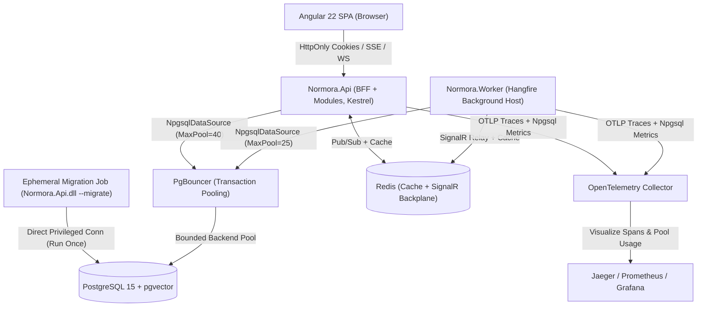
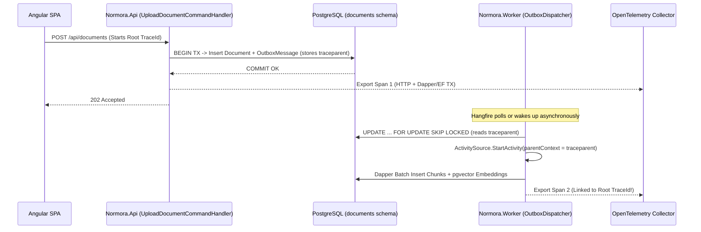
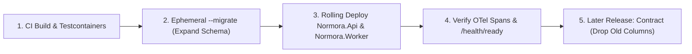

# Chapter 9: Deployment, Cloud Databases, and Observability

## 1. Learning Objectives

By the end of this chapter, you will be able to:
*   Deploy Dapper-based .NET 10 applications cleanly to cloud environments using both **Microsoft Azure SQL Database** and **PostgreSQL + pgvector (`Npgsql`)**.
*   Implement passwordless and secretless authentication using **Azure Managed Identities (Entra ID)** and **`NpgsqlDataSource` periodic token/password providers** without per-request token acquisition bottlenecks.
*   Size and govern ADO.NET connection pools (`NpgsqlDataSource` / `SqlConnection`) alongside **PgBouncer** to prevent connection exhaustion across API and background worker hosts.
*   Harden Dapper execution against transient cloud faults using **Polly v8 `ResiliencePipeline`** with exponential backoff, jitter, circuit breakers, and strict idempotency boundaries.
*   Architect an automated, zero-downtime CI/CD pipeline using **Ephemeral Migration Hosts (`--migrate`)**, `DbUp`/`FluentMigrator`, and the **Expand and Contract** pattern.
*   Instrument Dapper queries with **OpenTelemetry** (`Npgsql.OpenTelemetry` and `OpenTelemetry.Instrumentation.SqlClient`), propagate trace context across transactional outboxes to background workers, and correlate spans with `pg_stat_statements` or SQL Server Query Store without modifying repository code.
*   Separate **Liveness** and **Readiness** health probes and enforce graceful shutdown (`SIGTERM` cancellation) in containerized API and worker deployments.

## 2. Introduction

Building a high-performance data access layer with Dapper on your local development machine is only half the battle. The true test of an Enterprise SaaS application is how it behaves in a distributed cloud environment under heavy, unpredictable load. 

When transitioning to production—whether on **Azure SQL** (as in our EV Charging Platform) or **PostgreSQL + pgvector** (as in **Normora**, a .NET 10 modular monolith running separate `Normora.Api` BFF and `Normora.Worker` Hangfire hosts)—the rules change. Network connections are no longer perfectly stable; they become transient. Hardcoded connection strings with passwords become severe security liabilities. Unbounded connection pools across horizontally scaled containers will exhaust database connection limits in seconds. Furthermore, when a query that took 10 milliseconds locally suddenly takes 5 seconds in production, you cannot simply attach a debugger. You need rigorous, proactive observability.

This chapter bridges the gap between writing Dapper code and operating it at scale on **.NET 10 / C# 14**. We will explore passwordless cloud authentication, connection pool governance, Polly v8 resilience, OpenTelemetry distributed tracing across async worker boundaries, and zero-downtime schema deployments.

## 3. Core Concepts

### 3.1 Passwordless & Secretless Database Authentication

**What it is:** Eliminating static `User ID` and `Password` credentials from `appsettings.json` and connection strings. Instead, the compute identity (an Azure Managed Identity, AWS IAM Role, or Kubernetes Workload Identity) exchanges short-lived cryptographic OAuth tokens with the database engine, or injects rotated credentials at runtime via external secret stores.

**Why it matters:** Static database passwords leaked in source control, container layers, or error logs are one of the highest-impact breach vectors. Short-lived tokens (typically 15–60 minutes) expire automatically and are scoped to the specific compute workload.

**How it works:**
*   **Azure SQL (`Microsoft.Data.SqlClient`):** Modern `Microsoft.Data.SqlClient` natively supports `Authentication=Active Directory Default;` in the connection string, or programmatic injection via a singleton `TokenCredential` (`DefaultAzureCredential`).
*   **PostgreSQL (`NpgsqlDataSource`):** Npgsql's `NpgsqlDataSourceBuilder.UsePeriodicPasswordProvider` fetches and caches short-lived Entra ID / AWS RDS IAM tokens in the background on a timer (e.g., every 45 minutes), so individual Dapper queries pay **zero** token-acquisition latency.
*   **Self-Hosted / Docker Compose (Normora):** When running PostgreSQL in Docker/Kubernetes without cloud IAM federation, secrets are injected via environment variables or mounted secret files and bound through validated `IOptions<DatabaseOptions>` (`ValidateOnStart()`)—never hardcoded in `appsettings.json`.

**When NOT to use it:**
*   Do **not** instantiate `new DefaultAzureCredential()` inside `CreateConnectionAsync()` on every query—doing so defeats internal token caching and triggers synchronous/HTTP calls to the Instance Metadata Service (IMDS) per request.
*   Do **not** use cloud IAM token auth for local developer inner-loop PostgreSQL containers when standard SCRAM-SHA-256 container credentials via `.env` / User Secrets are simpler and offline-capable.

#### Real-World Examples (Normora & EV Charging)

1. **Normora (`Normora.Infrastructure`) — Validated Connection Options with Primary Constructors (`ValidateOnStart`):**
   ```csharp
   using System.ComponentModel.DataAnnotations;

   namespace Normora.Infrastructure.Options;

   public sealed class DatabaseOptions
   {
       public const string SectionName = "ConnectionStrings";

       [Required(AllowEmptyStrings = false)]
       public string DefaultConnection { get; init; } = string.Empty;

       [Range(5, 200)]
       public int MaxPoolSize { get; init; } = 50;

       [Range(1, 60)]
       public int CommandTimeoutSeconds { get; init; } = 15;
   }
   ```
   Registered in `DatabaseServiceExtensions.cs` with `.ValidateDataAnnotations().ValidateOnStart()` so a missing secret fails fast at boot instead of throwing at the first Dapper query.

2. **Normora (`Normora.Infrastructure`) — Cloud PostgreSQL Passwordless Token Refresh with `NpgsqlDataSource`:**
   When deploying Normora to Azure Database for PostgreSQL Flexible Server, `NpgsqlDataSource` refreshes Entra ID tokens asynchronously in the background:
   ```csharp
   using Azure.Core;
   using Azure.Identity;
   using Npgsql;

   var credential = new DefaultAzureCredential(); // Singleton! Never per-request.
   var dataSourceBuilder = new NpgsqlDataSourceBuilder(connectionString);

   dataSourceBuilder.UsePeriodicPasswordProvider(
       async (_, ct) =>
       {
           var token = await credential.GetTokenAsync(
               new TokenRequestContext(["https://ossrdbms-aad.database.windows.net/.default"]),
               ct);
           return token.Token;
       },
       successRefreshInterval: TimeSpan.FromMinutes(45),
       failureRefreshInterval: TimeSpan.FromSeconds(15));

   NpgsqlDataSource dataSource = dataSourceBuilder.Build();
   ```

3. **Normora (`Normora.Api`) — Role-Separated Credentials (`NormoraApp` vs `NormoraMigrator`):**
   Normora follows least-privilege separation: the runtime `Normora.Api` and `Normora.Worker` pools connect as an unprivileged application role (`normora_app` with `SELECT/INSERT/UPDATE/DELETE` only), while the ephemeral `--migrate` job uses a separate `DatabaseOptions:MigratorConnection` secret belonging to `normora_migrator` (allowed to execute `ALTER TABLE` / `CREATE INDEX`). Even if a Dapper query has a vulnerability, the runtime role cannot drop tables or alter schemas.

4. **Normora (`Normora.Worker`) — Enforcing `SslMode=VerifyFull` in Production Npgsql Connection Strings:**
   ```csharp
   public sealed class NpgsqlConnectionStringFactory(IOptions<DatabaseOptions> options, IHostEnvironment env)
   {
       public string Build()
       {
           var builder = new NpgsqlConnectionStringBuilder(options.Value.DefaultConnection)
           {
               MaxPoolSize = options.Value.MaxPoolSize,
               CommandTimeout = options.Value.CommandTimeoutSeconds,
               ApplicationName = env.ApplicationName,
               SslMode = env.IsDevelopment() ? SslMode.Prefer : SslMode.VerifyFull
           };
           return builder.ConnectionString;
       }
   }
   ```
   Using `NpgsqlConnectionStringBuilder` prevents syntax errors and guarantees TLS certificate verification in production across `Normora.Api` and `Normora.Worker`.

5. **EV Charging Platform (Azure SQL) — Built-In Entra ID Auth via `SqlConnectionStringBuilder`:**
   Instead of manually injecting `AccessToken` on every connection, modern `Microsoft.Data.SqlClient` handles token acquisition and caching natively when configured with `ActiveDirectoryDefault`:
   ```csharp
   var csb = new SqlConnectionStringBuilder(config.GetConnectionString("AzureSql"))
   {
       Authentication = SqlAuthenticationMethod.ActiveDirectoryDefault,
       Encrypt = true,
       TrustServerCertificate = false
   };
   ```

---

### 3.2 Connection Pooling, Pool Exhaustion & PgBouncer

**What it is:** Reusing open physical TCP/TLS connections to the database across many Dapper calls rather than performing a full TCP + TLS + PostgreSQL/TDS handshake on every query. In PostgreSQL, every backend process consumes ~5–10 MB of RAM and OS process overhead, making connection pooling critical.

**Why it matters:** A `.NET` application scales horizontally across pods and background workers. If 10 `Normora.Api` pods and 4 `Normora.Worker` Hangfire pods (each running 20 concurrent ingestion jobs) each allow `MaxPoolSize=100`, the cluster can request up to **1,400 connections**, instantly crashing a PostgreSQL instance configured with `max_connections = 200` (`53300: sorry, too many clients already`).

**How it works:**
*   **Client-Side Pooling (`NpgsqlDataSource`):** Register `NpgsqlDataSource` as a **singleton** in DI (via `AddNpgsqlDataSource`). Every `await using var conn = await dataSource.OpenConnectionAsync(ct)` borrows a warm physical connection from the pool and returns it cleanly on `DisposeAsync()`.
*   **Server-Side Transaction Pooling (`PgBouncer`):** Sits between `Normora.Api`/`Normora.Worker` and PostgreSQL. Hundreds of idle client connections multiplex onto a small pool of active PostgreSQL backend processes, returning the backend to PgBouncer as soon as each transaction finishes.

**When NOT to use PgBouncer Transaction Pooling:**
*   Do **not** use PgBouncer in **Transaction Pooling** mode if your Dapper code relies on session-scoped state outside an explicit transaction—such as PostgreSQL `LISTEN/NOTIFY`, session-level `pg_advisory_lock()`, temporary tables (`CREATE TEMP TABLE`), or `SET` variables without `LOCAL`. Those require **Session Pooling** or a dedicated direct connection.
*   Remember that `Disposing` a pooled `NpgsqlConnection` is mandatory; forgetting `await using` leaks connections until the pool times out (`Timeout waiting for connection`).

#### Real-World Examples (Normora & EV Charging)

1. **Normora (`Normora.Infrastructure`) — Registering a Singleton `NpgsqlDataSource` with Bounded Pools:**
   ```csharp
   public static IServiceCollection AddNormoraDapperDataSource(
       this IServiceCollection services,
       IConfiguration configuration,
       string serviceName)
   {
       var rawCs = configuration.GetConnectionString("DefaultConnection")
           ?? throw new InvalidOperationException(ApiMessages.DatabaseConfigurationMissing);

       var csb = new NpgsqlConnectionStringBuilder(rawCs)
       {
           Pooling = true,
           MinPoolSize = 5,
           MaxPoolSize = serviceName == "Normora.Worker" ? 25 : 40,
           ConnectionIdleLifetime = 300,
           ConnectionPruningInterval = 10,
           ApplicationName = serviceName
       };

       services.AddNpgsqlDataSource(csb.ConnectionString);
       return services;
   }
   ```
   Allocating distinct `MaxPoolSize` budgets (`40` for API, `25` for Worker) ensures Hangfire batch embedding ingestion never starves interactive user login or chat queries.

2. **Normora (`Modules/Documents`) — PgBouncer-Safe Multi-Tenant Session Context via `SET LOCAL`:**
   If Normora enforces PostgreSQL Row-Level Security (`app.current_tenant_id`) alongside EF/Dapper queries behind PgBouncer Transaction Pooling, `SET` must be scoped to the transaction using `SET LOCAL` (or `set_config(..., is_local => true)`):
   ```csharp
   await using var conn = await dataSource.OpenConnectionAsync(ct);
   await using var tx = await conn.BeginTransactionAsync(ct);

   await conn.ExecuteAsync(
       new CommandDefinition(
           "SELECT set_config('app.current_tenant_id', @TenantId, true);",
           new { TenantId = tenantId.ToString() },
           transaction: tx,
           cancellationToken: ct));

   var chunks = await conn.QueryAsync<DocumentChunkHitDto>(
       new CommandDefinition(hybridRetrievalSql, parameters, transaction: tx, cancellationToken: ct));

   await tx.CommitAsync(ct);
   ```
   Because `is_local => true` clears `app.current_tenant_id` automatically on `COMMIT`/`ROLLBACK`, the next tenant borrowing the same PgBouncer backend will never inherit stale tenant state.

3. **Normora (`Normora.Worker`) — Bypassing PgBouncer for Hangfire Distributed Locks or `LISTEN/NOTIFY`:**
   If a component uses PostgreSQL session-level advisory locks (`pg_try_advisory_lock`) or `WaitAsync()` notifications (`IDocumentProcessingWakeup`), route that specific connection through a direct `NpgsqlDataSource` (keyed DI service `"DirectPostgres"`) rather than the PgBouncer transaction pooler endpoint, because transaction poolers reassign backends between statements.

4. **Normora (`Normora.Infrastructure`) — Sizing `Npgsql` Multiplexing & Prepared Statements with PgBouncer:**
   In Npgsql 8/9/10 with PgBouncer transaction pooling (versions prior to PgBouncer 1.21 lacked protocol-level prepared statement support), if using an older PgBouncer, disable client auto-preparation or enable `NoResetOnClose = true` only when you never mutate session state:
   ```csharp
   var csb = new NpgsqlConnectionStringBuilder(rawCs)
   {
       MaxAutoPrepare = 0, // Required only for legacy PgBouncer < 1.21 without prepared-statement tracking
       NoResetOnClose = false // Keep false unless PgBouncer handles DISCARD ALL itself
   };
   ```

5. **EV Charging Platform (Azure SQL) — Splitting Read and Write Connection Pools (`ApplicationIntent=ReadOnly`):**
   In Azure SQL **Business Critical** or **Hyperscale** tiers (which include built-in readable secondaries—note that Basic/Standard/General Purpose single databases do *not* have readable secondaries), separate read-heavy telemetry dashboards from write commands:
   ```csharp
   public interface IReadConnectionFactory : ISqlConnectionFactory;
   public interface IWriteConnectionFactory : ISqlConnectionFactory;
   ```
   The `IReadConnectionFactory` appends `ApplicationIntent=ReadOnly` to `SqlConnectionStringBuilder`, routing Dapper `QueryAsync` dashboard reads off the primary node while `IWriteConnectionFactory` handles charger billing writes.

---

### 3.3 Cloud Transient Faults & Polly v8 Resilience Pipelines

**What it is:** Detecting temporary, self-healing database/network errors (TCP resets during PostgreSQL minor-version patching, Azure SQL failover blips, PgBouncer restart, or transient serialization failures `40001`) and automatically recovering using **Polly v8** (`ResiliencePipeline` and `Microsoft.Extensions.Resilience`).

**Why it matters:** Cloud databases are multi-tenant and ephemeral at the infrastructure layer. Without centralized resilience, a 2-second failover drops dozens of active HTTP requests and kills background ingestion jobs.

**How it works:**
*   Npgsql exposes `NpgsqlException.IsTransient` (which checks PostgreSQL SQLSTATE codes such as `08xxx` connection exceptions, `57P01` admin shutdown, `40001` serialization failure, and `53300` too many connections).
*   In **Polly v8**, you configure a `ResiliencePipeline` with `AddRetry` (exponential backoff + `UseJitter = true` to avoid Thundering Herd storms), `AddCircuitBreaker` (fail fast when the DB is hard-down), and `AddTimeout` (per-attempt deadline inside the retry!).
*   **Critical rule:** Wrap the **entire unit of database work** (open + query) for idempotent reads/writes, NOT just `OpenConnectionAsync()`—a connection can drop mid-query!

**When NOT to use retries:**
*   **NEVER** blindly retry non-idempotent `INSERT` or `UPDATE` statements (`UPDATE wallet SET balance = balance - 100`) if the failure occurs *after* the database committed the write but *before* the TCP ACK reached .NET. Retrying causes double-charges or duplicate rows. Use idempotency keys (`ON CONFLICT (idempotency_key) DO NOTHING`) or limit retries strictly to read queries and idempotent outbox claims.
*   **NEVER** put a retry loop inside a multi-statement `NpgsqlTransaction` block where individual commands retry independently; retry the *entire transaction* from `BeginTransactionAsync` if `40001` (`serialization_failure`) or transient drop occurs.

#### Real-World Examples (Normora & EV Charging)

1. **Normora (`Normora.Infrastructure`) — Registering Named Polly v8 Pipelines for Reads vs Writes:**
   ```csharp
   using Microsoft.Extensions.Resilience;
   using Npgsql;
   using Polly;
   using Polly.CircuitBreaker;
   using Polly.Retry;

   builder.Services.AddResiliencePipeline("normora-pg-read", pipelineBuilder =>
   {
       pipelineBuilder
           .AddCircuitBreaker(new CircuitBreakerStrategyOptions
           {
               ShouldHandle = new PredicateBuilder().Handle<NpgsqlException>(ex => ex.IsTransient),
               FailureRatio = 0.5,
               MinimumThroughput = 20,
               SamplingDuration = TimeSpan.FromSeconds(30),
               BreakDuration = TimeSpan.FromSeconds(15)
           })
           .AddRetry(new RetryStrategyOptions
           {
               ShouldHandle = new PredicateBuilder().Handle<NpgsqlException>(ex => ex.IsTransient),
               MaxRetryAttempts = 3,
               Delay = TimeSpan.FromMilliseconds(250),
               BackoffType = DelayBackoffType.Exponential,
               UseJitter = true
           })
           .AddTimeout(TimeSpan.FromSeconds(5));
   });
   ```
   Notice the strategy ordering: `CircuitBreaker` (outer) -> `Retry` (middle) -> `Timeout` (inner), so each retry attempt gets a fresh 5-second timeout rather than fighting a single shared deadline.

2. **Normora (`Modules/Documents`) — Resilient Idempotent Hybrid Retrieval (`PerformHybridRetrievalQuery`):**
   Using a C# 14 primary constructor, the read repository injects `ResiliencePipelineProvider<string>` and wraps both connection acquisition and Dapper execution:
   ```csharp
   public sealed class ResilientDocumentSearchExecutor(
       NpgsqlDataSource dataSource,
       ResiliencePipelineProvider<string> pipelineProvider)
   {
       private readonly ResiliencePipeline _readPipeline = pipelineProvider.GetPipeline("normora-pg-read");

       public async Task<IReadOnlyList<ChunkSearchHit>> SearchHybridAsync(
           Guid tenantId,
           float[] queryEmbedding,
           string lexicalQuery,
           int topK,
           CancellationToken ct)
       {
           return await _readPipeline.ExecuteAsync(async token =>
           {
               await using var conn = await dataSource.OpenConnectionAsync(token);
               var rows = await conn.QueryAsync<ChunkSearchHit>(
                   new CommandDefinition(
                       SqlQueries.HybridSearchRrf,
                       new { TenantId = tenantId, Vector = queryEmbedding, Query = lexicalQuery, TopK = topK },
                       cancellationToken: token));
               return rows.AsList();
           }, ct);
       }
   }
   ```

3. **Normora (`Normora.Worker`) — Idempotent Outbox Claiming with `FOR UPDATE SKIP LOCKED`:**
   In `HangfireDocumentProcessingOutboxDispatcher`, multiple worker threads can safely retry claiming `DocumentProcessingOutboxMessage` rows after a transient error because the SQL statement atomically claims rows by ID and status:
   ```sql
   UPDATE documents.document_processing_outbox
   SET status = 'Processing', locked_until_utc = NOW() + INTERVAL '5 minutes', attempt_count = attempt_count + 1
   WHERE id IN (
       SELECT id FROM documents.document_processing_outbox
       WHERE status = 'Pending' AND next_attempt_utc <= NOW()
       ORDER BY created_at_utc
       FOR UPDATE SKIP LOCKED
       LIMIT @BatchSize
   )
   RETURNING id, tenant_id, document_id, document_version_id, trace_parent;
   ```
   Even if retried, `FOR UPDATE SKIP LOCKED` prevents two `Normora.Worker` instances from processing the same document twice.

4. **Normora (`Modules/Tenants`) — Idempotent Stripe/PayU Webhook Recording (Safe Write Retry):**
   Because payment gateway callbacks (e.g., PayU callbacks in `Tenants`) can arrive multiple times or hit transient DB errors, Dapper uses a natural idempotency constraint (`ON CONFLICT (gateway_transaction_id) DO NOTHING RETURNING id`) so retrying on `NpgsqlException.IsTransient` never double-credits a tenant's subscription.

5. **EV Charging Platform (Azure SQL) — Retrying Serialization/Deadlock Error `1205` & Cloud Blips:**
   Upgrading the EV Charging `SqlException` predicate to Polly v8 catches Azure SQL transient codes (`40613`, `40197`, `40501`, `49918`, `40540`, `40143`) *plus* deadlock victim `1205` with jittered backoff:
   ```csharp
   private static bool IsTransientSqlError(SqlException ex) =>
       ex.Number is 40613 or 40197 or 40501 or 49918 or 40540 or 40143 or 1205;
   ```

---

### 3.4 Distributed Observability with OpenTelemetry & Npgsql

**What it is:** Emitting standardized **Traces** (spans showing parent-child call trees and latencies), **Metrics** (histograms/counters for connection pool saturation and query duration), and **Structured Logs** (correlated via `TraceId`) via **OpenTelemetry (OTel)** without coupling Dapper repositories to any APM vendor.

**Why it matters:** Dapper intentionally executes raw SQL silently—it has no built-in `.LogTo()` like EF Core. Under production load, you need to answer: *"Which exact endpoint or Hangfire job caused a 4-second pgvector query spike, and was the time spent waiting for a pooled connection or executing SQL on PostgreSQL?"*

**How it works:**
*   **PostgreSQL (`Npgsql.OpenTelemetry`):** Calling `.AddNpgsql()` on `TracerProviderBuilder` subscribes to Npgsql's `ActivitySource` (creating spans with `db.system = postgresql`, `db.statement`, and duration). Calling `.AddMeter("Npgsql")` on `MeterProviderBuilder` exports connection pool utilization (`db.client.connections.usage`), wait times, and bytes transferred.
*   **Azure SQL (`OpenTelemetry.Instrumentation.SqlClient`):** Calling `.AddSqlClientInstrumentation()` automatically captures sanitized SQL text in modern versions (note: `SetDbStatementForText` was **removed** in newer 1.12+ releases because statement capture + literal sanitization is now built in by default).
*   **Correlating Traces with Database Internals:** OpenTelemetry exports spans, **not** PostgreSQL/SQL Server execution plans. To inspect plans for a slow span, propagate correlation metadata (such as SQL comment taggers `/* traceparent=... tenant=... */` or `application_name`) so `pg_stat_statements` / `pg_stat_activity` (PostgreSQL) or Query Store / Extended Events (SQL Server) link directly back to the exact `TraceId`.
*   **Async Context Propagation:** `System.Diagnostics.Activity` flows via `AsyncLocal<T>` across `await` boundaries, but breaks across queues/outboxes unless you serialize `Activity.Current?.Id` (`W3C traceparent`) into the outbox row and restore it in the worker.

**When NOT to use 100% Tracing or Raw SQL Logging:**
*   Do **not** capture full unparameterized SQL literals or dump parameter values containing PII/secrets (`email`, `password_hash`, raw document text, OIDC tokens) into telemetry—violates GDPR/SOC2 and bloats exporter queues.
*   Do **not** use `AlwaysOnSampler` at 10,000+ QPS without evaluating CPU and egress cost; use head-based sampling (e.g., `TraceIdRatioBasedSampler(0.10)`) or tail-based sampling in an OTel Collector (keeping 100% of errors and slow >500ms traces while sampling fast healthy queries).

#### Real-World Examples (Normora & EV Charging)

1. **Normora (`Normora.Infrastructure`) — Unified OpenTelemetry Traces & Metrics for API + Worker:**
   ```csharp
   using Npgsql;
   using OpenTelemetry.Metrics;
   using OpenTelemetry.Resources;
   using OpenTelemetry.Trace;

   public static IServiceCollection AddNormoraTelemetry(
       this IServiceCollection services,
       string serviceName)
   {
       services.AddOpenTelemetry()
           .ConfigureResource(r => r.AddService(serviceName))
           .WithTracing(tracing => tracing
               .AddAspNetCoreInstrumentation()
               .AddHttpClientInstrumentation()
               .AddSource("Normora.Documents.Outbox")
               .AddNpgsql() // Captures every Dapper & EF Core PostgreSQL command span
               .AddOtlpExporter())
           .WithMetrics(metrics => metrics
               .AddAspNetCoreInstrumentation()
               .AddMeter("Npgsql") // Connection pool active/idle counts, wait duration, command timings
               .AddMeter("Normora.Dapper")
               .AddOtlpExporter());

       return services;
   }
   ```

2. **Normora (`Modules/Documents` -> `Normora.Worker`) — Propagating W3C `TraceParent` Through the Document Upload Outbox:**
   When `UploadDocumentCommandHandler` commits a `DocumentProcessingOutboxMessage`, it captures `Activity.Current?.Id`. When `HangfireDocumentProcessingOutboxDispatcher` runs in `Normora.Worker`, it links or restores the parent `ActivityContext` so every Hangfire Dapper query, Gemini OCR/embedding call, and pgvector insert appears in the **same distributed trace** as the user's HTTP upload:
   ```csharp
   using System.Diagnostics;

   public sealed class DocumentOutboxActivityScope
   {
       private static readonly ActivitySource Source = new("Normora.Documents.Outbox");

       public static Activity? StartLinkedActivity(string operationName, string? parentTraceParent, Guid tenantId)
       {
           ActivityContext.TryParse(parentTraceParent, null, out var parentContext);
           var activity = Source.StartActivity(operationName, ActivityKind.Consumer, parentContext);
           activity?.SetTag("normora.tenant_id", tenantId.ToString());
           return activity;
       }
   }
   ```

3. **Normora (`Normora.Infrastructure`) — Non-PII SQL Tagging (`SqlCommenter` Pattern) for `pg_stat_statements`:**
   Prepending a static, low-cardinality comment tag to Dapper queries links PostgreSQL's `pg_stat_statements` directly to the Normora CQRS operation without exposing PII or busting Dapper's `_queryCache`:
   ```csharp
   private const string HybridSearchSql = """
       /* op=PerformHybridRetrievalQuery module=Documents */
       SELECT id, document_id, content, (1 - (embedding <=> @Vector::vector)) AS score
       FROM documents.document_chunks
       WHERE tenant_id = @TenantId
       ORDER BY embedding <=> @Vector::vector
       LIMIT @TopK;
       """;
   ```
   *(Important: Put **static** tags like `op=...` in the SQL string—NEVER inject dynamic `TraceId` or `TenantId` strings into the SQL text itself, or you will destroy PostgreSQL's plan cache and Dapper's `_queryCache`!)*

4. **Normora (`Normora.Infrastructure`) — Monitoring Dapper's Internal Query Cache (`GetCachedSQLCount`) via OTel Gauge:**
   ```csharp
   using System.Diagnostics.Metrics;
   using Dapper;

   public sealed class DapperMetricsRegistrar
   {
       private static readonly Meter Meter = new("Normora.Dapper");

       public static void Register() =>
           Meter.CreateObservableGauge(
               "dapper.query_cache.count",
               () => SqlMapper.GetCachedSQLCount(),
               description: "Number of cached SQL/type mappings in Dapper SqlMapper");
   }
   ```
   If `dapper.query_cache.count` grows monotonically in Grafana, an engineer has introduced dynamic string concatenation (e.g., building `IN ('id1','id2')` instead of `= ANY(@Ids)`) that is leaking memory in `SqlMapper`.

5. **EV Charging Platform (Azure SQL) — Modern `SqlClient` OTel Registration + `SESSION_CONTEXT` Correlation:**
   Using current `OpenTelemetry.Instrumentation.SqlClient` (without the removed `SetDbStatementForText` option), plus injecting `TraceId` into SQL Server `SESSION_CONTEXT` for Extended Events:
   ```csharp
   builder.Services.AddOpenTelemetry()
       .WithTracing(tracing => tracing
           .AddAspNetCoreInstrumentation()
           .AddSqlClientInstrumentation(options =>
           {
               options.RecordException = true;
               // SQL command text is automatically captured and sanitized in modern versions
           })
           .AddAzureMonitorTraceExporter());
   ```

---

### 3.5 Ephemeral Migration Hosts & Zero-Downtime CI/CD (Expand & Contract)

**What it is:** Decoupling schema migrations from application web/worker serving processes, and structuring breaking schema changes into backward-compatible phases (**Expand -> Migrate/Backfill -> Deploy Code -> Contract**) so old and new versions of the app can run simultaneously against the same database.

**Why it matters:** Dapper maps columns directly to C# properties by name. If CI/CD deploys new Dapper code before adding a column, queries crash immediately. Conversely, if a migration runs `DROP COLUMN` or acquires an `ACCESS EXCLUSIVE` table lock while `Normora.Api` pods are serving traffic, active queries fail or hang behind the DDL lock queue. Worse, running migrations inside `Program.cs` during API startup causes race conditions when Kubernetes starts multiple replicas at once—and in .NET hosts with background services, OpenTelemetry listeners, or native libraries, running migrations inside the full web host can cause teardown crashes (such as native `SIGSEGV` exit code `139`).

**How it works:**
*   **Ephemeral Migration Host (`--migrate`):** `Normora.Api.dll --migrate` enters a minimal console branch (`MigrationHostExtensions.RunMigrationsAsync`) that registers *only* configuration and `DatabaseMigrationRunner`, executes the 4 sequential `IDatabaseMigrator` pipelines (`TenantsDatabaseMigrator`, `DocumentsDatabaseMigrator`, `ConversationsDatabaseMigrator`, `SessionDatabaseMigrator`), and exits cleanly with code `0`—never starting Kestrel, SignalR, Hangfire, or OpenTelemetry listeners.
*   **Expand and Contract (PostgreSQL):**
    1. **Expand:** Add nullable column (`ALTER TABLE ... ADD COLUMN ...`) or build indexes non-blockingly (`CREATE INDEX CONCURRENTLY ...` outside a transaction block) while old code runs untouched.
    2. **Dual-Write / Backfill:** Deploy new Dapper code that reads/writes both old and new shapes (or backfills historical rows in batches).
    3. **Contract:** In a later release after all old pods have drained, drop the obsolete column/constraint.

**When NOT to use Expand and Contract / Ephemeral Hosts:**
*   For purely **local development** (`dotnet run` or `start.ps1`), running automated migrations before booting the single local instance is convenient and safe.
*   Avoid `CREATE INDEX CONCURRENTLY` inside a multi-statement SQL transaction block—PostgreSQL forbids `CONCURRENTLY` inside `BEGIN ... COMMIT` (it must run in autocommit mode).

#### Real-World Examples (Normora & EV Charging)

1. **Normora (`Normora.Api`) — Ephemeral `--migrate` Entry Point Isolation:**
   ```csharp
   // Program.cs (Normora.Api)
   if (args.Contains("--migrate", StringComparer.OrdinalIgnoreCase))
   {
       await MigrationHostExtensions.RunMigrationsAsync(args);
       return; // Exits cleanly with code 0; Kestrel, SignalR, and OTel are never started
   }
   ```
   Running `dotnet Normora.Api.dll --migrate` in a dedicated Docker/Kubernetes Init Container or CI release job prevents multi-pod migration races and eliminates exit code `139` native teardown faults.

2. **Normora (`Normora.Infrastructure`) — Sequential Four-Migrator Pipeline (`DatabaseMigrationRunner`):**
   ```csharp
   public sealed class DatabaseMigrationRunner(IEnumerable<IDatabaseMigrator> migrators, ILogger<DatabaseMigrationRunner> logger)
   {
       public async Task RunAllAsync(CancellationToken ct)
       {
           foreach (var migrator in migrators) // Tenants -> Documents -> Conversations -> Session
           {
               logger.LogInformation("Running migrator {MigratorName}", migrator.GetType().Name);
               await migrator.MigrateAsync(ct);
           }
       }
   }
   ```
   Schema isolation (`tenants`, `documents`, `conversations`, `bff`) stays cleanly ordered and modular without cross-module coupling.

3. **Normora (`Modules/Documents`) — Zero-Lock pgvector HNSW Index Creation (`CONCURRENTLY`):**
   Building a pgvector HNSW index on millions of `document_chunks` rows takes minutes. Using `CREATE INDEX CONCURRENTLY` ensures `Normora.Api` conversational RAG queries and `Normora.Worker` chunk inserts keep flowing without table-lock outages:
   ```sql
   -- Executed outside a transaction (e.g., DbUp WithTransactionPerScript disabled for this file)
   CREATE INDEX CONCURRENTLY IF NOT EXISTS ix_document_chunks_embedding_hnsw
   ON documents.document_chunks
   USING hnsw (embedding vector_cosine_ops)
   WITH (m = 16, ef_construction = 64);
   ```

4. **Normora (`Modules/Tenants`) — Expand-and-Contract Renaming `ExternalUserId` Safely:**
   Suppose an older table column was named `identity_sub` and needs to migrate to `external_user_id` without downtime across rolling `Normora.Api` pods:
   *   *Release 1 (Expand):* `ALTER TABLE tenants.tenant_memberships ADD COLUMN external_user_id text NULL;` + batched backfill + trigger or dual-write in Dapper `INSERT/UPDATE`, reading `COALESCE(external_user_id, identity_sub) AS ExternalUserId`.
   *   *Release 2 (Contract):* Once Release 1 is 100% live, add `NOT VALID` constraint + `VALIDATE CONSTRAINT`, then `ALTER TABLE tenants.tenant_memberships DROP COLUMN identity_sub;`.

5. **EV Charging Platform (Azure SQL) — Golden CI/CD Pipeline Order (GitHub Actions / Azure DevOps):**
   1. **Build & Test:** `dotnet test` (including Testcontainers integration tests from Chapter 8).
   2. **Migrate DB First:** Run `DbUp` / `FluentMigrator` (or `--migrate`) against Azure SQL using a privileged deploy secret.
   3. **Deploy App:** Roll out new ASP.NET Core instances using Managed Identity (`ActiveDirectoryDefault`). Reversing steps 2 and 3 breaks Dapper immediately when querying new columns.

---

### 3.6 Health Checks, Graceful Shutdown & Production Diagnostics

**What it is:** Exposing distinct `/health/live` (is the .NET process responsive?) and `/health/ready` (can the host reach PostgreSQL, Redis, and MinIO?) endpoints, propagating host shutdown `CancellationToken`s through `CommandDefinition`, and diagnosing slow Dapper queries via database-native telemetry (`pg_stat_statements` and `EXPLAIN (ANALYZE, BUFFERS)`).

**Why it matters:** If a Kubernetes **Liveness** probe executes a PostgreSQL query and the database blips for 4 seconds, Kubernetes kills and restarts every healthy `Normora.Api` pod simultaneously—creating a cascading cold-start outage right as the DB recovers! Meanwhile, ignoring `CancellationToken` during rolling deploys interrupts active `UploadDocument` or `Conversations` SSE streams instead of draining cleanly.

**How it works:**
*   **Liveness (`/health/live`):** Checks zero external dependencies (just `200 OK` from the ASP.NET Core pipeline).
*   **Readiness (`/health/ready`):** Tagged `"ready"`. Executes a lightweight `SELECT 1` via `NpgsqlDataSource` (with a tight 2s timeout) plus Redis ping, so load balancers stop routing traffic to an unhealthy pod without killing it.
*   **Graceful Shutdown:** ASP.NET Core triggers `HttpContext.RequestAborted` and `IHostApplicationLifetime.ApplicationStopping` on `SIGTERM`. Passing `CancellationToken` into Dapper's `new CommandDefinition(..., cancellationToken: ct)` tells Npgsql to send a PostgreSQL query cancellation packet cleanly.

**When NOT to use heavy health checks:**
*   Never run full table scans, pgvector similarity searches, or `SELECT COUNT(*)` inside `/health/ready`—health endpoints are polled every 5–10 seconds per pod by load balancers and Kubernetes kubelets!

#### Real-World Examples (Normora & EV Charging)

1. **Normora (`Normora.Api`) — Separating Liveness and Readiness Probes (`AspNetCore.HealthChecks.NpgSql`):**
   ```csharp
   builder.Services.AddHealthChecks()
       .AddNpgSql(
           sp => sp.GetRequiredService<NpgsqlDataSource>(),
           name: "postgres-pgvector",
           tags: ["ready"],
           timeout: TimeSpan.FromSeconds(2))
       .AddRedis(
           redisConnectionString,
           name: "redis-backplane",
           tags: ["ready"],
           timeout: TimeSpan.FromSeconds(2));

   app.MapHealthChecks("/health/live", new HealthCheckOptions { Predicate = _ => false });
   app.MapHealthChecks("/health/ready", new HealthCheckOptions { Predicate = r => r.Tags.Contains("ready") });
   ```

2. **Normora (`Normora.Worker`) — Dedicated TCP/File Liveness for Non-HTTP Background Workers:**
   Because `Normora.Worker` is a Generic Host (not Kestrel), it publishes a lightweight heartbeat or internal health check probing Hangfire's PostgreSQL storage + `NpgsqlDataSource`, ensuring failed worker containers are surfaced in monitoring without exposing public HTTP business endpoints.

3. **Normora (`Modules/Conversations`) — Propagating `CancellationToken` to Abort Orphaned RAG Queries:**
   When a user cancels an SSE chat stream in the Angular SPA or `Normora.Api` receives `SIGTERM`, passing `ct` into `CommandDefinition` prevents PostgreSQL from wasting CPU finishing an abandoned `pgvector` HNSW search:
   ```csharp
   var cmd = new CommandDefinition(
       SqlQueries.FetchConversationHistory,
       new { ConversationId = conversationId, TenantId = tenantId },
       commandTimeout: 10,
       cancellationToken: ct);
   var messages = await conn.QueryAsync<ConversationTurnDto>(cmd);
   ```

4. **Normora (PostgreSQL Diagnostics) — Finding Top Slow Dapper Queries via `pg_stat_statements`:**
   Because Dapper uses parameterized queries (`@TenantId`, `@TopK`), PostgreSQL normalizes and aggregates them cleanly in `pg_stat_statements`:
   ```sql
   SELECT calls,
          ROUND(mean_exec_time::numeric, 2) AS avg_ms,
          ROUND(total_exec_time::numeric, 2) AS total_ms,
          rows,
          LEFT(query, 120) AS query_snippet
   FROM pg_stat_statements
   WHERE query LIKE '%document_chunks%'
   ORDER BY total_exec_time DESC
   LIMIT 10;
   ```

5. **EV Charging Platform (Azure SQL) — Query Store Correlation for Dapper Parameter Sniffing:**
   When an Azure SQL Dapper query suddenly degrades from 5ms to 4,000ms due to parameter sniffing across unevenly sized EV charging fleets, engineers correlate the slow OpenTelemetry span timestamp against Azure SQL **Query Store** (`sys.query_store_runtime_stats` / `sys.query_store_plan`) and add `OPTION (RECOMPILE)` selectively on the affected Dapper query.

## 4. Visual Diagrams

### Normora Production Deployment, Pooling & Observability Topology



### Distributed Trace Propagation Across Normora's Transactional Outbox



### Zero-Downtime Expand & Contract Deployment Pipeline



### Classic Azure SQL Managed Identity & OTel Flow (EV Charging Case Study)

```text
=============================================================================
             CLOUD DEPLOYMENT & OBSERVABILITY ARCHITECTURE
=============================================================================

[ Azure App Service (Compute) ]
       │
       ├── 1. Requests Auth Token via Managed Identity (Cached Singleton)
       │
[ Azure Entra ID (Active Directory) ]
       │
       ├── 2. Issues short-lived access token
       │
[ ASP.NET Core Application ]
       │
       ├── 3. SqlConnection (Authentication=ActiveDirectoryDefault)
       ├── 4. OpenTelemetry intercepts DbCommand (SqlClient Instrumentation)
       │
       ├── 5. DAPPER executes query using the token
       │          │
       │          ▼
       │  [ Azure SQL Database ]
       │          │
       ├── 6. OpenTelemetry ends the span (calculates duration)
       │
[ Azure Application Insights (or Datadog/Jaeger) ]
       ▲
       │
       └── 7. Telemetry exported: { "Query": "SELECT...", "DurationMs": 42 }
```

## 5. Complete Examples: EV Charging Platform & Normora

### EV Charging Platform (Azure SQL)

#### Scenario 1: Managed Identity Connection Factory (Singleton Credential + Primary Constructor)
We refactor our `ISqlConnectionFactory` from Chapter 6 to support Azure Managed Identities, allowing our API to connect to Azure SQL without a password. Notice that `TokenCredential` (`DefaultAzureCredential`) is stored as a singleton/shared instance via a C# 14 primary constructor so we preserve `Azure.Identity`'s internal token cache.

```csharp
using System.Data;
using Azure.Core;
using Azure.Identity;
using Microsoft.Data.SqlClient;

public sealed class ManagedIdentityConnectionFactory(
    IConfiguration config,
    TokenCredential credential) : ISqlConnectionFactory
{
    private readonly string _connectionString =
        config.GetConnectionString("AzureSql")
        ?? throw new InvalidOperationException("Missing AzureSql connection string.");

    private static readonly string[] SqlScope = ["https://database.windows.net/.default"];

    public async Task<IDbConnection> CreateConnectionAsync(CancellationToken ct = default)
    {
        var connection = new SqlConnection(_connectionString);

        // Reuse the injected singleton TokenCredential (never 'new DefaultAzureCredential()' per call).
        // Alternatively, set "Authentication=Active Directory Default;" directly in the connection string.
        var token = await credential.GetTokenAsync(new TokenRequestContext(SqlScope), ct);
        connection.AccessToken = token.Token;

        await connection.OpenAsync(ct);
        return connection;
    }
}
```

#### Scenario 2: OpenTelemetry Integration for Dapper (`SqlClient`)
We want every Dapper query exported to Application Insights/Azure Monitor without changing a single Dapper repository. Note that in modern `OpenTelemetry.Instrumentation.SqlClient` (1.12+), `SetDbStatementForText` was removed—sanitized SQL statement capture is built in automatically.

```csharp
// Program.cs
using Azure.Monitor.OpenTelemetry.Exporter;
using OpenTelemetry.Trace;

var builder = WebApplication.CreateBuilder(args);

builder.Services.AddOpenTelemetry()
    .WithTracing(tracerProviderBuilder =>
    {
        tracerProviderBuilder
            .AddAspNetCoreInstrumentation()
            .AddSqlClientInstrumentation(options =>
            {
                options.RecordException = true;
                // SQL statement text is captured and sanitized automatically by default.
            })
            .AddAzureMonitorTraceExporter();
    });
```

#### Scenario 3: Transient Fault Handling with Polly v8 (`ResiliencePipeline`)
Azure SQL occasionally drops connections or throws transient throttling codes. We wrap connection acquisition and idempotent Dapper execution in a **Polly v8** `ResiliencePipeline` with exponential backoff and jitter.

```csharp
using System.Data;
using Microsoft.Data.SqlClient;
using Polly;
using Polly.Retry;

public sealed class ResilientConnectionFactory(ISqlConnectionFactory innerFactory) : ISqlConnectionFactory
{
    private static readonly ResiliencePipeline RetryPipeline = new ResiliencePipelineBuilder()
        .AddRetry(new RetryStrategyOptions
        {
            ShouldHandle = new PredicateBuilder().Handle<SqlException>(IsTransient),
            MaxRetryAttempts = 3,
            Delay = TimeSpan.FromSeconds(1),
            BackoffType = DelayBackoffType.Exponential,
            UseJitter = true // Prevents thundering herd retries against a recovering database
        })
        .Build();

    public async Task<IDbConnection> CreateConnectionAsync(CancellationToken ct = default) =>
        await RetryPipeline.ExecuteAsync(
            async token => await innerFactory.CreateConnectionAsync(token),
            ct);

    private static bool IsTransient(SqlException ex) =>
        // Common Azure SQL transient error numbers (40613: DB unavailable, 40197/40501/49918: busy/throttled)
        ex.Number is 40613 or 40197 or 40501 or 49918 or 40540 or 40143;
}
```

---

### Normora (.NET 10 Modular Monolith, PostgreSQL + pgvector)

#### Scenario 4: Ephemeral Migration Host (`--migrate`) & Four-Migrator Pipeline
In `Normora.Api`, running migrations during Kestrel startup across multiple container replicas causes DDL lock races and risks native `SIGSEGV` teardown crashes (exit code `139`) if OpenTelemetry or Hangfire listeners initialize first. Instead, `Program.cs` branches immediately when `--migrate` is passed:

```csharp
// server/Normora.Api/Program.cs
if (args.Contains("--migrate", StringComparer.OrdinalIgnoreCase))
{
    await MigrationHostExtensions.RunMigrationsAsync(args);
    return;
}
```

`MigrationHostExtensions.RunMigrationsAsync` builds a lean console host containing only configuration and `DatabaseMigrationRunner` (no Kestrel, no SignalR Redis backplane, no Hangfire, no OTel diagnostic listeners), executing the 4 module migrators sequentially:

```csharp
// server/Normora.Infrastructure/Extensions/MigrationHostExtensions.cs
public static class MigrationHostExtensions
{
    public static async Task RunMigrationsAsync(string[] args, CancellationToken ct = default)
    {
        var builder = Host.CreateApplicationBuilder(args);
        builder.Services.AddMigrationServices(builder.Configuration);

        using var host = builder.Build();
        using var scope = host.Services.CreateScope();

        var runner = scope.ServiceProvider.GetRequiredService<DatabaseMigrationRunner>();
        await runner.RunAllAsync(ct); // Tenants -> Documents -> Conversations -> Session
    }
}
```

#### Scenario 5: End-to-End `Normora.Worker` Outbox Dapper Execution with OTel Trace Propagation & CWE-209 Safety
When `HangfireDocumentProcessingOutboxDispatcher` processes a `DocumentProcessingOutboxMessage`, it:
1. Restores the parent `ActivityContext` from `trace_parent` so the worker's Dapper queries link to the original upload span in Jaeger/Grafana.
2. Uses `NpgsqlDataSource` + Polly v8 (`NpgsqlException.IsTransient`) for idempotent state updates.
3. Logs full exception metadata internally to structured OpenTelemetry logs while publishing only generic `ApiMessages` constants to clients/emails (CWE-209 compliance).

```csharp
using System.Diagnostics;
using Dapper;
using Npgsql;
using Polly;
using Polly.Registry;
using Normora.Shared.Constants;

namespace Normora.Infrastructure.BackgroundJobs;

public sealed class DocumentOutboxWorkerExecutor(
    NpgsqlDataSource dataSource,
    ResiliencePipelineProvider<string> pipelineProvider,
    IDocumentNotificationService notifications,
    ILogger<DocumentOutboxWorkerExecutor> logger)
{
    private static readonly ActivitySource OutboxActivitySource = new("Normora.Documents.Outbox");
    private readonly ResiliencePipeline _pipeline = pipelineProvider.GetPipeline("normora-pg-read");

    public async Task MarkCompletedOrFailSafeAsync(
        Guid outboxId,
        Guid tenantId,
        Guid documentId,
        string? parentTraceParent,
        Func<CancellationToken, Task> processWork,
        CancellationToken ct)
    {
        ActivityContext.TryParse(parentTraceParent, null, out var parentContext);
        using var activity = OutboxActivitySource.StartActivity(
            "ProcessDocumentOutbox",
            ActivityKind.Consumer,
            parentContext);

        activity?.SetTag("normora.tenant_id", tenantId.ToString());
        activity?.SetTag("normora.document_id", documentId.ToString());

        try
        {
            await processWork(ct);

            await _pipeline.ExecuteAsync(async token =>
            {
                await using var conn = await dataSource.OpenConnectionAsync(token);
                await conn.ExecuteAsync(new CommandDefinition(
                    """
                    /* op=MarkOutboxCompleted module=Documents */
                    UPDATE documents.document_processing_outbox
                    SET status = 'Completed', processed_at_utc = NOW()
                    WHERE id = @OutboxId AND tenant_id = @TenantId;
                    """,
                    new { OutboxId = outboxId, TenantId = tenantId },
                    cancellationToken: token));
            }, ct);
        }
        catch (Exception ex) when (ex is not OperationCanceledException)
        {
            // Full exception stays strictly in internal structured logs / OTel spans
            activity?.SetStatus(ActivityStatusCode.Error, ex.GetType().Name);
            logger.LogError(ex, "Document ingestion failed for DocumentId {DocumentId} in Tenant {TenantId}",
                documentId, tenantId);

            // CWE-209: Never expose raw ex.Message or stack traces to clients or notification emails
            await notifications.NotifyDocumentFailedAsync(
                tenantId,
                documentId,
                ApiMessages.DocumentProcessingFailed,
                ct);
        }
    }
}
```

## 6. Continuous Integration / Continuous Deployment (CI/CD)

Dapper assumes your database schema matches your C# DTOs. Therefore, database schema migrations must execute *before* your ASP.NET Core application restarts with the new Dapper queries.

**The Golden CI/CD Pipeline Rule:**
1. **Build & Verify Phase:** Compile C# (`.NET 10`). Run Architecture/Unit Tests (`Normora.Architecture.Tests`). Run PostgreSQL/SQL Server Testcontainers Integration Tests (as seen in Chapter 8) against the exact migration scripts.
2. **Release Phase (Ephemeral Database Migration):** Execute `dotnet Normora.Api.dll --migrate` (or `DbUp` / `FluentMigrator`) as a **single-instance Kubernetes Job / Init Step** using a privileged migrator credential (`normora_migrator`) before any new API or worker pods start.
3. **Release Phase (Application Rolling Deploy):** Deploy the new `Normora.Api` and `Normora.Worker` container images (connecting with the least-privileged runtime role `normora_app`). Wait for `/health/ready` to report `200 OK` before shifting traffic and draining old instances.
4. **Delayed Contract Phase (Zero-Downtime Cleanup):** Only after all old instances have terminated (hours or days later) do you run a subsequent migration to `DROP COLUMN` or tighten `NOT NULL` constraints.

If you reverse steps 2 and 3, the new Dapper code will query columns that do not yet exist, instantly crashing production. Similarly, running `DROP COLUMN` in step 2 breaks the old instances still serving traffic during a rolling or Blue/Green deployment.

## 7. Performance Implications

### Token Caching (Managed Identity & Periodic Password Providers)
Calling `DefaultAzureCredential.GetTokenAsync()` inside a per-request factory creates severe latency spikes (50–100 ms per IMDS roundtrip) and risks IMDS throttling under burst traffic. Always keep `TokenCredential` as a singleton (or use `Authentication=Active Directory Default;` in `SqlClient`). For PostgreSQL, `NpgsqlDataSourceBuilder.UsePeriodicPasswordProvider(...)` refreshes tokens asynchronously on a background timer so every Dapper `OpenConnectionAsync()` executes strictly from memory in microseconds.

### Connection Pool Sizing & PgBouncer Multiplexing
Every PostgreSQL backend process consumes ~5–10 MB of server RAM plus OS scheduling overhead. Across horizontally scaled `Normora.Api` and `Normora.Worker` pods, unbounded `MaxPoolSize` settings rapidly exceed PostgreSQL `max_connections`. Keep per-pod `MaxPoolSize` tightly budgeted (e.g., `25–40`), route transactional workloads through **PgBouncer** in transaction-pooling mode, and watch the `Npgsql` OpenTelemetry metric `db.client.connections.wait_time` to detect pool starvation before timeouts occur.

### OpenTelemetry Overhead & Sampling
Capturing SQL spans and Npgsql metrics is invaluable, but serializing, allocating, and exporting OTLP batches has CPU and memory cost. Under sustained high throughput (e.g., 10,000+ queries/sec), 100% head-based tracing can consume noticeable CPU and fill OTLP exporter queues (causing dropped spans). In high-QPS environments, configure a `TraceIdRatioBasedSampler` (e.g., sampling 10% of healthy fast traces) or collector-level **tail-based sampling** (retaining 100% of error spans and slow >250ms queries while sampling fast `SELECT 1` / health noise). Also monitor `SqlMapper.GetCachedSQLCount()` via an ObservableGauge so dynamic SQL cache bloat is caught early.

## 8. Common Mistakes & Anti-Patterns

> [!CAUTION]
> **1. Hardcoding Database Passwords in `appsettings.json` or Source Control**
>
> **Wrong Code:**
> ```json
> // appsettings.Production.json (committed to Git)
> {
>   "ConnectionStrings": {
>     "DefaultConnection": "Host=prod-pg.internal;Database=normora;Username=postgres;Password=SuperSecretPassword123!"
>   }
> }
> ```
>
> **Why It's Wrong:** Any developer, CI artifact, or container image layer leaks production root credentials. Worse, connecting as superuser `postgres` violates least privilege.
>
> **The Fix:** Eliminate passwords via Managed Identity (`ActiveDirectoryDefault` / `NpgsqlDataSourceBuilder.UsePeriodicPasswordProvider`) or inject least-privilege runtime credentials (`normora_app`) via Azure Key Vault, Docker/Kubernetes Secrets, and `ValidateOnStart()`.

> [!CAUTION]
> **2. Creating `NpgsqlDataSource` or `DefaultAzureCredential` Per Request**
>
> **Wrong Code:**
> ```csharp
> public async Task<DocumentDto?> GetDocAsync(Guid id, CancellationToken ct)
> {
>     var credential = new DefaultAzureCredential(); // Recreated per call!
>     await using var ds = NpgsqlDataSource.Create(_connectionString); // Creates a brand-new pool per call!
>     await using var conn = await ds.OpenConnectionAsync(ct);
>     return await conn.QuerySingleOrDefaultAsync<DocumentDto>(...);
> }
> ```
>
> **Why It's Wrong:** Instantiating `NpgsqlDataSource` per request creates and tears down an entire connection pool on every HTTP call, exhausting TCP ephemeral ports (`TIME_WAIT` socket exhaustion) and PostgreSQL backends. Recreating `DefaultAzureCredential` discards its in-memory OAuth token cache.
>
> **The Fix:** Register both `NpgsqlDataSource` (`AddNpgsqlDataSource(...)`) and `TokenCredential` as **singletons** in DI (`Normora.Infrastructure`), injected via C# 14 primary constructors.

> [!CAUTION]
> **3. Blindly Retrying Non-Idempotent Dapper Writes**
>
> **Wrong Code:**
> ```csharp
> await retryPipeline.ExecuteAsync(async token =>
> {
>     // Non-idempotent mutation!
>     await conn.ExecuteAsync(
>         "UPDATE tenants.subscriptions SET credits = credits + @Amount WHERE tenant_id = @TenantId",
>         new { Amount = 100, TenantId = tenantId });
> }, ct);
> ```
>
> **Why It's Wrong:** If PostgreSQL commits the `UPDATE` and the TCP packet drops before the acknowledgment arrives, Polly sees a transient network exception and retries—crediting the tenant twice (`+200`).
>
> **The Fix:** Limit automatic retries strictly to **reads** and **idempotent writes** backed by natural uniqueness constraints (`INSERT ... ON CONFLICT (idempotency_key) DO NOTHING`) or atomic outbox claims (`FOR UPDATE SKIP LOCKED`).

> [!CAUTION]
> **4. Running Migrations Inside Kestrel Startup (`Program.cs`) Across Scaled Replicas**
>
> **Wrong Code:**
> ```csharp
> var app = builder.Build();
> // Every Normora.Api pod runs migrations on boot while starting OTel, SignalR, and Hangfire!
> await app.Services.GetRequiredService<DatabaseMigrationRunner>().RunAllAsync(CancellationToken.None);
> app.Run();
> ```
>
> **Why It's Wrong:** Launching 5 replicas simultaneously creates DDL lock contention and migration race conditions. Furthermore, initializing Kestrel, SignalR hubs, OpenTelemetry listeners, and Hangfire inside a short-lived migration container risks native teardown crashes (exit code `139` `SIGSEGV`).
>
> **The Fix:** Branch early in `Program.cs` for `dotnet Normora.Api.dll --migrate` using an ephemeral console host (`MigrationHostExtensions.RunMigrationsAsync`) executed once as a CI step or Kubernetes Job prior to rolling out `Normora.Api` and `Normora.Worker`.

> [!CAUTION]
> **5. Concatenating Values or PII into Dapper SQL Strings While Tracing Is Enabled**
>
> **Wrong Code:**
> ```csharp
> // NEVER concatenate user input or tenant filters into SQL!
> var sql = $"SELECT id, email FROM tenants.users WHERE email = '{request.Email}'";
> var user = await conn.QuerySingleOrDefaultAsync<UserDto>(sql);
> ```
>
> **Why It's Wrong:** Beyond catastrophic SQL Injection, OpenTelemetry exports the SQL string—writing raw PII (`request.Email`) directly into Jaeger/Application Insights (violating GDPR/SOC2) *and* creating a unique entry in Dapper's internal `_queryCache` for every single user email until memory balloons.
>
> **The Fix:** Always use parameterized Dapper queries (`WHERE email = @Email`) or PostgreSQL array parameters (`= ANY(@Ids)`), and monitor `SqlMapper.GetCachedSQLCount()` via an OpenTelemetry gauge.

> [!CAUTION]
> **6. Using Removed `SetDbStatementForText` or Legacy `System.Data.SqlClient`**
>
> **Wrong Code:**
> ```csharp
> using System.Data.SqlClient; // Legacy package!
> // ...
> tracing.AddSqlClientInstrumentation(o => o.SetDbStatementForText = true); // Removed in 1.12+!
> ```
>
> **Why It's Wrong:** `System.Data.SqlClient` lacks modern Entra ID / Managed Identity auth and modern diagnostic hooks. Meanwhile, `SetDbStatementForText` was removed in `OpenTelemetry.Instrumentation.SqlClient` `1.12+` (causing a compile error) because sanitized SQL text capture is now built in by default.
>
> **The Fix:** Use `Microsoft.Data.SqlClient` for SQL Server (or `Npgsql` + `Npgsql.OpenTelemetry` `.AddNpgsql()` for PostgreSQL), and remove `SetDbStatementForText` from modern `AddSqlClientInstrumentation` configs.

> [!CAUTION]
> **7. Dropping Columns or Creating Blocking Indexes During Zero-Downtime Deploys**
>
> **Wrong Code:**
> ```sql
> -- Executed directly before draining old Normora.Api pods
> ALTER TABLE documents.document_chunks DROP COLUMN legacy_section_title;
> CREATE INDEX ix_chunks_embedding ON documents.document_chunks USING hnsw (embedding vector_cosine_ops);
> ```
>
> **Why It's Wrong:** Old pods still running Dapper queries that select `legacy_section_title` crash immediately. Meanwhile, a non-concurrent `CREATE INDEX` acquires a `SHARE` lock that blocks all `Normora.Worker` chunk inserts for minutes.
>
> **The Fix:** Follow the **Expand and Contract** pattern (add new columns first, deploy code, drop old columns in a later release) and always build large production PostgreSQL indexes with `CREATE INDEX CONCURRENTLY`.

> [!CAUTION]
> **8. Losing Distributed Trace Context & Leaking `ex.Message` Across Background Workers (CWE-209)**
>
> **Wrong Code:**
> ```csharp
> // In Hangfire worker: no traceparent restored, and raw exception sent to user!
> catch (Exception ex)
> {
>     await emailSender.SendFailureAsync(user.Email, $"DB error: {ex.Message}");
> }
> ```
>
> **Why It's Wrong:** Without restoring `traceparent` from `DocumentProcessingOutboxMessage`, worker Dapper spans are orphaned from the originating `POST /api/documents` trace. Worse, sending `ex.Message` to end-users leaks schema names, connection details, and SQL syntax (CWE-209).
>
> **The Fix:** Store `Activity.Current?.Id` in the outbox row and restore it via `ActivityContext.TryParse`, log full exception details strictly to OTel/structured logs, and surface only safe `ApiMessages` constants to users.

> [!CAUTION]
> **9. Misusing `CommandFlags.Pipelined` or Session State Behind PgBouncer Transaction Pooling**
>
> **Wrong Code:**
> ```csharp
> // Outside an explicit transaction behind PgBouncer transaction pooling:
> await conn.ExecuteAsync("SET app.current_tenant_id = @Tid", new { Tid = tenantId.ToString() });
> var rows = await conn.QueryAsync<DocDto>("SELECT * FROM documents.documents");
> ```
>
> **Why It's Wrong:** Behind PgBouncer in **Transaction Pooling** mode, the `SET` and the `SELECT` can execute on *two different* PostgreSQL backend connections—leaking Tenant A's session variable onto Tenant B's connection! (Similarly, relying on Dapper's `CommandFlags.Pipelined` on SQL Server/TDS does not enable true network pipelining without MARS and can fail on busy connections; use `NpgsqlBatch` for true PostgreSQL statement batching.)
>
> **The Fix:** Wrap PgBouncer tenant context in an explicit transaction using `set_config('app.current_tenant_id', @Tid, true)` (`SET LOCAL`), or filter explicitly by `WHERE tenant_id = @TenantId` in every Dapper query.

## 9. Interview Questions

### Normora, .NET 10 & PostgreSQL Production Scenarios (Junior / Senior / Architect)

1. **[Junior] Why must `NpgsqlDataSource` be registered as a singleton in `Normora.Infrastructure` rather than instantiated per Dapper call?**
   *Answer:* `NpgsqlDataSource` owns the internal connection pool, prepared-statement metadata, and periodic password/token refresh timers. Creating it per request creates and destroys a new pool on every call, causing TCP port exhaustion (`TIME_WAIT`), massive TLS handshake latency, and PostgreSQL backend spikes.

2. **[Junior] In `Normora.Api`, why should `/health/live` avoid querying PostgreSQL while `/health/ready` runs a lightweight `SELECT 1`?**
   *Answer:* Liveness probes decide whether Kubernetes restarts the container. If `/health/live` queries PostgreSQL and the DB experiences a 5-second failover, Kubernetes will kill and restart every healthy `Normora.Api` pod simultaneously. Readiness probes (`/health/ready`) merely remove the pod from the load balancer until PostgreSQL recovers.

3. **[Senior] Why does Normora run `dotnet Normora.Api.dll --migrate` in an ephemeral console host instead of inside `Program.cs` during web startup?**
   *Answer:* Running migrations during web startup across multiple scaled pods causes concurrent DDL lock contention and race conditions. Branching early to `MigrationHostExtensions.RunMigrationsAsync` runs the 4 sequential `IDatabaseMigrator` pipelines once in a dedicated job without initializing Kestrel, SignalR, Hangfire, or OpenTelemetry listeners—preventing both race conditions and native teardown crashes (exit code `139`).

4. **[Senior] How do you preserve a single OpenTelemetry trace across `UploadDocumentCommandHandler` (`Normora.Api`) and `HangfireDocumentProcessingOutboxDispatcher` (`Normora.Worker`)?**
   *Answer:* `AsyncLocal<T>` does not cross database outbox queues. Inside the upload transaction, persist `Activity.Current?.Id` (W3C `traceparent`) on `DocumentProcessingOutboxMessage`. In `Normora.Worker`, parse it with `ActivityContext.TryParse` and start a new `Activity` via `ActivitySource.StartActivity(..., ActivityKind.Consumer, parentContext)` before running worker Dapper queries.

5. **[Senior] Why does `SET app.current_tenant_id = @Tid` leak tenant state behind PgBouncer Transaction Pooling, and what is the fix?**
   *Answer:* In Transaction Pooling mode, PgBouncer reassigns the underlying PostgreSQL backend after every standalone statement/transaction, so a session-level `SET` can linger on a backend handed to another tenant. Wrap the Dapper operation in an explicit transaction and use `SELECT set_config('app.current_tenant_id', @Tid, true)` (`SET LOCAL`), which resets automatically on `COMMIT`/`ROLLBACK`, alongside explicit `WHERE tenant_id = @TenantId` predicates.

6. **[Architect] How do you deploy a new `pgvector` HNSW index on `documents.document_chunks` in production without blocking `Normora.Api` searches or `Normora.Worker` chunk inserts?**
   *Answer:* A standard `CREATE INDEX` acquires a `SHARE` lock that blocks all writes until the index build finishes. Execute `CREATE INDEX CONCURRENTLY IF NOT EXISTS ... USING hnsw (embedding vector_cosine_ops)` outside any transaction block (disabling per-script transactions in the migration runner for that script) so reads and writes continue uninterrupted.

7. **[Architect] When a `Normora.Worker` Dapper command throws an `NpgsqlException` in production, how do you diagnose it while enforcing CWE-209 security rules?**
   *Answer:* Capture the full exception, SQLSTATE, and stack trace strictly inside structured `ILogger` logs and OpenTelemetry spans (`ActivityStatusCode.Error`), correlated by `TraceId` and `TenantId`. Never forward `ex.Message` or SQL details to SignalR notifications, API responses, or transactional emails—map user-facing errors strictly to generic `Normora.Shared.Constants.ApiMessages` constants.

8. **[Architect] How do you prevent connection exhaustion when `Normora.Api` (autoscale) and `Normora.Worker` (Hangfire concurrency) share one PostgreSQL cluster?**
   *Answer:* Calculate worst-case connections as `(ApiPods * ApiMaxPoolSize) + (WorkerPods * WorkerMaxPoolSize) + AdminReserve`. Budget `MaxPoolSize` tightly per host (e.g., `40` for API, `25` for Worker) via `NpgsqlConnectionStringBuilder`, place **PgBouncer** in transaction-pooling mode in front of PostgreSQL, and monitor `Npgsql`'s OpenTelemetry metric `db.client.connections.wait_time` to detect pool pressure before timeouts occur.

---

### Beginner (10)
1.  **What is a Transient Fault in a cloud database?**
    *Answer:* A temporary network or infrastructure error (like a momentary connection drop) that resolves itself if the operation is retried a few seconds later.
2.  **How do you prevent passwords from being stored in your connection string?**
    *Answer:* By using Azure Managed Identities (Entra ID) or `NpgsqlDataSourceBuilder.UsePeriodicPasswordProvider` to acquire short-lived OAuth tokens for authentication instead of a static password.
3.  **What is OpenTelemetry?**
    *Answer:* An open-source, vendor-agnostic framework for generating, capturing, and exporting telemetry data (traces, metrics, logs) from applications.
4.  **Does Dapper require a specific logging framework to log SQL queries?**
    *Answer:* No. Dapper doesn't log anything natively. You must instrument the underlying ADO.NET driver (`Npgsql.OpenTelemetry` or `OpenTelemetry.Instrumentation.SqlClient`).
5.  **Which NuGet package should you use for SQL Server connections in modern .NET?**
    *Answer:* `Microsoft.Data.SqlClient` (not the legacy `System.Data.SqlClient`).
6.  **What is Polly?**
    *Answer:* A .NET resilience and transient-fault-handling library (v8 uses `ResiliencePipeline` / `Microsoft.Extensions.Resilience`) that lets developers express Retry, Circuit Breaker, and Timeout strategies cleanly.
7.  **In a CI/CD pipeline, should you run database schema migrations before or after deploying the new C# code?**
    *Answer:* Before. The new Dapper queries might rely on tables or columns that the migration creates.
8.  **What is a TraceId?**
    *Answer:* A globally unique identifier assigned to a single transaction (like a web request) that flows through all services, background workers, and database calls, allowing you to trace the entire lifecycle of the request.
9.  **Can I see the SQL executed by Dapper in Application Insights or Jaeger?**
    *Answer:* Yes. In modern `OpenTelemetry.Instrumentation.SqlClient` (1.12+), sanitized SQL statement capture is built in automatically (`SetDbStatementForText` was removed). For PostgreSQL, `Npgsql.OpenTelemetry`'s `.AddNpgsql()` records `db.statement` spans automatically.
10. **What is a "Cold Start" in Azure App Services or Azure Functions?**
    *Answer:* The delay experienced when a cloud resource spins up from zero instances. During this time, the initial Dapper connection and JIT compilation might take significantly longer to establish.

### Intermediate (10)
11. **Explain the Expand and Contract pattern for database migrations.**
    *Answer:* A strategy for zero-downtime deployments. You first "Expand" the database (add new columns/tables) without breaking existing ones. You deploy the new Dapper code to use them. Later, you "Contract" the database (drop old columns) in a subsequent deployment.
12. **How does `DefaultAzureCredential` work locally versus in production?**
    *Answer:* It attempts a chain of authentications. Locally, it uses your Visual Studio, VS Code, or Azure CLI login. In production, it seamlessly detects the environment and uses the Managed Identity of the Azure resource.
13. **Why must you be careful when logging Dapper SQL strings regarding GDPR?**
    *Answer:* If you concatenate PII (like a user's name or email) directly into the SQL string instead of using parameters, that PII is permanently written to your monitoring logs, causing severe compliance violations.
14. **What is a Circuit Breaker?**
    *Answer:* A resilience pattern. If a Dapper query fails repeatedly (e.g., the database is down), the circuit "opens" and immediately fails fast for subsequent requests without attempting the DB connection, preventing system overload while the DB recovers.
15. **How do you inject the Azure AD Token into a `SqlConnection` or `NpgsqlDataSource`?**
    *Answer:* For SQL Server, set `Authentication=Active Directory Default;` in `SqlConnectionStringBuilder` (or set `connection.AccessToken` using a singleton `TokenCredential`). For PostgreSQL, configure `NpgsqlDataSourceBuilder.UsePeriodicPasswordProvider(...)` so `Npgsql` refreshes and caches tokens automatically in the background.
16. **What is the difference between Application Insights and OpenTelemetry?**
    *Answer:* Application Insights is a proprietary Microsoft monitoring platform. OpenTelemetry is a vendor-neutral standard for collecting data. Modern Azure Monitor / Application Insights utilizes OpenTelemetry (`Azure.Monitor.OpenTelemetry.Exporter`) as its data collection engine.
17. **If a transient network error occurs *during* the execution of an `ExecuteAsync` `INSERT` command, is it safe to automatically retry it via Polly?**
    *Answer:* Only if the operation is Idempotent (e.g., guarded by `ON CONFLICT DO NOTHING` or an idempotency key). If the network dropped after the database committed the insert, but before the ACK reached the application, retrying a non-idempotent insert will result in a duplicate record.
18. **How do you identify a transient database exception in code?**
    *Answer:* For PostgreSQL, check `NpgsqlException.IsTransient`. For SQL Server, check `SqlException.Number` against Microsoft's documented transient error codes (e.g., `40613`, `40197`, `40501`, `49918`).
19. **What is DbUp?**
    *Answer:* A .NET library that helps you deploy schema changes to SQL Server or PostgreSQL databases by tracking which SQL scripts have already been run, making schema migrations predictable in CI/CD.
20. **Does Dapper cause N+1 query problems in monitoring dashboards?**
    *Answer:* If a developer writes a `foreach` loop that executes a Dapper `QuerySingle` 100 times, OpenTelemetry will faithfully report 100 distinct database spans, drastically increasing the duration of the parent HTTP request span.

### Senior (10)
21. **Analyze the performance implications of instantiating `new DefaultAzureCredential()` on every Dapper repository invocation under a load of 5,000 requests per second.**
    *Answer:* Instantiating `DefaultAzureCredential` per call discards its internal token cache and triggers repeated calls to the Azure Instance Metadata Service (IMDS), adding 50–100 ms of latency and risking IMDS throttling. Always register `TokenCredential` as a singleton (or use `Authentication=Active Directory Default;` / `NpgsqlDataSourceBuilder.UsePeriodicPasswordProvider`) so tokens are refreshed in memory on a background cadence.
22. **Architect a mechanism to automatically inject a `CorrelationId` into SQL Server Extended Events or PostgreSQL logs to map Dapper queries to application traces without breaking query plan caching.**
    *Answer:* In SQL Server, execute `EXEC sp_set_session_context 'CorrelationId', @TraceId` and capture `SESSION_CONTEXT(N'CorrelationId')` in Extended Events. In PostgreSQL, pass static low-cardinality SQL comments (`/* op=SearchChunks module=Documents */`) for `pg_stat_statements`, or use `Npgsql`'s OpenTelemetry `Activity` correlation (never embed unique `TraceId` values directly inside the SQL string, which fragments plan caches and Dapper's `_queryCache`).
23. **You are migrating a monolithic Dapper application to Kubernetes. How do you manage the database schema migrations?**
    *Answer:* Database migrations should not execute on application startup (e.g., in `Program.cs`) in Kubernetes, because scaling up 10 pods simultaneously causes race conditions and DB locks as all 10 try to run the migration. Migrations must run as a dedicated Kubernetes `Job` (or CI/CD release step, such as `dotnet Normora.Api.dll --migrate`) ensuring it runs exactly once before the API pods are updated.
24. **Explain how OpenTelemetry Context Propagation works across asynchronous Dapper calls in C#.**
    *Answer:* OpenTelemetry relies on `System.Diagnostics.Activity`. `Activity` flows implicitly through asynchronous `await` continuations via `AsyncLocal<T>`. When you `await` a Dapper call, `Npgsql` or `SqlClient` instrumentation reads `Activity.Current` to attach the database span to the active trace hierarchy regardless of thread-pool thread switching.
25. **If an Azure SQL database hits its DTU/vCore limit, what behavior will Dapper exhibit?**
    *Answer:* Dapper will experience severe performance degradation. Simple queries will exceed their `CommandTimeout` (default 30s) and throw `SqlException` (Timeout). You will also likely see error `10928` (resource limit reached), which should be handled via Polly circuit breaking and upstream rate limiting.
26. **How do you architect Blue/Green deployments for an application using Dapper and SQL Server or PostgreSQL?**
    *Answer:* Blue/Green requires two versions of the API running simultaneously against the *same* database. Therefore, the database schema must be compatible with both V1 and V2 Dapper queries simultaneously. This strictly mandates the Expand and Contract pattern—destructive schema changes are forbidden during the overlap window.
27. **Why might you use `NpgsqlConnectionStringBuilder` or `SqlConnectionStringBuilder` instead of raw string manipulation in your Connection Factory?**
    *Answer:* Strongly typed builders safely handle parsing and overriding properties (`MaxPoolSize`, `CommandTimeout`, `ApplicationName`, `SslMode`) without risking syntax errors or connection-string injection vulnerabilities from manual string concatenation.
28. **In a highly concurrent system using Polly retries for Dapper, what is "Exponential Backoff with Jitter" and why is it necessary?**
    *Answer:* Exponential backoff increases the wait time between retries (e.g., 250ms, 500ms, 1s). If 100 concurrent requests fail simultaneously and wait identical intervals, they all retry at the exact same millisecond, creating a "Thundering Herd" that crushes the recovering database. Enabling `UseJitter = true` in Polly v8 adds random variance to desynchronize retries.
29. **How do you monitor for Dapper "Cache Bloat" (Identity Dictionary memory leaks) in production?**
    *Answer:* Standard OpenTelemetry doesn't track Dapper's internal dictionaries. Register an `ObservableGauge` on a custom `Meter` that reads `Dapper.SqlMapper.GetCachedSQLCount()`. If this gauge climbs unboundedly in Grafana, dynamic SQL string concatenation is busting Dapper's `_queryCache`.
30. **What is the `ApplicationIntent=ReadOnly` connection string parameter, and how do you use it architecturally with Dapper?**
    *Answer:* In Azure SQL **Business Critical** or **Hyperscale** tiers (and SQL Server Always On Availability Groups), `ApplicationIntent=ReadOnly` routes connections to a readable secondary replica in the cluster (note: Basic/Standard/General Purpose single DBs have no readable secondary, and geo-replicated secondaries use their own server endpoint). Architecturally, CQRS Command handlers inject `IWriteConnectionFactory` (Primary) while Query handlers inject `IReadConnectionFactory` (`ReadOnly`), offloading dashboard reads from the primary.

### Staff Engineer (5)
31. **Architect a seamless failover strategy for Dapper connecting to an Azure SQL Failover Group where the DNS switch takes up to 30 seconds.**
    *Answer:* A 30-second DNS switch will cause total API failure if timeouts are short. Configure a Polly v8 `ResiliencePipeline` combining a Circuit Breaker (to fail fast and shed load during the outage) with a jittered Retry strategy covering transport-level exceptions (`233`, `10054`, `40613`) across a sufficient recovery window once DNS propagates to the promoted secondary.
32. **A production incident reveals that OpenTelemetry SQL instrumentation is dropping spans under extreme load. Analyze the root cause and resolution.**
    *Answer:* OpenTelemetry exporters (like OTLP) use bounded memory queues and background threads to batch and transmit telemetry. Under extreme load, Dapper query volume exceeds the exporter's transmission bandwidth, filling the queue and dropping spans to prevent OOM exceptions. Resolution: 1. Implement head-based (`TraceIdRatioBasedSampler`) or collector tail-based sampling. 2. Tune `BatchExportProcessorOptions` (`MaxQueueSize` and `MaxExportBatchSize`) within container memory limits.
33. **Your Dapper application requires accessing cross-database tables (e.g., `DB1.dbo.Users` and `DB2.dbo.Orders`). Evaluate the viability of this in Azure SQL Database and the required Dapper architecture.**
    *Answer:* Azure SQL Database (PaaS) does not support native cross-database queries using three-part names (unlike SQL Server on-prem or Managed Instance). To achieve this, you must use **Elastic Database Queries** (External Tables) at the DB tier or API-level orchestration (fetching via Dapper from DB1 and DB2 and joining in C# memory—or MediatR cross-module contracts in a modular monolith). Memory/contract orchestration avoids Elastic Query latency penalties.
34. **Design an infrastructure-as-code (Terraform/Bicep) strategy that provisions Azure SQL, assigns a Managed Identity to an App Service, and creates the required database user for Dapper without human intervention.**
    *Answer:* 1. Terraform creates the App Service and enables System-Assigned Managed Identity. 2. Terraform creates Azure SQL with Entra-only auth enabled. 3. A post-deployment runner with Entra admin rights executes `CREATE USER [<AppServiceIdentityName>] FROM EXTERNAL PROVIDER; ALTER ROLE db_datareader ADD MEMBER [<AppServiceIdentityName>];` (plus `db_datawriter` if needed), achieving zero-touch least-privilege provisioning.
35. **The security team mandates that all SQL connections must originate from a private IP address (VNet) and never traverse the public internet. How does this impact your Dapper API and database configuration?**
    *Answer:* Configure an **Azure Private Endpoint** (Private Link) and disable public network access on the database server. Deploy `Normora.Api` / `Normora.Worker` (or App Service) with VNet integration. Dapper's code and connection string hostname do not change, because Private DNS resolves the database FQDN internally to a `10.0.x.x` private IP.

### Architect (5)
36. **Architect a global, multi-region SaaS utilizing Dapper and distributed PostgreSQL (e.g., Citus). How do you adapt Dapper's T-SQL paradigms to a distributed PostgreSQL engine?**
    *Answer:* Dapper works cleanly with `Npgsql`, but distributed sharded PostgreSQL requires every Dapper `WHERE` clause to include the **Distribution Column** (e.g., `tenant_id`) to avoid catastrophic cross-shard broadcast queries. Replace SQL Server `MERGE` / `OUTPUT` patterns with PostgreSQL's native `INSERT ... ON CONFLICT DO UPDATE RETURNING`, and push multi-step local shard mutations into PL/pgSQL functions when network roundtrips dominate.
37. **Defend the choice to use OpenTelemetry over proprietary APM agents (like Application Insights SDK or New Relic Agent) for monitoring Dapper performance.**
    *Answer:* Vendor lock-in is an architectural risk. Proprietary agents require vendor-specific SDKs or CLR profiler hooks that couple codebases to one vendor. OpenTelemetry is natively integrated into .NET, `Npgsql.OpenTelemetry`, and `SqlClient`. Exporting standardized OTLP allows routing telemetry to Jaeger locally, Grafana Tempo/Prometheus in self-hosted clusters, or Azure Monitor/Datadog in cloud deployments via configuration alone.
38. **A monolithic Dapper application is being strangled into microservices. The monolith uses explicit `SqlTransaction` boundaries spanning 5 aggregate roots. How do you architect the decomposition of these transactions?**
    *Answer:* You cannot stretch an ADO.NET `SqlTransaction` across independent service databases (and distributed 2PC hurts availability). Redesign the workflow with the **Transactional Outbox + Saga Pattern**: each service commits its local Dapper mutation and an outbox event atomically in one local transaction; downstream consumers execute their own local transactions or emit compensating events on failure.
39. **Evaluate the security perimeter of utilizing Azure SQL Always Encrypted with Secure Enclaves against a Dapper architecture handling highly classified health data (HIPAA).**
    *Answer:* Always Encrypted guarantees neither the cloud provider nor the DBA can read plaintext column values. `Microsoft.Data.SqlClient` transparently encrypts Dapper parameters in application memory before transmission. With Secure Enclaves, SQL Server can perform `LIKE`, range comparisons, and sorting inside hardware-isolated enclaves. The trade-off is key management complexity (access to the Column Master Key in Key Vault) and strict parameter type alignment in Dapper.
40. **Summarize the ultimate architectural goal of the data access layer in a modern enterprise system.**
    *Answer:* The ultimate goal is deterministic performance, tenant isolation, and operational transparency. The data access layer (Dapper + `Npgsql`/`SqlClient`) should be a thin, well-instrumented conduit between domain/application handlers and the persistence engine—enforcing security boundaries (parameterization, least-privilege auth, CWE-209 safe errors), resilience (Polly v8, bounded pools), and zero-downtime deployability without leaking database plumbing into business logic.

## 10. Exercises

### Easy
1.  **Managed Identity & Validated Options:** Refactor an existing `ISqlConnectionFactory` (or `NpgsqlDataSource` registration) to accept a singleton `TokenCredential` via a C# 14 primary constructor, and validate connection options at startup using `ValidateOnStart()`.

### Medium
1.  **Polly v8 Resilience Pipeline:** Implement a named `ResiliencePipeline` (`"normora-pg-read"` or `"azuresql-read"`) using `Microsoft.Extensions.Resilience` / `Polly` v8 with exponential backoff, `UseJitter = true`, and `NpgsqlException.IsTransient` (or `SqlException` transient numbers) wrapping an idempotent Dapper search query.

### Hard
1.  **OpenTelemetry Tracing & Metrics:** Create an ASP.NET Core `.NET 10` Web API using `Npgsql.OpenTelemetry` (`.AddNpgsql()` and `.AddMeter("Npgsql")`) or `OpenTelemetry.Instrumentation.SqlClient` (modern version—note that `SetDbStatementForText` has been removed because SQL capture is built in). Configure the OTLP or Console Exporter, run a parameterized Dapper query, and verify that `db.statement` and connection pool metrics appear in telemetry. Also add a `dapper.query_cache.count` `ObservableGauge` backed by `SqlMapper.GetCachedSQLCount()`.

### Enterprise
1.  **Full Cloud Deployment Pipeline (Normora-Style):** Architect a GitHub Actions YAML workflow that:
    *   Compiles a `.NET 10` Dapper application and runs Testcontainers PostgreSQL integration tests.
    *   Executes an ephemeral migration step (`dotnet Normora.Api.dll --migrate` or `DbUp`) using a privileged migrator secret (`normora_migrator`).
    *   Performs a rolling deployment of the API and worker containers using least-privilege runtime credentials (`normora_app`), gating traffic on `/health/ready` (`SELECT 1`) while keeping `/health/live` dependency-free.

## 11. Summary

Transitioning a Dapper application from localhost to production is a true test of architectural rigor. By leveraging passwordless cloud identities (`ActiveDirectoryDefault` for Azure SQL and `NpgsqlDataSourceBuilder.UsePeriodicPasswordProvider` for PostgreSQL), you eliminate static database passwords—the single greatest credential liability in data access. By sizing `NpgsqlDataSource` pools carefully (paired with PgBouncer where appropriate) and wrapping idempotent operations in Polly v8 `ResiliencePipeline`s with jitter and circuit breakers, you harden your system against transient cloud faults and connection exhaustion.

Equally critical, decoupling schema migrations into an ephemeral `--migrate` host combined with the **Expand and Contract** pattern (`CREATE INDEX CONCURRENTLY`) enables true zero-downtime deployments. Finally, integrating OpenTelemetry (`Npgsql.OpenTelemetry` / `SqlClient`), propagating `traceparent` across transactional outboxes to background workers, and separating `/health/live` from `/health/ready` pull Dapper out of the shadows—giving you empirical visibility into every production millisecond.

You have now completed the technical journey through Dapper deployment and observability. In Chapter 10, we will review the master production checklist and summarize the core tenets of Enterprise .NET architecture.
