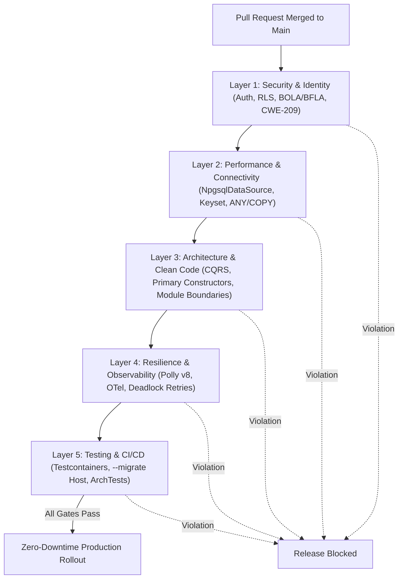
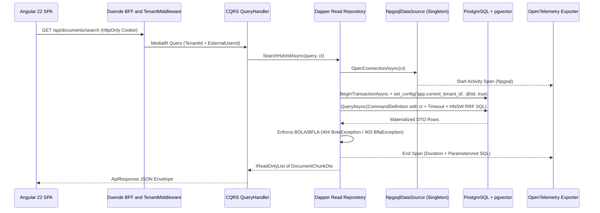
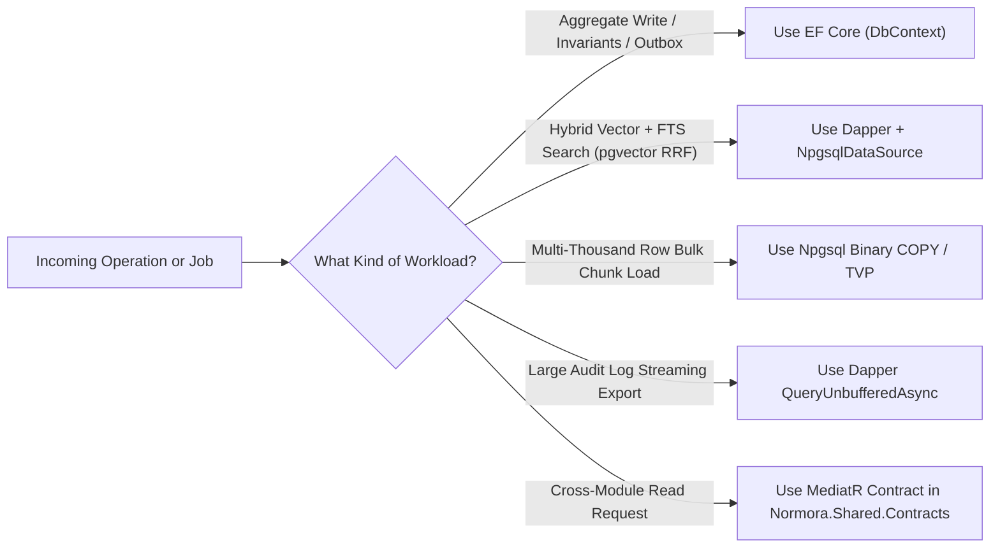

# Chapter 10: The Production Checklist and Summary

## 1. Learning Objectives

By the end of this final chapter, you will be able to:
*   Evaluate an entire ASP.NET Core (.NET 10 / C# 14) Dapper solution—both SQL Server (`Microsoft.Data.SqlClient`) and PostgreSQL (`Npgsql` + `pgvector`)—against a rigorous Enterprise Production Checklist.
*   Identify and prevent critical security (BOLA, BFLA, CWE-209, SQL injection, tenant leaks), performance (pool exhaustion, N+1 queries, deep `OFFSET` scans, missing `CancellationToken`), and architectural misconfigurations before deploying to production.
*   Apply an Architect's Decision Matrix to choose accurately between Dapper and Entity Framework Core inside a Modular Monolith (using **Normora** alongside the **EV Charging Platform** case study).
*   Enforce zero-downtime schema evolutions (Expand-and-Contract), ephemeral migration hosts, and automated Architecture Fitness Tests in CI/CD.
*   Synthesize the core tenets of Enterprise Data Access learned throughout this course.

## 2. Introduction

You have traversed the entire landscape of Dapper. You started with the fundamental mechanics of IL Emit and `IDataReader`, moved through complex object mapping and Table-Valued Parameters, and architected secure, multi-tenant CQRS pipelines with cloud deployment and OpenTelemetry observability.

However, knowledge without disciplined execution leads to production incidents. Before any Enterprise SaaS platform goes live—whether it is an Azure SQL **EV Charging Platform** or a .NET 10 Modular Monolith like **Normora** (PostgreSQL + `pgvector`, Duende BFF, Hangfire workers, and SignalR streaming)—it must pass a strict readiness review.

This chapter provides the ultimate **Dapper Architect's Production Checklist**. Every item is paired with both the classic SQL Server / EV Charging baseline and **Normora**'s real-world PostgreSQL + .NET 10 implementation, followed by an architectural decision guide ("What, Why, How, and When NOT to Use"), common production anti-patterns, and interview preparation.

Print this checklist. Pin it to your wall. Enforce it in your Pull Requests.

---

## 3. Production Readiness Architecture & Flow

Before inspecting individual checklist items, visualize how all five layers interlock at runtime and across your release pipeline.

### The 5-Layer Go / No-Go Production Gate



### Normora End-to-End Request & Guardrails Flow

Notice how security, tenant isolation, cancellation propagation, and observability wrap every Dapper read without leaking infrastructure details into Controllers or MediatR handlers:



---

## 4. The Dapper Architect's Production Checklist

> [!NOTE]
> **Dual-Database Coverage:** The checklist preserves every SQL Server / Azure SQL mandate from the **EV Charging Platform** case study while extending each layer for **.NET 10 / C# 14 (primary constructors)** and **Normora's PostgreSQL + `pgvector` (`Npgsql`)** stack.

---

### Layer 1: Security & Identity

- [ ] **No Hardcoded Passwords:** Connection strings do not contain `User ID` or `Password` in source control. Azure SQL deployments utilize Azure Managed Identity via `DefaultAzureCredential`. PostgreSQL deployments inject credentials via secret managers / environment overrides validated at startup (`ValidateOnStart()`) or use `NpgsqlDataSourceBuilder.UsePeriodicPasswordProvider` with short-lived cloud IAM/Entra tokens over TLS (`SslMode=VerifyFull`).
- [ ] **Strict Parameterization:** Zero dynamic string concatenation or C# string interpolation (`$"..."`) of user input into Dapper SQL strings. All variables are passed via anonymous objects, `DynamicParameters`, or typed `NpgsqlParameter` / `Pgvector.Vector` values.
- [ ] **Whitelist Dynamic Ordering:** Any dynamic `ORDER BY` clause validates both the **sort column** and **sort direction** (`ASC` / `DESC`) against a hardcoded C# `FrozenDictionary<string, string>` or `switch` expression before embedding the identifier into SQL.
- [ ] **Tenant Isolation (RLS & Defense-in-Depth):**
  * *SQL Server (EV Charging):* Row-Level Security (RLS) is enabled and `ISqlConnectionFactory` sets `SESSION_CONTEXT(N'TenantId')` per request.
  * *PostgreSQL (Normora):* RLS policies read `current_setting('app.current_tenant_id', true)` set via `SELECT set_config('app.current_tenant_id', @TenantId, true)` inside an explicit transaction (`is_local = true` prevents tenant leakage across pooled connections). Unscoped root queries (such as `TenantsDbContext` / `tenants.*` directory tables) and cross-module contracts **always** carry an explicit `WHERE tenant_id = @TenantId` filter.
- [ ] **BOLA & BFLA Enforcement on Raw Dapper Reads:** Because Dapper bypasses EF Core global query filters, every single-record lookup checks ownership/department ACLs in SQL or immediately upon return. Missing or unauthorized objects throw `BolaException` (mapped globally to `404 Not Found` with `ApiMessages.NotFound` to prevent ID enumeration); unauthorized actions throw `BflaException` (`403 Forbidden` with `ApiMessages.Forbidden`).
- [ ] **Principle of Least Privilege:** The runtime database role has `SELECT`, `INSERT`, `UPDATE`, and `DELETE` permissions only on its application schemas (`tenants`, `documents`, `conversations`). It cannot execute DDL (`CREATE`, `DROP`, `ALTER`, `TRUNCATE`) or connect as `sa` / `postgres` superuser. Schema migrations run under a separate privileged CI/CD or `--migrate` role.
- [ ] **Data Masking, Encryption & CWE-209 Scrubbing:** Sensitive PII uses SQL Server Dynamic Data Masking / Always Encrypted or PostgreSQL TLS + column encryption (`pgcrypto`). Raw database exceptions (`NpgsqlException.Message`, SQL text, stack traces) are **never** returned to API callers, Hangfire failure emails, or end-users (CWE-209); failures map to `Normora.Shared.Constants.ApiMessages`.
- [ ] **Input Validation Before DB Acquisition:** FluentValidation validators (`{OperationName}CommandValidator`) validate page sizes, string lengths, and vector dimensions *before* Dapper opens a database connection.

#### Real-World Normora Examples (Layer 1: Security & Identity)

**Example 1 — Startup-Validated `NpgsqlDataSource` (No Hardcoded Secrets):**
```csharp
// Normora.Infrastructure/Extensions/DatabaseServiceExtensions.cs
public static IServiceCollection AddNormoraDataSource(
    this IServiceCollection services,
    IConfiguration configuration)
{
    services.AddOptions<DatabaseOptions>()
        .Bind(configuration.GetSection(DatabaseOptions.SectionName))
        .ValidateDataAnnotations()
        .ValidateOnStart(); // Fails fast at boot if connection string or SSL mode is missing

    services.AddSingleton(sp =>
    {
        var options = sp.GetRequiredService<IOptions<DatabaseOptions>>().Value;
        var builder = new NpgsqlDataSourceBuilder(options.ConnectionString);
        builder.UseVector(); // Registers pgvector Npgsql plugin once
        return builder.Build();
    });

    return services;
}
```

**Example 2 — Whitelisted Dynamic `ORDER BY` for `Tenants` Audit Logs:**
```csharp
// Normora.Modules.Tenants.Infrastructure/Persistence/AuditLogReadRepository.cs
public sealed class AuditLogReadRepository(NpgsqlDataSource dataSource) : IAuditLogReadRepository
{
    private static readonly FrozenDictionary<string, string> AllowedSortColumns =
        new Dictionary<string, string>(StringComparer.OrdinalIgnoreCase)
        {
            ["createdAt"] = "al.created_at",
            ["action"] = "al.action",
            ["actorEmail"] = "al.actor_email"
        }.ToFrozenDictionary(StringComparer.OrdinalIgnoreCase);

    public async Task<IReadOnlyList<AuditLogDto>> GetPageAsync(
        Guid tenantId, string sortBy, bool descending, int limit, CancellationToken ct)
    {
        // Both column AND direction are strictly whitelisted — zero user strings enter SQL
        var orderColumn = AllowedSortColumns.GetValueOrDefault(sortBy, "al.created_at");
        var direction = descending ? "DESC" : "ASC";

        var sql = $"""
            SELECT al.id, al.action, al.actor_email, al.created_at
            FROM tenants.audit_logs al
            WHERE al.tenant_id = @TenantId
            ORDER BY {orderColumn} {direction}, al.id {direction}
            LIMIT @Limit;
            """;

        await using var conn = await dataSource.OpenConnectionAsync(ct);
        var rows = await conn.QueryAsync<AuditLogDto>(
            new CommandDefinition(sql, new { TenantId = tenantId, Limit = limit }, cancellationToken: ct));
        return rows.AsList();
    }
}
```

**Example 3 — PostgreSQL Local Session Context (`set_config`) for RLS:**
```csharp
// Normora.Infrastructure/Persistence/TenantedNpgsqlSession.cs
public sealed class TenantedNpgsqlSession(NpgsqlDataSource dataSource, ITenantContext tenantContext)
{
    public async Task<T> ExecuteInTenantScopeAsync<T>(
        Func<NpgsqlConnection, NpgsqlTransaction, Task<T>> work,
        CancellationToken ct)
    {
        if (tenantContext.TenantId == Guid.Empty)
            throw new InvalidOperationException(ApiMessages.TenantContextMissing);

        await using var conn = await dataSource.OpenConnectionAsync(ct);
        await using var tx = await conn.BeginTransactionAsync(ct);

        // is_local = true binds app.current_tenant_id strictly to this transaction,
        // so returning the connection to the Npgsql pool never leaks tenant state.
        await conn.ExecuteAsync(new CommandDefinition(
            "SELECT set_config('app.current_tenant_id', @TenantId, true);",
            new { TenantId = tenantContext.TenantId.ToString() },
            transaction: tx,
            cancellationToken: ct));

        var result = await work(conn, tx);
        await tx.CommitAsync(ct);
        return result;
    }
}
```

**Example 4 — Enforcing BOLA (`404`) & BFLA (`403`) on Dapper Document Reads:**
```csharp
// Normora.Modules.Documents.Application/Documents/Queries/GetDocumentById/GetDocumentByIdQueryHandler.cs
public sealed class GetDocumentByIdQueryHandler(
    IDocumentReadRepository readRepo,
    ICurrentUserContext currentUser)
    : IRequestHandler<GetDocumentByIdQuery, DocumentDetailDto>
{
    public async Task<DocumentDetailDto> Handle(GetDocumentByIdQuery request, CancellationToken ct)
    {
        if (!currentUser.HasPermission(Permissions.DocumentsRead))
            throw new BflaException(ApiMessages.Forbidden); // Mapped globally to 403

        // SQL filters by id AND tenant_id AND user department/group ACLs
        var doc = await readRepo.GetAccessibleByIdAsync(
            request.TenantId, request.DocumentId, currentUser.ExternalUserId, ct);

        // Missing OR unauthorized document both map to 404 (BOLA prevention: never leak ID existence)
        return doc ?? throw new BolaException(ApiMessages.NotFound);
    }
}
```

**Example 5 — CWE-209 Safe Error Handling in Background Ingestion (`Normora.Worker`):**
```csharp
// Normora.Modules.Documents.Infrastructure/Jobs/DocumentProcessingJob.cs
catch (NpgsqlException ex)
{
    // Full SQLState & details stay strictly in structured OpenTelemetry/Serilog logs
    logger.LogError(ex, "PostgreSQL failure {SqlState} processing Document {DocumentId}", ex.SqlState, documentId);

    // End-user status & notification emails receive only sanitized ApiMessages constants
    await statusUpdater.MarkFailedAsync(tenantId, documentId, ApiMessages.DocumentProcessingFailed, ct);
}
```

---

### Layer 2: Performance & Connectivity

- [ ] **Factory / DataSource Pattern Enforced:** `IDbConnection` is **never** registered as `Scoped` or `Singleton` in the DI container.
  * *SQL Server (EV Charging):* An `ISqlConnectionFactory` creates connections locally inside `await using` blocks.
  * *PostgreSQL / .NET 10 (Normora):* A singleton `NpgsqlDataSource` manages connection pooling, prepared-statement caches, and `pgvector` type mapping; repositories call `await using var conn = await dataSource.OpenConnectionAsync(ct);`.
- [ ] **Explicit Bounded Pagination (Prefer Keyset for Deep Pages):** Unbounded `SELECT * FROM ...` queries are banned. Shallow UI grids may use SQL Server `OFFSET/FETCH` or PostgreSQL `LIMIT @PageSize OFFSET @Offset` with a FluentValidation max cap (e.g., `<= 100`). High-volume chronological feeds (`tenants.audit_logs`, `conversations.messages`) use **Keyset (Cursor) Pagination** (`WHERE (created_at, id) < (@CursorTime, @CursorId)`) so page 10,000 stays $O(\log N)$ instead of scanning and discarding rows in $O(N)$.
- [ ] **No N+1 Queries:** `foreach` loops containing Dapper `QueryAsync` calls are strictly prohibited. Retrieve parent and child collections in one round trip via `QueryMultipleAsync` (`GridReader`), multi-mapping (`splitOn`), or PostgreSQL `= ANY(@Ids)` array batching.
- [ ] **Buffered Execution by Default (`buffered: true`):** Standard queries use `buffered: true` so Dapper reads all rows into memory and immediately closes/returns the connection to the pool. Only use `buffered: false` (`QueryUnbufferedAsync`) when streaming massive exports directly to an HTTP response or file pipeline, keeping the connection open strictly for the duration of the stream.
- [ ] **Bulk Operations (`TVP`, `UNNEST`, or `COPY`):** Inserting or updating more than 50 rows never uses sequential loops or Dapper's `ExecuteAsync(sql, list)` (which still executes $N$ round-trip statements under the hood).
  * *SQL Server (EV Charging):* Use a Table-Valued Parameter (TVP) + User-Defined Table Type.
  * *PostgreSQL (Normora):* Use `UNNEST(@Col1, @Col2, ...)` for medium batches (50–5,000 rows) or `NpgsqlConnection.BeginBinaryImportAsync` (`COPY ... FROM STDIN (FORMAT BINARY)`) for high-throughput bulk ingestion (e.g., thousands of `DocumentChunk` embeddings).
- [ ] **`CancellationToken` Propagated via `CommandDefinition`:** Every async Dapper call wraps SQL, parameters, and `CancellationToken` in `new CommandDefinition(sql, param, cancellationToken: ct)`. Aborted browser requests immediately cancel active PostgreSQL/SQL Server queries.
- [ ] **Prepared Statement & Plan-Cache Stability:** Never dynamically vary the number of `@p0, @p1, ...` placeholders in an `IN (...)` clause. Use `= ANY(@Ids)` in PostgreSQL (or TVP / `STRING_SPLIT` in SQL Server) so the SQL string stays constant, maximizing Npgsql's `Max Auto Prepare` hit rate and preventing Dapper `Identity` cache bloat.
- [ ] **Index & `pgvector` HNSW Alignment:** Hybrid search queries match the exact `pgvector` operator class (`<=>` for `vector_cosine_ops` on HNSW indexes) and avoid unindexed predicates that force PostgreSQL into sequential table scans.

#### Real-World Normora Examples (Layer 2: Performance & Connectivity)

**Example 1 — Singleton `NpgsqlDataSource` + Primary Constructor Repository (`Documents`):**
```csharp
// Normora.Modules.Documents.Infrastructure/Persistence/DocumentSearchReadRepository.cs
public sealed class DocumentSearchReadRepository(NpgsqlDataSource dataSource)
    : IDocumentSearchReadRepository
{
    public async Task<IReadOnlyList<HybridChunkMatchDto>> SearchHybridAsync(
        Guid tenantId, float[] queryEmbedding, string keywordQuery, int topK, CancellationToken ct)
    {
        const string sql = """
            WITH semantic AS (
                SELECT id, document_id, content, breadcrumb,
                       ROW_NUMBER() OVER (ORDER BY embedding <=> @Embedding) AS sem_rank
                FROM documents.document_chunks
                WHERE tenant_id = @TenantId AND is_deleted = FALSE
                ORDER BY embedding <=> @Embedding
                LIMIT 40
            ),
            lexical AS (
                SELECT id, document_id, content, breadcrumb,
                       ROW_NUMBER() OVER (ORDER BY ts_rank_cd(search_vector, websearch_to_tsquery('english', @Query)) DESC) AS lex_rank
                FROM documents.document_chunks
                WHERE tenant_id = @TenantId AND is_deleted = FALSE
                  AND search_vector @@ websearch_to_tsquery('english', @Query)
                LIMIT 40
            )
            SELECT COALESCE(s.id, l.id) AS ChunkId,
                   COALESCE(s.document_id, l.document_id) AS DocumentId,
                   COALESCE(s.breadcrumb, l.breadcrumb) AS Breadcrumb,
                   COALESCE(s.content, l.content) AS Content,
                   (COALESCE(1.0 / (60 + s.sem_rank), 0) + COALESCE(1.0 / (60 + l.lex_rank), 0)) AS RrfScore
            FROM semantic s
            FULL OUTER JOIN lexical l ON s.id = l.id
            ORDER BY RrfScore DESC
            LIMIT @TopK;
            """;

        await using var conn = await dataSource.OpenConnectionAsync(ct);
        var result = await conn.QueryAsync<HybridChunkMatchDto>(new CommandDefinition(
            sql,
            new { TenantId = tenantId, Embedding = new Vector(queryEmbedding), Query = keywordQuery, TopK = topK },
            cancellationToken: ct));

        return result.AsList();
    }
}
```

**Example 2 — Keyset (Cursor) Pagination on `tenants.audit_logs`:**
```csharp
// Avoids O(N) OFFSET scan when workspace admins browse historical audit trails
const string sql = """
    SELECT id, actor_external_user_id, action, target_type, created_at
    FROM tenants.audit_logs
    WHERE tenant_id = @TenantId
      AND (@CursorTime IS NULL OR (created_at, id) < (@CursorTime, @CursorId))
    ORDER BY created_at DESC, id DESC
    LIMIT @PageSize;
    """;
```

**Example 3 — Eliminating N+1 with `QueryMultipleAsync` + `= ANY(@Ids)` (`Conversations`):**
```csharp
// Fetches conversation header, recent turns, and cited chunk previews in 1 round trip
const string sql = """
    SELECT id, title, persona, updated_at
    FROM conversations.conversations
    WHERE id = @ConversationId AND tenant_id = @TenantId;

    SELECT id, role, content, created_at
    FROM conversations.messages
    WHERE conversation_id = @ConversationId AND tenant_id = @TenantId
    ORDER BY created_at DESC
    LIMIT @MessageLimit;

    SELECT mc.message_id, mc.chunk_id, mc.document_title, mc.snippet
    FROM conversations.message_citations mc
    WHERE mc.tenant_id = @TenantId
      AND mc.message_id = ANY(@KnownMessageIds);
    """;

await using var conn = await dataSource.OpenConnectionAsync(ct);
await using var grid = await conn.QueryMultipleAsync(new CommandDefinition(
    sql, new { ConversationId = conversationId, TenantId = tenantId, MessageLimit = 30, KnownMessageIds = messageIds },
    cancellationToken: ct));

var header = await grid.ReadSingleOrDefaultAsync<ConversationHeaderDto>()
    ?? throw new BolaException(ApiMessages.NotFound);
var messages = (await grid.ReadAsync<ConversationMessageDto>()).AsList();
var citations = (await grid.ReadAsync<CitationDto>()).AsList();
```

**Example 4 — Unbuffered Streaming Export (`QueryUnbufferedAsync`) for Audit Logs:**
```csharp
// Streams 100k+ audit rows directly to an HTTP CSV response without buffering in LOH RAM
public async IAsyncEnumerable<AuditLogExportRow> StreamExportAsync(
    Guid tenantId,
    [EnumeratorCancellation] CancellationToken ct)
{
    const string sql = """
        SELECT id, actor_external_user_id, action, ip_address, created_at
        FROM tenants.audit_logs
        WHERE tenant_id = @TenantId
        ORDER BY created_at DESC;
        """;

    await using var conn = await dataSource.OpenConnectionAsync(ct);
    await foreach (var row in conn.QueryUnbufferedAsync<AuditLogExportRow>(
        new CommandDefinition(sql, new { TenantId = tenantId }, flags: CommandFlags.None, cancellationToken: ct)))
    {
        yield return row;
    }
}
```

**Example 5 — High-Throughput Bulk Chunk Ingestion (`COPY` Binary Import + `UNNEST`):**
```csharp
// Normora.Modules.Documents.Infrastructure/Persistence/BulkChunkIngester.cs
// Used by Normora.Worker after Gemini batchEmbedContents returns 100-chunk embedding batches
public async Task BulkInsertChunksAsync(
    Guid tenantId,
    IReadOnlyList<PreparedChunk> chunks,
    CancellationToken ct)
{
    await using var conn = await dataSource.OpenConnectionAsync(ct);
    await using var writer = await conn.BeginBinaryImportAsync(
        """
        COPY documents.document_chunks
            (id, tenant_id, document_id, document_version_id, chunk_index, breadcrumb, content, embedding)
        FROM STDIN (FORMAT BINARY)
        """, ct);

    foreach (var chunk in chunks)
    {
        await writer.StartRowAsync(ct);
        await writer.WriteAsync(chunk.Id, NpgsqlDbType.Uuid, ct);
        await writer.WriteAsync(tenantId, NpgsqlDbType.Uuid, ct);
        await writer.WriteAsync(chunk.DocumentId, NpgsqlDbType.Uuid, ct);
        await writer.WriteAsync(chunk.VersionId, NpgsqlDbType.Uuid, ct);
        await writer.WriteAsync(chunk.Index, NpgsqlDbType.Integer, ct);
        await writer.WriteAsync(chunk.Breadcrumb, NpgsqlDbType.Text, ct);
        await writer.WriteAsync(chunk.Content, NpgsqlDbType.Text, ct);
        await writer.WriteAsync(new Vector(chunk.Embedding), ct);
    }

    await writer.CompleteAsync(ct);
}
```

---

### Layer 3: Architecture & Clean Code

- [ ] **Dependency Inversion:** Application layers (`Modules.*.Application`) and `Normora.Shared` have **zero** package references to `Dapper`, `Microsoft.Data.SqlClient`, or `Npgsql`. Application handlers depend strictly on narrow port interfaces (e.g., `IDocumentSearchReadRepository`).
- [ ] **CQRS Separation & Hybrid Persistence:** Commands that enforce complex domain invariants, state transitions, and transactional outbox entries use Entity Framework Core (or explicit domain aggregates). Complex read queries, hybrid vector searches, analytics, and bulk streams bypass Domain Entities and use Dapper to map straight into immutable `record` DTOs inside `Application/{Feature}/DTOs/`.
- [ ] **C# 14 Primary Constructors & Clean Operation Folders:** Repositories and CQRS handlers use C# primary constructors for dependency injection (no boilerplate private field + constructor wiring), `sealed` modifiers on concrete implementations, and separate files per CQRS slice (`{OperationName}Query.cs`, `{OperationName}QueryHandler.cs`, `{OperationName}QueryValidator.cs`).
- [ ] **Centralized Type Handlers (Once at Startup):** `SqlMapper.AddTypeHandler(...)` for custom value objects or drivers is registered **exactly once** during host startup (or module initialization guard) — never inside scoped repositories or per-test setup methods. Database driver plugins like `UseVector()` are configured on `NpgsqlDataSourceBuilder` at startup.
- [ ] **Explicit Transaction Boundaries (No `TransactionScope`):** Multi-statement atomic mutations share an explicit `DbTransaction` / `NpgsqlTransaction` (or share a connection via EF Core `Database.UseTransactionAsync` when bridging EF Core + Dapper in a Transactional Outbox). Ambient `TransactionScope` is avoided in async ASP.NET Core / PostgreSQL pipelines.
- [ ] **Strict Modular Monolith Boundaries:** A Dapper repository inside `Modules/Documents` **never** SQL-`JOIN`s across schemas into `tenants.*` or `conversations.*`. Cross-module data requests travel exclusively through MediatR contracts in `Normora.Shared.Contracts.*`, each explicitly carrying `Guid TenantId`.

#### Real-World Normora Examples (Layer 3: Architecture & Clean Code)

**Example 1 — Clean Port / Adapter Separation with C# 14 Primary Constructors:**
```csharp
// Application layer (zero Dapper/Npgsql dependencies):
// server/Modules/Documents/Application/Metrics/Queries/GetDocumentMetrics/IDocumentMetricsReader.cs
public interface IDocumentMetricsReader
{
    Task<DocumentMetricsDto> GetSummaryAsync(Guid tenantId, CancellationToken ct);
}

// Infrastructure layer (encapsulates Dapper + NpgsqlDataSource):
// server/Modules/Documents/Infrastructure/Persistence/DocumentMetricsReader.cs
public sealed class DocumentMetricsReader(NpgsqlDataSource dataSource) : IDocumentMetricsReader
{
    public async Task<DocumentMetricsDto> GetSummaryAsync(Guid tenantId, CancellationToken ct)
    {
        const string sql = """
            SELECT COUNT(*) AS TotalDocuments,
                   COALESCE(SUM(file_size_bytes), 0) AS TotalBytes,
                   COUNT(*) FILTER (WHERE status = 'Ready') AS IndexedDocuments
            FROM documents.documents
            WHERE tenant_id = @TenantId AND is_deleted = FALSE;
            """;

        await using var conn = await dataSource.OpenConnectionAsync(ct);
        return await conn.QuerySingleAsync<DocumentMetricsDto>(
            new CommandDefinition(sql, new { TenantId = tenantId }, cancellationToken: ct));
    }
}
```

**Example 2 — Hybrid CQRS Split (EF Core Writes + Dapper Reads):**
* **Write Path (`UploadDocumentCommandHandler`):** Uses `DocumentsDbContext` (EF Core) to enforce workspace quota invariants, create `Document` + `DocumentVersion` + `DocumentProcessingOutboxMessage` atomically, and trigger `IDocumentProcessingWakeup`.
* **Read Path (`PerformHybridRetrievalQueryHandler`):** Uses `IDocumentSearchReadRepository` (Dapper + `pgvector` HNSW + `tsvector` RRF) to bypass EF Core change tracking and materialize `HybridChunkMatchDto` directly.

**Example 3 — Startup-Only `SqlMapper.AddTypeHandler` Registration:**
```csharp
// Normora.Infrastructure/Extensions/DapperTypeHandlerRegistrar.cs
public static class DapperTypeHandlerRegistrar
{
    private static int _initialized;

    public static void RegisterOnce()
    {
        // Interlocked guard prevents race conditions when parallel test fixtures initialize hosts
        if (Interlocked.Exchange(ref _initialized, 1) == 1)
            return;

        SqlMapper.AddTypeHandler(new PgVectorTypeHandler());
        SqlMapper.AddTypeHandler(new StronglyTypedTenantIdHandler());
    }
}
```

**Example 4 — Sharing One `NpgsqlTransaction` Between EF Core & Dapper (Transactional Outbox):**
```csharp
// Guarantees Document metadata + Dapper-written chunk/outbox updates commit or roll back together
await using var conn = await dataSource.OpenConnectionAsync(ct);
await using var tx = await conn.BeginTransactionAsync(ct);

// Share the exact same connection & transaction with EF Core
await documentsDbContext.Database.UseTransactionAsync(tx, ct);
documentsDbContext.Documents.Add(document);
documentsDbContext.OutboxMessages.Add(outboxMessage);
await documentsDbContext.SaveChangesAsync(ct);

// Execute a Dapper update on the same atomic transaction
await conn.ExecuteAsync(new CommandDefinition(
    "UPDATE documents.workspace_quotas SET used_bytes = used_bytes + @Bytes WHERE tenant_id = @TenantId;",
    new { TenantId = tenantId, Bytes = fileSizeBytes },
    transaction: tx,
    cancellationToken: ct));

await tx.CommitAsync(ct);
```

**Example 5 — Cross-Module MediatR Contract Instead of Cross-Schema SQL `JOIN`:**
```csharp
// WRONG in Modules/Conversations: SELECT ... FROM conversations.messages JOIN tenants.departments ...
// RIGHT: Conversations calls a MediatR contract in Normora.Shared.Contracts.Documents
var retrieval = await mediator.Send(
    new PerformHybridRetrievalQuery(
        TenantId: request.TenantId,
        ExternalUserId: currentUser.ExternalUserId,
        QueryText: rewrittenQuery,
        TopK: 8),
    ct);
```

---

### Layer 4: Resilience & Observability

- [ ] **Polly v8 `ResiliencePipeline` Integration:** Transient database faults are handled centrally via Polly v8 (`ResiliencePipeline` / `Microsoft.Extensions.Resilience`) with exponential backoff + jitter (superseding Polly v7's legacy `AsyncRetryPolicy` shown in Chapter 9).
  * *SQL Server (EV Charging):* Catches `SqlException` transient codes (`40613`, `40197`, `40501`, `49918`).
  * *PostgreSQL (Normora):* Catches `NpgsqlException` where `ex.IsTransient` or `PostgresException.SqlState` is `"57P01"` (admin shutdown), `"53300"` (too many connections), or `"08006"` (connection failure).
- [ ] **OpenTelemetry Tracing Active (Without PII Leaks):**
  * *SQL Server:* `OpenTelemetry.Instrumentation.SqlClient` enabled (note: older beta/RC releases used `SetDbStatementForText = true`, whereas modern v1.x releases configure statement capture and `RecordException` via the updated instrumentation options / enrichment hooks).
  * *PostgreSQL (Normora):* `Npgsql.OpenTelemetry` (`tracerProviderBuilder.AddNpgsql()`) captures every Dapper query span automatically across both `Normora.Api` and `Normora.Worker` with parameterized SQL text only—never inline PII, embeddings, or user chat prompts.
- [ ] **Timeout Management (App + DB Engine):** Long-running analytics or vector reranking queries set `CommandTimeout` explicitly in `CommandDefinition` AND enforce PostgreSQL `SET LOCAL statement_timeout = '10s'` so abandoned or runaway plans cannot starve DB worker threads.
- [ ] **Transaction-Level Deadlock & Serialization Retries:**
  * *SQL Server:* Retries `SqlException` Error `1205` (Deadlock Victim).
  * *PostgreSQL:* Retries `PostgresException` `SqlState == "40P01"` (`deadlock_detected`) or `"40001"` (`serialization_failure`) by **rolling back and re-running the entire transaction unit** (retrying inside an aborted PostgreSQL transaction fails with `25P02: current transaction is aborted`).
- [ ] **Readiness Health Checks & Pool Metrics:** `/health/ready` checks live database connectivity via `AspNetCore.HealthChecks.NpgSql` (`SELECT 1` with short timeout), while OpenTelemetry metrics monitor `db.client.connections.usage` and connection wait times to detect pool exhaustion early.

#### Real-World Normora Examples (Layer 4: Resilience & Observability)

**Example 1 — Polly v8 `ResiliencePipeline` for Transient PostgreSQL Faults:**
```csharp
// Normora.Infrastructure/Resilience/DatabaseResiliencePipelines.cs
public static ResiliencePipeline CreateNpgsqlReadPipeline(ILogger logger) =>
    new ResiliencePipelineBuilder()
        .AddRetry(new RetryStrategyOptions
        {
            MaxRetryAttempts = 3,
            BackoffType = DelayBackoffType.Exponential,
            UseJitter = true,
            Delay = TimeSpan.FromMilliseconds(200),
            ShouldHandle = new PredicateBuilder()
                .Handle<NpgsqlException>(ex => ex.IsTransient)
                .Handle<PostgresException>(ex => ex.SqlState is "57P01" or "53300" or "08006"),
            OnRetry = args =>
            {
                logger.LogWarning(args.Outcome.Exception,
                    "Transient PostgreSQL error; retry attempt {Attempt}", args.AttemptNumber);
                return ValueTask.CompletedTask;
            }
        })
        .Build();
```

**Example 2 — OpenTelemetry `AddNpgsql()` Across `Normora.Api` and `Normora.Worker`:**
```csharp
// Normora.Infrastructure/Extensions/TelemetryExtensions.cs
services.AddOpenTelemetry()
    .WithTracing(tracing => tracing
        .AddAspNetCoreInstrumentation()
        .AddNpgsql() // Automatically traces every Dapper command executed on NpgsqlDataSource
        .AddOtlpExporter())
    .WithMetrics(metrics => metrics
        .AddAspNetCoreInstrumentation()
        .AddNpgsqlInstrumentation() // Exposes pool wait time, active/idle connections, command duration
        .AddOtlpExporter());
```

**Example 3 — `CommandDefinition` Timeout + PostgreSQL `statement_timeout` for HNSW Reranking:**
```csharp
// Prevents complex multi-tenant pgvector + full-text queries from hanging indefinitely
await conn.ExecuteAsync(new CommandDefinition(
    "SET LOCAL statement_timeout = '8000';", transaction: tx, cancellationToken: ct));

var matches = await conn.QueryAsync<HybridChunkMatchDto>(new CommandDefinition(
    hybridSql, param, transaction: tx, commandTimeout: 10, cancellationToken: ct));
```

**Example 4 — Full-Transaction Deadlock Retry (`40P01`) in `Tenants` Quota Updates:**
```csharp
// Retries the ENTIRE transaction unit; never retries a single statement inside a failed Postgres tx
for (var attempt = 1; attempt <= 3; attempt++)
{
    await using var conn = await dataSource.OpenConnectionAsync(ct);
    await using var tx = await conn.BeginTransactionAsync(IsolationLevel.ReadCommitted, ct);
    try
    {
        await conn.ExecuteAsync(new CommandDefinition(updateQuotaSql, param, tx, cancellationToken: ct));
        await tx.CommitAsync(ct);
        break;
    }
    catch (PostgresException ex) when (ex.SqlState is "40P01" or "40001" && attempt < 3)
    {
        await tx.RollbackAsync(ct); // Clears 25P02 state cleanly before fresh retry
        await Task.Delay(Random.Shared.Next(25, 100) * attempt, ct);
    }
}
```

**Example 5 — Readiness Health Check (`/health/ready`) for Kubernetes / Docker Compose:**
```csharp
// Normora.Api/Program.cs
builder.Services.AddHealthChecks()
    .AddNpgSql(
        sp => sp.GetRequiredService<NpgsqlDataSource>(),
        name: "postgresql-pgvector",
        timeout: TimeSpan.FromSeconds(2),
        tags: ["ready"]);
```

---

### Layer 5: Testing & CI/CD

- [ ] **Zero Mocking of Dapper:** `IDbConnection` extension methods (`QueryAsync`, `ExecuteAsync`) are never mocked with Moq/NSubstitute. Unit tests mock the Application repository/reader interface (e.g., `IDocumentSearchReadRepository`).
- [ ] **Testcontainers Integration Coverage:** 100% of Dapper repositories are verified against real database engines in Docker via `Testcontainers` (`Testcontainers.MsSql` for SQL Server; `Testcontainers.PostgreSql` with `pgvector/pgvector:pg16` for Normora's HNSW & `tsvector` queries).
- [ ] **Transaction Rollback & `Respawn` Isolation:** Single-transaction tests wrap Dapper writes in a rolled-back `DbTransaction` / `NpgsqlTransaction` for millisecond cleanup. Multi-transaction tests (e.g., Transactional Outbox commits, RLS policy verification across connections) use `Respawn` or isolated test schemas.
- [ ] **Ephemeral Migration Host Before Deployment:** Database migrations run as an isolated CI/CD step *before* rolling out new API/Worker binaries. In Normora, `dotnet Normora.Api.dll --migrate` invokes `MigrationHostExtensions.RunMigrationsAsync` (without Kestrel, SignalR, OTel listeners, or Hangfire) to execute all 4 sequential `IDatabaseMigrator`s cleanly and exit `0` without native SIGSEGV (`139`).
- [ ] **Expand-and-Contract + Explicit Column Lists:** Destructive DDL (`DROP COLUMN`, column renames) spans multiple deployments so blue/green or rolling pods stay compatible. Dapper queries always select **explicit column names** (never `SELECT *`) so adding new columns never breaks constructor mapping.
- [ ] **Automated Architecture Fitness Tests:** `Normora.Architecture.Tests` (NetArchTest) runs in CI to verify that `Modules.*.Application` never references `Dapper` or `Npgsql`, `Normora.Infrastructure` never references `Normora.Api`/`Normora.Worker`, and modules never breach DbContext encapsulation.

#### Real-World Normora Examples (Layer 5: Testing & CI/CD)

**Example 1 — Unit Testing Handler Logic by Mocking the Port (Not `IDbConnection`):**
```csharp
// Tests GetDocumentMetricsQueryHandler without touching SQL or Dapper internals
var reader = Substitute.For<IDocumentMetricsReader>();
reader.GetSummaryAsync(tenantId, Arg.Any<CancellationToken>())
      .Returns(new DocumentMetricsDto(TotalDocuments: 42, TotalBytes: 1_048_576, IndexedDocuments: 40));

var handler = new GetDocumentMetricsQueryHandler(reader);
var result = await handler.Handle(new GetDocumentMetricsQuery(tenantId), CancellationToken.None);

Assert.Equal(42, result.TotalDocuments);
```

**Example 2 — `Testcontainers.PostgreSql` with `pgvector` Image for Hybrid Retrieval:**
```csharp
// Normora.IntegrationTests/Fixtures/PgVectorContainerFixture.cs
public sealed class PgVectorContainerFixture : IAsyncLifetime
{
    private readonly PostgreSqlContainer _container = new PostgreSqlBuilder()
        .WithImage("pgvector/pgvector:pg16")
        .WithDatabase("normora_test")
        .Build();

    public NpgsqlDataSource DataSource { get; private set; } = null!;

    public async Task InitializeAsync()
    {
        await _container.StartAsync();
        var builder = new NpgsqlDataSourceBuilder(_container.GetConnectionString());
        builder.UseVector();
        DataSource = builder.Build();
        // Run DatabaseMigrationRunner here before executing Dapper repository tests
    }

    public async Task DisposeAsync()
    {
        await DataSource.DisposeAsync();
        await _container.DisposeAsync();
    }
}
```

**Example 3 — Transaction Rollback vs. `Respawn` for RLS & Outbox Tests:**
* Use **`NpgsqlTransaction` + `RollbackAsync()`** inside `AuditLogReadRepositoryTests` to insert seed audit rows and query them back in < 15ms.
* Use **`Respawn`** (`Respawner.CreateAsync(conn, new RespawnerOptions { DbAdapter = DbAdapter.Postgres, SchemasToInclude = ["tenants", "documents", "conversations"] })`) when testing `TenantedNpgsqlSession` RLS policies or `UploadDocumentCommandHandler` outbox commits where real `COMMIT` behavior is required.

**Example 4 — Ephemeral `--migrate` Pipeline Step Before Deploying API & Worker:**
```yaml
# CI/CD Release Gate (runs BEFORE rolling out Normora.Api and Normora.Worker replicas)
- name: Run Ephemeral Database Migrations
  run: dotnet Normora.Api.dll --migrate
  # Executes DatabaseMigrationRunner sequentially:
  # 1. TenantsDatabaseMigrator
  # 2. DocumentsDatabaseMigrator
  # 3. ConversationsDatabaseMigrator
  # 4. SessionDatabaseMigrator (Duende BFF)
```

**Example 5 — `Normora.Architecture.Tests` Guarding Dapper Leakage:**
```csharp
// server/Normora.Architecture.Tests/PersistenceBoundaryTests.cs
[Fact]
public void ApplicationLayers_ShouldNotReference_DapperOrNpgsql()
{
    var applicationAssemblies = new[]
    {
        typeof(Normora.Modules.Tenants.Application.AssemblyMarker).Assembly,
        typeof(Normora.Modules.Documents.Application.AssemblyMarker).Assembly,
        typeof(Normora.Modules.Conversations.Application.AssemblyMarker).Assembly
    };

    var result = Types.InAssemblies(applicationAssemblies)
        .ShouldNot()
        .HaveDependencyOnAny("Dapper", "Npgsql", "Microsoft.Data.SqlClient")
        .GetResult();

    Assert.True(result.IsSuccessful);
}
```

---

## 5. Architect's Decision Guide: What, Why, How, and When NOT to Use Dapper

Senior architects do not treat Dapper as a religion; they treat it as a precision instrument. The diagram below summarizes how **Normora** splits persistence responsibilities between Entity Framework Core and Dapper across its Modular Monolith:



### Decision Matrix

| Decision Area | What & How | Why It Matters | When **NOT** to Use It |
|---|---|---|---|
| **1. `NpgsqlDataSource` vs `ISqlConnectionFactory`** | Register `NpgsqlDataSource` as a `Singleton` (with `UseVector()`), calling `OpenConnectionAsync(ct)` per method. Use `ISqlConnectionFactory` for SQL Server (`DefaultAzureCredential`). | Centralizes pooling, prepared statement caches, and plugin mappings with minimal allocation overhead. | **Do NOT** use a single singleton `NpgsqlDataSource` when implementing **Database-per-Tenant** (each tenant has a distinct connection string/host) or per-request dynamic user credentials; use a keyed/cached factory per tenant instead. |
| **2. Dapper vs. EF Core (Hybrid CQRS)** | Use **EF Core** for transactional domain commands, optimistic concurrency tokens, and schema migrations; use **Dapper** for read projections, `pgvector` HNSW + `tsvector` RRF queries, and dashboards. | EF Core enforces complex aggregate invariants and tracks changes cleanly; Dapper eliminates change-tracker overhead and gives total SQL plan control. | **Do NOT** use Dapper for deeply nested aggregate writes with domain events and soft-delete cascades (`UploadDocumentCommandHandler`, `CancelSubscriptionCommandHandler`)—you will accidentally reimplement a buggy ORM by hand. |
| **3. PostgreSQL RLS (`set_config`) vs Explicit `WHERE`** | Pair PostgreSQL RLS (`set_config(..., true)` inside a tx) with explicit `WHERE tenant_id = @TenantId` predicates in every Dapper query. | Defense-in-depth: an omitted `WHERE` clause cannot leak tenant data, while explicit predicates keep query plans transparent and support unscoped root tables (`TenantsDbContext`). | **Do NOT** rely solely on ambient RLS on global/directory lookup tables (`tenants.tenants`, `tenants.invitations` pre-login) or background Hangfire jobs that lack an HTTP `ITenantContext`; pass `Guid TenantId` explicitly. |
| **4. Keyset Pagination vs `OFFSET/FETCH` & Unbuffered Streaming** | Use keyset `(created_at, id) < (@CursorTime, @CursorId)` for large logs; use `QueryUnbufferedAsync` only for streaming exports. | Prevents $O(N)$ deep-page scans and Out-Of-Memory (OOM) spikes during multi-megabyte exports. | **Do NOT** use keyset pagination if the UI requires jumping directly to arbitrary page numbers ("Jump to Page 47"). **Do NOT** use `buffered: false` (`QueryUnbufferedAsync`) for normal paginated JSON APIs—it pins an open DB connection while the caller reads. |
| **5. `COPY` / `UNNEST` / TVPs vs `ExecuteAsync(list)`** | Use `BeginBinaryImportAsync` (`COPY`) or `UNNEST` (PostgreSQL) / TVPs (SQL Server) for > 50 rows. | Collapses $N$ network round trips and WAL commits into 1 binary stream or 1 statement. | **Do NOT** use `COPY` when you need `ON CONFLICT DO UPDATE` upserts or per-row `RETURNING` IDs directly in one step—use `UNNEST` into an `INSERT ... ON CONFLICT` statement or a staging temp table instead. |

### 5 Concrete Normora Persistence Decisions

1. **`UploadDocumentCommandHandler` (`Documents` Write):** Uses **EF Core** (`DocumentsDbContext`), **NOT Dapper**, because it must atomically persist `Document`, `DocumentVersion`, and `DocumentProcessingOutboxMessage` while enforcing tenant storage invariants.
2. **`PerformHybridRetrievalQueryHandler` (`Documents` Read):** Uses **Dapper + `NpgsqlDataSource`**, **NOT EF Core**, because combining `pgvector` HNSW cosine distance (`<=>`), PostgreSQL `websearch_to_tsquery`, and CTE Reciprocal Rank Fusion (RRF) requires handcrafted SQL and zero change tracking.
3. **`GetAuditLogsQueryHandler` (`Tenants` Read):** Uses **Dapper + Keyset Pagination + Whitelisted `FrozenDictionary` Sort**, **NOT `OFFSET`**, because enterprise compliance logs grow to millions of rows per tenant.
4. **`BulkChunkIngester` (`Normora.Worker`):** Uses **`NpgsqlConnection.BeginBinaryImportAsync` (`COPY`)**, **NOT Dapper `ExecuteAsync(chunks)`**, because ingesting a 500-page PDF generates hundreds of 768-dimensional embeddings that must load in milliseconds.
5. **`CancelSubscriptionCommandHandler` (`Tenants` Write):** Uses **EF Core + `TenantPlanPricingCatalog`**, **NOT Dapper**, because it enforces Free-tier cancellation invariants (`ApiMessages.CannotCancelFreePlan`) and PayU billing state transitions on a rich domain entity.

---

## 6. Common Mistakes & Anti-Patterns

Every item below has caused real outages or security CVEs in production Dapper systems.

> [!CAUTION]
> **Anti-Pattern 1: String-Interpolated `ORDER BY` or `IN (...)` Clauses**
>
> **Wrong Code:**
> ```csharp
> // CRITICAL SQL INJECTION + DAPPER CACHE BLOAT
> var sql = $"SELECT id, title FROM documents.documents WHERE tenant_id = '{tenantId}' ORDER BY {request.SortBy} {request.SortDir}";
> var docs = await conn.QueryAsync<DocumentListDto>(sql);
> ```
>
> **Why It's Wrong:** Interpolating `request.SortBy` or `request.SortDir` bypasses parameterization and allows attackers to inject arbitrary SQL (`"created_at; DROP TABLE..."`). Interpolating `tenantId` or building variable-length `IN ('a','b')` strings also busts Dapper's internal `SqlMapper` query cache (causing unbounded memory growth) and leaks PII into OpenTelemetry traces.
>
> **The Fix:** Parameterize all values (`@TenantId`, `= ANY(@Ids)`), and map both sort column and sort direction through a hardcoded `FrozenDictionary` / `switch`:
> ```csharp
> var col = AllowedSortColumns.GetValueOrDefault(request.SortBy, "d.created_at");
> var dir = request.Descending ? "DESC" : "ASC";
> var sql = $"SELECT d.id, d.title FROM documents.documents d WHERE d.tenant_id = @TenantId ORDER BY {col} {dir};";
> var docs = await conn.QueryAsync<DocumentListDto>(new CommandDefinition(sql, new { TenantId = tenantId }, cancellationToken: ct));
> ```

> [!CAUTION]
> **Anti-Pattern 2: Registering `IDbConnection` as `Scoped`/`Singleton` or Omitting `await using`**
>
> **Wrong Code:**
> ```csharp
> // Program.cs — DO NOT DO THIS
> builder.Services.AddScoped<IDbConnection>(_ => new NpgsqlConnection(connStr));
>
> // Repository — never disposes connection or collides across concurrent SignalR/MediatR tasks
> public sealed class BrokenRepo(IDbConnection db)
> {
>     public Task<int> CountAsync(Guid tid) => db.ExecuteScalarAsync<int>("SELECT COUNT(*) FROM documents.documents WHERE tenant_id = @tid", new { tid });
> }
> ```
>
> **Why It's Wrong:** A `Scoped` or `Singleton` `IDbConnection` holds a physical pooled socket open for the entire HTTP request (even while waiting on slow external calls like Google Gemini or MinIO), starving the connection pool under load. Worse, `NpgsqlConnection` and `SqlConnection` are **not thread-safe**—concurrent `Task.WhenAll` queries on the same scoped connection throw `NpgsqlOperationInProgressException` / MARS exceptions.
>
> **The Fix:** Inject `NpgsqlDataSource` (Singleton) or `ISqlConnectionFactory`, and open/dispose connections locally inside `await using`:
> ```csharp
> public sealed class DocumentCounter(NpgsqlDataSource dataSource)
> {
>     public async Task<int> CountAsync(Guid tenantId, CancellationToken ct)
>     {
>         await using var conn = await dataSource.OpenConnectionAsync(ct);
>         return await conn.ExecuteScalarAsync<int>(
>             new CommandDefinition("SELECT COUNT(*) FROM documents.documents WHERE tenant_id = @TenantId;", new { TenantId = tenantId }, cancellationToken: ct));
>     }
> }
> ```

> [!CAUTION]
> **Anti-Pattern 3: Returning `403` or Raw `ex.Message` on Missing/Unauthorized Tenant Objects (BOLA & CWE-209)**
>
> **Wrong Code:**
> ```csharp
> var doc = await conn.QuerySingleOrDefaultAsync<DocumentRow>(
>     "SELECT id, tenant_id, title FROM documents.documents WHERE id = @Id", new { Id = request.DocumentId });
>
> if (doc is null) return NotFound("Document 8a91... does not exist");
> if (doc.TenantId != currentUser.TenantId) return Forbid(); // Leaks that the ID exists in another tenant!
> ```
>
> **Why It's Wrong:** Returning `403 Forbidden` when a record exists in Tenant B vs `404` when it does not exist allows an attacker in Tenant A to enumerate valid UUIDs/IDs across tenants (Broken Object Level Authorization — BOLA). Hardcoding strings or returning `ex.Message` violates Normora's `ApiMessages` rule and risks CWE-209 information disclosure.
>
> **The Fix:** Filter by `tenant_id = @TenantId` directly in the SQL `WHERE` clause and throw `BolaException(ApiMessages.NotFound)` (`404`) when no row is returned:
> ```csharp
> var doc = await conn.QuerySingleOrDefaultAsync<DocumentDetailDto>(
>     new CommandDefinition(
>         "SELECT id, title FROM documents.documents WHERE id = @Id AND tenant_id = @TenantId AND is_deleted = FALSE;",
>         new { Id = request.DocumentId, TenantId = request.TenantId },
>         cancellationToken: ct));
>
> return doc ?? throw new BolaException(ApiMessages.NotFound);
> ```

> [!CAUTION]
> **Anti-Pattern 4: Dropping `CancellationToken` in Async Dapper Calls**
>
> **Wrong Code:**
> ```csharp
> // User closed the chat tab 200ms ago, but PostgreSQL keeps running the heavy HNSW vector query!
> var chunks = await conn.QueryAsync<HybridChunkMatchDto>(sql, new { TenantId = tenantId, Embedding = vec });
> ```
>
> **Why It's Wrong:** Dapper's convenience overloads `QueryAsync(sql, param)` do **not** accept a `CancellationToken`. When clients cancel HTTP requests or SSE streams, PostgreSQL continues burning CPU and holding locks until the query finishes naturally.
>
> **The Fix:** Always wrap parameters and `CancellationToken` inside `CommandDefinition`:
> ```csharp
> var chunks = await conn.QueryAsync<HybridChunkMatchDto>(
>     new CommandDefinition(sql, new { TenantId = tenantId, Embedding = vec }, cancellationToken: ct));
> ```

> [!CAUTION]
> **Anti-Pattern 5: Retrying a Failed Statement Inside an Aborted PostgreSQL Transaction (`25P02`)**
>
> **Wrong Code:**
> ```csharp
> await using var tx = await conn.BeginTransactionAsync(ct);
> try
> {
>     await conn.ExecuteAsync(sql, param, tx);
> }
> catch (PostgresException ex) when (ex.SqlState == "40P01") // Deadlock
> {
>     // CRASH: Throws 25P02 "current transaction is aborted, commands ignored until end of transaction block"!
>     await conn.ExecuteAsync(sql, param, tx);
> }
> ```
>
> **Why It's Wrong:** Unlike SQL Server (which may abort only the statement depending on `XACT_ABORT`), PostgreSQL immediately transitions the entire transaction into an aborted state on any error. Any subsequent SQL executed on `tx` fails with `25P02`.
>
> **The Fix:** Roll back `tx` (or dispose it), acquire a clean transaction, and retry the entire logical unit of work from the start (see Layer 4, Example 4).

> [!CAUTION]
> **Anti-Pattern 6: Calling `SqlMapper.AddTypeHandler` Inside Repositories or Tests**
>
> **Wrong Code:**
> ```csharp
> public sealed class DocumentSearchReadRepository(NpgsqlDataSource dataSource)
> {
>     public async Task SearchAsync(...)
>     {
>         // MUTATES GLOBAL STATIC DICTIONARY ON EVERY CALL + CAUSES STALE DESERIALIZER CACHE!
>         SqlMapper.AddTypeHandler(new PgVectorTypeHandler());
>         ...
>     }
> }
> ```
>
> **Why It's Wrong:** `Dapper.SqlMapper` stores type handlers and compiled IL deserializers in global static caches. Calling `AddTypeHandler` after queries have already run can leave earlier cached plans using the old deserializer, and concurrent calls create race conditions during startup or parallel xUnit test execution.
>
> **The Fix:** Register all Dapper `TypeHandler`s exactly once during host startup (guarded by `Interlocked.Exchange`, as shown in Layer 3, Example 3) before the first query executes.

> [!CAUTION]
> **Anti-Pattern 7: Cross-Schema `JOIN`s and `SELECT *` in Production Queries**
>
> **Wrong Code:**
> ```csharp
> // Inside Modules/Documents: reaches straight into tenants schema AND uses SELECT *
> const string sql = """
>     SELECT * FROM documents.documents d
>     JOIN tenants.departments dep ON dep.id = d.department_id
>     WHERE d.tenant_id = @TenantId;
>     """;
> ```
>
> **Why It's Wrong:** First, joining across `documents.*` and `tenants.*` violates Modular Monolith DbContext/schema encapsulation—if `Tenants` later extracts into its own microservice or database, `Documents` breaks. Second, `SELECT *` breaks positional/constructor DTO mapping during Expand-and-Contract zero-downtime migrations and pulls unused heavy columns (such as `pgvector` embeddings or `tsvector`s) across the wire.
>
> **The Fix:** Always project explicit columns (`SELECT d.id, d.title, d.status`) and fetch cross-module data through `Normora.Shared.Contracts.*` MediatR queries.

---

## 7. Interview Questions

### Junior Level

1. **Why should `IDbConnection` never be registered as a `Singleton` or `Scoped` service in ASP.NET Core DI?**
   *Answer:* Database connections are not thread-safe and represent finite pooled sockets. Holding a connection open for an entire HTTP request (`Scoped`) or app lifetime (`Singleton`) starves the connection pool during slow I/O (like AI or HTTP calls) and causes concurrent-access exceptions. Instead, inject a singleton `NpgsqlDataSource` (or `ISqlConnectionFactory`) and open/dispose connections locally with `await using`.

2. **How do you pass a `CancellationToken` to Dapper's `QueryAsync` or `ExecuteAsync`?**
   *Answer:* Dapper's simple overloads don't take a `CancellationToken` directly. You must pass a `CommandDefinition`: `await conn.QueryAsync<T>(new CommandDefinition(sql, param, cancellationToken: ct))`. Without it, aborted HTTP requests leave expensive queries running on the database server.

3. **How do you safely support dynamic sorting (`ORDER BY`) in Dapper without introducing SQL injection?**
   *Answer:* SQL parameters (`@Col`) cannot parameterize column identifiers or `ASC`/`DESC` keywords. You must validate both the requested column name and sort direction against a hardcoded C# whitelist (such as a `FrozenDictionary<string, string>` and boolean flag) and interpolate only the trusted whitelist output.

### Senior Level

4. **How do you prevent N+1 queries and `SqlMapper` cache bloat when filtering by a list of IDs in Dapper + PostgreSQL?**
   *Answer:* Never loop with `QueryAsync`, and never dynamically build `IN (@p0, @p1, ...)` strings (which produces a different SQL string per list length and bloats Dapper's query cache). Use PostgreSQL's array syntax `WHERE id = ANY(@Ids)` (passing a `Guid[]` or `List<Guid>`), or `QueryMultipleAsync` to fetch parent + child sets in one round trip.

5. **When should you use `buffered: false` (`QueryUnbufferedAsync`) versus the default `buffered: true`?**
   *Answer:* Keep `buffered: true` for normal API endpoints so Dapper materializes results immediately and returns the connection to the pool right away. Use `QueryUnbufferedAsync` only when streaming massive datasets (e.g., exporting 100k+ `AuditLogs` rows to CSV) where buffering would spike memory into the Large Object Heap (LOH). Remember that unbuffered streaming keeps the DB connection pinned until enumeration completes.

6. **In PostgreSQL + Npgsql, why does retrying a failed Dapper statement inside the same `NpgsqlTransaction` fail with `25P02`, and how do you fix it?**
   *Answer:* When a PostgreSQL transaction encounters a deadlock (`40P01`) or serialization failure (`40001`), PostgreSQL places the entire transaction into an aborted state (`25P02: current transaction is aborted`). You must `RollbackAsync()` / dispose the failed transaction and retry the **entire** transaction block from a fresh connection/transaction.

### Architect Level

7. **In a Modular Monolith like Normora, how do you decide between Entity Framework Core and Dapper for a given CQRS slice?**
   *Answer:* Use EF Core for command paths that mutate aggregates, enforce domain invariants, manage optimistic concurrency, or write atomic Transactional Outbox entries (`UploadDocumentCommandHandler`). Use Dapper for complex read models, hybrid `pgvector` HNSW + full-text RRF queries (`PerformHybridRetrievalQueryHandler`), keyset-paginated audit trails, and `COPY` bulk ingestion—while strictly keeping Dapper/Npgsql out of `Application` layers and never joining across another module's schema.

8. **How do you enforce multi-tenant security on Dapper queries so a single missed `WHERE` clause cannot become a cross-tenant BOLA breach?**
   *Answer:* Combine database-level Row-Level Security (`set_config('app.current_tenant_id', @tid, true)` inside an explicit transaction so connection pooling cannot leak state) with explicit `WHERE tenant_id = @TenantId` clauses on every query (required for unscoped root contexts like `TenantsDbContext`), cross-module MediatR contracts that mandate `Guid TenantId`, and mapping unauthorized/missing object lookups to `BolaException` (`404 Not Found`) rather than `403`.

9. **How do you guarantee zero-downtime schema deployments when your production fleet runs rolling Dapper + EF Core containers (such as `Normora.Api` and `Normora.Worker`)?**
   *Answer:* Follow three rules: (1) Execute migrations from an isolated ephemeral host (`dotnet Normora.Api.dll --migrate` without Kestrel/SignalR/workers) *before* deploying new application containers; (2) Apply **Expand-and-Contract** migrations—never `DROP` or rename a column while old containers still read it; and (3) Never use `SELECT *` in Dapper queries so newly added columns during the "Expand" phase never break constructor or column mapping.

---

## 8. Summary and Conclusion

Dapper is not an Object-Relational Mapper in the traditional sense; it is a surgical data access conduit. It does not try to hide the database from you. It assumes that you, the Architect, know exactly what you are doing.

When you choose Dapper, you choose to take full responsibility for the SQL execution plan, the concurrency isolation level, the connection lifecycle, and the object materialization graph.

Entity Framework Core is exceptional for managing complex domain invariants, tracking changes, emitting migrations, and handling transactional writes (such as Normora's outbox-backed uploads and subscription state transitions). However, when building high-performance SaaS platforms, hybrid `pgvector` + full-text retrieval pipelines, enterprise reporting engines, or systems requiring massive bulk ingestion, the abstractions of heavy ORMs become severe bottlenecks.

By utilizing Dapper—and wrapping it in the rigorous Clean Architecture, Modular Monolith boundaries, BOLA/BFLA security hardening, OpenTelemetry observability, and Testcontainers automation detailed in this course—you unlock the absolute maximum performance of your database engine. You eliminate memory allocations. You collapse network latency. You gain deterministic observability.

You have now mastered the Micro-ORM.

Go build something incredibly fast.
