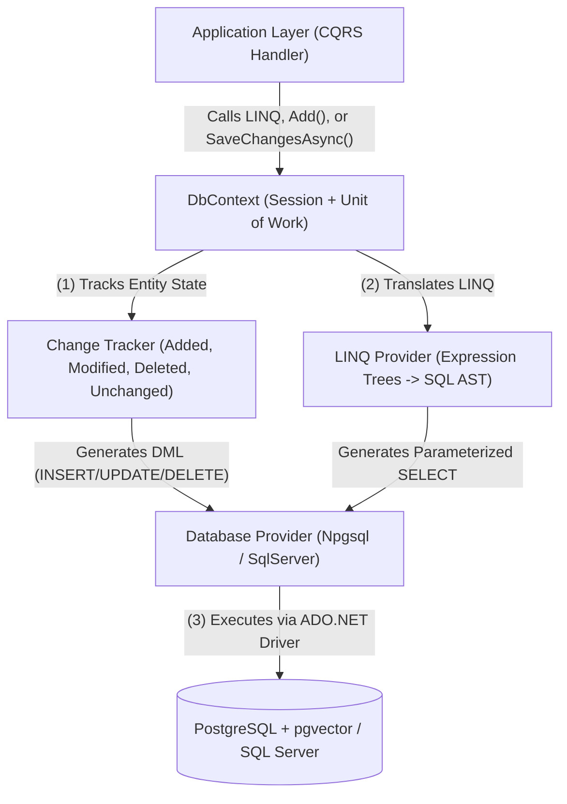
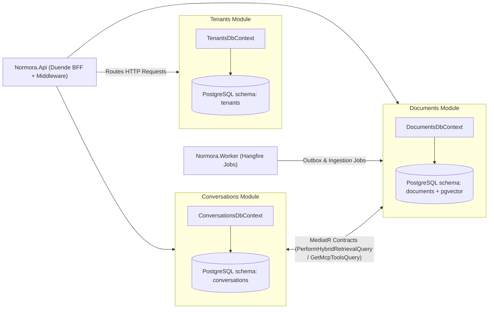
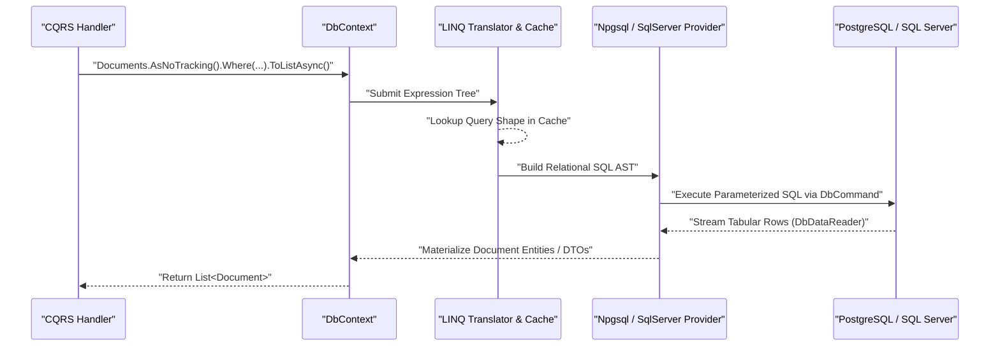

# Chapter 1: The Evolution of Data Access and EF Core Fundamentals

## 1. Learning Objectives

By the end of this chapter, you will be able to:
*   Understand the fundamental philosophy of Object-Relational Mapping (ORM) and all five dimensions of the **Object-Relational Impedance Mismatch**.
*   Trace the architectural evolution from ADO.NET DataSets and Entity Framework 6 to the modern rewrite in **EF Core 10 (.NET 10)**.
*   Evaluate when to use EF Core 10 versus a Micro-ORM like Dapper or raw ADO.NET (`Npgsql` / `Microsoft.Data.SqlClient`)—and **when NOT to use EF Core**.
*   Initialize and configure the core primitives of EF Core: `DbContext` (using C# primary constructors), `DbSet<TEntity>`, and parameterless `IEntityTypeConfiguration<T>` classes.
*   Apply EF Core cleanly in both **Clean Architecture** (EV Charging Platform case study) and **Modular Monolith CQRS** (**Normora**, backed by PostgreSQL + `pgvector`).

## 2. Introduction

Data outlives applications. The C# code you write today will likely be rewritten in a decade, but the relational data structure in PostgreSQL or SQL Server will persist, mutate, and survive.

The relationship between Object-Oriented Programming (OOP) in C# and a Relational Database Management System (RDBMS) is historically fraught. C# relies on inheritance, encapsulation, object graphs, and memory references. Relational databases rely on primary keys, foreign keys, set-based logic, and flat tabular rows. This fundamental disconnect is known as the **Object-Relational Impedance Mismatch**.

### The Five Dimensions of the Impedance Mismatch

As an architect, it is not enough to say "objects and tables are different." You must recognize the five concrete friction points an ORM bridges:

1.  **Granularity:** In OOP, you model fine-grained concepts like a `Money` value object (amount + currency) or a `PgVector` embedding metadata wrapper. In a relational table, storing every tiny value object as its own table creates excessive `JOIN`s; flattening them into columns on a parent row requires mapping logic.
2.  **Inheritance (Subtypes):** C# natively supports class inheritance (`abstract class BaseMessage` -> `UserMessage`, `AssistantMessage`) and polymorphism. Relational databases have no native `extends` keyword—tables are flat, forcing strategies like Table-Per-Hierarchy (TPH), Table-Per-Type (TPT), or Table-Per-Concrete-Type (TPC).
3.  **Identity:** In C#, two objects are identical if they share the same memory reference (`ReferenceEquals(a, b)`) or override `Equals()`. In an RDBMS, row identity is defined strictly by **Primary Key** values (`Id`). Loading the same database row twice into memory without identity resolution creates two divergent C# objects representing one source of truth.
4.  **Associations:** C# references are unidirectional pointers in RAM (`document.Versions`), whereas relational databases express associations via **Foreign Keys** (`document_versions.document_id`) that can be joined in either direction. Many-to-many object collections require hidden associative **join tables** in SQL.
5.  **Data Navigation:** OOP encourages "pointer chasing" (`foreach (var chunk in doc.Versions.First().Chunks)`). In a database, traversing relationships row-by-row triggers the catastrophic **N+1 query problem** (1 query for the parent + N separate network round-trips for children) instead of a single set-based `JOIN`.

### Why ORMs Exist (and When NOT to Use One)
Object-Relational Mappers (ORMs) were invented to bridge this chasm. Without an ORM, developers must write boilerplate ADO.NET code (`NpgsqlCommand` / `SqlCommand`) to open connections, construct raw SQL strings, map resulting `DbDataReader` rows into C# objects column-by-column, and manually track which properties changed to construct targeted `UPDATE` statements later.

This boilerplate is not only tedious but error-prone: a typo in a column name string causes a runtime crash rather than a compile-time error. ORMs allow developers to query the database using strongly-typed C# expressions (**LINQ** — Language Integrated Query) and manipulate state using standard C# objects, delegating SQL generation, parameterization (SQL injection defense), and state tracking to the framework.

**When NOT to use a full ORM like EF Core:**
*   **Ultra-high-throughput bulk ingestion:** Inserting 100,000+ rows per second (e.g., raw IoT telemetry streams) where per-entity state tracking creates unnecessary GC pressure—use PostgreSQL `COPY` (`NpgsqlBinaryImporter`) or `SqlBulkCopy`.
*   **Purely flat analytical / ad-hoc reporting grids:** Executing hand-tuned 8-table window-function queries returning read-only projections where a micro-ORM (Dapper) gives lower mapping overhead.
*   **Legacy stored-procedure-only databases:** When every read/write is locked behind complex vendor-specific stored procedures returning multiple untyped result sets.

### The Evolution to EF Core 10 (.NET 10)
Microsoft's data-access journey moved through four distinct eras:
1.  **ADO.NET (`SqlDataReader` / `DataSet`):** Raw, fast, zero magic, but massive manual mapping boilerplate. `DataSet` and `DataTable` buffered untyped XML-heavy tables in memory.
2.  **LINQ to SQL (2007):** Proved C# expression trees could compile to SQL, but was locked to SQL Server and lacked rich domain-mapping flexibility.
3.  **Entity Framework 1–6 (2008–2013):** Introduced the conceptual model (`.edmx` XML designers), `ObjectContext`, and later `DbContext`. However, EF6 was monolithic, tied to Windows-only .NET Framework (`System.Data.Entity`), suffered from sluggish startup and bloated SQL generation, and silently hid expensive behaviors.
4.  **Entity Framework Core (EF Core 1.0 to EF Core 10 on .NET 10):** Not an upgrade—a complete, cross-platform, open-source, modular rewrite. Designed for cloud-native Linux/Docker workloads, EF Core 10 natively supports asynchronous I/O, compiled models, bulk set-based mutations (`ExecuteUpdateAsync` / `ExecuteDeleteAsync`), complex value-object types, native JSON columns, **named query filters** (allowing selective filter bypass in EF Core 10), and first-class LINQ `LeftJoin` / `RightJoin` operators. Crucially, its pluggable provider model lets teams run **SQL Server** (`Microsoft.EntityFrameworkCore.SqlServer`) or **PostgreSQL + pgvector** (`Npgsql.EntityFrameworkCore.PostgreSQL`) with identical core patterns.

### Real-World Examples: Impedance Mismatch in Normora

In **Normora** (a `.NET 10` modular monolith built on PostgreSQL + `pgvector`), every module encounters the impedance mismatch daily:
1.  **Granularity — `DocumentChunk` & Vector Embeddings (`Documents` module):** A `DocumentChunk` entity holds extracted Markdown breadcrumb text, token counts, and a 768/1536-dimensional embedding vector. PostgreSQL stores that vector using `pgvector`'s native `vector` column type indexed with HNSW (`CREATE INDEX ... USING hnsw`), while C# works with `Pgvector.Vector` mapped cleanly in `DocumentChunkConfiguration` rather than scattering raw float arrays across join tables.
2.  **Identity — `Tenant` & `TenantMembership` (`Tenants` module):** Two concurrent handlers resolving membership for the same `ExternalUserId` inside a single HTTP request must see the exact same tracked `TenantMembership` instance in memory. EF Core's **Identity Resolution** guarantees one CLR instance per primary key inside a `DbContext` scope.
3.  **Associations — `Document`, `DocumentVersion`, and `DocumentProcessingOutboxMessage` (`Documents` module):** When a user uploads a policy PDF, `UploadDocumentCommandHandler` creates a `Document` parent, attaches a `DocumentVersion` child via a C# navigation collection, and enqueues a `DocumentProcessingOutboxMessage`. EF Core orders the `INSERT` statements automatically by foreign-key dependency inside one atomic transaction.
4.  **Data Navigation — `Conversation` & `ConversationMessage` (`Conversations` module):** Walking `conversation.Messages` lazily in a loop during a RAG turn would trigger N+1 round-trips to PostgreSQL. Instead, Normora loads only the required recent turns in a single projected SQL query using `AsNoTracking()`.
5.  **Granularity & Value Semantics — `TenantPlan` & `TenantPlanPricingCatalog` (`Tenants` module):** `TenantPlan` persists workspace billing tier, `Currency` (`INR`, `USD`, `EUR`, etc.), and billing cycle (`Monthly`, `Annual`) as relational columns, while domain pricing rules live in C# inside `TenantPlanPricingCatalog`—keeping relational storage flat while keeping business invariants in C#.

## 3. Core Concepts

### ORM (Object-Relational Mapper)
A software layer that bridges object-oriented C# code and relational database tables, translating LINQ queries into parameterized SQL and database rows back into typed objects.

### The `DbContext`
The `DbContext` is the heart of Entity Framework Core. It represents a short-lived **session** with the database and implements two classic enterprise patterns simultaneously:
*   **Unit of Work:** Tracks all inserts, updates, and deletes across multiple tables during a business operation and commits them atomically in `SaveChangesAsync()`.
*   **Repository Coordinator:** Exposes `DbSet<TEntity>` properties for querying and mutating entity collections.

*When NOT to keep a `DbContext` alive:* Never hold a `DbContext` as a Singleton or reuse one across concurrent threads (`Task.WhenAll`), because its internal state is not thread-safe and grows without bound.

### The `DbSet<TEntity>`
A property on the `DbContext` representing a typed collection of entities that maps to a database table (or view). You write LINQ expressions against a `DbSet<TEntity>` (`dbContext.Documents.Where(...)`) to generate SQL `SELECT` statements, and call `.Add()` / `.Remove()` to stage writes.

### The `Entity` (POCO)
A **POCO** (*Plain Old CLR Object*) is a standard C# class representing a persistent domain concept without inheriting from framework base classes like `EntityObject`. In a **Domain-Driven Design (DDD)** architecture, entities encapsulate both state and invariant-enforcing behavior (e.g., private setters and factory methods).

### The `Change Tracker`
An internal subsystem inside every `DbContext` that records snapshots of loaded entities (`Unchanged`, `Added`, `Modified`, `Deleted`, `Detached`). When `SaveChangesAsync()` runs, the Change Tracker computes minimal `INSERT`/`UPDATE`/`DELETE` SQL statements.

*When NOT to use Change Tracking:* For read-only queries (CQRS Queries), always disable tracking via `.AsNoTracking()` (covered deeply in Chapters 2 and 6) so EF Core skips snapshot allocation.

### Database Provider & `IEntityTypeConfiguration<T>`
*   **Database Provider:** A pluggable NuGet package translating EF Core's internal query/schema model into a specific SQL dialect (e.g., `Npgsql.EntityFrameworkCore.PostgreSQL` for PostgreSQL + `pgvector`, or `Microsoft.EntityFrameworkCore.SqlServer` for SQL Server).
*   **`IEntityTypeConfiguration<T>`:** A dedicated configuration class separating table, column, index, and foreign-key rules from both the Domain Entity and `DbContext.OnModelCreating()`. Keeping configurations parameterless allows EF Core to auto-discover them via `ApplyConfigurationsFromAssembly(...)`.

### Real-World Examples: Core Primitives in Normora
1.  **Module-Private `DbContext` (`DocumentsDbContext`):** Owns the `documents` schema in PostgreSQL (`Documents`, `DocumentVersions`, `DocumentChunks`, `DocumentProcessingOutboxMessages`) and binds global multi-tenant filters to the injected `ITenantContext`.
2.  **Unscoped Root `DbContext` (`TenantsDbContext`):** Owns the `tenants` schema (`Tenants`, `TenantMemberships`, `Departments`, `UserGroups`, `AuditLogs`, `TenantPlans`) without an ambient `TenantId` global filter because it bootstraps tenant resolution across workspaces.
3.  **Conversational `DbContext` (`ConversationsDbContext`):** Owns the `conversations` schema (`Conversations`, `ConversationMessages`, `PendingApprovals`, `SavedAnswers`) completely isolated from `DocumentsDbContext`.
4.  **Dedicated `IEntityTypeConfiguration<Document>`:** Lives in `server/Modules/Documents/Persistence/Configurations/DocumentConfiguration.cs` with a parameterless public constructor, configuring table names, composite indexes, and `DeleteBehavior` rules without polluting `Document.cs`.
5.  **Domain Entities as Rich POCOs (`TenantPlan` & `Document`):** Domain classes in `Modules/{Module}/Domain/` carry zero EF Core NuGet references or `[Table]` attributes, preserving pure domain logic and testability.

## 4. Visual Diagrams

### EF Core 10 Architecture & Pipeline



### Normora Modular Monolith Persistence Boundaries

In Normora, each bounded context owns its own private `DbContext` and PostgreSQL schema. Modules never touch another module's `DbContext`; cross-module workflows flow strictly through MediatR contracts in `Normora.Shared.Contracts.*`.



## 5. API Deep Dive

### DbContext and DbSet Basics
Let's look at the absolute minimum API surface required to start EF Core.

```csharp
using Microsoft.EntityFrameworkCore;

// 1. The Entity
public class Tenant
{
    public Guid Id { get; set; }
    public string Name { get; set; }
    public DateTime CreatedAt { get; set; }
}

// 2. The DbContext
public class ApplicationDbContext : DbContext
{
    // The DbSet maps to the 'Tenants' table
    public DbSet<Tenant> Tenants { get; set; }

    // Overriding OnConfiguring to define the database provider
    protected override void OnConfiguring(DbContextOptionsBuilder optionsBuilder)
    {
        // This is typically injected via DI in ASP.NET Core, 
        // but shown here for fundamental understanding.
        optionsBuilder.UseSqlServer("Server=localhost;Database=EVPlatform;...");
    }
}
```

**Internal Behavior:**
When you instantiate `ApplicationDbContext` for the first time, EF Core builds its internal **Metadata Model** *once* per application lifetime (cached by `DbContext` type and model cache key). It scans `DbSet<T>` properties, analyzes entity classes using Reflection, resolves Fluent API rules, and caches compiled delegates.

### Modern .NET 10 Style: Primary Constructors & `IEntityTypeConfiguration<T>`

In **.NET 10**, C# **primary constructors** eliminate boilerplate constructor-and-field declarations. Furthermore, enterprise systems like **Normora** keep `DbContext` classes lean by extracting every entity's mapping into a **parameterless** `IEntityTypeConfiguration<T>` class and scanning the assembly once:

*   **What:** `modelBuilder.ApplyConfigurationsFromAssembly(typeof(DocumentsDbContext).Assembly)` discovers every `IEntityTypeConfiguration<T>` class in the module.
*   **Why:** Keeps `OnModelCreating` under 20 lines even when a module grows to 40+ tables, and avoids merge conflicts.
*   **When NOT to use inline `OnModelCreating`:** Never dump hundreds of `.Entity<T>()` mappings inside `OnModelCreating` in production modules. Equally important: **never** inject scoped services (like `ITenantContext`) into an `IEntityTypeConfiguration<T>` constructor—`ApplyConfigurationsFromAssembly` calls `Activator.CreateInstance` expecting a public parameterless constructor, so injecting dependencies breaks model building! Bind dynamic query filters to the `DbContext` instance instead.

### Real-World Examples: Core API & Configuration in Normora

1.  **`DocumentsDbContext` with Primary Constructor & Global Tenant Filter:**
    ```csharp
    // server/Modules/Documents/Persistence/DocumentsDbContext.cs
    public sealed class DocumentsDbContext(
        DbContextOptions<DocumentsDbContext> options,
        ITenantContext tenantContext) : DbContext(options)
    {
        public DbSet<Document> Documents => Set<Document>();
        public DbSet<DocumentVersion> DocumentVersions => Set<DocumentVersion>();
        public DbSet<DocumentChunk> DocumentChunks => Set<DocumentChunk>();
        public DbSet<DocumentProcessingOutboxMessage> OutboxMessages => Set<DocumentProcessingOutboxMessage>();

        protected override void OnModelCreating(ModelBuilder modelBuilder)
        {
            modelBuilder.HasDefaultSchema("documents");
            modelBuilder.ApplyConfigurationsFromAssembly(typeof(DocumentsDbContext).Assembly);
            modelBuilder.Entity<Document>()
                .HasQueryFilter(d => d.TenantId == tenantContext.TenantId);
        }
    }
    ```
2.  **Parameterless `IEntityTypeConfiguration<Document>`:**
    ```csharp
    // server/Modules/Documents/Persistence/Configurations/DocumentConfiguration.cs
    public sealed class DocumentConfiguration : IEntityTypeConfiguration<Document>
    {
        public void Configure(EntityTypeBuilder<Document> builder)
        {
            builder.ToTable("documents");
            builder.HasKey(d => d.Id);
            builder.Property(d => d.Title).HasMaxLength(255).IsRequired();
            builder.HasIndex(d => new { d.TenantId, d.DepartmentId });
        }
    }
    ```
3.  **Unscoped Multi-Tenancy Root (`TenantsDbContext`):** Unlike `DocumentsDbContext`, `TenantsDbContext` manages tenant resolution bootstrapping and cross-workspace memberships, so it omits an ambient `TenantId` global filter and relies on explicit `.Where(m => m.TenantId == request.TenantId)` predicates.
4.  **`ConversationsDbContext` Schema Isolation:** Targets `modelBuilder.HasDefaultSchema("conversations")` for `Conversations`, `ConversationMessages`, `PendingApprovals`, and `SavedAnswers`, ensuring clean PostgreSQL schema separation within the same database cluster.
5.  **`BffSessionDbContext` (`Normora.Api`):** Lives exclusively in the BFF host (`Normora.Api/Migrations/Bff`) to persist Duende BFF user sessions separately from business module schemas.

## 6. EF Core Internals: The Query Pipeline

What happens when you execute `var tenants = dbContext.Tenants.Where(t => t.Name == "Acme").ToList();`?

1.  **Expression Tree Generation:** The C# compiler translates your lambda expression `t => t.Name == "Acme"` into an `Expression<Func<Tenant, bool>>`. This is not executable IL; it is an immutable syntax tree representing the logic.
2.  **Query Compilation & Caching:** EF Core's LINQ Provider hashes the expression tree shape and checks its **Compiled Query Cache**. On a cache miss, it parses the tree nodes (`Parameter t`, `Property Name`, `==`, `Constant/Parameter`).
3.  **SQL Translation:** The Database Provider (`Npgsql` or `SqlServer`) translates the abstract tree into a dialect-specific SQL Abstract Syntax Tree (AST). It converts `==` to `=`, quotes identifiers appropriately (`"Name"` in PostgreSQL vs `[Name]` in SQL Server), and parameterizes values (`@__name_0`) to prevent SQL injection and maximize database plan reuse.
4.  **Execution:** EF Core opens a pooled database connection (`NpgsqlConnection` / `SqlConnection`), sends the SQL and parameters, and streams rows via `DbDataReader`.
5.  **Materialization:** EF Core's compiled materializer delegate constructs C# objects, populates properties, and—unless `.AsNoTracking()` was specified—registers snapshots in the Change Tracker.



*When NOT to rely on default tracked LINQ queries:*
*   **Read-only endpoints:** Always add `.AsNoTracking()` (or project to a DTO with `.Select(...)`) so you do not pay snapshot memory costs.
*   **Set-based updates/deletes:** When purging expired `PendingApproval` rows or marking 5,000 chunks stale, avoid loading entities into memory—use `ExecuteUpdateAsync()` / `ExecuteDeleteAsync()` (covered in Chapter 6).

### Real-World Examples: Query Pipeline in Normora

1.  **`GroupBy` Anonymous-Type Projection Rule (`Documents` / `Tenants` metrics):** EF Core's relational translator cannot translate parameterized C# `record` constructors directly inside `GroupBy(...).Select(...)` and throws an `InvalidOperationException` at runtime. Normora enforces projecting to an anonymous type in SQL first, then mapping to DTOs in memory:
    ```csharp
    var grouped = await dbContext.Documents
        .AsNoTracking()
        .GroupBy(d => d.Status)
        .Select(g => new { Status = g.Key, Count = g.Count() }) // Translated to SQL GROUP BY
        .ToListAsync(ct);

    var result = grouped.Select(x => new DocumentStatusMetricDto(x.Status, x.Count)).ToList();
    ```
2.  **Projection Pushdown in `ConversationsDbContext`:** When loading sidebar conversation history, `.Select(c => new ConversationSummaryDto(c.Id, c.Title, c.UpdatedAt))` projects only 3 columns in SQL instead of hydrating full message graphs, automatically bypassing the Change Tracker.
3.  **Explicit Tenant Predicate on `TenantsDbContext`:** Because `TenantsDbContext` is an unscoped root context, queries like `GetUserGroupsQueryHandler` explicitly write `.Where(g => g.TenantId == request.TenantId)` so the predicate is compiled straight into the SQL `WHERE` clause.
4.  **Transactional Outbox `SaveChangesAsync()` (`UploadDocumentCommandHandler`):** Adding a `Document`, a `DocumentVersion`, and a `DocumentProcessingOutboxMessage` batches three `INSERT` commands into a single database round-trip inside one atomic PostgreSQL transaction.
5.  **Vector & Full-Text Translation (`DocumentsDbContext`):** Using `Npgsql` + `Pgvector.EntityFrameworkCore`, EF Core translates `c.Embedding.CosineDistance(queryVector)` directly into PostgreSQL's `c.embedding <=> @__queryVector_0` operator, utilizing the HNSW index on the database server rather than pulling vectors into C# RAM.

## 7. Complete Examples: The EV Platform Case Study

We will build a Multi-Tenant EV (Electric Vehicle) Charging Management Platform throughout this book. Let's define the foundational domain.

```csharp
// Domain/Entities/Tenant.cs
public class Tenant
{
    public Guid Id { get; set; } = Guid.NewGuid();
    public string Name { get; set; } = string.Empty;
    public string ContactEmail { get; set; } = string.Empty;
    public bool IsActive { get; set; } = true;
    
    // Navigation Property
    public ICollection<Site> Sites { get; set; } = new List<Site>();
}

// Domain/Entities/Site.cs
public class Site
{
    public Guid Id { get; set; } = Guid.NewGuid();
    public Guid TenantId { get; set; } // Foreign Key
    public string LocationName { get; set; } = string.Empty;
    public decimal Latitude { get; set; }
    public decimal Longitude { get; set; }

    // Navigation Property
    public Tenant Tenant { get; set; } = null!;
}

// Infrastructure/Data/EvDbContext.cs
using Microsoft.EntityFrameworkCore;

public class EvDbContext : DbContext
{
    public EvDbContext(DbContextOptions<EvDbContext> options) : base(options) { }

    public DbSet<Tenant> Tenants => Set<Tenant>();
    public DbSet<Site> Sites => Set<Site>();

    protected override void OnModelCreating(ModelBuilder modelBuilder)
    {
        // We will cover the Fluent API deeply in Chapter 3.
        // This explicitly defines the One-to-Many relationship.
        modelBuilder.Entity<Tenant>()
            .HasMany(t => t.Sites)
            .WithOne(s => s.Tenant)
            .HasForeignKey(s => s.TenantId)
            .OnDelete(DeleteBehavior.Restrict);
    }
}
```

### Complete Normora Case Study Slice: Documents Module Vertical Slice

Alongside the EV Platform case study, this course demonstrates every pattern inside **Normora** (`.NET 10`, PostgreSQL + `pgvector`, Modular Monolith, CQRS folder-per-operation):

```csharp
// 1. Domain Entity (server/Modules/Documents/Domain/Entities/Document.cs) — Zero EF Core dependencies
public sealed class Document
{
    private Document() { } // Private parameterless constructor for EF Core materialization

    public Document(Guid tenantId, Guid departmentId, string title, string storageKey)
    {
        Id = Guid.NewGuid();
        TenantId = tenantId;
        DepartmentId = departmentId;
        Title = title;
        StorageKey = storageKey;
        Status = DocumentStatus.Pending;
        CreatedAt = DateTimeOffset.UtcNow;
    }

    public Guid Id { get; private set; }
    public Guid TenantId { get; private set; }
    public Guid DepartmentId { get; private set; }
    public string Title { get; private set; } = string.Empty;
    public string StorageKey { get; private set; } = string.Empty;
    public DocumentStatus Status { get; private set; }
    public DateTimeOffset CreatedAt { get; private set; }
}

// 2. Parameterless Configuration (server/Modules/Documents/Persistence/Configurations/DocumentConfiguration.cs)
public sealed class DocumentConfiguration : IEntityTypeConfiguration<Document>
{
    public void Configure(EntityTypeBuilder<Document> builder)
    {
        builder.ToTable("documents");
        builder.HasKey(d => d.Id);
        builder.Property(d => d.Title).HasMaxLength(255).IsRequired();
        builder.Property(d => d.StorageKey).HasMaxLength(512).IsRequired();
        builder.HasIndex(d => new { d.TenantId, d.DepartmentId });
    }
}

// 3. CQRS Query Handler (server/Modules/Documents/Application/Documents/Queries/GetDocumentById/GetDocumentByIdQueryHandler.cs)
public sealed class GetDocumentByIdQueryHandler(
    DocumentsDbContext dbContext) : IRequestHandler<GetDocumentByIdQuery, DocumentDto>
{
    public async Task<DocumentDto> Handle(GetDocumentByIdQuery request, CancellationToken ct)
    {
        var dto = await dbContext.Documents
            .AsNoTracking()
            .Where(d => d.Id == request.DocumentId)
            .Select(d => new DocumentDto(d.Id, d.Title, d.Status, d.CreatedAt))
            .FirstOrDefaultAsync(ct);

        // BOLA protection: return 404 via BolaException (never leak whether ID exists in another tenant)
        return dto ?? throw new BolaException(ApiMessages.NotFound);
    }
}
```

## 8. Performance: EF Core 10 vs Dapper vs ADO.NET

A Solution Architect must choose the right data access tool for each workload rather than forcing one tool everywhere.

| Feature | EF Core 10 (.NET 10) | Dapper | Raw ADO.NET (`Npgsql` / `Microsoft.Data.SqlClient`) |
| :--- | :--- | :--- | :--- |
| **Development Speed** | Very High (LINQ, Migrations, Change Tracker) | Medium (Manual SQL required) | Very Low (Manual connection & reader boilerplate) |
| **Query Performance** | High (Compiled query cache, parameterized SQL) | Very High (IL-emitted flat reader mapping) | Absolute Maximum |
| **Change Tracking** | Automatic (Complex object graphs) | Manual | Manual |
| **Memory Overhead** | Medium (Low with `AsNoTracking()` / projections) | Very Low | Minimal |
| **Compile-Time Safety** | 100% (Strongly-typed LINQ) | 0% (SQL Strings) | 0% (SQL Strings) |
| **Ideal Use Case** | Domain mutations, CQRS commands, standard queries | Complex multi-join reporting grids | Binary bulk `COPY`, extreme low-latency paths |

**The Enterprise Verdict:** Use EF Core 10 for 95% of your application—all CQRS Command handlers, complex object-graph mutations, and standard parameterized Queries (with `.AsNoTracking()` and `.Select(...)` projections). Reach for Dapper or raw `Npgsql` only for the remaining 5% where profiling proves EF Core's query translation or per-row materialization is the bottleneck.

**When NOT to use Dapper / Raw ADO.NET:** Avoid them for multi-entity transactional writes (e.g., creating a `Document` + `DocumentVersion` + `DocumentProcessingOutboxMessage` atomically) where manual foreign-key ordering, optimistic concurrency, and `UPDATE` column-diffing become brittle boilerplate.

### Real-World Examples: Tool Selection in Normora

1.  **`UploadDocumentCommandHandler` (`Documents` module) -> EF Core 10:** Persists `Document`, `DocumentVersion`, and `DocumentProcessingOutboxMessage` inside a single `SaveChangesAsync()` transaction with automatic FK ordering.
2.  **`PerformHybridRetrievalQuery` (`Documents` module) -> EF Core 10 + `Pgvector.EntityFrameworkCore` or Targeted SQL:** Combines `pgvector` HNSW cosine similarity with PostgreSQL `tsvector` keyword ranking (Reciprocal Rank Fusion). When custom RRF CTE SQL is needed, EF Core's `SqlQuery<T>` / Dapper executes cleanly over the same connection.
3.  **`DocumentProcessingJob` Batch Embedding Storage (`Normora.Worker`) -> Batched EF Core or `Npgsql` Binary `COPY`:** Gemini's `batchEmbedContents` returns up to 100 chunk embeddings per call; writing chunks with `AutoDetectChangesEnabled = false` or `NpgsqlBinaryImporter` avoids Change Tracker overhead at scale.
4.  **`GetAuditLogsQueryHandler` Export (`Tenants` module) -> EF Core `AsNoTracking()` Projection (or Dapper for 100k+ CSV Exports):** Standard paginated UI tables use EF Core `.AsNoTracking().Select(...)`, while massive flat compliance exports are prime candidates for streaming via Dapper/ADO.NET.
5.  **`TenantResolutionMiddleware` (`Normora.Api`) -> Redis Cache-Aside + `TenantsDbContext`:** Every HTTP request needs tenant slug and RBAC metadata. Normora checks Redis first (30s–5m sliding TTL) and falls back to a fast `AsNoTracking()` query on `TenantsDbContext`, avoiding database hits on 99% of requests.

## 9. ASP.NET Core Integration & DbContext Lifetimes

In a modern SaaS application, you never instantiate the `DbContext` manually with `new` inside controllers or handlers. You rely on the ASP.NET Core Dependency Injection (DI) container, choosing between three lifetime strategies:

```csharp
// Program.cs (EV Platform)
var builder = WebApplication.CreateBuilder(args);

// 1. Standard Scoped registration (one instance per HTTP request)
builder.Services.AddDbContext<EvDbContext>(options =>
{
    options.UseSqlServer(builder.Configuration.GetConnectionString("AzureSql"));
});
```

### Scoped vs. Pooled vs. Factory (`IDbContextFactory<T>`)

| Registration | Lifetime Behavior | When to Use | When NOT to Use |
| :--- | :--- | :--- | :--- |
| **`AddDbContext<T>`** | Scoped (one per HTTP request / DI scope) | Standard web APIs and CQRS handlers; works cleanly with constructor-injected scoped services like `ITenantContext` | Long-lived Singletons, SignalR hubs holding state across messages, or parallel `Task.WhenAll` queries |
| **`AddDbContextPool<T>`** | Reuses `DbContext` instances from an object pool | High-throughput stateless services with parameterless/options-only `DbContext` constructors | **Do NOT use when your `DbContext` constructor injects scoped services** (e.g., `ITenantContext`), because pooled instances retain constructor references across requests—risking cross-tenant data leaks! |
| **`AddDbContextFactory<T>`** | Injects a thread-safe factory to create short-lived instances on demand | Background workers (`Normora.Worker`), Blazor Server, SignalR hubs, or running parallel queries via `Task.WhenAll` | Simple per-request MVC/MediatR handlers where Scoped DI already manages `SaveChangesAsync` and disposal |

**Lifetime Pitfalls:**
*   **Never** register a `DbContext` as a Singleton. Its Change Tracker will accumulate every loaded entity until the process crashes with `OutOfMemoryException`, and concurrent requests will corrupt internal state.
*   **Never** share one `DbContext` instance across parallel `Task.WhenAll` tasks—EF Core explicitly throws `InvalidOperationException` ("A second operation was started on this context instance before a previous operation completed").

### Real-World Examples: Lifetimes & Hosting in Normora

1.  **Module Composition Root (`DocumentsModuleExtensions.cs`):** Registers `DocumentsDbContext` as **Scoped** using `UseNpgsql(...)` + `UseVector()`, binding `ITenantContext` per HTTP request so global tenant query filters always see the active workspace.
2.  **`Normora.Worker` Hangfire Jobs (`DocumentProcessingJob`):** Background jobs run outside an HTTP request pipeline. Hangfire creates a fresh DI scope per job execution (or uses `IDbContextFactory<DocumentsDbContext>`), ensuring `DocumentsDbContext` is cleanly disposed after each ingestion job.
3.  **Why Normora Avoids `AddDbContextPool` on Tenanted Contexts:** Because `DocumentsDbContext` and `ConversationsDbContext` accept scoped `ITenantContext` in their primary constructors, naive pooling would capture the first request's `ITenantContext` across future requests. Normora uses Scoped `AddDbContext` instead.
4.  **Parallel RAG Sub-Queries (`Conversations` & `Documents`):** When `ConversationTurnPreparer` triggers concurrent operations (e.g., loading conversation metadata while running hybrid retrieval), each operation runs in its own module boundary or sequential await—never sharing one `DbContext` concurrently across threads.
5.  **Ephemeral `--migrate` Console Host (`DatabaseMigrationRunner`):** Running `dotnet Normora.Api.dll --migrate` executes `MigrationHostExtensions.RunMigrationsAsync` in a minimal console host without Kestrel, SignalR hubs, or OpenTelemetry listeners, running `TenantsDatabaseMigrator`, `DocumentsDatabaseMigrator`, `ConversationsDatabaseMigrator`, and `SessionDatabaseMigrator` sequentially before clean zero-exit teardown.

## 10. Clean Architecture & Modular Monolith Perspective

Where does EF Core live in enterprise architecture?

### Classic Layered Clean Architecture
*   **Domain Layer:** Contains entities (`Tenant`, `Site`). *Zero EF Core dependencies.*
*   **Application Layer:** Contains MediatR Handlers and interfaces. *Zero EF Core dependencies.*
*   **Infrastructure Layer:** Contains `EvDbContext` and concrete Repositories. *This is the ONLY layer referencing `Microsoft.EntityFrameworkCore`.*

### Normora's Modular Monolith + CQRS Approach
In a **Modular Monolith** like Normora, wrapping `DbSet<T>` in generic `IRepository<T>` abstractions adds boilerplate without benefit, because `DbContext` is already a Unit of Work and `DbSet<T>` is already a Repository. Instead, Normora enforces **module-level encapsulation**:
*   Each module (`Tenants`, `Documents`, `Conversations`) owns its private `DbContext`, domain entities, and CQRS handlers inside `server/Modules/{ModuleName}/`.
*   CQRS handlers inside `Documents` may inject `DocumentsDbContext` directly (leveraging full LINQ projections, `AsNoTracking()`, and `ExecuteUpdateAsync()`), **but** `Conversations` and `Tenants` can **never** inject `DocumentsDbContext`.
*   `Normora.Shared` remains 100% free of EF Core and domain entities; cross-module communication strictly uses MediatR contracts in `Normora.Shared.Contracts.*`.

## 11. Enterprise SaaS Perspective

Why is EF Core 10 the premier choice for Enterprise SaaS over raw SQL?
1.  **Global Query Filters (and EF Core 10 Named Filters):** In Chapters 3 and 9, we will configure `HasQueryFilter` dynamically bound to `ITenantContext.TenantId` (and soft-delete flags). EF Core 10 even supports **named query filters** (`HasQueryFilter("TenantFilter", ...)`), letting administrative operations selectively bypass soft-delete filters via `IgnoreQueryFilters(["SoftDeleteFilter"])` without accidentally disabling tenant isolation!
2.  **Concurrency Tokens:** EF Core manages Optimistic Concurrency (e.g., PostgreSQL `xmin` system column or `RowVersion`), preventing two workspace admins from silently overwriting each other's edits.
3.  **Auditing & Outbox Atomicity:** By intercepting `SaveChangesAsync()`, architects centrally populate audit metadata and commit **Transactional Outbox** messages (`DocumentProcessingOutboxMessage`) inside the exact same ACID transaction as the business entity.

### Real-World Examples: Enterprise SaaS & Module Boundaries in Normora

1.  **100% `DbContext` Encapsulation (`server/Modules/`):** `DocumentsDbContext`, `TenantsDbContext`, and `ConversationsDbContext` are `internal` or strictly encapsulated to their module; `Normora.Api` middleware and controllers never inject any module's `DbContext`.
2.  **Cross-Module Hybrid Retrieval via MediatR (`Conversations` -> `Documents`):** `SearchCompanyDocumentsTool` in `Conversations` sends `PerformHybridRetrievalQuery(TenantId, ...)` via MediatR instead of touching `DocumentsDbContext`. Notice that cross-module contracts explicitly carry `Guid TenantId` for defense-in-depth across HTTP and background worker contexts.
3.  **Cross-Module MCP Tool Execution (`Documents` -> `Conversations`):** `McpController` in `Documents` dispatches `GetMcpToolsQuery` and `ExecuteMcpToolCommand` via MediatR to `Conversations` rather than referencing `ConversationsDbContext` or `IAgentToolRegistry`.
4.  **Zero-Trust BOLA (404) & BFLA (403) Enforcement:** When a query against `DocumentsDbContext` returns `null` (either missing or blocked by tenant/department filtering), handlers throw `BolaException` (mapped globally to `404` with `ApiMessages.NotFound`), preventing ID enumeration. Unauthorized role actions throw `BflaException` (`403` with `ApiMessages.Forbidden`).
5.  **Provider-Neutral Identity (`ExternalUserId`):** Domain entities in `TenantsDbContext` store `ExternalUserId` rather than vendor-locked `KeycloakUserId`, decoupling the schema from Keycloak OIDC.

## 12. Real Production Case Study

Throughout this book, two real-world systems ground every concept:
1.  **The EV Charging Management Platform:** Manages thousands of `Charger`s across multiple `Site`s for different `Tenant`s, processing millions of `ChargingSession` records and transactional `Payment`s.
2.  **Normora (Enterprise Multi-Tenant Knowledge & Conversational AI Platform):** A `.NET 10` modular monolith (`Tenants`, `Documents`, `Conversations`) backed by PostgreSQL + `pgvector` HNSW indexes, Hangfire outbox workers, Duende BFF, and Gemini RAG orchestration.

## 13. Common Mistakes & Anti-Patterns

> [!CAUTION]
> **Anti-Pattern 1 (Beginner): Polluting Domain Entities with Database Attributes**
>
> **Wrong Code:**
> ```csharp
> [Table("documents", Schema = "documents")]
> public class Document
> {
>     [Column("title")]
>     public string Title { get; set; } = string.Empty;
> }
> ```
> **Why It's Wrong:** Coupling domain entities to `System.ComponentModel.DataAnnotations.Schema` or EF Core attributes leaks persistence details into your pure Domain layer, violates Clean Architecture, and forces you to scatter database concerns across domain code.
>
> **The Fix:** Keep Domain entities as pure POCOs and move all table, column, and index rules into a dedicated parameterless `IEntityTypeConfiguration<Document>` class inside `Persistence/Configurations/`:
> ```csharp
> public sealed class DocumentConfiguration : IEntityTypeConfiguration<Document>
> {
>     public void Configure(EntityTypeBuilder<Document> builder)
>     {
>         builder.ToTable("documents");
>         builder.Property(d => d.Title).HasColumnName("title").HasMaxLength(255).IsRequired();
>     }
> }
> ```

> [!CAUTION]
> **Anti-Pattern 2 (Intermediate): Injecting Scoped Services into `IEntityTypeConfiguration<T>`**
>
> **Wrong Code:**
> ```csharp
> public sealed class DocumentConfiguration(ITenantContext tenantContext)
>     : IEntityTypeConfiguration<Document>
> {
>     public void Configure(EntityTypeBuilder<Document> builder)
>         => builder.HasQueryFilter(d => d.TenantId == tenantContext.TenantId);
> }
> ```
> **Why It's Wrong:** `modelBuilder.ApplyConfigurationsFromAssembly(...)` instantiates configuration classes via reflection expecting a **public parameterless constructor**. Injecting `ITenantContext` throws `MissingMethodException` at startup—and even if instantiated manually, `OnModelCreating` only runs *once* per app lifetime, freezing the first tenant's ID forever!
>
> **The Fix:** Keep `IEntityTypeConfiguration<T>` parameterless and bind dynamic `HasQueryFilter` expressions directly to the `DbContext` primary constructor parameter (`tenantContext.TenantId`) inside `OnModelCreating`.

> [!CAUTION]
> **Anti-Pattern 3 (Intermediate): Assuming EF Core Is Slow Instead of Fixing Read Tracking & N+1 Queries**
>
> **Wrong Code:**
> ```csharp
> // Missing AsNoTracking() and loading entire entity + full text columns just for a list view
> var docs = await dbContext.Documents.Where(d => d.DepartmentId == deptId).ToListAsync(ct);
> return docs.Select(d => new DocumentListItemDto(d.Id, d.Title)).ToList();
> ```
> **Why It's Wrong:** EF Core 10 generates fast, parameterized SQL, but loading full entities with Change Tracking enabled allocates snapshot memory for every row even though the query is read-only.
>
> **The Fix:** Project directly to your DTO in SQL (or add `.AsNoTracking()` when returning entities):
> ```csharp
> var docs = await dbContext.Documents
>     .AsNoTracking()
>     .Where(d => d.DepartmentId == deptId)
>     .Select(d => new DocumentListItemDto(d.Id, d.Title))
>     .ToListAsync(ct);
> ```

> [!CAUTION]
> **Anti-Pattern 4 (Senior): Direct DTO/Record Constructor Projection Inside `GroupBy`**
>
> **Wrong Code:**
> ```csharp
> // Fails at runtime in EF Core relational LINQ translation!
> var stats = await dbContext.Documents
>     .GroupBy(d => d.Status)
>     .Select(g => new DocumentStatusMetricDto(g.Key, g.Count()))
>     .ToListAsync(ct);
> ```
> **Why It's Wrong:** EF Core's relational compiler cannot translate parameterized C# `record` or class constructor invocations directly inside `GroupBy(...).Select(...)`, throwing an unhandled `InvalidOperationException` at runtime (resulting in HTTP 400/500).
>
> **The Fix:** Always project `GroupBy` results into an **anonymous type** in SQL first, materialize with `ToListAsync()`, and map to your C# record/DTO in memory:
> ```csharp
> var grouped = await dbContext.Documents
>     .AsNoTracking()
>     .GroupBy(d => d.Status)
>     .Select(g => new { Status = g.Key, Count = g.Count() })
>     .ToListAsync(ct);
>
> var stats = grouped.Select(x => new DocumentStatusMetricDto(x.Status, x.Count)).ToList();
> ```

> [!CAUTION]
> **Anti-Pattern 5 (Senior): Calling `.Update(entity)` on Detached Entities or Sharing One `DbContext` Across `Task.WhenAll`**
>
> **Wrong Code:**
> ```csharp
> // 1. Blindly calling Update() overwrites every column in the row
> dbContext.Documents.Update(detachedDocument);
>
> // 2. Concurrent operations on a single Scoped DbContext
> await Task.WhenAll(
>     dbContext.Documents.CountAsync(ct),
>     dbContext.DocumentVersions.CountAsync(ct));
> ```
> **Why It's Wrong:** `DbSet.Update(entity)` marks *every* property as `Modified`, generating a full-table-width `UPDATE` that can clobber concurrent changes. Meanwhile, `DbContext` is **not thread-safe**: running two async queries concurrently on the same `DbContext` throws `InvalidOperationException`.
>
> **The Fix:** For targeted updates, load the tracked entity (or attach and mark only changed properties / use `ExecuteUpdateAsync`). For parallel queries, await sequentially on the scoped `DbContext` or create separate instances via `IDbContextFactory<DocumentsDbContext>`.

> [!CAUTION]
> **Anti-Pattern 6 (Architect): Cross-Module `DbContext` Injection & Using `AddDbContextPool` with Scoped `ITenantContext`**
>
> **Wrong Code:**
> ```csharp
> // 1. Conversations module bypassing MediatR contracts and touching DocumentsDbContext directly
> public sealed class SearchCompanyDocumentsTool(DocumentsDbContext docsDb) { ... }
>
> // 2. Pooling a DbContext whose constructor captures a scoped ITenantContext
> services.AddDbContextPool<DocumentsDbContext>(opt => opt.UseNpgsql(connStr));
> ```
> **Why It's Wrong:** Injecting `DocumentsDbContext` inside `Conversations` shatters Modular Monolith boundaries and couples modules to another module's internal schema. Pooling `DocumentsDbContext` with constructor-injected `ITenantContext` turns a scoped dependency into a long-lived captive dependency across pooled requests—risking **catastrophic cross-tenant data leaks**!
>
> **The Fix:** Keep each module's `DbContext` strictly private (communicate across modules via MediatR contracts like `PerformHybridRetrievalQuery` carrying explicit `Guid TenantId`), and register tenanted `DbContext`s with Scoped `AddDbContext<DocumentsDbContext>` instead of `AddDbContextPool`. Also remember: for 100,000+ row telemetry bulk inserts, bypass `SaveChangesAsync()` and use `NpgsqlBinaryImporter` (`COPY`), `SqlBulkCopy`, or `ExecuteUpdateAsync`/`ExecuteDeleteAsync`.

## 14. Interview Questions

### Core Spotlight: EF Core 10 & Normora (Junior, Senior, Architect)

1.  **[Junior] What is the Object-Relational Impedance Mismatch, and how do `DbContext` and `DbSet<T>` address it?**
    *Answer:* It is the structural gap between OOP concepts (objects, references, inheritance, object graphs) and relational tables (primary keys, foreign keys, flat rows, set-based SQL). `DbContext` acts as a session and Unit of Work managing the Change Tracker and SQL translation, while `DbSet<T>` maps a C# entity type to a database table so you can query and persist state using strongly-typed LINQ.
2.  **[Junior] Why does Normora use parameterless `IEntityTypeConfiguration<T>` classes instead of Data Annotations (`[Table]`, `[Column]`) or huge `OnModelCreating` methods?**
    *Answer:* Data Annotations leak database concerns into Domain entities, and huge `OnModelCreating` methods cause merge conflicts. Parameterless `IEntityTypeConfiguration<T>` classes keep entities pure, allow automatic discovery via `ApplyConfigurationsFromAssembly(...)`, and avoid runtime `MissingMethodException` failures during assembly scanning.
3.  **[Junior] What happens if you call `GroupBy(...).Select(g => new MyRecordDto(g.Key, g.Count()))` directly in EF Core 10?**
    *Answer:* EF Core's relational LINQ translator cannot translate parameterized C# `record` constructor calls inside `GroupBy(...).Select(...)` and throws an `InvalidOperationException` at runtime. You must project to an anonymous type (`new { Key = g.Key, Count = g.Count() }`) in SQL first, materialize with `ToListAsync()`, and map to `MyRecordDto` in memory.
4.  **[Senior] Why is `AddDbContextPool<T>` dangerous for `DocumentsDbContext` and `ConversationsDbContext` in Normora?**
    *Answer:* `AddDbContextPool` reuses `DbContext` instances across HTTP requests without re-running their constructors. Because `DocumentsDbContext` and `ConversationsDbContext` accept a scoped `ITenantContext` in their primary constructors for global query filters, pooling would turn `ITenantContext` into a captive dependency pointing to an old request's tenant, risking cross-tenant data leakage. Use Scoped `AddDbContext<T>` instead.
5.  **[Senior] How should a background worker like `Normora.Worker` (Hangfire) or parallel `Task.WhenAll` code manage `DbContext` instances?**
    *Answer:* `DbContext` is not thread-safe. Background Hangfire jobs run outside HTTP requests and must resolve a fresh DI scope per job or use `IDbContextFactory<T>` to create and dispose short-lived instances. Similarly, concurrent `Task.WhenAll` queries must never share one `DbContext` instance—each parallel task needs its own `DbContext` from `IDbContextFactory<T>`.
6.  **[Senior] Why does `TenantsDbContext` omit an ambient `TenantId` global query filter while `DocumentsDbContext` enforces one?**
    *Answer:* `TenantsDbContext` is the unscoped multi-tenancy root responsible for bootstrapping tenant resolution (`TenantResolutionMiddleware`) and reading cross-workspace memberships before a tenant context is resolved. Workspace-scoped queries against `TenantsDbContext` therefore filter explicitly (`.Where(m => m.TenantId == request.TenantId)`), whereas domain contexts (`DocumentsDbContext`, `ConversationsDbContext`) enforce ambient global filters bound to `ITenantContext.TenantId`.
7.  **[Architect] In Normora's Modular Monolith, why do module CQRS handlers inject their private `DbContext` directly (no Generic Repository), while cross-module calls use MediatR contracts?**
    *Answer:* `DbContext` already implements Unit of Work and `DbSet<T>` already acts as a repository; adding a generic `IRepository<T>` hides EF Core features like `.Select()` projections, `AsNoTracking()`, and `ExecuteUpdateAsync()`. Injecting the private `DbContext` inside its owning module keeps queries lean, while forbidding cross-module `DbContext` injection and routing cross-module calls through `Normora.Shared.Contracts.*` MediatR queries (with explicit `Guid TenantId`) preserves strict bounded-context encapsulation.
8.  **[Architect] When would you deliberately bypass EF Core 10 in favor of Dapper or raw `Npgsql` (`COPY`) in an enterprise platform?**
    *Answer:* Keep EF Core 10 for transactional writes, outbox inserts, and standard CQRS reads, but bypass Change Tracking (`ExecuteUpdateAsync`/`ExecuteDeleteAsync`) or switch to `NpgsqlBinaryImporter` (`COPY`) for massive bulk ingestion (e.g., 100k+ telemetry rows/sec), and consider Dapper or raw SQL projections (`SqlQuery<T>`) for ultra-heavy multi-table analytical exports or custom hybrid ranking CTEs where profiling proves EF Core materialization overhead matters.

### Beginner (10)
1.  **What does ORM stand for, and what problem does it solve?**
    *Answer:* Object-Relational Mapper. It solves the impedance mismatch by translating object-oriented code into relational database structures and queries.
2.  **What is the core class you must inherit from to configure EF Core?**
    *Answer:* `DbContext`.
3.  **What property type represents a database table in a DbContext?**
    *Answer:* `DbSet<TEntity>`.
4.  **What language do you use in C# to query an EF Core DbSet?**
    *Answer:* LINQ (Language Integrated Query).
5.  **Does EF Core execute the SQL immediately when you write `.Where(x => x.Id == 1)`?**
    *Answer:* No. Execution is deferred until you call a materialization method like `.ToList()`, `.FirstOrDefault()`, or iterate over it with a `foreach` loop.
6.  **What NuGet packages are required to use SQL Server or PostgreSQL with EF Core 10?**
    *Answer:* `Microsoft.EntityFrameworkCore.SqlServer` for SQL Server, or `Npgsql.EntityFrameworkCore.PostgreSQL` for PostgreSQL (plus `Pgvector.EntityFrameworkCore` when mapping `pgvector` embeddings).
7.  **Why should you not use `System.Data.SqlClient` with EF Core 10?**
    *Answer:* It is legacy. For SQL Server, the modern, maintained ADO.NET provider is `Microsoft.Data.SqlClient` (supporting Entra ID / Managed Identities); for PostgreSQL, it is `Npgsql`.
8.  **What is the default DI lifetime of a DbContext in ASP.NET Core?**
    *Answer:* Scoped (one instance per HTTP request).
9.  **What is a POCO?**
    *Answer:* Plain Old CLR Object. A simple class without dependencies on external frameworks, used to represent entities in EF Core.
10. **What is the difference between EF6 and EF Core?**
    *Answer:* EF6 is the legacy, monolithic, Windows-only framework. EF Core is a complete, cross-platform, modular, and highly performant rewrite.

### Intermediate (10)
11. **Explain the purpose of the Change Tracker.**
    *Answer:* The Change Tracker monitors all entities currently attached to the DbContext. It records their original values and tracks modifications so that when `SaveChanges` is called, it can generate the exact `INSERT`, `UPDATE`, or `DELETE` statements required.
12. **What is an Expression Tree in the context of EF Core?**
    *Answer:* A data structure representing C# code (like a LINQ lambda). EF Core traverses this tree to translate the C# logic into a SQL Abstract Syntax Tree.
13. **Why shouldn't you inject a DbContext as a Singleton?**
    *Answer:* Because the DbContext is not thread-safe, and its internal Change Tracker will accumulate every entity ever queried, eventually causing an Out-Of-Memory exception and corrupting data across concurrent requests.
14. **What is the "Impedance Mismatch"?**
    *Answer:* The fundamental conceptual difference between how data is modeled in Object-Oriented systems (graphs, references, inheritance) versus Relational Databases (tables, foreign keys).
15. **How does EF Core know which column is the Primary Key if you don't explicitly configure it?**
    *Answer:* By convention, EF Core looks for a property named `Id` or `<EntityName>Id` (e.g., `TenantId`).
16. **What is the Fluent API?**
    *Answer:* A set of methods used inside `OnModelCreating` (or `IEntityTypeConfiguration<T>.Configure`) to configure the EF Core model (keys, relationships, constraints) explicitly, keeping the configuration separate from the domain entity classes.
17. **If you execute a LINQ query and it throws an exception about "client-side evaluation," what does that mean?**
    *Answer:* In older versions of EF Core (pre-3.0), if it couldn't translate a C# function to SQL, it would silently pull the whole table into memory and evaluate the function in C#. Modern EF Core throws an `InvalidOperationException` for untranslatable server-side predicates, forcing you to rewrite the query for SQL translation (only the final `.Select()` projection can execute client-side transforms).
18. **What is a Navigation Property?**
    *Answer:* A property on an entity that holds a reference to a related entity (e.g., a `Tenant` property on a `Site` object), mapped to a Foreign Key in the database.
19. **Can EF Core map to an existing database?**
    *Answer:* Yes, this is called Reverse Engineering (or "Database First"). You use `dotnet ef dbcontext scaffold` (or `Scaffold-DbContext`) to generate C# models from an existing schema.
20. **What is the difference between `IQueryable` and `IEnumerable` in EF Core?**
    *Answer:* `IQueryable` represents a query that has not yet been translated to SQL; appending `.Where()` adds to the SQL command. `IEnumerable` represents data already in memory (or streaming results client-side); appending `.Where()` executes the filter in C# RAM, completely defeating the purpose of the database engine.

### Senior (10)
21. **Explain the performance difference between ADO.NET, Dapper, and EF Core.**
    *Answer:* ADO.NET is the foundational driver (fastest). Dapper is a thin wrapper that emits IL for microsecond object mapping (very fast). EF Core adds LINQ translation, Expression Tree parsing, and Change Tracking overhead (fast, especially with `AsNoTracking()` and projections, but inherently heavier than Dapper for flat read grids).
22. **In Clean Architecture, why is it considered an anti-pattern for the Application Layer (e.g., a MediatR handler) to return an `IQueryable<T>`?**
    *Answer:* Because executing or iterating an `IQueryable` triggers database execution. If the Application Layer returns it to the Presentation Layer (Controller), the Controller executes the database query. This violates layer boundaries, meaning a database failure causes an exception in the Presentation layer, bypassing Application layer error handling.
23. **How does EF Core handle `DateTime` vs `DateTimeOffset`?**
    *Answer:* `DateTime` can be ambiguous (Local vs UTC; note that `Npgsql` rejects non-UTC `DateTime` values for `timestamptz` by default). `DateTimeOffset` preserves the exact UTC offset (mapping to SQL Server `datetimeoffset` and PostgreSQL `timestamptz` when UTC), preventing timezone bugs across global deployments.
24. **What is a "Shadow Property"?**
    *Answer:* A property that exists in the EF Core model and the database schema (e.g., `CreatedDate`), but does NOT exist on the C# Domain Entity class. It is managed entirely by EF Core under the hood, keeping the domain clean.
25. **How does EF Core translate C# `string.Contains("text")` into SQL?**
    *Answer:* It translates it into a `LIKE '%text%'` (or `STRPOS` / `LIKE` in PostgreSQL depending on parameterization). Note that leading wildcards prevent standard B-Tree indexes from seeking efficiently, often causing sequential/table scans unless trigram (`pg_trgm`) or full-text (`tsvector`) indexes are used.
26. **What is the DbContext Pooling feature, and when should you avoid it?**
    *Answer:* `AddDbContextPool` maintains a pool of reusable `DbContext` instances, resetting Change Tracker state between requests rather than allocating new contexts. However, avoid it whenever your `DbContext` constructor injects scoped services (like `ITenantContext`), because pooled instances retain constructor-captured references across requests.
27. **Why might you choose Dapper over EF Core for a specific API endpoint?**
    *Answer:* If the endpoint is a read-only reporting dashboard returning 50,000 flattened rows derived from a 6-table `JOIN`, EF Core's object hydration and identity resolution overhead will cause CPU spikes. Dapper excels at high-speed, flat tabular mapping.
28. **Explain how EF Core's `Find(id)` method differs from `FirstOrDefault(x => x.Id == id)`.**
    *Answer:* `Find()` checks the local Change Tracker memory *first*. If the entity is already loaded in the current DbContext, it returns it instantly without a database round-trip. `FirstOrDefault()` always executes a query against the database.
29. **What happens if you have a `DbSet<Log>` and you insert 10,000 logs by calling `.Add()` in a loop, then `.SaveChanges()`?**
    *Answer:* The Change Tracker allocates memory for 10,000 tracked entity states and runs `DetectChanges()` checks, causing memory pressure and slow execution. For updates/deletes, EF Core 7+ introduced `ExecuteUpdate`/`ExecuteDelete` to bypass the Change Tracker; for massive inserts, batch with `AddRange` + `AutoDetectChangesEnabled = false` or use `NpgsqlBinaryImporter` (`COPY`) / `SqlBulkCopy`.
30. **If EF Core is an implementation detail, should you mock the `DbContext` for Unit Testing?**
    *Answer:* No. Mocking `DbContext` or `DbSet` is fragile and provides false confidence (a mocked LINQ-to-Objects query passes in C# even when it fails SQL translation in PostgreSQL/SQL Server). Mock domain/application ports for unit tests, and use Testcontainers with a real database for integration tests.

### Staff Engineer (5)
31. **Architect a mechanism to automatically set standard auditing properties (`CreatedBy`, `ModifiedAt`) on every entity without polluting the domain logic.**
    *Answer:* Implement a `SaveChangesInterceptor` (or override `SaveChangesAsync` on the `DbContext`). Iterate over `ChangeTracker.Entries()`. For entries in the `Added` state, set `CreatedBy` and `CreatedAt`. For entries in the `Modified` state, set `ModifiedAt`. This centralizes the cross-cutting concern entirely within the persistence layer.
32. **A production deployment caused CPU utilization to double due to EF Core Query Compilation. Analyze the likely root cause.**
    *Answer:* EF Core compiles Expression Trees into executable delegates and caches them by a hash of the query shape. While EF Core 8+ parameterizes primitive `Contains` collections (via `OPENJSON` or PostgreSQL `= ANY(@p)`), dynamically building *different Expression Tree shapes* per request (e.g., dynamically chained `.Or()` predicates or uncached `Expression.Lambda` builders) causes constant cache misses, forcing EF Core to recompile expression trees on every HTTP request and exhausting CPU.
33. **Design a multi-tenant isolation strategy for EF Core where the risk of developer error (forgetting a `WHERE` clause) is zero.**
    *Answer:* Use EF Core Global Query Filters bound dynamically to a scoped `ITenantContext` injected into the `DbContext` (`HasQueryFilter(e => e.TenantId == tenantContext.TenantId)`—or EF Core 10 named filters `HasQueryFilter("TenantFilter", ...)` so soft-delete filters can be bypassed independently). For unscoped root contexts like Normora's `TenantsDbContext`, enforce explicit tenant predicates and architecture tests.
34. **Evaluate the architectural trade-offs of using `AsNoTracking()` by default for all read operations in a CQRS architecture.**
    *Answer:* In CQRS, Queries (Reads) do not modify state. By enforcing `AsNoTracking()` on all Query Handlers, you eliminate Change Tracker memory allocation and Identity Resolution overhead, resulting in 2x-4x read performance gains. The trade-off is that if you fetch a list containing the same related entity twice, `AsNoTracking` instantiates two separate C# objects in memory (unless you use `AsNoTrackingWithIdentityResolution()`). For read models, this is an acceptable trade-off.
35. **Your team wants to use the SQLite InMemory provider for integration testing an EF Core application that targets PostgreSQL (`pgvector`) or Azure SQL in production. Formulate a technical argument against this.**
    *Answer:* EF Core is an abstraction, but generated SQL and capabilities are dialect-specific. SQLite lacks PostgreSQL schemas, `pgvector` HNSW operators, `tsvector` full-text search, SQL Server `MERGE`, and strict decimal/concurrency semantics. A query can pass on SQLite and crash in production. Always test against the real database engine via Docker Testcontainers.

### Architect (5)
36. **Architect a zero-downtime deployment strategy for a monolithic application where an EF Core migration renames a highly utilized column.**
    *Answer:* Renaming a column in EF Core generates `sp_rename` / `ALTER TABLE ... RENAME COLUMN`, which instantly breaks the running V1 application. An Architect enforces the Expand and Contract pattern:
    Deployment 1 (Expand): Migration adds the *new* column (nullable). V2 Application deploys, writing to both old and new columns.
    Deployment 2: Background script backfills historical data from old to new.
    Deployment 3: V3 Application deploys, reading/writing exclusively to the new column.
    Deployment 4 (Contract): Migration drops the old column. Zero downtime achieved.
37. **In a Domain-Driven Design (DDD) architecture, EF Core requires parameterless constructors for materialization, but DDD dictates entities should only be instantiated via methods that enforce invariants. Reconcile this conflict.**
    *Answer:* EF Core is designed to respect encapsulation. You define a `private` parameterless constructor specifically for EF Core. Because EF Core uses reflection, it can invoke private constructors during materialization from the database without exposing them to the Application Layer, preserving strict domain invariants for new entity creation.
38. **Evaluate the decision to use a Generic Repository Pattern (e.g., `IRepository<T>`) over `DbContext` injection in an Enterprise ASP.NET Core application.**
    *Answer:* The Generic Repository is largely an anti-pattern with modern EF Core. `DbContext` *is* a Unit of Work, and `DbSet<T>` *is* a Generic Repository. Wrapping them in another layer destroys EF Core's query composability (like `.Select()` projections and `ExecuteUpdateAsync()`). Either inject module-private `DbContext` directly inside CQRS handlers (as Normora does within each bounded context), or build explicit use-case-specific repositories (`IInvoiceRepository`) that encapsulate optimized queries.
39. **A high-frequency trading platform requires 1-millisecond latency for data retrieval. Assess the viability of EF Core for the critical path.**
    *Answer:* EF Core is unsuitable for the critical path of an HFT system. Even with Compiled Queries and `AsNoTracking`, the baseline overhead of the EF Core pipeline (parameter mapping, object materialization) adds microseconds of latency and GC pressure. The Architect must mandate raw ADO.NET or a specialized native driver with zero-allocation structs for the critical read path, reserving EF Core for non-critical configuration or reporting domains.
40. **How do you architect Domain Event dispatching or Transactional Outbox writes triggered by EF Core state changes within a single transactional boundary?**
    *Answer:* Either collect `DomainEvents` on entities and dispatch them in an overridden `SaveChangesAsync()` / `SaveChangesInterceptor`, or—for durable asynchronous work like Normora's `UploadDocumentCommandHandler`—insert the domain entities (`Document`, `DocumentVersion`) alongside a `DocumentProcessingOutboxMessage` in the same `SaveChangesAsync()` transaction, then wake up a background dispatcher (`Hangfire`) after commit.

## 15. Exercises

### Easy
1.  **Project Setup:** Create a new ASP.NET Core Web API project. Install `Npgsql.EntityFrameworkCore.PostgreSQL` (or `Microsoft.EntityFrameworkCore.SqlServer`) and `Microsoft.EntityFrameworkCore.Design`.
2.  **Basic Context (Primary Constructor):** Create a `User` class with an `Id` and `Name`. Create an `AppDbContext(DbContextOptions<AppDbContext> options) : DbContext(options)` using a C# primary constructor and a `DbSet<User>`.

### Medium
1.  **Dependency Injection & Configuration Separation:** Register `AppDbContext` as Scoped in `Program.cs`. Create a parameterless `UserConfiguration : IEntityTypeConfiguration<User>` and apply it using `modelBuilder.ApplyConfigurationsFromAssembly(...)`. Write a `GET` endpoint using `.AsNoTracking().Select(...)`.

### Hard
1.  **The Change Tracker & `GroupBy` Rule:** In a console app, fetch a `Document`, print `context.Entry(doc).State` (`Unchanged`), update `Title`, print state (`Modified`), and call `SaveChangesAsync()`. Next, write a `GroupBy(d => d.Status)` query projecting to an anonymous type before mapping to a `record` DTO.

### Enterprise
1.  **Clean Architecture vs. Modular Monolith Setup:**
    *   **Option A (EV Platform Clean Architecture):** Create `EV.Domain`, `EV.Application`, and `EV.Infrastructure`, keeping `EV.Domain` 100% free of EF Core NuGet packages.
    *   **Option B (Normora Modular Monolith):** Create two modules (`Documents` and `Conversations`), each with its own `internal` `DbContext` (`documents` and `conversations` schemas), primary constructor injection, parameterless `IEntityTypeConfiguration<T>` classes, and a MediatR contract in a `Shared` project so `Conversations` never references `DocumentsDbContext`.

## 16. Production Checklist

- [ ] Is the modern database driver used (`Npgsql.EntityFrameworkCore.PostgreSQL` for PostgreSQL or `Microsoft.Data.SqlClient` via `Microsoft.EntityFrameworkCore.SqlServer`—never legacy `System.Data.SqlClient`)?
- [ ] Is `DbContext` registered as **Scoped** (`AddDbContext`) when injecting scoped services like `ITenantContext` (and NOT pooled with `AddDbContextPool`)?
- [ ] Are `DbContext` classes kept lean using parameterless `IEntityTypeConfiguration<T>` classes and `ApplyConfigurationsFromAssembly(...)`?
- [ ] Are Domain Entities kept free of EF Core Data Annotations?
- [ ] Are module `DbContext`s strictly encapsulated (no cross-module `DbContext` injection)?
- [ ] Are `GroupBy` aggregations projected to anonymous types before mapping to C# records/DTOs?
- [ ] Are Connection Strings supplied via secure environment variables, Docker secrets, or Key Vault rather than hardcoded in `OnConfiguring`?

## 17. Summary

Entity Framework Core 10 is a phenomenally powerful abstraction over relational databases like PostgreSQL and SQL Server. It bridges all five dimensions of the Object-Relational Impedance Mismatch through a compiled LINQ translation engine, parameterless `IEntityTypeConfiguration<T>` mappings, and an intelligent Change Tracker. While Micro-ORMs like Dapper and binary `COPY` drivers shine for specialized flat-read or high-frequency bulk paths, EF Core 10 provides the premier foundation for both Clean Architecture and Modular Monolith systems like **Normora**.

By understanding the internal pipeline—from Expression Trees and Query Plan Caching to `DbContext` lifetimes and module boundaries—you transition from merely writing queries to architecting resilient enterprise data systems. In the next chapter, we will dive deeply into the beating heart of EF Core: **The DbContext and the Change Tracker**.
